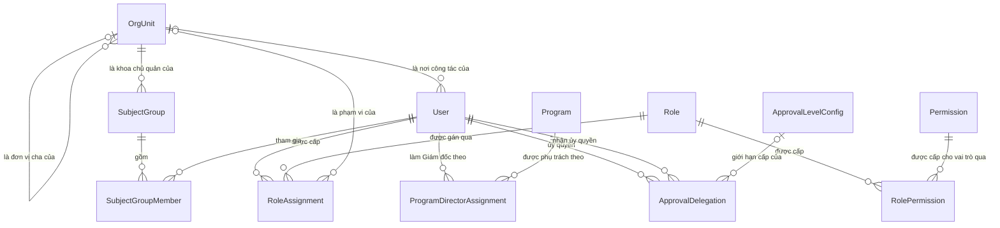
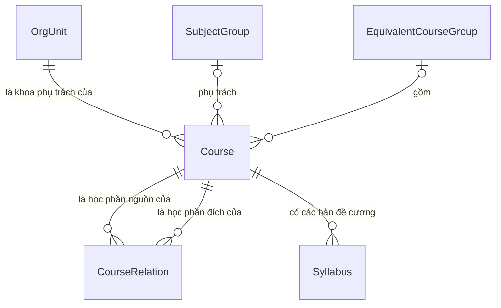
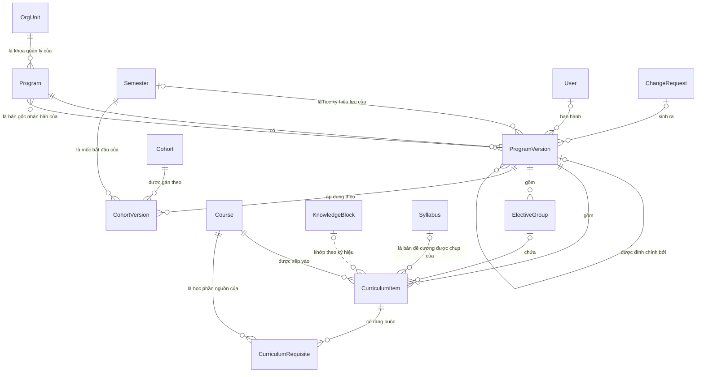
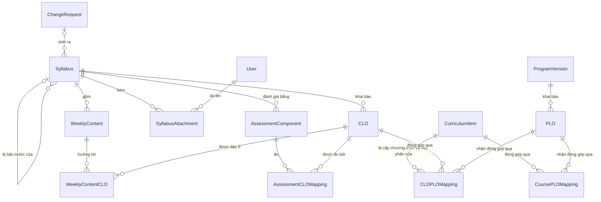
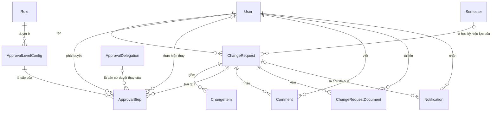
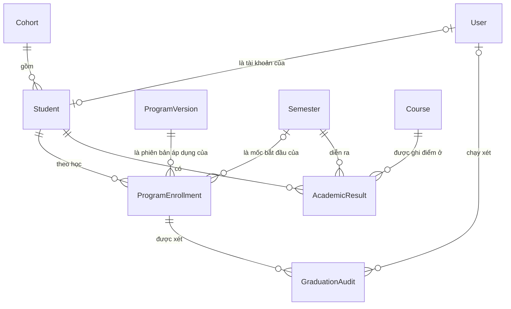
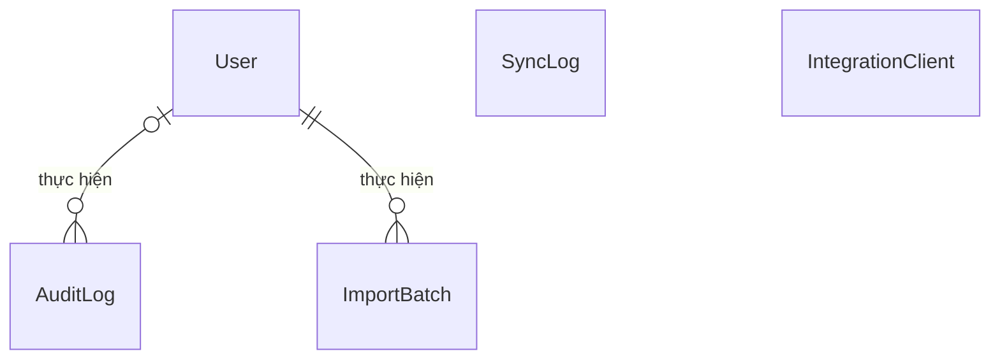

# SƠ ĐỒ THỰC THỂ – QUAN HỆ (ERD) v0.1

**Hệ thống Quản lý Chương trình đào tạo — PBL6**

| | |
|---|---|
| Ngày lập | 2026-10-11 |
| Mức mô hình | **Logic** — thực thể, quan hệ, bản số. Chưa có kiểu dữ liệu vật lý, chưa có chỉ mục. Hệ quản trị cơ sở dữ liệu đã chọn là PostgreSQL (`docs/design/tech-stack.md`) |
| Nguồn | `docs/requirement/REQUIREMENTS.md` mục 4.2 (37 thực thể), mục 6, 7, 10, 11 |
| Thuộc tính | Xem `docs/design/data-dictionary.md` |
| Tên | Tên lập trình tiếng Anh. Tên SRS tương ứng của từng thực thể và thuộc tính ở từ điển dữ liệu (Quy ước, mục 10); bảng tra gộp ở `docs/design/naming-map.md` |
| Trạng thái | v0.1 — dựng trên các quyết định tạm của SRS (Q-03..Q-28 chưa trả lời). Các điểm mô hình phải tự quyết được ghi ở mục 3; các điểm còn hở ở mục 5 |

Sơ đồ viết bằng Mermaid, tách theo nhóm để đọc được. Một thực thể có thể xuất hiện ở nhiều sơ đồ; nó được định nghĩa ở nhóm ghi trong mục 1.

---

## 1. Danh sách thực thể

47 thực thể: 37 lấy từ SRS mục 4.2, 10 bổ sung (đánh dấu **mới**, lý do ở mục 4).

| Nhóm | Thực thể |
|---|---|
| Tổ chức và người dùng | `OrgUnit` · `SubjectGroup` · `User` · `Role` · `Permission` **mới** · `RolePermission` **mới** · `RoleAssignment` · `SubjectGroupMember` · `ProgramDirectorAssignment` · `ApprovalDelegation` |
| Học phần | `Course` · `CourseRelation` · `EquivalentCourseGroup` |
| Chương trình đào tạo | `Program` · `ProgramVersion` · `CurriculumItem` · `ElectiveGroup` · `KnowledgeBlock` · `CurriculumRequisite` **mới** · `Cohort` **mới** · `Semester` **mới** · `CohortVersion` **mới** |
| Chuẩn đầu ra | `PLO` · `CLO` · `CLOPLOMapping` · `CoursePLOMapping` |
| Đề cương chi tiết | `Syllabus` · `WeeklyContent` · `WeeklyContentCLO` **mới** · `AssessmentComponent` · `AssessmentCLOMapping` · `SyllabusAttachment` |
| Quy trình phê duyệt | `ChangeRequest` · `ChangeItem` · `ApprovalStep` · `ApprovalLevelConfig` **mới** · `Comment` · `Notification` · `ChangeRequestDocument` |
| Sinh viên và kết quả học tập | `Student` · `ProgramEnrollment` **mới** · `AcademicResult` · `GraduationAudit` |
| Hệ thống | `AuditLog` · `ImportBatch` · `SyncLog` · `IntegrationClient` **mới** |

---

## 2. Sơ đồ theo nhóm

Ký hiệu bản số: `||` đúng một · `|o` không hoặc một · `o{` không hoặc nhiều.

### 2.1. Tổ chức và người dùng

### 2.2. Học phần

### 2.3. Chương trình đào tạo, khung và phiên bản

Đường nét đứt giữa `KnowledgeBlock` và `CurriculumItem` không phải tham chiếu: dòng khung giữ ký hiệu khối dưới dạng chuỗi (`blockSymbol`), khớp với `blockCode` khi có và không bị ép phải khớp (E-2).

### 2.4. Đề cương chi tiết và chuẩn đầu ra

### 2.5. Đề xuất thay đổi và phê duyệt

### 2.6. Sinh viên và kết quả học tập

### 2.7. Hệ thống

`AuditLog` trỏ tới đối tượng bị tác động bằng cặp (loại thực thể, mã bản ghi), không bằng quan hệ cứng, nên không có đường nối tới các thực thể nghiệp vụ.

---

## 3. Quyết định mô hình

SRS mục 4.2 liệt kê thực thể và thuộc tính nhưng không nói ảnh chụp phiên bản được lưu thế nào. Các quyết định dưới đây lấp chỗ đó. Mỗi quyết định ghi phương án đã bỏ để có thể đảo lại.

### M-1 — Ảnh chụp: dòng gắn phiên bản, đề cương được ghim bằng tham chiếu

| | |
|---|---|
| **Chọn** | `CurriculumItem`, `ElectiveGroup`, `PLO`, `CurriculumRequisite`, `CLOPLOMapping`, `CoursePLOMapping` thuộc về một `ProgramVersion` và được sao chép sang phiên bản mới. Đề cương **không** sao chép theo chương trình: mỗi bản đề cương là một dòng `Syllabus` bất biến sau khi ban hành, và mỗi dòng khung ghim đúng bản đề cương của học phần đó (`CurriculumItem.syllabus`) |
| **Bỏ** | Sao chép vật lý toàn bộ đề cương vào từng phiên bản của từng chương trình (cách hiểu sát chữ nhất của DEC-01 "sao chép toàn bộ dữ liệu") |
| **Vì sao** | DEC-02 yêu cầu một đề cương dùng chung cho mọi chương trình. Sao chép theo chương trình tạo ra N bản của cùng một đề cương, đúng thứ DEC-02 muốn tránh. Ghim bằng tham chiếu vẫn cho đúng kết quả của DEC-01: mở một phiên bản cũ luôn thấy đúng bản đề cương tại thời điểm ban hành, vì bản đó không sửa được |
| **Hệ quả** | Sửa một đề cương → một dòng `Syllabus` mới → mỗi chương trình có học phần đó sinh một `ProgramVersion` mới, dòng khung trỏ sang bản đề cương mới (EC-38). `CLO` được sao chép theo bản đề cương, nên `cloCode` phải ổn định qua các bản để ghép lại ma trận và để so sánh phiên bản |

### M-2 — Dữ liệu chưa ban hành là một phiên bản ở trạng thái NHÁP

| | |
|---|---|
| **Chọn** | `ProgramVersion.status` có bốn giá trị: Nháp · Chờ hiệu lực · Đang hiệu lực · Lịch sử. `Syllabus.status`: Nháp · Đã ban hành · Lịch sử. Dữ liệu nhập từ Excel đi vào một phiên bản Nháp; chỉ bản Nháp sửa trực tiếp được |
| **Bỏ** | Một bộ bảng "bản làm việc" riêng, tách khỏi bảng phiên bản |
| **Vì sao** | Một bộ bảng thay cho hai; "ban hành phiên bản khởi tạo" (điểm hở H-1 trong `docs/planning/epics.md`) trở thành một lần đổi trạng thái Nháp → Đang hiệu lực kèm số quyết định. Trạng thái "Chờ hiệu lực" là chỗ đứng của phiên bản đã duyệt nhưng chưa tới học kỳ hiệu lực (DEC-07) |
| **Hệ quả** | Sau khi một chương trình có phiên bản đầu tiên, thay đổi không tạo bản Nháp mới để sửa trực tiếp: thay đổi nằm trong `ChangeItem` của đề xuất, và phiên bản mới chỉ được sinh ra khi đề xuất được duyệt |

### M-3 — `Program` giữ danh tính, `ProgramVersion` giữ mô tả

| | |
|---|---|
| **Chọn** | `Program` chỉ có mã chương trình, khoa, trình độ, trạng thái. Tên chương trình, mã ngành, tên ngành, số học kỳ và ba số tín chỉ nằm ở `ProgramVersion` |
| **Bỏ** | Để toàn bộ thuộc tính mô tả ở `Program` như SRS mục 4.2.3 và bảng ánh xạ Excel mục 4.3 |
| **Vì sao** | "Sửa thông tin chương trình" là một loại đề xuất (FR-56) và ảnh chụp phải chứa "toàn bộ trường dữ liệu mô tả tại thời điểm ban hành" (mục 6.2.2). Thuộc tính sửa được qua đề xuất thì phải nằm trong phiên bản, nếu không phiên bản cũ sẽ hiển thị giá trị mới |
| **Hệ quả** | Bảng ánh xạ Excel ở SRS mục 4.3 đặt sáu trường ChuongTrinhDaoTao.tenChuongTrinh, .soHocKy, .tongTinChi, .tinChiBatBuoc, .tinChiTuChon, .maNganh (tên SRS) ở chương trình; ở mô hình này chúng là `programName`, `semesterCount`, `totalCredits`, `compulsoryCredits`, `electiveCredits`, `majorCode` của `ProgramVersion`. Chỉ `programCode` còn ở `Program` |

### M-4 — Tương đương là nhóm, không phải dòng quan hệ

| | |
|---|---|
| **Chọn** | Học phần trỏ tới nhiều nhất một `EquivalentCourseGroup`. `CourseRelation` chỉ chứa QH1 (học trước), QH2 (tiên quyết), QH3 (song hành), QH5 (thay thế) |
| **Bỏ** | Dòng `CourseRelation` loại QH4 cho từng cặp |
| **Vì sao** | DEC-06 và BR-09: tương đương là hai chiều và bắc cầu, tức là các nhóm rời nhau. Một học phần thuộc đúng một nhóm thì chỉ cần một tham chiếu, không cần bảng thành viên |
| **Hệ quả** | Người dùng vẫn khai báo đủ "05 loại quan hệ" (FR-18); loại thứ tư được lưu bằng việc đưa học phần vào nhóm. Nhóm tương đương không nằm trong ảnh chụp và áp dụng cho mọi phiên bản (EC-16) |

### M-5 — Khung chụp cả ràng buộc và thông tin học phần

| | |
|---|---|
| **Chọn** | Khi ban hành, quan hệ QH1–QH3 của các học phần trong khung được chép sang `CurriculumRequisite`; tên và số tín chỉ của học phần được chép vào dòng khung (`courseNameSnapshot`, `creditsSnapshot`) |
| **Bỏ** | Phiên bản cũ đọc quan hệ và số tín chỉ hiện tại từ danh mục học phần |
| **Vì sao** | Mục 6.2.2 ghi ảnh chụp khung "kèm ràng buộc học trước/tiên quyết/song hành"; FR-71 cấm phiên bản đã ban hành thay đổi dưới bất kỳ hình thức nào. Nếu đọc từ danh mục, đổi số tín chỉ hay sửa một quan hệ sẽ làm đổi nội dung mọi phiên bản cũ |
| **Hệ quả** | Điều kiện đăng ký và xét tốt nghiệp của một sinh viên được tính trên `CurriculumRequisite` và số tín chỉ chụp của phiên bản áp dụng cho sinh viên đó, không trên danh mục hiện tại |

### M-6 — Ma trận CLO–PLO bám vào dòng khung

| | |
|---|---|
| **Chọn** | `CLOPLOMapping` trỏ tới `CurriculumItem`, `CLO`, `PLO`. Dòng khung chính là cặp (phiên bản chương trình, học phần) mà BR-19 nói tới |
| **Bỏ** | Bốn cột rời (chương trình, học phần, CLO, PLO) như liệt kê ở SRS mục 4.2.4 |
| **Vì sao** | Ràng buộc bổ sung của DEC-03: khi học phần bị gỡ khỏi khung, các dòng ma trận của cặp đó không được sang phiên bản mới. Bám vào dòng khung thì điều này tự xảy ra — không còn dòng khung thì không còn chỗ để ma trận bám |
| **Hệ quả** | Hai ràng buộc phải kiểm: CLO của một dòng ma trận phải thuộc bản đề cương mà dòng khung đang ghim; PLO phải thuộc cùng phiên bản với dòng khung |

### M-7 — Phạm vi quyền không lưu hai nơi

| | |
|---|---|
| **Chọn** | `RoleAssignment` cấp vai trò. Phạm vi của Giám đốc CTĐT đọc từ `ProgramDirectorAssignment`; phạm vi của Điều phối nhóm chuyên môn và Giảng viên đọc từ `SubjectGroupMember`. Người điều phối của một nhóm là thành viên có vai trò "Điều phối" đang trong thời gian hiệu lực; `SubjectGroup` không có cột người điều phối |
| **Bỏ** | Cột "người điều phối" trên `SubjectGroup` (SRS mục 4.2.1) và phạm vi chép lại vào `RoleAssignment` |
| **Vì sao** | FR-04 đòi ghi thời gian hiệu lực của việc chỉ định, tức là cần lịch sử — một cột đơn không giữ được. Cùng một sự thật lưu hai nơi thì sớm muộn lệch nhau |
| **Hệ quả** | Cột phạm vi của `RoleAssignment` chỉ dùng cho vai trò có phạm vi là đơn vị: Phòng Đào tạo (toàn hệ thống), Ban lãnh đạo khoa (khoa). R3..R6 là vai trò suy ra: `Role.scopeSource` chỉ bảng nguồn, người dùng giữ vai trò đúng khi bảng đó có dòng còn hiệu lực, và `RoleAssignment` không có dòng cho chúng (F-02 D3) |

### M-8 — Sinh viên gắn với chương trình qua `ProgramEnrollment`

| | |
|---|---|
| **Chọn** | `ProgramEnrollment` nối sinh viên với phiên bản áp dụng; một sinh viên có thể có nhiều dòng. `CohortVersion` ghi quy tắc ở cấp khóa (FR-74), có mốc học kỳ để giữ lịch sử |
| **Bỏ** | Hai cột "Chương trình đào tạo" và "phiên bản CTĐT áp dụng" trên `Student` (SRS mục 4.2.7) |
| **Vì sao** | EC-34: sinh viên song ngành gắn với hai chương trình và được xét tốt nghiệp độc lập theo từng chương trình. EC-33, EC-35, EC-37: chuyển ngành, chuyển trình độ, bảo lưu đều là ngoại lệ so với quy tắc của khóa |
| **Hệ quả** | `GraduationAudit` trỏ tới một dòng ghi danh, không trỏ thẳng tới sinh viên. Ban hành một phiên bản mới không tự đổi phiên bản của sinh viên nào. Chỉ khi Phòng Đào tạo gán phiên bản đó cho một khóa (thêm dòng `CohortVersion` — "quyết định chuyển đổi" của BR-26) thì các dòng ghi danh không phải ngoại lệ của khóa đó mới chuyển theo |

### M-9 — Những thứ không lưu

Các giá trị sau được tính khi cần, không có thực thể: cột "Đăng ký được?" (SRS mục 4.3), tổng tín chỉ theo học kỳ / khối / toàn chương trình (FR-77), tiến độ học tập (FR-90), các cảnh báo nhất quán và bảng sức khỏe (FR-78..82; riêng việc chấp nhận chênh lệch tín chỉ được lưu thành các cột `creditMismatch*` trên `ProgramVersion`), danh sách chương trình bị ảnh hưởng (FR-17). `GraduationAudit` là ngoại lệ: SRS liệt kê nó là thực thể, và EC-43 đòi tính lại rồi thông báo khi điểm bị sửa hồi tố, nên cần kết quả cũ để so.

### M-10 — Quyền theo chức năng là dữ liệu, không viết trong mã

| | |
|---|---|
| **Chọn** | `Permission` là danh mục chức năng, mỗi chức năng một dòng, mã dạng đối tượng.hành động (ví dụ syllabus.edit, version.publish). `RolePermission` ghi vai trò nào có quyền nào, kèm hai thuộc tính độc lập: `mode` (`DIRECT` Trực tiếp · `VIA_REQUEST` Qua đề xuất) và `scope` (`ALL` Toàn bộ · `SCOPED` Theo phạm vi). Không có dòng nghĩa là không có quyền. Máy chủ kiểm mỗi thao tác bằng mã quyền của thao tác đó, không bằng tên vai trò. Ma trận ban đầu ở mục 9 của từ điển dữ liệu, chép từ SRS mục 3.4 và các quyết định tạm đã có. Phòng Đào tạo sửa ô của sáu vai trò có sẵn trên MH-15 bằng quyền permission.manage (F02-02); hai ô của chính R1 (permission.manage, user.manage) bị khóa |
| **Bỏ** | (a) Viết cứng ma trận 3.4 trong mã kiểm quyền. (b) Một cột ký hiệu duy nhất X · Đ · P · Đ(P) như SRS. (c) Cho Phòng Đào tạo sửa ma trận hoặc tự tạo vai trò ngay từ đầu |
| **Vì sao** | (a) Mỗi lần đổi ai được làm gì sẽ phải sửa mã ở nhiều chỗ, và bảng kiểm NFR-09 không có nguồn để sinh ra. (b) Bốn ký hiệu là tích của hai câu hỏi độc lập: ghi thẳng hay phải qua duyệt, mọi đối tượng hay chỉ trong phạm vi; tách ra thì một tổ hợp mới không đòi đổi danh sách giá trị. (c) Khi viết M-10 chưa có yêu cầu; F02-02 sau đó chọn cho R1 sửa ô, kèm khóa hai ô, hộp xác nhận và nhật ký trước/sau vì đây là đường leo thang đặc quyền |
| **Hệ quả** | Ba dòng "Duyệt cấp 1/2/3" của SRS không thành dòng `Permission`: ai duyệt cấp nào đọc từ `ApprovalLevelConfig` và `ApprovalDelegation`, cùng lý do với M-7. Ô X của Phòng Đào tạo ở cấp 1 và 2 là duyệt thay (BR-31), ghi thành quyền changeRequest.override. `scope` = `SCOPED` đọc phạm vi của vai trò ở chỗ M-7 chỉ ra; với Sinh viên là các dòng `ProgramEnrollment` của chính mình. `mode` không vượt FR-55: dữ liệu đã ban hành chỉ đổi qua đề xuất với mọi vai trò, kể cả Phòng Đào tạo (US-053), còn bản Nháp thì người có dòng sửa trực tiếp trong phạm vi (H-4); `mode` giữ ký hiệu của SRS để đổi được khi Khoa quyết khác. Người giữ nhiều vai trò có hợp các quyền của những vai trò còn hiệu lực; trên cùng một đối tượng, Trực tiếp thắng Qua đề xuất |
| **Mở rộng sau này** | Ba hướng dưới đây đều không đòi đổi cấu trúc bảng. Tách quyền theo hành động (sửa được mà không ban hành được, chỉ xem): thêm dòng `Permission` và dòng `RolePermission`. Cho Phòng Đào tạo sửa ma trận: thêm một quyền cho thao tác đó và một màn hình; mọi thay đổi ghi `AuditLog` như thay đổi phân quyền (FR-10). Vai trò tự định nghĩa: thêm dòng `Role` có `isSystemRole` = Không (phạm vi của vai trò loại này: E-13) |

---

## 4. Khác biệt so với SRS mục 4.2

### 4.1. Thực thể bổ sung

| Thực thể | Vì sao cần | Căn cứ |
|---|---|---|
| `CurriculumRequisite` | Giữ ràng buộc học trước/tiên quyết/song hành trong ảnh chụp | Mục 6.2.2, FR-71 (M-5) |
| `Cohort` | "Khóa" là một bên của ánh xạ Khóa → Phiên bản; cần là đối tượng chứ không phải chuỗi tự do | FR-74 |
| `Semester` | Hiệu lực tính theo học kỳ; hệ thống phải biết ngày bắt đầu học kỳ để chuyển Chờ hiệu lực → Đang hiệu lực | BR-25, DEC-07 |
| `CohortVersion` | Một phiên bản áp dụng cho nhiều khóa (ví dụ mục 6.2.3: phiên bản 1.1 cho K2023 và K2024) | FR-74 |
| `WeeklyContentCLO` | "CLO liên quan" của một tuần là danh sách | Mục 4.2.5 |
| `ApprovalLevelConfig` | Số cấp và vai trò duyệt từng cấp "khai báo trong bảng cấu hình" | DEC-04, NFR-24 |
| `ProgramEnrollment` | Sinh viên song ngành, chuyển ngành, ngoại lệ so với khóa | EC-33, EC-34, EC-35 (M-8) |
| `IntegrationClient` | "Mỗi bên tích hợp có khóa riêng", có giới hạn tần suất | API-03, API-04 |
| `Permission` | Danh mục chức năng để ma trận quyền là dữ liệu chứ không nằm trong mã | SRS mục 3.4, NFR-09 (M-10) |
| `RolePermission` | Vai trò nào có quyền nào, ghi thẳng hay qua đề xuất, toàn bộ hay trong phạm vi | SRS mục 3.4, FR-07 (M-10) |

### 4.2. Thuộc tính chuyển chỗ hoặc bỏ

| Trong SRS | Ở mô hình này | Quyết định |
|---|---|---|
| `SubjectGroup` — người điều phối | Suy ra từ `SubjectGroupMember` | M-7 |
| `EquivalentCourseGroup` — danh sách học phần thành viên | `Course.equivalenceGroup` | M-4 |
| `Program` — tên, mã ngành, tên ngành, số học kỳ, ba số tín chỉ | `ProgramVersion` | M-3 |
| `Program`, `ProgramVersion` — khóa áp dụng | `CohortVersion` | M-8 |
| `PLO` — thuộc Chương trình đào tạo | Thuộc `ProgramVersion`; BR-17 vẫn đúng vì mỗi phiên bản thuộc đúng một chương trình | M-1 |
| `CLOPLOMapping`, `CoursePLOMapping` — Chương trình đào tạo, học phần | `curriculumItem` | M-6 |
| `WeeklyContent` — CLO liên quan | `WeeklyContentCLO` | — |
| `Student` — Chương trình đào tạo, phiên bản CTĐT áp dụng | `ProgramEnrollment` | M-8 |
| `GraduationAudit` — sinh viên | `enrollment` | M-8 |
| `CourseRelation` — loại quan hệ QH4 | Không dùng; thay bằng nhóm tương đương | M-4 |

---

## 5. Điểm còn hở của mô hình

Mô hình v0.1 chạy được với phương án tạm ở cột cuối. Đổi phương án thì đổi phần mô hình ghi ở cột "Ảnh hưởng".

Nơi định nghĩa các mã ở cột "Liên quan": `Q-xx` — SRS mục 13; `C01`..`C12` — phần "Thẩm định SRS và giả định cần xác nhận" của `docs/Bo_so_do_Use_Case_CTDT/Thuyet_minh_Use_Case.md`; `H-x` — mục 6 của `docs/planning/epics.md`; `U-x` — `docs/planning/user-stories.md`; `S-x` — `docs/design/state-diagrams.md`; `L-x` — `docs/design/sequence-diagrams.md`; `G-x` — `docs/design/screen-inventory.md`.

| Mã | Điểm hở | Liên quan | Ảnh hưởng | Tạm chọn |
|---|---|---|---|---|
| E-1 | **Hai chỗ lưu ngưỡng điểm tiên quyết.** FR-19 đặt ngưỡng trên quan hệ; BR-07 và mục 7.3 dùng "Điểm học" của dòng khung (`CurriculumItem.minStudiedScore`) | Q-03, Q-04 | `CourseRelation.minScore`, `CurriculumRequisite.minScore`, `CurriculumItem.minStudiedScore` | Dùng ngưỡng trên ràng buộc nếu có; nếu trống, dùng `minStudiedScore` của dòng khung chứa học phần nguồn |
| E-2 | **Khối kiến thức.** `KnowledgeBlock.requiredCredits` trong SRS không gắn với chương trình nào, trong khi yêu cầu tín chỉ theo khối là của từng chương trình. Cột Ký hiệu đang lưu tự do | Q-08 | `KnowledgeBlock`, `CurriculumItem.blockSymbol` | Giữ `KnowledgeBlock` là danh mục chung; `blockSymbol` là chuỗi, khớp với `blockCode` nếu có, không ép buộc |
| E-3 | **Nhiều đề xuất cùng học kỳ hiệu lực.** Hai đề xuất đã duyệt trên cùng một chương trình, cùng học kỳ: sinh hai phiên bản hay gộp một? Ảnh chụp tạo lúc duyệt (FR-69) hay lúc tới học kỳ (mục 6.1.4)? | C01 | `ProgramVersion.sourceRequest` (hiện là một tham chiếu) | Mỗi đề xuất sinh một phiên bản, tạo ngay khi duyệt ở trạng thái Chờ hiệu lực. Nếu phải gộp, đổi thành quan hệ nhiều–nhiều |
| E-4 | **Đối tượng của đề xuất là tham chiếu đa hình.** `ChangeRequest` và `ChangeItem` trỏ tới đối tượng bằng (loại, mã), không có ràng buộc toàn vẹn. FR-56 liệt kê sáu loại đề xuất, trong khi ma trận 3.4 và UC-09 có thêm đề xuất thay đổi tổ chức / phân công | C04, UC-09 | `ChangeRequest.requestType`, `.targetType`, `ChangeItem.entityType` | Bảy loại: sáu loại của FR-56 và loại "Thay đổi tổ chức / phân công". Tuyến duyệt của loại thứ bảy (C04 tạm chọn: chuyển thẳng Phòng Đào tạo) không nằm trong mô hình dữ liệu |
| E-5 | **Ma trận Học phần–PLO** suy diễn hay nhập trực tiếp | Q-26 | `CoursePLOMapping` | **Đã chốt 2026-10-18 (F11-02):** nhập trực tiếp kèm `weight`; `CLOPLOMapping` chỉ nhận PLO mà dòng khung đã có ở `CoursePLOMapping`, không mang mức (F11-03) |
| E-6 | **Người soạn đề cương** không có trong mô hình | Q-27 | `Syllabus` | Phạm vi của giảng viên theo nhóm chuyên môn (SRS mục 3.3); không thêm cột người soạn |
| E-7 | **Tham số nghiệp vụ và cấu hình đồng bộ** (ngưỡng, số ngày nhắc hạn, lịch đồng bộ, quy tắc ưu tiên nguồn) lưu ở bảng hay ở tệp cấu hình | Q-16, NFR-24 | Có thể thêm thực thể cấu hình | Không mô hình hóa; quyết ở bước kiến trúc. Riêng cấp duyệt có `ApprovalLevelConfig` vì DEC-04 ghi rõ là bảng |
| E-8 | **Tài khoản của sinh viên** sinh ra thế nào (H-2 trong `docs/planning/epics.md`) | Q-13 | `Student.user` | Tham chiếu không bắt buộc; sinh viên chưa có tài khoản vẫn có dữ liệu và vẫn xét tốt nghiệp được |
| E-9 | **Khóa cũ có nhận phiên bản mới không.** BR-26 nói sinh viên giữ nguyên phiên bản lúc nhập học; ví dụ mục 6.2.3 lại chuyển K2023 từ 1.0 sang 1.1 | C07 | `CohortVersion.fromSemester`, `ProgramEnrollment.isException` | Mô hình cho phép cả hai; Phòng Đào tạo chọn khóa áp dụng khi ban hành |
| E-10 | **Danh mục trạng thái của sinh viên** không có trong SRS | — | `Student.status` | Đang học · Bảo lưu · Thôi học · Đã tốt nghiệp |
| E-11 | **Nhóm tương đương nằm ngoài ảnh chụp.** Sửa một nhóm tương đương làm đổi kết quả khi xét lại theo phiên bản cũ; chưa chốt xét lại dùng nhóm hiện tại hay nhóm tại thời điểm ban hành | C11, EC-16 | `Course.equivalenceGroup`, `GraduationAudit` | Theo EC-16: dùng nhóm hiện tại. Mỗi lần xét lưu một dòng `GraduationAudit` riêng nên kết quả đã xét không bị ghi đè. Nếu phải dùng nhóm tại thời điểm ban hành, thêm bảng chụp thành viên nhóm theo phiên bản |
| E-12 | **Ma trận ban đầu có những ô SRS không ghi.** 12 quyền không có dòng trong SRS mục 3.4 (từ điển dữ liệu mục 9, cột Nguồn không ghi "3.4") lấy vai trò theo story và các quyết định tạm đã có. Ngoài ra ô `Đ` của Điều phối và Giảng viên ở học phần, quan hệ, CLO, đề cương, công thức điểm được ghi thành Đ(P) theo mục 3.3; ô X của Sinh viên ở xem PLO/CLO và ba mục tra cứu được ghi thành P (chỉ của mình); Phòng Đào tạo và Giám đốc CTĐT được thêm quyền tra cứu sinh viên theo L-10 | U-1, S-1, G-2, G-3, G-8, L-10 | `RolePermission` (chỉ dữ liệu) | Như mục 9 của từ điển dữ liệu. Đổi ô nào thì chỉ đổi dữ liệu khởi tạo và bảng kiểm NFR-09 |
| E-13 | **Phạm vi của vai trò tự định nghĩa.** Phạm vi của R3, R4, R5, R6 đọc từ bảng phân công riêng (M-7); một vai trò mới không có bảng phân công nào | — | `RoleAssignment.scopeType`, `RolePermission.scope` | Chưa làm vai trò tự định nghĩa. Khi làm: vai trò mới chỉ được phạm vi Toàn hệ thống hoặc Đơn vị qua `RoleAssignment`; muốn phạm vi theo chương trình hay theo nhóm thì phải thêm bảng phân công |
