# SƠ ĐỒ TUẦN TỰ v0.1

**Hệ thống Quản lý Chương trình đào tạo — PBL6**

| | |
|---|---|
| Ngày lập | 2026-10-12 |
| Đi kèm | `docs/design/state-diagrams.md` (mã chuyển trạng thái DX, BD, PB, DC, NL, DB, GD; điểm hở S-1..S-14), `docs/design/data-dictionary.md` |
| Nguồn | `docs/requirement/REQUIREMENTS.md` mục 6, 7.3, 7.4, 8; `docs/Bo_so_do_Use_Case_CTDT/Thuyet_minh_Use_Case.md`; `docs/planning/epics.md` |
| Mức | Logic. Mỗi sơ đồ chỉ có các vai trò, "Hệ thống" như một khối, và các hệ thống ngoài. Không có lớp, không có thành phần kỹ thuật, không có đường dẫn API nào ngoài sáu đường dẫn của SRS mục 8.4 |
| Hiển thị | Sơ đồ viết bằng Mermaid `sequenceDiagram`, **chưa kiểm tra hiển thị** |
| Điểm còn hở của tài liệu này | L-1..L-10, mục 18 |

---

## 1. Quy ước

| Ký hiệu | Nghĩa |
|---|---|
| R1 | Phòng Đào tạo — duyệt cấp 3, ban hành |
| R2 | Ban lãnh đạo khoa — xem và bình luận, không duyệt |
| R3 | Giám đốc CTĐT — duyệt cấp 2 |
| R4 | Điều phối nhóm chuyên môn — duyệt cấp 1 |
| R5 | Giảng viên — người đề xuất |
| R6 | Sinh viên — chỉ xem |
| HT | Hệ thống Quản lý Chương trình đào tạo, xét như một khối |
| E1 | Cơ sở dữ liệu có sẵn của Trường — nguồn chỉ đọc |
| E2 | Dịch vụ email |
| E3 | Ứng dụng dDUT |

- Mũi tên từ HT về chính nó là một bước xử lý bên trong, viết bằng lời nghiệp vụ.
- Mã trong ngoặc ở phần giải thích (ví dụ DX-04, PB-05) là mã chuyển trạng thái trong `state-diagrams.md`.
- Mọi thao tác ghi dữ liệu đều kèm một dòng `AuditLog` (FR-105). Sơ đồ chỉ vẽ bước ghi nhật ký khi nhật ký là một phần của quy tắc (bỏ qua cấp, can thiệp, đồng bộ).
- Mọi yêu cầu từ người dùng đều được HT kiểm tra quyền và phạm vi ở phía máy chủ trước khi xử lý (NFR-09). Sơ đồ chỉ vẽ bước này ở những luồng mà việc từ chối là một nhánh đáng nêu.

### Danh sách sơ đồ

| Mục | Luồng | Use case | Yêu cầu chức năng | Bậc |
|---|---|---|---|---|
| 2 | Đăng nhập và kết thúc phiên | UC-01 | — (Q-13, NFR-06, NFR-08) | B1 |
| 3 | Nhập Excel: chạy thử rồi ghi | UC-71, UC-72, UC-73, UC-74, UC-75 | FR-33, FR-34, FR-35, FR-96, FR-97, FR-101 | B2, B5 |
| 4 | Ban hành phiên bản khởi tạo | — (H-1) | FR-70, FR-71 | B4 |
| 5 | Tạo và gửi đề xuất thay đổi | UC-37, UC-38, UC-16, UC-57 | FR-55, FR-56, FR-68, FR-108, FR-109, FR-17 | B4 |
| 6 | Phê duyệt ba cấp — luồng đồng ý | UC-42, UC-43, UC-44, UC-46, UC-47, UC-40, UC-41 | FR-57, FR-58, FR-59, FR-62, FR-63, FR-65, FR-67 | B4 |
| 7 | Tự động bỏ qua cấp | UC-38 | FR-61 | B4 |
| 8 | Trả lại, từ chối, thu hồi | UC-39, UC-43, UC-44, UC-45 | FR-59, FR-60 | B4 |
| 9 | Ủy quyền và Phòng Đào tạo can thiệp | UC-08, UC-43, UC-44, UC-48 | FR-09, FR-64, FR-66 | B4, B6 |
| 10 | Ban hành, ảnh chụp và kích hoạt đầu học kỳ | UC-46, UC-49, UC-53 | FR-69, FR-70, FR-71, FR-75 | B4 |
| 11 | Sửa đề cương dùng chung lan ra mọi chương trình | UC-16, UC-33, UC-38, UC-49 | FR-17, FR-44, FR-69 | B4 |
| 12 | Gán phiên bản cho khóa sinh viên | UC-52, UC-65 | FR-74 | B4, B5 |
| 13 | Kiểm tra điều kiện đăng ký học phần | UC-60, UC-63 | FR-31, FR-83, FR-91, FR-92 | B5 |
| 14 | Xét tốt nghiệp: một sinh viên và theo lô | UC-61, UC-62, UC-64 | FR-84, FR-85, FR-86, FR-87 | B5 |
| 15 | Sinh viên xem cổng thông tin | UC-84, UC-59, UC-32, UC-65 | FR-88, FR-89, FR-90, FR-93, FR-95 | B5 |
| 16 | Ứng dụng dDUT gọi API | UC-66, UC-67, UC-68, UC-69, UC-70 | FR-94 | B5 |
| 17 | Đồng bộ theo lịch với cơ sở dữ liệu có sẵn | UC-76, UC-77, UC-78 | FR-98, FR-99, FR-100 | B6 |

---

## 2. Đăng nhập và kết thúc phiên

Phục vụ UC-01. Tài khoản nội bộ, không đăng nhập một lần, không có chức năng quên mật khẩu (Q-13).

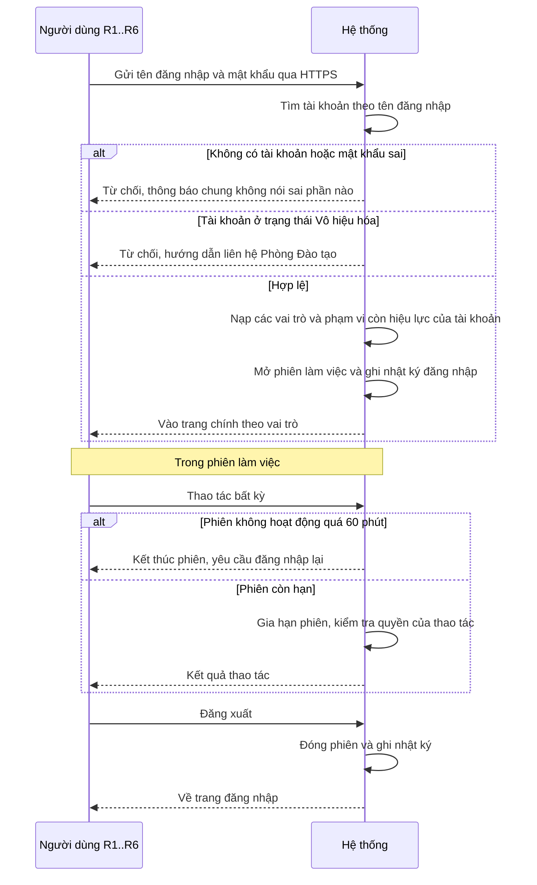

| Điểm | Quy tắc | Nguồn |
|---|---|---|
| Mật khẩu | So với `User.passwordHash`; không lưu, không ghi nhật ký mật khẩu dạng rõ | NFR-06 |
| Kênh truyền | Mọi trao đổi qua HTTPS | NFR-07 |
| Hết phiên | 60 phút không hoạt động; giá trị nằm trong cấu hình | NFR-08, NFR-24 |
| Vai trò và phạm vi | Đọc từ `RoleAssignment`, `ProgramDirectorAssignment`, `SubjectGroupMember` tại lúc đăng nhập; dòng hết hạn không được nạp | FR-07, M-7 |
| Sai nhiều lần | SRS không nêu khóa tài khoản — xem L-1 | L-1 |

---

## 3. Nhập Excel: chạy thử rồi ghi

Phục vụ UC-71..UC-75; FR-33, FR-34, FR-35, FR-96, FR-97, FR-101; SRS mục 6.3. Dùng chung cho bốn loại dữ liệu của `ImportBatch.importType`. R3 chỉ nhập được khung của chương trình mình được phân công.

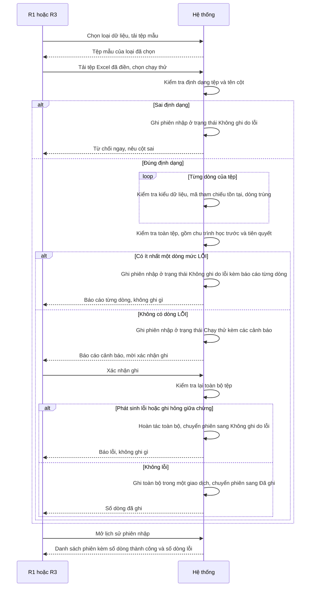

| Điểm | Quy tắc | Nguồn |
|---|---|---|
| Sai định dạng | Từ chối ngay, nêu cột sai | EC-47 |
| Mã học phần không tồn tại | Báo lỗi đúng dòng, ví dụ "Dòng 15: LỖI — Mã HP 9999999 không tồn tại" | EC-45 |
| Dòng trùng | Báo các dòng trùng nhau | EC-46 |
| Cảnh báo | Mức CẢNH BÁO không chặn ghi, ví dụ tín chỉ bằng 0 | SRS mục 6.3, BR-02 |
| Toàn vẹn | Ghi toàn bộ hoặc không ghi gì | FR-35 |
| Kiểm tra lại khi xác nhận | Chuyển trạng thái NL-05 đến NL-07 | S-12 |
| Thời gian | Tệp 1000 dòng xử lý dưới 60 giây | NFR-05 |
| Nhập khung chương trình | Tạo hoặc thay nội dung của phiên bản Nháp; chương trình đã có phiên bản rời Nháp thì không nhập đè được | M-2, FR-55, L-2 |
| Nhập danh sách sinh viên | Tạo `Student`, tài khoản đăng nhập và `ProgramEnrollment` theo khóa (GD-01) | H-2, E-8, mục 12 |

---

## 4. Ban hành phiên bản khởi tạo

Không có use case riêng (H-1 trong `epics.md`). Phục vụ FR-70, FR-71. Là bước chuyển một chương trình từ "sửa trực tiếp" sang "chỉ sửa qua đề xuất".

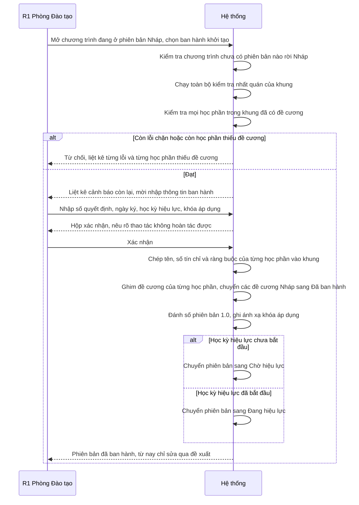

| Điểm | Quy tắc | Nguồn |
|---|---|---|
| Chỉ một lần cho mỗi chương trình | Chuyển trạng thái PB-03, PB-04 | H-1 |
| Lỗi chặn | Học phần bắt buộc trong nhóm tự chọn, học phần trùng, học kỳ vượt số học kỳ khai báo, chu trình tiên quyết | EC-05, EC-06, EC-08, EC-09 |
| Thiếu đề cương | Chặn ban hành | EC-44 |
| Cảnh báo không chặn | Lệch tổng tín chỉ đã có lý do ghi đè, tiên quyết xếp sau, học kỳ trống, PLO chưa có học phần đóng góp | EC-03, EC-10, EC-07, EC-41 |
| Dữ liệu chép vào khung | `courseNameSnapshot`, `creditsSnapshot`, `CurriculumRequisite` | M-5 |
| Đề cương | Chuyển trạng thái DC-03 | M-1 |
| Khóa áp dụng | Ghi vào `CohortVersion` | FR-70, FR-74 |
| Xác nhận | Thao tác không hoàn tác phải có hộp xác nhận | NFR-20 |
| Số phiên bản đầu | Mặc định 1.0; Phòng Đào tạo sửa được khi nạp dữ liệu đã có từ trước — xem L-3 | BR-24, L-3 |

---

## 5. Tạo và gửi đề xuất thay đổi

Phục vụ UC-37, UC-38 (bao gồm UC-57), UC-16; FR-55, FR-56, FR-68, FR-108, FR-109, FR-17. Ví dụ: giảng viên sửa công thức điểm của một học phần thuộc nhóm mình.

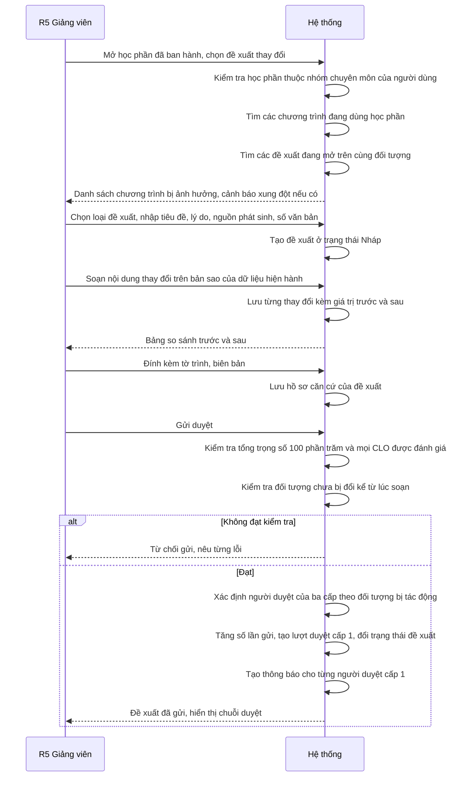

| Điểm | Quy tắc | Nguồn |
|---|---|---|
| Ai tạo được | Theo ma trận SRS mục 3.4, trong phạm vi của mình | SRS mục 3.4, S-1 |
| Chương trình bị ảnh hưởng | Hiển thị trước khi cho soạn | FR-17, EC-38, UC-16 |
| Cảnh báo xung đột | Không chặn; chỉ báo | FR-68, BR-30 |
| Nguồn phát sinh | Trường hoặc Khoa, kèm số văn bản căn cứ | FR-108, Q-19 |
| Hồ sơ | Bản quét tờ trình, biên bản, công văn; xem được ở mọi cấp | FR-109, Q-18 |
| Kiểm tra trước khi gửi | Tổng trọng số, CLO chưa được bao phủ | BR-12, BR-14, EC-39, EC-40 |
| Đối tượng đã đổi | So `ChangeItem.baseVersion`; lệch thì người tạo phải soạn lại trên dữ liệu mới | EC-27 |
| Người duyệt cấp 1 | Điều phối của nhóm phụ trách học phần bị tác động; nhiều nhóm thì cần tất cả | SRS mục 6.1.3, EC-21, EC-22 |
| Chuyển trạng thái | DX-01, DX-02, DX-04 | — |

---

## 6. Phê duyệt ba cấp — luồng đồng ý

Phục vụ UC-42, UC-43, UC-44, UC-46, UC-47, UC-40, UC-41; FR-57, FR-58, FR-59, FR-62, FR-63, FR-65, FR-67. Tiếp nối mục 5. Bước sau khi Phòng Đào tạo đồng ý vẽ chi tiết ở mục 10.

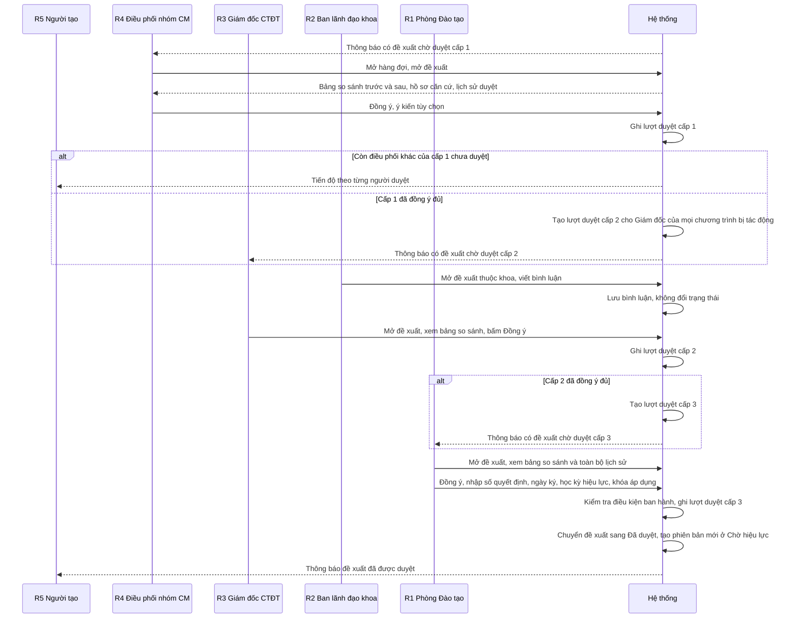

| Điểm | Quy tắc | Nguồn |
|---|---|---|
| Hàng đợi | Mỗi người duyệt thấy các đề xuất đang chờ chính mình | FR-65, UC-42 |
| Bảng so sánh | Hiển thị ở mọi cấp duyệt | FR-58 |
| Ba lựa chọn | Đồng ý · Trả lại · Từ chối; mục này chỉ vẽ Đồng ý | FR-59 |
| Nhiều người một cấp | Cấp chỉ xong khi mọi người đồng ý | EC-22, EC-23 |
| Ban lãnh đạo khoa | Xem và bình luận, không có nút duyệt | FR-62, DEC-04, Q-24 |
| Thông báo | Trong ứng dụng, tới người duyệt kế tiếp mỗi lần chuyển cấp | FR-63, UC-47 |
| Lịch sử | Ai duyệt, lúc nào, ý kiến gì; không sửa được | FR-67 |
| Người duyệt cấp 3 | Bất kỳ tài khoản R1 nào khác người tạo | SRS mục 6.1.3, BR-27, C03 |
| Chuyển trạng thái | DX-07, DX-09, DX-10; BD-01, BD-03 | — |

---

## 7. Tự động bỏ qua cấp

Phục vụ FR-61 (trong UC-38); BR-27, DEC-09, EC-19, EC-20, EC-24. Ví dụ: Giám đốc CTĐT tự tạo đề xuất sửa khung của chương trình mình phụ trách.

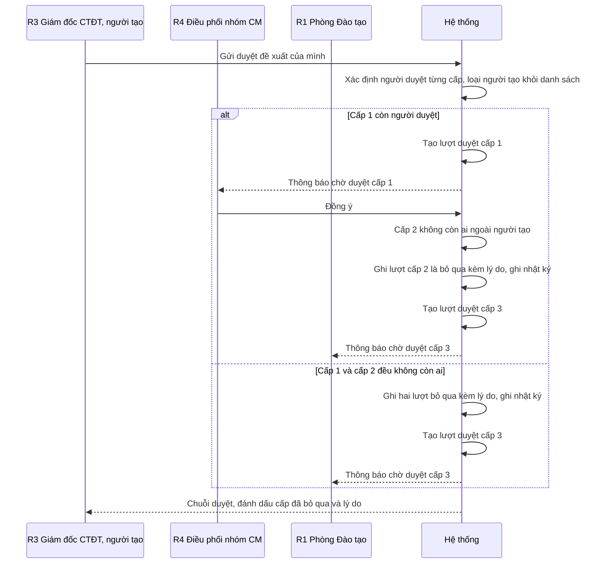

| Trường hợp | Cấp bị bỏ qua | Nguồn |
|---|---|---|
| Người tạo là Giám đốc CTĐT duy nhất của mọi chương trình bị tác động | Cấp 2 | EC-19, DEC-09 |
| Người tạo là điều phối duy nhất của mọi nhóm bị tác động | Cấp 1 | EC-20 |
| Người tạo là một trong nhiều người duyệt của cấp | Không bỏ cấp; chỉ bỏ lượt của người tạo, những người còn lại vẫn duyệt | BR-27, EC-22, EC-23, L-4 |
| Học phần thuộc khoa khác | Cấp 1 và cấp 2 | EC-24, Q-06 |
| Đề xuất không tác động học phần của nhóm nào | Cấp 1 | C04 |
| Đề xuất thay đổi tổ chức / phân công | Cấp 1 và cấp 2 | E-4, C04 |
| Người tạo là Phòng Đào tạo | Không bỏ cấp 3; tài khoản R1 khác duyệt | C03, L-5 |

Mỗi lần bỏ qua ghi `ApprovalStep.isSkipped`, `skipReason` và một dòng nhật ký. Chuyển trạng thái: DX-05, DX-06, DX-08, BD-02.

---

## 8. Trả lại, từ chối, thu hồi

Phục vụ UC-39, UC-43, UC-44, UC-45; FR-59, FR-60; BR-28, BR-29. Ba nhánh độc lập, vẽ chung một sơ đồ.

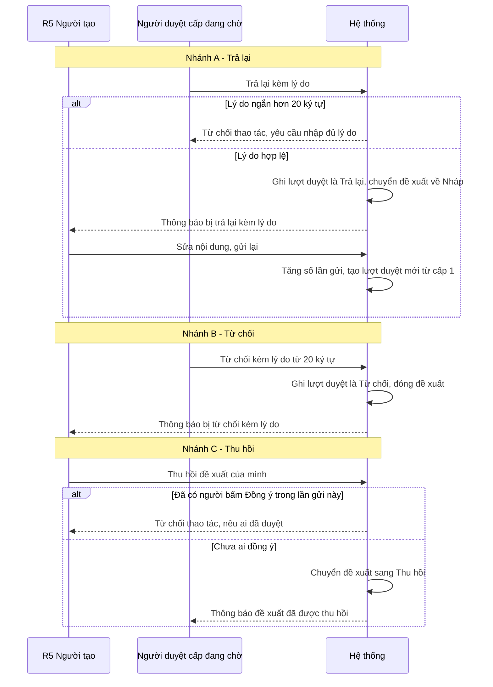

| Điểm | Quy tắc | Nguồn |
|---|---|---|
| Lý do bắt buộc | Tối thiểu 20 ký tự cho Trả lại và Từ chối | BR-28 |
| Gửi lại sau khi bị trả | Đi lại từ cấp 1, kể cả khi bị trả từ cấp 3 | BR-29, EC-26, Q-07 |
| Từ chối | Đóng vĩnh viễn; muốn làm lại phải tạo đề xuất mới | SRS mục 6.1, C02, S-6 |
| Thu hồi | Chỉ người tạo; chỉ khi chưa ai đồng ý; cấp bị bỏ qua không tính | FR-60, S-3 |
| Lịch sử các lần gửi | Lượt duyệt của các lần gửi trước vẫn giữ nguyên | FR-67 |
| Chuyển trạng thái | DX-12, DX-13, DX-14; BD-04, BD-05 | — |

---

## 9. Ủy quyền và Phòng Đào tạo can thiệp

Phục vụ UC-08, UC-43, UC-44, UC-48; FR-09, FR-64, FR-66; BR-31, EC-25, EC-28. Ủy quyền, email và nhắc hạn thuộc bậc B6; can thiệp của Phòng Đào tạo có từ bậc B4.

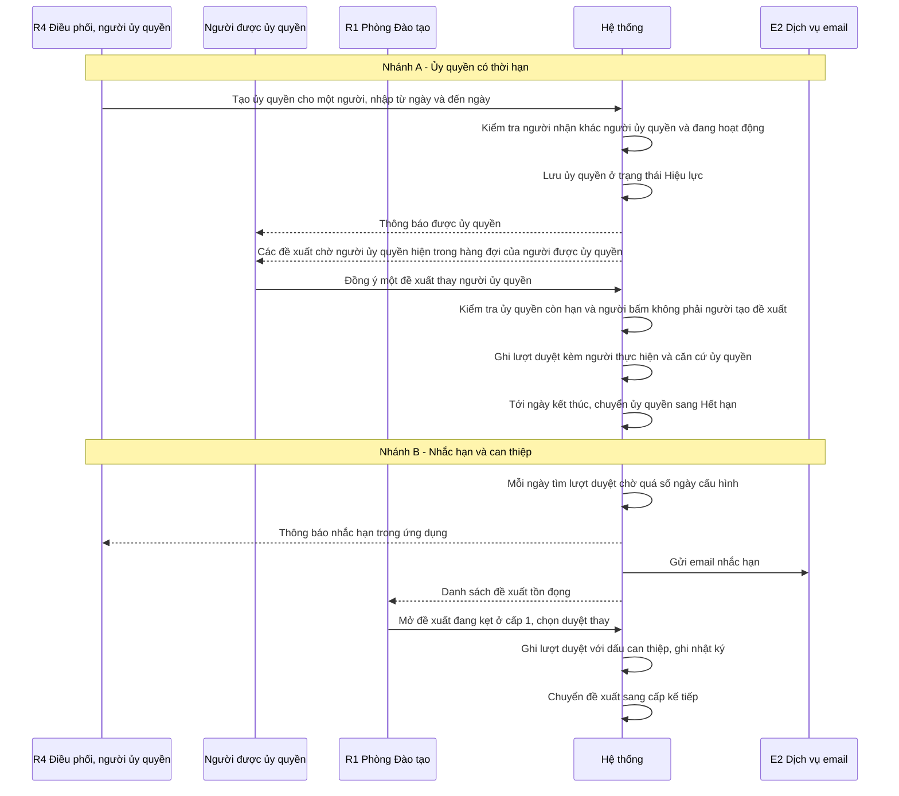

| Điểm | Quy tắc | Nguồn |
|---|---|---|
| Ai ủy quyền được | R3, R4 cho phần việc của mình; R1 lập thay khi người duyệt đã vắng | UC-08, EC-25 |
| Hết hạn | Tự chuyển Hết hạn khi qua `validTo` | FR-09 |
| Không tự duyệt qua ủy quyền | Người được ủy quyền không được là người tạo đề xuất | BR-27 |
| Dấu vết | `ApprovalStep.performedBy`, `delegation`, `isOverride` | FR-67, BR-31 |
| Can thiệp | R1 duyệt thay ở bất kỳ cấp nào, luôn có nhật ký | BR-31, EC-28 |
| Nhắc hạn | Số ngày lấy từ cấu hình | FR-66, NFR-24, Q-17 |
| Email | Gửi cho các sự kiện quan trọng; email hỏng không làm hỏng thao tác chính — xem L-6 | FR-64, L-6 |
| Chuyển trạng thái | UQ-01, UQ-02; BD-03 | — |

---

## 10. Ban hành, ảnh chụp và kích hoạt đầu học kỳ

Phục vụ UC-46 (bao gồm UC-49), UC-53; FR-69, FR-70, FR-71, FR-75; SRS mục 6.2; DEC-01, DEC-07, DEC-08.

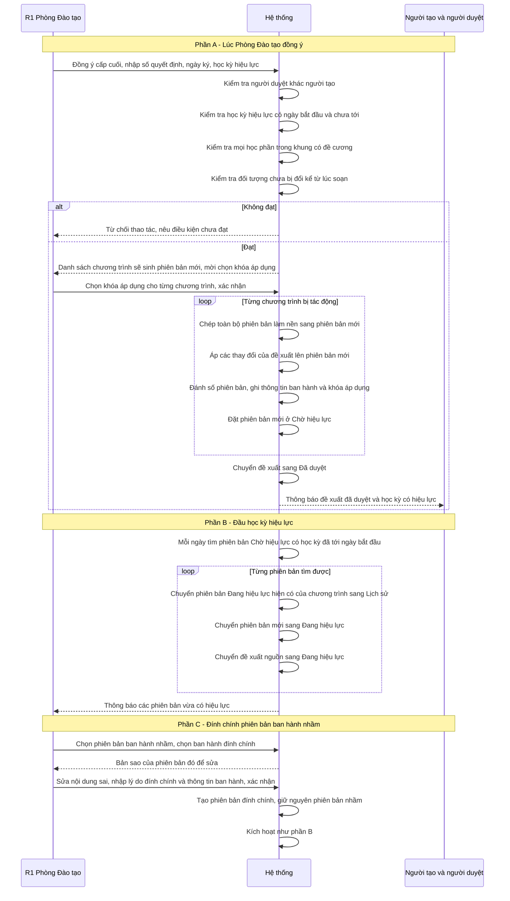

| Điểm | Quy tắc | Nguồn |
|---|---|---|
| Ảnh chụp gồm | Thông tin chương trình, khung và ràng buộc, nhóm tự chọn, PLO, đề cương của mọi học phần trong khung, CLO và ma trận CLO–PLO, thông tin ban hành | SRS mục 6.2.2, DEC-01, FR-69 |
| Cách chụp | Các dòng của chương trình được chép theo phiên bản; đề cương được ghim bằng tham chiếu tới bản bất biến | M-1, M-5, M-6 |
| Thời điểm chụp | Lúc Phòng Đào tạo đồng ý; phiên bản nằm ở Chờ hiệu lực tới đầu học kỳ | C01, E-3, DEC-07 |
| Phiên bản làm nền | Phiên bản mới nhất đã rời Nháp của chương trình, kể cả bản đang Chờ hiệu lực — xem L-7 | E-3, L-7 |
| Đánh số | Khung hoặc PLO đổi thì tăng số Chính; đề cương hoặc công thức điểm đổi thì tăng số Phụ | BR-24 |
| Một phiên bản hiệu lực | Hai bước đổi trạng thái ở phần B chạy trong một giao dịch | BR-22 |
| Bất biến | Từ lúc rời Nháp không sửa, không xóa | FR-71, BR-23, NFR-14 |
| Dòng ma trận | Dòng `CLOPLOMapping` của học phần đã rời khung không được mang sang phiên bản mới | DEC-03 |
| Sinh viên | Kích hoạt không chuyển sinh viên nào sang phiên bản mới | BR-26, M-8, C07 |
| Đính chính | Không xóa bản nhầm; R1 ban hành trực tiếp kèm lý do | FR-75, DEC-08, EC-31, S-8 |
| Chuyển trạng thái | DX-10, DX-11; PB-05..PB-09; DC-04, DC-05 | — |

---

## 11. Sửa đề cương dùng chung lan ra mọi chương trình

Phục vụ UC-16, UC-33, UC-38, UC-49; FR-17, FR-44, FR-69; DEC-02, EC-23, EC-38. Ví dụ: một học phần nằm trong khung của hai chương trình A và B.

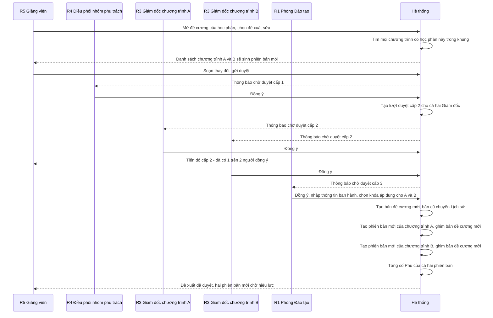

| Điểm | Quy tắc | Nguồn |
|---|---|---|
| Một đề cương cho mọi chương trình | Sửa một lần, áp cho mọi chương trình chứa học phần | FR-44, DEC-02 |
| Báo trước | Người tạo thấy danh sách chương trình bị ảnh hưởng trước khi gửi | FR-17, EC-38 |
| Cấp 2 | Cần đồng ý của Giám đốc mọi chương trình bị tác động; hiển thị tiến độ theo từng người | SRS mục 6.1.3, EC-23 |
| Chương trình nào bị tác động | Chương trình có học phần trong khung của phiên bản Đang hiệu lực hoặc Chờ hiệu lực. Phiên bản Lịch sử không sinh bản mới — xem L-8 | DEC-01, BR-26, L-8 |
| Một đề xuất, nhiều phiên bản | Mỗi chương trình bị tác động sinh một phiên bản riêng, cùng `sourceRequest` | E-3, EC-38 |
| Ma trận CLO–PLO | Dòng ma trận của từng chương trình được chép sang phiên bản mới và trỏ tới CLO của bản đề cương mới theo `cloCode` | DEC-03, M-1, M-6 |
| Hiệu lực | Từ học kỳ kế tiếp, không hồi tố | BR-16, EC-30 |

---

## 12. Gán phiên bản cho khóa sinh viên

Phục vụ UC-52, UC-65; FR-74; BR-26; EC-33, EC-34, EC-35, EC-37. Phần gán theo khóa có từ bậc B4; phần gán riêng từng sinh viên có từ bậc B5, khi đã có dữ liệu sinh viên.

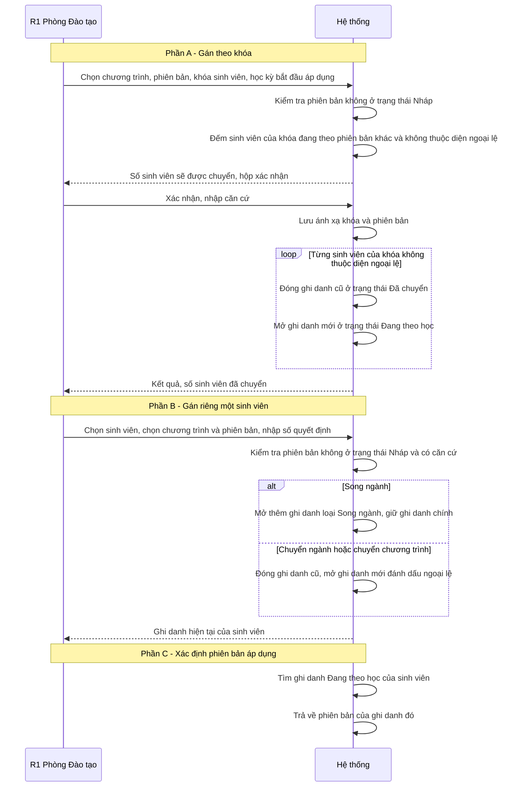

| Điểm | Quy tắc | Nguồn |
|---|---|---|
| Sinh viên giữ phiên bản lúc nhập học | Chỉ đổi khi Phòng Đào tạo gán lại có căn cứ | BR-26, C07 |
| Ban hành không tự chuyển sinh viên | Việc chuyển chỉ xảy ra ở phần A hoặc B | M-8 |
| Khóa cũ nhận phiên bản mới | Được phép khi Phòng Đào tạo chọn, như ví dụ K2023 nhận phiên bản 1.1 | SRS mục 6.2.3, E-9 |
| Chuyển ngành | Gắn lại phiên bản của ngành mới; học phần đã học đối chiếu qua nhóm tương đương | EC-33 |
| Song ngành | Hai ghi danh, xét tốt nghiệp độc lập | EC-34 |
| Cử nhân lên Kỹ sư | Gắn lại; phần chênh lệch tính vào tín chỉ còn thiếu | EC-35 |
| Bảo lưu rồi học lại | Giữ phiên bản của khóa gốc | EC-37 |
| Sinh viên có nhiều ghi danh | Phần C chạy cho từng chương trình; cổng sinh viên cho chọn chương trình — xem L-9 | EC-34, L-9 |
| Chuyển trạng thái | GD-01, GD-02, GD-03 | — |

---

## 13. Kiểm tra điều kiện đăng ký học phần

Phục vụ UC-60 (bao gồm UC-63); FR-31, FR-83, FR-91, FR-92; thuật toán `XacDinhDieuKienDangKy` của SRS mục 7.3; BR-06, BR-07, BR-08. Chỉ là tra cứu: hệ thống không thực hiện đăng ký học phần (SRS mục 12).

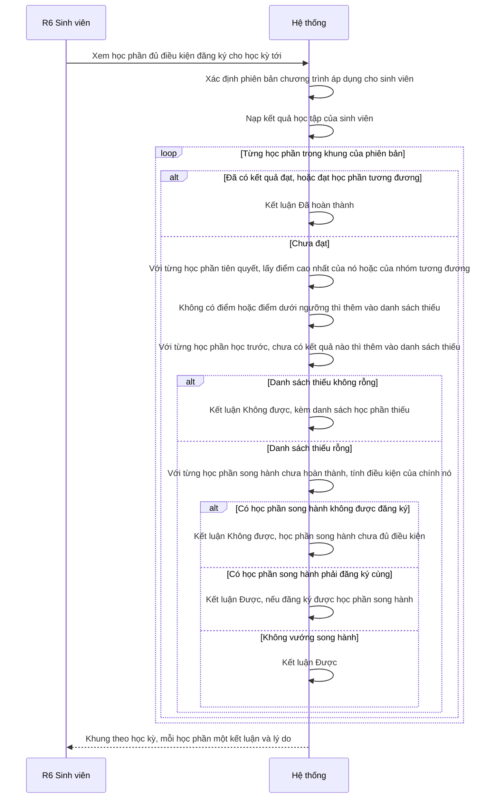

| Kết luận | Hiển thị | Nguồn |
|---|---|---|
| Được | Xanh | SRS mục 7.3, FR-83 |
| Được, nếu ĐK được HP song hành | Vàng | SRS mục 7.3, BR-08 |
| Không được — kèm lý do | Đỏ; lý do nêu từng học phần thiếu | SRS mục 7.3, FR-92, EC-11 |
| Đã hoàn thành | Xám; không tính là một trong ba trạng thái của cột "Đăng ký được?" | C05 |

| Điểm | Quy tắc | Nguồn |
|---|---|---|
| Học trước | Thỏa khi đã có kết quả, kể cả không đạt | BR-06 |
| Tiên quyết | Thỏa khi điểm cao nhất đạt ngưỡng; so trên thang 4 | BR-07, DEC-11, EC-36 |
| Ngưỡng điểm | Lấy `CurriculumRequisite.minScore`; nếu trống lấy `CurriculumItem.minStudiedScore` | E-1 |
| Song hành | Đệ quy; giới hạn 20 cấp và phải nhớ các học phần đã xét để không lặp | SRS mục 7.3, C06 |
| Học phần tiên quyết đã ngừng mở lớp | Dùng học phần thay thế theo QH5; chưa khai báo thì cảnh báo cho quản trị | EC-12, EC-32 |
| Ràng buộc lấy từ đâu | Từ `CurriculumRequisite` của phiên bản áp dụng, không lấy từ danh mục hiện hành | M-5 |
| Chưa có kết quả học tập | Vẫn tính được; học phần không có ràng buộc cho kết luận Được | EC-52 |
| Thời gian | Toàn khung của một sinh viên dưới 3 giây | NFR-02 |
| Cán bộ xem thay | R1, R3 xem được kết quả của một sinh viên trong phạm vi — xem L-10 | UC-60, L-10 |

---

## 14. Xét tốt nghiệp: một sinh viên và theo lô

Phục vụ UC-61, UC-62 (cùng bao gồm UC-64); FR-84, FR-85, FR-86, FR-87; thuật toán `XetTotNghiep` của SRS mục 7.4.

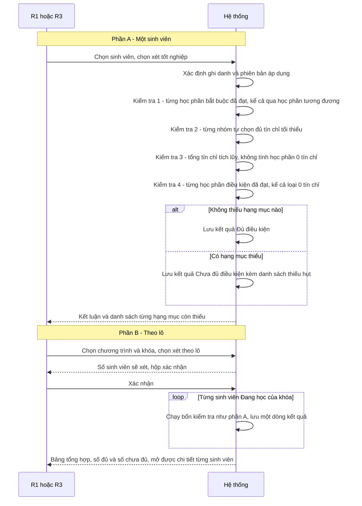

| Điểm | Quy tắc | Nguồn |
|---|---|---|
| Học phần tương đương | Đạt một học phần trong nhóm thì coi như đạt học phần bắt buộc cùng nhóm | FR-85, BR-09, DEC-06, EC-15 |
| Tín chỉ công nhận | Tính theo tín chỉ của học phần đã học thực tế; thiếu thì cộng vào phần còn thiếu và cảnh báo | BR-10, EC-14 |
| Học cả hai học phần cùng nhóm | Tính một lần; học phần còn lại là tín chỉ tự do | EC-17 |
| Nhóm tương đương dùng bản nào | Nhóm hiện tại ở danh mục, không theo phiên bản | EC-16, E-11, C11 |
| Học phần 0 tín chỉ | Không cộng vào tổng, nhưng bắt buộc hoàn thành nếu là học phần điều kiện | BR-02, EC-01 |
| Nhóm tự chọn | Tín chỉ đạt trong nhóm so với `minCredits`; không tính trùng một học phần cho hai nhóm | BR-04, C09 |
| Học lại | Lấy điểm cao nhất | EC-36 |
| Song ngành | Xét độc lập theo từng ghi danh | EC-34 |
| Điểm sửa hồi tố | Xét lại tự động, lưu dòng mới, thông báo Phòng Đào tạo | EC-43 |
| Lưu kết quả | Mỗi lần xét một dòng `GraduationAudit`; không ghi đè dòng cũ | M-9 |
| Thời gian | Lô khoảng 500 sinh viên dưới 5 phút | NFR-03 |
| Sinh viên tự xem | Sinh viên xem kết quả xét của chính mình ở cổng sinh viên | SRS mục 3.4, UC-61 |

---

## 15. Sinh viên xem cổng thông tin

Phục vụ UC-84 (bao gồm UC-65), UC-59, UC-32; FR-88, FR-89, FR-90, FR-93, FR-95.

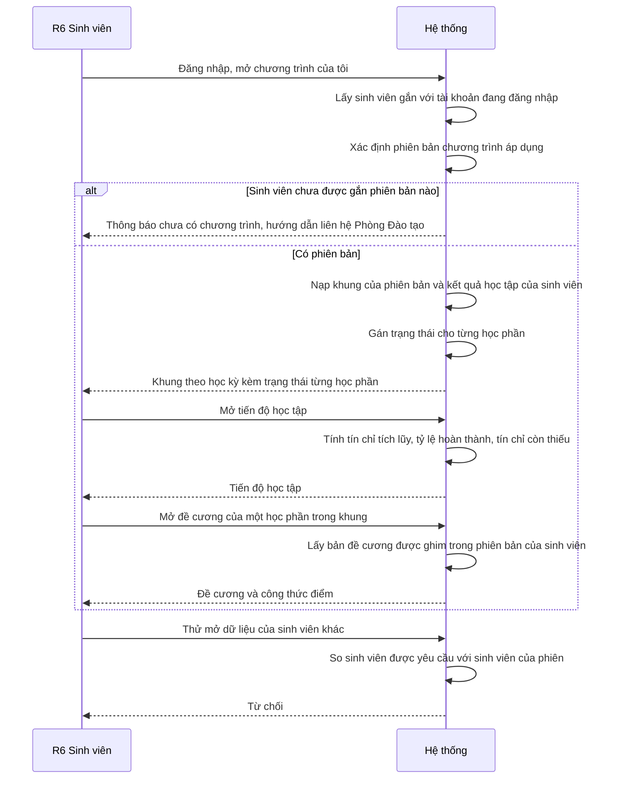

| Điểm | Quy tắc | Nguồn |
|---|---|---|
| Đúng phiên bản | Phiên bản của ghi danh Đang theo học, không phải phiên bản Đang hiệu lực mới nhất | FR-88, BR-26 |
| Trạng thái học phần | Đã học đạt · Đang học · Chưa học · Không đạt; lấy theo dòng kết quả tốt nhất | FR-89, EC-36 |
| Chưa có kết quả học tập | Vẫn hiện đủ khung; phần tiến độ ghi rõ chưa có dữ liệu | EC-52 |
| Tiến độ | Tín chỉ tích lũy không tính học phần 0 tín chỉ | FR-90, BR-02 |
| Đề cương đúng bản | Bản được ghim trong phiên bản của sinh viên | FR-93, M-1, S-9 |
| Chỉ dữ liệu của mình | Máy chủ từ chối mọi yêu cầu tới sinh viên khác | NFR-11, NFR-09 |
| Màn hình nhỏ | Dùng được từ chiều rộng 360px | FR-95, NFR-17 |
| Thời gian tra cứu | Dưới 2 giây | NFR-01 |

---

## 16. Ứng dụng dDUT gọi API

Phục vụ UC-66, UC-67, UC-68, UC-69, UC-70; FR-94; SRS mục 8.3 và 8.4. Chỉ đọc.

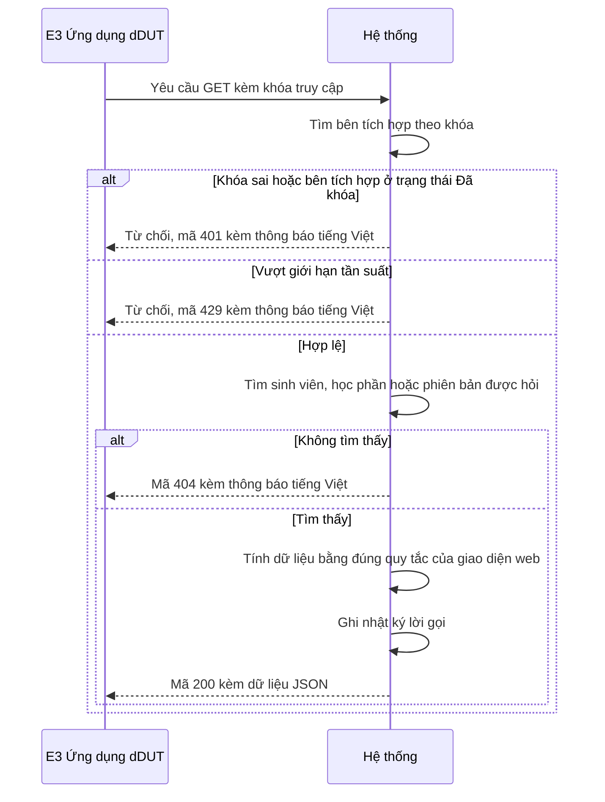

| Đường dẫn (SRS mục 8.4) | Use case | Dữ liệu trả về | Quy tắc dùng chung với |
|---|---|---|---|
| `GET /api/v1/sinh-vien/{mssv}/chuong-trinh` | UC-66 | Phiên bản chương trình áp dụng cho sinh viên | Mục 15 |
| `GET /api/v1/sinh-vien/{mssv}/tien-do` | UC-67 | Tiến độ học tập | Mục 15 |
| `GET /api/v1/sinh-vien/{mssv}/hoc-phan-du-dieu-kien` | UC-68 | Kết luận điều kiện đăng ký từng học phần | Mục 13 |
| `GET /api/v1/sinh-vien/{mssv}/xet-tot-nghiep` | UC-70 | Kết luận và danh sách thiếu hụt | Mục 14 |
| `GET /api/v1/hoc-phan/{maHP}/de-cuong` | UC-69 | Đề cương và công thức điểm | Mục 15 |
| `GET /api/v1/chuong-trinh/{maCT}/phien-ban/{soPB}` | UC-66 | Nội dung một phiên bản chương trình | Mục 10 |

| Điểm | Quy tắc | Nguồn |
|---|---|---|
| Kiểu giao tiếp | REST, dữ liệu JSON | API-01 |
| Tài liệu | OpenAPI 3.0, xem được qua web | API-02 |
| Xác thực | Mỗi bên tích hợp một khóa riêng; lưu dạng băm ở `IntegrationClient.keyHash` | API-03 |
| Giới hạn tần suất | Theo `IntegrationClient.rateLimit` | API-04 |
| Mã trả về | Mã HTTP chuẩn kèm thông báo tiếng Việt | API-05 |
| Một quy tắc, hai kênh | API và web dùng chung kết quả tính của UC-63, UC-64, UC-65 | UC-68, UC-70 |
| Đề cương theo ngữ cảnh | Đường dẫn đề cương không mang phiên bản; trả về bản Đã ban hành mới nhất | C10, S-9 |
| Dữ liệu của sinh viên nào | Hệ thống tin bên tích hợp đã xác thực sinh viên; khóa truy cập không gắn với từng sinh viên — xem L-10 | NFR-11, L-10 |

---

## 17. Đồng bộ theo lịch với cơ sở dữ liệu có sẵn

Phục vụ UC-76, UC-77, UC-78; FR-98, FR-99, FR-100; DEC-10; EC-48, EC-49; SRS mục 8.1, 8.2.

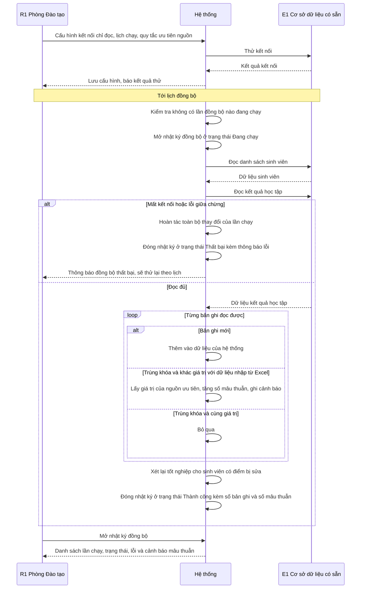

| Điểm | Quy tắc | Nguồn |
|---|---|---|
| Chỉ đọc | Hệ thống không ghi gì vào cơ sở dữ liệu có sẵn | FR-98, SRS mục 8.1 |
| Dữ liệu lấy về | Sinh viên, kết quả học tập, lớp học phần | SRS mục 8.1 |
| Nguồn ưu tiên | Kết quả học tập và danh sách sinh viên: cơ sở dữ liệu có sẵn thắng. Danh mục học phần và khung chương trình: hệ thống này thắng | SRS mục 8.2, DEC-10 |
| Mâu thuẫn | Áp quy tắc ưu tiên và ghi cảnh báo, đếm vào `SyncLog.conflictCount` | FR-100, EC-48 |
| Mất kết nối | Hoàn tác toàn bộ, ghi lỗi, thử lại theo lịch | EC-49 |
| Không có kết nối | Hệ thống vẫn chạy đủ chức năng bằng dữ liệu nhập từ Excel | DEC-10, Q-09 |
| Điểm sửa hồi tố | Xét lại tốt nghiệp và thông báo Phòng Đào tạo | EC-43 |
| Sinh viên mới | Được gắn phiên bản theo khóa (GD-01) | FR-74 |
| Chuyển trạng thái | DB-01..DB-04 | — |

---

## 18. Điểm còn hở

Các lựa chọn dưới đây là **tạm thời**.

| # | Vấn đề | Liên quan | Lựa chọn tạm | Ảnh hưởng nếu đổi |
|---|---|---|---|---|
| L-1 | **Khóa tài khoản sau nhiều lần đăng nhập sai.** SRS không nêu | UC-01, NFR-06 | Không khóa tài khoản. Chỉ ghi nhật ký từng lần đăng nhập sai | Mục 2; thêm tham số cấu hình nếu cần khóa |
| L-2 | **Nhập Excel khung cho chương trình đã ban hành.** FR-33 không nói; FR-55 cấm sửa trực tiếp dữ liệu đã ban hành | FR-33, FR-55, M-2 | Chỉ nhập được vào phiên bản Nháp. Chương trình đã có phiên bản rời Nháp thì nhập Excel bị từ chối; thay đổi phải đi qua đề xuất | Mục 3; nếu cho nhập Excel làm nội dung của đề xuất thì thêm một luồng "nhập Excel thành đề xuất" |
| L-3 | **Số của phiên bản khởi tạo.** BR-24 chỉ nói cách tăng | H-1, BR-24, S-7 | Mặc định 1.0; Phòng Đào tạo nhập được số khác khi nạp chương trình đã có phiên bản từ trước | Mục 4 |
| L-4 | **Người tạo là một trong nhiều người duyệt của một cấp.** FR-61 chỉ nói "bỏ qua cấp đó" | FR-61, BR-27, EC-22, EC-23 | Chỉ bỏ lượt của người tạo; những người duyệt còn lại của cấp vẫn phải duyệt. Cả cấp chỉ bị bỏ qua khi không còn ai | Mục 7; quy tắc DX-05, DX-06, DX-08 |
| L-5 | **Người tạo là Phòng Đào tạo.** Bỏ qua cấp 3 theo FR-61 sẽ thành tự duyệt, trái BR-27 | FR-61, BR-27, C03, Q-19 | Không bỏ cấp 3. Một tài khoản R1 khác người tạo phải duyệt; nếu chỉ có một tài khoản R1 thì đề xuất không đi tiếp được và hệ thống báo rõ | Mục 6, 7; cần ít nhất hai tài khoản Phòng Đào tạo khi vận hành |
| L-6 | **Email gửi hỏng.** FR-64 không nói phải làm gì | FR-64, UC-48 | Thông báo trong ứng dụng là kênh chính. Email hỏng không làm hỏng thao tác duyệt; ghi lỗi và không gửi lại tự động | Mục 9 |
| L-7 | **Hai đề xuất được duyệt trên cùng chương trình trước cùng một học kỳ.** E-3 chọn mỗi đề xuất một phiên bản nhưng chưa nói phiên bản thứ hai chép từ đâu | E-3, C01, BR-22 | Phiên bản sau chép từ phiên bản mới nhất đã rời Nháp, kể cả bản đang Chờ hiệu lực. Đầu học kỳ, các bản được kích hoạt theo thứ tự tạo; bản cuối cùng ở Đang hiệu lực, các bản trước chuyển Lịch sử | Mục 10; quy tắc PB-05, PB-06 |
| L-8 | **Khóa cũ có nhận đề cương mới không.** Phiên bản Lịch sử là bất biến nên các khóa đang theo nó giữ đề cương và công thức điểm cũ | DEC-01, BR-16, BR-26, E-9 | Chỉ chương trình có học phần trong phiên bản Đang hiệu lực hoặc Chờ hiệu lực mới sinh phiên bản mới. Khóa cũ nhận đề cương mới khi Phòng Đào tạo chọn khóa đó làm khóa áp dụng của phiên bản mới (mục 12, phần A) | Mục 11, 12 |
| L-9 | **Sinh viên có hai ghi danh.** FR-88 viết như thể mỗi sinh viên có một chương trình | FR-88, EC-34 | Cổng sinh viên và API trả về ghi danh loại Chính; sinh viên song ngành chọn được chương trình còn lại trên cổng. API chỉ trả ghi danh Chính | Mục 12, 15, 16; nếu API phải trả cả hai thì đổi cấu trúc dữ liệu trả về |
| L-10 | **Ai được xem dữ liệu học tập của một sinh viên.** Ma trận SRS mục 3.4 chỉ cho R6; UC-59, UC-60, UC-61 liệt kê cả cán bộ; khóa API không gắn với từng sinh viên | SRS mục 3.4, UC-59, UC-60, UC-61, NFR-11 | R1 xem được mọi sinh viên; R3 xem được sinh viên của chương trình mình phụ trách; R2, R4, R5 không xem. Sinh viên chỉ xem của mình. Bên tích hợp được tin là đã xác thực sinh viên; mỗi lời gọi API được ghi nhật ký kèm mã sinh viên | Mục 13, 14, 16; quyền trên các màn hình tra cứu sinh viên |
