# SƠ ĐỒ TRẠNG THÁI v0.1

**Hệ thống Quản lý Chương trình đào tạo — PBL6**

| | |
|---|---|
| Ngày lập | 2026-10-12 |
| Đi kèm | `docs/design/data-dictionary.md` (tên thực thể, thuộc tính, danh sách trạng thái), `docs/design/erd.md` (M-1..M-9, E-1..E-11) |
| Nguồn | `docs/requirement/REQUIREMENTS.md` mục 6.1, 6.2, 6.3, 8, 9, 10; `docs/Bo_so_do_Use_Case_CTDT/Thuyet_minh_Use_Case.md` (C01..C12); `docs/planning/epics.md` (H-1..H-4) |
| Mức | Logic — không nêu công nghệ. Sơ đồ viết bằng Mermaid `stateDiagram-v2`, **chưa kiểm tra hiển thị** |
| Điểm còn hở của tài liệu này | S-1..S-14, mục 14 |

---

## 1. Quy ước

- **Tên trạng thái** lấy nguyên văn từ cột mô tả của thuộc tính `trangThai` (hoặc `hanhDong`, `trangThaiDoc`) trong từ điển dữ liệu. Tài liệu này không thêm, không đổi tên trạng thái nào.
- **Tác nhân:** R1 Phòng Đào tạo · R2 Ban lãnh đạo khoa · R3 Giám đốc CTĐT · R4 Điều phối nhóm chuyên môn · R5 Giảng viên · R6 Sinh viên · "Hệ thống" = tự động, không có người bấm · E1 cơ sở dữ liệu có sẵn của Trường.
- **Bảng chuyển trạng thái** có sáu cột cố định: Từ · Sự kiện · Điều kiện · Đến · Tác nhân · Nguồn. `[*]` ở cột Từ nghĩa là dòng được tạo ra; ở cột Đến nghĩa là dòng bị xóa.
- **Điều kiện** là điều phải đúng thì chuyển trạng thái mới xảy ra. Sai điều kiện thì thao tác bị từ chối và trạng thái giữ nguyên, trừ khi bảng ghi khác.
- Mọi chuyển trạng thái đều ghi một dòng `NhatKyHeThong` (FR-105). Bảng không nhắc lại điều này.
- Cột Nguồn ghi mã trong SRS hoặc trong tài liệu đi kèm. Mã `S-x` nghĩa là quy tắc do tài liệu này tạm chọn, xem mục 14.

### Thực thể có vòng đời

| Mục | Thực thể | Thuộc tính | Số trạng thái |
|---|---|---|---|
| 2 | `DeXuatThayDoi` | `trangThai` | 8 |
| 3 | `BuocDuyet` | `hanhDong` | 4 |
| 4 | `PhienBanCTDT` | `trangThai` | 4 |
| 5 | `DeCuongChiTiet` | `trangThai` | 3 |
| 6 | `HocPhan` | `trangThai` | 3 |
| 7 | `UyQuyenDuyet` | `trangThai` | 3 |
| 8 | `PhienNhapLieu` | `trangThai` | 3 |
| 9 | `LogDongBo` | `trangThai` | 3 |
| 10 | `GhiDanhCTDT` | `trangThai` | 3 |
| 11 | `SinhVien` | `trangThai` | 4 |
| 12 | `KetQuaHocTap` | `trangThai` | 4 |
| 13 | `DonVi`, `NhomChuyenMon`, `NguoiDung`, `ChuongTrinhDaoTao`, `ThongBao`, `BenTichHop` | hai giá trị | 2 |

---

## 2. `DeXuatThayDoi`

Đề xuất thay đổi dữ liệu đã ban hành. Ba trạng thái cuối, không đi tiếp được: Đang hiệu lực · Từ chối · Thu hồi.

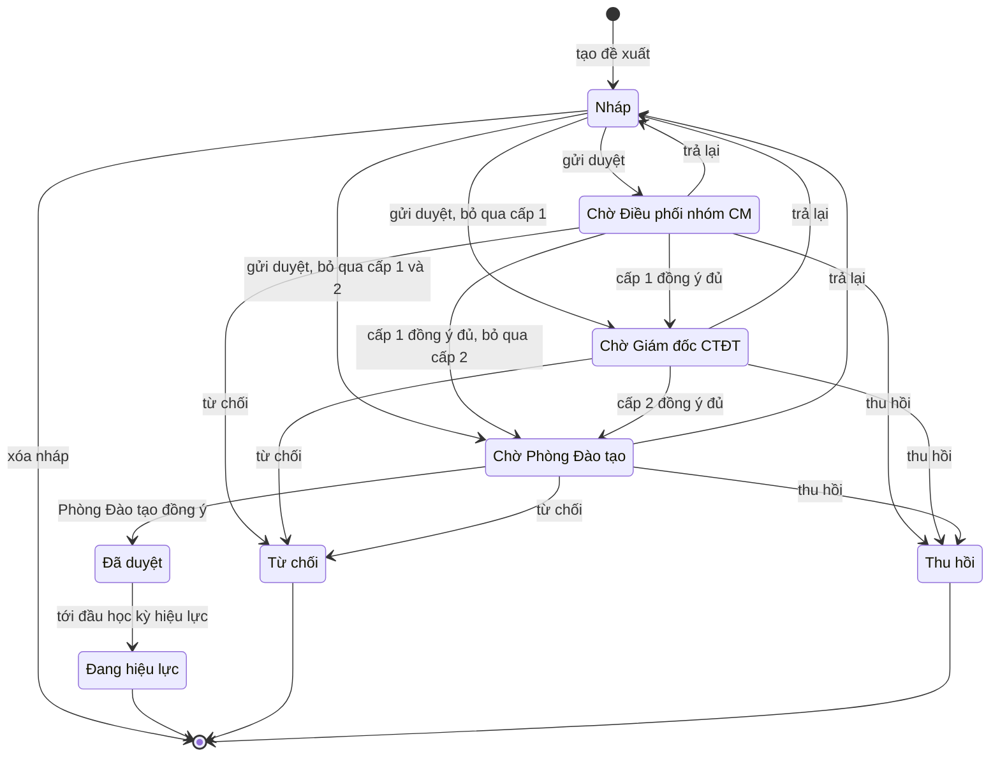

| # | Từ | Sự kiện | Điều kiện | Đến | Tác nhân | Nguồn |
|---|---|---|---|---|---|---|
| DX-01 | `[*]` | Tạo đề xuất | Người tạo có quyền "Tạo đề xuất thay đổi" và đối tượng nằm trong phạm vi của mình; đối tượng đã ban hành; chọn một `loaiDeXuat`; `lanGui` = 0 | Nháp | R1, R3, R4, R5 (R2: xem S-1) | FR-55, FR-56, SRS mục 3.4, UC-37 |
| DX-02 | Nháp | Sửa nội dung, hồ sơ đính kèm, nguồn phát sinh | Người sửa là `nguoiTao` | Nháp | Người tạo | UC-37, FR-108, FR-109 |
| DX-03 | Nháp | Xóa nháp | Người xóa là `nguoiTao`; `lanGui` = 0 (đề xuất chưa từng được gửi) | `[*]` | Người tạo | UC-37, S-2 |
| DX-04 | Nháp | Gửi duyệt | Có ít nhất một `NoiDungThayDoi`; mọi CLO có thành phần đánh giá bao phủ (EC-40); `phienBanGoc` còn khớp với đối tượng (EC-27); cấp 1 có ít nhất một người duyệt khác người tạo. `lanGui` tăng 1; tạo `BuocDuyet` cấp 1 cho điều phối của **mọi** nhóm phụ trách học phần bị tác động | Chờ Điều phối nhóm CM | Người tạo | FR-57, BR-29, EC-21, EC-22, UC-38 |
| DX-05 | Nháp | Gửi duyệt, bỏ qua cấp 1 | Như DX-04, nhưng cấp 1 không còn ai phải duyệt: người tạo là điều phối duy nhất của cấp 1 (EC-20), hoặc đề xuất không tác động học phần của nhóm nào (C04). Ghi `BuocDuyet` cấp 1 với `coBoQua` = Có, `lyDoBoQua` | Chờ Giám đốc CTĐT | Người tạo | FR-61, BR-27, DEC-09, EC-20, C04 |
| DX-06 | Nháp | Gửi duyệt, bỏ qua cấp 1 và cấp 2 | Như DX-04, và cả hai cấp dưới không còn ai phải duyệt: học phần thuộc khoa khác (EC-24); hoặc `loaiDeXuat` = Thay đổi tổ chức / phân công (E-4); hoặc người tạo vừa là điều phối duy nhất vừa là Giám đốc CTĐT duy nhất của các đối tượng bị tác động | Chờ Phòng Đào tạo | Người tạo | EC-24, FR-61, E-4, C04 |
| DX-07 | Chờ Điều phối nhóm CM | Một điều phối bấm Đồng ý và là người cuối cùng của cấp | Mọi `BuocDuyet` cấp 1 của `lanGui` hiện tại có `hanhDong` = Đồng ý; cấp 2 có ít nhất một người duyệt khác người tạo. Tạo `BuocDuyet` cấp 2 cho Giám đốc CTĐT của **mọi** chương trình bị tác động | Chờ Giám đốc CTĐT | R4; người được ủy quyền; R1 khi can thiệp | FR-57, FR-59, EC-22, EC-23, UC-43 |
| DX-08 | Chờ Điều phối nhóm CM | Như DX-07, bỏ qua cấp 2 | Như DX-07, nhưng người tạo là Giám đốc CTĐT duy nhất của mọi chương trình bị tác động (EC-19) | Chờ Phòng Đào tạo | R4; người được ủy quyền; R1 khi can thiệp | FR-61, DEC-09, EC-19 |
| DX-09 | Chờ Giám đốc CTĐT | Một Giám đốc CTĐT bấm Đồng ý và là người cuối cùng của cấp | Mọi `BuocDuyet` cấp 2 của `lanGui` hiện tại có `hanhDong` = Đồng ý. Tạo một `BuocDuyet` cấp 3 không chỉ đích danh | Chờ Phòng Đào tạo | R3; người được ủy quyền; R1 khi can thiệp | FR-57, FR-59, EC-23, UC-44 |
| DX-10 | Chờ Phòng Đào tạo | Đồng ý cấp cuối | Người duyệt khác `nguoiTao` (BR-27, C03); nhập `soQuyetDinh`, `ngayKy`, `hocKyHieuLuc`; học kỳ hiệu lực có `ngayBatDau` và chưa bắt đầu (S-5); mọi học phần trong khung của các chương trình bị tác động có đề cương (EC-44); `phienBanGoc` còn khớp (EC-27). Hệ thống tạo `PhienBanCTDT` ở Chờ hiệu lực cho mọi chương trình bị tác động (PB-05) | Đã duyệt | R1 | FR-59, FR-69, FR-70, SRS mục 6.1.4, UC-46 |
| DX-11 | Đã duyệt | Tới `HocKy.ngayBatDau` của `hocKyHieuLuc` | Mọi phiên bản sinh từ đề xuất này đã chuyển Đang hiệu lực (PB-06) | Đang hiệu lực | Hệ thống | DEC-07, BR-25, SRS mục 6.1.4 bước 7 |
| DX-12 | Chờ Điều phối nhóm CM · Chờ Giám đốc CTĐT · Chờ Phòng Đào tạo | Trả lại | `yKien` tối thiểu 20 ký tự (BR-28). Các `BuocDuyet` còn Chờ của lần gửi này không còn hiệu lực (S-4) | Nháp | Người duyệt của cấp đang chờ; người được ủy quyền; R1 khi can thiệp | FR-59, BR-28, BR-29, EC-26, UC-43, UC-44, UC-45 |
| DX-13 | Chờ Điều phối nhóm CM · Chờ Giám đốc CTĐT · Chờ Phòng Đào tạo | Từ chối | `yKien` tối thiểu 20 ký tự (BR-28) | Từ chối | Như DX-12 | FR-59, BR-28, C02, UC-43, UC-44, UC-45 |
| DX-14 | Chờ Điều phối nhóm CM · Chờ Giám đốc CTĐT · Chờ Phòng Đào tạo | Thu hồi | Người thu hồi là `nguoiTao`; trong `lanGui` hiện tại chưa có `BuocDuyet` nào `hanhDong` = Đồng ý với `coBoQua` = Không (S-3) | Thu hồi | Người tạo | FR-60, UC-39 |

**Quy tắc đi kèm**

| Quy tắc | Nội dung | Nguồn |
|---|---|---|
| Gửi lại | Đề xuất bị trả về Nháp, khi gửi lại đi từ cấp 1 (DX-04..DX-06), không quay về cấp vừa trả | BR-29, Q-07 |
| Từ chối khác Trả lại | Từ chối đóng đề xuất vĩnh viễn; Trả lại đưa về Nháp. EC-26 dùng chữ "từ chối" cho trường hợp về Nháp — tài liệu này hiểu là Trả lại | C02, S-6 |
| Duyệt thay theo ủy quyền | Người được ủy quyền thực hiện DX-07..DX-09, DX-12, DX-13 thay cho `nguoiDuyet`; ghi `BuocDuyet.nguoiThucHien` và `uyQuyen`. Người được ủy quyền không được là `nguoiTao` | FR-09, EC-25, BR-27 |
| Phòng Đào tạo can thiệp | R1 thực hiện được DX-07..DX-09, DX-12, DX-13 ở bất kỳ cấp nào; ghi `BuocDuyet.laCanThiep` = Có | BR-31, EC-25, EC-28 |
| Bình luận | Bình luận (`BinhLuan`) không làm đổi trạng thái ở bất kỳ trạng thái nào | FR-62 |
| Cảnh báo xung đột | Khi tạo (DX-01) hoặc gửi (DX-04..DX-06), nếu đối tượng đang có đề xuất khác ở Nháp đã gửi, Chờ …, hoặc Đã duyệt, hệ thống cảnh báo nhưng không chặn | FR-68, BR-30, EC-27 |
| Người tạo bị vô hiệu hóa | Đề xuất giữ nguyên trạng thái và tiếp tục được xử lý | EC-29 |

---

## 3. `BuocDuyet`

Một lượt duyệt của một người ở một cấp, trong một lần gửi. Thuộc tính mang vòng đời là `hanhDong`.

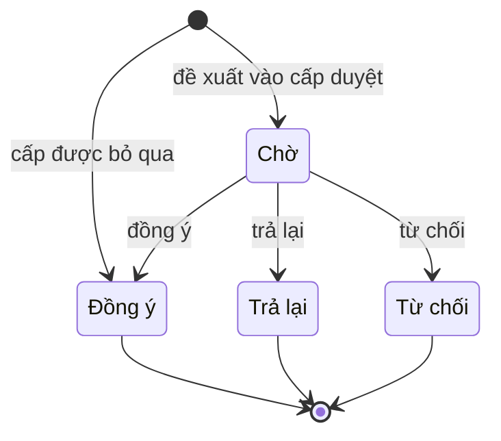

| # | Từ | Sự kiện | Điều kiện | Đến | Tác nhân | Nguồn |
|---|---|---|---|---|---|---|
| BD-01 | `[*]` | Đề xuất vào một cấp duyệt (DX-04, DX-07, DX-09) | Một dòng cho mỗi người phải duyệt theo SRS mục 6.1.3; `nguoiDuyet` khác `nguoiTao` của đề xuất | Chờ | Hệ thống | FR-57, EC-22, EC-23 |
| BD-02 | `[*]` | Cấp được bỏ qua (DX-05, DX-06, DX-08) | `coBoQua` = Có; `lyDoBoQua` bắt buộc; `thoiDiem` = lúc gửi | Đồng ý | Hệ thống | FR-61, BR-27, DEC-09, S-4 |
| BD-03 | Chờ | Đồng ý | Đề xuất đang ở đúng cấp của dòng; `lanGui` của dòng bằng `lanGui` của đề xuất; người bấm là `nguoiDuyet`, hoặc người có `UyQuyenDuyet` Hiệu lực của `nguoiDuyet`, hoặc R1 | Đồng ý | R4 · R3 · R1 theo cấp | FR-59, FR-67 |
| BD-04 | Chờ | Trả lại | Như BD-03; `yKien` tối thiểu 20 ký tự | Trả lại | Như BD-03 | FR-59, BR-28 |
| BD-05 | Chờ | Từ chối | Như BD-03; `yKien` tối thiểu 20 ký tự | Từ chối | Như BD-03 | FR-59, BR-28 |

Dòng `BuocDuyet` đã rời Chờ là bất biến: nó là lịch sử duyệt mà FR-67 yêu cầu. Hàng đợi chờ duyệt (FR-65) của một người gồm các dòng `hanhDong` = Chờ, có `lanGui` bằng `lanGui` của đề xuất, và đề xuất đang ở đúng cấp của dòng.

---

## 4. `PhienBanCTDT`

Một phiên bản của một chương trình. Bất biến từ khi rời Nháp (FR-71, BR-23).

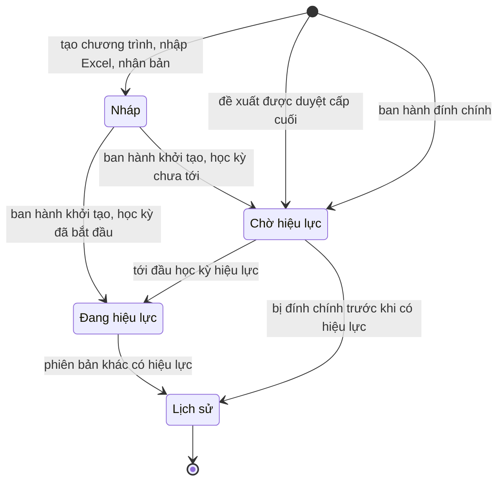

| # | Từ | Sự kiện | Điều kiện | Đến | Tác nhân | Nguồn |
|---|---|---|---|---|---|---|
| PB-01 | `[*]` | Tạo chương trình bằng nhập Excel hoặc nhân bản một phiên bản có sẵn | Chương trình chưa có phiên bản Nháp nào; `soPhienBan` để trống | Nháp | R1; R3 trong phạm vi phân công | FR-25, FR-33, DEC-12, M-2, UC-20, UC-73 |
| PB-02 | Nháp | Sửa trực tiếp thông tin, khung, nhóm tự chọn, PLO, ma trận | Chương trình chưa có phiên bản nào rời Nháp | Nháp | R1; R3 và R4 trong phạm vi | H-4, M-2 |
| PB-03 | Nháp | Ban hành phiên bản khởi tạo | Chương trình chưa có phiên bản nào rời Nháp; không còn lỗi chặn (EC-05, EC-06, EC-08, EC-09); mọi dòng khung có đề cương (EC-44); nhập `soQuyetDinh`, `ngayKy`, `hocKyHieuLuc`, khóa áp dụng; `HocKy.ngayBatDau` của học kỳ hiệu lực chưa tới | Chờ hiệu lực | R1 | H-1, FR-70, BR-24, BR-25 |
| PB-04 | Nháp | Ban hành phiên bản khởi tạo cho dữ liệu đã có hiệu lực từ trước | Như PB-03, nhưng `HocKy.ngayBatDau` của học kỳ hiệu lực đã qua | Đang hiệu lực | R1 | H-1, S-7 |
| PB-05 | `[*]` | Đề xuất được duyệt cấp cuối (DX-10) | Một phiên bản mới cho **mỗi** chương trình bị tác động, chép từ phiên bản làm nền (`phienBanTruoc`) rồi áp các `NoiDungThayDoi`; `deXuatNguon` = đề xuất; số phiên bản tăng theo BR-24 | Chờ hiệu lực | Hệ thống | FR-69, DEC-01, E-3, C01, UC-49, EC-38 |
| PB-06 | Chờ hiệu lực | Tới `HocKy.ngayBatDau` của `hocKyHieuLuc` | Trong cùng một giao dịch, phiên bản Đang hiệu lực hiện có của chương trình chuyển Lịch sử (PB-07), để không lúc nào có hai phiên bản Đang hiệu lực | Đang hiệu lực | Hệ thống | BR-22, BR-25, DEC-07 |
| PB-07 | Đang hiệu lực | Phiên bản khác của cùng chương trình chuyển Đang hiệu lực | — | Lịch sử | Hệ thống | SRS mục 6.2.1, BR-22 |
| PB-08 | `[*]` | Ban hành phiên bản đính chính | `dinhChinhCho` trỏ tới phiên bản ban hành nhầm; `lyDoDinhChinh` bắt buộc; các điều kiện ban hành như PB-03. Học kỳ hiệu lực đã bắt đầu thì PB-06 chạy ngay sau đó | Chờ hiệu lực | R1 | FR-75, DEC-08, EC-31, UC-53, S-8 |
| PB-09 | Chờ hiệu lực | Phiên bản đính chính của nó được ban hành | Phiên bản bị đính chính chưa kịp có hiệu lực | Lịch sử | Hệ thống | DEC-08, S-8 |

**Quy tắc đi kèm**

| Quy tắc | Nội dung | Nguồn |
|---|---|---|
| Không có đường quay lại | Không phiên bản nào quay về Nháp. Không phiên bản nào bị xóa sau khi rời Nháp | FR-71, DEC-08 |
| Lịch sử vẫn được dùng | Phiên bản Lịch sử vẫn là `GhiDanhCTDT.phienBanApDung` của các khóa cũ và vẫn xem lại được đầy đủ | SRS mục 6.2.1, FR-73, BR-26 |
| Sinh viên không tự chuyển | PB-06 không đổi `GhiDanhCTDT` của sinh viên nào | M-8, C07 |
| Số phiên bản | Thay đổi khung hoặc PLO tăng số Chính; thay đổi đề cương hoặc công thức điểm tăng số Phụ | BR-24 |

---

## 5. `DeCuongChiTiet`

Một bản đề cương của một học phần. Mỗi học phần có nhiều nhất một bản Nháp và nhiều nhất một bản Đã ban hành.

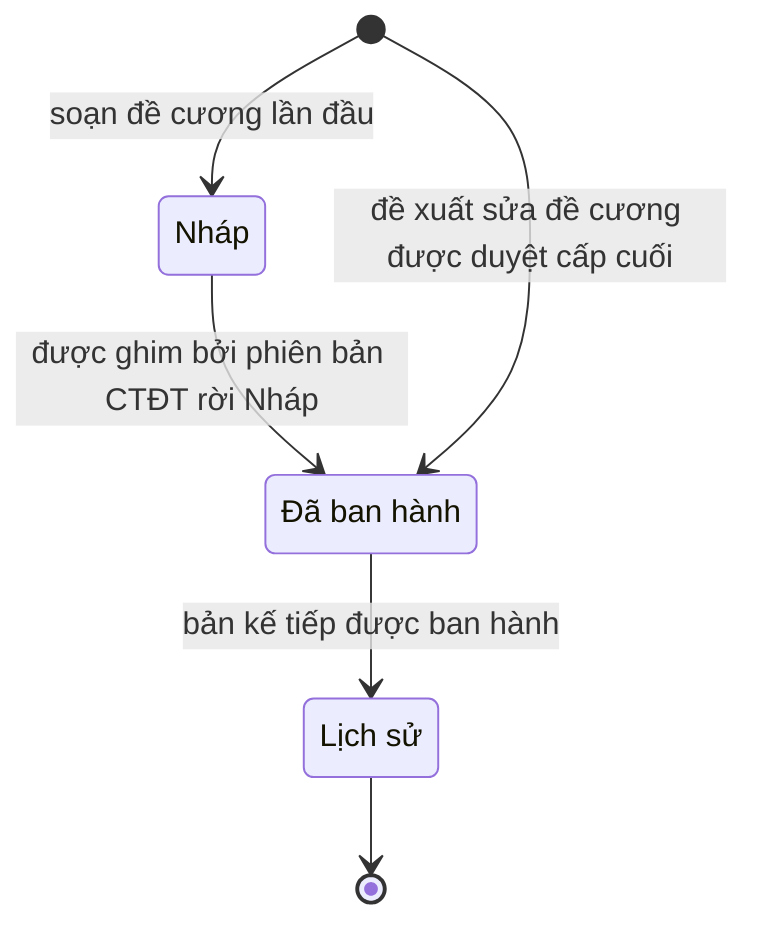

| # | Từ | Sự kiện | Điều kiện | Đến | Tác nhân | Nguồn |
|---|---|---|---|---|---|---|
| DC-01 | `[*]` | Soạn đề cương lần đầu cho học phần | Học phần chưa có bản đề cương nào | Nháp | R1; R3, R4, R5 trong phạm vi | FR-44, H-4, UC-33 |
| DC-02 | Nháp | Sửa trực tiếp nội dung, CLO, công thức điểm | Tổng trọng số bằng 100% thì mới lưu được công thức điểm (BR-12, EC-39) | Nháp | R1; R3, R4, R5 trong phạm vi | H-4, UC-33, UC-35 |
| DC-03 | Nháp | Lần đầu được ghim bởi một `PhienBanCTDT` rời Nháp (PB-03, PB-04, PB-05) | `moTaHocPhan`, `mucTieu` có nội dung; tổng trọng số 100% (BR-12); mọi CLO có thành phần đánh giá (BR-14); thành phần điều kiện có ngưỡng (BR-15). Ghi `thoiDiemBanHanh` | Đã ban hành | Hệ thống | M-1, EC-44, FR-69 |
| DC-04 | `[*]` | Đề xuất có thay đổi đề cương, CLO hoặc công thức điểm được duyệt cấp cuối (DX-10) | Bản mới chép từ bản Đã ban hành (`phienBanTruoc`) rồi áp `NoiDungThayDoi`; `deXuatNguon` = đề xuất; `soPhienBanNoiBo` tăng 1 | Đã ban hành | Hệ thống | M-1, M-2, DEC-02, S-9 |
| DC-05 | Đã ban hành | Bản kế tiếp của cùng học phần được ban hành (DC-04) | — | Lịch sử | Hệ thống | M-1, S-9 |

Bản Đã ban hành và bản Lịch sử đều bất biến. Bản nào **đang áp dụng** cho một chương trình không đọc từ `trangThai` mà đọc từ `DongKhungCTDT.deCuong` của phiên bản chương trình tương ứng (xem S-9).

---

## 6. `HocPhan`

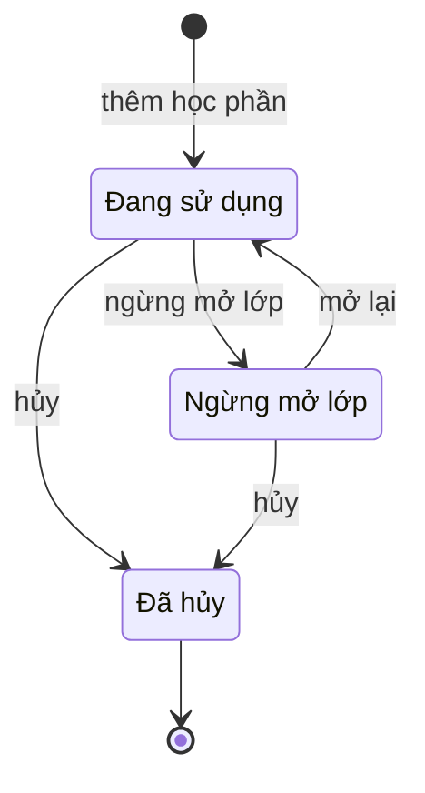

| # | Từ | Sự kiện | Điều kiện | Đến | Tác nhân | Nguồn |
|---|---|---|---|---|---|---|
| HP-01 | `[*]` | Thêm học phần vào danh mục | `maHocPhan` chưa tồn tại; `soTinChi` ≥ 0 (BR-01) | Đang sử dụng | R1 | FR-11, FR-15, UC-11 |
| HP-02 | Đang sử dụng | Ngừng mở lớp | Đã có `QuanHeHocPhan` loại QH5 từ học phần này tới một học phần Đang sử dụng | Ngừng mở lớp | R1 | FR-15, EC-12, EC-32, UC-12 |
| HP-03 | Ngừng mở lớp | Mở lại | — | Đang sử dụng | R1 | S-10 |
| HP-04 | Đang sử dụng · Ngừng mở lớp | Hủy | Học phần không nằm trong `DongKhungCTDT` của phiên bản nào đã rời Nháp và không có `KetQuaHocTap`. Sai điều kiện thì chỉ được chuyển Ngừng mở lớp | Đã hủy | R1 | FR-15, EC-50, S-10 |

Không có thao tác xóa cứng học phần (EC-50). Đã hủy là trạng thái cuối.

---

## 7. `UyQuyenDuyet`

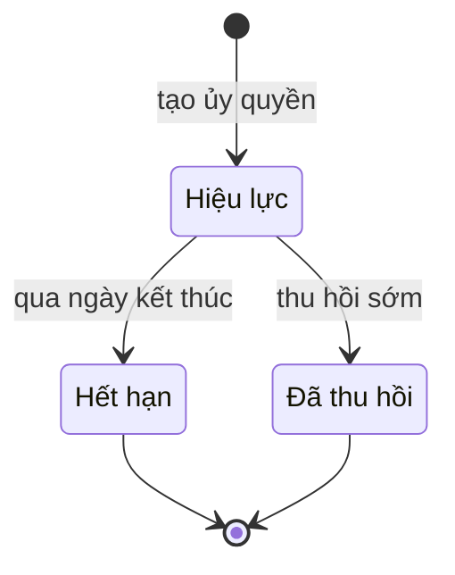

| # | Từ | Sự kiện | Điều kiện | Đến | Tác nhân | Nguồn |
|---|---|---|---|---|---|---|
| UQ-01 | `[*]` | Tạo ủy quyền | `nguoiDuocUyQuyen` khác `nguoiUyQuyen` và đang Hoạt động; `denNgay` không trước `tuNgay`; người ủy quyền đang là người duyệt của cấp nêu ở `phamVi` | Hiệu lực | R3, R4 cho chính mình; R1 cho bất kỳ ai | FR-09, EC-25, UC-08 |
| UQ-02 | Hiệu lực | Qua `denNgay` | — | Hết hạn | Hệ thống | FR-09 |
| UQ-03 | Hiệu lực | Thu hồi sớm | Người thu hồi là `nguoiUyQuyen` hoặc R1 | Đã thu hồi | R3, R4, R1 | UC-08, S-11 |
| UQ-04 | Hiệu lực | Một trong hai tài khoản chuyển Vô hiệu hóa | — | Đã thu hồi | Hệ thống | EC-51, S-11 |

Ủy quyền ở trạng thái Hiệu lực chỉ dùng được khi ngày hiện tại nằm trong khoảng `tuNgay`..`denNgay` (S-11).

---

## 8. `PhienNhapLieu`

Một lần nhập Excel, theo quy trình của SRS mục 6.3.

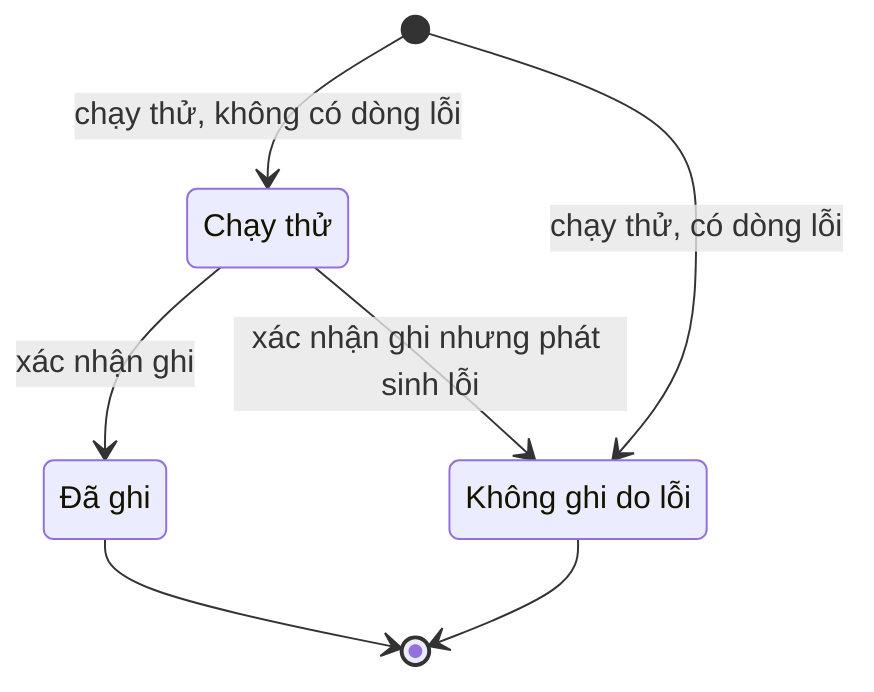

| # | Từ | Sự kiện | Điều kiện | Đến | Tác nhân | Nguồn |
|---|---|---|---|---|---|---|
| NL-01 | `[*]` | Tải tệp lên và chạy thử | Tệp đúng định dạng mẫu; `soDongLoi` = 0. Dòng mức CẢNH BÁO không chặn. Chưa ghi dữ liệu nghiệp vụ | Chạy thử | R1; R3 trong phạm vi phân công | FR-34, SRS mục 6.3, UC-72 |
| NL-02 | `[*]` | Tải tệp lên và chạy thử | Tệp sai định dạng (EC-47), hoặc `soDongLoi` > 0 (EC-45, EC-46, chu trình tiên quyết). `baoCaoLoi` ghi từng dòng | Không ghi do lỗi | R1; R3 trong phạm vi phân công | FR-34, FR-35, EC-45, EC-46, EC-47 |
| NL-03 | Chạy thử | Xác nhận ghi | Hệ thống kiểm tra lại toàn bộ tệp (UC-75) và vẫn không có lỗi; ghi toàn bộ trong một giao dịch | Đã ghi | Người đã chạy thử | FR-35, FR-101, UC-73 |
| NL-04 | Chạy thử | Xác nhận ghi | Kiểm tra lại phát sinh lỗi vì dữ liệu nền đã đổi sau lúc chạy thử, hoặc việc ghi hỏng giữa chừng; hoàn tác toàn bộ | Không ghi do lỗi | Hệ thống | FR-35, S-12 |

Phiên Chạy thử không được xác nhận thì giữ nguyên Chạy thử và vẫn nằm trong lịch sử phiên nhập (FR-101).

---

## 9. `LogDongBo`

Một lần đồng bộ với cơ sở dữ liệu có sẵn của Trường.

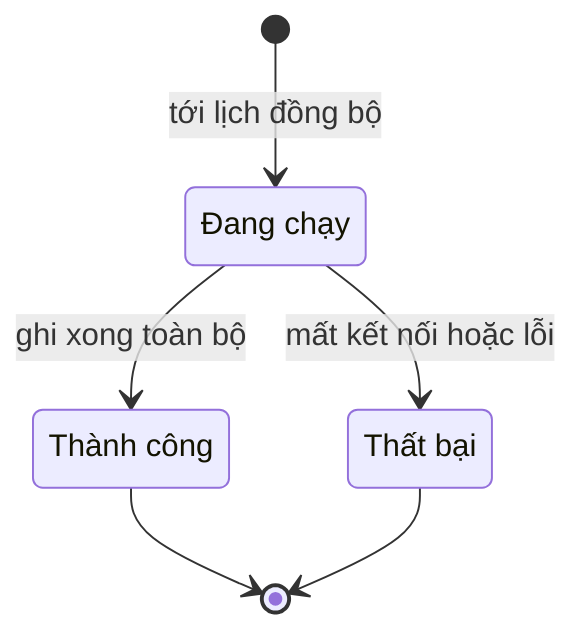

| # | Từ | Sự kiện | Điều kiện | Đến | Tác nhân | Nguồn |
|---|---|---|---|---|---|---|
| DB-01 | `[*]` | Tới lịch đồng bộ, hoặc R1 bấm chạy ngay | Kết nối chỉ đọc đã cấu hình; không có lần đồng bộ nào khác Đang chạy | Đang chạy | Hệ thống; R1 | FR-98, FR-99, UC-77 |
| DB-02 | Đang chạy | Đọc và ghi xong toàn bộ | Bản ghi mâu thuẫn giữa hai nguồn được xử lý theo quy tắc ưu tiên của SRS mục 8.2 và đếm vào `soMauThuan` | Thành công | Hệ thống | FR-100, EC-48, DEC-10 |
| DB-03 | Đang chạy | Mất kết nối hoặc lỗi bất kỳ | Hoàn tác toàn bộ dữ liệu của lần chạy; ghi `thongBaoLoi`; lần kế tiếp chạy theo lịch | Thất bại | Hệ thống | EC-49 |
| DB-04 | Đang chạy | Lần chạy bị treo quá thời hạn cấu hình | Phát hiện khi tới lịch kế tiếp | Thất bại | Hệ thống | S-13 |

---

## 10. `GhiDanhCTDT`

Sinh viên theo một chương trình ở một phiên bản cụ thể.

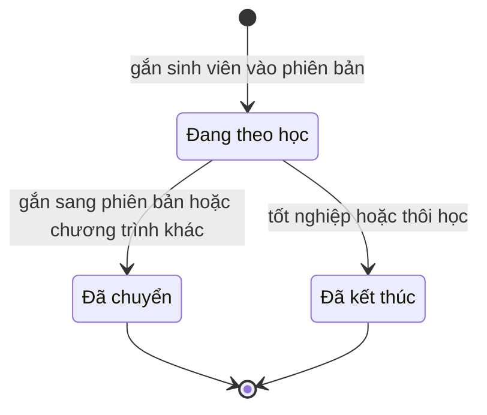

| # | Từ | Sự kiện | Điều kiện | Đến | Tác nhân | Nguồn |
|---|---|---|---|---|---|---|
| GD-01 | `[*]` | Gắn sinh viên vào phiên bản theo khóa | Có `ApDungPhienBan` cho khóa của sinh viên; phiên bản không ở Nháp; sinh viên chưa có dòng Đang theo học của chương trình đó; `laNgoaiLe` = Không | Đang theo học | Hệ thống, khi nhập hoặc đồng bộ sinh viên | FR-74, BR-26, M-8, UC-65 |
| GD-02 | `[*]` | Gắn riêng một sinh viên | `laNgoaiLe` = Có; `canCu` bắt buộc; phiên bản không ở Nháp. Song ngành thì `loaiGhiDanh` = Song ngành (EC-34) | Đang theo học | R1 | BR-26, EC-33, EC-34, EC-35, UC-52 |
| GD-03 | Đang theo học | Sinh viên được gắn sang phiên bản khác của cùng chương trình, hoặc sang chương trình khác | Dòng mới (GD-01 hoặc GD-02) được tạo trong cùng giao dịch | Đã chuyển | R1 | BR-26, EC-33, EC-35, E-9, UC-52 |
| GD-04 | Đang theo học | `SinhVien.trangThai` chuyển Thôi học hoặc Đã tốt nghiệp | — | Đã kết thúc | Hệ thống | E-10, S-14 |

Sinh viên Bảo lưu giữ nguyên dòng Đang theo học và phiên bản của khóa gốc (EC-37). Ban hành phiên bản mới không kích hoạt GD-03 (M-8).

---

## 11. `SinhVien`

Trạng thái của sinh viên do nguồn dữ liệu quyết định (Excel hoặc cơ sở dữ liệu có sẵn). Hệ thống chỉ đọc và ghi lại, không tự quyết.

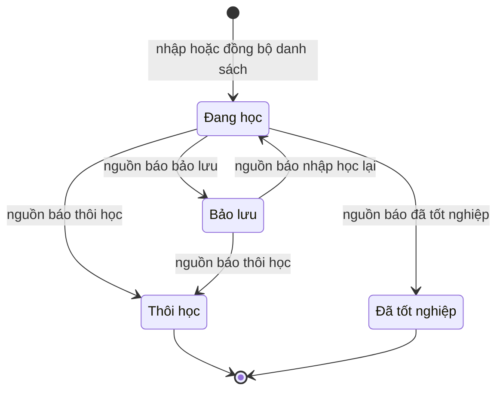

| # | Từ | Sự kiện | Điều kiện | Đến | Tác nhân | Nguồn |
|---|---|---|---|---|---|---|
| SV-01 | `[*]` | Nhập danh sách sinh viên từ Excel hoặc đồng bộ | `maSinhVien` chưa tồn tại. Dòng mới nhận trạng thái mà nguồn ghi, mặc định Đang học | Đang học | R1 qua Excel; E1 qua đồng bộ | FR-96, FR-98, E-10 |
| SV-02 | Đang học | Nguồn ghi trạng thái bảo lưu | — | Bảo lưu | R1 qua Excel; E1 | EC-37, E-10 |
| SV-03 | Bảo lưu | Nguồn ghi trạng thái đang học | Giữ phiên bản của khóa gốc | Đang học | R1 qua Excel; E1 | EC-37 |
| SV-04 | Đang học · Bảo lưu | Nguồn ghi trạng thái thôi học | Kéo theo GD-04 | Thôi học | R1 qua Excel; E1 | E-10 |
| SV-05 | Đang học | Nguồn ghi trạng thái đã tốt nghiệp | Kéo theo GD-04. Kết quả `KetQuaXetTotNghiep` = Đủ điều kiện **không** tự gây ra chuyển trạng thái này | Đã tốt nghiệp | R1 qua Excel; E1 | E-10, S-14 |

Khi Excel và cơ sở dữ liệu có sẵn ghi hai trạng thái khác nhau cho cùng sinh viên, cơ sở dữ liệu có sẵn thắng (SRS mục 8.2, DEC-10) và lần đồng bộ ghi một cảnh báo (EC-48).

---

## 12. `KetQuaHocTap`

Hệ thống không nhập điểm (SRS mục 12). Trạng thái của một dòng kết quả đi theo nguồn dữ liệu.

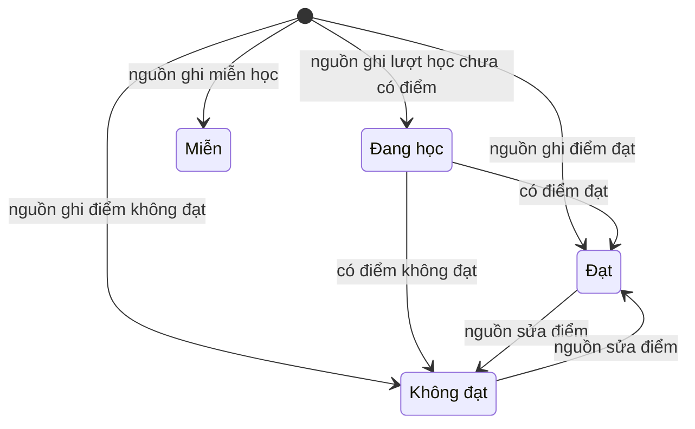

| # | Từ | Sự kiện | Điều kiện | Đến | Tác nhân | Nguồn |
|---|---|---|---|---|---|---|
| KQ-01 | `[*]` | Nhập hoặc đồng bộ một lượt học của một học phần trong một học kỳ | Chưa có dòng cho bộ (`sinhVien`, `hocPhan`, `hocKy`). Trạng thái lấy theo nguồn | Đang học · Đạt · Không đạt · Miễn | R1 qua Excel; E1 | FR-96, FR-98, DEC-11 |
| KQ-02 | Đang học | Nguồn có điểm | Đạt hay Không đạt do nguồn ghi; hệ thống lưu ba thang điểm và không tự tính lại | Đạt · Không đạt | R1 qua Excel; E1 | DEC-11, Q-03 |
| KQ-03 | Đạt · Không đạt | Nguồn sửa điểm hồi tố | Nếu sinh viên đã có `KetQuaXetTotNghiep`, hệ thống xét lại, lưu một dòng kết quả mới và thông báo cho Phòng Đào tạo | Không đạt · Đạt | R1 qua Excel; E1 | EC-43 |

Học lại hoặc học cải thiện tạo dòng mới ở học kỳ khác, không sửa dòng cũ; khi tính toán lấy điểm cao nhất (EC-36).

---

## 13. Thực thể chỉ có hai trạng thái

Không vẽ sơ đồ. Cả hai chiều chuyển đều được phép trừ khi bảng ghi khác.

| Thực thể | Thuộc tính | Hai trạng thái | Ai chuyển | Điều kiện, ghi chú | Nguồn |
|---|---|---|---|---|---|
| `DonVi` | `trangThai` | Đang hoạt động · Ngừng hoạt động | R1 | Không xóa đơn vị đã có dữ liệu; ngừng thay cho xóa | FR-01, UC-02 |
| `NhomChuyenMon` | `trangThai` | Đang sử dụng · Ngừng sử dụng | R1 | Ngừng thay cho xóa | FR-02, UC-02 |
| `NguoiDung` | `trangThai` | Hoạt động · Vô hiệu hóa | R1 | Tài khoản đã phát sinh giao dịch chỉ được vô hiệu hóa, không xóa cứng. Vô hiệu hóa kéo theo UQ-04 | FR-06, EC-51, EC-29, UC-05 |
| `ChuongTrinhDaoTao` | `trangThai` | Đang sử dụng · Ngừng sử dụng | R1 | Chương trình đang có sinh viên chỉ được chuyển Ngừng sử dụng; cấm xóa cứng | EC-50 |
| `ThongBao` | `trangThaiDoc` | Chưa đọc · Đã đọc | Người nhận | Một chiều: Chưa đọc → Đã đọc | FR-63, UC-47 |
| `BenTichHop` | `trangThai` | Hoạt động · Đã khóa | R1 | Bên bị khóa thì mọi lời gọi API bị từ chối | FR-94, API-03 |

`KetQuaXetTotNghiep.ketLuan` (Đủ điều kiện · Chưa đủ điều kiện) không phải vòng đời: mỗi lần xét tạo một dòng mới, dòng cũ không đổi (M-9).

---

## 14. Điểm còn hở

Các lựa chọn dưới đây là **tạm thời**. Cột "Ảnh hưởng" ghi những gì phải sửa nếu lựa chọn đổi.

| # | Vấn đề | Liên quan | Lựa chọn tạm | Ảnh hưởng nếu đổi |
|---|---|---|---|---|
| S-1 | **Ban lãnh đạo khoa có tạo đề xuất không.** Ma trận SRS mục 3.4 ghi R2 không có quyền "Tạo đề xuất thay đổi"; UC-09 và UC-37 lại liệt kê R2 là tác nhân | SRS mục 3.4, UC-09, UC-37, E-4 | Theo SRS: R2 không tạo đề xuất về dữ liệu đào tạo. R2 và R4 chỉ tạo được loại "Thay đổi tổ chức / phân công", loại này đi DX-06 thẳng tới Phòng Đào tạo | DX-01, DX-06; quyền trên màn hình tạo đề xuất |
| S-2 | **Xóa đề xuất nháp.** UC-37 cho xóa nháp; FR-67 đòi giữ lịch sử duyệt đầy đủ | UC-37, FR-67 | Chỉ xóa được nháp chưa từng gửi (`lanGui` = 0). Nháp đã từng bị trả lại thì không xóa, chỉ để yên hoặc gửi lại | DX-03 |
| S-3 | **"Chưa có cấp nào phê duyệt" khi một cấp có nhiều người.** FR-60 không nói trường hợp một trong nhiều điều phối đã đồng ý nhưng cấp chưa xong | FR-60, EC-22 | Chặt hơn: chỉ cần một người đã bấm Đồng ý là không thu hồi được. Cấp bị bỏ qua không tính là đã phê duyệt | DX-14 |
| S-4 | **`BuocDuyet.hanhDong` thiếu giá trị cho cấp bị bỏ qua và cho dòng bị bỏ dở.** Danh sách hiện có: Chờ · Đồng ý · Trả lại · Từ chối | `BuocDuyet`, FR-61, FR-65 | Cấp bị bỏ qua ghi Đồng ý kèm `coBoQua` = Có. Dòng còn Chờ khi đề xuất bị trả lại, từ chối hoặc thu hồi thì giữ nguyên Chờ và bị loại khỏi hàng đợi bằng điều kiện `lanGui` và trạng thái đề xuất | BD-02, DX-12; nếu thêm giá trị "Bỏ qua" và "Đã đóng" vào từ điển dữ liệu thì hai quy tắc này gọn hơn |
| S-5 | **Học kỳ hiệu lực đã bắt đầu hoặc chưa có ngày bắt đầu.** `HocKy.ngayBatDau` được để trống; BR-16 cấm hồi tố | BR-16, BR-25, DEC-07, `HocKy` | Khi duyệt cấp cuối, học kỳ hiệu lực phải có `ngayBatDau` và ngày đó chưa tới. Ngoại lệ duy nhất là ban hành khởi tạo (PB-04) | DX-10, DX-11, PB-06; tác vụ kích hoạt đầu học kỳ |
| S-6 | **Phòng Đào tạo không đồng ý sau khi hai cấp dưới đã đồng ý.** EC-26 viết "từ chối" nhưng kết quả là về Nháp; SRS mục 6.1 viết Từ chối là đóng | EC-26, C02, BR-29 | Hai nút riêng ở cả ba cấp: Trả lại → Nháp, Từ chối → Từ chối (đóng). EC-26 được hiểu là Trả lại | DX-12, DX-13 |
| S-7 | **Nạp các phiên bản đã có trước khi dùng hệ thống.** Ví dụ SRS mục 6.2.3 có ba phiên bản 1.0, 1.1, 2.0 cùng còn khóa đang học; H-1 chỉ cho ban hành khởi tạo một lần | H-1, SRS mục 6.2.3, BR-22 | Ban hành khởi tạo dùng cho phiên bản cũ nhất còn khóa đang học, cho phép học kỳ hiệu lực đã qua (PB-04). Các phiên bản sau đó nạp bằng đề xuất do Phòng Đào tạo tạo; riêng trong đợt nạp ban đầu, điều kiện "học kỳ chưa tới" của S-5 được Phòng Đào tạo bỏ qua có ghi nhật ký | PB-04, DX-10; có thể cần một thuộc tính đánh dấu "nạp dữ liệu lịch sử" trên `DeXuatThayDoi` |
| S-8 | **Phiên bản đính chính có đi qua ba cấp duyệt không.** UC-53 ghi đi qua luồng duyệt; từ điển dữ liệu ghi `PhienBanCTDT.deXuatNguon` trống ở bản đính chính; ma trận SRS chỉ cho R1 ban hành | UC-53, FR-75, DEC-08, `PhienBanCTDT` | R1 ban hành đính chính trực tiếp, bắt buộc `lyDoDinhChinh`, không qua cấp 1 và 2. Bản đính chính tăng số Phụ. Bản bị đính chính chuyển Lịch sử, kể cả khi chưa kịp có hiệu lực (PB-09) | PB-08, PB-09; nếu phải qua ba cấp thì bản đính chính sinh từ DX-10 và `deXuatNguon` có giá trị |
| S-9 | **Đề cương đã duyệt nhưng chưa tới học kỳ hiệu lực không có trạng thái riêng.** `DeCuongChiTiet` chỉ có Nháp · Đã ban hành · Lịch sử, trong khi BR-16 nói công thức điểm mới chỉ áp dụng từ học kỳ kế tiếp | BR-16, DEC-07, C10, M-1 | Bản mới chuyển Đã ban hành ngay khi duyệt cấp cuối, bản trước chuyển Lịch sử cùng lúc. Bản đang áp dụng được xác định qua `DongKhungCTDT.deCuong` của phiên bản chương trình Đang hiệu lực, không qua `trangThai` | DC-04, DC-05; màn hình và API tra cứu đề cương phải nhận ngữ cảnh chương trình hoặc học kỳ. Nếu thêm trạng thái "Chờ hiệu lực" cho đề cương thì sửa từ điển dữ liệu |
| S-10 | **Ý nghĩa của "Đã hủy" và việc mở lại học phần.** SRS chỉ liệt kê ba trạng thái, không nêu chuyển nào được phép | FR-15, EC-50 | Đã hủy dành cho học phần chưa từng nằm trong phiên bản đã ban hành và chưa có kết quả học tập; là trạng thái cuối. Ngừng mở lớp mở lại được | HP-03, HP-04 |
| S-11 | **Ủy quyền có ngày bắt đầu ở tương lai, và ủy quyền của tài khoản bị vô hiệu hóa.** Danh sách trạng thái không có "Chưa hiệu lực" | FR-09, `UyQuyenDuyet` | Dòng nhận Hiệu lực ngay khi tạo; chỉ dùng được trong khoảng `tuNgay`..`denNgay`. Vô hiệu hóa một trong hai tài khoản thì ủy quyền tự chuyển Đã thu hồi | UQ-01, UQ-04 |
| S-12 | **Dữ liệu nền đổi giữa lúc chạy thử và lúc xác nhận.** SRS mục 6.3 không nói bước xác nhận có kiểm tra lại không | SRS mục 6.3, UC-73, UC-75 | Xác nhận luôn kiểm tra lại toàn bộ tệp; có lỗi thì không ghi gì và phiên chuyển Không ghi do lỗi | NL-03, NL-04 |
| S-13 | **Lần đồng bộ bị treo.** EC-49 chỉ nói trường hợp mất kết nối được phát hiện | EC-49, `LogDongBo` | Lần chạy Đang chạy quá một thời hạn cấu hình được (NFR-24) thì bị đánh Thất bại khi tới lịch kế tiếp | DB-04; thêm một tham số cấu hình (E-7) |
| S-14 | **Ai đặt trạng thái "Đã tốt nghiệp".** Hệ thống xét điều kiện tốt nghiệp nhưng việc công nhận tốt nghiệp nằm ngoài phạm vi | SRS mục 12, E-10, FR-84 | Trạng thái sinh viên chỉ đổi theo nguồn dữ liệu. Kết quả xét Đủ điều kiện không tự đổi `SinhVien.trangThai` | SV-05, GD-04 |
