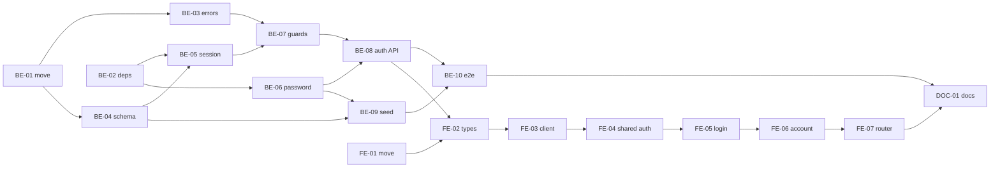

# F-01 Login and Session — Backend + Frontend Implementation Plan

This plan builds local-account login, logout, a 60-minute idle session stored in PostgreSQL, a forced password change on first login, and the "My account" screen (MH-03) with self-service password change. It also lays the groundwork every later feature builds on: the `src/features/` + `src/shared/` layout on both sides, the global error envelope, `cuid` primary keys, CSRF protection, the authenticated-route guard on the backend and the route guard on the frontend.

It deliberately excludes the audit log (US-002, US-003 — deferred by answer F01-07), roles, permissions and per-role menus (F-02), R1 resetting another user's password (F-02, MH-06), account lockout and "forgot password".

> **Companion documents**
> - Requirement: `docs/requirement/REQUIREMENTS.md` — NFR-06, NFR-07, NFR-08, NFR-24, Q-13
> - Story and acceptance criteria: `docs/planning/user-stories.md:64` (US-001); epic EP-01 in `docs/planning/epics.md:51`
> - Tasks: `docs/planning/task-breakdown.md:95-99` (CV-001..CV-005)
> - Design: `docs/design/sequence-diagrams.md:59` (§2 login flow), `docs/design/data-dictionary.md:66` (`User`), `docs/design/screen-inventory.md:52-54` (MH-01..MH-03), `docs/design/tech-stack.md:33-38`
> - Answers: `docs/planning/feature-questions.md` §F-00, §F-01
> - Tests: `docs/planning/test-plan.md:387` (NFR-08 case), NT-B1-01, NT-B1-07

**Status**: Complete 2026-10-18 (BE-01..BE-10, FE-01..FE-07, DOC-01; §7 manual walk passed, seed run on the dev database). Build record: `docs/implement-report/f-01-auth-session-implement-report.md`

---

## 0. Plan at a glance

Everything below in one table. Read this; the rest is detail for whoever builds it.

| What | Why | How and where |
|---|---|---|
| **Code moves to `features/` + `shared/`** on both sides | Answers F00-01, F00-02; every later feature is written into this layout | Backend: `health` → `src/features/health/`; `config`, `prisma`, `queue` → `src/shared/`. Frontend: `api`, `layout`, `pages` → `src/shared/` and `src/features/health/`. Pure moves, no behaviour change (BE-01, FE-01) |
| **One error shape for every failed call** — `{ statusCode, code, message, details?, path, timestamp }` | Answer F00-08; the frontend shows `message` (Vietnamese) and branches on `code` | `AppException` + a catch-all filter in `src/shared/`; validation errors carry per-field constraint keys in `details` (BE-03); the frontend `ApiError` reads it (FE-03) |
| **Users can log in and out** with username + password | US-001 AC1–AC3; local accounts first (F01-01) | `POST /api/auth/login`, `POST /api/auth/logout`, `GET /api/auth/me` (BE-08); login screen MH-01 (FE-05) |
| **Wrong username and wrong password look identical** | US-001 AC2 — no hint which part was wrong | One 401 `INVALID_CREDENTIALS`; an unknown username still runs one Argon2 verify so the response time does not leak it (BE-06, BE-08) |
| **A disabled account is told to contact Phòng Đào tạo** — only after the right password | US-001 AC3 | 403 `ACCOUNT_DISABLED`, checked after the password (BE-08) |
| **Session ends after 60 idle minutes; the next action is refused** | US-001 AC4, NFR-08 | `express-session` with rolling cookie + `connect-pg-simple` store in a `session` table; idle minutes from `SESSION_IDLE_MINUTES` (BE-05) |
| **Passwords stored only as Argon2id hashes** | US-001 AC5, NFR-06 | `PasswordService` in `src/shared/password/` (BE-06); `User.passwordHash` (BE-04) |
| **First R1 account is seeded and must change its password** | Answer F00-16, F01-04 | `prisma/seed.ts` upserts it with `mustChangePassword = true` (BE-09); the guard blocks everything except `me`, `logout`, `change-password` until changed (BE-07) |
| **My account screen with password change** | MH-03, F01-04, F01-05 (≥ 8 chars, letters and digits) | `POST /api/auth/change-password` (BE-08); `AccountPage` (FE-06) |
| **Every page except login requires a session** | NFR-07/08; F00-05 (`/me` is the only client state) | Backend global `AuthenticatedGuard` with `@Public()` opt-out (BE-07); frontend `RequireAuth` route on `useMe` (FE-04, FE-07); pages lazy-loaded (F00-18) |
| **CSRF protection** | Cookie sessions need it; F01-08 | `SameSite=Lax` cookie + global `CsrfGuard` requiring `X-Requested-With: XMLHttpRequest` on writes (BE-07); the client always sends it (FE-03) |
| **Database gets its first tables** — `User`, `session` | First migration of the project | `cuid(2)` ids (F00-10), `UserStatus` enum, `createdAt`/`updatedAt` (BE-04) |

### Key behaviours worth knowing

| Behaviour | Why it is this way |
|---|---|
| Every authenticated request reloads the `User` row (one primary-key read) | A disabled account loses access on its very next call, without hunting down its sessions — this already satisfies F02-08 "open sessions end immediately" (D2) |
| `GET /api/auth/me` renews the idle timer like any other call | `rolling: true` renews on every response. Any background polling would keep a session alive forever — F-14's 60-second notification poll must not (§8) |
| Logout is public and always answers 204 | An expired session can still press "Đăng xuất" without an error (D14) |
| Login regenerates the session id | Prevents session fixation: an id planted before login is never the one that becomes authenticated |
| A failed login is written to the application log only (username, IP), never to the database | No `AuditLog` table yet (F01-07); passwords are never logged |
| `GET /api/health` still answers 503 with `HealthDto`, not the error envelope | The status is set on the response instead of thrown, so the global filter never wraps it (D5) |
| Usernames are trimmed and lower-cased on login and on creation | `Admin` and `admin` are the same account; the unique index is on the normalised value (D7) |
| Changing `SESSION_SECRET` logs everyone out | Existing cookies no longer verify; expected on rotation |

### Not included

| Excluded | Why |
|---|---|
| Audit log — table, writes, lookup screen (US-002, US-003, NFR-10) | Answer F01-07: deferred. Recorded in `docs/planning/deferred-scope.md` §2 |
| Roles, permissions, per-role menu, `@RequirePermission` | F-02. US-001 AC1 "sees the items of their role" completes there; F-01 shows the same menu to everyone |
| `User.orgUnit` | `OrgUnit` does not exist until F-02 builds it (F02-07); F-02 adds the nullable column |
| R1 resets another user's password, account list (MH-05, MH-06) | F-02 |
| Lockout or rate limit after failed logins | Answer F01-03 A: none; failures are logged |
| Forgot password by email | Answer F01-04 A: R1 resets it |
| SSO (Entra ID) | Answer F01-01 A: later; auth is isolated in `features/auth` so a second login route can be added |
| Ending the user's *other* sessions on password change | Needs a lookup of sessions by user; add with F-02's deactivation work if wanted |
| HTTPS termination | Caddy, F-27. F-01 only marks the cookie `Secure` in production and trusts one proxy hop |
| Playwright acceptance scenario NT-B1-01 | Needs F-03 (org tree); written with B1's last feature |

### Open questions

All F-01 questions are answered (`feature-questions.md` §F-00, §F-01). Small choices the answers did not cover:

| Question | Resolved when | Default if unanswered |
|---|---|---|
| Seeded R1 username and user code | Before running the seed in a shared environment | `admin` / `ADMIN` (`SEED_ADMIN_USERNAME` overrides the username) |
| Session cookie name | Any time before production | `ctdt.sid` |

---

## 1. Scope

| In scope | Why |
|---|---|
| Backend and frontend folder restructure | F00-01, F00-02 — must precede any feature code |
| Global error envelope, validation error shape | F00-08 |
| `User` (without `orgUnit`), `session` table, first migration | CV-001; F00-10 `cuid` |
| Login, logout, me, change password | US-001, CV-002, F01-04 |
| Global authenticated guard, `@Public()`, `@CurrentUser()`, CSRF guard | Every later endpoint depends on them |
| Seed of the first R1 account | F00-16 |
| Login (MH-01), Home (MH-02, minimal), My account (MH-03, without roles) | CV-003 |
| Unit tests + Testcontainers e2e | F00-21, CV-005 |

| Out of scope | Deferred until |
|---|---|
| Audit log (US-002, US-003) | Undecided; `deferred-scope.md` §2 |
| Roles, permissions, scope, per-role menus | F-02 |
| `User.orgUnit`, account management screens | F-02 |
| HTTPS, reverse proxy | F-27 |

| AC | Covered by |
|---|---|
| US-001 AC1 — correct credentials → home page | BE-08, FE-05, FE-07 (role-specific menu items: F-02) |
| US-001 AC2 — wrong password or unknown user → one generic message | BE-06 (`verifyAgainstDummy`), BE-08, BE-10 test, FE-05 |
| US-001 AC3 — disabled account → refused, told to contact Phòng Đào tạo | BE-08, BE-10 test, FE-05 |
| US-001 AC4 — 60 idle minutes → must log in again; the action is not performed | BE-05, BE-07, BE-10 test, FE-03 (`handleSessionError`), FE-04 |
| US-001 AC5 — database holds only `passwordHash` | BE-04, BE-06, BE-10 test |
| CV-001 minimal `User` | BE-04 |
| CV-002 login, logout, idle expiry from config, failed logins logged, no lockout | BE-05, BE-08 |
| CV-003 login screen, page frame, Vietnamese UI | FE-05, FE-07 |
| CV-005 tests: right/wrong login, expiry, disabled, encrypted transport only | BE-10; encrypted transport: cookie `Secure` in production (BE-05), HTTPS itself F-27 |
| F01-04 self password change, forced on first login | BE-07, BE-08, FE-04, FE-06 |
| F01-05 password rule | BE-06, FE-06 |
| F01-08 CSRF | BE-07, FE-03 |

---

## 2. Contract verification

The backend endpoints below are **defined by this plan**, so for them §2 records the contract both sides build to; the only pre-existing endpoint is `/api/health`. Rows citing a library are claims about packages not yet installed — they are **UNVERIFIED** until BE-02 installs them, and each has a §8 risk.

### 2a. Endpoints

| Endpoint | Verified at | Request | Response | Notes |
|---|---|---|---|---|
| `GET /api/health` | `source/backend/src/health/health.controller.ts:15-24` | — | 200 / 503 `HealthDto` | 503 is produced by throwing `ServiceUnavailableException(result)`; BE-03 changes the mechanism to `response.status(503)` so the body stays `HealthDto`. BE-07 marks it `@Public()` |
| `POST /api/auth/login` | defined in BE-08 | `LoginDto` + header `X-Requested-With` | 200 `MeDto`; 400 `VALIDATION_FAILED`; 401 `INVALID_CREDENTIALS`; 403 `ACCOUNT_DISABLED`, `CSRF_HEADER_MISSING` | Public. Regenerates the session, sets cookie `ctdt.sid`. Logs failures |
| `POST /api/auth/logout` | defined in BE-08 | header `X-Requested-With` | 204, no body | Public, idempotent. Destroys the session row, clears the cookie |
| `GET /api/auth/me` | defined in BE-08 | cookie | 200 `MeDto`; 401 `SESSION_REQUIRED` | Allowed while a password change is pending. Renews the idle timer |
| `POST /api/auth/change-password` | defined in BE-08 | `ChangePasswordDto` + header | 204; 400 `VALIDATION_FAILED`, `CURRENT_PASSWORD_WRONG`, `PASSWORD_UNCHANGED`; 401 `SESSION_REQUIRED` | Allowed while a password change is pending; clears `mustChangePassword` |
| any route, any failure | defined in BE-03 | — | `ErrorResponseDto` | Unmatched routes → 404 `NOT_FOUND`; unknown errors → 500 `INTERNAL_ERROR`, logged |
| any protected route | defined in BE-07 | — | 401 `SESSION_REQUIRED`; 403 `PASSWORD_CHANGE_REQUIRED` | No protected route other than the three above exists in F-01; the 403 branch is unit-tested in BE-07 |

**Library contracts the plan relies on — UNVERIFIED until installed:**

| Claim | Where to verify at build time | Used by |
|---|---|---|
| `express-session` with `rolling: true` resets the cookie `maxAge` on every response and calls `store.touch()` when the session is unmodified | `node_modules/express-session/index.js` (`rolling`, `touch`) | BE-05 |
| `connect-pg-simple` reads only rows whose `expire` is in the future, so an idle-expired session is "no session" | `node_modules/connect-pg-simple/index.js` (`get`) | BE-05, AC4 |
| `connect-pg-simple`'s table is `sid varchar PK "session_pkey"`, `sess json`, `expire timestamp(6)`, index `IDX_session_expire` | `node_modules/connect-pg-simple/table.sql` | BE-04 `Session` model |
| `argon2.hash(pw, { type: argon2.argon2id })` returns a `$argon2id$...` string; `argon2.verify(hash, pw)` returns a boolean | `node_modules/argon2/argon2.d.ts` | BE-06 |
| Prisma 7.10 accepts `@default(cuid(2))` | `pnpm prisma:generate` succeeds | BE-04 |
| Prisma 7 reads the seed command from `prisma.config.ts` `migrations.seed`, and `migrate dev` no longer runs `generate` or the seed | `node_modules/prisma/` config types; run output | BE-04, BE-09 |

### 2b. DTOs

**`MeDto`** — response of `login` and `me` (BE-08 `me.dto.ts`)

| Field | Wire type | Nullable | Source | Modeled as (frontend) | Note |
|---|---|---|---|---|---|
| `id` | `string` (cuid2) | no | BE-04 `User.id` | `Me['id']` | |
| `username` | `string` | no | `User.username` | `Me['username']` | normalised lower-case |
| `userCode` | `string` | no | `User.userCode` | `Me['userCode']` | |
| `fullName` | `string` | no | `User.fullName` | `Me['fullName']` | header and MH-03 |
| `email` | `string \| null` | **yes** | `User.email` | `Me['email']` | MH-03 shows "—" when null |
| `mustChangePassword` | `boolean` | no | `User.mustChangePassword` | `Me['mustChangePassword']` | drives the `RequireAuth` redirect |

`passwordHash` and `status` are never sent. F-02 adds roles and permissions to this DTO.

**`ErrorResponseDto`** — every error (BE-03 `error-response.dto.ts`)

| Field | Wire type | Nullable | Source | Modeled as (frontend) | Note |
|---|---|---|---|---|---|
| `statusCode` | `number` | no | filter | `ApiError.status` | read from the HTTP status, not the body |
| `code` | `string` — values in F-01: `'VALIDATION_FAILED' \| 'SESSION_REQUIRED' \| 'PASSWORD_CHANGE_REQUIRED' \| 'CSRF_HEADER_MISSING' \| 'INVALID_CREDENTIALS' \| 'ACCOUNT_DISABLED' \| 'CURRENT_PASSWORD_WRONG' \| 'PASSWORD_UNCHANGED' \| 'BAD_REQUEST' \| 'UNAUTHORIZED' \| 'FORBIDDEN' \| 'NOT_FOUND' \| 'CONFLICT' \| 'REQUEST_FAILED' \| 'INTERNAL_ERROR'` | no | BE-03 `error-codes.ts`, BE-08 `auth.errors.ts` | `ApiError.code` | open set: later features add codes, so it is `string` on the wire |
| `message` | `string` (Vietnamese) | no | same | `ApiError.message` | shown to the user as is |
| `details` | `FieldErrorDto[]` | optional | BE-03 | `ApiError.details` | only on `VALIDATION_FAILED` |
| `path` | `string` | no | `request.originalUrl` | **not modeled** | diagnostics only |
| `timestamp` | `string` (ISO 8601) | no | filter | **not modeled** | diagnostics only |

**`FieldErrorDto`**

| Field | Wire type | Nullable | Source | Modeled as | Note |
|---|---|---|---|---|---|
| `field` | `string` | no | `ValidationError.property`, dotted for nested | `details[i].field` | |
| `constraints` | `string[]` | no | `Object.keys(ValidationError.constraints)` — e.g. `'isNotEmpty'`, `'minLength'`, `'matches'` | `details[i].constraints` | keys, not sentences — the frontend validates the same rules first and owns the wording |

**`HealthDto`** — unchanged; `source/backend/src/health/health.dto.ts:10-18`: `status: 'ok' | 'error'`, `database: 'up' | 'down'`, `redis: 'up' | 'down'`, none nullable. Modeled as `Health` in `features/health/api/health.ts`.

**Requests** (BE-08)

| DTO | Field | Wire type | Rules |
|---|---|---|---|
| `LoginDto` | `username` | `string` | trimmed + lower-cased, not empty, ≤ `USERNAME_MAX_LENGTH` (64) |
| | `password` | `string` | not empty, ≤ `PASSWORD_MAX_LENGTH` (128); no strength rule — old passwords must still log in |
| `ChangePasswordDto` | `currentPassword` | `string` | not empty, ≤ 128 |
| | `newPassword` | `string` | ≥ `PASSWORD_MIN_LENGTH` (8), ≤ 128, matches `PASSWORD_PATTERN` (a letter and a digit) |

### 2c. Mismatch log

| Deliverable | What the upstream doc says | What this plan does | Found at |
|---|---|---|---|
| BE-04 | `User` has `orgUnit → OrgUnit` | Column omitted; F-02 adds it nullable with `OrgUnit` | `data-dictionary.md:75` |
| BE-04 | `User` has no forced-change flag | Adds ⊕ `mustChangePassword` (F00-16, F01-04) — data dictionary gets the row in DOC-01 | `data-dictionary.md:68-79` |
| BE-08 | Login and logout "ghi nhật ký" (write the log) | Application log only; no `AuditLog` (F01-07) | `sequence-diagrams.md:76,88` |
| BE-07 | Roles and scope are loaded at login | F-01 has none; F-02 decides where they load. The guard reloads the user per request (D2) | `sequence-diagrams.md:75,99` |
| BE-01 | Move config and Prisma sources to `src/shared/` | Existing `test/prisma-collation.e2e-spec.ts` imports their old paths, but BE-01 does not include that test in its file list | `source/backend/test/prisma-collation.e2e-spec.ts:3-4` |
| DOC-01 | Audit-table privileges "set up with F-01"; F-01 builds the audit log | Deferred; both lines rewritten | `database_and_models.md:161`, `general_architecture.md:77` |
| — | F-01 is 17 points (US-001..003) | 10 points (US-001); the 7 deferred points leave the README total | `implementation/README.md:109` |

---

## 3. Decisions

| # | Decision | Why | Rejected alternative |
|---|---|---|---|
| D1 | Sessions via `express-session` + `connect-pg-simple`; the `session` table is declared in `schema.prisma` and created by the migration, `createTableIfMissing: false` | Tech-stack choice; declaring the table keeps `prisma migrate` from seeing it as drift and dropping it | Letting the store create the table at runtime — Prisma would generate a migration dropping it |
| D2 | `AuthenticatedGuard` reloads the user's `status` and `mustChangePassword` on every protected request | A disabled account is locked out on its next call without deleting sessions by user; one indexed read per request is negligible | Trusting a snapshot in the session — deactivation (F02-08) would then need to find and delete session rows by JSON content |
| D3 | CSRF: `SameSite=Lax` cookie + a global guard requiring `X-Requested-With: XMLHttpRequest` on non-GET/HEAD/OPTIONS | F01-08 A. A cross-site page cannot set a custom header without a CORS preflight, and the backend enables no CORS | Synchronizer token (`csrf-csrf`) — an extra round trip and token plumbing for no gain here |
| D4 | Errors: `AppException(definition, details?)` where a definition is `{ status, code, message }` constant; one `@Catch()` filter maps everything to `ErrorResponseDto` | One place defines each code's status and Vietnamese message; built-in Nest exceptions still get a code from their status | Subclass per error — dozens of classes for what is data |
| D5 | Health's 503 is set with `@Res({ passthrough: true })`, not thrown | The global filter would replace the `HealthDto` body with the envelope and break `HealthPage` and the e2e test | Exempting health inside the filter — a special case in shared code |
| D6 | Ids are `String @id @default(cuid(2))` | F00-10 C; cuid v1 is deprecated by its author for predictability | `cuid()` (v1) |
| D7 | Usernames trimmed and lower-cased by a shared `normalizeUsername` on login (DTO transform), seed, and later F-02 creation | Case-insensitive login with a plain unique index | `citext` column — an extension for one column |
| D8 | Unknown username runs `PasswordService.verifyAgainstDummy` | AC2: timing must not reveal whether the username exists | Early return — ~50 ms faster for unknown names, which is the leak |
| D9 | Failed login → `Logger.warn` with username and IP | CV-002 "log failed logins" with no audit table (F01-07) | Skipping it |
| D10 | Prisma models and fields are not `@map`ped (table `User`, column `passwordHash`), except `Session` → `session` | Existing convention: `source/backend/README.md:52`; `session` is the store's default name | snake_case mapping everywhere |
| D11 | Every business table gets `createdAt @default(now())` and `updatedAt @updatedAt`, implicit like `id` | Cheap, needed by later lists ("newest first") | Adding them per entity when asked |
| D12 | Split: `shared/auth` holds what every feature uses (decorators, guards, current user); `features/auth` holds the endpoints and screens. Same split on the frontend (`shared/auth` = session state, `features/auth` = screens) | Features must not import other features (`nestjs-rules.md` §1, `react-vite-rules.md` §4) | Everything in `features/auth` — every feature would import it |
| D13 | Frontend `fetchMe` returns `null` on 401 instead of throwing; a cache-level handler sets `me` to `null` on any `SESSION_REQUIRED` | "Not logged in" is a normal state for the route guard, not an error; an expiry mid-use redirects from one place | Each page handling 401 itself |
| D14 | Logout is `@Public()` and idempotent | Pressing "Đăng xuất" after expiry must not show an error | Protected logout |
| D15 | Seed runs with `tsx` | It resolves the `.js` import suffixes of this ESM project to `.ts`; Node's own type stripping does not | `node --experimental-strip-types` |
| D16 | MH-03 now shows identity fields and the password form only; F-02 adds roles and scope | Roles do not exist yet | Waiting for F-02 to build MH-03 — the forced first-login change needs a screen now |
| D17 | Queries do not retry 4xx responses | A 401 retried three times delays the login redirect | TanStack default (3 retries for every error) |

---

## 5. Deliverables

Backend paths are relative to `source/backend/`, frontend paths to `source/frontend/`. **No git writes** at any step (`ai-rules.md` Rule 7): moves are plain file moves; git sees them as delete + add.

### BE-01 — Move backend code to `features/` + `shared/`

What/Why: F00-01. Pure move with import updates; behaviour unchanged.

**Files**

| Action | Path |
|---|---|
| MOVE | `src/config/env.validation.ts` → `src/shared/config/env.validation.ts` |
| MOVE | `src/prisma/prisma.module.ts`, `prisma.service.ts` → `src/shared/prisma/` |
| MOVE | `src/queue/queue.module.ts` → `src/shared/queue/queue.module.ts` |
| MOVE | `src/health/*.ts` (5 files) → `src/features/health/` |
| MODIFY | `src/app.module.ts`, `src/main.ts`, moved files' relative imports |
| DELETE | empty `src/config/`, `src/prisma/`, `src/queue/`, `src/health/` |

**Shape**

```ts
// src/app.module.ts
import { Module } from '@nestjs/common';
import { ConfigModule } from '@nestjs/config';
import { HealthModule } from './features/health/health.module.js';
import { validateEnv } from './shared/config/env.validation.js';
import { PrismaModule } from './shared/prisma/prisma.module.js';
import { QueueModule } from './shared/queue/queue.module.js';
```

Import changes inside moved files:

| File | Old import | New import |
|---|---|---|
| `shared/prisma/prisma.service.ts` | `'../config/env.validation.js'`, `'../generated/prisma/client.js'` | `'../config/env.validation.js'` (unchanged), `'../../generated/prisma/client.js'` |
| `shared/queue/queue.module.ts` | `'../config/env.validation.js'` | unchanged |
| `features/health/health.service.ts` | `'../config/env.validation.js'`, `'../prisma/prisma.service.js'` | `'../../shared/config/env.validation.js'`, `'../../shared/prisma/prisma.service.js'` |
| `main.ts` | `'./config/env.validation.js'` | `'./shared/config/env.validation.js'` |

**Rationale**: Target layout from `nestjs-rules.md` §1; the module files themselves are unchanged.

**Gotchas**
- `src/generated/prisma` stays where it is (`prisma/schema.prisma` `output = "../src/generated/prisma"`); only the relative path from `shared/prisma/` grows one `../`.
- Every relative import keeps its `.js` suffix (ESM, `module: nodenext`).
- Do not use `git mv` (Rule 7).

**Verify**: `pnpm exec tsc --noEmit -p tsconfig.json`; `pnpm test` (health spec passes); `pnpm lint`.

**Depends on**: —

---

### BE-02 — Install backend dependencies

What/Why: Session, store, hashing and seed runner.

**Files**: MODIFY `package.json`, `pnpm-lock.yaml`.

**Shape**

```
pnpm add express-session connect-pg-simple pg argon2
pnpm add -D @types/express-session @types/connect-pg-simple @types/pg tsx
```

```jsonc
// package.json scripts — added
"prisma:seed": "prisma db seed"
```

**Rationale**: Libraries fixed by `docs/design/tech-stack.md:33-38`. `pg` becomes a direct dependency because the session store gets its own pool (BE-05); `@prisma/adapter-pg` already pulls it in transitively but transitive packages are not importable under pnpm.

**Gotchas**
- pnpm 10 does not run dependency build scripts unless approved. `argon2` ships prebuilt binaries; if `import('argon2')` fails at runtime, run `pnpm approve-builds` and allow `argon2`.
- pnpm is currently bound to Node 20 by Volta (§8): fix first, or `engines` (`>=22.22.0 <23`) makes the install complain.
- After install, re-read the library contracts in §2a and log any difference in §2c.

**Verify**: `pnpm install --frozen-lockfile` succeeds; `node -e "import('argon2').then(a => a.hash('x', { type: a.argon2id })).then(console.log)"` prints a `$argon2id$` string.

**Depends on**: —

---

### BE-03 — Global error envelope

What/Why: F00-08. Every error leaves the API as `ErrorResponseDto`.

**Files**

| Action | Path |
|---|---|
| NEW | `src/shared/exception/error-definition.ts` |
| NEW | `src/shared/exception/error-codes.ts` |
| NEW | `src/shared/exception/app.exception.ts` |
| NEW | `src/shared/exception/validation-exception.factory.ts` |
| NEW | `src/shared/dtos/error-response.dto.ts` |
| NEW | `src/shared/filter/all-exceptions.filter.ts` |
| NEW | `src/shared/filter/all-exceptions.filter.spec.ts` |
| MODIFY | `src/app.setup.ts` |
| MODIFY | `src/features/health/health.controller.ts`, `health.controller.spec.ts` |

**Shape**

```ts
// src/shared/exception/error-definition.ts
import type { HttpStatus } from '@nestjs/common';

export interface ErrorDefinition {
  status: HttpStatus;
  code: string;
  message: string;
}
```

```ts
// src/shared/exception/error-codes.ts
import { HttpStatus } from '@nestjs/common';
import type { ErrorDefinition } from './error-definition.js';

export const COMMON_ERRORS = {
  VALIDATION_FAILED: {
    status: HttpStatus.BAD_REQUEST,
    code: 'VALIDATION_FAILED',
    message: 'Dữ liệu gửi lên không hợp lệ.',
  },
  SESSION_REQUIRED: {
    status: HttpStatus.UNAUTHORIZED,
    code: 'SESSION_REQUIRED',
    message: 'Phiên làm việc đã hết hạn hoặc chưa đăng nhập. Vui lòng đăng nhập lại.',
  },
  PASSWORD_CHANGE_REQUIRED: {
    status: HttpStatus.FORBIDDEN,
    code: 'PASSWORD_CHANGE_REQUIRED',
    message: 'Bạn cần đổi mật khẩu trước khi tiếp tục.',
  },
  CSRF_HEADER_MISSING: {
    status: HttpStatus.FORBIDDEN,
    code: 'CSRF_HEADER_MISSING',
    message: 'Yêu cầu không hợp lệ.',
  },
  INTERNAL_ERROR: {
    status: HttpStatus.INTERNAL_SERVER_ERROR,
    code: 'INTERNAL_ERROR',
    message: 'Hệ thống gặp lỗi, vui lòng thử lại sau.',
  },
} as const satisfies Record<string, ErrorDefinition>;

// Built-in Nest exceptions (unmatched route, body parse failure) carry only a status.
export const ERRORS_BY_STATUS: Partial<Record<HttpStatus, ErrorDefinition>> = {
  [HttpStatus.BAD_REQUEST]: { status: HttpStatus.BAD_REQUEST, code: 'BAD_REQUEST', message: 'Yêu cầu không hợp lệ.' },
  [HttpStatus.UNAUTHORIZED]: { status: HttpStatus.UNAUTHORIZED, code: 'UNAUTHORIZED', message: 'Bạn chưa đăng nhập.' },
  [HttpStatus.FORBIDDEN]: { status: HttpStatus.FORBIDDEN, code: 'FORBIDDEN', message: 'Bạn không có quyền thực hiện thao tác này.' },
  [HttpStatus.NOT_FOUND]: { status: HttpStatus.NOT_FOUND, code: 'NOT_FOUND', message: 'Không tìm thấy.' },
  [HttpStatus.CONFLICT]: { status: HttpStatus.CONFLICT, code: 'CONFLICT', message: 'Dữ liệu đã bị thay đổi, vui lòng tải lại.' },
};

export const UNMAPPED_CLIENT_ERROR_CODE = 'REQUEST_FAILED';
export const UNMAPPED_CLIENT_ERROR_MESSAGE = 'Yêu cầu không thực hiện được.';
```

```ts
// src/shared/exception/app.exception.ts
import { HttpException } from '@nestjs/common';
import type { FieldErrorDto } from '../dtos/error-response.dto.js';
import type { ErrorDefinition } from './error-definition.js';

export class AppException extends HttpException {
  readonly code: string;
  readonly details?: FieldErrorDto[];

  constructor(definition: ErrorDefinition, details?: FieldErrorDto[]) {
    super(definition.message, definition.status);
    this.code = definition.code;
    this.details = details;
  }
}
```

```ts
// src/shared/exception/validation-exception.factory.ts
import type { ValidationError } from 'class-validator';
import type { FieldErrorDto } from '../dtos/error-response.dto.js';
import { AppException } from './app.exception.js';
import { COMMON_ERRORS } from './error-codes.js';

export function validationExceptionFactory(errors: ValidationError[]): AppException {
  return new AppException(COMMON_ERRORS.VALIDATION_FAILED, toFieldErrors(errors));
}

function toFieldErrors(errors: ValidationError[], parent?: string): FieldErrorDto[] {
  return errors.flatMap((error) => {
    const field = parent ? `${parent}.${error.property}` : error.property;
    const own = error.constraints
      ? [{ field, constraints: Object.keys(error.constraints) }]
      : [];
    return [...own, ...toFieldErrors(error.children ?? [], field)];
  });
}
```

```ts
// src/shared/dtos/error-response.dto.ts
import { ApiProperty, ApiPropertyOptional } from '@nestjs/swagger';

export class FieldErrorDto {
  @ApiProperty()
  field: string;

  @ApiProperty({ type: [String] })
  constraints: string[];
}

export class ErrorResponseDto {
  @ApiProperty()
  statusCode: number;

  @ApiProperty()
  code: string;

  @ApiProperty()
  message: string;

  @ApiPropertyOptional({ type: [FieldErrorDto] })
  details?: FieldErrorDto[];

  @ApiProperty()
  path: string;

  @ApiProperty()
  timestamp: string;
}
```

```ts
// src/shared/filter/all-exceptions.filter.ts
import {
  type ArgumentsHost,
  Catch,
  type ExceptionFilter,
  HttpException,
  HttpStatus,
  Logger,
} from '@nestjs/common';
import type { Request, Response } from 'express';
import type { ErrorResponseDto } from '../dtos/error-response.dto.js';
import { AppException } from '../exception/app.exception.js';
import {
  COMMON_ERRORS,
  ERRORS_BY_STATUS,
  UNMAPPED_CLIENT_ERROR_CODE,
  UNMAPPED_CLIENT_ERROR_MESSAGE,
} from '../exception/error-codes.js';

@Catch()
export class AllExceptionsFilter implements ExceptionFilter {
  private readonly logger = new Logger(AllExceptionsFilter.name);

  catch(exception: unknown, host: ArgumentsHost): void {
    const http = host.switchToHttp();
    const request = http.getRequest<Request>();
    const body = toErrorBody(exception, request.originalUrl);
    if (body.statusCode >= HttpStatus.INTERNAL_SERVER_ERROR) {
      this.logger.error(exception);
    }
    http.getResponse<Response>().status(body.statusCode).json(body);
  }
}

export function toErrorBody(exception: unknown, path: string): ErrorResponseDto {
  const timestamp = new Date().toISOString();
  if (exception instanceof AppException) {
    return {
      statusCode: exception.getStatus(),
      code: exception.code,
      message: exception.message,
      details: exception.details,
      path,
      timestamp,
    };
  }
  if (exception instanceof HttpException) {
    const statusCode = exception.getStatus();
    const known = ERRORS_BY_STATUS[statusCode];
    if (known) {
      return { statusCode, code: known.code, message: known.message, path, timestamp };
    }
    if (statusCode < HttpStatus.INTERNAL_SERVER_ERROR) {
      return {
        statusCode,
        code: UNMAPPED_CLIENT_ERROR_CODE,
        message: UNMAPPED_CLIENT_ERROR_MESSAGE,
        path,
        timestamp,
      };
    }
  }
  const internal = COMMON_ERRORS.INTERNAL_ERROR;
  return { statusCode: internal.status, code: internal.code, message: internal.message, path, timestamp };
}
```

```ts
// src/app.setup.ts — changes inside configureApp
app.useGlobalPipes(
  new ValidationPipe({
    whitelist: true,
    forbidNonWhitelisted: true,
    transform: true,
    exceptionFactory: validationExceptionFactory,
  }),
);
app.useGlobalFilters(new AllExceptionsFilter());
```

```ts
// src/features/health/health.controller.ts
@Get()
@ApiOkResponse({ type: HealthDto })
@ApiServiceUnavailableResponse({ type: HealthDto })
async check(@Res({ passthrough: true }) response: Response): Promise<HealthDto> {
  const result = await this.health.check();
  if (result.status !== HealthStatus.Ok) {
    response.status(HttpStatus.SERVICE_UNAVAILABLE);
  }
  return result;
}
```

`health.controller.spec.ts`: replace the 503 case with "sets 503 and still returns the result": pass `{ status: vi.fn() } as unknown as Response`, assert `status` was called with `HttpStatus.SERVICE_UNAVAILABLE` and the promise resolves to `REDIS_DOWN`; the all-up case asserts `status` was not called.

`all-exceptions.filter.spec.ts` tests `toErrorBody` directly, one case per branch: `AppException` with details; `NotFoundException` → `NOT_FOUND`; `HttpException('x', 418)` → `REQUEST_FAILED`; `new Error()` → 500 `INTERNAL_ERROR`; and `validationExceptionFactory` flattening a nested child to `parent.child`.

**Rationale**: Exception and filter folders named by `nestjs-rules.md` §6 (`src/shared/exception/`, `src/shared/filter/`). Constant-object style mirrors `HealthStatus` in `src/features/health/health.dto.ts:3-4`. Health's controller keeps its decorators from `health.controller.ts:15-17`.

**Gotchas**
- Register the filter in `configureApp`, not as `APP_FILTER` — the e2e tests already call `configureApp`, so both paths stay identical (`app.setup.ts:8`).
- `HttpException.message` is the string passed to `super`; do not pass an object or the message becomes `"Http Exception"`.
- `details` are constraint *keys*. Do not add Vietnamese `message:` options to every validator — the frontend validates the same rules before sending.
- A malformed JSON body is rejected by the body parser before routing. Confirm in BE-10 that it arrives as `BAD_REQUEST`; if Nest bypasses the filter there, record it in §2c.

**Verify**: `pnpm test` (new filter spec + updated health spec); `pnpm exec tsc --noEmit -p tsconfig.json`; `pnpm lint`. BE-10 checks the live 404 and 400 shapes.

**Depends on**: BE-01

---

### BE-04 — Prisma schema: `User`, `Session`, first migration

What/Why: CV-001, D1, D6, D10, D11.

**Files**

| Action | Path |
|---|---|
| MODIFY | `prisma/schema.prisma` |
| NEW | `prisma/migrations/<timestamp>_auth_session/migration.sql` (generated) |
| MODIFY | `prisma.config.ts` (seed command, used by BE-09) |

**Shape**

```prisma
enum UserStatus {
  ACTIVE
  DISABLED
}

model User {
  id                 String     @id @default(cuid(2))
  userCode           String     @unique
  fullName           String
  email              String?
  status             UserStatus @default(ACTIVE)
  username           String     @unique
  passwordHash       String
  mustChangePassword Boolean    @default(false)
  createdAt          DateTime   @default(now())
  updatedAt          DateTime   @updatedAt
}

// Owned by connect-pg-simple: columns, key and index match its table.sql, so it never shows as drift.
model Session {
  sid    String   @id @db.VarChar
  sess   Json     @db.Json
  expire DateTime @db.Timestamp(6)

  @@index([expire], map: "IDX_session_expire")
  @@map("session")
}
```

```ts
// prisma.config.ts — migrations block
migrations: { path: 'prisma/migrations', seed: 'tsx prisma/seed.ts' },
```

Commands, in order:

```
pnpm services:up
pnpm prisma:migrate --name auth_session
pnpm prisma:generate
```

**Rationale**: Field names and enum values copied from `docs/design/data-dictionary.md:66-79`; model style per `source/backend/README.md:52`. The existing top-of-file comment in `schema.prisma:1` stays.

**Gotchas**
- `cuid(2)` ids are generated by Prisma Client, not by the database: a raw-SQL `INSERT` must supply `id`.
- Prisma 7 `migrate dev` does not run `generate`; the explicit `pnpm prisma:generate` is the codegen step — skipping it leaves `UserStatus` missing from `src/generated/prisma`.
- `Session.sid` must stay `@db.VarChar` and `sess` `@db.Json` (not `Jsonb`); otherwise the store's queries still work but the next `migrate dev` diffs against the store's expectations.
- Compare the generated `migration.sql` against `connect-pg-simple/table.sql` once BE-02 installs it (§2a).
- `pnpm services:up` needs Docker.

**Verify**: `migration.sql` creates `"User"` with unique indexes on `userCode` and `username`, enum `"UserStatus"`, table `"session"` with `session_pkey` and `IDX_session_expire`; `pnpm exec tsc --noEmit -p tsconfig.json` sees `UserStatus` from `src/generated/prisma/client.js`.

**Depends on**: BE-01

---

### BE-05 — Environment and session store

What/Why: NFR-08, NFR-24 (idle minutes from config), D1.

**Files**

| Action | Path |
|---|---|
| MODIFY | `src/shared/config/env.validation.ts` |
| NEW | `src/shared/session/session.constants.ts` |
| NEW | `src/shared/session/session-data.ts` |
| NEW | `src/shared/session/session-store.service.ts` |
| NEW | `src/shared/session/session.module.ts` |
| NEW | `src/shared/session/session-lifecycle.ts` |
| MODIFY | `src/app.module.ts`, `src/app.setup.ts`, `src/main.ts` |
| NEW | `test/test-env.ts` |
| MODIFY | `test/health.e2e-spec.ts` |
| MODIFY | `README.md` (variables table) |

**Shape**

```ts
// src/shared/config/env.validation.ts — added to class Env
const SESSION_SECRET_MIN_LENGTH = 32;
const DEFAULT_SESSION_IDLE_MINUTES = 60;

  @IsString()
  @MinLength(SESSION_SECRET_MIN_LENGTH)
  SESSION_SECRET: string;

  @IsInt()
  @Min(1)
  SESSION_IDLE_MINUTES: number = DEFAULT_SESSION_IDLE_MINUTES;
```

```ts
// src/shared/session/session.constants.ts
export const SESSION_COOKIE_NAME = 'ctdt.sid';
export const SESSION_TABLE = 'session';
export const MS_PER_MINUTE = 60_000;
// Caddy is the only proxy in front of the app; trusting it makes `secure` cookies and request.ip work.
export const TRUSTED_PROXY_HOPS = 1;
```

```ts
// src/shared/session/session-data.ts
declare module 'express-session' {
  interface SessionData {
    userId: string;
  }
}

export {};
```

```ts
// src/shared/session/session-store.service.ts
import { Injectable, type OnModuleDestroy } from '@nestjs/common';
import { ConfigService } from '@nestjs/config';
import connectPgSimple from 'connect-pg-simple';
import type { RequestHandler } from 'express';
import session from 'express-session';
import { Pool } from 'pg';
import type { Env } from '../config/env.validation.js';
import { MS_PER_MINUTE, SESSION_COOKIE_NAME, SESSION_TABLE } from './session.constants.js';
import './session-data.js';

@Injectable()
export class SessionStoreService implements OnModuleDestroy {
  readonly handler: RequestHandler;
  private readonly pool: Pool;

  constructor(config: ConfigService<Env, true>) {
    this.pool = new Pool({ connectionString: config.get('DATABASE_URL', { infer: true }) });
    const PgStore = connectPgSimple(session);
    this.handler = session({
      store: new PgStore({ pool: this.pool, tableName: SESSION_TABLE, createTableIfMissing: false }),
      name: SESSION_COOKIE_NAME,
      secret: config.get('SESSION_SECRET', { infer: true }),
      resave: false,
      saveUninitialized: false,
      rolling: true,
      cookie: {
        httpOnly: true,
        sameSite: 'lax',
        secure: config.get('NODE_ENV', { infer: true }) === 'production',
        maxAge: config.get('SESSION_IDLE_MINUTES', { infer: true }) * MS_PER_MINUTE,
      },
    });
  }

  async onModuleDestroy(): Promise<void> {
    await this.pool.end();
  }
}
```

```ts
// src/shared/session/session.module.ts
import { Module } from '@nestjs/common';
import { SessionStoreService } from './session-store.service.js';

@Module({
  providers: [SessionStoreService],
  exports: [SessionStoreService],
})
export class SessionModule {}
```

```ts
// src/shared/session/session-lifecycle.ts
import type { Request } from 'express';
import type { Session } from 'express-session';

// A new id at login: an id planted in the browser before login never becomes an authenticated one.
export async function startSession(request: Request, userId: string): Promise<void> {
  await new Promise<void>((resolve, reject) =>
    request.session.regenerate((error: unknown) => (error ? reject(error) : resolve())),
  );
  request.session.userId = userId;
  await new Promise<void>((resolve, reject) =>
    request.session.save((error: unknown) => (error ? reject(error) : resolve())),
  );
}

export async function endSession(session: Session | undefined): Promise<void> {
  if (!session) {
    return;
  }
  await new Promise<void>((resolve, reject) =>
    session.destroy((error: unknown) => (error ? reject(error) : resolve())),
  );
}
```

```ts
// src/app.setup.ts — signature and additions
export function configureApp(app: NestExpressApplication): void {
  const config: ConfigService<Env, true> = app.get(ConfigService);
  if (config.get('NODE_ENV', { infer: true }) === 'production') {
    app.set('trust proxy', TRUSTED_PROXY_HOPS);
  }
  app.use(app.get(SessionStoreService).handler);
  app.setGlobalPrefix(API_PREFIX);
  // ...pipes, filter, Swagger as before
}
```

```ts
// src/main.ts
const app = await NestFactory.create<NestExpressApplication>(AppModule);
```

```ts
// test/test-env.ts
import type { StartedPostgreSqlContainer } from '@testcontainers/postgresql';
import type { StartedRedisContainer } from '@testcontainers/redis';

const TEST_SESSION_SECRET = 'e2e-session-secret-long-enough-for-validation';

// Must run before AppModule is imported: ConfigModule.forRoot validates while the module is being decorated.
export function setAppEnv(postgres: StartedPostgreSqlContainer, redis: StartedRedisContainer): void {
  process.env.DATABASE_URL = postgres.getConnectionUri();
  process.env.REDIS_HOST = redis.getHost();
  process.env.REDIS_PORT = String(redis.getPort());
  process.env.SESSION_SECRET = TEST_SESSION_SECRET;
}
```

`test/health.e2e-spec.ts`: replace lines 19-21 with `setAppEnv(postgres, redis)`, create the app with `moduleRef.createNestApplication<NestExpressApplication>()`, and move the "imported late" comment to `test-env.ts` (above) — it is the same constraint.

`README.md` variables table gains:

| Biến | Giá trị mẫu | Bắt buộc |
|---|---|---|
| `SESSION_SECRET` | chuỗi ngẫu nhiên ≥ 32 ký tự | Có |
| `SESSION_IDLE_MINUTES` | `60` | Không, mặc định `60` |
| `SEED_ADMIN_USERNAME` | `admin` | Chỉ khi chạy seed, mặc định `admin` |
| `SEED_ADMIN_PASSWORD` | mật khẩu tạm ≥ 8 ký tự, có chữ và số | Chỉ khi chạy seed |

**Rationale**: Env properties keep explicit types as `env.validation.ts:15-16` requires. The service-owning-a-client-with-`onModuleDestroy` shape mirrors `src/features/health/health.service.ts:10-46` (own `Redis` connection, closed on destroy). Getting the handler with `app.get` inside `configureApp` keeps `main.ts` and e2e on one path (`app.setup.ts:8`).

**Gotchas**
- The session pool is separate from Prisma's: `connect-pg-simple` needs a `pg.Pool`, and Prisma's adapter does not expose one. Two pools against one database is fine at this size.
- `app.use(handler)` must come before any route runs; `app.use` in `configureApp` does, because Nest mounts its router at `init()`.
- `NODE_ENV` is `test` under Vitest, so the cookie is not `Secure` in e2e and supertest keeps it.
- The health e2e must call `setAppEnv` or startup fails on the now-required `SESSION_SECRET`.
- `express-session`'s default export and `connect-pg-simple`'s factory are CommonJS; with `esModuleInterop` the default imports above work — confirm against the installed typings.

**Verify**: `pnpm exec tsc --noEmit -p tsconfig.json`; `pnpm test:e2e` — the existing health e2e still passes; starting `pnpm dev` without `SESSION_SECRET` fails with `Invalid environment: ... SESSION_SECRET ...`.

**Depends on**: BE-02, BE-04

---

### BE-06 — Password hashing and policy

What/Why: NFR-06, F01-05, D7, D8. Shared because F-02's reset and the seed hash passwords too.

**Files**

| Action | Path |
|---|---|
| NEW | `src/shared/password/password-policy.ts` |
| NEW | `src/shared/password/password.service.ts` |
| NEW | `src/shared/password/password.service.spec.ts` |
| NEW | `src/shared/password/password.module.ts` |
| NEW | `src/shared/auth/username.ts` |

**Shape**

```ts
// src/shared/password/password-policy.ts
export const PASSWORD_MIN_LENGTH = 8;
// Caps Argon2 work per request; no real password is longer.
export const PASSWORD_MAX_LENGTH = 128;
export const PASSWORD_PATTERN = /^(?=.*\p{L})(?=.*\d).+$/u;
export const USERNAME_MAX_LENGTH = 64;
```

```ts
// src/shared/password/password.service.ts
import { Injectable } from '@nestjs/common';
import argon2 from 'argon2';

const DUMMY_PASSWORD = 'dummy-password-for-unknown-usernames';

@Injectable()
export class PasswordService {
  // Hashed once; verifying against it costs the same as verifying a real account.
  private readonly dummyHash = this.hash(DUMMY_PASSWORD);

  hash(password: string): Promise<string> {
    return argon2.hash(password, { type: argon2.argon2id });
  }

  verify(hash: string, password: string): Promise<boolean> {
    return argon2.verify(hash, password);
  }

  async verifyAgainstDummy(password: string): Promise<false> {
    await argon2.verify(await this.dummyHash, password);
    return false;
  }
}
```

```ts
// src/shared/password/password.module.ts
import { Global, Module } from '@nestjs/common';
import { PasswordService } from './password.service.js';

@Global()
@Module({
  providers: [PasswordService],
  exports: [PasswordService],
})
export class PasswordModule {}
```

```ts
// src/shared/auth/username.ts
export function normalizeUsername(raw: string): string {
  return raw.trim().toLowerCase();
}
```

Spec cases: `hash` returns a string starting `$argon2id$` and not containing the password; `verify` true for the right password, false for a wrong one; `verifyAgainstDummy` resolves `false`; `PASSWORD_PATTERN` rejects `abcdefgh` and `12345678`, accepts `abc12345` and `mậtkhẩu1`.

**Rationale**: `@Global` module mirrors `src/shared/prisma/prisma.module.ts:4-9`. Argon2 library from `tech-stack.md:38`.

**Gotchas**
- The service has no constructor dependencies on purpose: the seed (BE-09) instantiates it with `new PasswordService()` outside Nest.
- `\p{L}` needs the `u` flag; it counts Vietnamese letters as letters.
- Unit tests hit real Argon2 (~50 ms per hash) — acceptable; do not mock the thing under test.

**Verify**: `pnpm test` runs the spec green.

**Depends on**: BE-02

---

### BE-07 — Shared auth: decorators, current user, guards

What/Why: Every endpoint is protected by default; `@Public()` opts out. Enforces the forced password change and CSRF (D2, D3).

**Files**

| Action | Path |
|---|---|
| NEW | `src/shared/auth/public.decorator.ts` |
| NEW | `src/shared/auth/allow-pending-password-change.decorator.ts` |
| NEW | `src/shared/auth/authenticated-user.ts` |
| NEW | `src/shared/auth/current-user.decorator.ts` |
| NEW | `src/shared/auth/authenticated.guard.ts` |
| NEW | `src/shared/auth/authenticated.guard.spec.ts` |
| NEW | `src/shared/auth/csrf.guard.ts` |
| NEW | `src/shared/auth/csrf.guard.spec.ts` |
| MODIFY | `src/app.module.ts` (guards) |
| MODIFY | `src/features/health/health.controller.ts` (`@Public()`) |

**Shape**

```ts
// src/shared/auth/public.decorator.ts
import { SetMetadata } from '@nestjs/common';

export const IS_PUBLIC_KEY = 'isPublic';
export const Public = () => SetMetadata(IS_PUBLIC_KEY, true);
```

```ts
// src/shared/auth/allow-pending-password-change.decorator.ts
import { SetMetadata } from '@nestjs/common';

export const ALLOW_PENDING_PASSWORD_CHANGE_KEY = 'allowPendingPasswordChange';
export const AllowPendingPasswordChange = () =>
  SetMetadata(ALLOW_PENDING_PASSWORD_CHANGE_KEY, true);
```

```ts
// src/shared/auth/authenticated-user.ts
import type { Prisma } from '../../generated/prisma/client.js';

export const AUTHENTICATED_USER_SELECT = {
  id: true,
  username: true,
  userCode: true,
  fullName: true,
  email: true,
  status: true,
  mustChangePassword: true,
} as const satisfies Prisma.UserSelect;

export type AuthenticatedUser = Prisma.UserGetPayload<{ select: typeof AUTHENTICATED_USER_SELECT }>;

declare global {
  namespace Express {
    interface Request {
      user?: AuthenticatedUser;
    }
  }
}
```

```ts
// src/shared/auth/current-user.decorator.ts
import { createParamDecorator, type ExecutionContext } from '@nestjs/common';
import type { Request } from 'express';
import type { AuthenticatedUser } from './authenticated-user.js';

// Only valid on routes behind AuthenticatedGuard, which sets request.user.
export const CurrentUser = createParamDecorator(
  (_data: unknown, context: ExecutionContext): AuthenticatedUser =>
    context.switchToHttp().getRequest<Request>().user!,
);
```

```ts
// src/shared/auth/authenticated.guard.ts
import { type CanActivate, type ExecutionContext, Injectable } from '@nestjs/common';
import { Reflector } from '@nestjs/core';
import type { Request } from 'express';
import { UserStatus } from '../../generated/prisma/client.js';
import { AppException } from '../exception/app.exception.js';
import { COMMON_ERRORS } from '../exception/error-codes.js';
import { PrismaService } from '../prisma/prisma.service.js';
import { endSession } from '../session/session-lifecycle.js';
import { ALLOW_PENDING_PASSWORD_CHANGE_KEY } from './allow-pending-password-change.decorator.js';
import { AUTHENTICATED_USER_SELECT } from './authenticated-user.js';
import { IS_PUBLIC_KEY } from './public.decorator.js';

@Injectable()
export class AuthenticatedGuard implements CanActivate {
  constructor(
    private readonly reflector: Reflector,
    private readonly prisma: PrismaService,
  ) {}

  async canActivate(context: ExecutionContext): Promise<boolean> {
    if (this.isMarked(IS_PUBLIC_KEY, context)) {
      return true;
    }
    const request = context.switchToHttp().getRequest<Request>();
    const userId = request.session?.userId;
    if (!userId) {
      throw new AppException(COMMON_ERRORS.SESSION_REQUIRED);
    }
    // Re-read every request so a disabled account loses access on its next call.
    const user = await this.prisma.user.findUnique({
      where: { id: userId },
      select: AUTHENTICATED_USER_SELECT,
    });
    if (!user || user.status !== UserStatus.ACTIVE) {
      await endSession(request.session);
      throw new AppException(COMMON_ERRORS.SESSION_REQUIRED);
    }
    if (user.mustChangePassword && !this.isMarked(ALLOW_PENDING_PASSWORD_CHANGE_KEY, context)) {
      throw new AppException(COMMON_ERRORS.PASSWORD_CHANGE_REQUIRED);
    }
    request.user = user;
    return true;
  }

  private isMarked(key: string, context: ExecutionContext): boolean {
    return this.reflector.getAllAndOverride<boolean>(key, [
      context.getHandler(),
      context.getClass(),
    ]) === true;
  }
}
```

```ts
// src/shared/auth/csrf.guard.ts
import { type CanActivate, type ExecutionContext, Injectable } from '@nestjs/common';
import type { Request } from 'express';
import { AppException } from '../exception/app.exception.js';
import { COMMON_ERRORS } from '../exception/error-codes.js';

export const CSRF_HEADER = 'x-requested-with';
export const CSRF_HEADER_VALUE = 'XMLHttpRequest';
const SAFE_METHODS = new Set(['GET', 'HEAD', 'OPTIONS']);

// A cross-site page cannot add a custom header without a CORS preflight, and this API grants none.
@Injectable()
export class CsrfGuard implements CanActivate {
  canActivate(context: ExecutionContext): boolean {
    const request = context.switchToHttp().getRequest<Request>();
    if (SAFE_METHODS.has(request.method) || request.get(CSRF_HEADER) === CSRF_HEADER_VALUE) {
      return true;
    }
    throw new AppException(COMMON_ERRORS.CSRF_HEADER_MISSING);
  }
}
```

```ts
// src/app.module.ts — providers
providers: [
  { provide: APP_GUARD, useClass: CsrfGuard },
  { provide: APP_GUARD, useClass: AuthenticatedGuard },
],
```

`health.controller.ts`: add `@Public()` on the class.

Guard spec cases (mock `PrismaService.user.findUnique`, real `Reflector`, fake context with `getHandler`/`getClass` returning plain functions decorated via `Reflect.defineMetadata`): public route → true without a DB read; no `userId` → `SESSION_REQUIRED`; user missing → `SESSION_REQUIRED` and session destroyed; `DISABLED` → same; `mustChangePassword` on an unmarked route → `PASSWORD_CHANGE_REQUIRED`; on a marked route → true and `request.user` set; active user → true. CSRF spec: GET passes; POST without header → `CSRF_HEADER_MISSING`; POST with header passes.

**Rationale**: `@Public()` and `@CurrentUser()` are named in `nestjs-rules.md` §5; the session-based guard replaces its JWT guard per `CLAUDE.md` deviations. Guards live in `src/shared/` as §1 of that rule file places guards there.

**Gotchas**
- The non-null `!` in `CurrentUser` is safe only behind the guard; never use `@CurrentUser()` on a `@Public()` route.
- Both guards are global: every later controller is protected unless it says `@Public()`. Health must be public — the uptime monitor (F-27) has no session.
- `request.session` is `undefined` if the session middleware is missing (unit tests); the optional chaining covers it.
- F-02's `PermissionGuard` must be registered **after** `AuthenticatedGuard` so it can read `request.user`.

**Verify**: `pnpm test` (two new specs); `pnpm test:e2e` health still 200 without a cookie.

**Depends on**: BE-03, BE-04, BE-05

---

### BE-08 — Auth feature module

What/Why: US-001, F01-04. The four endpoints in §2a.

**Files**

| Action | Path |
|---|---|
| NEW | `src/features/auth/auth.module.ts` |
| NEW | `src/features/auth/auth.controller.ts` |
| NEW | `src/features/auth/auth.service.ts` |
| NEW | `src/features/auth/auth.service.spec.ts` |
| NEW | `src/features/auth/auth.errors.ts` |
| NEW | `src/features/auth/login.dto.ts` |
| NEW | `src/features/auth/change-password.dto.ts` |
| NEW | `src/features/auth/me.dto.ts` |
| MODIFY | `src/app.module.ts` (imports `AuthModule`, `SessionModule`, `PasswordModule`) |
| MODIFY | `src/app.setup.ts` (Swagger cookie auth) |

**Shape**

```ts
// src/features/auth/auth.errors.ts
import { HttpStatus } from '@nestjs/common';
import type { ErrorDefinition } from '../../shared/exception/error-definition.js';

export const AUTH_ERRORS = {
  INVALID_CREDENTIALS: {
    status: HttpStatus.UNAUTHORIZED,
    code: 'INVALID_CREDENTIALS',
    message: 'Tên đăng nhập hoặc mật khẩu không đúng.',
  },
  ACCOUNT_DISABLED: {
    status: HttpStatus.FORBIDDEN,
    code: 'ACCOUNT_DISABLED',
    message: 'Tài khoản đã bị vô hiệu hóa. Vui lòng liên hệ Phòng Đào tạo.',
  },
  CURRENT_PASSWORD_WRONG: {
    status: HttpStatus.BAD_REQUEST,
    code: 'CURRENT_PASSWORD_WRONG',
    message: 'Mật khẩu hiện tại không đúng.',
  },
  PASSWORD_UNCHANGED: {
    status: HttpStatus.BAD_REQUEST,
    code: 'PASSWORD_UNCHANGED',
    message: 'Mật khẩu mới phải khác mật khẩu hiện tại.',
  },
} as const satisfies Record<string, ErrorDefinition>;
```

```ts
// src/features/auth/login.dto.ts
import { ApiProperty } from '@nestjs/swagger';
import { Transform } from 'class-transformer';
import { IsNotEmpty, IsString, MaxLength } from 'class-validator';
import { normalizeUsername } from '../../shared/auth/username.js';
import { PASSWORD_MAX_LENGTH, USERNAME_MAX_LENGTH } from '../../shared/password/password-policy.js';

export class LoginDto {
  @ApiProperty()
  @Transform(({ value }) => (typeof value === 'string' ? normalizeUsername(value) : value))
  @IsString()
  @IsNotEmpty()
  @MaxLength(USERNAME_MAX_LENGTH)
  username: string;

  @ApiProperty()
  @IsString()
  @IsNotEmpty()
  @MaxLength(PASSWORD_MAX_LENGTH)
  password: string;
}
```

```ts
// src/features/auth/change-password.dto.ts
export class ChangePasswordDto {
  @ApiProperty()
  @IsString()
  @IsNotEmpty()
  @MaxLength(PASSWORD_MAX_LENGTH)
  currentPassword: string;

  @ApiProperty({ minLength: PASSWORD_MIN_LENGTH, maxLength: PASSWORD_MAX_LENGTH })
  @IsString()
  @MinLength(PASSWORD_MIN_LENGTH)
  @MaxLength(PASSWORD_MAX_LENGTH)
  @Matches(PASSWORD_PATTERN)
  newPassword: string;
}
```

```ts
// src/features/auth/me.dto.ts
import { ApiProperty } from '@nestjs/swagger';
import type { AuthenticatedUser } from '../../shared/auth/authenticated-user.js';

export class MeDto {
  @ApiProperty()
  id: string;

  @ApiProperty()
  username: string;

  @ApiProperty()
  userCode: string;

  @ApiProperty()
  fullName: string;

  @ApiProperty({ type: String, nullable: true })
  email: string | null;

  @ApiProperty()
  mustChangePassword: boolean;
}

export function toMeDto(user: AuthenticatedUser): MeDto {
  return {
    id: user.id,
    username: user.username,
    userCode: user.userCode,
    fullName: user.fullName,
    email: user.email,
    mustChangePassword: user.mustChangePassword,
  };
}
```

```ts
// src/features/auth/auth.service.ts
import { Injectable, Logger } from '@nestjs/common';
import { UserStatus } from '../../generated/prisma/client.js';
import { AUTHENTICATED_USER_SELECT, type AuthenticatedUser } from '../../shared/auth/authenticated-user.js';
import { AppException } from '../../shared/exception/app.exception.js';
import { PasswordService } from '../../shared/password/password.service.js';
import { PrismaService } from '../../shared/prisma/prisma.service.js';
import { AUTH_ERRORS } from './auth.errors.js';
import type { ChangePasswordDto } from './change-password.dto.js';
import type { LoginDto } from './login.dto.js';

@Injectable()
export class AuthService {
  private readonly logger = new Logger(AuthService.name);

  constructor(
    private readonly prisma: PrismaService,
    private readonly passwords: PasswordService,
  ) {}

  async login(dto: LoginDto, ip: string | undefined): Promise<AuthenticatedUser> {
    const user = await this.prisma.user.findUnique({
      where: { username: dto.username },
      select: { ...AUTHENTICATED_USER_SELECT, passwordHash: true },
    });
    const valid = user
      ? await this.passwords.verify(user.passwordHash, dto.password)
      : await this.passwords.verifyAgainstDummy(dto.password);
    if (!user || !valid) {
      this.logger.warn(`Failed login for "${dto.username}" from ${ip ?? 'unknown'}`);
      throw new AppException(AUTH_ERRORS.INVALID_CREDENTIALS);
    }
    // Checked after the password so the disabled state is shown only to its owner.
    if (user.status !== UserStatus.ACTIVE) {
      throw new AppException(AUTH_ERRORS.ACCOUNT_DISABLED);
    }
    const { passwordHash: _, ...authenticated } = user;
    return authenticated;
  }

  async changePassword(userId: string, dto: ChangePasswordDto): Promise<void> {
    const { passwordHash } = await this.prisma.user.findUniqueOrThrow({
      where: { id: userId },
      select: { passwordHash: true },
    });
    if (!(await this.passwords.verify(passwordHash, dto.currentPassword))) {
      throw new AppException(AUTH_ERRORS.CURRENT_PASSWORD_WRONG);
    }
    if (dto.newPassword === dto.currentPassword) {
      throw new AppException(AUTH_ERRORS.PASSWORD_UNCHANGED);
    }
    await this.prisma.user.update({
      where: { id: userId },
      data: { passwordHash: await this.passwords.hash(dto.newPassword), mustChangePassword: false },
    });
  }
}
```

```ts
// src/features/auth/auth.controller.ts
import { Body, Controller, Get, HttpCode, HttpStatus, Post, Req, Res } from '@nestjs/common';
import {
  ApiBadRequestResponse, ApiCookieAuth, ApiForbiddenResponse, ApiNoContentResponse,
  ApiOkResponse, ApiTags, ApiUnauthorizedResponse,
} from '@nestjs/swagger';
import type { Request, Response } from 'express';
import { AllowPendingPasswordChange } from '../../shared/auth/allow-pending-password-change.decorator.js';
import type { AuthenticatedUser } from '../../shared/auth/authenticated-user.js';
import { CurrentUser } from '../../shared/auth/current-user.decorator.js';
import { Public } from '../../shared/auth/public.decorator.js';
import { ErrorResponseDto } from '../../shared/dtos/error-response.dto.js';
import { SESSION_COOKIE_NAME } from '../../shared/session/session.constants.js';
import { endSession, startSession } from '../../shared/session/session-lifecycle.js';
import { AuthService } from './auth.service.js';
import { ChangePasswordDto } from './change-password.dto.js';
import { LoginDto } from './login.dto.js';
import { MeDto, toMeDto } from './me.dto.js';

@ApiTags('auth')
@Controller('auth')
export class AuthController {
  constructor(private readonly auth: AuthService) {}

  @Public()
  @Post('login')
  @HttpCode(HttpStatus.OK)
  @ApiOkResponse({ type: MeDto })
  @ApiBadRequestResponse({ type: ErrorResponseDto })
  @ApiUnauthorizedResponse({ type: ErrorResponseDto })
  @ApiForbiddenResponse({ type: ErrorResponseDto })
  async login(@Body() dto: LoginDto, @Req() request: Request): Promise<MeDto> {
    const user = await this.auth.login(dto, request.ip);
    await startSession(request, user.id);
    return toMeDto(user);
  }

  @Public()
  @Post('logout')
  @HttpCode(HttpStatus.NO_CONTENT)
  @ApiNoContentResponse()
  async logout(@Req() request: Request, @Res({ passthrough: true }) response: Response): Promise<void> {
    await endSession(request.session);
    response.clearCookie(SESSION_COOKIE_NAME);
  }

  @AllowPendingPasswordChange()
  @Get('me')
  @ApiCookieAuth()
  @ApiOkResponse({ type: MeDto })
  @ApiUnauthorizedResponse({ type: ErrorResponseDto })
  me(@CurrentUser() user: AuthenticatedUser): MeDto {
    return toMeDto(user);
  }

  @AllowPendingPasswordChange()
  @Post('change-password')
  @HttpCode(HttpStatus.NO_CONTENT)
  @ApiCookieAuth()
  @ApiNoContentResponse()
  @ApiBadRequestResponse({ type: ErrorResponseDto })
  @ApiUnauthorizedResponse({ type: ErrorResponseDto })
  changePassword(@CurrentUser() user: AuthenticatedUser, @Body() dto: ChangePasswordDto): Promise<void> {
    return this.auth.changePassword(user.id, dto);
  }
}
```

```ts
// src/features/auth/auth.module.ts
@Module({
  controllers: [AuthController],
  providers: [AuthService],
})
export class AuthModule {}
```

```ts
// src/app.setup.ts — Swagger document
const document = new DocumentBuilder()
  .setTitle('Quản lý Chương trình đào tạo')
  .setVersion('0.1')
  .addCookieAuth(SESSION_COOKIE_NAME)
  .build();
```

Service spec cases (mock `PrismaService`, real-shaped mock `PasswordService`): unknown username → `verifyAgainstDummy` called, `INVALID_CREDENTIALS`; wrong password → `INVALID_CREDENTIALS`, same error object shape as unknown; disabled + right password → `ACCOUNT_DISABLED`; disabled + wrong password → `INVALID_CREDENTIALS`; success returns no `passwordHash`; change password: wrong current → `CURRENT_PASSWORD_WRONG`; same as current → `PASSWORD_UNCHANGED`; success updates hash and clears `mustChangePassword`.

**Rationale**: Controller/service/DTO split and Swagger decorators mirror `src/features/health/health.controller.ts:10-24` and `health.dto.ts:10-18`; module mirrors `health.module.ts:5-9`. The controller only moves data between HTTP and the service; session start/end is transport and lives in `shared/session`.

**Gotchas**
- Never log `dto.password` or the DTO object.
- `request.ip` is the proxy's address in production unless `trust proxy` is set (BE-05 does).
- `_` in the destructuring may trip oxlint's unused-variable rule; if so, build the return object field by field instead.
- `forbidNonWhitelisted` rejects unknown body fields with `VALIDATION_FAILED` — the frontend must send exactly these fields.
- `@Transform` runs before validation only because `transform: true` is set (`app.setup.ts:15`).

**Verify**: `pnpm test`; `pnpm exec tsc --noEmit -p tsconfig.json`; `pnpm lint`; `/api/docs-json` lists the four paths with `MeDto` and `ErrorResponseDto` schemas.

**Depends on**: BE-06, BE-07

---

### BE-09 — Seed the first R1 account

What/Why: F00-16. A fresh database needs one account to log in with.

**Files**

| Action | Path |
|---|---|
| NEW | `prisma/seed.ts` |
| MODIFY | `prisma.config.ts` (seed command — shape in BE-04) |

**Shape**

```ts
// prisma/seed.ts
import 'dotenv/config';
import { PrismaPg } from '@prisma/adapter-pg';
import { PrismaClient } from '../src/generated/prisma/client.js';
import { normalizeUsername } from '../src/shared/auth/username.js';
import { PASSWORD_MIN_LENGTH, PASSWORD_PATTERN } from '../src/shared/password/password-policy.js';
import { PasswordService } from '../src/shared/password/password.service.js';

const DEFAULT_ADMIN_USERNAME = 'admin';
const ADMIN_USER_CODE = 'ADMIN';
const ADMIN_FULL_NAME = 'Quản trị hệ thống';

// Runs outside Nest, so it reads the environment directly, as prisma.config.ts does.
const username = normalizeUsername(process.env.SEED_ADMIN_USERNAME ?? DEFAULT_ADMIN_USERNAME);
const password = process.env.SEED_ADMIN_PASSWORD;
if (!password || password.length < PASSWORD_MIN_LENGTH || !PASSWORD_PATTERN.test(password)) {
  throw new Error('SEED_ADMIN_PASSWORD must be set, at least 8 characters, with a letter and a digit');
}

const prisma = new PrismaClient({
  adapter: new PrismaPg({ connectionString: process.env.DATABASE_URL }),
});

try {
  // update: {} — re-running never resets a password the admin has already changed.
  await prisma.user.upsert({
    where: { username },
    create: {
      username,
      userCode: ADMIN_USER_CODE,
      fullName: ADMIN_FULL_NAME,
      passwordHash: await new PasswordService().hash(password),
      mustChangePassword: true,
    },
    update: {},
  });
} finally {
  await prisma.$disconnect();
}
```

**Rationale**: Prisma client construction mirrors `src/shared/prisma/prisma.service.ts:21-28`; direct environment reads mirror `prisma.config.ts:4-8`, the existing documented exception.

**Gotchas**
- F-02 extends this file with roles, the 40 permissions and the R1 role assignment; until then the seeded account has no role, which F-01 does not check.
- `tsx` strips types with esbuild, which does not emit decorator metadata; `PasswordService` has no constructor parameters, so nothing is lost.
- Do not import `PrismaService` here — it needs `ConfigService` and checks collation via Nest lifecycle hooks.

**Verify**: `pnpm prisma:seed` twice → one `User` row (`SELECT count(*) FROM "User"` = 1), `mustChangePassword = true`, `passwordHash` starts `$argon2id$`.

**Depends on**: BE-04, BE-06

---

### BE-10 — End-to-end tests for auth

What/Why: CV-005, US-001 AC2–AC5, the envelope and CSRF on a real stack.

**Files**

| Action | Path |
|---|---|
| NEW | `test/migrations.ts` |
| NEW | `test/test-app.ts` |
| NEW | `test/auth.e2e-spec.ts` |
| MODIFY | `test/health.e2e-spec.ts` (use `createTestApp`) |

**Shape**

```ts
// test/migrations.ts
import { execSync } from 'node:child_process';

// The CLI is the only supported way to apply migrations; Prisma has no programmatic migrate API.
export function applyMigrations(databaseUrl: string): void {
  execSync('pnpm exec prisma migrate deploy', {
    env: { ...process.env, DATABASE_URL: databaseUrl },
    stdio: 'inherit',
  });
}
```

```ts
// test/test-app.ts
import type { NestExpressApplication } from '@nestjs/platform-express';
import { Test } from '@nestjs/testing';
import { configureApp } from '../src/app.setup.js';

// Call after setAppEnv: AppModule validates the environment when it is imported.
export async function createTestApp(): Promise<NestExpressApplication> {
  const { AppModule } = await import('../src/app.module.js');
  const moduleRef = await Test.createTestingModule({ imports: [AppModule] }).compile();
  const app = moduleRef.createNestApplication<NestExpressApplication>();
  configureApp(app);
  await app.init();
  return app;
}
```

```ts
// test/auth.e2e-spec.ts — structure
const CSRF = { 'X-Requested-With': 'XMLHttpRequest' };
const ACTIVE = { username: 'gv01', password: 'matkhau01', userCode: 'GV01', fullName: 'Nguyễn Văn A' };
const DISABLED = { username: 'gv02', password: 'matkhau02', userCode: 'GV02', fullName: 'Trần Thị B' };

describe('auth', () => {
  let postgres: StartedPostgreSqlContainer;
  let redis: StartedRedisContainer;
  let app: NestExpressApplication;
  let prisma: PrismaService;

  beforeAll(async () => {
    [postgres, redis] = await Promise.all([startPostgres({ vietnameseCollation: true }), startRedis()]);
    setAppEnv(postgres, redis);
    applyMigrations(postgres.getConnectionUri());
    app = await createTestApp();
    prisma = app.get(PrismaService);
    const passwords = app.get(PasswordService);
    for (const [account, status] of [[ACTIVE, UserStatus.ACTIVE], [DISABLED, UserStatus.DISABLED]] as const) {
      await prisma.user.create({
        data: {
          username: account.username,
          userCode: account.userCode,
          fullName: account.fullName,
          status,
          passwordHash: await passwords.hash(account.password),
        },
      });
    }
  });

  afterAll(async () => {
    await app?.close();
    await Promise.all([postgres?.stop(), redis?.stop()]);
  });
  // cases below
});
```

| Case | Request | Expect |
|---|---|---|
| login succeeds | agent `POST /api/auth/login` ACTIVE + CSRF | 200 `MeDto` without `passwordHash`; `Set-Cookie` `ctdt.sid` with `HttpOnly`, `SameSite=Lax` |
| username is case-insensitive | `username: ' GV01 '` | 200 |
| me with the cookie | agent `GET /api/auth/me` | 200, same `id` |
| wrong password and unknown user look the same (AC2) | two logins | both 401, bodies equal except `timestamp` |
| disabled account (AC3) | DISABLED, right password | 403 `ACCOUNT_DISABLED` |
| missing CSRF header | login without header | 403 `CSRF_HEADER_MISSING` |
| validation shape | login `{}` | 400 `VALIDATION_FAILED`, `details` has `username` and `password` |
| malformed JSON | login with body `{` | 400 envelope (`BAD_REQUEST`) — else record in §2c |
| unknown route | `GET /api/nope` | 404 `NOT_FOUND` envelope |
| no session | `GET /api/auth/me` without cookie | 401 `SESSION_REQUIRED` |
| idle expiry refuses the action (AC4) | log in; `UPDATE "session" SET expire = now() - interval '1 minute'`; `POST change-password` | 401 `SESSION_REQUIRED`; `passwordHash` unchanged in DB |
| disabled mid-session (D2) | log in; set status `DISABLED`; `GET me` | 401; the `session` row is gone |
| change password | wrong current → 400 `CURRENT_PASSWORD_WRONG`; weak new → 400 `VALIDATION_FAILED`; valid → 204, then login with new password 200 | |
| forced change cleared | set `mustChangePassword = true`; `GET me` → 200 with `true`; change password → `GET me` shows `false` | |
| logout | `POST logout` → 204; `GET me` → 401; second logout → 204 | |
| hash only (AC5) | read the row | `passwordHash` starts `$argon2id$`, differs from the password |

**Rationale**: Container lifecycle mirrors `test/health.e2e-spec.ts:14-36`; the late import moves into `createTestApp` with its comment.

**Gotchas**
- `request.agent(app.getHttpServer())` keeps the cookie between calls; plain `request()` does not.
- `execSync` with a command string goes through the shell, which resolves `pnpm.cmd` on Windows; `execFileSync('pnpm', ...)` would not.
- Vitest runs spec files in separate workers, each with its own containers and environment.
- The expiry test edits the `session` table instead of waiting 60 minutes; it proves the store refuses expired rows, which is what AC4 depends on.

**Verify**: `pnpm test:e2e` — health and auth suites green (Docker running).

**Depends on**: BE-08, BE-09 (seed is not used by the tests, but its `prisma.config.ts` change must not break `migrate deploy`)

---

### FE-01 — Move frontend code to `features/` + `shared/`

What/Why: F00-02. Pure move.

**Files**

| Action | Path |
|---|---|
| MOVE | `src/api/client.ts` → `src/shared/api/client.ts` |
| MOVE | `src/api/schema.d.ts` → `src/shared/api/schema.d.ts` |
| MOVE | `src/api/health.ts` → `src/features/health/api/health.ts` |
| MOVE | `src/pages/HealthPage.tsx`, `HealthPage.test.tsx` → `src/features/health/pages/` |
| MOVE | `src/layout/AppLayout.tsx` → `src/shared/layout/AppLayout.tsx` |
| MODIFY | `src/router.tsx`, moved files' imports |
| MODIFY | `package.json` — `api:types` output `src/shared/api/schema.d.ts` |
| DELETE | empty `src/api/`, `src/pages/`, `src/layout/` |

**Shape**

```jsonc
"api:types": "openapi-typescript http://localhost:3000/api/docs-json -o src/shared/api/schema.d.ts"
```

| File | New imports |
|---|---|
| `features/health/api/health.ts` | `'../../../shared/api/client'`, `'../../../shared/api/schema'` |
| `features/health/pages/HealthPage.tsx` | `'../api/health'` |
| `shared/layout/AppLayout.tsx` | `'../../routes'` |
| `router.tsx` | `'./shared/layout/AppLayout'`, `'./features/health/pages/HealthPage'` |

**Rationale**: Layout from answer F00-02: `src/features/<f>/{api,components,hooks,pages,schema}` + `src/shared/`. `main.tsx`, `router.tsx`, `routes.ts` stay at `src/` as app composition.

**Gotchas**: `verbatimModuleSyntax` is on (`tsconfig.app.json`) — keep `import type` where the original used it. No `git mv`.

**Verify**: `pnpm exec tsc -b`; `pnpm test` (3 HealthPage tests); `pnpm lint`.

**Depends on**: —

---

### FE-02 — Regenerate API types

What/Why: Codegen step — `ErrorResponseDto`, `MeDto`, `LoginDto`, `ChangePasswordDto` enter `schema.d.ts`.

**Files**: MODIFY `src/shared/api/schema.d.ts` (generated).

**Shape**

```
# backend, in source/backend: services up, migrated, then
pnpm dev
# frontend, in source/frontend
pnpm api:types
```

**Rationale**: Types come from OpenAPI, never by hand (`CLAUDE.md` deviations; `general_architecture.md` §3).

**Gotchas**: The backend needs `SESSION_SECRET` set to start. Commit nothing (Rule 7) — the user commits the regenerated file with the change.

**Verify**: `schema.d.ts` contains `"/api/auth/login"` and `components['schemas']['MeDto']` with `email: string | null`.

**Depends on**: BE-08, FE-01

---

### FE-03 — API client: error envelope, CSRF header, query client

What/Why: D13, D17; every request sends the CSRF header; errors carry `code` and Vietnamese `message`.

**Files**

| Action | Path |
|---|---|
| MODIFY | `src/shared/api/client.ts` |
| NEW | `src/shared/api/client.test.ts` |
| NEW | `src/shared/api/errorCodes.ts` |
| NEW | `src/shared/api/queryClient.ts` |
| MODIFY | `src/main.tsx` |

**Shape**

```ts
// src/shared/api/client.ts
import type { components } from './schema';

export const API_BASE_URL = '/api';
type ErrorResponse = components['schemas']['ErrorResponseDto'];
type FieldError = components['schemas']['FieldErrorDto'];

const NO_CONTENT = 204;
// The backend refuses writes without it; a cross-site page cannot add it.
const CSRF_HEADER = { 'X-Requested-With': 'XMLHttpRequest' } as const;

export class ApiError extends Error {
  readonly status: number;
  readonly code: string | undefined;
  readonly details: FieldError[] | undefined;

  constructor(status: number, body: Partial<ErrorResponse> | undefined) {
    super(body?.message ?? `API request failed with status ${status}`);
    this.status = status;
    this.code = body?.code;
    this.details = body?.details;
  }
}

async function request<T>(
  path: string,
  init: RequestInit,
  acceptedStatuses: readonly number[],
): Promise<T> {
  const response = await fetch(`${API_BASE_URL}${path}`, {
    ...init,
    headers: { Accept: 'application/json', ...CSRF_HEADER, ...init.headers },
  });
  if (!response.ok && !acceptedStatuses.includes(response.status)) {
    throw new ApiError(response.status, await readErrorBody(response));
  }
  if (response.status === NO_CONTENT) {
    return undefined as T;
  }
  return (await response.json()) as T;
}

async function readErrorBody(response: Response): Promise<Partial<ErrorResponse> | undefined> {
  try {
    return (await response.json()) as Partial<ErrorResponse>;
  } catch {
    return undefined;
  }
}

// `acceptedStatuses` covers endpoints whose error status still carries a typed body, such as health's 503.
export function getJson<T>(path: string, acceptedStatuses: readonly number[] = []): Promise<T> {
  return request<T>(path, { method: 'GET' }, acceptedStatuses);
}

export function sendJson<T>(method: 'POST' | 'PUT' | 'PATCH' | 'DELETE', path: string, body?: unknown): Promise<T> {
  return request<T>(
    path,
    {
      method,
      headers: body === undefined ? {} : { 'Content-Type': 'application/json' },
      body: body === undefined ? undefined : JSON.stringify(body),
    },
    [],
  );
}
```

```ts
// src/shared/api/errorCodes.ts
export const ERROR_CODES = {
  sessionRequired: 'SESSION_REQUIRED',
  passwordChangeRequired: 'PASSWORD_CHANGE_REQUIRED',
} as const;
export const UNAUTHORIZED = 401;
```

```ts
// src/shared/api/queryClient.ts
import { MutationCache, QueryCache, QueryClient } from '@tanstack/react-query';
import { meQueryKey } from '../auth/me';
import { ApiError } from './client';
import { ERROR_CODES } from './errorCodes';

const MAX_QUERY_RETRIES = 3;
const FIRST_SERVER_ERROR = 500;

export const queryClient: QueryClient = new QueryClient({
  queryCache: new QueryCache({ onError: handleSessionError }),
  mutationCache: new MutationCache({ onError: handleSessionError }),
  defaultOptions: {
    queries: {
      retry: (failureCount, error) =>
        !(error instanceof ApiError && error.status < FIRST_SERVER_ERROR) &&
        failureCount < MAX_QUERY_RETRIES,
    },
  },
});

// One place turns an expired session into a redirect: RequireAuth reacts to `me` becoming null.
function handleSessionError(error: Error): void {
  if (!(error instanceof ApiError)) {
    return;
  }
  if (error.code === ERROR_CODES.sessionRequired) {
    queryClient.setQueryData(meQueryKey, null);
  } else if (error.code === ERROR_CODES.passwordChangeRequired) {
    void queryClient.invalidateQueries({ queryKey: meQueryKey });
  }
}
```

`main.tsx`: delete `const queryClient = new QueryClient();` (`main.tsx:13`) and import `queryClient` from `./shared/api/queryClient`.

`client.test.ts` cases: error body → `ApiError` with `code`, `message`, `details`; non-JSON error body → fallback message, `code` undefined; 204 → `undefined`; every request carries `X-Requested-With`; `getJson` with an accepted status returns the body.

**Rationale**: Extends the existing `getJson`/`ApiError` in `src/shared/api/client.ts` (was `src/api/client.ts:1-24`) instead of adding a library; the `acceptedStatuses` contract and its comment are kept so `fetchHealth` is untouched.

**Gotchas**
- `undefined as T` is only correct for 204 endpoints; call them as `sendJson<void>`.
- `HealthPage.test.tsx` stubs `fetch` with 502 `{}` — `readErrorBody` returns `{}`, the fallback message applies, the test still passes.
- `queryClient.ts` imports `meQueryKey` (FE-04) — build FE-04's `me.ts` in the same step or stub it first.

**Verify**: `pnpm test` (new client test + HealthPage); `pnpm exec tsc -b`.

**Depends on**: FE-02

---

### FE-04 — Shared auth: current user, route guard, logout

What/Why: F00-05 (`/me` is the only client session state), D13.

**Files**

| Action | Path |
|---|---|
| NEW | `src/shared/auth/me.ts` |
| NEW | `src/shared/auth/useMe.ts` |
| NEW | `src/shared/auth/useLogout.ts` |
| NEW | `src/shared/auth/RequireAuth.tsx` |
| NEW | `src/shared/auth/RequireAuth.test.tsx` |

**Shape**

```ts
// src/shared/auth/me.ts
import { ApiError, getJson, sendJson } from '../api/client';
import { UNAUTHORIZED } from '../api/errorCodes';
import type { components } from '../api/schema';

export type Me = components['schemas']['MeDto'];

export const meQueryKey = ['auth', 'me'] as const;

const ME_PATH = '/auth/me';
const LOGOUT_PATH = '/auth/logout';

export async function fetchMe(): Promise<Me | null> {
  try {
    return await getJson<Me>(ME_PATH);
  } catch (error) {
    if (error instanceof ApiError && error.status === UNAUTHORIZED) {
      return null;
    }
    throw error;
  }
}

export function logout(): Promise<void> {
  return sendJson<void>('POST', LOGOUT_PATH);
}
```

```ts
// src/shared/auth/useMe.ts
import { useQuery } from '@tanstack/react-query';
import { fetchMe, meQueryKey } from './me';

export function useMe() {
  return useQuery({ queryKey: meQueryKey, queryFn: fetchMe, staleTime: Infinity });
}
```

```ts
// src/shared/auth/useLogout.ts
import { useMutation, useQueryClient } from '@tanstack/react-query';
import { useNavigate } from 'react-router';
import { ROUTES } from '../../routes';
import { logout } from './me';

export function useLogout() {
  const queryClient = useQueryClient();
  const navigate = useNavigate();
  return useMutation({
    mutationFn: logout,
    onSettled: () => {
      queryClient.clear();
      void navigate(ROUTES.login, { replace: true });
    },
  });
}
```

```tsx
// src/shared/auth/RequireAuth.tsx
import { Result, Spin } from 'antd';
import { Navigate, Outlet, useLocation } from 'react-router';
import { ROUTES } from '../../routes';
import { useMe } from './useMe';

export interface LoginRedirectState {
  from: string;
}

export function RequireAuth() {
  const { data: me, isPending, isError } = useMe();
  const { pathname } = useLocation();

  if (isPending) {
    return <Spin fullscreen />;
  }
  if (isError) {
    return <Result status="error" title="Không kết nối được máy chủ ứng dụng" />;
  }
  if (me === null) {
    const state: LoginRedirectState = { from: pathname };
    return <Navigate to={ROUTES.login} replace state={state} />;
  }
  if (me.mustChangePassword && pathname !== ROUTES.account) {
    return <Navigate to={ROUTES.account} replace />;
  }
  return <Outlet />;
}
```

`RequireAuth.test.tsx` (memory router with `/login`, `/account`, `/` children rendering marker text): `me` 401 → login marker; `mustChangePassword: true` on `/` → account marker; normal user → child marker.

**Rationale**: Query-key-beside-fetcher mirrors `src/features/health/api/health.ts:10-14`; hooks wrap queries per `react-vite-rules.md` §2. Unreachable-server wording reuses `HealthPage.tsx:48`.

**Gotchas**
- `staleTime: Infinity`: `me` changes only on login, logout, password change or a session error — each updates the cache explicitly. Without it, every window focus refetches `/me`.
- `queryClient.clear()` on logout also drops other users' cached data — required on shared lab computers.
- `onSettled`, not `onSuccess`: a failed logout call still leaves the user on the login page.

**Verify**: `pnpm test`; `pnpm exec tsc -b`.

**Depends on**: FE-03

---

### FE-05 — Login page (MH-01)

What/Why: US-001 AC1–AC3, CV-003.

**Files**

| Action | Path |
|---|---|
| NEW | `src/features/auth/api/auth.ts` |
| NEW | `src/features/auth/hooks/useLogin.ts` |
| NEW | `src/features/auth/pages/LoginPage.tsx` |
| NEW | `src/features/auth/pages/LoginPage.test.tsx` |
| NEW | `src/features/auth/schema/authRules.ts` |

**Shape**

```ts
// src/features/auth/api/auth.ts
import { sendJson } from '../../../shared/api/client';
import type { components } from '../../../shared/api/schema';
import type { Me } from '../../../shared/auth/me';

export type LoginRequest = components['schemas']['LoginDto'];
export type ChangePasswordRequest = components['schemas']['ChangePasswordDto'];

const LOGIN_PATH = '/auth/login';
const CHANGE_PASSWORD_PATH = '/auth/change-password';

export function login(body: LoginRequest): Promise<Me> {
  return sendJson<Me>('POST', LOGIN_PATH, body);
}

export function changePassword(body: ChangePasswordRequest): Promise<void> {
  return sendJson<void>('POST', CHANGE_PASSWORD_PATH, body);
}
```

```ts
// src/features/auth/hooks/useLogin.ts
import { useMutation, useQueryClient } from '@tanstack/react-query';
import { meQueryKey } from '../../../shared/auth/me';
import { login } from '../api/auth';

export function useLogin() {
  const queryClient = useQueryClient();
  return useMutation({
    mutationFn: login,
    onSuccess: (me) => queryClient.setQueryData(meQueryKey, me),
  });
}
```

```ts
// src/features/auth/schema/authRules.ts
import type { FormRule } from 'antd';

// Mirrors source/backend/src/shared/password/password-policy.ts; the backend is the authority.
export const PASSWORD_MIN_LENGTH = 8;
export const PASSWORD_MAX_LENGTH = 128;
const PASSWORD_PATTERN = /^(?=.*\p{L})(?=.*\d).+$/u;

export const REQUIRED_USERNAME: FormRule[] = [{ required: true, message: 'Nhập tên đăng nhập' }];
export const REQUIRED_PASSWORD: FormRule[] = [{ required: true, message: 'Nhập mật khẩu' }];
export const NEW_PASSWORD_RULES: FormRule[] = [
  { required: true, message: 'Nhập mật khẩu mới' },
  { min: PASSWORD_MIN_LENGTH, message: `Mật khẩu có ít nhất ${PASSWORD_MIN_LENGTH} ký tự` },
  { max: PASSWORD_MAX_LENGTH },
  { pattern: PASSWORD_PATTERN, message: 'Mật khẩu phải có cả chữ và số' },
];
```

```tsx
// src/features/auth/pages/LoginPage.tsx
import { Alert, Button, Card, Flex, Form, Input, Typography } from 'antd';
import { Navigate, useLocation, useNavigate } from 'react-router';
import type { LoginRedirectState } from '../../../shared/auth/RequireAuth';
import { useMe } from '../../../shared/auth/useMe';
import { ROUTES } from '../../../routes';
import type { LoginRequest } from '../api/auth';
import { useLogin } from '../hooks/useLogin';
import { REQUIRED_PASSWORD, REQUIRED_USERNAME } from '../schema/authRules';

const CARD_WIDTH = 360;

export function LoginPage() {
  const { data: me } = useMe();
  const loginMutation = useLogin();
  const navigate = useNavigate();
  const from = (useLocation().state as LoginRedirectState | null)?.from ?? ROUTES.home;

  if (me) {
    return <Navigate to={from} replace />;
  }

  const onFinish = (values: LoginRequest) =>
    loginMutation.mutate(values, { onSuccess: () => void navigate(from, { replace: true }) });

  return (
    <Flex justify="center" align="center" style={{ minHeight: '100vh' }}>
      <Card style={{ width: CARD_WIDTH }}>
        <Typography.Title level={4}>Quản lý Chương trình đào tạo</Typography.Title>
        {loginMutation.isError && (
          <Alert type="error" showIcon title={loginMutation.error.message} style={{ marginBottom: 16 }} />
        )}
        <Form<LoginRequest> layout="vertical" onFinish={onFinish} requiredMark={false}>
          <Form.Item name="username" label="Tên đăng nhập" rules={REQUIRED_USERNAME}>
            <Input autoComplete="username" autoFocus />
          </Form.Item>
          <Form.Item name="password" label="Mật khẩu" rules={REQUIRED_PASSWORD}>
            <Input.Password autoComplete="current-password" />
          </Form.Item>
          <Button type="primary" htmlType="submit" block loading={loginMutation.isPending}>
            Đăng nhập
          </Button>
        </Form>
      </Card>
    </Flex>
  );
}
```

`LoginPage.test.tsx` cases (fetch stubbed per URL): `/auth/me` 401 then login 200 → navigates to the home marker; login 401 `INVALID_CREDENTIALS` → shows "Tên đăng nhập hoặc mật khẩu không đúng."; login 403 `ACCOUNT_DISABLED` → shows the Phòng Đào tạo message; empty submit → "Nhập tên đăng nhập".

**Rationale**: Page composition mirrors `HealthPage.tsx:23-69` (AntD `Card`, `Alert` with `title`); forms use AntD `Form` + `rules` per F00-04; the error text comes from the server per F00-09 A.

**Gotchas**
- A failed login answers 401 `INVALID_CREDENTIALS`, not `SESSION_REQUIRED`, so `handleSessionError` leaves `me` alone.
- The Alert's `title` prop matches AntD 6 usage in `HealthPage.tsx:48`.
- `Form` rule messages override `vi_VN` defaults only where wording matters; `max` keeps the default.

**Verify**: `pnpm test`; `pnpm exec tsc -b`; `pnpm lint`.

**Depends on**: FE-04

---

### FE-06 — My account page (MH-03) with password change

What/Why: F01-04 (self change, forced on first login), F01-05, D16.

**Files**

| Action | Path |
|---|---|
| NEW | `src/features/auth/hooks/useChangePassword.ts` |
| NEW | `src/features/auth/pages/AccountPage.tsx` |
| NEW | `src/features/auth/pages/AccountPage.test.tsx` |

**Shape**

```ts
// src/features/auth/hooks/useChangePassword.ts
export function useChangePassword() {
  const queryClient = useQueryClient();
  return useMutation({
    mutationFn: changePassword,
    onSuccess: () => queryClient.invalidateQueries({ queryKey: meQueryKey }),
  });
}
```

```tsx
// src/features/auth/pages/AccountPage.tsx
interface ChangePasswordForm extends ChangePasswordRequest {
  confirmPassword: string;
}

const EMPTY = '—';

export function AccountPage() {
  const { data: me } = useMe();
  const changeMutation = useChangePassword();
  const [form] = Form.useForm<ChangePasswordForm>();
  const { message } = App.useApp();

  if (!me) {
    return null;
  }

  const onFinish = ({ currentPassword, newPassword }: ChangePasswordForm) =>
    changeMutation.mutate(
      { currentPassword, newPassword },
      {
        onSuccess: () => {
          form.resetFields();
          void message.success('Đã đổi mật khẩu');
        },
      },
    );

  return (
    <Flex vertical gap="large">
      {me.mustChangePassword && (
        <Alert type="warning" showIcon title="Bạn cần đổi mật khẩu trước khi tiếp tục sử dụng hệ thống." />
      )}
      <Card title="Tài khoản của tôi">
        <Descriptions
          bordered
          column={1}
          items={[
            { key: 'fullName', label: 'Họ tên', children: me.fullName },
            { key: 'username', label: 'Tên đăng nhập', children: me.username },
            { key: 'userCode', label: 'Mã cán bộ / sinh viên', children: me.userCode },
            { key: 'email', label: 'Email', children: me.email ?? EMPTY },
          ]}
        />
      </Card>
      <Card title="Đổi mật khẩu">
        {changeMutation.isError && <Alert type="error" showIcon title={changeMutation.error.message} />}
        <Form<ChangePasswordForm> form={form} layout="vertical" onFinish={onFinish}>
          <Form.Item name="currentPassword" label="Mật khẩu hiện tại" rules={REQUIRED_PASSWORD}>
            <Input.Password autoComplete="current-password" />
          </Form.Item>
          <Form.Item name="newPassword" label="Mật khẩu mới" rules={NEW_PASSWORD_RULES}>
            <Input.Password autoComplete="new-password" />
          </Form.Item>
          <Form.Item
            name="confirmPassword"
            label="Nhập lại mật khẩu mới"
            dependencies={['newPassword']}
            rules={[
              { required: true, message: 'Nhập lại mật khẩu mới' },
              ({ getFieldValue }) => ({
                validator: (_, value) =>
                  !value || value === getFieldValue('newPassword')
                    ? Promise.resolve()
                    : Promise.reject(new Error('Mật khẩu nhập lại không khớp')),
              }),
            ]}
          >
            <Input.Password autoComplete="new-password" />
          </Form.Item>
          <Button type="primary" htmlType="submit" loading={changeMutation.isPending}>
            Đổi mật khẩu
          </Button>
        </Form>
      </Card>
    </Flex>
  );
}
```

`AccountPage.test.tsx` cases: shows identity fields and "—" for null email; warning shown when `mustChangePassword`; mismatched confirm → "Mật khẩu nhập lại không khớp", no request sent; `abcdefgh` → "Mật khẩu phải có cả chữ và số"; server 400 `CURRENT_PASSWORD_WRONG` → its message shown.

**Rationale**: `Descriptions` with `items` mirrors `HealthPage.tsx:51-65`. `App.useApp()` works because `main.tsx:18` wraps the tree in `<AntApp>`.

**Gotchas**
- `confirmPassword` must be stripped before sending — the backend's `forbidNonWhitelisted` rejects it.
- After success with `mustChangePassword`, invalidating `me` refetches `false` and `RequireAuth` stops redirecting; the user then navigates freely.
- `me` is guaranteed by `RequireAuth`; the `null` return only satisfies the type.

**Verify**: `pnpm test`; `pnpm exec tsc -b`.

**Depends on**: FE-05 (shares `api/auth.ts`, `authRules.ts`)

---

### FE-07 — Home page, routes, layout, lazy loading

What/Why: MH-02 minimal, CV-003, F00-18; wires everything into the router.

**Files**

| Action | Path |
|---|---|
| NEW | `src/features/home/pages/HomePage.tsx` |
| MODIFY | `src/routes.ts` |
| MODIFY | `src/router.tsx` |
| MODIFY | `src/shared/layout/AppLayout.tsx` |

**Shape**

```ts
// src/routes.ts
export const ROUTES = {
  home: '/',
  login: '/login',
  account: '/account',
  health: '/health',
} as const;
```

```tsx
// src/router.tsx
import { lazy } from 'react';
import { createBrowserRouter } from 'react-router';
import { LoginPage } from './features/auth/pages/LoginPage';
import { ROUTES } from './routes';
import { RequireAuth } from './shared/auth/RequireAuth';
import { AppLayout } from './shared/layout/AppLayout';

const HomePage = lazy(() => import('./features/home/pages/HomePage').then((m) => ({ default: m.HomePage })));
const AccountPage = lazy(() => import('./features/auth/pages/AccountPage').then((m) => ({ default: m.AccountPage })));
const HealthPage = lazy(() => import('./features/health/pages/HealthPage').then((m) => ({ default: m.HealthPage })));

export const router = createBrowserRouter([
  { path: ROUTES.login, element: <LoginPage /> },
  {
    element: <RequireAuth />,
    children: [
      {
        path: ROUTES.home,
        element: <AppLayout />,
        children: [
          { index: true, element: <HomePage /> },
          { path: ROUTES.account, element: <AccountPage /> },
          { path: ROUTES.health, element: <HealthPage /> },
        ],
      },
    ],
  },
]);
```

```tsx
// src/features/home/pages/HomePage.tsx
import { Card, Typography } from 'antd';
import { useMe } from '../../../shared/auth/useMe';

export function HomePage() {
  const { data: me } = useMe();
  return (
    <Card>
      <Typography.Title level={4}>Xin chào, {me?.fullName}</Typography.Title>
      <Typography.Text type="secondary">Chọn một mục ở thanh bên để bắt đầu.</Typography.Text>
    </Card>
  );
}
```

```tsx
// src/shared/layout/AppLayout.tsx — changes
const MENU_ITEMS = [
  { key: ROUTES.home, label: <Link to={ROUTES.home}>Trang chính</Link> },
  { key: ROUTES.health, label: <Link to={ROUTES.health}>Trạng thái hệ thống</Link> },
];

export function AppLayout() {
  const { pathname } = useLocation();
  const { data: me } = useMe();
  const logoutMutation = useLogout();

  const userMenu: MenuProps['items'] = [
    { key: ROUTES.account, label: <Link to={ROUTES.account}>Tài khoản của tôi</Link> },
    { key: 'logout', label: 'Đăng xuất', onClick: () => logoutMutation.mutate() },
  ];

  return (
    <Layout style={{ minHeight: '100vh' }}>
      <Layout.Header style={{ display: 'flex', alignItems: 'center', justifyContent: 'space-between' }}>
        <Typography.Title level={4} style={{ color: '#fff', margin: 0 }}>
          Quản lý Chương trình đào tạo
        </Typography.Title>
        <Dropdown menu={{ items: userMenu }} trigger={['click']}>
          <Button type="text" icon={<UserOutlined />} style={{ color: '#fff' }}>
            {me?.fullName}
          </Button>
        </Dropdown>
      </Layout.Header>
      <Layout>
        <Layout.Sider breakpoint="lg" collapsedWidth={0} theme="light">
          <Menu mode="inline" selectedKeys={[pathname]} items={MENU_ITEMS} />
        </Layout.Sider>
        <Layout.Content style={{ padding: 24 }}>
          <Suspense fallback={<Spin />}>
            <Outlet />
          </Suspense>
        </Layout.Content>
      </Layout>
    </Layout>
  );
}
```

**Rationale**: Route-object router and `ROUTES` constants mirror `src/router.tsx:6-15` and `src/routes.ts:1-4`; the layout keeps the existing Header/Sider/Content from `AppLayout.tsx:12-32`. Login is eager (F00-18: first paint for a logged-out user).

**Gotchas**
- The old index route `<Navigate to={ROUTES.health} />` (`router.tsx:11`) is replaced by `HomePage`; `features_architecture.md` §0's "`/` redirects to `/health`" line is updated in DOC-01.
- `Suspense` sits inside the layout so the header and menu stay visible while a page chunk loads.
- `RequireAuth` wraps the layout, so the layout can assume `me` exists; `me?.` only satisfies the type.
- The menu is the same for everyone until F-02 filters it by permission.

**Verify**: `pnpm exec tsc -b`; `pnpm test`; `pnpm build` emits separate chunks for Home, Account, Health. Manual walk in §7.

**Depends on**: FE-04, FE-05, FE-06

---

### DOC-01 — Docs sync

What/Why: Rule 4; makes the architecture docs describe what was built.

**Files**

| Action | Path | Change |
|---|---|---|
| MODIFY | `docs/architecture/general_architecture.md` | §2 and §3 trees to the new layout; remove "Chưa dựng" items now built; error envelope, guards, session in the rules tables |
| MODIFY | `docs/architecture/features_architecture.md` | New section "1. Đăng nhập, phiên (F-01)"; §0 health: `@Public`, 503 via response status, `/` no longer redirects |
| MODIFY | `docs/architecture/database_and_models.md` | `User`, `session`, `UserStatus`; current schema version `auth_session`; seed section; conventions `cuid(2)`, `createdAt`/`updatedAt` |
| MODIFY | `docs/technical/technical_reference.md` | `express-session`, `connect-pg-simple`, `pg`, `argon2`, `tsx`; new env variables |
| MODIFY | `docs/design/data-dictionary.md` | `User` gains ⊕ `mustChangePassword` |
| MODIFY | `docs/implementation/README.md` | F-01 row → this plan, status |
| MODIFY | `docs/progress/*` | per Rule 4 |
| NEW | `docs/implement-report/f-01-auth-session-implement-report.md` | Rule 14, appended as each deliverable lands |

**Verify**: Every path named in the architecture docs exists.

**Depends on**: all

---

## 6. Sequencing



Build order: BE-01 → BE-02 → BE-03 → **pause P1** → BE-04 → BE-05 → BE-06 → BE-07 → BE-08 → BE-09 → BE-10 → **pause P2** → FE-01 → FE-02 → FE-03 + FE-04 (one step: `queryClient.ts` imports `me.ts`) → FE-05 → FE-06 → FE-07 → **pause P3** → DOC-01.

| Pause | After | What the user checks |
|---|---|---|
| P1 | BE-03 | Restructured backend builds, tests green; `GET /api/nope` returns the envelope; health unchanged |
| P2 | BE-10 | Full auth API through Swagger at `/api/docs`: seed, login, me, change password, logout; e2e green |
| P3 | FE-07 | Browser walk (§7) |

FE-01 has no backend dependency and can be done any time before FE-02.

---

## 7. Verification strategy

| Layer | How |
|---|---|
| Backend unit | Vitest: filter, validation factory, password service, both guards, auth service — every branch listed in BE-03/06/07/08 |
| Backend e2e | Testcontainers: BE-10 table; existing health suite stays green |
| Frontend unit | Vitest + Testing Library: client, `RequireAuth`, `LoginPage`, `AccountPage`; existing `HealthPage` tests stay green |
| Build gate | Backend: `pnpm exec tsc --noEmit -p tsconfig.json`, `pnpm lint`, `pnpm test`, `pnpm test:e2e`. Frontend: `pnpm exec tsc -b`, `pnpm lint`, `pnpm test`, `pnpm build`. Run through the **build-verifier** agent |
| Manual walk (P3) | 1. Seed, log in as `admin` → forced to MH-03 with warning; other menu items bounce back. 2. Change password → home shows "Xin chào". 3. Log out → login page; back button does not show protected pages. 4. Wrong password and unknown user show the same message. 5. Disable a user in the database → its next click lands on login. 6. Set `SESSION_IDLE_MINUTES=1`, wait 2 minutes, click → login page, and the action was not performed. 7. Open `/account` logged out → login → returns to `/account` |
| Test cases | `docs/planning/test-plan.md:387` (NFR-08) is covered by BE-10's expiry case and walk step 6; NT-B1-07 needs F-02 |

---

## 8. Risks and open items

| Risk | Impact | Mitigation |
|---|---|---|
| pnpm is bound to Node 20 by Volta; `engines` requires Node 22 | BE-02 install may fail or warn | Run `volta install pnpm@10.23.0` (needs the user's go) before BE-02 |
| Docker is off | BE-04 migration, BE-10 and the health e2e cannot run | Start Docker Desktop before BE-04 |
| Library contracts in §2a are UNVERIFIED (packages not installed) | Session expiry or store table could differ from the plan | Re-read each cited file right after BE-02; log differences in §2c and fix the affected deliverable |
| `cuid(2)` or `migrations.seed` not supported as assumed by Prisma 7.10 | Generate or seed fails | Fall back to `cuid()`; or a `prisma:seed` script running `tsx prisma/seed.ts` directly |
| `argon2` native binary blocked by pnpm 10's build-script policy | Hashing fails at runtime | `pnpm approve-builds`; record in `technical_reference.md` |
| **Constraint for F-14:** the 60-second notification poll (F14-10) renews the session on every call | A browser left open never reaches the 60-minute idle limit, breaking NFR-08 | F-14's plan must keep polls from counting as activity — e.g. store `lastActivityAt` in the session, updated only by non-poll requests, and let `AuthenticatedGuard` enforce the idle limit from it |
| **Constraint for F-02:** `User.orgUnit` is missing; `MeDto` has no roles | F-02 must add the column (nullable, additive) and extend `MeDto` + the seed with the R1 assignment | Recorded in §2c; F-02's plan starts from it |
| Malformed JSON might bypass the filter | One error response not in the envelope | BE-10 case detects it; fix with a body-parser error handler if needed |
| Failed logins are only in the application log | No database trail until the audit log is built | Accepted by F01-07; `deferred-scope.md` §2 |
