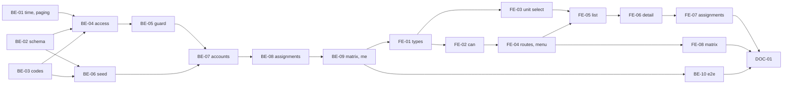

# F-02 Accounts, Roles and Permissions — Backend + Frontend Implementation Plan

This plan builds account management for Phòng Đào tạo (create, edit, disable, re-enable, reset password — MH-05, MH-06), roles with a scope and a validity period, the server-side permission check every later feature relies on (`@RequirePermission` + `PermissionGuard` + per-object scope checks), the seeded catalog of 41 permissions with the initial role × permission matrix, and the matrix screen MH-15, on which R1 may change cells of the six existing roles (answer F02-02 A). It also builds the minimal `OrgUnit` table and seeds Trường → Khoa CNTT + Phòng Đào tạo (F02-07), because scopes and `User.orgUnit` need it.

It deliberately excludes the org-unit tree screen and subject groups (F-03), program director assignments (F-06), student accounts (F-17), approval delegations (F-25), custom roles (F02-03) and the audit log (F01-07).

> **Companion documents**
> - Requirement: `docs/requirement/REQUIREMENTS.md:420-424` (FR-06..FR-10), `:1028` (NFR-09)
> - Stories: `docs/planning/user-stories.md:99-135` (US-004, US-005, US-006); epic EP-02
> - Tasks: `docs/planning/task-breakdown.md:110-120` (CV-011..CV-020), `:125` (CV-021, built minimally here)
> - Design: `docs/design/data-dictionary.md:37-176` (§1), `:760-826` (§9 matrix); `docs/design/erd.md:231-260` (M-7, M-10); `docs/design/screen-inventory.md:61-62,71` (MH-05, MH-06, MH-15); `docs/design/sequence-diagrams.md:97`
> - Answers: `docs/planning/feature-questions.md:83-94` (§F-02), §F-00 (F00-03, F00-13)
> - Builds on: `docs/implementation/f-01-auth-session-implementation-plan.md` (BE-03 errors, BE-07 guards, BE-08 `MeDto`, BE-09 seed, BE-10 test harness, FE-03/FE-04 client and session state)
> - Tests: `docs/planning/test-plan.md:281` (NT-B1-02, account part), `:286` (NT-B1-07)

**Status**: Code complete 2026-10-19; browser walk §7 owed

---

## 0. Plan at a glance

Everything below in one table. Read this; the rest is detail for whoever builds it.

| What | Why | How and where |
|---|---|---|
| **Every endpoint names the permission it needs; the server refuses anything else** | US-005 AC3, AC5; NFR-09; F00-03 | `@RequirePermission('user.manage')` on the route, a global `PermissionGuard` after `AuthenticatedGuard`; a route with no permission marker and no `@AnyAuthenticated()` is refused (deny by default) (BE-05) |
| **Scope is checked per object in the service** | US-005 AC1, AC6; F00-03 | The guard attaches an `AccessContext` (all active roles with their resolved scope); services call `access.assertCan(code, target)` and `access.scopeFor(code)` for list filters (BE-04, BE-05) |
| **41 permissions and the initial matrix are seeded from one table** | CV-014; data dictionary §9 + new `permission.manage` | `PERMISSION_CATALOG` written in the SRS's own symbols X / P / Đ / Đ(P), translated to `mode` + `scope` by the seed; tests use the same function (BE-06) |
| **R1 manages accounts**: list, create with a one-time temporary password, edit, disable, re-enable, reset password | US-004 AC1–AC4; F01-04; F02-08 | `features/users` endpoints (BE-07); MH-05 list and MH-06 detail (FE-05, FE-06). No delete endpoint exists (AC3) |
| **A disabled user is thrown out on the next click** | US-004 AC4; F02-08 | Already true from F-01's guard reloading the user; F-02 adds the e2e proof (BE-10) |
| **R1 gives R1 or R2 roles with a scope and a validity period; R3–R6 come from assignments** | US-005 AC1, AC2, AC4; M-7; CV-027, CV-029, CV-060 | `RoleAssignment` holds only roles scoped System or Unit. Director, coordinator, lecturer and student roles are *derived* from their assignment tables as those features land — never typed in twice (D3) |
| **Role history per user** — who granted what, when, and when it ended | US-006 AC1–AC3 via domain history (F01-07) | Assignments are never deleted or edited: revoke stamps `revokedAt`/`revokedBy`, a scope change is revoke + new row. MH-06 lists them all (BE-08, FE-07) |
| **Permission matrix screen; R1 may change cells of the six roles** | F02-02 A (overrides "read-only" in M-10/MH-15); US-005 AC7 | `GET /api/permissions/matrix`, `PUT`/`DELETE /api/roles/:roleCode/permissions/:permissionCode` behind the new `permission.manage`; two R1 cells are locked so R1 cannot lock itself out (BE-09, FE-08) |
| **Menu and routes follow permissions** | US-001 AC1 (completed here) | `MeDto.permissions` lists held codes; `useCan`, `RequirePermission` route wrapper, menu items carry a permission (FE-02, FE-03, FE-04) |
| **First org units exist** — Trường, Khoa CNTT, Phòng Đào tạo | F02-07 | Minimal `OrgUnit` model + seed; read-only `GET /api/org-units` for selects. F-03 adds the tree screen (BE-02, BE-06) |

### Key behaviours worth knowing

| Behaviour | Why it is this way |
|---|---|
| Permission checks read the database on every request (assignments + matrix, 1–4 small queries) | A revoked role or a changed matrix cell takes effect on the very next call, with no cache to invalidate (D5) |
| A route with neither `@RequirePermission` nor `@AnyAuthenticated()` answers 403 | Forgetting the decorator fails closed, not open (D4). F-01's `me` and `change-password` gain `@AnyAuthenticated()` |
| The guard checks "holds the permission somewhere"; whether *this* object is in scope is checked in the service | The guard cannot know the target object before the service loads it (F00-03) |
| `Đ` cells are `VIA_REQUEST`, but nothing in F-02 enforces "via request" | Whether a write goes direct depends on the object's state (F02-06: direct until the program's first version). Each feature reads `access.modeFor(...)` and decides (§8) |
| On one object, `DIRECT` beats `VIA_REQUEST` when a user's roles disagree | `erd.md` M-10 Hệ quả |
| Validity dates are calendar days in `Asia/Ho_Chi_Minh` | `validTo` = today still grants for the whole of today |
| A derived role (R3–R6) appears in `me.roles` only while its source table has an active row | M-7: one fact, one place. In F-02 those tables do not exist yet, so nobody holds R3–R6 until F-03/F-06/F-17 |
| Re-running the seed never re-adds a matrix cell R1 removed | Matrix rows are created only when their permission row is new (D9) |
| Disabling a user keeps all their rows; their name keeps showing in history | US-004 AC3, AC5; EC-29, EC-51 |
| Temporary passwords are shown once, in the response to create or reset; never stored in clear or logged | NFR-06 |

### Not included

| Excluded | Why |
|---|---|
| Org-unit tree screen, add/edit/deactivate units, subject groups, membership, coordinators | F-03 (F02-07). F-03 also fills the `SUBJECT_GROUP_*` scope sources |
| Program director assignments and their scope | F-06 fills `PROGRAM_DIRECTOR` |
| Student accounts and "own enrollment" scope | F-17 fills `OWN_ENROLLMENT` |
| Revoking approval delegations on deactivation (F02-08) | `ApprovalDelegation` arrives in F-25; recorded there as a constraint (§8) |
| Custom roles | F02-03: not built. `Role.isSystemRole` keeps the column for later |
| Audit-log rows for permission changes (FR-10) | F01-07. Role history comes from `RoleAssignment` rows; matrix cell changes go to the application log and `RolePermission.updatedBy` (D7) |
| Ending a disabled user's sessions by deleting rows | Not needed: the guard refuses the next request (F-01 D2) |
| Playwright NT-B1-02 | Needs F-03 (groups) |

### Open questions

All F-02 questions are answered (`feature-questions.md` §F-02). Small choices the answers did not cover:

| Question | Resolved when | Default if unanswered |
|---|---|---|
| Seeded org-unit codes | Before the seed runs in a shared environment | `DHBK` Trường Đại học Bách khoa, `KHOA_CNTT` Khoa Công nghệ Thông tin, `PDT` Phòng Đào tạo |
| Temporary password length and alphabet | Any time | 12 characters, letters and digits without look-alikes (`0 O 1 l I`) |
| Which matrix cells are locked against editing | Before FE-08 | R1 × `permission.manage`, R1 × `user.manage` |

---

## 1. Scope

| In scope | Why |
|---|---|
| `OrgUnit` (minimal), `Role`, `Permission`, `RolePermission`, `RoleAssignment`; `User.orgUnit` | CV-011, CV-014, CV-021 (minimal per F02-07) |
| Seed: 3 org units, 6 roles, 41 permissions, initial matrix, R1 assignment for the seeded admin | CV-014, F00-16 |
| `PermissionGuard`, `@RequirePermission`, `@AnyAuthenticated`, `AccessContext`, `ScopeService` | CV-015, F00-03 |
| Account CRUD without delete, disable/enable, reset password | CV-012, US-004 |
| Role assignment add/revoke, history list | CV-015, CV-016, CV-019, CV-020 |
| Permission matrix view + cell edit for R1 | CV-018, F02-02 A |
| `MeDto` gains org unit, roles, permissions; menu filtering | US-001 AC1, CV-003 |
| Shared paging (`PageQueryDto`, page response shape) | F00-13; first list in the project |
| E2E permission table for every F-02 route (allowed + denied per cell) | CV-017 (B1 part), NT-B1-07 |

| Out of scope | Deferred until |
|---|---|
| Org-unit management screen (MH-07) | F-03 |
| Subject groups, memberships, coordinator scope | F-03 |
| Program director scope | F-06 |
| Student role scope | F-17 |
| Delegation revocation on deactivation | F-25 |
| Audit-log lookup (MH-09) | Deferred (F01-07) |

| AC | Covered by |
|---|---|
| US-004 AC1 — create → Active, can log in | BE-07, FE-05, BE-10 |
| US-004 AC2 — duplicate username blocked, field named | BE-07 (`USERNAME_TAKEN` with `details`), FE-05 |
| US-004 AC3 — no delete; disable only; name stays in history | BE-07 (no route), FE-06 |
| US-004 AC4 — disabled user's open session refused | F-01 BE-07 (D2); BE-10 case |
| US-004 AC5 — pending requests continue after creator disabled | Nothing to build in F-02: no request references a user's status. Recorded for F-14 (§8) |
| US-005 AC1 — two roles, each in its own scope | BE-04 (`AccessContext` union), BE-10 |
| US-005 AC2 — ended role has no effect | BE-04 (active filter), BE-10 |
| US-005 AC3 — direct admin call by a lecturer refused | BE-05, BE-10 (NT-B1-07) |
| US-005 AC4 — System / Unit / By assignment | BE-08 (System, Unit), BE-04 (derived roles = "by assignment") |
| US-005 AC5 — decision from the role's row for that permission only | BE-05, BE-06, BE-10 |
| US-005 AC6 — out-of-scope refused, in-scope allowed | BE-04 unit tests; first real scoped route arrives in F-03 (§8) |
| US-005 AC7 — R1 sees every role × permission with mode and scope | BE-09, FE-08. Answer F02-02 A adds editing |
| US-006 AC1 — grant shows who, to whom, role, scope, period | BE-08, FE-07 |
| US-006 AC2 — revoke / scope change keeps before and after | BE-08 (revoke stamps; change = revoke + new) |
| US-006 AC3 — full permission history of one user | FE-07 (MH-06 history table) instead of the deferred audit screen |

---

## 2. Contract verification

F-02 builds on code that F-01's plan specifies but that is **not built yet**. Every "existing" claim below cites the F-01 plan section that defines it; Rule 13 re-reads the built file before each step here.

### 2a. Endpoints

All new; the contract is defined here. Paths are under `/api`.

| Endpoint | Permission | Request | Response | Notes |
|---|---|---|---|---|
| `GET /auth/me` | any authenticated (MODIFY) | — | `MeDto` (extended) | Adds `orgUnit`, `roles`, `permissions`. Still allowed during a pending password change |
| `GET /org-units` | any authenticated | — | `OrgUnitDto[]` | Flat list, active and inactive, ordered by `unitName` (ICU vi-VN) |
| `GET /users` | `user.manage` | `?page&pageSize&q&orgUnitId&status` | `UserPageDto` | `q` matches username, userCode, fullName (case-insensitive `contains`) |
| `POST /users` | `user.manage` | `CreateUserDto` | 201 `CreatedUserDto` | Body contains `temporaryPassword` exactly once |
| `GET /users/:userId` | `user.manage` | — | `UserDetailDto` | 404 `USER_NOT_FOUND` |
| `PATCH /users/:userId` | `user.manage` | `UpdateUserDto` | `UserDetailDto` | `username` is not editable |
| `POST /users/:userId/disable` | `user.manage` | — | `UserDetailDto` | Idempotent; refuses self (`CANNOT_DISABLE_SELF`) |
| `POST /users/:userId/enable` | `user.manage` | — | `UserDetailDto` | Idempotent |
| `POST /users/:userId/reset-password` | `user.manage` | — | `TemporaryPasswordDto` | Sets `mustChangePassword = true` |
| `GET /users/:userId/role-assignments` | `user.manage` | — | `RoleAssignmentDto[]` | Every row ever, newest `createdAt` first, plus derived roles marked `derived: true` |
| `POST /users/:userId/role-assignments` | `user.manage` | `CreateRoleAssignmentDto` | 201 `RoleAssignmentDto` | Only roles with `scopeSource = NONE` |
| `POST /users/:userId/role-assignments/:assignmentId/revoke` | `user.manage` | — | `RoleAssignmentDto` | Refuses own assignments (`CANNOT_CHANGE_OWN_ROLES`) |
| `GET /roles` | `user.manage` or `permission.view` | — | `RoleDto[]` | Ordered by `roleCode` |
| `GET /permissions/matrix` | `permission.view` | — | `PermissionMatrixDto` | |
| `PUT /roles/:roleCode/permissions/:permissionCode` | `permission.manage` | `SetRolePermissionDto` | `MatrixCellDto` | Upsert; 409 `MATRIX_CELL_LOCKED` for locked cells |
| `DELETE /roles/:roleCode/permissions/:permissionCode` | `permission.manage` | — | 204 | Idempotent; locked cells refused |

### 2b. DTOs

All new except `MeDto`. Enum wire values are the Prisma enum values in BE-02.

**`MeDto`** (MODIFY of F-01 plan BE-08 `src/features/auth/me.dto.ts`)

| Field | Wire type | Nullable | Source | Note |
|---|---|---|---|---|
| `id`, `username`, `userCode`, `fullName`, `email`, `mustChangePassword` | as F-01 | as F-01 | F-01 plan BE-08 | unchanged |
| `orgUnit` | `OrgUnitRefDto` | **yes** | BE-02 `User.orgUnitId` | `{ id, unitCode, unitName }` |
| `roles` | `MeRoleDto[]` | no | BE-04 `AccessContext.assignments` | empty for a user with no active role |
| `permissions` | `PermissionCode[]` — the 41 literal codes | no | BE-03 `PERMISSION_CODES` | Codes held in at least one scope; emitted with `enum` in OpenAPI so the frontend gets a union type |

**`MeRoleDto`**

| Field | Wire type | Nullable | Note |
|---|---|---|---|
| `roleCode` | `string` | no | `R1`..`R6` |
| `roleName` | `string` | no | |
| `scopeType` | `'SYSTEM' \| 'UNIT' \| 'ASSIGNMENT'` | no | `ASSIGNMENT` only on derived roles |
| `scopeUnit` | `OrgUnitRefDto` | **yes** | Set when `scopeType = UNIT` |
| `derived` | `boolean` | no | True for roles read from an assignment table |

**`OrgUnitDto`**: `id`, `unitCode`, `unitName`, `unitType: 'UNIVERSITY' | 'FACULTY' | 'OFFICE'`, `parentUnitId: string | null`, `status: 'ACTIVE' | 'INACTIVE'`. **`OrgUnitRefDto`**: `id`, `unitCode`, `unitName`.

**`UserSummaryDto`**

| Field | Wire type | Nullable | Note |
|---|---|---|---|
| `id`, `username`, `userCode`, `fullName` | `string` | no | |
| `email` | `string` | **yes** | |
| `orgUnit` | `OrgUnitRefDto` | **yes** | |
| `status` | `'ACTIVE' \| 'DISABLED'` | no | |
| `activeRoleCodes` | `string[]` | no | Manual assignments active today; derived roles are not listed here (they need per-user source queries) |

**`UserDetailDto`** = `UserSummaryDto` + `mustChangePassword: boolean`, `createdAt: string` (ISO), `updatedAt: string`.

**`UserPageDto`**: `items: UserSummaryDto[]`, `total: number`, `page: number`, `pageSize: number` (F00-13).

**`CreatedUserDto`**: `user: UserDetailDto`, `temporaryPassword: string`. **`TemporaryPasswordDto`**: `temporaryPassword: string`.

**`CreateUserDto`**: `username` (trimmed + lower-cased, 3..64, `^[a-z0-9._-]+$`), `userCode` (trimmed, upper-cased, 1..32), `fullName` (1..200), `email?` (`IsEmail`), `orgUnitId?` (string). **`UpdateUserDto`**: all of `userCode`, `fullName`, `email`, `orgUnitId` optional; `email` and `orgUnitId` accept `null` to clear.

**`RoleAssignmentDto`**

| Field | Wire type | Nullable | Note |
|---|---|---|---|
| `id` | `string` | **yes** | `null` for derived rows (no row of their own) |
| `role` | `RoleRefDto` (`id`, `roleCode`, `roleName`) | no | |
| `scopeType` | `'SYSTEM' \| 'UNIT' \| 'ASSIGNMENT'` | no | |
| `scopeUnit` | `OrgUnitRefDto` | **yes** | |
| `validFrom` | `string` (`YYYY-MM-DD`) | **yes** | `null` on derived rows |
| `validTo` | `string` (`YYYY-MM-DD`) | **yes** | `null` = open-ended |
| `assignedBy` | `UserRefDto` (`id`, `fullName`) | **yes** | `null` for seed rows and derived rows |
| `createdAt` | `string` (ISO) | **yes** | `null` on derived rows |
| `revokedAt` | `string` (ISO) | **yes** | |
| `revokedBy` | `UserRefDto` | **yes** | |
| `state` | `'ACTIVE' \| 'SCHEDULED' \| 'EXPIRED' \| 'REVOKED'` | no | Computed at read time from dates and `revokedAt`; not stored |
| `derived` | `boolean` | no | |

**`CreateRoleAssignmentDto`**: `roleId: string`, `scopeType: 'SYSTEM' | 'UNIT'`, `scopeUnitId?: string` (required when `UNIT`), `validFrom: string` (`IsISO8601({ strict: true })`, date only), `validTo?: string`.

**`RoleDto`**: `id`, `roleCode`, `roleName`, `description: string | null`, `isSystemRole: boolean`, `scopeSource: 'NONE' | 'PROGRAM_DIRECTOR' | 'SUBJECT_GROUP_COORDINATOR' | 'SUBJECT_GROUP_MEMBER' | 'OWN_ENROLLMENT'`, `assignable: boolean` (= `scopeSource === 'NONE'`).

**`PermissionMatrixDto`**: `roles: RoleDto[]`, `permissions: PermissionDto[]`, `cells: MatrixCellDto[]`, `lockedCells: MatrixCellKeyDto[]`.
**`PermissionDto`**: `id`, `permissionCode: PermissionCode`, `permissionName`, `functionGroup: 'SYSTEM_ADMIN' | 'COURSE_CATALOG' | 'PROGRAM' | 'LEARNING_OUTCOME' | 'SYLLABUS' | 'APPROVAL' | 'VERSION' | 'DATA_REPORT' | 'STUDENT_LOOKUP'`, `description: string | null`, `source: string | null`.
**`MatrixCellDto`**: `roleCode`, `permissionCode`, `mode: 'DIRECT' | 'VIA_REQUEST'`, `scope: 'ALL' | 'SCOPED'`, `updatedAt: string`, `updatedBy: UserRefDto | null`.
**`MatrixCellKeyDto`**: `roleCode`, `permissionCode`. **`SetRolePermissionDto`**: `mode`, `scope`.

### 2c. Mismatch log

| Deliverable | What the doc said | What this plan does | Found at |
|---|---|---|---|
| BE-09, FE-08 | M-10 and MH-15: matrix is read-only, changes only by release | R1 edits cells of existing roles (answer F02-02 A wins); new permission `permission.manage` | `erd.md:255`, `screen-inventory.md:71` |
| BE-03, BE-06 | 40 permissions | 41 (adds `permission.manage`) | `data-dictionary.md:762` |
| BE-02 | `Role` has no scope-source column | ⊕ `Role.scopeSource` so derived roles are data, not role names in code | `data-dictionary.md:83-94`; CV-015 "không viết cứng vai trò trong mã" |
| BE-02, BE-08 | `RoleAssignment.scopeType` may be `ASSIGNMENT` | Rows hold `SYSTEM`/`UNIT` only; `ASSIGNMENT` appears on derived roles at read time | `data-dictionary.md:131`, M-7 |
| BE-02 | `RoleAssignment` has no grantor/revocation columns | ⊕ `assignedBy`, `revokedAt`, `revokedBy` — the US-006 history without an audit table | `data-dictionary.md:123-136` |
| BE-02 | `RolePermission` changes "ghi nhật ký như RoleAssignment" | ⊕ `updatedBy` + application log | `data-dictionary.md:112` |
| FE-07 | MH-06 history reads `AuditLog` | Reads `RoleAssignment` rows | `screen-inventory.md:62` |
| BE-02 | Unique (`user`, `role`, `scopeUnit`, `validFrom`) | Kept, but PostgreSQL treats `NULL` `scopeUnit` as distinct; the overlap check in BE-08 is what actually prevents duplicates | `data-dictionary.md:136` |

DOC-01 writes these into the design docs.

---

## 3. Decisions

| # | Decision | Why | Rejected alternative |
|---|---|---|---|
| D1 | Foreign keys are `<relationName>Id` scalars beside a relation field named as in the data dictionary (`parentUnit` + `parentUnitId`) | First relations in the schema; every later plan follows it | Bare `parentUnit String` — Prisma needs a relation field anyway |
| D2 | `ScopeSource` enum on `Role` (`NONE`, `PROGRAM_DIRECTOR`, `SUBJECT_GROUP_COORDINATOR`, `SUBJECT_GROUP_MEMBER`, `OWN_ENROLLMENT`) | CV-015 forbids role names in code; the source of a role's scope becomes data | `switch (roleCode)` in the guard |
| D3 | Roles with a source other than `NONE` are derived: a user holds R4 exactly while an active coordinator row exists, etc. `RoleAssignment` rows are only for `NONE` roles (R1, R2), scoped `SYSTEM` or `UNIT` | M-7 "one fact, one place"; CV-027/029/060 "suy ra vai trò"; an expired coordinator row removes the role with no second record to forget | Requiring R1 to also add an R4 assignment for every coordinator — two records that drift |
| D4 | Deny by default: `PermissionGuard` refuses any non-public route with neither `@RequirePermission(...)` nor `@AnyAuthenticated()` | NFR-09; a forgotten decorator fails closed | Allow when no metadata — a forgotten decorator silently opens the route |
| D5 | Access is loaded per request, no cache | Revocations and matrix edits take effect immediately; < 200 users, a handful of indexed queries | In-memory cache with invalidation — a stale grant is a security bug |
| D6 | `AccessContext` is a plain class built once per request by `ScopeService.loadAccess()` and attached to `request.access`; its checks are synchronous | One load per request however many checks a service makes; services stay testable with a hand-built context | Async `ScopeService.assertCan()` hitting the DB per check |
| D7 | Permission history: `RoleAssignment` rows are append-only (revoke stamps; no update of role/scope/dates); matrix changes write `RolePermission.updatedBy` + one application-log line | FR-10 without the deferred audit table (F01-07, `deferred-scope.md` §2) | A bespoke `PermissionChangeLog` table — rebuilding a slice of the deferred audit log |
| D8 | Locked matrix cells: R1 × `permission.manage`, R1 × `user.manage` | F02-02 opens an edit path; R1 must not be able to remove its own way back | No lock — one wrong click needs a database fix |
| D9 | Seed creates `RolePermission` rows only for a `Permission` it is inserting for the first time | Re-running the seed must not undo R1's edits; a new permission added in a later release still gets its initial cells | `upsert` every cell — silently reverts R1's changes |
| D10 | The catalog is written in the data dictionary's symbols (`X`, `P`, `D`, `DP`) and translated in one function | Reviewing it against §9 is a line-by-line read | Writing `mode`/`scope` pairs — 80+ pairs nobody can check by eye |
| D11 | Accounts are created with a server-generated temporary password returned once; reset does the same; both set `mustChangePassword` | F01-04 (R1 resets, forced change); R1 never chooses or sees a user's permanent password | R1 types the initial password — weak passwords chosen under time pressure |
| D12 | One shared `PageQueryDto` + `Page<T>`; one response class per resource (`UserPageDto`) | F00-13; Swagger cannot express generics, so each list gets a concrete class | Generic Swagger mixin — extra machinery for a few classes |
| D13 | Dates without time (`validFrom`, `validTo`) are `@db.Date`, sent as `YYYY-MM-DD`, compared against today in `Asia/Ho_Chi_Minh` via `todayDate()` | A role valid "until 31/12" must work all day on 31/12 Vietnamese time | UTC `now()` — off by 7 hours at both ends |
| D14 | Org units used for selects come from `src/shared/org-units/` on the frontend | Users (F-02) and many later features pick a unit; features must not import each other (`react-vite-rules.md` §4) | `features/org-units` imported by `features/users` |
| D15 | The frontend receives `permissions` as a typed union (OpenAPI `enum`) | A misspelt permission code fails `tsc` instead of hiding a menu item forever | Plain `string[]` |
| D16 | Self-protection: R1 cannot disable itself or revoke its own assignments | Prevents an accidental lock-out of the last administrator | A "last R1" count check — more code, same practical effect |

---

## 5. Deliverables

Backend paths are relative to `source/backend/`, frontend paths to `source/frontend/`. No git writes at any step (`ai-rules.md` Rule 7).

### BE-01 — Shared building blocks: today's date, paging

What/Why: D12, D13. First list endpoint and first date-only columns in the project.

**Files**

| Action | Path |
|---|---|
| NEW | `src/shared/time/today.ts` |
| NEW | `src/shared/time/today.spec.ts` |
| NEW | `src/shared/pagination/page-query.dto.ts` |
| NEW | `src/shared/pagination/page.ts` |

**Shape**

```ts
// src/shared/time/today.ts
export const APP_TIME_ZONE = 'Asia/Ho_Chi_Minh';

// A UTC-midnight Date for the current calendar day in Vietnam, comparable with @db.Date columns.
export function todayDate(now: Date = new Date()): Date {
  const isoDay = new Intl.DateTimeFormat('en-CA', { timeZone: APP_TIME_ZONE }).format(now);
  return new Date(`${isoDay}T00:00:00.000Z`);
}

export function toIsoDay(date: Date): string {
  return date.toISOString().slice(0, 10);
}

export function fromIsoDay(isoDay: string): Date {
  return new Date(`${isoDay}T00:00:00.000Z`);
}
```

```ts
// src/shared/pagination/page-query.dto.ts
import { ApiPropertyOptional } from '@nestjs/swagger';
import { Type } from 'class-transformer';
import { IsInt, IsOptional, Max, Min } from 'class-validator';

export const PAGINATION = {
  DEFAULT_PAGE: 1,
  DEFAULT_PAGE_SIZE: 20,
  MAX_PAGE_SIZE: 100,
} as const;

export class PageQueryDto {
  @ApiPropertyOptional({ default: PAGINATION.DEFAULT_PAGE, minimum: 1 })
  @IsOptional()
  @Type(() => Number)
  @IsInt()
  @Min(1)
  page: number = PAGINATION.DEFAULT_PAGE;

  @ApiPropertyOptional({ default: PAGINATION.DEFAULT_PAGE_SIZE, minimum: 1, maximum: PAGINATION.MAX_PAGE_SIZE })
  @IsOptional()
  @Type(() => Number)
  @IsInt()
  @Min(1)
  @Max(PAGINATION.MAX_PAGE_SIZE)
  pageSize: number = PAGINATION.DEFAULT_PAGE_SIZE;
}
```

```ts
// src/shared/pagination/page.ts
import type { PageQueryDto } from './page-query.dto.js';

export interface Page<T> {
  items: T[];
  total: number;
  page: number;
  pageSize: number;
}

export function toSkipTake(query: PageQueryDto): { skip: number; take: number } {
  return { skip: (query.page - 1) * query.pageSize, take: query.pageSize };
}

export function toPage<T>(items: T[], total: number, query: PageQueryDto): Page<T> {
  return { items, total, page: query.page, pageSize: query.pageSize };
}
```

`today.spec.ts` cases: 2026-10-18T17:30:00Z → `2026-10-19` (already the next day in Vietnam); 2026-10-18T16:59:59Z → `2026-10-18`; `fromIsoDay(toIsoDay(d))` round-trips.

**Rationale**: Constants object per `nestjs-rules.md` §9; DTO decorators mirror F-01 plan BE-08 `login.dto.ts`. `transform: true` in `app.setup.ts:15` turns query strings into numbers through `@Type`.

**Gotchas**
- Query DTOs extend `PageQueryDto`; the field initialisers only apply because `transform: true` instantiates the class.
- `forbidNonWhitelisted` rejects unknown query parameters too — the frontend must not send extra ones.
- Never compare a `@db.Date` column with `new Date()`; always with `todayDate()`.

**Verify**: `pnpm test` (today spec).

**Depends on**: F-01 complete

---

### BE-02 — Prisma schema: org units, roles, permissions, assignments

What/Why: CV-011, CV-014, CV-021 (minimal), D1–D3, D7.

**Files**

| Action | Path |
|---|---|
| MODIFY | `prisma/schema.prisma` |
| NEW | `prisma/migrations/<timestamp>_access_control/migration.sql` (generated) |

**Shape**

```prisma
enum OrgUnitType {
  UNIVERSITY
  FACULTY
  OFFICE
}

enum OrgUnitStatus {
  ACTIVE
  INACTIVE
}

enum ScopeSource {
  NONE
  PROGRAM_DIRECTOR
  SUBJECT_GROUP_COORDINATOR
  SUBJECT_GROUP_MEMBER
  OWN_ENROLLMENT
}

enum FunctionGroup {
  SYSTEM_ADMIN
  COURSE_CATALOG
  PROGRAM
  LEARNING_OUTCOME
  SYLLABUS
  APPROVAL
  VERSION
  DATA_REPORT
  STUDENT_LOOKUP
}

enum PermissionMode {
  DIRECT
  VIA_REQUEST
}

enum PermissionScope {
  ALL
  SCOPED
}

enum ScopeType {
  SYSTEM
  UNIT
  ASSIGNMENT
}

model OrgUnit {
  id              String           @id @default(cuid(2))
  unitCode        String           @unique
  unitName        String
  unitType        OrgUnitType
  parentUnitId    String?
  parentUnit      OrgUnit?         @relation("OrgUnitTree", fields: [parentUnitId], references: [id], onDelete: Restrict)
  childUnits      OrgUnit[]        @relation("OrgUnitTree")
  status          OrgUnitStatus    @default(ACTIVE)
  users           User[]
  roleAssignments RoleAssignment[]
  createdAt       DateTime         @default(now())
  updatedAt       DateTime         @updatedAt

  @@index([parentUnitId])
}

model User {
  // ...F-01 fields unchanged...
  orgUnitId          String?
  orgUnit            OrgUnit?         @relation(fields: [orgUnitId], references: [id], onDelete: Restrict)
  roleAssignments    RoleAssignment[] @relation("AssignmentHolder")
  grantedAssignments RoleAssignment[] @relation("AssignmentGrantor")
  revokedAssignments RoleAssignment[] @relation("AssignmentRevoker")
  updatedRolePermissions RolePermission[]

  @@index([orgUnitId])
}

model Role {
  id              String           @id @default(cuid(2))
  roleCode        String           @unique
  roleName        String
  description     String?
  isSystemRole    Boolean          @default(false)
  scopeSource     ScopeSource      @default(NONE)
  rolePermissions RolePermission[]
  assignments     RoleAssignment[]
  createdAt       DateTime         @default(now())
  updatedAt       DateTime         @updatedAt
}

model Permission {
  id              String           @id @default(cuid(2))
  permissionCode  String           @unique
  permissionName  String
  functionGroup   FunctionGroup
  description     String?
  source          String?
  rolePermissions RolePermission[]
  createdAt       DateTime         @default(now())
  updatedAt       DateTime         @updatedAt
}

model RolePermission {
  id           String          @id @default(cuid(2))
  roleId       String
  role         Role            @relation(fields: [roleId], references: [id], onDelete: Restrict)
  permissionId String
  permission   Permission      @relation(fields: [permissionId], references: [id], onDelete: Restrict)
  mode         PermissionMode
  scope        PermissionScope
  updatedById  String?
  updatedBy    User?           @relation(fields: [updatedById], references: [id], onDelete: Restrict)
  createdAt    DateTime        @default(now())
  updatedAt    DateTime        @updatedAt

  @@unique([roleId, permissionId])
  @@index([permissionId])
}

model RoleAssignment {
  id          String    @id @default(cuid(2))
  userId      String
  user        User      @relation("AssignmentHolder", fields: [userId], references: [id], onDelete: Restrict)
  roleId      String
  role        Role      @relation(fields: [roleId], references: [id], onDelete: Restrict)
  scopeType   ScopeType
  scopeUnitId String?
  scopeUnit   OrgUnit?  @relation(fields: [scopeUnitId], references: [id], onDelete: Restrict)
  validFrom   DateTime  @db.Date
  validTo     DateTime? @db.Date
  assignedById String?
  assignedBy  User?     @relation("AssignmentGrantor", fields: [assignedById], references: [id], onDelete: Restrict)
  revokedAt   DateTime?
  revokedById String?
  revokedBy   User?     @relation("AssignmentRevoker", fields: [revokedById], references: [id], onDelete: Restrict)
  createdAt   DateTime  @default(now())
  updatedAt   DateTime  @updatedAt

  @@unique([userId, roleId, scopeUnitId, validFrom])
  @@index([userId])
}
```

Commands, in `source/backend` with Docker running:

```
pnpm prisma:migrate --name access_control
pnpm prisma:generate
```

**Rationale**: Conventions from `docs/architecture/database_and_models.md` "Quy ước lược đồ" (`cuid(2)`, `createdAt`/`updatedAt`, Prisma enums) and the F-01 plan BE-04 `User` model. `onDelete: Restrict` everywhere: nothing in this domain is ever hard-deleted (FR-06, EC-51).

**Gotchas**
- `User.orgUnitId` is nullable — the migration is additive and the seeded admin row survives.
- `ScopeType.ASSIGNMENT` exists for DTOs of derived roles; BE-08 refuses it on insert (D3).
- Three relations between `User` and `RoleAssignment` need explicit relation names, or `prisma generate` fails with an ambiguity error.
- PostgreSQL's unique index treats `NULL` `scopeUnitId` as distinct; BE-08's overlap check is the real guard (§2c).
- Run `prisma generate` before `tsc`: `Prisma.RoleAssignmentGetPayload` types in BE-04 come from it.

**Verify**: Migration applies to a fresh container; `pnpm exec tsc --noEmit -p tsconfig.json` passes; `\d "RoleAssignment"` shows the unique index and four FKs.

**Depends on**: F-01 BE-04

---

### BE-03 — Permission codes and error codes

What/Why: One source of the 41 codes for decorators, seed, `MeDto` and tests (D15); the authorization errors.

**Files**

| Action | Path |
|---|---|
| NEW | `src/shared/authz/permission-codes.ts` |
| MODIFY | `src/shared/exception/error-codes.ts` |

**Shape**

```ts
// src/shared/authz/permission-codes.ts
export const PERMISSIONS = {
  ORG_UNIT_MANAGE: 'orgUnit.manage',
  SUBJECT_GROUP_VIEW: 'subjectGroup.view',
  USER_MANAGE: 'user.manage',
  PERMISSION_VIEW: 'permission.view',
  PERMISSION_MANAGE: 'permission.manage',
  DIRECTOR_ASSIGN: 'director.assign',
  DELEGATION_MANAGE: 'delegation.manage',
  INTEGRATION_CLIENT_MANAGE: 'integrationClient.manage',
  SYNC_CONFIGURE: 'sync.configure',
  AUDIT_LOG_VIEW: 'auditLog.view',
  COURSE_VIEW: 'course.view',
  COURSE_EDIT: 'course.edit',
  COURSE_RELATION_EDIT: 'courseRelation.edit',
  PROGRAM_VIEW: 'program.view',
  PROGRAM_EDIT_INFO: 'program.editInfo',
  PROGRAM_CLONE: 'program.clone',
  CURRICULUM_EDIT: 'curriculum.edit',
  CURRICULUM_IMPORT_EXPORT_EXCEL: 'curriculum.importExportExcel',
  VERSION_ASSIGN_COHORT: 'version.assignCohort',
  OUTCOME_VIEW: 'outcome.view',
  PLO_EDIT: 'plo.edit',
  CLO_EDIT: 'clo.edit',
  SYLLABUS_VIEW: 'syllabus.view',
  SYLLABUS_EDIT: 'syllabus.edit',
  GRADING_FORMULA_EDIT: 'gradingFormula.edit',
  CHANGE_REQUEST_VIEW: 'changeRequest.view',
  CHANGE_REQUEST_CREATE: 'changeRequest.create',
  CHANGE_REQUEST_CREATE_ORGANIZATIONAL: 'changeRequest.createOrganizational',
  CHANGE_REQUEST_OVERRIDE: 'changeRequest.override',
  CHANGE_REQUEST_COMMENT: 'changeRequest.comment',
  CHANGE_REQUEST_STATISTICS: 'changeRequest.statistics',
  VERSION_PUBLISH: 'version.publish',
  VERSION_VIEW_HISTORY: 'version.viewHistory',
  VERSION_COMPARE: 'version.compare',
  DATA_IMPORT_EXCEL: 'data.importExcel',
  REPORT_EXPORT_ACCREDITATION: 'report.exportAccreditation',
  REPORT_BENCHMARK: 'report.benchmark',
  STUDENT_VIEW_PROGRESS: 'student.viewProgress',
  STUDENT_VIEW_REGISTRATION_ELIGIBILITY: 'student.viewRegistrationEligibility',
  GRADUATION_VIEW: 'graduation.view',
  GRADUATION_AUDIT: 'graduation.audit',
} as const;

export type PermissionCode = (typeof PERMISSIONS)[keyof typeof PERMISSIONS];
export const PERMISSION_CODES: readonly PermissionCode[] = Object.values(PERMISSIONS);
```

```ts
// src/shared/exception/error-codes.ts — added to COMMON_ERRORS
PERMISSION_DENIED: {
  status: HttpStatus.FORBIDDEN,
  code: 'PERMISSION_DENIED',
  message: 'Bạn không có quyền thực hiện thao tác này.',
},
OUT_OF_SCOPE: {
  status: HttpStatus.FORBIDDEN,
  code: 'OUT_OF_SCOPE',
  message: 'Đối tượng này nằm ngoài phạm vi được phân công của bạn.',
},
```

**Rationale**: Constants object with `SCREAMING_SNAKE_CASE` keys per `nestjs-rules.md` §9; errors join `COMMON_ERRORS` (F-01 plan BE-03) because every feature raises them.

**Gotchas**
- A code, once used, never changes (`data-dictionary.md:100`); add new ones, never rename.
- Keep the object order identical to data dictionary §9 so a reviewer can diff them.

**Verify**: `pnpm exec tsc --noEmit -p tsconfig.json`; `PERMISSION_CODES.length === 41` asserted in BE-06's spec.

**Depends on**: —

---

### BE-04 — `AccessContext` and `ScopeService`

What/Why: CV-015, US-005 AC1/AC2/AC6, D2, D3, D5, D6. Turns a user id into "which permissions, in which mode, over which objects", once per request.

**Files**

| Action | Path |
|---|---|
| NEW | `src/shared/authz/access-context.ts` |
| NEW | `src/shared/authz/access-context.spec.ts` |
| NEW | `src/shared/authz/scope.service.ts` |
| NEW | `src/shared/authz/scope.service.spec.ts` |
| NEW | `src/shared/authz/scope-source.reader.ts` |

**Shape**

```ts
// src/shared/authz/access-context.ts
import type { PermissionMode, PermissionScope, ScopeSource, ScopeType } from '../../generated/prisma/client.js';
import { AppException } from '../exception/app.exception.js';
import { COMMON_ERRORS } from '../exception/error-codes.js';
import type { PermissionCode } from './permission-codes.js';

// What an object belongs to; an object is in scope when any one list intersects the holder's scope.
export interface ScopeTarget {
  orgUnitIds?: readonly string[];
  subjectGroupIds?: readonly string[];
  programIds?: readonly string[];
  studentIds?: readonly string[];
}

export interface ScopeIds {
  orgUnitIds: ReadonlySet<string>;
  subjectGroupIds: ReadonlySet<string>;
  programIds: ReadonlySet<string>;
  studentIds: ReadonlySet<string>;
}

export type ResolvedScope = { all: true } | ({ all: false } & ScopeIds);

export interface PermissionGrant {
  mode: PermissionMode;
  scope: PermissionScope;
}

export interface ActiveAssignment {
  assignmentId: string | null;
  roleId: string;
  roleCode: string;
  roleName: string;
  scopeSource: ScopeSource;
  scopeType: ScopeType;
  scopeUnit: { id: string; unitCode: string; unitName: string } | null;
  scope: ResolvedScope;
  permissions: ReadonlyMap<PermissionCode, PermissionGrant>;
}

const NOTHING: ResolvedScope = {
  all: false,
  orgUnitIds: new Set(),
  subjectGroupIds: new Set(),
  programIds: new Set(),
  studentIds: new Set(),
};

export class AccessContext {
  constructor(
    readonly userId: string,
    readonly assignments: readonly ActiveAssignment[],
  ) {}

  has(code: PermissionCode): boolean {
    return this.assignments.some((assignment) => assignment.permissions.has(code));
  }

  heldPermissions(): PermissionCode[] {
    return [...new Set(this.assignments.flatMap((assignment) => [...assignment.permissions.keys()]))];
  }

  // DIRECT wins over VIA_REQUEST when two roles cover the same object.
  modeFor(code: PermissionCode, target: ScopeTarget): PermissionMode | null {
    let found: PermissionMode | null = null;
    for (const assignment of this.assignments) {
      const grant = assignment.permissions.get(code);
      if (!grant || !covers(effectiveScope(assignment, grant), target)) {
        continue;
      }
      if (grant.mode === 'DIRECT') {
        return 'DIRECT';
      }
      found = grant.mode;
    }
    return found;
  }

  assertCan(code: PermissionCode, target: ScopeTarget): PermissionMode {
    const mode = this.modeFor(code, target);
    if (mode === null) {
      throw new AppException(this.has(code) ? COMMON_ERRORS.OUT_OF_SCOPE : COMMON_ERRORS.PERMISSION_DENIED);
    }
    return mode;
  }

  // Union of every scope holding the permission, for building list filters.
  scopeFor(code: PermissionCode): ResolvedScope {
    const scopes = this.assignments
      .filter((assignment) => assignment.permissions.has(code))
      .map((assignment) => effectiveScope(assignment, assignment.permissions.get(code)!));
    if (scopes.some((scope) => scope.all)) {
      return { all: true };
    }
    return scopes.reduce<ResolvedScope>((union, scope) => unite(union, scope), NOTHING);
  }
}

function effectiveScope(assignment: ActiveAssignment, grant: PermissionGrant): ResolvedScope {
  return grant.scope === 'ALL' ? { all: true } : assignment.scope;
}

function covers(scope: ResolvedScope, target: ScopeTarget): boolean {
  if (scope.all) {
    return true;
  }
  return (
    intersects(scope.orgUnitIds, target.orgUnitIds) ||
    intersects(scope.subjectGroupIds, target.subjectGroupIds) ||
    intersects(scope.programIds, target.programIds) ||
    intersects(scope.studentIds, target.studentIds)
  );
}

function intersects(held: ReadonlySet<string>, wanted: readonly string[] | undefined): boolean {
  return (wanted ?? []).some((id) => held.has(id));
}

function unite(left: ResolvedScope, right: ResolvedScope): ResolvedScope {
  if (left.all || right.all) {
    return { all: true };
  }
  return {
    all: false,
    orgUnitIds: new Set([...left.orgUnitIds, ...right.orgUnitIds]),
    subjectGroupIds: new Set([...left.subjectGroupIds, ...right.subjectGroupIds]),
    programIds: new Set([...left.programIds, ...right.programIds]),
    studentIds: new Set([...left.studentIds, ...right.studentIds]),
  };
}

export const EMPTY_SCOPE_IDS = NOTHING;
```

```ts
// src/shared/authz/scope-source.reader.ts
import { Injectable } from '@nestjs/common';
import { ScopeSource } from '../../generated/prisma/client.js';
import { PrismaService } from '../prisma/prisma.service.js';
import type { ScopeTarget } from './access-context.js';

// Each derived role's scope lives in its own assignment table (erd.md M-7).
// A source whose table is not built yet yields nothing: nobody holds that role.
@Injectable()
export class ScopeSourceReader {
  constructor(private readonly prisma: PrismaService) {}

  async activeTargets(source: Exclude<ScopeSource, 'NONE'>, userId: string, today: Date): Promise<ScopeTarget> {
    switch (source) {
      case ScopeSource.PROGRAM_DIRECTOR:
        return {};
      case ScopeSource.SUBJECT_GROUP_COORDINATOR:
        return {};
      case ScopeSource.SUBJECT_GROUP_MEMBER:
        return {};
      case ScopeSource.OWN_ENROLLMENT:
        return {};
    }
  }
}
```

The four empty cases are replaced by F-03 (`SUBJECT_GROUP_*` → `SubjectGroupMember` rows active on `today`), F-06 (`PROGRAM_DIRECTOR` → `ProgramDirectorAssignment`), F-17 (`OWN_ENROLLMENT` → the user's `Student` + `ProgramEnrollment` rows). Unused `userId`/`today`/`prisma` until then are expected lint warnings (Rule 10 allows them on new code).

```ts
// src/shared/authz/scope.service.ts
import { Injectable } from '@nestjs/common';
import { OrgUnitStatus, ScopeSource, ScopeType } from '../../generated/prisma/client.js';
import { PrismaService } from '../prisma/prisma.service.js';
import { todayDate } from '../time/today.js';
import {
  AccessContext, type ActiveAssignment, EMPTY_SCOPE_IDS, type PermissionGrant, type ResolvedScope, type ScopeTarget,
} from './access-context.js';
import type { PermissionCode } from './permission-codes.js';
import { ScopeSourceReader } from './scope-source.reader.js';

const ROLE_WITH_PERMISSIONS = {
  id: true,
  roleCode: true,
  roleName: true,
  scopeSource: true,
  rolePermissions: { select: { mode: true, scope: true, permission: { select: { permissionCode: true } } } },
} as const;

@Injectable()
export class ScopeService {
  constructor(
    private readonly prisma: PrismaService,
    private readonly sources: ScopeSourceReader,
  ) {}

  async loadAccess(userId: string): Promise<AccessContext> {
    const today = todayDate();
    const [manual, derived] = await Promise.all([
      this.loadManualAssignments(userId, today),
      this.loadDerivedAssignments(userId, today),
    ]);
    return new AccessContext(userId, [...manual, ...derived]);
  }

  private async loadManualAssignments(userId: string, today: Date): Promise<ActiveAssignment[]> {
    const rows = await this.prisma.roleAssignment.findMany({
      where: {
        userId,
        revokedAt: null,
        validFrom: { lte: today },
        OR: [{ validTo: null }, { validTo: { gte: today } }],
      },
      select: {
        id: true,
        scopeType: true,
        scopeUnit: { select: { id: true, unitCode: true, unitName: true } },
        role: { select: ROLE_WITH_PERMISSIONS },
      },
    });
    const needsTree = rows.some((row) => row.scopeType === ScopeType.UNIT);
    const children = needsTree ? await this.loadChildrenByParent() : new Map<string, string[]>();
    return rows.map((row) => ({
      assignmentId: row.id,
      roleId: row.role.id,
      roleCode: row.role.roleCode,
      roleName: row.role.roleName,
      scopeSource: row.role.scopeSource,
      scopeType: row.scopeType,
      scopeUnit: row.scopeUnit,
      scope: row.scopeType === ScopeType.SYSTEM
        ? { all: true }
        : unitScope(row.scopeUnit ? descendantsAndSelf(row.scopeUnit.id, children) : []),
      permissions: toGrantMap(row.role.rolePermissions),
    }));
  }

  private async loadDerivedAssignments(userId: string, today: Date): Promise<ActiveAssignment[]> {
    const roles = await this.prisma.role.findMany({
      where: { scopeSource: { not: ScopeSource.NONE } },
      select: ROLE_WITH_PERMISSIONS,
    });
    const assignments: ActiveAssignment[] = [];
    for (const role of roles) {
      const target = await this.sources.activeTargets(role.scopeSource as Exclude<ScopeSource, 'NONE'>, userId, today);
      const scope = targetScope(target);
      if (scope.all || isEmpty(scope)) {
        continue;
      }
      assignments.push({
        assignmentId: null,
        roleId: role.id,
        roleCode: role.roleCode,
        roleName: role.roleName,
        scopeSource: role.scopeSource,
        scopeType: ScopeType.ASSIGNMENT,
        scopeUnit: null,
        scope,
        permissions: toGrantMap(role.rolePermissions),
      });
    }
    return assignments;
  }

  private async loadChildrenByParent(): Promise<Map<string, string[]>> {
    const units = await this.prisma.orgUnit.findMany({
      where: { status: OrgUnitStatus.ACTIVE },
      select: { id: true, parentUnitId: true },
    });
    const children = new Map<string, string[]>();
    for (const unit of units) {
      if (unit.parentUnitId) {
        children.set(unit.parentUnitId, [...(children.get(unit.parentUnitId) ?? []), unit.id]);
      }
    }
    return children;
  }
}

function descendantsAndSelf(rootId: string, children: Map<string, string[]>): string[] {
  const found = [rootId];
  for (let index = 0; index < found.length; index += 1) {
    found.push(...(children.get(found[index]) ?? []));
  }
  return found;
}

function unitScope(orgUnitIds: string[]): ResolvedScope {
  return { ...EMPTY_SCOPE_IDS, all: false, orgUnitIds: new Set(orgUnitIds) };
}

function targetScope(target: ScopeTarget): ResolvedScope {
  return {
    all: false,
    orgUnitIds: new Set(target.orgUnitIds),
    subjectGroupIds: new Set(target.subjectGroupIds),
    programIds: new Set(target.programIds),
    studentIds: new Set(target.studentIds),
  };
}

function isEmpty(scope: ResolvedScope): boolean {
  return !scope.all &&
    scope.orgUnitIds.size + scope.subjectGroupIds.size + scope.programIds.size + scope.studentIds.size === 0;
}

function toGrantMap(
  rows: { mode: PermissionGrant['mode']; scope: PermissionGrant['scope']; permission: { permissionCode: string } }[],
): Map<PermissionCode, PermissionGrant> {
  return new Map(rows.map((row) => [row.permission.permissionCode as PermissionCode, { mode: row.mode, scope: row.scope }]));
}
```

`access-context.spec.ts` (hand-built contexts, no mocks):

| Case | Expect |
|---|---|
| no assignments | `has` false; `assertCan` → `PERMISSION_DENIED` |
| permission held, target outside scope | `assertCan` → `OUT_OF_SCOPE` (US-005 AC6) |
| same target inside scope | returns the mode |
| `ALL` cell on a scoped assignment | covers any target |
| two roles: `VIA_REQUEST` over all + `DIRECT` over group G | target in G → `DIRECT`; target elsewhere → `VIA_REQUEST` |
| two roles, two scopes (US-005 AC1) | each permission only in its own scope |
| `scopeFor` union | ids of both scopes; `all` if any is `all` |

`scope.service.spec.ts` (mock `PrismaService`, real `ScopeSourceReader` with mocked Prisma): revoked row not queried (assert the `where`); `UNIT` scope expands to child units; `SYSTEM` → `all`; derived roles absent while sources return `{}`.

**Rationale**: Pure context + loader split is D6. Building the tree in memory mirrors the size assumption of F06-01 (< 20 programs, a few dozen units). `ScopeService` name is answer F00-03.

**Gotchas**
- The `where` for active rows must use `todayDate()`, never `new Date()` (D13).
- `scopeFor` returns permission-holder scope; a list filter for an `ALL` grant must not add a `where`.
- `activeTargets` returning `{ all: ... }` is impossible by type; derived roles never get `all`.
- Inactive org units drop out of `UNIT` scope expansion; the unit itself is still included as the root.

**Verify**: `pnpm test` (two specs).

**Depends on**: BE-02, BE-03, BE-01

---

### BE-05 — `PermissionGuard` and decorators

What/Why: D4, US-005 AC3/AC5, NFR-09.

**Files**

| Action | Path |
|---|---|
| NEW | `src/shared/authz/require-permission.decorator.ts` |
| NEW | `src/shared/authz/any-authenticated.decorator.ts` |
| NEW | `src/shared/authz/current-access.decorator.ts` |
| NEW | `src/shared/authz/permission.guard.ts` |
| NEW | `src/shared/authz/permission.guard.spec.ts` |
| NEW | `src/shared/authz/authz.module.ts` |
| MODIFY | `src/shared/auth/authenticated-user.ts` (`Request.access`) |
| MODIFY | `src/app.module.ts` (third `APP_GUARD`, import `AuthzModule`) |
| MODIFY | `src/features/auth/auth.controller.ts` (`@AnyAuthenticated()` on `me`, `change-password`) |

**Shape**

```ts
// src/shared/authz/require-permission.decorator.ts
import { SetMetadata } from '@nestjs/common';
import type { PermissionCode } from './permission-codes.js';

export const REQUIRED_PERMISSIONS_KEY = 'requiredPermissions';
// Several codes mean "any one of them".
export const RequirePermission = (...codes: [PermissionCode, ...PermissionCode[]]) =>
  SetMetadata(REQUIRED_PERMISSIONS_KEY, codes);
```

```ts
// src/shared/authz/any-authenticated.decorator.ts
import { SetMetadata } from '@nestjs/common';

export const ANY_AUTHENTICATED_KEY = 'anyAuthenticated';
export const AnyAuthenticated = () => SetMetadata(ANY_AUTHENTICATED_KEY, true);
```

```ts
// src/shared/authz/current-access.decorator.ts
import { createParamDecorator, type ExecutionContext } from '@nestjs/common';
import type { Request } from 'express';
import type { AccessContext } from './access-context.js';

// Only valid behind PermissionGuard, which sets request.access.
export const CurrentAccess = createParamDecorator(
  (_data: unknown, context: ExecutionContext): AccessContext =>
    context.switchToHttp().getRequest<Request>().access!,
);
```

```ts
// src/shared/authz/permission.guard.ts
import { type CanActivate, type ExecutionContext, Injectable } from '@nestjs/common';
import { Reflector } from '@nestjs/core';
import type { Request } from 'express';
import { IS_PUBLIC_KEY } from '../auth/public.decorator.js';
import { AppException } from '../exception/app.exception.js';
import { COMMON_ERRORS } from '../exception/error-codes.js';
import { ANY_AUTHENTICATED_KEY } from './any-authenticated.decorator.js';
import type { PermissionCode } from './permission-codes.js';
import { REQUIRED_PERMISSIONS_KEY } from './require-permission.decorator.js';
import { ScopeService } from './scope.service.js';

@Injectable()
export class PermissionGuard implements CanActivate {
  constructor(
    private readonly reflector: Reflector,
    private readonly scopes: ScopeService,
  ) {}

  async canActivate(context: ExecutionContext): Promise<boolean> {
    const targets = [context.getHandler(), context.getClass()];
    if (this.reflector.getAllAndOverride<boolean>(IS_PUBLIC_KEY, targets)) {
      return true;
    }
    const request = context.switchToHttp().getRequest<Request>();
    // AuthenticatedGuard runs first and has already refused requests without a user.
    const access = await this.scopes.loadAccess(request.user!.id);
    request.access = access;
    const required = this.reflector.getAllAndOverride<PermissionCode[]>(REQUIRED_PERMISSIONS_KEY, targets);
    if (required) {
      if (required.some((code) => access.has(code))) {
        return true;
      }
      throw new AppException(COMMON_ERRORS.PERMISSION_DENIED);
    }
    if (this.reflector.getAllAndOverride<boolean>(ANY_AUTHENTICATED_KEY, targets)) {
      return true;
    }
    throw new AppException(COMMON_ERRORS.PERMISSION_DENIED);
  }
}
```

```ts
// src/shared/authz/authz.module.ts
import { Global, Module } from '@nestjs/common';
import { ScopeSourceReader } from './scope-source.reader.js';
import { ScopeService } from './scope.service.js';

@Global()
@Module({
  providers: [ScopeService, ScopeSourceReader],
  exports: [ScopeService],
})
export class AuthzModule {}
```

```ts
// src/shared/auth/authenticated-user.ts — the global Request augmentation gains:
access?: AccessContext;
```

```ts
// src/app.module.ts — providers, in this order (Nest runs global guards in registration order)
{ provide: APP_GUARD, useClass: CsrfGuard },
{ provide: APP_GUARD, useClass: AuthenticatedGuard },
{ provide: APP_GUARD, useClass: PermissionGuard },
```

Guard spec cases: public → true, `loadAccess` not called; required code held → true and `request.access` set; required not held → `PERMISSION_DENIED`; any-of with one held → true; `@AnyAuthenticated` → true; neither marker → `PERMISSION_DENIED`.

**Rationale**: Mirrors F-01 plan BE-07 `AuthenticatedGuard` (reflector use, `AppException`) and `CurrentUser` decorator. Name `@RequirePermission` is answer F00-03.

**Gotchas**
- `@AllowPendingPasswordChange()` (F-01) and `@AnyAuthenticated()` are independent: `me` and `change-password` need both.
- Health is `@Public()` and skips this guard entirely.
- A `@Public()` route never has `request.access`; `@CurrentAccess()` there throws on `!`.
- Order of `APP_GUARD` entries is the execution order — keep this guard last.

**Verify**: `pnpm test`; `pnpm test:e2e` auth suite stays green (proves `me`/`change-password` got `@AnyAuthenticated`).

**Depends on**: BE-04

---

### BE-06 — Seed: org units, roles, permission catalog, R1 assignment

What/Why: CV-014, CV-021, F02-07, D9, D10. One function shared by `prisma/seed.ts` and the e2e tests.

**Files**

| Action | Path |
|---|---|
| NEW | `prisma/seed-data/org-units.ts` |
| NEW | `prisma/seed-data/roles.ts` |
| NEW | `prisma/seed-data/permission-catalog.ts` |
| NEW | `prisma/seed-data/seed-access-control.ts` |
| NEW | `prisma/seed-data/permission-catalog.spec.ts` |
| MODIFY | `prisma/seed.ts` |
| MODIFY | `vitest.config.ts` (include `prisma/**/*.spec.ts`) |

**Shape**

```ts
// prisma/seed-data/org-units.ts
import { OrgUnitType } from '../../src/generated/prisma/client.js';

export const ORG_UNIT_CODES = { UNIVERSITY: 'DHBK', FACULTY_IT: 'KHOA_CNTT', ACADEMIC_OFFICE: 'PDT' } as const;

export const SEED_ORG_UNITS = [
  { unitCode: ORG_UNIT_CODES.UNIVERSITY, unitName: 'Trường Đại học Bách khoa – Đại học Đà Nẵng', unitType: OrgUnitType.UNIVERSITY, parentCode: null },
  { unitCode: ORG_UNIT_CODES.FACULTY_IT, unitName: 'Khoa Công nghệ Thông tin', unitType: OrgUnitType.FACULTY, parentCode: ORG_UNIT_CODES.UNIVERSITY },
  { unitCode: ORG_UNIT_CODES.ACADEMIC_OFFICE, unitName: 'Phòng Đào tạo', unitType: OrgUnitType.OFFICE, parentCode: ORG_UNIT_CODES.UNIVERSITY },
] as const;
```

```ts
// prisma/seed-data/roles.ts
import { ScopeSource } from '../../src/generated/prisma/client.js';

export const ROLE_CODES = { R1: 'R1', R2: 'R2', R3: 'R3', R4: 'R4', R5: 'R5', R6: 'R6' } as const;
export type RoleCode = (typeof ROLE_CODES)[keyof typeof ROLE_CODES];

export const SEED_ROLES: readonly { roleCode: RoleCode; roleName: string; scopeSource: ScopeSource }[] = [
  { roleCode: 'R1', roleName: 'Phòng Đào tạo', scopeSource: ScopeSource.NONE },
  { roleCode: 'R2', roleName: 'Ban lãnh đạo khoa', scopeSource: ScopeSource.NONE },
  { roleCode: 'R3', roleName: 'Giám đốc CTĐT', scopeSource: ScopeSource.PROGRAM_DIRECTOR },
  { roleCode: 'R4', roleName: 'Điều phối nhóm chuyên môn', scopeSource: ScopeSource.SUBJECT_GROUP_COORDINATOR },
  { roleCode: 'R5', roleName: 'Giảng viên', scopeSource: ScopeSource.SUBJECT_GROUP_MEMBER },
  { roleCode: 'R6', roleName: 'Sinh viên', scopeSource: ScopeSource.OWN_ENROLLMENT },
];
```

```ts
// prisma/seed-data/permission-catalog.ts
import { FunctionGroup, PermissionMode, PermissionScope } from '../../src/generated/prisma/client.js';
import { PERMISSIONS, type PermissionCode } from '../../src/shared/authz/permission-codes.js';
import type { RoleCode } from './roles.js';

// The symbols of data-dictionary.md §9, so this table can be checked against it line by line.
export const CELL = { X: 'X', P: 'P', D: 'D', DP: 'DP' } as const;
type Cell = (typeof CELL)[keyof typeof CELL];

export const CELL_MEANING: Record<Cell, { mode: PermissionMode; scope: PermissionScope }> = {
  X: { mode: PermissionMode.DIRECT, scope: PermissionScope.ALL },
  P: { mode: PermissionMode.DIRECT, scope: PermissionScope.SCOPED },
  D: { mode: PermissionMode.VIA_REQUEST, scope: PermissionScope.ALL },
  DP: { mode: PermissionMode.VIA_REQUEST, scope: PermissionScope.SCOPED },
};

export interface PermissionSeed {
  code: PermissionCode;
  name: string;
  group: FunctionGroup;
  source: string;
  cells: Partial<Record<RoleCode, Cell>>;
}

const { X, P, D, DP } = CELL;
const ALL_STAFF_VIEW = { R1: X, R2: X, R3: X, R4: X, R5: X } as const;
const SCOPED_EDIT = { R1: X, R3: DP, R4: DP, R5: DP } as const;

export const PERMISSION_CATALOG: readonly PermissionSeed[] = [
  { code: PERMISSIONS.ORG_UNIT_MANAGE, name: 'Quản lý đơn vị, nhóm chuyên môn', group: FunctionGroup.SYSTEM_ADMIN, source: '3.4', cells: { R1: X } },
  { code: PERMISSIONS.SUBJECT_GROUP_VIEW, name: 'Xem nhóm chuyên môn và thành viên', group: FunctionGroup.SYSTEM_ADMIN, source: 'G-2', cells: { R1: X, R2: P, R4: P } },
  { code: PERMISSIONS.USER_MANAGE, name: 'Quản lý người dùng, gán vai trò', group: FunctionGroup.SYSTEM_ADMIN, source: '3.4', cells: { R1: X } },
  { code: PERMISSIONS.PERMISSION_VIEW, name: 'Xem ma trận quyền', group: FunctionGroup.SYSTEM_ADMIN, source: 'M-10', cells: { R1: X } },
  { code: PERMISSIONS.PERMISSION_MANAGE, name: 'Sửa ma trận quyền của vai trò có sẵn', group: FunctionGroup.SYSTEM_ADMIN, source: 'F02-02', cells: { R1: X } },
  { code: PERMISSIONS.DIRECTOR_ASSIGN, name: 'Phân công Giám đốc CTĐT', group: FunctionGroup.SYSTEM_ADMIN, source: '3.4', cells: { R1: X } },
  { code: PERMISSIONS.DELEGATION_MANAGE, name: 'Ủy quyền phê duyệt', group: FunctionGroup.SYSTEM_ADMIN, source: 'FR-09, US-114', cells: { R1: X, R3: P, R4: P } },
  { code: PERMISSIONS.INTEGRATION_CLIENT_MANAGE, name: 'Quản lý bên tích hợp và khóa truy cập', group: FunctionGroup.SYSTEM_ADMIN, source: 'FR-94, US-098', cells: { R1: X } },
  { code: PERMISSIONS.SYNC_CONFIGURE, name: 'Cấu hình kết nối và lịch đồng bộ, xem nhật ký đồng bộ', group: FunctionGroup.SYSTEM_ADMIN, source: 'FR-98, FR-99, FR-100, US-102', cells: { R1: X } },
  { code: PERMISSIONS.AUDIT_LOG_VIEW, name: 'Xem nhật ký hệ thống', group: FunctionGroup.SYSTEM_ADMIN, source: '3.4', cells: { R1: X, R2: X } },
  { code: PERMISSIONS.COURSE_VIEW, name: 'Xem danh mục học phần', group: FunctionGroup.COURSE_CATALOG, source: '3.4', cells: { ...ALL_STAFF_VIEW, R6: X } },
  { code: PERMISSIONS.COURSE_EDIT, name: 'Thêm/sửa học phần', group: FunctionGroup.COURSE_CATALOG, source: '3.4, U-1', cells: { R1: X, R3: D, R4: DP, R5: DP } },
  { code: PERMISSIONS.COURSE_RELATION_EDIT, name: 'Khai báo quan hệ học phần, nhóm tương đương', group: FunctionGroup.COURSE_CATALOG, source: '3.4, U-1', cells: { R1: X, R3: D, R4: DP, R5: DP } },
  { code: PERMISSIONS.PROGRAM_VIEW, name: 'Xem CTĐT', group: FunctionGroup.PROGRAM, source: '3.4, G-8', cells: { ...ALL_STAFF_VIEW, R6: P } },
  { code: PERMISSIONS.PROGRAM_EDIT_INFO, name: 'Sửa thông tin CTĐT', group: FunctionGroup.PROGRAM, source: '3.4', cells: { R1: X, R3: P } },
  { code: PERMISSIONS.PROGRAM_CLONE, name: 'Nhân bản CTĐT', group: FunctionGroup.PROGRAM, source: 'FR-25, US-022', cells: { R1: X } },
  { code: PERMISSIONS.CURRICULUM_EDIT, name: 'Sửa khung chương trình', group: FunctionGroup.PROGRAM, source: '3.4', cells: { R1: X, R3: DP, R4: DP, R5: DP } },
  { code: PERMISSIONS.CURRICULUM_IMPORT_EXPORT_EXCEL, name: 'Nhập/xuất Excel khung chương trình', group: FunctionGroup.PROGRAM, source: '3.4', cells: { R1: X, R3: P } },
  { code: PERMISSIONS.VERSION_ASSIGN_COHORT, name: 'Gán phiên bản cho khóa tuyển sinh', group: FunctionGroup.PROGRAM, source: 'FR-74, US-080', cells: { R1: X } },
  { code: PERMISSIONS.OUTCOME_VIEW, name: 'Xem PLO/CLO', group: FunctionGroup.LEARNING_OUTCOME, source: '3.4, G-3', cells: { ...ALL_STAFF_VIEW, R6: P } },
  { code: PERMISSIONS.PLO_EDIT, name: 'Sửa PLO', group: FunctionGroup.LEARNING_OUTCOME, source: '3.4', cells: { R1: X, R3: DP } },
  { code: PERMISSIONS.CLO_EDIT, name: 'Sửa CLO, ma trận CLO–PLO', group: FunctionGroup.LEARNING_OUTCOME, source: '3.4, U-1', cells: SCOPED_EDIT },
  { code: PERMISSIONS.SYLLABUS_VIEW, name: 'Xem đề cương', group: FunctionGroup.SYLLABUS, source: '3.4, G-8', cells: { ...ALL_STAFF_VIEW, R6: X } },
  { code: PERMISSIONS.SYLLABUS_EDIT, name: 'Sửa nội dung đề cương', group: FunctionGroup.SYLLABUS, source: '3.4, U-1', cells: SCOPED_EDIT },
  { code: PERMISSIONS.GRADING_FORMULA_EDIT, name: 'Sửa công thức điểm', group: FunctionGroup.SYLLABUS, source: '3.4, U-1', cells: SCOPED_EDIT },
  { code: PERMISSIONS.CHANGE_REQUEST_VIEW, name: 'Xem đề xuất và lịch sử duyệt', group: FunctionGroup.APPROVAL, source: 'FR-62, FR-65', cells: { R1: X, R2: P, R3: P, R4: P, R5: P } },
  { code: PERMISSIONS.CHANGE_REQUEST_CREATE, name: 'Tạo đề xuất thay đổi dữ liệu đào tạo', group: FunctionGroup.APPROVAL, source: '3.4', cells: { R1: X, R3: X, R4: X, R5: X } },
  { code: PERMISSIONS.CHANGE_REQUEST_CREATE_ORGANIZATIONAL, name: 'Tạo đề xuất thay đổi tổ chức / phân công', group: FunctionGroup.APPROVAL, source: 'S-1, E-4', cells: { R2: P, R4: P } },
  { code: PERMISSIONS.CHANGE_REQUEST_OVERRIDE, name: 'Duyệt thay ở cấp 1 và 2', group: FunctionGroup.APPROVAL, source: '3.4, BR-31', cells: { R1: X } },
  { code: PERMISSIONS.CHANGE_REQUEST_COMMENT, name: 'Bình luận trên đề xuất', group: FunctionGroup.APPROVAL, source: '3.4', cells: ALL_STAFF_VIEW },
  { code: PERMISSIONS.CHANGE_REQUEST_STATISTICS, name: 'Thống kê đề xuất', group: FunctionGroup.APPROVAL, source: 'FR-107, US-109', cells: { R1: X, R2: X, R3: P, R4: P } },
  { code: PERMISSIONS.VERSION_PUBLISH, name: 'Ban hành phiên bản', group: FunctionGroup.VERSION, source: '3.4', cells: { R1: X } },
  { code: PERMISSIONS.VERSION_VIEW_HISTORY, name: 'Xem lịch sử phiên bản', group: FunctionGroup.VERSION, source: '3.4', cells: ALL_STAFF_VIEW },
  { code: PERMISSIONS.VERSION_COMPARE, name: 'So sánh hai phiên bản', group: FunctionGroup.VERSION, source: '3.4', cells: ALL_STAFF_VIEW },
  { code: PERMISSIONS.DATA_IMPORT_EXCEL, name: 'Nhập dữ liệu từ Excel', group: FunctionGroup.DATA_REPORT, source: '3.4', cells: { R1: X, R3: P } },
  { code: PERMISSIONS.REPORT_EXPORT_ACCREDITATION, name: 'Xuất báo cáo kiểm định', group: FunctionGroup.DATA_REPORT, source: '3.4', cells: { R1: X, R2: X, R3: P } },
  { code: PERMISSIONS.REPORT_BENCHMARK, name: 'Đối sánh chương trình, phân bổ tín chỉ', group: FunctionGroup.DATA_REPORT, source: 'FR-102, FR-103, US-105', cells: { R1: X, R2: X, R3: X, R4: X } },
  { code: PERMISSIONS.STUDENT_VIEW_PROGRESS, name: 'Xem tiến độ học tập', group: FunctionGroup.STUDENT_LOOKUP, source: '3.4, L-10', cells: { R1: X, R3: P, R6: P } },
  { code: PERMISSIONS.STUDENT_VIEW_REGISTRATION_ELIGIBILITY, name: 'Xem điều kiện đăng ký học phần', group: FunctionGroup.STUDENT_LOOKUP, source: '3.4, L-10', cells: { R1: X, R3: P, R6: P } },
  { code: PERMISSIONS.GRADUATION_VIEW, name: 'Xem kết quả xét tốt nghiệp', group: FunctionGroup.STUDENT_LOOKUP, source: '3.4, L-10', cells: { R1: X, R3: P, R6: P } },
  { code: PERMISSIONS.GRADUATION_AUDIT, name: 'Xét tốt nghiệp một sinh viên hoặc theo lô', group: FunctionGroup.STUDENT_LOOKUP, source: 'FR-84, FR-87, US-087, US-090', cells: { R1: X, R3: P } },
];

// R1 must not be able to remove its own way back to these screens.
export const LOCKED_CELLS: readonly { roleCode: RoleCode; permissionCode: PermissionCode }[] = [
  { roleCode: 'R1', permissionCode: PERMISSIONS.PERMISSION_MANAGE },
  { roleCode: 'R1', permissionCode: PERMISSIONS.USER_MANAGE },
];
```

```ts
// prisma/seed-data/seed-access-control.ts
import type { PrismaClient } from '../../src/generated/prisma/client.js';
import { SEED_ORG_UNITS } from './org-units.js';
import { CELL_MEANING, PERMISSION_CATALOG } from './permission-catalog.js';
import { SEED_ROLES } from './roles.js';

export async function seedAccessControl(prisma: PrismaClient): Promise<void> {
  const unitIds = new Map<string, string>();
  for (const unit of SEED_ORG_UNITS) {
    const parentUnitId = unit.parentCode ? unitIds.get(unit.parentCode) : undefined;
    const saved = await prisma.orgUnit.upsert({
      where: { unitCode: unit.unitCode },
      create: { unitCode: unit.unitCode, unitName: unit.unitName, unitType: unit.unitType, parentUnitId },
      update: {},
    });
    unitIds.set(unit.unitCode, saved.id);
  }

  const roleIds = new Map<string, string>();
  for (const role of SEED_ROLES) {
    const saved = await prisma.role.upsert({
      where: { roleCode: role.roleCode },
      create: { ...role, isSystemRole: true },
      update: { roleName: role.roleName, scopeSource: role.scopeSource, isSystemRole: true },
    });
    roleIds.set(role.roleCode, saved.id);
  }

  for (const entry of PERMISSION_CATALOG) {
    const existing = await prisma.permission.findUnique({ where: { permissionCode: entry.code } });
    const data = { permissionName: entry.name, functionGroup: entry.group, source: entry.source };
    if (existing) {
      // Cells of a known permission belong to R1 now (matrix screen); only its labels are refreshed.
      await prisma.permission.update({ where: { id: existing.id }, data });
      continue;
    }
    await prisma.permission.create({
      data: {
        permissionCode: entry.code,
        ...data,
        rolePermissions: {
          create: Object.entries(entry.cells).map(([roleCode, cell]) => ({
            roleId: roleIds.get(roleCode)!,
            ...CELL_MEANING[cell],
          })),
        },
      },
    });
  }
}
```

```ts
// prisma/seed.ts — after the admin upsert of F-01 BE-09
await seedAccessControl(prisma);
const academicOffice = await prisma.orgUnit.findUniqueOrThrow({ where: { unitCode: ORG_UNIT_CODES.ACADEMIC_OFFICE } });
const r1 = await prisma.role.findUniqueOrThrow({ where: { roleCode: ROLE_CODES.R1 } });
const admin = await prisma.user.update({ where: { username }, data: { orgUnitId: academicOffice.id } });
const hasR1 = await prisma.roleAssignment.findFirst({ where: { userId: admin.id, roleId: r1.id, revokedAt: null } });
if (!hasR1) {
  await prisma.roleAssignment.create({
    data: { userId: admin.id, roleId: r1.id, scopeType: ScopeType.SYSTEM, validFrom: todayDate() },
  });
}
```

`permission-catalog.spec.ts`: 41 entries; codes unique and equal to `PERMISSION_CODES` in order; every cell symbol valid; every locked cell exists in the catalog with R1 = `X`; spot checks against §9: `course.edit` R3 = `D`, `curriculum.edit` R3 = `DP`, R4 = `DP`; `program.view` R6 = `P`.

**Rationale**: Upsert-only seed per F00-16, mirroring F-01 plan BE-09's `update: {}` guard. Exporting `seedAccessControl` lets BE-10 seed containers with the exact production catalog.

**Gotchas**
- `prisma.orgUnit.update` on the admin overwrites `orgUnitId` every run; harmless (same value) unless R1 moved the admin — acceptable, it is the bootstrap account.
- The seed imports `src/shared/authz/permission-codes.ts` and `src/shared/time/today.ts` — both must stay free of Nest imports so `tsx` can load them outside the app.
- Adding a permission in a later feature = add a `PERMISSIONS` key + a catalog line; the seed then inserts its cells once.
- Role names refresh on every run (`update`), permission cells do not (D9).

**Verify**: `pnpm prisma:seed` twice → 3 `OrgUnit`, 6 `Role`, 41 `Permission`, 123 `RolePermission` rows, 1 `RoleAssignment`; delete one `RolePermission`, seed again → still deleted.

**Depends on**: BE-02, BE-03, BE-01

---

### BE-07 — Users feature: accounts

What/Why: US-004, CV-011/012, D11, D16.

**Files**

| Action | Path |
|---|---|
| NEW | `src/features/users/users.module.ts` |
| NEW | `src/features/users/users.controller.ts` |
| NEW | `src/features/users/users.service.ts` |
| NEW | `src/features/users/users.service.spec.ts` |
| NEW | `src/features/users/users.errors.ts` |
| NEW | `src/features/users/user.dto.ts` (response DTOs + mappers) |
| NEW | `src/features/users/create-user.dto.ts` |
| NEW | `src/features/users/update-user.dto.ts` |
| NEW | `src/features/users/list-users-query.dto.ts` |
| NEW | `src/shared/password/temporary-password.ts` |
| NEW | `src/shared/password/temporary-password.spec.ts` |
| NEW | `src/shared/dtos/ref.dto.ts` (`OrgUnitRefDto`, `UserRefDto`, `RoleRefDto`) |
| MODIFY | `src/app.module.ts` (import `UsersModule`) |

**Shape**

```ts
// src/shared/password/temporary-password.ts
import { randomInt } from 'node:crypto';

export const TEMPORARY_PASSWORD_LENGTH = 12;
const LETTERS = 'abcdefghjkmnpqrstuvwxyzABCDEFGHJKLMNPQRSTUVWXYZ';
const DIGITS = '23456789';
const ALPHABET = LETTERS + DIGITS;

// Always at least one letter and one digit, so it passes the password policy it is later checked against.
export function generateTemporaryPassword(): string {
  const chars = [pick(LETTERS), pick(DIGITS)];
  while (chars.length < TEMPORARY_PASSWORD_LENGTH) {
    chars.push(pick(ALPHABET));
  }
  for (let index = chars.length - 1; index > 0; index -= 1) {
    const swap = randomInt(index + 1);
    [chars[index], chars[swap]] = [chars[swap], chars[index]];
  }
  return chars.join('');
}

function pick(source: string): string {
  return source[randomInt(source.length)];
}
```

```ts
// src/features/users/users.errors.ts
export const USER_ERRORS = {
  USER_NOT_FOUND: { status: HttpStatus.NOT_FOUND, code: 'USER_NOT_FOUND', message: 'Không tìm thấy tài khoản.' },
  USERNAME_TAKEN: { status: HttpStatus.CONFLICT, code: 'USERNAME_TAKEN', message: 'Tên đăng nhập đã được dùng.' },
  USER_CODE_TAKEN: { status: HttpStatus.CONFLICT, code: 'USER_CODE_TAKEN', message: 'Mã người dùng đã được dùng.' },
  ORG_UNIT_NOT_FOUND: { status: HttpStatus.BAD_REQUEST, code: 'ORG_UNIT_NOT_FOUND', message: 'Đơn vị không tồn tại.' },
  CANNOT_DISABLE_SELF: { status: HttpStatus.BAD_REQUEST, code: 'CANNOT_DISABLE_SELF', message: 'Không thể tự vô hiệu hóa tài khoản của mình.' },
} as const satisfies Record<string, ErrorDefinition>;
```

```ts
// src/features/users/create-user.dto.ts
export const USER_FIELD_LIMITS = { USERNAME_MIN: 3, USERNAME_MAX: 64, USER_CODE_MAX: 32, FULL_NAME_MAX: 200, EMAIL_MAX: 254 } as const;
export const USERNAME_PATTERN = /^[a-z0-9._-]+$/;

export class CreateUserDto {
  @ApiProperty()
  @Transform(({ value }) => (typeof value === 'string' ? normalizeUsername(value) : value))
  @IsString()
  @Length(USER_FIELD_LIMITS.USERNAME_MIN, USER_FIELD_LIMITS.USERNAME_MAX)
  @Matches(USERNAME_PATTERN)
  username: string;

  @ApiProperty()
  @Transform(({ value }) => (typeof value === 'string' ? value.trim().toUpperCase() : value))
  @IsString()
  @Length(1, USER_FIELD_LIMITS.USER_CODE_MAX)
  userCode: string;

  @ApiProperty()
  @Transform(({ value }) => (typeof value === 'string' ? value.trim() : value))
  @IsString()
  @Length(1, USER_FIELD_LIMITS.FULL_NAME_MAX)
  fullName: string;

  @ApiPropertyOptional()
  @IsOptional()
  @IsEmail()
  @MaxLength(USER_FIELD_LIMITS.EMAIL_MAX)
  email?: string;

  @ApiPropertyOptional()
  @IsOptional()
  @IsString()
  orgUnitId?: string;
}
```

```ts
// src/features/users/update-user.dto.ts — userCode/fullName as CreateUserDto but optional;
// email and orgUnitId accept null to clear:
@ApiPropertyOptional({ type: String, nullable: true })
@IsOptional()
@ValidateIf((_, value) => value !== null)
@IsEmail()
email?: string | null;
```

```ts
// src/features/users/list-users-query.dto.ts
export class ListUsersQueryDto extends PageQueryDto {
  @ApiPropertyOptional() @IsOptional() @IsString() @MaxLength(USER_FIELD_LIMITS.FULL_NAME_MAX) q?: string;
  @ApiPropertyOptional() @IsOptional() @IsString() orgUnitId?: string;
  @ApiPropertyOptional({ enum: UserStatus }) @IsOptional() @IsEnum(UserStatus) status?: UserStatus;
}
```

```ts
// src/features/users/user.dto.ts — response classes per §2b, plus:
export const USER_DETAIL_SELECT = {
  id: true, username: true, userCode: true, fullName: true, email: true, status: true,
  mustChangePassword: true, createdAt: true, updatedAt: true,
  orgUnit: { select: { id: true, unitCode: true, unitName: true } },
  roleAssignments: {
    where: { revokedAt: null },
    select: { validFrom: true, validTo: true, role: { select: { roleCode: true } } },
  },
} as const satisfies Prisma.UserSelect;

type UserRow = Prisma.UserGetPayload<{ select: typeof USER_DETAIL_SELECT }>;

export function toUserSummaryDto(row: UserRow, today: Date): UserSummaryDto { /* activeRoleCodes from rows active on today */ }
export function toUserDetailDto(row: UserRow, today: Date): UserDetailDto { /* summary + mustChangePassword, ISO dates */ }
```

```ts
// src/features/users/users.service.ts
@Injectable()
export class UsersService {
  private readonly logger = new Logger(UsersService.name);

  constructor(
    private readonly prisma: PrismaService,
    private readonly passwords: PasswordService,
  ) {}

  async list(query: ListUsersQueryDto): Promise<Page<UserSummaryDto>> {
    const where: Prisma.UserWhereInput = {
      status: query.status,
      orgUnitId: query.orgUnitId,
      ...(query.q && {
        OR: [
          { username: { contains: query.q, mode: 'insensitive' } },
          { userCode: { contains: query.q, mode: 'insensitive' } },
          { fullName: { contains: query.q, mode: 'insensitive' } },
        ],
      }),
    };
    const [rows, total] = await this.prisma.$transaction([
      this.prisma.user.findMany({ where, select: USER_DETAIL_SELECT, orderBy: { fullName: 'asc' }, ...toSkipTake(query) }),
      this.prisma.user.count({ where }),
    ]);
    const today = todayDate();
    return toPage(rows.map((row) => toUserSummaryDto(row, today)), total, query);
  }

  async get(userId: string): Promise<UserDetailDto> {
    return toUserDetailDto(await this.findOrThrow(userId), todayDate());
  }

  async create(dto: CreateUserDto, actorId: string): Promise<CreatedUserDto> {
    await this.assertUnique(dto.username, dto.userCode);
    await this.assertOrgUnit(dto.orgUnitId);
    const temporaryPassword = generateTemporaryPassword();
    const row = await this.prisma.user.create({
      data: { ...dto, passwordHash: await this.passwords.hash(temporaryPassword), mustChangePassword: true },
      select: USER_DETAIL_SELECT,
    });
    this.logger.log(`User ${row.id} (${row.username}) created by ${actorId}`);
    return { user: toUserDetailDto(row, todayDate()), temporaryPassword };
  }

  async update(userId: string, dto: UpdateUserDto): Promise<UserDetailDto> { /* findOrThrow; unique userCode if changed; assertOrgUnit */ }

  async disable(userId: string, actorId: string): Promise<UserDetailDto> {
    if (userId === actorId) {
      throw new AppException(USER_ERRORS.CANNOT_DISABLE_SELF);
    }
    return this.setStatus(userId, UserStatus.DISABLED, actorId);
  }

  async enable(userId: string, actorId: string): Promise<UserDetailDto> {
    return this.setStatus(userId, UserStatus.ACTIVE, actorId);
  }

  async resetPassword(userId: string, actorId: string): Promise<TemporaryPasswordDto> {
    await this.findOrThrow(userId);
    const temporaryPassword = generateTemporaryPassword();
    await this.prisma.user.update({
      where: { id: userId },
      data: { passwordHash: await this.passwords.hash(temporaryPassword), mustChangePassword: true },
    });
    this.logger.log(`Password of user ${userId} reset by ${actorId}`);
    return { temporaryPassword };
  }

  // Duplicate checks run before the insert so the error names the field (US-004 AC2);
  // the unique index still backs them up against a race.
  private async assertUnique(username: string, userCode: string): Promise<void> {
    const clash = await this.prisma.user.findFirst({
      where: { OR: [{ username }, { userCode }] },
      select: { username: true },
    });
    if (clash) {
      const field = clash.username === username ? 'username' : 'userCode';
      const definition = field === 'username' ? USER_ERRORS.USERNAME_TAKEN : USER_ERRORS.USER_CODE_TAKEN;
      throw new AppException(definition, [{ field, constraints: ['unique'] }]);
    }
  }
  // findOrThrow, assertOrgUnit, setStatus: straightforward; setStatus is idempotent and logs.
}
```

```ts
// src/features/users/users.controller.ts — accounts part
@ApiTags('users')
@ApiCookieAuth()
@RequirePermission(PERMISSIONS.USER_MANAGE)
@Controller('users')
export class UsersController {
  constructor(
    private readonly users: UsersService,
    private readonly assignments: RoleAssignmentsService,
  ) {}

  @Get()
  @ApiOkResponse({ type: UserPageDto })
  list(@Query() query: ListUsersQueryDto): Promise<UserPageDto> { return this.users.list(query); }

  @Post()
  @ApiCreatedResponse({ type: CreatedUserDto })
  @ApiConflictResponse({ type: ErrorResponseDto })
  create(@Body() dto: CreateUserDto, @CurrentUser() actor: AuthenticatedUser): Promise<CreatedUserDto> {
    return this.users.create(dto, actor.id);
  }

  @Get(':userId')
  @ApiOkResponse({ type: UserDetailDto })
  get(@Param('userId') userId: string): Promise<UserDetailDto> { return this.users.get(userId); }

  @Patch(':userId')
  update(@Param('userId') userId: string, @Body() dto: UpdateUserDto): Promise<UserDetailDto> { return this.users.update(userId, dto); }

  @Post(':userId/disable') @HttpCode(HttpStatus.OK)
  disable(@Param('userId') userId: string, @CurrentUser() actor: AuthenticatedUser) { return this.users.disable(userId, actor.id); }

  @Post(':userId/enable') @HttpCode(HttpStatus.OK)
  enable(@Param('userId') userId: string, @CurrentUser() actor: AuthenticatedUser) { return this.users.enable(userId, actor.id); }

  @Post(':userId/reset-password') @HttpCode(HttpStatus.OK)
  @ApiOkResponse({ type: TemporaryPasswordDto })
  resetPassword(@Param('userId') userId: string, @CurrentUser() actor: AuthenticatedUser) { return this.users.resetPassword(userId, actor.id); }

  // role-assignment routes: BE-08
}
```

Service spec cases: duplicate username → `USERNAME_TAKEN` with `details[0].field === 'username'`; duplicate code → `USER_CODE_TAKEN`; unknown org unit → `ORG_UNIT_NOT_FOUND`; create returns a 12-char temporary password and stores only its hash with `mustChangePassword: true`; disable self → `CANNOT_DISABLE_SELF`; disable twice → no error; reset sets `mustChangePassword`; list builds the `OR` only when `q` is set. Temporary-password spec: length 12, always a letter and a digit (1 000 samples), no look-alike characters.

**Rationale**: Controller/service/DTO split mirrors F-01 plan BE-08 (`auth.controller.ts`, `auth.service.ts`, `auth.errors.ts`). `$transaction([findMany, count])` per `nestjs-rules.md` §3. The temporary password lives in `shared/password` beside `PasswordService` (F-01 plan BE-06) because F-17 reuses it for student accounts.

**Gotchas**
- Never log a temporary password or a DTO containing one.
- `mode: 'insensitive'` uses `ILIKE`, which ignores the ICU collation; accent-sensitive matching is acceptable for admin search.
- `status: undefined` in a Prisma `where` means "no filter" — intended.
- The response to `POST /users` is the only place the temporary password ever appears; the frontend must show it before navigating away (FE-05).
- A unique-index violation (`P2002`) from a race surfaces as a 500 unless mapped; map `P2002` on `username`/`userCode` to the same errors.

**Verify**: `pnpm test`; Swagger shows the routes with `UserPageDto`.

**Depends on**: BE-05, BE-06, BE-01

---

### BE-08 — Users feature: role assignments and history

What/Why: US-005 AC1/AC2/AC4, US-006, CV-015/016/019, D3, D7, D16.

**Files**

| Action | Path |
|---|---|
| NEW | `src/features/users/role-assignments.service.ts` |
| NEW | `src/features/users/role-assignments.service.spec.ts` |
| NEW | `src/features/users/role-assignment.dto.ts` |
| NEW | `src/features/users/create-role-assignment.dto.ts` |
| MODIFY | `src/features/users/users.errors.ts` |
| MODIFY | `src/features/users/users.controller.ts` |
| MODIFY | `src/features/users/users.module.ts` |

**Shape**

```ts
// users.errors.ts — added
ROLE_NOT_ASSIGNABLE: { status: HttpStatus.BAD_REQUEST, code: 'ROLE_NOT_ASSIGNABLE', message: 'Vai trò này được suy ra từ phân công, không gán tay.' },
SCOPE_INVALID: { status: HttpStatus.BAD_REQUEST, code: 'SCOPE_INVALID', message: 'Phạm vi không hợp lệ cho vai trò đã chọn.' },
VALIDITY_INVALID: { status: HttpStatus.BAD_REQUEST, code: 'VALIDITY_INVALID', message: 'Ngày kết thúc phải sau hoặc bằng ngày bắt đầu.' },
ASSIGNMENT_OVERLAP: { status: HttpStatus.CONFLICT, code: 'ASSIGNMENT_OVERLAP', message: 'Người dùng đã có vai trò này với cùng phạm vi trong khoảng thời gian đó.' },
ASSIGNMENT_NOT_FOUND: { status: HttpStatus.NOT_FOUND, code: 'ASSIGNMENT_NOT_FOUND', message: 'Không tìm thấy phân quyền.' },
ASSIGNMENT_ALREADY_REVOKED: { status: HttpStatus.CONFLICT, code: 'ASSIGNMENT_ALREADY_REVOKED', message: 'Phân quyền này đã được thu hồi.' },
CANNOT_CHANGE_OWN_ROLES: { status: HttpStatus.BAD_REQUEST, code: 'CANNOT_CHANGE_OWN_ROLES', message: 'Không thể tự thay đổi vai trò của mình.' },
```

```ts
// src/features/users/create-role-assignment.dto.ts
export const ASSIGNABLE_SCOPE_TYPES = [ScopeType.SYSTEM, ScopeType.UNIT] as const;

export class CreateRoleAssignmentDto {
  @ApiProperty() @IsString() roleId: string;

  @ApiProperty({ enum: ASSIGNABLE_SCOPE_TYPES })
  @IsIn(ASSIGNABLE_SCOPE_TYPES)
  scopeType: (typeof ASSIGNABLE_SCOPE_TYPES)[number];

  @ApiPropertyOptional()
  @ValidateIf((dto: CreateRoleAssignmentDto) => dto.scopeType === ScopeType.UNIT)
  @IsString()
  scopeUnitId?: string;

  @ApiProperty({ format: 'date' }) @IsISO8601({ strict: true }) @Length(ISO_DAY_LENGTH, ISO_DAY_LENGTH) validFrom: string;

  @ApiPropertyOptional({ format: 'date' }) @IsOptional() @IsISO8601({ strict: true }) @Length(ISO_DAY_LENGTH, ISO_DAY_LENGTH) validTo?: string;
}
// ISO_DAY_LENGTH = 10 lives in src/shared/time/today.ts
```

```ts
// src/features/users/role-assignments.service.ts
@Injectable()
export class RoleAssignmentsService {
  private readonly logger = new Logger(RoleAssignmentsService.name);

  constructor(
    private readonly prisma: PrismaService,
    private readonly scopes: ScopeService,
  ) {}

  // Every row ever (US-006), then the derived roles active today.
  async history(userId: string): Promise<RoleAssignmentDto[]> {
    const rows = await this.prisma.roleAssignment.findMany({
      where: { userId },
      select: ROLE_ASSIGNMENT_SELECT,
      orderBy: { createdAt: 'desc' },
    });
    const today = todayDate();
    const access = await this.scopes.loadAccess(userId);
    const derived = access.assignments.filter((assignment) => assignment.assignmentId === null);
    return [...rows.map((row) => toRoleAssignmentDto(row, today)), ...derived.map(toDerivedRoleAssignmentDto)];
  }

  async assign(userId: string, dto: CreateRoleAssignmentDto, actorId: string): Promise<RoleAssignmentDto> {
    if (userId === actorId) {
      throw new AppException(USER_ERRORS.CANNOT_CHANGE_OWN_ROLES);
    }
    const role = await this.prisma.role.findUnique({ where: { id: dto.roleId } });
    if (!role || role.scopeSource !== ScopeSource.NONE) {
      throw new AppException(USER_ERRORS.ROLE_NOT_ASSIGNABLE);
    }
    const scopeUnitId = dto.scopeType === ScopeType.UNIT ? dto.scopeUnitId! : null;
    if (scopeUnitId && !(await this.prisma.orgUnit.findUnique({ where: { id: scopeUnitId } }))) {
      throw new AppException(USER_ERRORS.SCOPE_INVALID);
    }
    const validFrom = fromIsoDay(dto.validFrom);
    const validTo = dto.validTo ? fromIsoDay(dto.validTo) : null;
    if (validTo && validTo < validFrom) {
      throw new AppException(USER_ERRORS.VALIDITY_INVALID);
    }
    await this.assertNoOverlap(userId, role.id, scopeUnitId, validFrom, validTo);
    const row = await this.prisma.roleAssignment.create({
      data: { userId, roleId: role.id, scopeType: dto.scopeType, scopeUnitId, validFrom, validTo, assignedById: actorId },
      select: ROLE_ASSIGNMENT_SELECT,
    });
    this.logger.log(`Role ${role.roleCode} (${dto.scopeType} ${scopeUnitId ?? '-'}, ${dto.validFrom}..${dto.validTo ?? '∞'}) granted to ${userId} by ${actorId}`);
    return toRoleAssignmentDto(row, todayDate());
  }

  async revoke(userId: string, assignmentId: string, actorId: string): Promise<RoleAssignmentDto> {
    if (userId === actorId) {
      throw new AppException(USER_ERRORS.CANNOT_CHANGE_OWN_ROLES);
    }
    const existing = await this.prisma.roleAssignment.findFirst({ where: { id: assignmentId, userId } });
    if (!existing) {
      throw new AppException(USER_ERRORS.ASSIGNMENT_NOT_FOUND);
    }
    if (existing.revokedAt) {
      throw new AppException(USER_ERRORS.ASSIGNMENT_ALREADY_REVOKED);
    }
    const row = await this.prisma.roleAssignment.update({
      where: { id: assignmentId },
      data: { revokedAt: new Date(), revokedById: actorId },
      select: ROLE_ASSIGNMENT_SELECT,
    });
    this.logger.log(`Role assignment ${assignmentId} of ${userId} revoked by ${actorId}`);
    return toRoleAssignmentDto(row, todayDate());
  }

  // Two periods overlap unless one ends before the other starts; an open end never ends.
  private async assertNoOverlap(userId: string, roleId: string, scopeUnitId: string | null, from: Date, to: Date | null): Promise<void> {
    const clash = await this.prisma.roleAssignment.findFirst({
      where: {
        userId, roleId, scopeUnitId, revokedAt: null,
        OR: [{ validTo: null }, { validTo: { gte: from } }],
        ...(to && { validFrom: { lte: to } }),
      },
    });
    if (clash) {
      throw new AppException(USER_ERRORS.ASSIGNMENT_OVERLAP);
    }
  }
}
```

```ts
// src/features/users/role-assignment.dto.ts — RoleAssignmentDto per §2b, plus
export const ROLE_ASSIGNMENT_SELECT = {
  id: true, scopeType: true, validFrom: true, validTo: true, createdAt: true, revokedAt: true,
  role: { select: { id: true, roleCode: true, roleName: true } },
  scopeUnit: { select: { id: true, unitCode: true, unitName: true } },
  assignedBy: { select: { id: true, fullName: true } },
  revokedBy: { select: { id: true, fullName: true } },
} as const satisfies Prisma.RoleAssignmentSelect;

export const ASSIGNMENT_STATE = { ACTIVE: 'ACTIVE', SCHEDULED: 'SCHEDULED', EXPIRED: 'EXPIRED', REVOKED: 'REVOKED' } as const;

export function assignmentState(row: { validFrom: Date; validTo: Date | null; revokedAt: Date | null }, today: Date) {
  if (row.revokedAt) return ASSIGNMENT_STATE.REVOKED;
  if (row.validFrom > today) return ASSIGNMENT_STATE.SCHEDULED;
  if (row.validTo && row.validTo < today) return ASSIGNMENT_STATE.EXPIRED;
  return ASSIGNMENT_STATE.ACTIVE;
}
```

Controller additions:

```ts
@Get(':userId/role-assignments')
@ApiOkResponse({ type: [RoleAssignmentDto] })
history(@Param('userId') userId: string) { return this.assignments.history(userId); }

@Post(':userId/role-assignments')
@ApiCreatedResponse({ type: RoleAssignmentDto })
assign(@Param('userId') userId: string, @Body() dto: CreateRoleAssignmentDto, @CurrentUser() actor: AuthenticatedUser) {
  return this.assignments.assign(userId, dto, actor.id);
}

@Post(':userId/role-assignments/:assignmentId/revoke')
@HttpCode(HttpStatus.OK)
revoke(@Param('userId') userId: string, @Param('assignmentId') assignmentId: string, @CurrentUser() actor: AuthenticatedUser) {
  return this.assignments.revoke(userId, assignmentId, actor.id);
}
```

Spec cases: derived role (`scopeSource ≠ NONE`) → `ROLE_NOT_ASSIGNABLE`; `UNIT` without unit → `VALIDATION_FAILED` (DTO) / unknown unit → `SCOPE_INVALID`; `validTo < validFrom` → `VALIDITY_INVALID`; overlap with open-ended active row → `ASSIGNMENT_OVERLAP`; no overlap with a revoked row; self → `CANNOT_CHANGE_OWN_ROLES`; revoke twice → `ASSIGNMENT_ALREADY_REVOKED`; `assignmentState` for each of the four states including `validTo = today` → `ACTIVE`.

**Rationale**: Helper service split per `nestjs-rules.md` §2 (users service would pass 250 lines). History-as-rows is D7; a "change scope" in the UI is revoke + assign.

**Gotchas**
- No `PATCH` on assignments exists on purpose: editing a row would erase its history.
- `history` calls `loadAccess(userId)` for the *target* user, not the actor.
- The overlap query with `scopeUnitId: null` uses `IS NULL` in Prisma — exactly what the unique index cannot do.
- A future-dated assignment (`SCHEDULED`) grants nothing until its day.

**Verify**: `pnpm test`.

**Depends on**: BE-07, BE-04

---

### BE-09 — Permissions feature: roles list, matrix, cell editing; org-unit list; `MeDto`

What/Why: US-005 AC7, CV-018, F02-02 A, D8; the two small read endpoints the screens need; `MeDto` completion.

**Files**

| Action | Path |
|---|---|
| NEW | `src/features/permissions/permissions.module.ts` |
| NEW | `src/features/permissions/permissions.controller.ts` |
| NEW | `src/features/permissions/permissions.service.ts` |
| NEW | `src/features/permissions/permissions.service.spec.ts` |
| NEW | `src/features/permissions/permissions.errors.ts` |
| NEW | `src/features/permissions/permission-matrix.dto.ts` |
| NEW | `src/features/permissions/set-role-permission.dto.ts` |
| NEW | `src/shared/authz/locked-cells.ts` |
| NEW | `src/features/org-units/org-units.module.ts` |
| NEW | `src/features/org-units/org-units.controller.ts` |
| NEW | `src/features/org-units/org-units.service.ts` |
| NEW | `src/features/org-units/org-unit.dto.ts` |
| MODIFY | `src/features/auth/me.dto.ts`, `auth.controller.ts`, `auth.service.ts` |
| MODIFY | `src/app.module.ts` |

**Shape**

```ts
// src/shared/authz/locked-cells.ts — moved here from the seed data so the API and the seed share it
export const LOCKED_CELLS = [
  { roleCode: 'R1', permissionCode: PERMISSIONS.PERMISSION_MANAGE },
  { roleCode: 'R1', permissionCode: PERMISSIONS.USER_MANAGE },
] as const satisfies readonly { roleCode: string; permissionCode: PermissionCode }[];

export function isLockedCell(roleCode: string, permissionCode: string): boolean {
  return LOCKED_CELLS.some((cell) => cell.roleCode === roleCode && cell.permissionCode === permissionCode);
}
```

(BE-06's `permission-catalog.ts` imports `LOCKED_CELLS` from here instead of declaring it.)

```ts
// src/features/permissions/permissions.errors.ts
export const PERMISSION_ERRORS = {
  ROLE_NOT_FOUND: { status: HttpStatus.NOT_FOUND, code: 'ROLE_NOT_FOUND', message: 'Không tìm thấy vai trò.' },
  PERMISSION_NOT_FOUND: { status: HttpStatus.NOT_FOUND, code: 'PERMISSION_NOT_FOUND', message: 'Không tìm thấy quyền.' },
  MATRIX_CELL_LOCKED: { status: HttpStatus.CONFLICT, code: 'MATRIX_CELL_LOCKED', message: 'Ô này được khóa để Phòng Đào tạo không tự mất quyền quản trị.' },
} as const satisfies Record<string, ErrorDefinition>;
```

```ts
// src/features/permissions/permissions.service.ts
@Injectable()
export class PermissionsService {
  private readonly logger = new Logger(PermissionsService.name);

  constructor(private readonly prisma: PrismaService) {}

  listRoles(): Promise<RoleDto[]> {
    return this.prisma.role.findMany({ orderBy: { roleCode: 'asc' } }).then((rows) => rows.map(toRoleDto));
  }

  async matrix(): Promise<PermissionMatrixDto> {
    const [roles, permissions, cells] = await Promise.all([
      this.prisma.role.findMany({ orderBy: { roleCode: 'asc' } }),
      this.prisma.permission.findMany(),
      this.prisma.rolePermission.findMany({ select: MATRIX_CELL_SELECT }),
    ]);
    return {
      roles: roles.map(toRoleDto),
      permissions: sortByCatalogOrder(permissions).map(toPermissionDto),
      cells: cells.map(toMatrixCellDto),
      lockedCells: [...LOCKED_CELLS],
    };
  }

  async setCell(roleCode: string, permissionCode: string, dto: SetRolePermissionDto, actorId: string): Promise<MatrixCellDto> {
    const { role, permission } = await this.findPair(roleCode, permissionCode);
    const before = await this.prisma.rolePermission.findUnique({ where: { roleId_permissionId: { roleId: role.id, permissionId: permission.id } } });
    if (isLockedCell(roleCode, permissionCode) && (dto.mode !== PermissionMode.DIRECT || dto.scope !== PermissionScope.ALL)) {
      throw new AppException(PERMISSION_ERRORS.MATRIX_CELL_LOCKED);
    }
    const saved = await this.prisma.rolePermission.upsert({
      where: { roleId_permissionId: { roleId: role.id, permissionId: permission.id } },
      create: { roleId: role.id, permissionId: permission.id, ...dto, updatedById: actorId },
      update: { ...dto, updatedById: actorId },
      select: MATRIX_CELL_SELECT,
    });
    this.logger.log(`Matrix ${roleCode} × ${permissionCode}: ${describe(before)} → ${dto.mode}/${dto.scope} by ${actorId}`);
    return toMatrixCellDto(saved);
  }

  async clearCell(roleCode: string, permissionCode: string, actorId: string): Promise<void> {
    if (isLockedCell(roleCode, permissionCode)) {
      throw new AppException(PERMISSION_ERRORS.MATRIX_CELL_LOCKED);
    }
    const { role, permission } = await this.findPair(roleCode, permissionCode);
    const deleted = await this.prisma.rolePermission.deleteMany({ where: { roleId: role.id, permissionId: permission.id } });
    if (deleted.count > 0) {
      this.logger.log(`Matrix ${roleCode} × ${permissionCode}: removed by ${actorId}`);
    }
  }
}

// Same order as data-dictionary.md §9, so the screen reads like the document.
function sortByCatalogOrder<T extends { permissionCode: string }>(rows: T[]): T[] {
  const order = new Map(PERMISSION_CODES.map((code, index) => [code, index]));
  return [...rows].sort((a, b) => (order.get(a.permissionCode as PermissionCode) ?? 0) - (order.get(b.permissionCode as PermissionCode) ?? 0));
}
```

```ts
// src/features/permissions/permissions.controller.ts
@ApiTags('permissions')
@ApiCookieAuth()
@Controller()
export class PermissionsController {
  constructor(private readonly permissions: PermissionsService) {}

  @Get('roles')
  @RequirePermission(PERMISSIONS.USER_MANAGE, PERMISSIONS.PERMISSION_VIEW)
  @ApiOkResponse({ type: [RoleDto] })
  roles(): Promise<RoleDto[]> { return this.permissions.listRoles(); }

  @Get('permissions/matrix')
  @RequirePermission(PERMISSIONS.PERMISSION_VIEW)
  @ApiOkResponse({ type: PermissionMatrixDto })
  matrix(): Promise<PermissionMatrixDto> { return this.permissions.matrix(); }

  @Put('roles/:roleCode/permissions/:permissionCode')
  @RequirePermission(PERMISSIONS.PERMISSION_MANAGE)
  @ApiOkResponse({ type: MatrixCellDto })
  setCell(@Param('roleCode') roleCode: string, @Param('permissionCode') permissionCode: string,
          @Body() dto: SetRolePermissionDto, @CurrentUser() actor: AuthenticatedUser): Promise<MatrixCellDto> {
    return this.permissions.setCell(roleCode, permissionCode, dto, actor.id);
  }

  @Delete('roles/:roleCode/permissions/:permissionCode')
  @RequirePermission(PERMISSIONS.PERMISSION_MANAGE)
  @HttpCode(HttpStatus.NO_CONTENT)
  clearCell(@Param('roleCode') roleCode: string, @Param('permissionCode') permissionCode: string,
            @CurrentUser() actor: AuthenticatedUser): Promise<void> {
    return this.permissions.clearCell(roleCode, permissionCode, actor.id);
  }
}
```

```ts
// src/features/org-units/org-units.controller.ts
@ApiTags('org-units')
@ApiCookieAuth()
@Controller('org-units')
export class OrgUnitsController {
  constructor(private readonly orgUnits: OrgUnitsService) {}

  @Get()
  @AnyAuthenticated()
  @ApiOkResponse({ type: [OrgUnitDto] })
  list(): Promise<OrgUnitDto[]> { return this.orgUnits.list(); }
}
// OrgUnitsService.list(): findMany ordered by unitName asc, mapped to OrgUnitDto.
```

```ts
// src/features/auth/me.dto.ts — additions
export class MeRoleDto {
  @ApiProperty() roleCode: string;
  @ApiProperty() roleName: string;
  @ApiProperty({ enum: ScopeType }) scopeType: ScopeType;
  @ApiProperty({ type: OrgUnitRefDto, nullable: true }) scopeUnit: OrgUnitRefDto | null;
  @ApiProperty() derived: boolean;
}

// in MeDto
@ApiProperty({ type: OrgUnitRefDto, nullable: true }) orgUnit: OrgUnitRefDto | null;
@ApiProperty({ type: [MeRoleDto] }) roles: MeRoleDto[];
@ApiProperty({ enum: PERMISSION_CODES, isArray: true, enumName: 'PermissionCode' }) permissions: PermissionCode[];

export function toMeDto(user: AuthenticatedUser, orgUnit: OrgUnitRefDto | null, access: AccessContext): MeDto { /* ... */ }
```

`AuthController.me(@CurrentUser() user, @CurrentAccess() access)` → `this.auth.me(user, access)`; `AuthService.me` loads the org unit ref and calls `toMeDto`. `login` returns `MeDto` too: after `startSession`, `this.auth.me(user, await this.scopes.loadAccess(user.id))` (login is `@Public`, so no `request.access` exists).

Service spec cases: matrix permissions sorted in catalog order; `setCell` on a locked cell with anything but `DIRECT/ALL` → `MATRIX_CELL_LOCKED`; `clearCell` locked → same; unknown role/permission → 404s; `clearCell` of a missing cell → no error, no log.

**Rationale**: Mirrors BE-07's layering. The org-unit list is its own feature folder because F-03 extends exactly this module with the tree endpoints.

**Gotchas**
- `@Controller()` with no prefix: every route carries its full path; keep them distinct from `users`.
- Permission codes contain dots; Express path params accept them, but the frontend must `encodeURIComponent` both segments.
- `enumName: 'PermissionCode'` makes openapi-typescript emit one named union instead of inlining 41 strings in several places.
- `AuthenticatedUser` (F-01) does not include `orgUnitId`; add `orgUnitId: true` to `AUTHENTICATED_USER_SELECT` rather than querying twice.

**Verify**: `pnpm test`; `pnpm exec tsc --noEmit -p tsconfig.json`; `/api/docs-json` has `PermissionCode` enum with 41 values.

**Depends on**: BE-05, BE-06, BE-08

---

### BE-10 — End-to-end tests: accounts, assignments, permission table

What/Why: CV-017 (B1 part), NT-B1-07, US-004 AC1–AC4, US-005 AC1–AC3, AC5.

**Files**

| Action | Path |
|---|---|
| NEW | `test/fixtures/accounts.ts` |
| NEW | `test/users.e2e-spec.ts` |
| NEW | `test/permission-table.e2e-spec.ts` |
| NEW | `test/permission-table.ts` |
| MODIFY | `test/auth.e2e-spec.ts` (`me` now has `roles`, `permissions`) |

**Shape**

```ts
// test/fixtures/accounts.ts
export interface TestAccount { username: string; password: string; id: string }

export async function createAccount(app: NestExpressApplication, username: string, roleCode?: string, scope?: { unitCode: string }): Promise<TestAccount> {
  const prisma = app.get(PrismaService);
  const password = `${username}Pass1`;
  const user = await prisma.user.create({
    data: { username, userCode: username.toUpperCase(), fullName: username, passwordHash: await app.get(PasswordService).hash(password) },
  });
  if (roleCode) {
    const role = await prisma.role.findUniqueOrThrow({ where: { roleCode } });
    const unit = scope && (await prisma.orgUnit.findUniqueOrThrow({ where: { unitCode: scope.unitCode } }));
    await prisma.roleAssignment.create({
      data: { userId: user.id, roleId: role.id, scopeType: unit ? 'UNIT' : 'SYSTEM', scopeUnitId: unit?.id, validFrom: todayDate() },
    });
  }
  return { username, password, id: user.id };
}

export async function loginAgent(app: NestExpressApplication, account: TestAccount) {
  const agent = request.agent(app.getHttpServer());
  await agent.post('/api/auth/login').set(CSRF).send({ username: account.username, password: account.password }).expect(200);
  return agent;
}
```

```ts
// test/permission-table.ts — grows with every feature; each row is one allowed and one denied call.
export interface PermissionCase {
  permission: PermissionCode;
  method: 'get' | 'post' | 'put' | 'patch' | 'delete';
  path: string;
  body?: object;
  allowedRole: string;
  deniedRole: string;
}

export const PERMISSION_TABLE: PermissionCase[] = [
  { permission: PERMISSIONS.USER_MANAGE, method: 'get', path: '/api/users', allowedRole: 'R1', deniedRole: 'R2' },
  { permission: PERMISSIONS.USER_MANAGE, method: 'post', path: '/api/users', body: { username: 'x', userCode: 'X', fullName: 'X' }, allowedRole: 'R1', deniedRole: 'R2' },
  { permission: PERMISSIONS.PERMISSION_VIEW, method: 'get', path: '/api/permissions/matrix', allowedRole: 'R1', deniedRole: 'R2' },
  { permission: PERMISSIONS.PERMISSION_MANAGE, method: 'put', path: '/api/roles/R2/permissions/course.view', body: { mode: 'DIRECT', scope: 'ALL' }, allowedRole: 'R1', deniedRole: 'R2' },
];
```

`permission-table.e2e-spec.ts`: seed with `seedAccessControl`, create one account per role used in the table (R2 scoped to `KHOA_CNTT`), then `it.each(PERMISSION_TABLE)` → allowed role gets a non-403 status; denied role gets 403 `PERMISSION_DENIED`, and for write methods a row count read before and after is unchanged (US-005 AC3 "không đổi dữ liệu").

`users.e2e-spec.ts` cases:

| Case | Expect |
|---|---|
| R1 creates a user (AC1) | 201, temporary password; login with it → 200 with `mustChangePassword: true` |
| duplicate username (AC2) | 409 `USERNAME_TAKEN`, `details[0].field = 'username'` |
| no `DELETE /api/users/:id` (AC3) | 404 `NOT_FOUND` |
| disable while the user has a session (AC4) | user's next `GET /api/auth/me` → 401 `SESSION_REQUIRED` |
| R1 disables self | 400 `CANNOT_DISABLE_SELF` |
| route with no decorator is refused | a test-only controller is not possible in the app module; instead assert every route in `/api/docs-json` except `@Public` ones is covered by `PERMISSION_TABLE` or listed in an `ANY_AUTHENTICATED_ROUTES` allow-list in the spec |
| two roles (US-005 AC1) | user with R1 ended yesterday + R2 today: `me.roles` = [R2]; `GET /api/users` → 403 |
| ended role (AC2) | assignment with `validTo` = yesterday → no effect on `me.permissions` |
| scheduled role | `validFrom` = tomorrow → no effect |
| revoke takes effect immediately | revoke R1 of user B while B is logged in → B's next `GET /api/users` → 403 |
| history keeps rows (US-006) | assign, revoke, assign again → history has 3 rows: `REVOKED`, `ACTIVE`, and the seed-less first; `assignedBy` and `revokedBy` set |
| matrix edit (F02-02) | `DELETE /api/roles/R2/permissions/course.view` → R2 user's `me.permissions` lacks `course.view`; locked cell → 409 |

**Rationale**: Container lifecycle and agent use mirror F-01 plan BE-10 (`test/auth.e2e-spec.ts`, `createTestApp`). `PERMISSION_TABLE` is the CV-017 artefact every later feature appends to.

**Gotchas**
- Each spec file runs in its own worker with its own containers (F-01 BE-10); seed in `beforeAll`.
- Accounts created in fixtures have `mustChangePassword = false` (default) so they can call protected routes immediately.
- The "every route is covered" check reads the OpenAPI JSON, so it only sees routes with Swagger metadata — all routes have it by convention.

**Verify**: `pnpm test:e2e` green with Docker running.

**Depends on**: BE-09

---

### FE-01 — Regenerate API types; shared paging and query helpers

What/Why: Codegen step; F00-13 on the client.

**Files**

| Action | Path |
|---|---|
| MODIFY | `src/shared/api/schema.d.ts` (generated) |
| MODIFY | `src/shared/api/client.ts` (`withQuery`) |
| NEW | `src/shared/api/pagination.ts` |

**Shape**

```
# backend, in source/backend: services up, migrated, then
pnpm start:dev
# frontend, in source/frontend
pnpm api:types
```

```ts
// src/shared/api/client.ts — addition
type QueryValue = string | number | boolean | null | undefined;

export function withQuery(path: string, params: Record<string, QueryValue>): string {
  const search = new URLSearchParams();
  for (const [key, value] of Object.entries(params)) {
    if (value !== undefined && value !== null && value !== '') {
      search.set(key, String(value));
    }
  }
  const query = search.toString();
  return query ? `${path}?${query}` : path;
}
```

```ts
// src/shared/api/pagination.ts
// Mirrors PAGINATION in source/backend/src/shared/pagination/page-query.dto.ts.
export const DEFAULT_PAGE_SIZE = 20;
export const PAGE_SIZE_OPTIONS = [10, 20, 50, 100];

export interface PageParams {
  page: number;
  pageSize: number;
}
```

**Rationale**: Generation as its own step, as in F-01 plan FE-02. `withQuery` drops empty filters because the backend rejects nothing it does not know, but `forbidNonWhitelisted` would reject unknown keys — only known keys are passed.

**Gotchas**: Empty strings are dropped so a cleared search box does not send `q=` (which would fail `@IsString` length rules nowhere, but would make the URL noisy and cache keys differ).

**Verify**: `pnpm exec tsc -b` — `components['schemas']['UserPageDto']` and `PermissionCode` exist.

**Depends on**: BE-09

---

### FE-02 — Shared permission helpers

What/Why: D15; US-001 AC1 per-role menu; route-level guard.

**Files**

| Action | Path |
|---|---|
| NEW | `src/shared/auth/permissions.ts` |
| NEW | `src/shared/auth/useCan.ts` |
| NEW | `src/shared/auth/RequirePermission.tsx` |
| NEW | `src/shared/auth/RequirePermission.test.tsx` |

**Shape**

```ts
// src/shared/auth/permissions.ts
import type { components } from '../api/schema';
import type { Me } from './me';

export type PermissionCode = components['schemas']['PermissionCode'];

// Codes the frontend references; the union type rejects a misspelt code at compile time.
export const PERMISSIONS = {
  userManage: 'user.manage',
  permissionView: 'permission.view',
  permissionManage: 'permission.manage',
} as const satisfies Record<string, PermissionCode>;

export function hasPermission(me: Me | null | undefined, code: PermissionCode): boolean {
  return me?.permissions.includes(code) ?? false;
}
```

```ts
// src/shared/auth/useCan.ts
import { hasPermission, type PermissionCode } from './permissions';
import { useMe } from './useMe';

export function useCan(code: PermissionCode): boolean {
  const { data: me } = useMe();
  return hasPermission(me, code);
}
```

```tsx
// src/shared/auth/RequirePermission.tsx
import { Result } from 'antd';
import type { ReactNode } from 'react';
import type { PermissionCode } from './permissions';
import { useCan } from './useCan';

interface RequirePermissionProps {
  code: PermissionCode;
  children: ReactNode;
}

// Hides pages the user cannot use; the server still refuses the calls on its own.
export function RequirePermission({ code, children }: RequirePermissionProps) {
  if (!useCan(code)) {
    return <Result status="403" title="Bạn không có quyền truy cập trang này" />;
  }
  return children;
}
```

Test cases: user with the code → children; without → 403 result.

**Rationale**: Extends F-01 plan FE-04's `shared/auth` (`me.ts`, `useMe`); same file style.

**Gotchas**: `RequirePermission` sits inside `RequireAuth`, so `me` is loaded; `useCan` returns `false` while pending only in tests that skip `RequireAuth`.

**Verify**: `pnpm test`; `pnpm exec tsc -b`.

**Depends on**: FE-01

---

### FE-03 — Shared org-unit select

What/Why: D14; user form and assignment form pick a unit.

**Files**

| Action | Path |
|---|---|
| NEW | `src/shared/org-units/orgUnits.ts` |
| NEW | `src/shared/org-units/useOrgUnits.ts` |
| NEW | `src/shared/org-units/OrgUnitSelect.tsx` |

**Shape**

```ts
// src/shared/org-units/orgUnits.ts
export type OrgUnit = components['schemas']['OrgUnitDto'];
export const orgUnitsQueryKey = ['org-units'] as const;
const ORG_UNITS_PATH = '/org-units';
export function fetchOrgUnits(): Promise<OrgUnit[]> { return getJson<OrgUnit[]>(ORG_UNITS_PATH); }
```

```ts
// src/shared/org-units/useOrgUnits.ts
export function useOrgUnits() {
  return useQuery({ queryKey: orgUnitsQueryKey, queryFn: fetchOrgUnits, staleTime: ORG_UNITS_STALE_MS });
}
// ORG_UNITS_STALE_MS = 5 * 60 * 1000 — units change rarely; F-03 invalidates the key on edits.
```

```tsx
// src/shared/org-units/OrgUnitSelect.tsx
interface OrgUnitSelectProps {
  value?: string | null;
  onChange?: (value: string | null) => void;
  activeOnly?: boolean;
  allowClear?: boolean;
}

export function OrgUnitSelect({ value, onChange, activeOnly = true, allowClear = true }: OrgUnitSelectProps) {
  const { data = [], isPending } = useOrgUnits();
  const options = data
    .filter((unit) => !activeOnly || unit.status === 'ACTIVE' || unit.id === value)
    .map((unit) => ({ value: unit.id, label: unit.unitName }));
  return (
    <Select
      value={value ?? undefined}
      onChange={(next) => onChange?.(next ?? null)}
      options={options}
      loading={isPending}
      allowClear={allowClear}
      showSearch
      optionFilterProp="label"
      placeholder="Chọn đơn vị"
    />
  );
}
```

**Rationale**: AntD `Form.Item` passes `value`/`onChange` to its child — same controlled-input contract as AntD's own inputs (F00-04). Fetcher + key beside each other mirrors F-01 plan FE-04 `me.ts`.

**Gotchas**: Keep an inactive unit visible when it is the current value, or editing a user in a closed unit would blank the field.

**Verify**: `pnpm exec tsc -b`.

**Depends on**: FE-01

---

### FE-04 — Routes, menu by permission

What/Why: US-001 AC1, CV-003 completion.

**Files**

| Action | Path |
|---|---|
| MODIFY | `src/routes.ts` |
| MODIFY | `src/router.tsx` |
| MODIFY | `src/shared/layout/AppLayout.tsx` |
| NEW | `src/shared/layout/menuItems.tsx` |

**Shape**

```ts
// src/routes.ts
export const ROUTES = {
  home: '/',
  login: '/login',
  account: '/account',
  health: '/health',
  users: '/users',
  userDetail: '/users/:userId',
  permissionMatrix: '/permissions',
} as const;
```

```tsx
// src/shared/layout/menuItems.tsx
import { Link } from 'react-router';
import { ROUTES } from '../../routes';
import { PERMISSIONS, type PermissionCode } from '../auth/permissions';

export interface AppMenuItem {
  path: string;
  label: string;
  permission?: PermissionCode;
}

export const APP_MENU: readonly AppMenuItem[] = [
  { path: ROUTES.home, label: 'Trang chính' },
  { path: ROUTES.users, label: 'Tài khoản', permission: PERMISSIONS.userManage },
  { path: ROUTES.permissionMatrix, label: 'Ma trận quyền', permission: PERMISSIONS.permissionView },
  { path: ROUTES.health, label: 'Trạng thái hệ thống' },
];

export function toMenuItems(items: readonly AppMenuItem[], permissions: readonly PermissionCode[]) {
  return items
    .filter((item) => !item.permission || permissions.includes(item.permission))
    .map((item) => ({ key: item.path, label: <Link to={item.path}>{item.label}</Link> }));
}
```

`AppLayout.tsx`: replace the F-01 `MENU_ITEMS` constant with `toMenuItems(APP_MENU, me?.permissions ?? [])`; `selectedKeys` uses the first menu path that prefixes `pathname` so `/users/abc` highlights "Tài khoản".

`router.tsx` children additions:

```tsx
{ path: ROUTES.users, element: <RequirePermission code={PERMISSIONS.userManage}><UserListPage /></RequirePermission> },
{ path: ROUTES.userDetail, element: <RequirePermission code={PERMISSIONS.userManage}><UserDetailPage /></RequirePermission> },
{ path: ROUTES.permissionMatrix, element: <RequirePermission code={PERMISSIONS.permissionView}><PermissionMatrixPage /></RequirePermission> },
```

Each page `lazy(...)` as F-01 plan FE-07.

**Rationale**: Mirrors F-01 plan FE-07 (`ROUTES`, lazy pages, `AppLayout` menu). Menu as data so every later feature adds one line.

**Gotchas**: Build detail links with `generatePath(ROUTES.userDetail, { userId })`, never string concatenation (`react-vite-rules.md` §7).

**Verify**: `pnpm exec tsc -b`; `pnpm build`.

**Depends on**: FE-02

---

### FE-05 — Account list page (MH-05) with create

What/Why: US-004 AC1, AC2; CV-013.

**Files**

| Action | Path |
|---|---|
| NEW | `src/features/users/api/users.ts` |
| NEW | `src/features/users/hooks/useUsers.ts` |
| NEW | `src/features/users/pages/UserListPage.tsx` |
| NEW | `src/features/users/pages/UserListPage.test.tsx` |
| NEW | `src/features/users/components/UserFormModal.tsx` |
| NEW | `src/features/users/components/TemporaryPasswordModal.tsx` |
| NEW | `src/features/users/schema/userRules.ts` |
| NEW | `src/features/users/constants/userLabels.ts` |

**Shape**

```ts
// src/features/users/api/users.ts
export type UserSummary = components['schemas']['UserSummaryDto'];
export type UserDetail = components['schemas']['UserDetailDto'];
export type UserPage = components['schemas']['UserPageDto'];
export type CreateUserRequest = components['schemas']['CreateUserDto'];
export type UpdateUserRequest = components['schemas']['UpdateUserDto'];
export type CreatedUser = components['schemas']['CreatedUserDto'];
export type TemporaryPassword = components['schemas']['TemporaryPasswordDto'];
export type UserStatus = UserSummary['status'];

export interface UserListParams extends PageParams {
  q?: string;
  orgUnitId?: string;
  status?: UserStatus;
}

const USERS_PATH = '/users';
const userPath = (userId: string) => `${USERS_PATH}/${encodeURIComponent(userId)}`;

export const fetchUsers = (params: UserListParams) => getJson<UserPage>(withQuery(USERS_PATH, { ...params }));
export const fetchUser = (userId: string) => getJson<UserDetail>(userPath(userId));
export const createUser = (body: CreateUserRequest) => sendJson<CreatedUser>('POST', USERS_PATH, body);
export const updateUser = (userId: string, body: UpdateUserRequest) => sendJson<UserDetail>('PATCH', userPath(userId), body);
export const disableUser = (userId: string) => sendJson<UserDetail>('POST', `${userPath(userId)}/disable`);
export const enableUser = (userId: string) => sendJson<UserDetail>('POST', `${userPath(userId)}/enable`);
export const resetUserPassword = (userId: string) => sendJson<TemporaryPassword>('POST', `${userPath(userId)}/reset-password`);
```

```ts
// src/features/users/hooks/useUsers.ts
export const USER_QUERY_KEYS = {
  all: ['users'] as const,
  list: (params: UserListParams) => ['users', 'list', params] as const,
  detail: (userId: string) => ['users', 'detail', userId] as const,
  assignments: (userId: string) => ['users', 'detail', userId, 'role-assignments'] as const,
};

export function useUserList(params: UserListParams) {
  return useQuery({ queryKey: USER_QUERY_KEYS.list(params), queryFn: () => fetchUsers(params), placeholderData: keepPreviousData });
}

export function useUser(userId: string) {
  return useQuery({ queryKey: USER_QUERY_KEYS.detail(userId), queryFn: () => fetchUser(userId) });
}

export function useCreateUser() {
  const queryClient = useQueryClient();
  return useMutation({
    mutationFn: createUser,
    onSuccess: () => queryClient.invalidateQueries({ queryKey: USER_QUERY_KEYS.all }),
  });
}

// useUpdateUser, useDisableUser, useEnableUser, useResetUserPassword: same pattern; each
// writes the returned UserDetail into the detail key and invalidates lists.
```

```ts
// src/features/users/constants/userLabels.ts
export const USER_STATUS_LABELS: Record<UserStatus, string> = { ACTIVE: 'Hoạt động', DISABLED: 'Vô hiệu hóa' };
export const USER_STATUS_COLORS: Record<UserStatus, string> = { ACTIVE: 'green', DISABLED: 'default' };
```

```ts
// src/features/users/schema/userRules.ts
// Mirrors USER_FIELD_LIMITS and USERNAME_PATTERN in source/backend/src/features/users/create-user.dto.ts.
export const USERNAME_RULES: FormRule[] = [
  { required: true, message: 'Nhập tên đăng nhập' },
  { min: 3, max: 64, message: 'Tên đăng nhập dài 3–64 ký tự' },
  { pattern: /^[a-zA-Z0-9._-]+$/, message: 'Chỉ dùng chữ không dấu, số và . _ -' },
];
export const USER_CODE_RULES: FormRule[] = [{ required: true, message: 'Nhập mã người dùng' }, { max: 32 }];
export const FULL_NAME_RULES: FormRule[] = [{ required: true, message: 'Nhập họ tên' }, { max: 200 }];
export const EMAIL_RULES: FormRule[] = [{ type: 'email', message: 'Email không hợp lệ' }];
```

```tsx
// src/features/users/pages/UserListPage.tsx — structure
export function UserListPage() {
  const [params, setParams] = useState<UserListParams>({ page: 1, pageSize: DEFAULT_PAGE_SIZE });
  const { data, isPending, isError } = useUserList(params);
  const [creating, setCreating] = useState(false);
  const [created, setCreated] = useState<CreatedUser | null>(null);
  // Filters row: Input.Search (q), OrgUnitSelect, Select status; each resets page to 1.
  // Table columns: userCode, fullName (Link to detail via generatePath), username, orgUnit.unitName,
  //   activeRoleCodes (Tags), status (Tag with USER_STATUS_LABELS/COLORS).
  // Table pagination: current=params.page, pageSize, total=data.total, onChange → setParams.
  // "Thêm tài khoản" button → UserFormModal mode="create"; on success → TemporaryPasswordModal.
  // isError → <Result status="error" .../>; empty → Table's locale emptyText "Chưa có tài khoản".
}
```

```tsx
// src/features/users/components/UserFormModal.tsx
interface UserFormModalProps {
  open: boolean;
  mode: 'create' | 'edit';
  initial?: UserDetail;
  onClose: () => void;
  onSaved: (result: CreatedUser | UserDetail) => void;
}
// AntD Form with the rules above; username field disabled in edit mode.
// On ApiError with details, map each { field } to form.setFields([{ name: field, errors: [error.message] }])
// so USERNAME_TAKEN shows under the username field (US-004 AC2).
```

```tsx
// src/features/users/components/TemporaryPasswordModal.tsx
interface TemporaryPasswordModalProps {
  username: string;
  temporaryPassword: string | null;
  onClose: () => void;
}
// Modal with Typography.Text copyable + warning: "Mật khẩu chỉ hiện một lần. Người dùng phải đổi mật khẩu khi đăng nhập lần đầu."
// maskClosable={false}: closing by accident loses the only copy.
```

Page test cases (fetch stubbed): list renders rows and total; typing in search refetches with `q` and page 1; create → modal shows temporary password; 409 `USERNAME_TAKEN` → error under the username field.

**Rationale**: Feature folder per `react-vite-rules.md` §1 (`api/` in place of `services/`, as F-01 plan FE-05 established); query keys at the top of the hooks file per §2; F00-04 AntD form rules; F00-17 Vietnamese constants per feature.

**Gotchas**
- `keepPreviousData` avoids the table flashing empty between pages.
- The query key includes the params object; keep it serialisable (no `undefined`-vs-missing differences — `withQuery` already drops them, but the key does not, so normalise before `setParams`).
- Username rules allow upper case because the backend lower-cases; show the lower-cased result after save.

**Verify**: `pnpm test`; `pnpm exec tsc -b`.

**Depends on**: FE-03, FE-04

---

### FE-06 — Account detail page (MH-06): edit, disable, enable, reset password

What/Why: US-004 AC3–AC4; F01-04 (R1 reset); NFR-20 confirmation dialogs.

**Files**

| Action | Path |
|---|---|
| NEW | `src/features/users/pages/UserDetailPage.tsx` |
| NEW | `src/features/users/pages/UserDetailPage.test.tsx` |
| NEW | `src/features/users/components/UserInfoCard.tsx` |

**Shape**

```tsx
// src/features/users/pages/UserDetailPage.tsx
export function UserDetailPage() {
  const { userId = '' } = useParams();
  const { data: user, isPending, isError } = useUser(userId);
  // isPending → Skeleton; isError with USER_NOT_FOUND → Result 404 "Không tìm thấy tài khoản".
  return (
    <Flex vertical gap="middle">
      <UserInfoCard user={user} />
      <RoleAssignmentsCard userId={userId} />
    </Flex>
  );
}
```

```tsx
// src/features/users/components/UserInfoCard.tsx
interface UserInfoCardProps {
  user: UserDetail;
}
// Descriptions: username, userCode, fullName, email, orgUnit, status Tag, mustChangePassword note.
// Actions: "Sửa" → UserFormModal mode="edit"; "Đặt lại mật khẩu" → Popconfirm → TemporaryPasswordModal;
// "Vô hiệu hóa" (status ACTIVE) → Modal.confirm with text "Người này sẽ bị đăng xuất ở lần thao tác tiếp theo
//   và không đăng nhập được nữa. Dữ liệu và lịch sử của họ vẫn giữ nguyên." (AC3, AC4);
// "Kích hoạt lại" (status DISABLED) → Popconfirm.
// The disable button is hidden when user.id === me.id (backend refuses anyway).
// No delete action anywhere (AC3).
```

Test cases: disable asks for confirmation and calls the endpoint only after OK; reset shows the password modal; own account hides the disable button.

**Rationale**: Same patterns as FE-05; confirmation via AntD `Modal.confirm` from `App.useApp()` (the app is wrapped in `AntApp`, `main.tsx`).

**Gotchas**: Use `App.useApp().modal.confirm`, not the static `Modal.confirm`, so the confirm inherits the `vi_VN` locale and theme.

**Verify**: `pnpm test`.

**Depends on**: FE-05

---

### FE-07 — Role assignments card with history (MH-06)

What/Why: US-005 AC1, AC2, AC4; US-006 AC1–AC3; CV-016, CV-020.

**Files**

| Action | Path |
|---|---|
| NEW | `src/features/users/api/roleAssignments.ts` |
| NEW | `src/features/users/hooks/useRoleAssignments.ts` |
| NEW | `src/features/users/components/RoleAssignmentsCard.tsx` |
| NEW | `src/features/users/components/AssignRoleModal.tsx` |
| NEW | `src/features/users/components/AssignRoleModal.test.tsx` |
| MODIFY | `src/features/users/constants/userLabels.ts` |

**Shape**

```ts
// src/features/users/api/roleAssignments.ts
export type RoleAssignment = components['schemas']['RoleAssignmentDto'];
export type CreateRoleAssignmentRequest = components['schemas']['CreateRoleAssignmentDto'];
export type Role = components['schemas']['RoleDto'];

const ROLES_PATH = '/roles';
const assignmentsPath = (userId: string) => `/users/${encodeURIComponent(userId)}/role-assignments`;

export const fetchRoles = () => getJson<Role[]>(ROLES_PATH);
export const fetchRoleAssignments = (userId: string) => getJson<RoleAssignment[]>(assignmentsPath(userId));
export const assignRole = (userId: string, body: CreateRoleAssignmentRequest) => sendJson<RoleAssignment>('POST', assignmentsPath(userId), body);
export const revokeRole = (userId: string, assignmentId: string) =>
  sendJson<RoleAssignment>('POST', `${assignmentsPath(userId)}/${encodeURIComponent(assignmentId)}/revoke`);
```

```ts
// src/features/users/constants/userLabels.ts — additions
export const SCOPE_TYPE_LABELS: Record<RoleAssignment['scopeType'], string> = {
  SYSTEM: 'Toàn hệ thống',
  UNIT: 'Đơn vị',
  ASSIGNMENT: 'Theo phân công',
};
export const ASSIGNMENT_STATE_LABELS: Record<RoleAssignment['state'], string> = {
  ACTIVE: 'Đang hiệu lực',
  SCHEDULED: 'Chưa tới ngày',
  EXPIRED: 'Đã hết hạn',
  REVOKED: 'Đã thu hồi',
};
export const ASSIGNMENT_STATE_COLORS: Record<RoleAssignment['state'], string> = {
  ACTIVE: 'green', SCHEDULED: 'blue', EXPIRED: 'default', REVOKED: 'red',
};
export const DATE_FORMAT = 'DD/MM/YYYY';
export const ISO_DAY_FORMAT = 'YYYY-MM-DD';
```

```tsx
// src/features/users/components/RoleAssignmentsCard.tsx
interface RoleAssignmentsCardProps {
  userId: string;
}
// Card "Vai trò và phạm vi" with button "Gán vai trò" (hidden for own account).
// Table over useRoleAssignments(userId): role.roleName, scope (SCOPE_TYPE_LABELS + scopeUnit.unitName),
//   validFrom–validTo (DATE_FORMAT, "không thời hạn" when null), state Tag,
//   assignedBy.fullName + createdAt ("Hệ thống" when null), revokedBy.fullName + revokedAt.
// Derived rows: scope "Theo phân công", no dates, no revoke button, Tooltip "Suy ra từ phân công; thay đổi ở màn hình phân công".
// Row action "Thu hồi" on ACTIVE/SCHEDULED manual rows → Popconfirm → revoke.
// Footer note: "Đổi phạm vi = thu hồi dòng cũ rồi gán dòng mới; lịch sử giữ cả hai." (US-006 AC2)
```

```tsx
// src/features/users/components/AssignRoleModal.tsx
interface AssignRoleModalProps {
  userId: string;
  open: boolean;
  onClose: () => void;
}
// Form: role Select over useRoles() filtered to assignable; scopeType Radio (SYSTEM | UNIT);
// scopeUnitId OrgUnitSelect shown and required when UNIT; validFrom DatePicker (default today),
// validTo DatePicker optional with rule "not before validFrom".
// Submit converts dayjs → ISO_DAY_FORMAT strings. Server errors: ASSIGNMENT_OVERLAP / SCOPE_INVALID → message.error(error.message).
```

Modal test cases: non-assignable roles are not offered; choosing UNIT makes the unit required; submit sends `YYYY-MM-DD` strings.

**Rationale**: Same structure as FE-05; dates as strings to match D13.

**Gotchas**
- `DatePicker` returns dayjs in local time; format with `ISO_DAY_FORMAT`, never `toISOString()` (would shift a day for UTC+7 midnight).
- After assign/revoke, also invalidate `meQueryKey` when `userId === me.id` — never true because self-changes are refused, so skip it.
- The roles query uses `useRoles` from this feature's hooks (`GET /roles` is allowed with `user.manage`).

**Verify**: `pnpm test`.

**Depends on**: FE-06

---

### FE-08 — Permission matrix page (MH-15) with cell editing

What/Why: US-005 AC7, CV-018, F02-02 A.

**Files**

| Action | Path |
|---|---|
| NEW | `src/features/permissions/api/permissionMatrix.ts` |
| NEW | `src/features/permissions/hooks/usePermissionMatrix.ts` |
| NEW | `src/features/permissions/pages/PermissionMatrixPage.tsx` |
| NEW | `src/features/permissions/pages/PermissionMatrixPage.test.tsx` |
| NEW | `src/features/permissions/components/MatrixCell.tsx` |
| NEW | `src/features/permissions/constants/matrixLabels.ts` |

**Shape**

```ts
// src/features/permissions/api/permissionMatrix.ts
export type PermissionMatrix = components['schemas']['PermissionMatrixDto'];
export type MatrixCell = components['schemas']['MatrixCellDto'];
export type SetRolePermissionRequest = components['schemas']['SetRolePermissionDto'];

const MATRIX_PATH = '/permissions/matrix';
const cellPath = (roleCode: string, permissionCode: string) =>
  `/roles/${encodeURIComponent(roleCode)}/permissions/${encodeURIComponent(permissionCode)}`;

export const fetchPermissionMatrix = () => getJson<PermissionMatrix>(MATRIX_PATH);
export const setMatrixCell = (roleCode: string, permissionCode: string, body: SetRolePermissionRequest) =>
  sendJson<MatrixCell>('PUT', cellPath(roleCode, permissionCode), body);
export const clearMatrixCell = (roleCode: string, permissionCode: string) =>
  sendJson<void>('DELETE', cellPath(roleCode, permissionCode));
```

```ts
// src/features/permissions/constants/matrixLabels.ts
// The data dictionary's symbols, so the screen reads like data-dictionary.md §9.
export const CELL_OPTIONS = [
  { key: 'X', label: 'X — Trực tiếp, toàn bộ', mode: 'DIRECT', scope: 'ALL' },
  { key: 'P', label: 'P — Trực tiếp, theo phạm vi', mode: 'DIRECT', scope: 'SCOPED' },
  { key: 'D', label: 'Đ — Qua đề xuất, toàn bộ', mode: 'VIA_REQUEST', scope: 'ALL' },
  { key: 'DP', label: 'Đ(P) — Qua đề xuất, theo phạm vi', mode: 'VIA_REQUEST', scope: 'SCOPED' },
] as const;
export const NO_CELL_LABEL = '– Không có quyền';
export const CELL_SYMBOLS = { X: 'X', P: 'P', D: 'Đ', DP: 'Đ(P)' } as const;
export const FUNCTION_GROUP_LABELS: Record<PermissionMatrix['permissions'][number]['functionGroup'], string> = {
  SYSTEM_ADMIN: 'Quản trị hệ thống',
  COURSE_CATALOG: 'Danh mục học phần',
  PROGRAM: 'Chương trình đào tạo',
  LEARNING_OUTCOME: 'Chuẩn đầu ra',
  SYLLABUS: 'Đề cương chi tiết',
  APPROVAL: 'Quy trình phê duyệt',
  VERSION: 'Phiên bản',
  DATA_REPORT: 'Dữ liệu và báo cáo',
  STUDENT_LOOKUP: 'Tra cứu sinh viên',
};
```

```tsx
// src/features/permissions/pages/PermissionMatrixPage.tsx — structure
// Filters: role multi-select (columns shown), function group select (rows shown).
// Table: rows = permissions grouped by functionGroup (expandable group header rows),
//   first column permissionName + code (Typography.Text code), source;
//   one column per role → <MatrixCell .../>.
// Legend under the table: the four symbols and "–".
// canEdit = useCan(PERMISSIONS.permissionManage); without it every cell is read-only (AC7).
```

```tsx
// src/features/permissions/components/MatrixCell.tsx
interface MatrixCellProps {
  roleCode: string;
  permissionCode: PermissionCode;
  cell: MatrixCell | undefined;
  locked: boolean;
  editable: boolean;
}
// Read-only: the symbol (or "–") with Tooltip "Cập nhật lần cuối: <updatedBy.fullName>, <updatedAt>".
// Editable and not locked: Dropdown with CELL_OPTIONS + NO_CELL_LABEL; choosing opens
//   modal.confirm("Đổi quyền của <role> với <permission> từ A sang B? Thay đổi có hiệu lực ngay.").
// Locked: symbol + LockOutlined icon, Tooltip from MATRIX_CELL_LOCKED message.
// Mutations update the matrix query data in place (setQueryData) and invalidate meQueryKey,
// because the editor may have changed a role they hold.
```

Page test cases: renders 41 rows × 6 roles from a fixture; without `permission.manage` no dropdown appears; choosing "–" on a cell calls DELETE after confirmation; locked cells have no dropdown.

**Rationale**: Feature folder as FE-05. Symbols reuse the data dictionary's legend (`data-dictionary.md:764-770`).

**Gotchas**
- `Đ` cannot be an object key safely in all tooling; keys are `D`/`DP`, display symbols separate.
- Matrix edits change what *other* logged-in users can do on their next request — the confirm text says so.
- 41 × 6 cells: render dropdowns lazily (only on click) to keep the table light.

**Verify**: `pnpm test`; manual walk §7.

**Depends on**: FE-04

---

### DOC-01 — Docs sync

What/Why: Rule 4; §2c mismatches into the design docs.

**Files**

| Action | Path | Change |
|---|---|---|
| MODIFY | `docs/design/data-dictionary.md` | `Role` ⊕ `scopeSource`; `RoleAssignment` ⊕ `assignedBy`, `revokedAt`, `revokedBy`, note that rows hold System/Unit only and are never edited; `RolePermission` ⊕ `updatedBy`; §9: 41 permissions with `permission.manage` |
| MODIFY | `docs/design/erd.md` | M-10: R1 edits cells of existing roles on MH-15 (F02-02 A); M-7: derived roles (D3) |
| MODIFY | `docs/design/screen-inventory.md` | MH-15 gains cell editing for R1; MH-06 history reads `RoleAssignment` |
| MODIFY | `docs/architecture/general_architecture.md` | Authorization section: three global guards in order, deny-by-default, `AccessContext`, `ScopeSource` readers to fill |
| MODIFY | `docs/architecture/features_architecture.md` | Sections for users, permissions, org-units (list only) |
| MODIFY | `docs/architecture/database_and_models.md` | Five new models, enums, migration `access_control`, seed contents, FK naming convention (D1) |
| MODIFY | `docs/implementation/README.md`, `docs/progress/*` | Status |
| NEW | `docs/implement-report/f-02-accounts-roles-permissions-implement-report.md` | Rule 14 |

**Verify**: Every path named in the architecture docs exists.

**Depends on**: all

---

## 6. Sequencing



Build order: BE-01 → BE-02 → BE-03 → BE-04 → BE-05 → BE-06 → **pause P1** → BE-07 → BE-08 → BE-09 → BE-10 → **pause P2** → FE-01 → FE-02 → FE-03 → FE-04 → FE-05 → FE-06 → FE-07 → **pause P3** → FE-08 → DOC-01.

| Pause | After | What the user checks |
|---|---|---|
| P1 | BE-06 | Seed counts (3 / 6 / 41 / 123 / 1); `GET /api/auth/me` as admin still works (proves `@AnyAuthenticated`); any other protected route without a decorator answers 403 |
| P2 | BE-10 | Swagger walk: create a user, log in as them in another browser, assign R2, revoke, disable; e2e green |
| P3 | FE-07 | Browser walk §7 steps 1–5 |

---

## 7. Verification strategy

| Layer | How |
|---|---|
| Backend unit | `today`, `AccessContext`, `ScopeService`, `PermissionGuard`, catalog, temporary password, users, role assignments, permissions services |
| Backend e2e | `users.e2e-spec.ts`, `permission-table.e2e-spec.ts` (CV-017 B1 rows), updated `auth.e2e-spec.ts` |
| Frontend unit | `RequirePermission`, `UserListPage`, `UserDetailPage`, `AssignRoleModal`, `PermissionMatrixPage` |
| Build gate | As F-01 §7, through the **build-verifier** agent |
| Manual walk | 1. As admin: menu shows Tài khoản, Ma trận quyền. 2. Create `gv01` in Khoa CNTT → copy the temporary password; log in as `gv01` in a private window → forced password change → menu shows only Trang chính and Trạng thái. 3. Assign `gv01` R2 scoped Khoa CNTT → `gv01` reloads, sees nothing new (R2 has no admin permission) — matrix confirms. 4. Revoke; history shows both rows with grantor and revoker. 5. Disable `gv01` while their window is open → their next click lands on login (US-004 AC4). 6. Matrix: remove R2 × `course.view`, confirm R1 × `user.manage` is locked |
| Test cases | NT-B1-07 = `permission-table.e2e-spec.ts` denied rows; NT-B1-02 account part = walk step 2 |

---

## 8. Risks and open items

| Risk | Impact | Mitigation |
|---|---|---|
| F-01 is not built; every "existing" shape here comes from its plan | A deviation in F-01's build changes BE-05/BE-09 call sites | Re-read F-01's built `authenticated-user.ts`, `me.dto.ts`, `app.module.ts`, `test/auth.e2e-spec.ts` before BE-05 (Rule 13); log differences in §2c |
| **Constraint for F-03, F-06, F-17:** `ScopeSourceReader` returns nothing for the four derived sources | Until filled, nobody holds R3–R6, so R3–R6 cells are untestable | Each of those plans must replace its case in `scope-source.reader.ts` and add rows to `PERMISSION_TABLE` |
| **Constraint for F-25:** deactivating a user must revoke their delegations (F02-08) | Delegations survive deactivation | F-25's plan hooks `UsersService.disable` (or a shared event) to set its delegations `REVOKED` |
| **Constraint for F-14:** US-004 AC5 — a pending request continues after its creator is disabled | A query that joins only active users would stall it | F-14 must never filter approval work by the creator's status |
| **Guidance for every editing feature:** `Đ` = direct until the program's first version, then via request (F02-06); released data only via request for everyone (FR-55) | A feature that reads only `access.modeFor` would let R3 edit a released program directly | Each feature combines `modeFor` with the object's state; F-04's plan writes the first instance as a shared helper |
| US-005 AC6 has no scoped route to prove it in F-02 | Scope enforcement is unit-tested only | First scoped e2e rows arrive with F-03 (`subjectGroup.view` for R4) |
| Per-request access load adds 2–5 queries | Latency on every call | Measured in F-27's load test; cache by user with a short TTL only if NFR response times fail |
| Matrix editing is an escalation path (M-10 "Vì sao" (c)) | A wrong edit grants too much to a role | Only R1 holds `permission.manage`; confirm dialog; every change logged with before/after; two locked cells |
| `PermissionCode` union depends on `enumName` support in `@nestjs/swagger` | Without it the frontend gets inline unions per field | Fall back to `string` + the `PERMISSIONS` constant on the frontend; record in §2c |
