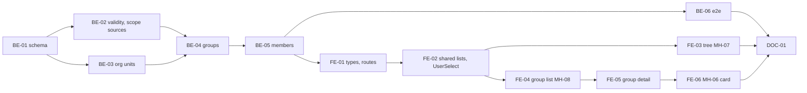

# F-03 Org Units and Subject Groups — Backend + Frontend Implementation Plan

This plan builds the org-unit tree screen (MH-07: add Khoa/Phòng under Trường, rename, move, deactivate, re-activate), subject groups of a faculty (MH-08: add, edit, deactivate with an impact list), memberships of lecturers in groups with validity periods, coordinator appointments with validity periods, and the two derived scopes that F-02 left empty: R5 "Giảng viên" (every group the user is an active member of) and R4 "Điều phối nhóm chuyên môn" (every group the user actively coordinates). It is the first feature with real scoped data, so it also carries the first scoped end-to-end proof of US-005 AC6.

It deliberately excludes the course list in the deactivation impact (F-04 fills it), the B4 organisational change request (MH-40, F-13), approval routing to coordinators (F-14), and a production seed of the four subject groups (their codes and names are not in any source document).

> **Companion documents**
> - Requirement: `docs/requirement/REQUIREMENTS.md:410-413` (FR-01..FR-04), `:1228` (EC-22)
> - Stories: `docs/planning/user-stories.md:137-177` (US-007..US-010); epic EP-03
> - Tasks: `docs/planning/task-breakdown.md:125-135` (CV-021..CV-031)
> - Design: `docs/design/data-dictionary.md:39-63` (`OrgUnit`, `SubjectGroup`), `:144-155` (`SubjectGroupMember`), `:783-784` (§9 `orgUnit.manage`, `subjectGroup.view`); `docs/design/erd.md:231-236` (M-7); `docs/design/screen-inventory.md:63-64,175,776` (MH-07, MH-08, G-2)
> - Answers: `docs/planning/feature-questions.md:96-104` (§F-03), `:93` (F02-07)
> - Builds on: `docs/implementation/f-02-accounts-roles-permissions-implementation-plan.md` (BE-01 time helpers, BE-02 `OrgUnit`, BE-04 `AccessContext`/`ScopeService`/`ScopeSourceReader`, BE-05 guard, BE-06 seed, BE-08 assignment pattern, BE-09 `features/org-units`, BE-10 test fixtures and `PERMISSION_TABLE`, FE-02..FE-07)
> - Tests: `docs/planning/test-plan.md:83` (DL-1), `:280-281` (NT-B1-01, NT-B1-02)

**Status**: Not started

---

## 0. Plan at a glance

Everything below in one table. Read this; the rest is detail for whoever builds it.

| What | Why | How and where |
|---|---|---|
| **R1 manages the unit tree** — add a Khoa or Phòng under Trường, rename, move, deactivate, re-activate; never delete | US-007 AC1–AC3; CV-022; MH-07 | `POST/PATCH /api/org-units`, `.../deactivate`, `.../activate` behind `orgUnit.manage`; allowed parent types are a constant, a cycle check runs on every parent change; no delete route exists (BE-03). Tree screen built from the existing flat unit list plus the group list (FE-03) |
| **A new Khoa is at once selectable as a course owner** | US-007 AC2 | Every unit write invalidates the shared `org-units` query that `OrgUnitSelect` reads (FE-03); F-04 filters that select to `FACULTY` |
| **R1 manages subject groups of a faculty** — add, rename, move to another faculty, deactivate after seeing what is attached, re-activate | US-008 AC1–AC3; CV-024, CV-025 | `features/subject-groups` (BE-04); `groupCode` unique and immutable; `GET .../deactivation-impact` lists active members, coordinators and (from F-04) courses before the confirm dialog (FE-04) |
| **A lecturer belongs to any number of groups, each membership with a period** | US-009 AC1–AC3; F03-05; CV-026–CV-028 | `SubjectGroupMember` rows (BE-01); add / end / revoke (BE-05); no two overlapping rows for the same person, group and role. MH-08 detail lists every row ever (FE-05); MH-06 shows a user's groups (FE-06) |
| **Coordinators are appointed with a period; a group may have several** | US-010 AC1–AC3; F03-04 A (overrides the "at most one" rule in the data dictionary) | A `COORDINATOR` row needs a `MEMBER` row of the same person and group covering its whole period; ending a membership trims the coordinator rows inside it (BE-05) |
| **Roles R4 and R5 follow the rows by themselves** | M-7; CV-027, CV-029; F-02 constraint | `ScopeSourceReader` fills `SUBJECT_GROUP_MEMBER` and `SUBJECT_GROUP_COORDINATOR` from active rows in active groups; when a coordinator period ends, R4 disappears from `me.roles` the next request, R5 stays (BE-02) |
| **"Chưa có Điều phối" warning** | US-010 AC2 | `hasActiveCoordinator` on every group summary; warning tag in the list, alert on the detail page (BE-04, FE-04, FE-05) |
| **R2 sees groups of its faculty, R4 sees only the groups it coordinates** | F03-02 A, G-2; US-005 AC6 | `GET /subject-groups` filters by `access.scopeFor('subjectGroup.view')`; detail calls `assertCan` → 403 `OUT_OF_SCOPE` outside scope; first scoped e2e cases (BE-06) |
| **One definition of "active" for periods** across roles, memberships and later features | Rule 6; F-06 and F-25 need the same | `src/shared/time/validity.ts`: `validityState`, `parsePeriod`, `overlapsPeriod`; F-02's role assignments migrate to it (BE-02) |

### Key behaviours worth knowing

| Behaviour | Why it is this way |
|---|---|
| With today's parent-type map, every Khoa and Phòng sits directly under Trường, so "move" only matters once a second level is allowed | FR-01 names exactly Trường → Phòng and Trường → Khoa; the map is one constant, and the cycle check already guards a deeper tree |
| A unit cannot be deactivated while it has active child units or active subject groups; users in it do not block | US-007 AC3 only forbids deletion; blocking on users would make closing a unit impossible until every account moves |
| A deactivated group keeps all its rows, but its members and coordinators lose scope on it the same day | Scope readers only count rows in `ACTIVE` groups; re-activating restores everything without re-entering rows |
| A coordinator is always also a member | US-010 AC3; the containment check runs on add. When the coordinator period ends the person is simply a member again (US-010 AC2) |
| "End" only shortens a period; extending means adding a new row | Extending in place would need a second overlap check and would rewrite history; a new row keeps both facts |
| Ending a membership trims (or revokes, if not yet started) the coordinator rows inside it, in the same transaction | Otherwise a coordinator row would outlive the membership that the containment rule says it needs |
| Revoking a membership row is refused while a live coordinator row depends on it | Revoke means "entered by mistake"; R1 revokes the coordinator row first, so nothing disappears silently |
| R2 and R4 can view MH-08 from day one, although F03-02 says "from B4" | The F-02 seed already gives R2 × `subjectGroup.view` = P and R4 = P; R1 may clear those two cells on MH-15 until B4 starts (§8) |
| Subject-group and unit lists are not paged | Fewer than 20 rows each; same choice as F-02's `GET /org-units` |

### Not included

| Excluded | Why |
|---|---|
| Courses in the deactivation impact | `Course` arrives in F-04; F-03 returns `courses: []` and F-04 fills it (§8 constraint) |
| Organisational change request (MH-40 form, R2/R4 propose membership changes) | F-13, from B4 (F03-01 A) |
| Approval routing to "every coordinator of the course's group" | F-14 (F03-04 A); F-03 provides the rows and the active-row filter it will reuse |
| Production seed of the four IT subject groups | Codes and names are in no source document (CV-024); R1 enters them, as NT-B1-01 does. E2E fixtures create their own groups |
| Syllabus author as scope | F03-03 A: scope is by subject group only |
| Audit-log rows | F01-07; history lives in the membership rows (`assignedBy`, `revokedAt`, `revokedBy`) and the application log |

### Open questions

All F-03 questions are answered (`feature-questions.md` §F-03). Small choices the answers did not cover:

| Question | Resolved when | Default if unanswered |
|---|---|---|
| Codes and names of the four subject groups | Before NT-B1-01 on a shared environment | R1 enters them on MH-08; no seed |
| Whether R2 and R4 should see MH-08 before B4 | Before B1 acceptance | Leave the seeded cells; R1 can clear them on MH-15 |
| May a `PHÒNG` sit under a `KHOA` | When the Khoa asks for it | No — both only under Trường (`ALLOWED_PARENT_TYPES`) |

---

## 1. Scope

| In scope | Why |
|---|---|
| Org-unit create, rename, change parent, deactivate, re-activate | CV-022, US-007 |
| Tree screen MH-07 | CV-023 |
| `SubjectGroup` model, CRUD without delete, deactivation impact | CV-024, CV-025, US-008 |
| `SubjectGroupMember` model, add / end / revoke, both roles, history | CV-026, CV-027, CV-029, US-009, US-010 |
| Derived scopes for R4 and R5 | CV-027, CV-029, M-7, F-02 constraint |
| Group detail screen with members and coordinators; a user's groups on MH-06 | CV-028, CV-030 |
| Shared validity helpers (state, period parsing, overlap) and F-02's migration to them | One rule for every dated row |
| Shared `UserSelect` on the frontend | Member picker here; director picker in F-06 |
| E2E: org units, groups, memberships, scope, two-group lecturer, expired coordinator | CV-031, US-005 AC6 |

| Out of scope | Deferred until |
|---|---|
| Courses attached to a group (impact list, scope on courses) | F-04 |
| MH-40 organisational change request | F-13 (B4) |
| Coordinator as level-1 approver | F-14 |
| Revoking delegations of a disabled coordinator | F-25 |

| AC | Covered by |
|---|---|
| US-007 AC1 — tree: Trường root, Phòng and Khoa below, groups under Khoa | FE-03 (`buildOrgTree`), BE-04 (`GET /subject-groups` for R1) |
| US-007 AC2 — new Khoa selectable as course owner | BE-03 (create `FACULTY`), FE-03 (invalidates `org-units`); consumed by F-04 |
| US-007 AC3 — unit with users or courses only deactivated, never deleted | BE-03 (no delete route; deactivate), BE-06 |
| US-008 AC1 — four groups shown under the Khoa | BE-04, FE-03, FE-04; NT-B1-01 manual |
| US-008 AC2 — duplicate group code blocked | BE-04 (`GROUP_CODE_TAKEN` with `details`), FE-04, BE-06 |
| US-008 AC3 — deactivating lists attached courses, asks to confirm, no delete | BE-04 (`deactivation-impact`; courses from F-04), FE-04 |
| US-009 AC1 — two groups, sees both groups' scope | BE-02, BE-06 (`me.roles` R5 with both group ids via scoped access) |
| US-009 AC2 — end date removes scope, history stays | BE-05 (`end`), BE-02 (active filter), BE-06 |
| US-009 AC3 — duplicate active membership blocked | BE-05 (`MEMBERSHIP_OVERLAP`), BE-06 |
| US-010 AC1 — coordinator from A to B is level-1 approver in that period | BE-02 (R4 derived while active); approval routing itself F-14 |
| US-010 AC2 — expired → regular member; warning if nobody replaces | BE-02, BE-04 (`hasActiveCoordinator`), FE-04, FE-05, BE-06 |
| US-010 AC3 — non-member cannot be coordinator | BE-05 (`COORDINATOR_NOT_MEMBER`), FE-05, BE-06 |
| US-005 AC6 — out-of-scope refused, in-scope allowed (carried from F-02) | BE-04, BE-06 |

---

## 2. Contract verification

F-03 builds on F-02 code that is **specified, not built**. Every "existing" claim cites the F-02 plan section that defines it; Rule 13 re-reads the built file before the step that uses it.

| Existing piece used | Defined at | Used by |
|---|---|---|
| `OrgUnit` model, `OrgUnitType`, `OrgUnitStatus`, relation `OrgUnitTree` | F-02 BE-02 | BE-01, BE-03 |
| `todayDate`, `fromIsoDay`, `toIsoDay`, `ISO_DAY_LENGTH` | F-02 BE-01, BE-08 | BE-02..BE-05 |
| `ScopeSourceReader.activeTargets(source, userId, today)` with four empty cases | F-02 BE-04 | BE-02 replaces two |
| `AccessContext.assertCan`, `scopeFor`; `ResolvedScope` | F-02 BE-04 | BE-04 |
| `@RequirePermission`, `@CurrentAccess`, `PERMISSIONS.ORG_UNIT_MANAGE`, `PERMISSIONS.SUBJECT_GROUP_VIEW`, `USER_MANAGE` | F-02 BE-03, BE-05 | BE-03..BE-05 |
| Seeded cells `orgUnit.manage {R1: X}`, `subjectGroup.view {R1: X, R2: P, R4: P}`; R4 = `SUBJECT_GROUP_COORDINATOR`, R5 = `SUBJECT_GROUP_MEMBER` | F-02 BE-06 | BE-02, BE-06 |
| `features/org-units` module with `GET /org-units`, `OrgUnitDto` | F-02 BE-09 | BE-03 extends |
| `OrgUnitRefDto`, `UserRefDto` in `src/shared/dtos/ref.dto.ts` | F-02 BE-07 | BE-04, BE-05 |
| `ASSIGNMENT_STATE`, `assignmentState`, `USER_ERRORS.VALIDITY_INVALID`, `assertNoOverlap` | F-02 BE-08 | BE-02 moves them to shared |
| `createAccount`, `loginAgent`, `PermissionCase`, `PERMISSION_TABLE`, route-coverage check | F-02 BE-10 | BE-06 |
| `withQuery`, `PageParams`, `DEFAULT_PAGE_SIZE` | F-02 FE-01 | FE-02 |
| `PERMISSIONS`, `useCan`, `RequirePermission` | F-02 FE-02 | FE-01 |
| `src/shared/org-units/` (`orgUnitsQueryKey`, `useOrgUnits`, `OrgUnitSelect`) | F-02 FE-03 | FE-03, FE-04 |
| `ROUTES`, `APP_MENU`, `router.tsx` lazy pages | F-02 FE-04 | FE-01 |
| `USER_QUERY_KEYS`, `UserDetailPage`, `userLabels.ts` (`ASSIGNMENT_STATE_*`, `DATE_FORMAT`, `ISO_DAY_FORMAT`) | F-02 FE-05..FE-07 | FE-01 moves labels to shared, FE-06 |

### 2a. Endpoints

All under `/api`. New unless marked.

| Endpoint | Permission | Request | Response | Notes |
|---|---|---|---|---|
| `GET /org-units` | any authenticated (existing) | — | `OrgUnitDto[]` | Unchanged; the tree page reads it |
| `POST /org-units` | `orgUnit.manage` | `CreateOrgUnitDto` | 201 `OrgUnitDto` | Only `FACULTY`/`OFFICE`; parent must be active and of an allowed type |
| `PATCH /org-units/:unitId` | `orgUnit.manage` | `UpdateOrgUnitDto` | `OrgUnitDto` | `unitCode` and `unitType` not editable; parent change runs the cycle check |
| `POST /org-units/:unitId/deactivate` | `orgUnit.manage` | — | `OrgUnitDto` | Refused for the root, or with active children or active groups. Idempotent on an inactive unit |
| `POST /org-units/:unitId/activate` | `orgUnit.manage` | — | `OrgUnitDto` | Refused while the parent is inactive. Idempotent |
| `GET /subject-groups` | `subjectGroup.view` | `?facultyId&status` | `SubjectGroupSummaryDto[]` | Filtered to the caller's scope; ordered by `groupName` |
| `POST /subject-groups` | `orgUnit.manage` | `CreateSubjectGroupDto` | 201 `SubjectGroupSummaryDto` | `groupCode` unique |
| `GET /subject-groups/:groupId` | `subjectGroup.view` | — | `SubjectGroupDetailDto` | 404 before scope; out of scope → 403 `OUT_OF_SCOPE`. Includes every member row ever |
| `PATCH /subject-groups/:groupId` | `orgUnit.manage` | `UpdateSubjectGroupDto` | `SubjectGroupSummaryDto` | `groupCode` not editable |
| `GET /subject-groups/:groupId/deactivation-impact` | `orgUnit.manage` | — | `SubjectGroupDeactivationImpactDto` | `courses` is `[]` until F-04 |
| `POST /subject-groups/:groupId/deactivate` | `orgUnit.manage` | — | `SubjectGroupSummaryDto` | Idempotent; rows untouched |
| `POST /subject-groups/:groupId/activate` | `orgUnit.manage` | — | `SubjectGroupSummaryDto` | Refused while the faculty is inactive |
| `POST /subject-groups/:groupId/members` | `orgUnit.manage` | `AddSubjectGroupMemberDto` | 201 `SubjectGroupMemberDto` | Group must be active; user must be active |
| `POST /subject-groups/:groupId/members/:memberId/end` | `orgUnit.manage` | `EndSubjectGroupMemberDto` | `SubjectGroupMemberDto[]` | Returns every row it changed (the ended row first, then trimmed or revoked coordinator rows) |
| `POST /subject-groups/:groupId/members/:memberId/revoke` | `orgUnit.manage` | — | `SubjectGroupMemberDto` | Refused while a live coordinator row depends on a membership row |
| `GET /subject-group-memberships` | `orgUnit.manage` or `user.manage` | `?userId` (required) | `UserSubjectGroupMembershipDto[]` | Every row of that user, newest `validFrom` first |

### 2b. DTOs

All new. Enum wire values are the Prisma enum values in BE-01 and F-02 BE-02.

**`OrgUnitDto`** (existing, F-02 §2b): `id`, `unitCode`, `unitName`, `unitType: 'UNIVERSITY' | 'FACULTY' | 'OFFICE'`, `parentUnitId: string | null`, `status: 'ACTIVE' | 'INACTIVE'`.

**`CreateOrgUnitDto`**: `unitCode` (trimmed, upper-cased, 1..32, `^[A-Z0-9_]+$`), `unitName` (trimmed, 1..200), `unitType: 'FACULTY' | 'OFFICE'`, `parentUnitId: string`.
**`UpdateOrgUnitDto`**: `unitName?`, `parentUnitId?` — at least one present is not enforced; an empty body returns the unit unchanged.

**`SubjectGroupSummaryDto`**

| Field | Wire type | Nullable | Source | Note |
|---|---|---|---|---|
| `id`, `groupCode`, `groupName` | `string` | no | BE-01 | |
| `faculty` | `OrgUnitRefDto` | no | BE-01 `facultyId` | |
| `status` | `'ACTIVE' \| 'INACTIVE'` | no | BE-01 `SubjectGroupStatus` | |
| `activeMemberCount` | `number` | no | BE-04 | Distinct people with an active row of either role today |
| `activeCoordinators` | `UserRefDto[]` | no | BE-04 | Active `COORDINATOR` rows today |
| `hasActiveCoordinator` | `boolean` | no | BE-04 | `activeCoordinators.length > 0`; sent so the list needs no client rule |

**`SubjectGroupDetailDto`** = summary + `members: SubjectGroupMemberDto[]`, `createdAt: string`, `updatedAt: string`.

**`SubjectGroupMemberDto`**

| Field | Wire type | Nullable | Note |
|---|---|---|---|
| `id` | `string` | no | |
| `lecturer` | `MemberUserDto` (`id`, `userCode`, `fullName`, `status: 'ACTIVE' \| 'DISABLED'`) | no | `status` lets the screen mark a disabled coordinator |
| `memberRole` | `'MEMBER' \| 'COORDINATOR'` | no | |
| `validFrom` | `string` (`YYYY-MM-DD`) | no | |
| `validTo` | `string` (`YYYY-MM-DD`) | **yes** | `null` = open-ended |
| `state` | `'ACTIVE' \| 'SCHEDULED' \| 'EXPIRED' \| 'REVOKED'` | no | Computed by `validityState` at read time; the group's own status is not folded in |
| `assignedBy` | `UserRefDto` | **yes** | |
| `createdAt` | `string` (ISO) | no | |
| `revokedAt` | `string` (ISO) | **yes** | |
| `revokedBy` | `UserRefDto` | **yes** | |

**`UserSubjectGroupMembershipDto`** = `SubjectGroupMemberDto` + `subjectGroup: SubjectGroupRefDto` (`id`, `groupCode`, `groupName`, `status`).

**`SubjectGroupDeactivationImpactDto`**: `activeMemberCount: number`, `activeCoordinators: UserRefDto[]`, `courses: SubjectGroupCourseRefDto[]` (`id`, `courseCode`, `courseName`) — always `[]` in F-03.

**`CreateSubjectGroupDto`**: `groupCode` (trimmed, upper-cased, 1..32, `^[A-Z0-9_]+$`), `groupName` (trimmed, 1..200), `facultyId: string`. **`UpdateSubjectGroupDto`**: `groupName?`, `facultyId?`.

**`AddSubjectGroupMemberDto`**: `lecturerId: string`, `memberRole: 'MEMBER' | 'COORDINATOR'`, `validFrom: string` (date), `validTo?: string` (date). **`EndSubjectGroupMemberDto`**: `validTo: string` (date).

**`MembershipQueryDto`**: `userId: string` (required).

### 2c. Mismatch log

| Deliverable | What the doc said | What this plan does | Found at |
|---|---|---|---|
| BE-01, BE-05 | "Tại một thời điểm, mỗi nhóm có nhiều nhất một dòng Điều phối đang hiệu lực" | Several coordinators allowed (answer F03-04 A wins); data dictionary updated with this plan | `data-dictionary.md:154` |
| BE-01 | `SubjectGroupMember` has no grantor or revocation columns | ⊕ `assignedBy`, `revokedAt`, `revokedBy`, mirroring F-02 D7 for `RoleAssignment` | `data-dictionary.md:144-155` |
| BE-05 | No rule ties a coordinator row to a membership | Containment rule (US-010 AC3) and no-overlap rule (US-009 AC3) written into the data dictionary | `user-stories.md:173-175, 163` |
| BE-03 | `OrgUnit` parent: "chỉ nút Trường được để trống" | Kept; adds the allowed parent types (Khoa, Phòng under Trường) | `data-dictionary.md:48` |
| BE-04 | `SubjectGroup.groupCode` unique | Also immutable — permission codes, imports and scope tests refer to groups by code | `data-dictionary.md:63` |
| — | CV-024 "nạp 04 nhóm chuyên môn" | Not seeded: names unknown; R1 enters them | `task-breakdown.md:128` |
| BE-01..BE-06 | F-01/F-02 are specified, not built; existing shapes come from their plans | Checked the built source on 2026-10-19: `OrgUnit`, `User`, `RoleAssignment`, scope contracts and time exports match the required contracts; preserve their current fields and relations. BE-01 adds only the planned group models, enums and inverse relations | `source/backend/prisma/schema.prisma`; `source/backend/src/shared/authz/scope.service.ts`; `source/backend/src/shared/time/today.ts` |
| BE-02 | Reader snippets refer to `userId` and `today` | The built stub names these unused parameters `_userId` and `_today`; rename them when filling the two group cases, preserving the existing `Exclude<ScopeSource, 'NONE'>` signature and the other empty cases | `source/backend/src/shared/authz/scope-source.reader.ts` |
| BE-02 | The validity call-site table lists the DTO state enum and `toRoleAssignmentDto`; the existing OpenAPI enum is described as renamed | Also migrate `toDerivedRoleAssignmentDto`'s `ASSIGNMENT_STATE.ACTIVE` and the state-helper imports/assertions in `role-assignments.service.spec.ts`. The current Swagger enum is inline, without `enumName`; `ValidityState` introduces a named enum while preserving state values. The validity-error test currently checks the literal code, not `USER_ERRORS` | `source/backend/src/features/users/role-assignment.dto.ts`; `source/backend/src/features/users/role-assignments.service.spec.ts` |
| BE-02 | The call-site migration table moves `ScopeService.loadManualAssignments` to `coversDay`, but the Files table omits `scope.service.ts` | Include the existing service in BE-02's follow-up edits; its inline inclusive-date and revocation filters match the plan. No change is needed to `today.ts`, whose four required exports already exist | `source/backend/src/shared/authz/scope.service.ts`; `source/backend/src/shared/time/today.ts` |
| BE-03, BE-04 | `mapUniqueViolation(error, definition, field)` exists, possibly inside `users.service.ts`, and can be moved | No such function exists. `UsersService` has private `throwUniqueError` and `throwTaken` methods plus preflight `assertUnique`. Introduce the planned shared mapper for unit/group writes without replacing or changing those existing user paths | `source/backend/src/features/users/users.service.ts`; `source/backend/src/shared/prisma/` |
| BE-06 | Route coverage lives with the permission-table tests and matches `{param}` using a `[^/]+` regex | Coverage actually lives in `users.e2e-spec.ts`: it normalizes Swagger `{param}` to `:param` and compares exact method/path strings. Extend that check in the follow-up to support BE-06's concrete placeholder paths and query strings without changing endpoint contracts | `source/backend/test/users.e2e-spec.ts`; `source/backend/test/permission-table.ts` |
| BE-06 | Existing permission-table rows use concrete placeholder ids; denied-write checks can be extended to new routes | Existing rows use `:userId`/`:roleCode` tokens, replaced in `sendRequest`; `countWrites` counts users for `/api/users` and role permissions for everything else. Preserve existing token handling and extend denied-write counts to org units, groups and memberships in the follow-up | `source/backend/test/permission-table.ts`; `source/backend/test/permission-table.e2e-spec.ts` |
| BE-02 | The named edit set is sufficient to keep existing scope tests green after filling the group readers | Blocked before implementation: `scope.service.spec.ts` instantiates the real `ScopeSourceReader` with a Prisma mock lacking `subjectGroupMember`; its existing R4 empty-source case will call the new membership query and fail. Keeping it green requires adding `subjectGroupMember.findMany: vi.fn().mockResolvedValue([])` to that mock. This is not an import repair and the file is outside the approved follow-up edit set; request that narrowly scoped test-fixture edit rather than adding a production fallback | `source/backend/src/shared/authz/scope.service.spec.ts` (`beforeEach`, `omits derived roles when their sources return no targets`) |
| BE-02 | The preceding mock blocker prevented implementation under the original edit scope | Resolved by explicit authorization: added the empty `subjectGroupMember.findMany` mock to `scope.service.spec.ts`; the existing empty-source assertion is unchanged. Existing backend test fixtures/mocks may now be adapted when planned behavior requires it | `source/backend/src/shared/authz/scope.service.spec.ts` |
| BE-04, BE-05 | DTO snippets eagerly reference each other between `subject-group.dto.ts` and `subject-group-member.dto.ts` | Use lazy Swagger type factories on the circular references and a type alias for the membership's group reference to avoid eager decorator metadata access in ESM; DTO fields and OpenAPI shapes are unchanged | `source/backend/src/features/subject-groups/subject-group.dto.ts`; `source/backend/src/features/subject-groups/subject-group-member.dto.ts` |
| BE-02 | Existing state tests import the feature-owned helpers | Updated `role-assignments.service.spec.ts` to import the shared state helpers and common validity error; retained all four state assertions and the reversed-period assertion with the same meaning | `source/backend/src/features/users/role-assignments.service.spec.ts` |
| BE-06 | The existing permission table covers only the earlier feature routes | Added the fifteen planned route cases and `NO_ROLE` without changing the earlier cases or their allowed/denied roles | `source/backend/test/permission-table.ts` |
| BE-06 | Permission-table setup assigns every account a manual role and counts only earlier feature tables | The no-role account now has no manual assignment; denied-write counts select org units, groups or memberships for their new routes. Existing authorization and no-write assertions remain unchanged | `source/backend/test/permission-table.e2e-spec.ts` |
| BE-06 | Existing route-coverage assertions compare normalized colon-token paths exactly | Adapted the coverage matcher to compare method and path segments, accepting concrete ids for parameter segments and stripping query strings. The assertion still requires authorization coverage for every documented route; existing token substitution and other user tests are unchanged | `source/backend/test/users.e2e-spec.ts` |

The data-dictionary rows above are applied together with this plan (`docs/design/data-dictionary.md` `OrgUnit`, `SubjectGroup`, `SubjectGroupMember`).

---

## 3. Decisions

| # | Decision | Why | Rejected alternative |
|---|---|---|---|
| D1 | Membership and coordination are **separate rows** (`MEMBER`, `COORDINATOR`) of one table; a coordinator row must lie inside one membership row of the same person and group | US-010 AC2 "trở lại là thành viên thường" falls out with no extra write; US-010 AC3 is one query | One row per person with a mutable role — ending a coordinator period would end the membership too, or rewrite history |
| D2 | No two non-revoked rows of the same (group, person, role) overlap in time; checked in the service | US-009 AC3; a database exclusion constraint needs `btree_gist` and raw SQL in a Prisma migration | `EXCLUDE USING gist` — stronger, but an extension and hand-written SQL for a few hundred rows |
| D3 | Several coordinators per group | F03-04 A | One coordinator (data dictionary before this plan) |
| D4 | "End" only sets or shortens `validTo`; "revoke" marks a row as entered by mistake; nothing is deleted or extended in place | Same history discipline as F-02 D7; extension = new row | `PATCH` on dates — loses the earlier period |
| D5 | Ending a `MEMBER` row trims coordinator rows inside it (revokes those starting after the new end); revoking a `MEMBER` row with a live coordinator row is refused | Ending is a normal event and should not need two clicks; revoking is a correction and must not erase another row silently | Refuse both — R1 would have to end every coordinator row first on every departure |
| D6 | Active = not revoked, `validFrom ≤ today`, `validTo` empty or `≥ today`, **and** the group is `ACTIVE`; one where-builder in `src/shared/subject-groups/active-membership.ts` | Scope readers, summaries and F-14's approver lookup must agree on who is active | Each caller writing its own `where` |
| D7 | Validity helpers move to `src/shared/time/validity.ts` (`VALIDITY_STATE`, `validityState`, `parsePeriod`, `overlapsPeriod`) and `VALIDITY_INVALID` moves to `COMMON_ERRORS`; F-02's role assignments migrate | Third dated table in three features (F-06, F-25 follow); a feature must not import another feature's code | Copying `assignmentState` into the subject-groups feature |
| D8 | Unit hierarchy rules are data: `ALLOWED_PARENT_TYPES` + `CREATABLE_UNIT_TYPES`; a parent change also walks ancestors to refuse cycles | CV-022 asks for the cycle check explicitly; the map makes today's two-level tree explicit and widening it a one-line change | Hard-coding "parent must be the root" |
| D9 | No dedicated tree endpoint; the screen builds the tree from `GET /org-units` and `GET /subject-groups` | Both lists exist, both are tiny, and both are cached under keys other screens already invalidate | `GET /org-units/tree` returning a recursive DTO — a recursive OpenAPI schema for no data the client lacks |
| D10 | Group endpoints live in a new `features/subject-groups`; unit writes extend `features/org-units` | `nestjs-rules.md` §1 one domain per feature; F-02 BE-09 created `org-units` for this extension | One `organisation` feature for both |
| D11 | Group and unit lists are not paged | < 20 rows; F-02's `GET /org-units` set the precedent | `PageQueryDto` on a list that never has a second page |
| D12 | Frontend: subject-group list fetcher, key and hook live in `src/shared/subject-groups/` | The tree page (`features/org-units`), the group pages (`features/subject-groups`) and F-04's course form all read it; features must not import each other | Fetcher inside `features/subject-groups` |
| D13 | Frontend: validity labels and date formats move from `features/users/constants/userLabels.ts` to `src/shared/validity/validity.ts` | Same reason as D7 on the client | Duplicating the four labels |
| D14 | Member picker `UserSelect` lives in `src/shared/users/` and searches `GET /users?q=&status=ACTIVE` | Reused by F-06 (directors); `GET /users` is allowed for R1, who is the only writer here | A members-only endpoint |

---

## 5. Deliverables

### BE-01 — Prisma schema: subject groups and memberships

What/Why: CV-024, CV-026, D1, D3, D4.

**Files**

| Action | Path |
|---|---|
| MODIFY | `prisma/schema.prisma` |
| NEW | `prisma/migrations/<timestamp>_subject_groups/migration.sql` (generated) |

**Shape**

```prisma
enum SubjectGroupStatus {
  ACTIVE
  INACTIVE
}

enum SubjectGroupMemberRole {
  MEMBER
  COORDINATOR
}

model SubjectGroup {
  id        String               @id @default(cuid(2))
  groupCode String               @unique
  groupName String
  facultyId String
  faculty   OrgUnit              @relation(fields: [facultyId], references: [id], onDelete: Restrict)
  status    SubjectGroupStatus   @default(ACTIVE)
  members   SubjectGroupMember[]
  createdAt DateTime             @default(now())
  updatedAt DateTime             @updatedAt

  @@index([facultyId])
}

model SubjectGroupMember {
  id             String                 @id @default(cuid(2))
  subjectGroupId String
  subjectGroup   SubjectGroup           @relation(fields: [subjectGroupId], references: [id], onDelete: Restrict)
  lecturerId     String
  lecturer       User                   @relation("MembershipHolder", fields: [lecturerId], references: [id], onDelete: Restrict)
  memberRole     SubjectGroupMemberRole
  validFrom      DateTime               @db.Date
  validTo        DateTime?              @db.Date
  assignedById   String?
  assignedBy     User?                  @relation("MembershipGrantor", fields: [assignedById], references: [id], onDelete: Restrict)
  revokedAt      DateTime?
  revokedById    String?
  revokedBy      User?                  @relation("MembershipRevoker", fields: [revokedById], references: [id], onDelete: Restrict)
  createdAt      DateTime               @default(now())
  updatedAt      DateTime               @updatedAt

  @@index([lecturerId])
  @@index([subjectGroupId])
}

model OrgUnit {
  // ...F-02 fields unchanged...
  subjectGroups SubjectGroup[]
}

model User {
  // ...F-01, F-02 fields unchanged...
  subjectGroupMemberships SubjectGroupMember[] @relation("MembershipHolder")
  grantedMemberships      SubjectGroupMember[] @relation("MembershipGrantor")
  revokedMemberships      SubjectGroupMember[] @relation("MembershipRevoker")
}
```

Commands, in `source/backend` with Docker running:

```
pnpm prisma:migrate --name subject_groups
pnpm prisma:generate
```

**Rationale**: Mirrors F-02 BE-02 `RoleAssignment` (dated `@db.Date` period, grantor and revoker relations, `onDelete: Restrict` everywhere). FK naming follows F-02 D1.

**Gotchas**
- Three relations between `User` and `SubjectGroupMember` need names, exactly like `RoleAssignment`; without them `prisma generate` fails.
- No unique index on (group, lecturer, role, validFrom): it would not stop overlaps anyway, and D2's service check does.
- `facultyId` points at any `OrgUnit`; that it is a `FACULTY` is checked in BE-04, not by the schema.
- The migration is purely additive; F-02 rows are untouched.

**Verify**: Migration applies to a fresh container; `pnpm exec tsc --noEmit -p tsconfig.json`; `\d "SubjectGroupMember"` shows four FKs and two indexes.

**Depends on**: F-02 complete

---

### BE-02 — Shared validity helpers, active-membership filter, R4/R5 scope sources

What/Why: D6, D7, M-7; fills two of F-02's four empty `ScopeSourceReader` cases (CV-027, CV-029).

**Files**

| Action | Path |
|---|---|
| NEW | `src/shared/time/validity.ts` |
| NEW | `src/shared/time/validity.spec.ts` |
| NEW | `src/shared/subject-groups/active-membership.ts` |
| MODIFY | `src/shared/exception/error-codes.ts` (`VALIDITY_INVALID` into `COMMON_ERRORS`) |
| MODIFY | `src/shared/authz/scope-source.reader.ts` |
| NEW | `src/shared/authz/scope-source.reader.spec.ts` |
| MODIFY | `src/features/users/users.errors.ts` (remove `VALIDITY_INVALID`) |
| MODIFY | `src/features/users/role-assignment.dto.ts` (remove `ASSIGNMENT_STATE`, `assignmentState`; use `validityState`) |
| MODIFY | `src/features/users/role-assignments.service.ts` (use `parsePeriod`, `overlapsPeriod`) |
| MODIFY | `src/features/users/role-assignments.service.spec.ts` (expect `COMMON_ERRORS.VALIDITY_INVALID`) |

**Shape**

```ts
// src/shared/time/validity.ts
import { AppException } from '../exception/app.exception.js';
import { COMMON_ERRORS } from '../exception/error-codes.js';
import { fromIsoDay } from './today.js';

export const VALIDITY_STATE = {
  ACTIVE: 'ACTIVE',
  SCHEDULED: 'SCHEDULED',
  EXPIRED: 'EXPIRED',
  REVOKED: 'REVOKED',
} as const;
export type ValidityState = (typeof VALIDITY_STATE)[keyof typeof VALIDITY_STATE];
export const VALIDITY_STATES = Object.values(VALIDITY_STATE);

export interface DatedRow {
  validFrom: Date;
  validTo: Date | null;
  revokedAt: Date | null;
}

export function validityState(row: DatedRow, today: Date): ValidityState {
  if (row.revokedAt) return VALIDITY_STATE.REVOKED;
  if (row.validFrom > today) return VALIDITY_STATE.SCHEDULED;
  if (row.validTo && row.validTo < today) return VALIDITY_STATE.EXPIRED;
  return VALIDITY_STATE.ACTIVE;
}

export interface Period {
  validFrom: Date;
  validTo: Date | null;
}

export function parsePeriod(validFrom: string, validTo?: string | null): Period {
  const period = { validFrom: fromIsoDay(validFrom), validTo: validTo ? fromIsoDay(validTo) : null };
  if (period.validTo && period.validTo < period.validFrom) {
    throw new AppException(COMMON_ERRORS.VALIDITY_INVALID);
  }
  return period;
}

// Where-fragment for rows whose period overlaps [from, to]; an open end never ends.
export function overlapsPeriod(period: Period) {
  return {
    OR: [{ validTo: null }, { validTo: { gte: period.validFrom } }],
    ...(period.validTo && { validFrom: { lte: period.validTo } }),
  };
}

// Where-fragment for rows active on `today`, ignoring revocation.
export function coversDay(today: Date) {
  return {
    validFrom: { lte: today },
    OR: [{ validTo: null }, { validTo: { gte: today } }],
  };
}
```

```ts
// src/shared/exception/error-codes.ts — added to COMMON_ERRORS (moved from USER_ERRORS)
VALIDITY_INVALID: {
  status: HttpStatus.BAD_REQUEST,
  code: 'VALIDITY_INVALID',
  message: 'Ngày kết thúc phải sau hoặc bằng ngày bắt đầu.',
},
```

```ts
// src/shared/subject-groups/active-membership.ts
import { type Prisma, SubjectGroupStatus } from '../../generated/prisma/client.js';
import { coversDay } from '../time/validity.js';

// One definition of "active" for memberships: scope, summaries and approver lookups must agree.
export function activeMemberRowWhere(today: Date) {
  return { revokedAt: null, ...coversDay(today) } satisfies Prisma.SubjectGroupMemberWhereInput;
}

export function activeMembershipWhere(today: Date) {
  return {
    ...activeMemberRowWhere(today),
    subjectGroup: { status: SubjectGroupStatus.ACTIVE },
  } satisfies Prisma.SubjectGroupMemberWhereInput;
}
```

```ts
// src/shared/authz/scope-source.reader.ts — two cases filled
case ScopeSource.SUBJECT_GROUP_COORDINATOR:
  return { subjectGroupIds: await this.activeGroupIds(userId, today, SubjectGroupMemberRole.COORDINATOR) };
case ScopeSource.SUBJECT_GROUP_MEMBER:
  return { subjectGroupIds: await this.activeGroupIds(userId, today) };

private async activeGroupIds(lecturerId: string, today: Date, memberRole?: SubjectGroupMemberRole): Promise<string[]> {
  const rows = await this.prisma.subjectGroupMember.findMany({
    where: { lecturerId, ...(memberRole && { memberRole }), ...activeMembershipWhere(today) },
    select: { subjectGroupId: true },
    distinct: ['subjectGroupId'],
  });
  return rows.map((row) => row.subjectGroupId);
}
```

F-02 call-site migration (Rule 13 "replacing a shared function"):

| Superseded | Call site | Migrated to |
|---|---|---|
| `ASSIGNMENT_STATE` | `features/users/role-assignment.dto.ts` (`RoleAssignmentDto.state` enum) | `VALIDITY_STATES`, `enumName: 'ValidityState'` |
| `assignmentState(row, today)` | `features/users/role-assignment.dto.ts` (`toRoleAssignmentDto`) | `validityState(row, today)` |
| `USER_ERRORS.VALIDITY_INVALID` + inline check | `features/users/role-assignments.service.ts` `assign` | `parsePeriod(dto.validFrom, dto.validTo)` |
| inline `OR`/`validFrom` overlap in `assertNoOverlap` | `features/users/role-assignments.service.ts` | `...overlapsPeriod(period)` |
| inline active-row `where` | `shared/authz/scope.service.ts` `loadManualAssignments` | `...coversDay(today)` |

After migration `ASSIGNMENT_STATE` and `assignmentState` no longer exist; grep proves it.

`validity.spec.ts`: the four states, including `validTo = today` → `ACTIVE` and `validFrom = today` → `ACTIVE`; `parsePeriod` with `validTo < validFrom` → `VALIDITY_INVALID`, equal dates allowed; `overlapsPeriod` with an open end has no `validFrom` key.

`scope-source.reader.spec.ts` (mocked Prisma): coordinator source passes `memberRole: COORDINATOR` and the active filter with the group-status clause; member source passes no `memberRole`; result ids come back as `subjectGroupIds`; `PROGRAM_DIRECTOR` and `OWN_ENROLLMENT` still return `{}`.

**Rationale**: Helpers extracted from F-02 BE-08 (`assignmentState`, `assertNoOverlap`) without changing behaviour. The reader shape is F-02 BE-04's; the "every row of either role" reading for R5 is the data dictionary's `scopeSource` note (`data-dictionary.md:93`).

**Gotchas**
- `coversDay` and `overlapsPeriod` both contain an `OR` key; never spread both into one `where`, the second silently replaces the first. Wrap in `AND: [...]` if a query ever needs both.
- The R5 source counts coordinator rows too; with D1 containment that changes nothing today, but it keeps R5 correct if a row is ever entered without containment by hand.
- The OpenAPI enum name changes to `ValidityState`; the F-02 frontend reads `RoleAssignment['state']`, so no frontend code changes, only the regenerated types.

**Verify**: `pnpm test` (validity, reader, role-assignments specs); `grep -rn "assignmentState\|ASSIGNMENT_STATE" src` → nothing.

**Depends on**: BE-01

---

### BE-03 — Org-unit management

What/Why: US-007 AC1–AC3, CV-022, D8, D10.

**Files**

| Action | Path |
|---|---|
| NEW | `src/features/org-units/org-units.errors.ts` |
| NEW | `src/features/org-units/org-unit-hierarchy.ts` |
| NEW | `src/features/org-units/org-unit-hierarchy.spec.ts` |
| NEW | `src/features/org-units/create-org-unit.dto.ts` |
| NEW | `src/features/org-units/update-org-unit.dto.ts` |
| MODIFY | `src/features/org-units/org-units.service.ts` |
| NEW | `src/features/org-units/org-units.service.spec.ts` |
| MODIFY | `src/features/org-units/org-units.controller.ts` |
| MODIFY | `src/features/org-units/org-unit.dto.ts` (`toOrgUnitDto`, `ORG_UNIT_SELECT`) |

**Shape**

```ts
// src/features/org-units/org-units.errors.ts
export const ORG_UNIT_ERRORS = {
  ORG_UNIT_NOT_FOUND: { status: HttpStatus.NOT_FOUND, code: 'ORG_UNIT_NOT_FOUND', message: 'Không tìm thấy đơn vị.' },
  UNIT_CODE_TAKEN: { status: HttpStatus.CONFLICT, code: 'UNIT_CODE_TAKEN', message: 'Mã đơn vị đã tồn tại.' },
  PARENT_INVALID: { status: HttpStatus.BAD_REQUEST, code: 'PARENT_INVALID', message: 'Đơn vị cha không hợp lệ cho loại đơn vị này.' },
  PARENT_CYCLE: { status: HttpStatus.BAD_REQUEST, code: 'PARENT_CYCLE', message: 'Không thể đặt đơn vị cha là chính nó hoặc đơn vị cấp dưới của nó.' },
  PARENT_INACTIVE: { status: HttpStatus.CONFLICT, code: 'PARENT_INACTIVE', message: 'Đơn vị cha đang ngừng hoạt động.' },
  ROOT_UNIT_LOCKED: { status: HttpStatus.CONFLICT, code: 'ROOT_UNIT_LOCKED', message: 'Không thể ngừng hoạt động hoặc di chuyển đơn vị gốc.' },
  UNIT_HAS_ACTIVE_CHILDREN: { status: HttpStatus.CONFLICT, code: 'UNIT_HAS_ACTIVE_CHILDREN', message: 'Đơn vị còn đơn vị con đang hoạt động.' },
  UNIT_HAS_ACTIVE_GROUPS: { status: HttpStatus.CONFLICT, code: 'UNIT_HAS_ACTIVE_GROUPS', message: 'Đơn vị còn nhóm chuyên môn đang sử dụng.' },
} as const satisfies Record<string, ErrorDefinition>;
```

```ts
// src/features/org-units/org-unit-hierarchy.ts
import { OrgUnitType } from '../../generated/prisma/client.js';

export const CREATABLE_UNIT_TYPES = [OrgUnitType.FACULTY, OrgUnitType.OFFICE] as const;

// FR-01: Trường → Phòng, Trường → Khoa. The root is seeded and has no parent.
export const ALLOWED_PARENT_TYPES: Record<OrgUnitType, readonly OrgUnitType[]> = {
  UNIVERSITY: [],
  FACULTY: [OrgUnitType.UNIVERSITY],
  OFFICE: [OrgUnitType.UNIVERSITY],
};

export function isAllowedParent(childType: OrgUnitType, parentType: OrgUnitType): boolean {
  return ALLOWED_PARENT_TYPES[childType].includes(parentType);
}

// True when `candidateParentId` is `unitId` itself or one of its descendants.
export function createsCycle(unitId: string, candidateParentId: string, parentOf: ReadonlyMap<string, string | null>): boolean {
  for (let current: string | null = candidateParentId; current; current = parentOf.get(current) ?? null) {
    if (current === unitId) {
      return true;
    }
  }
  return false;
}
```

```ts
// src/features/org-units/create-org-unit.dto.ts
export const ORG_UNIT_FIELD_LIMITS = { CODE_MAX: 32, NAME_MAX: 200 } as const;
export const UNIT_CODE_PATTERN = /^[A-Z0-9_]+$/;

export class CreateOrgUnitDto {
  @ApiProperty({ maxLength: ORG_UNIT_FIELD_LIMITS.CODE_MAX })
  @Transform(({ value }) => (typeof value === 'string' ? value.trim().toUpperCase() : value))
  @IsString() @Length(1, ORG_UNIT_FIELD_LIMITS.CODE_MAX) @Matches(UNIT_CODE_PATTERN)
  unitCode: string;

  @ApiProperty({ maxLength: ORG_UNIT_FIELD_LIMITS.NAME_MAX })
  @Transform(({ value }) => (typeof value === 'string' ? value.trim() : value))
  @IsString() @Length(1, ORG_UNIT_FIELD_LIMITS.NAME_MAX)
  unitName: string;

  @ApiProperty({ enum: CREATABLE_UNIT_TYPES })
  @IsIn(CREATABLE_UNIT_TYPES)
  unitType: (typeof CREATABLE_UNIT_TYPES)[number];

  @ApiProperty() @IsString() parentUnitId: string;
}

// update-org-unit.dto.ts
export class UpdateOrgUnitDto {
  @ApiPropertyOptional({ maxLength: ORG_UNIT_FIELD_LIMITS.NAME_MAX })
  @IsOptional()
  @Transform(({ value }) => (typeof value === 'string' ? value.trim() : value))
  @IsString() @Length(1, ORG_UNIT_FIELD_LIMITS.NAME_MAX)
  unitName?: string;

  @ApiPropertyOptional() @IsOptional() @IsString() parentUnitId?: string;
}
```

```ts
// src/features/org-units/org-units.service.ts — additions
@Injectable()
export class OrgUnitsService {
  private readonly logger = new Logger(OrgUnitsService.name);

  constructor(private readonly prisma: PrismaService) {}

  // list(): unchanged from F-02

  async create(dto: CreateOrgUnitDto, actorId: string): Promise<OrgUnitDto> {
    const parent = await this.findOrThrow(dto.parentUnitId, ORG_UNIT_ERRORS.PARENT_INVALID);
    assertParentUsable(dto.unitType, parent);
    try {
      const row = await this.prisma.orgUnit.create({
        data: { unitCode: dto.unitCode, unitName: dto.unitName, unitType: dto.unitType, parentUnitId: parent.id },
        select: ORG_UNIT_SELECT,
      });
      this.logger.log(`Org unit ${row.unitCode} created under ${parent.unitCode} by ${actorId}`);
      return toOrgUnitDto(row);
    } catch (error) {
      throw mapUniqueViolation(error, ORG_UNIT_ERRORS.UNIT_CODE_TAKEN, 'unitCode');
    }
  }

  async update(unitId: string, dto: UpdateOrgUnitDto, actorId: string): Promise<OrgUnitDto> {
    const unit = await this.findOrThrow(unitId);
    if (dto.parentUnitId !== undefined && dto.parentUnitId !== unit.parentUnitId) {
      if (!unit.parentUnitId) {
        throw new AppException(ORG_UNIT_ERRORS.ROOT_UNIT_LOCKED);
      }
      const parent = await this.findOrThrow(dto.parentUnitId, ORG_UNIT_ERRORS.PARENT_INVALID);
      assertParentUsable(unit.unitType, parent);
      if (createsCycle(unit.id, parent.id, await this.parentMap())) {
        throw new AppException(ORG_UNIT_ERRORS.PARENT_CYCLE);
      }
    }
    const row = await this.prisma.orgUnit.update({
      where: { id: unit.id },
      data: { unitName: dto.unitName, parentUnitId: dto.parentUnitId },
      select: ORG_UNIT_SELECT,
    });
    this.logger.log(`Org unit ${row.unitCode} updated by ${actorId}`);
    return toOrgUnitDto(row);
  }

  async deactivate(unitId: string, actorId: string): Promise<OrgUnitDto> {
    const unit = await this.findOrThrow(unitId);
    if (!unit.parentUnitId) {
      throw new AppException(ORG_UNIT_ERRORS.ROOT_UNIT_LOCKED);
    }
    if (unit.status === OrgUnitStatus.INACTIVE) {
      return toOrgUnitDto(unit);
    }
    const [children, groups] = await Promise.all([
      this.prisma.orgUnit.count({ where: { parentUnitId: unit.id, status: OrgUnitStatus.ACTIVE } }),
      this.prisma.subjectGroup.count({ where: { facultyId: unit.id, status: SubjectGroupStatus.ACTIVE } }),
    ]);
    if (children > 0) throw new AppException(ORG_UNIT_ERRORS.UNIT_HAS_ACTIVE_CHILDREN);
    if (groups > 0) throw new AppException(ORG_UNIT_ERRORS.UNIT_HAS_ACTIVE_GROUPS);
    return this.setStatus(unit.id, OrgUnitStatus.INACTIVE, actorId);
  }

  async activate(unitId: string, actorId: string): Promise<OrgUnitDto> {
    const unit = await this.findOrThrow(unitId);
    if (unit.status === OrgUnitStatus.ACTIVE) {
      return toOrgUnitDto(unit);
    }
    const parent = unit.parentUnitId ? await this.findOrThrow(unit.parentUnitId) : null;
    if (parent && parent.status !== OrgUnitStatus.ACTIVE) {
      throw new AppException(ORG_UNIT_ERRORS.PARENT_INACTIVE);
    }
    return this.setStatus(unit.id, OrgUnitStatus.ACTIVE, actorId);
  }

  private async parentMap(): Promise<Map<string, string | null>> {
    const units = await this.prisma.orgUnit.findMany({ select: { id: true, parentUnitId: true } });
    return new Map(units.map((unit) => [unit.id, unit.parentUnitId]));
  }

  // findOrThrow(id, error = ORG_UNIT_NOT_FOUND), setStatus(id, status, actorId) with one log line
}

function assertParentUsable(childType: OrgUnitType, parent: { unitType: OrgUnitType; status: OrgUnitStatus }): void {
  if (!isAllowedParent(childType, parent.unitType)) {
    throw new AppException(ORG_UNIT_ERRORS.PARENT_INVALID);
  }
  if (parent.status !== OrgUnitStatus.ACTIVE) {
    throw new AppException(ORG_UNIT_ERRORS.PARENT_INACTIVE);
  }
}
```

`mapUniqueViolation(error, definition, field)` is the helper F-02 BE-07 writes for `USERNAME_TAKEN` (Prisma `P2002` → `AppException(definition, [{ field, ... }])`); if BE-07 built it inside `users.service.ts`, move it to `src/shared/prisma/unique-violation.ts` here and record the move in the implement report.

```ts
// src/features/org-units/org-units.controller.ts — additions
@Post()
@RequirePermission(PERMISSIONS.ORG_UNIT_MANAGE)
@ApiCreatedResponse({ type: OrgUnitDto })
create(@Body() dto: CreateOrgUnitDto, @CurrentUser() actor: AuthenticatedUser) { return this.orgUnits.create(dto, actor.id); }

@Patch(':unitId')
@RequirePermission(PERMISSIONS.ORG_UNIT_MANAGE)
@ApiOkResponse({ type: OrgUnitDto })
update(@Param('unitId') unitId: string, @Body() dto: UpdateOrgUnitDto, @CurrentUser() actor: AuthenticatedUser) {
  return this.orgUnits.update(unitId, dto, actor.id);
}

@Post(':unitId/deactivate')
@HttpCode(HttpStatus.OK)
@RequirePermission(PERMISSIONS.ORG_UNIT_MANAGE)
@ApiOkResponse({ type: OrgUnitDto })
deactivate(@Param('unitId') unitId: string, @CurrentUser() actor: AuthenticatedUser) { return this.orgUnits.deactivate(unitId, actor.id); }

@Post(':unitId/activate')
// same decorators → this.orgUnits.activate(unitId, actor.id)
```

`org-unit-hierarchy.spec.ts`: FACULTY under UNIVERSITY allowed; FACULTY under OFFICE refused; UNIVERSITY under anything refused; `createsCycle` for self, for a child, for a grandchild, and false for a sibling.

`org-units.service.spec.ts`: create with an inactive parent → `PARENT_INACTIVE`; create under a FACULTY → `PARENT_INVALID`; duplicate code → `UNIT_CODE_TAKEN` with `details[0].field = 'unitCode'`; move the root → `ROOT_UNIT_LOCKED`; deactivate the root → `ROOT_UNIT_LOCKED`; deactivate with an active group → `UNIT_HAS_ACTIVE_GROUPS`; deactivate twice → same DTO, one write; activate under an inactive parent → `PARENT_INACTIVE`.

**Rationale**: Same layering and logging as F-02 BE-07/BE-08 (`users.service.ts`, `role-assignments.service.ts`). The controller extends F-02 BE-09's `OrgUnitsController`, whose `GET` stays `@AnyAuthenticated`.

**Gotchas**
- `unitType` is not in `UpdateOrgUnitDto`: changing a Khoa into a Phòng would invalidate courses and groups attached to it. `forbidNonWhitelisted` refuses the field.
- `data: { unitName: undefined }` leaves the column untouched in Prisma — that is what makes the partial update work; do not map `undefined` to `null`.
- Users of a deactivated unit keep `orgUnitId`; `OrgUnitSelect` already keeps an inactive current value visible (F-02 FE-03).
- An R2 assignment scoped to a deactivated Khoa keeps the Khoa itself in scope (F-02 BE-04 always includes the root); this is intended — history stays readable.

**Verify**: `pnpm test`; Swagger: create `KHOA_TOAN` under `DHBK`, try moving it under `KHOA_CNTT` → 400 `PARENT_INVALID`.

**Depends on**: BE-01

---

### BE-04 — Subject groups: list, detail, create, edit, deactivation impact, deactivate, activate

What/Why: US-008 AC1–AC3, US-010 AC2 warning, F03-02, US-005 AC6, D6, D10, D11.

**Files**

| Action | Path |
|---|---|
| NEW | `src/features/subject-groups/subject-groups.module.ts` |
| NEW | `src/features/subject-groups/subject-groups.controller.ts` |
| NEW | `src/features/subject-groups/subject-groups.service.ts` |
| NEW | `src/features/subject-groups/subject-groups.service.spec.ts` |
| NEW | `src/features/subject-groups/subject-groups.errors.ts` |
| NEW | `src/features/subject-groups/subject-group.dto.ts` |
| NEW | `src/features/subject-groups/subject-group-member.dto.ts` |
| NEW | `src/features/subject-groups/create-subject-group.dto.ts` |
| NEW | `src/features/subject-groups/update-subject-group.dto.ts` |
| NEW | `src/features/subject-groups/subject-group-query.dto.ts` |
| MODIFY | `src/app.module.ts` (import `SubjectGroupsModule`) |

**Shape**

```ts
// src/features/subject-groups/subject-groups.errors.ts
export const SUBJECT_GROUP_ERRORS = {
  SUBJECT_GROUP_NOT_FOUND: { status: HttpStatus.NOT_FOUND, code: 'SUBJECT_GROUP_NOT_FOUND', message: 'Không tìm thấy nhóm chuyên môn.' },
  GROUP_CODE_TAKEN: { status: HttpStatus.CONFLICT, code: 'GROUP_CODE_TAKEN', message: 'Mã nhóm chuyên môn đã tồn tại.' },
  FACULTY_INVALID: { status: HttpStatus.BAD_REQUEST, code: 'FACULTY_INVALID', message: 'Nhóm chuyên môn phải thuộc một Khoa đang hoạt động.' },
  SUBJECT_GROUP_INACTIVE: { status: HttpStatus.CONFLICT, code: 'SUBJECT_GROUP_INACTIVE', message: 'Nhóm chuyên môn đang ngừng sử dụng.' },
  LECTURER_INVALID: { status: HttpStatus.BAD_REQUEST, code: 'LECTURER_INVALID', message: 'Người được chọn không tồn tại hoặc đã bị vô hiệu hóa.' },
  MEMBERSHIP_OVERLAP: { status: HttpStatus.CONFLICT, code: 'MEMBERSHIP_OVERLAP', message: 'Người này đã có vai trò này trong nhóm trong khoảng thời gian đó.' },
  COORDINATOR_NOT_MEMBER: { status: HttpStatus.BAD_REQUEST, code: 'COORDINATOR_NOT_MEMBER', message: 'Hãy gán người này làm thành viên của nhóm trong suốt khoảng thời gian trước khi chỉ định Điều phối.' },
  MEMBER_NOT_FOUND: { status: HttpStatus.NOT_FOUND, code: 'MEMBER_NOT_FOUND', message: 'Không tìm thấy dòng thành viên.' },
  MEMBER_ALREADY_REVOKED: { status: HttpStatus.CONFLICT, code: 'MEMBER_ALREADY_REVOKED', message: 'Dòng thành viên này đã được thu hồi.' },
  END_DATE_NOT_EARLIER: { status: HttpStatus.BAD_REQUEST, code: 'END_DATE_NOT_EARLIER', message: 'Chỉ được rút ngắn thời hạn; muốn kéo dài hãy thêm dòng mới.' },
  MEMBER_HAS_COORDINATOR: { status: HttpStatus.CONFLICT, code: 'MEMBER_HAS_COORDINATOR', message: 'Dòng thành viên này còn dòng Điều phối dựa vào; hãy thu hồi dòng Điều phối trước.' },
} as const satisfies Record<string, ErrorDefinition>;
```

```ts
// src/features/subject-groups/subject-group.dto.ts
export class SubjectGroupRefDto {
  @ApiProperty() id: string;
  @ApiProperty() groupCode: string;
  @ApiProperty() groupName: string;
  @ApiProperty({ enum: SubjectGroupStatus, enumName: 'SubjectGroupStatus' }) status: SubjectGroupStatus;
}

export class SubjectGroupSummaryDto extends SubjectGroupRefDto {
  @ApiProperty({ type: OrgUnitRefDto }) faculty: OrgUnitRefDto;
  @ApiProperty() activeMemberCount: number;
  @ApiProperty({ type: [UserRefDto] }) activeCoordinators: UserRefDto[];
  @ApiProperty() hasActiveCoordinator: boolean;
}

export class SubjectGroupDetailDto extends SubjectGroupSummaryDto {
  @ApiProperty({ type: [SubjectGroupMemberDto] }) members: SubjectGroupMemberDto[];
  @ApiProperty() createdAt: string;
  @ApiProperty() updatedAt: string;
}

export class SubjectGroupCourseRefDto {
  @ApiProperty() id: string;
  @ApiProperty() courseCode: string;
  @ApiProperty() courseName: string;
}

export class SubjectGroupDeactivationImpactDto {
  @ApiProperty() activeMemberCount: number;
  @ApiProperty({ type: [UserRefDto] }) activeCoordinators: UserRefDto[];
  @ApiProperty({ type: [SubjectGroupCourseRefDto] }) courses: SubjectGroupCourseRefDto[];
}

export function summaryInclude(today: Date) {
  return {
    faculty: { select: { id: true, unitCode: true, unitName: true } },
    members: {
      where: activeMemberRowWhere(today),
      select: { memberRole: true, lecturer: { select: { id: true, fullName: true } } },
    },
  } satisfies Prisma.SubjectGroupInclude;
}

export function toSubjectGroupSummaryDto(row: SubjectGroupWithActiveMembers): SubjectGroupSummaryDto {
  // Active rows of an INACTIVE group still exist but grant nothing (D6).
  const live = row.status === SubjectGroupStatus.ACTIVE ? row.members : [];
  const activeCoordinators = uniqueById(
    live.filter((member) => member.memberRole === SubjectGroupMemberRole.COORDINATOR).map((member) => member.lecturer),
  );
  return {
    id: row.id, groupCode: row.groupCode, groupName: row.groupName, status: row.status, faculty: row.faculty,
    activeMemberCount: new Set(live.map((member) => member.lecturer.id)).size,
    activeCoordinators,
    hasActiveCoordinator: activeCoordinators.length > 0,
  };
}
```

```ts
// src/features/subject-groups/subject-group-member.dto.ts
export class MemberUserDto {
  @ApiProperty() id: string;
  @ApiProperty() userCode: string;
  @ApiProperty() fullName: string;
  @ApiProperty({ enum: UserStatus, enumName: 'UserStatus' }) status: UserStatus;
}

export class SubjectGroupMemberDto {
  @ApiProperty() id: string;
  @ApiProperty({ type: MemberUserDto }) lecturer: MemberUserDto;
  @ApiProperty({ enum: SubjectGroupMemberRole, enumName: 'SubjectGroupMemberRole' }) memberRole: SubjectGroupMemberRole;
  @ApiProperty({ format: 'date' }) validFrom: string;
  @ApiProperty({ format: 'date', nullable: true, type: String }) validTo: string | null;
  @ApiProperty({ enum: VALIDITY_STATES, enumName: 'ValidityState' }) state: ValidityState;
  @ApiProperty({ type: UserRefDto, nullable: true }) assignedBy: UserRefDto | null;
  @ApiProperty() createdAt: string;
  @ApiProperty({ nullable: true, type: String }) revokedAt: string | null;
  @ApiProperty({ type: UserRefDto, nullable: true }) revokedBy: UserRefDto | null;
}

export class UserSubjectGroupMembershipDto extends SubjectGroupMemberDto {
  @ApiProperty({ type: SubjectGroupRefDto }) subjectGroup: SubjectGroupRefDto;
}

export const MEMBER_SELECT = {
  id: true, memberRole: true, validFrom: true, validTo: true, createdAt: true, revokedAt: true,
  lecturer: { select: { id: true, userCode: true, fullName: true, status: true } },
  assignedBy: { select: { id: true, fullName: true } },
  revokedBy: { select: { id: true, fullName: true } },
} as const satisfies Prisma.SubjectGroupMemberSelect;

export function toSubjectGroupMemberDto(row: MemberRow, today: Date): SubjectGroupMemberDto {
  return {
    ...row,
    validFrom: toIsoDay(row.validFrom),
    validTo: row.validTo ? toIsoDay(row.validTo) : null,
    state: validityState(row, today),
    createdAt: row.createdAt.toISOString(),
    revokedAt: row.revokedAt?.toISOString() ?? null,
  };
}
```

```ts
// src/features/subject-groups/create-subject-group.dto.ts
export const SUBJECT_GROUP_FIELD_LIMITS = { CODE_MAX: 32, NAME_MAX: 200 } as const;
export const GROUP_CODE_PATTERN = /^[A-Z0-9_]+$/;

export class CreateSubjectGroupDto {
  // groupCode: Transform trim + upper, Length(1, CODE_MAX), Matches(GROUP_CODE_PATTERN)
  // groupName: Transform trim, Length(1, NAME_MAX)
  @ApiProperty() @IsString() facultyId: string;
}
// UpdateSubjectGroupDto: groupName?, facultyId? (both optional, same validators)
// SubjectGroupQueryDto: facultyId? (IsString), status? (IsEnum(SubjectGroupStatus))
```

```ts
// src/features/subject-groups/subject-groups.service.ts
@Injectable()
export class SubjectGroupsService {
  private readonly logger = new Logger(SubjectGroupsService.name);

  constructor(private readonly prisma: PrismaService) {}

  async list(query: SubjectGroupQueryDto, access: AccessContext): Promise<SubjectGroupSummaryDto[]> {
    const scope = access.scopeFor(PERMISSIONS.SUBJECT_GROUP_VIEW);
    const rows = await this.prisma.subjectGroup.findMany({
      where: { facultyId: query.facultyId, status: query.status, ...scopeWhere(scope) },
      include: summaryInclude(todayDate()),
      orderBy: { groupName: 'asc' },
    });
    return rows.map(toSubjectGroupSummaryDto);
  }

  async detail(groupId: string, access: AccessContext): Promise<SubjectGroupDetailDto> {
    const today = todayDate();
    const row = await this.prisma.subjectGroup.findUnique({ where: { id: groupId }, include: summaryInclude(today) });
    if (!row) throw new AppException(SUBJECT_GROUP_ERRORS.SUBJECT_GROUP_NOT_FOUND);
    access.assertCan(PERMISSIONS.SUBJECT_GROUP_VIEW, groupTarget(row));
    const members = await this.prisma.subjectGroupMember.findMany({
      where: { subjectGroupId: row.id },
      select: MEMBER_SELECT,
      orderBy: [{ memberRole: 'desc' }, { validFrom: 'desc' }],
    });
    return {
      ...toSubjectGroupSummaryDto(row),
      members: members.map((member) => toSubjectGroupMemberDto(member, today)),
      createdAt: row.createdAt.toISOString(),
      updatedAt: row.updatedAt.toISOString(),
    };
  }

  async create(dto: CreateSubjectGroupDto, actorId: string): Promise<SubjectGroupSummaryDto> {
    await this.assertFaculty(dto.facultyId);
    try {
      const row = await this.prisma.subjectGroup.create({
        data: { groupCode: dto.groupCode, groupName: dto.groupName, facultyId: dto.facultyId },
        include: summaryInclude(todayDate()),
      });
      this.logger.log(`Subject group ${row.groupCode} created by ${actorId}`);
      return toSubjectGroupSummaryDto(row);
    } catch (error) {
      throw mapUniqueViolation(error, SUBJECT_GROUP_ERRORS.GROUP_CODE_TAKEN, 'groupCode');
    }
  }

  async update(groupId: string, dto: UpdateSubjectGroupDto, actorId: string): Promise<SubjectGroupSummaryDto> {
    await this.findOrThrow(groupId);
    if (dto.facultyId !== undefined) {
      await this.assertFaculty(dto.facultyId);
    }
    const row = await this.prisma.subjectGroup.update({
      where: { id: groupId },
      data: { groupName: dto.groupName, facultyId: dto.facultyId },
      include: summaryInclude(todayDate()),
    });
    this.logger.log(`Subject group ${row.groupCode} updated by ${actorId}`);
    return toSubjectGroupSummaryDto(row);
  }

  async deactivationImpact(groupId: string): Promise<SubjectGroupDeactivationImpactDto> {
    const row = await this.prisma.subjectGroup.findUnique({ where: { id: groupId }, include: summaryInclude(todayDate()) });
    if (!row) throw new AppException(SUBJECT_GROUP_ERRORS.SUBJECT_GROUP_NOT_FOUND);
    const summary = toSubjectGroupSummaryDto(row);
    return { activeMemberCount: summary.activeMemberCount, activeCoordinators: summary.activeCoordinators, courses: [] };
  }

  async deactivate(groupId: string, actorId: string): Promise<SubjectGroupSummaryDto> {
    return this.setStatus(groupId, SubjectGroupStatus.INACTIVE, actorId);
  }

  async activate(groupId: string, actorId: string): Promise<SubjectGroupSummaryDto> {
    const group = await this.findOrThrow(groupId);
    if (group.status === SubjectGroupStatus.INACTIVE) {
      await this.assertFaculty(group.facultyId);
    }
    return this.setStatus(groupId, SubjectGroupStatus.ACTIVE, actorId);
  }

  private async assertFaculty(facultyId: string): Promise<void> {
    const unit = await this.prisma.orgUnit.findUnique({ where: { id: facultyId } });
    if (!unit || unit.unitType !== OrgUnitType.FACULTY || unit.status !== OrgUnitStatus.ACTIVE) {
      throw new AppException(SUBJECT_GROUP_ERRORS.FACULTY_INVALID);
    }
  }

  // findOrThrow(groupId); setStatus(groupId, status, actorId): no write when already in that status, one log line
}

// A group is reached through its own id (R4, R5 scope) or its faculty (R2 unit scope).
export function groupTarget(group: { id: string; facultyId: string }): ScopeTarget {
  return { subjectGroupIds: [group.id], orgUnitIds: [group.facultyId] };
}

function scopeWhere(scope: ResolvedScope): Prisma.SubjectGroupWhereInput {
  if (scope.all) {
    return {};
  }
  return { OR: [{ id: { in: [...scope.subjectGroupIds] } }, { facultyId: { in: [...scope.orgUnitIds] } }] };
}
```

`detail` uses the summary include for the counts and a second, ordered query for the full history, so the summary mapper stays the one place that decides who is active.

```ts
// src/features/subject-groups/subject-groups.controller.ts
@ApiTags('subject-groups')
@ApiCookieAuth()
@Controller('subject-groups')
export class SubjectGroupsController {
  constructor(
    private readonly groups: SubjectGroupsService,
    private readonly members: SubjectGroupMembersService,
  ) {}

  @Get()
  @RequirePermission(PERMISSIONS.SUBJECT_GROUP_VIEW)
  @ApiOkResponse({ type: [SubjectGroupSummaryDto] })
  list(@Query() query: SubjectGroupQueryDto, @CurrentAccess() access: AccessContext) { return this.groups.list(query, access); }

  @Post()
  @RequirePermission(PERMISSIONS.ORG_UNIT_MANAGE)
  @ApiCreatedResponse({ type: SubjectGroupSummaryDto })
  create(@Body() dto: CreateSubjectGroupDto, @CurrentUser() actor: AuthenticatedUser) { return this.groups.create(dto, actor.id); }

  @Get(':groupId')
  @RequirePermission(PERMISSIONS.SUBJECT_GROUP_VIEW)
  @ApiOkResponse({ type: SubjectGroupDetailDto })
  detail(@Param('groupId') groupId: string, @CurrentAccess() access: AccessContext) { return this.groups.detail(groupId, access); }

  @Patch(':groupId')
  @RequirePermission(PERMISSIONS.ORG_UNIT_MANAGE)
  @ApiOkResponse({ type: SubjectGroupSummaryDto })
  update(@Param('groupId') groupId: string, @Body() dto: UpdateSubjectGroupDto, @CurrentUser() actor: AuthenticatedUser) {
    return this.groups.update(groupId, dto, actor.id);
  }

  @Get(':groupId/deactivation-impact')
  @RequirePermission(PERMISSIONS.ORG_UNIT_MANAGE)
  @ApiOkResponse({ type: SubjectGroupDeactivationImpactDto })
  impact(@Param('groupId') groupId: string) { return this.groups.deactivationImpact(groupId); }

  @Post(':groupId/deactivate')   // + :groupId/activate — HttpCode(OK), ORG_UNIT_MANAGE, SubjectGroupSummaryDto
  // member routes: BE-05
}
```

Service spec cases: `list` with `scope.all` adds no filter; with an R4 scope filters by `id in`; with an R2 unit scope filters by `facultyId in`; `detail` out of scope → `OUT_OF_SCOPE`, missing → `SUBJECT_GROUP_NOT_FOUND` before any scope check; `create` with an `OFFICE` unit → `FACULTY_INVALID`; duplicate code → `GROUP_CODE_TAKEN` with `details[0].field = 'groupCode'`; summary of an `INACTIVE` group reports 0 members and `hasActiveCoordinator: false`; two coordinators both listed; one person with a `MEMBER` and a `COORDINATOR` row counts once.

**Rationale**: Layering and naming mirror F-02 BE-07 (`users.service.ts`, `users.errors.ts`, DTO + mapper beside it). `scopeFor` for lists and `assertCan` for one object is the F00-03 split F-02 BE-04 prepared.

**Gotchas**
- `orderBy: { memberRole: 'desc' }` sorts by enum declaration order in PostgreSQL (`COORDINATOR` after `MEMBER` → `desc` puts coordinators first); keep the enum order in BE-01 as written.
- `scopeWhere` must not be spread into a `where` that already has an `OR`.
- `detail` checks scope **after** loading the row, so a 404 reveals that an id does not exist; ids are `cuid`, not guessable, and F-02's permission table relies on "allowed role sees non-403".
- `deactivationImpact` must keep its response shape when F-04 fills `courses`; F-04 adds the query here, not a new endpoint.

**Verify**: `pnpm test`; `pnpm exec tsc --noEmit -p tsconfig.json`; Swagger: create two groups under `KHOA_CNTT`, list them.

**Depends on**: BE-02, BE-03

---

### BE-05 — Memberships and coordinators: add, end, revoke, a user's groups

What/Why: US-009 AC1–AC3, US-010 AC1–AC3, CV-027, CV-029, D1–D5.

**Files**

| Action | Path |
|---|---|
| NEW | `src/features/subject-groups/subject-group-members.service.ts` |
| NEW | `src/features/subject-groups/subject-group-members.service.spec.ts` |
| NEW | `src/features/subject-groups/add-subject-group-member.dto.ts` |
| NEW | `src/features/subject-groups/end-subject-group-member.dto.ts` |
| NEW | `src/features/subject-groups/membership-query.dto.ts` |
| NEW | `src/features/subject-groups/subject-group-memberships.controller.ts` |
| MODIFY | `src/features/subject-groups/subject-groups.controller.ts` (member routes) |
| MODIFY | `src/features/subject-groups/subject-groups.module.ts` |

**Shape**

```ts
// src/features/subject-groups/add-subject-group-member.dto.ts
export class AddSubjectGroupMemberDto {
  @ApiProperty() @IsString() lecturerId: string;

  @ApiProperty({ enum: SubjectGroupMemberRole, enumName: 'SubjectGroupMemberRole' })
  @IsEnum(SubjectGroupMemberRole)
  memberRole: SubjectGroupMemberRole;

  @ApiProperty({ format: 'date' }) @IsISO8601({ strict: true }) @Length(ISO_DAY_LENGTH, ISO_DAY_LENGTH) validFrom: string;

  @ApiPropertyOptional({ format: 'date' }) @IsOptional() @IsISO8601({ strict: true }) @Length(ISO_DAY_LENGTH, ISO_DAY_LENGTH) validTo?: string;
}

// end-subject-group-member.dto.ts
export class EndSubjectGroupMemberDto {
  @ApiProperty({ format: 'date' }) @IsISO8601({ strict: true }) @Length(ISO_DAY_LENGTH, ISO_DAY_LENGTH) validTo: string;
}

// membership-query.dto.ts
export class MembershipQueryDto {
  @ApiProperty() @IsString() userId: string;
}
```

```ts
// src/features/subject-groups/subject-group-members.service.ts
@Injectable()
export class SubjectGroupMembersService {
  private readonly logger = new Logger(SubjectGroupMembersService.name);

  constructor(private readonly prisma: PrismaService) {}

  async add(groupId: string, dto: AddSubjectGroupMemberDto, actorId: string): Promise<SubjectGroupMemberDto> {
    const group = await this.prisma.subjectGroup.findUnique({ where: { id: groupId } });
    if (!group) throw new AppException(SUBJECT_GROUP_ERRORS.SUBJECT_GROUP_NOT_FOUND);
    if (group.status !== SubjectGroupStatus.ACTIVE) throw new AppException(SUBJECT_GROUP_ERRORS.SUBJECT_GROUP_INACTIVE);
    const lecturer = await this.prisma.user.findUnique({ where: { id: dto.lecturerId } });
    if (!lecturer || lecturer.status !== UserStatus.ACTIVE) throw new AppException(SUBJECT_GROUP_ERRORS.LECTURER_INVALID);
    const period = parsePeriod(dto.validFrom, dto.validTo);
    await this.assertNoOverlap(group.id, lecturer.id, dto.memberRole, period);
    if (dto.memberRole === SubjectGroupMemberRole.COORDINATOR) {
      await this.assertCoveredByMembership(group.id, lecturer.id, period);
    }
    const row = await this.prisma.subjectGroupMember.create({
      data: { subjectGroupId: group.id, lecturerId: lecturer.id, memberRole: dto.memberRole, ...period, assignedById: actorId },
      select: MEMBER_SELECT,
    });
    this.logger.log(`${dto.memberRole} ${lecturer.id} in ${group.groupCode} (${dto.validFrom}..${dto.validTo ?? '∞'}) by ${actorId}`);
    return toSubjectGroupMemberDto(row, todayDate());
  }

  // Returns every row it changed: the ended row first, then the coordinator rows it trimmed or revoked.
  async end(groupId: string, memberId: string, dto: EndSubjectGroupMemberDto, actorId: string): Promise<SubjectGroupMemberDto[]> {
    const row = await this.findLiveOrThrow(groupId, memberId);
    const validTo = fromIsoDay(dto.validTo);
    if (validTo < row.validFrom) throw new AppException(COMMON_ERRORS.VALIDITY_INVALID);
    if (row.validTo && validTo >= row.validTo) throw new AppException(SUBJECT_GROUP_ERRORS.END_DATE_NOT_EARLIER);

    const dependants = row.memberRole === SubjectGroupMemberRole.MEMBER
      ? await this.coordinatorRowsInside(row)
      : [];
    const now = new Date();
    const changed = await this.prisma.$transaction([
      this.prisma.subjectGroupMember.update({ where: { id: row.id }, data: { validTo }, select: MEMBER_SELECT }),
      ...dependants
        .filter((coordinator) => coordinator.validFrom > validTo)
        .map((coordinator) => this.prisma.subjectGroupMember.update({
          where: { id: coordinator.id }, data: { revokedAt: now, revokedById: actorId }, select: MEMBER_SELECT,
        })),
      ...dependants
        .filter((coordinator) => coordinator.validFrom <= validTo && (!coordinator.validTo || coordinator.validTo > validTo))
        .map((coordinator) => this.prisma.subjectGroupMember.update({
          where: { id: coordinator.id }, data: { validTo }, select: MEMBER_SELECT,
        })),
    ]);
    this.logger.log(`Member row ${row.id} ended ${dto.validTo} by ${actorId}; ${changed.length - 1} coordinator row(s) adjusted`);
    const today = todayDate();
    return changed.map((member) => toSubjectGroupMemberDto(member, today));
  }

  async revoke(groupId: string, memberId: string, actorId: string): Promise<SubjectGroupMemberDto> {
    const row = await this.findLiveOrThrow(groupId, memberId);
    if (row.memberRole === SubjectGroupMemberRole.MEMBER && (await this.coordinatorRowsInside(row)).length > 0) {
      throw new AppException(SUBJECT_GROUP_ERRORS.MEMBER_HAS_COORDINATOR);
    }
    const updated = await this.prisma.subjectGroupMember.update({
      where: { id: row.id },
      data: { revokedAt: new Date(), revokedById: actorId },
      select: MEMBER_SELECT,
    });
    this.logger.log(`Member row ${row.id} revoked by ${actorId}`);
    return toSubjectGroupMemberDto(updated, todayDate());
  }

  async membershipsOf(userId: string): Promise<UserSubjectGroupMembershipDto[]> {
    const rows = await this.prisma.subjectGroupMember.findMany({
      where: { lecturerId: userId },
      select: { ...MEMBER_SELECT, subjectGroup: { select: { id: true, groupCode: true, groupName: true, status: true } } },
      orderBy: { validFrom: 'desc' },
    });
    const today = todayDate();
    return rows.map((row) => ({ ...toSubjectGroupMemberDto(row, today), subjectGroup: row.subjectGroup }));
  }

  private async findLiveOrThrow(groupId: string, memberId: string) {
    const row = await this.prisma.subjectGroupMember.findFirst({ where: { id: memberId, subjectGroupId: groupId } });
    if (!row) throw new AppException(SUBJECT_GROUP_ERRORS.MEMBER_NOT_FOUND);
    if (row.revokedAt) throw new AppException(SUBJECT_GROUP_ERRORS.MEMBER_ALREADY_REVOKED);
    return row;
  }

  private async assertNoOverlap(groupId: string, lecturerId: string, memberRole: SubjectGroupMemberRole, period: Period) {
    const clash = await this.prisma.subjectGroupMember.findFirst({
      where: { subjectGroupId: groupId, lecturerId, memberRole, revokedAt: null, ...overlapsPeriod(period) },
    });
    if (clash) throw new AppException(SUBJECT_GROUP_ERRORS.MEMBERSHIP_OVERLAP);
  }

  // One membership row must cover the whole coordinator period (US-010 AC3).
  private async assertCoveredByMembership(groupId: string, lecturerId: string, period: Period) {
    const cover = await this.prisma.subjectGroupMember.findFirst({
      where: {
        subjectGroupId: groupId, lecturerId, memberRole: SubjectGroupMemberRole.MEMBER, revokedAt: null,
        validFrom: { lte: period.validFrom },
        ...(period.validTo ? { OR: [{ validTo: null }, { validTo: { gte: period.validTo } }] } : { validTo: null }),
      },
    });
    if (!cover) throw new AppException(SUBJECT_GROUP_ERRORS.COORDINATOR_NOT_MEMBER);
  }

  // Coordinator rows contained in this membership row start inside its period.
  private coordinatorRowsInside(member: { subjectGroupId: string; lecturerId: string; validFrom: Date; validTo: Date | null }) {
    return this.prisma.subjectGroupMember.findMany({
      where: {
        subjectGroupId: member.subjectGroupId, lecturerId: member.lecturerId,
        memberRole: SubjectGroupMemberRole.COORDINATOR, revokedAt: null,
        validFrom: { gte: member.validFrom, ...(member.validTo && { lte: member.validTo }) },
      },
    });
  }
}
```

```ts
// subject-groups.controller.ts — member routes, all @RequirePermission(PERMISSIONS.ORG_UNIT_MANAGE)
@Post(':groupId/members')
@ApiCreatedResponse({ type: SubjectGroupMemberDto })
addMember(@Param('groupId') groupId: string, @Body() dto: AddSubjectGroupMemberDto, @CurrentUser() actor: AuthenticatedUser) {
  return this.members.add(groupId, dto, actor.id);
}

@Post(':groupId/members/:memberId/end')
@HttpCode(HttpStatus.OK)
@ApiOkResponse({ type: [SubjectGroupMemberDto] })
endMember(@Param('groupId') groupId: string, @Param('memberId') memberId: string,
          @Body() dto: EndSubjectGroupMemberDto, @CurrentUser() actor: AuthenticatedUser) {
  return this.members.end(groupId, memberId, dto, actor.id);
}

@Post(':groupId/members/:memberId/revoke')
@HttpCode(HttpStatus.OK)
@ApiOkResponse({ type: SubjectGroupMemberDto })
revokeMember(@Param('groupId') groupId: string, @Param('memberId') memberId: string, @CurrentUser() actor: AuthenticatedUser) {
  return this.members.revoke(groupId, memberId, actor.id);
}
```

```ts
// src/features/subject-groups/subject-group-memberships.controller.ts
@ApiTags('subject-groups')
@ApiCookieAuth()
@Controller('subject-group-memberships')
export class SubjectGroupMembershipsController {
  constructor(private readonly members: SubjectGroupMembersService) {}

  @Get()
  @RequirePermission(PERMISSIONS.ORG_UNIT_MANAGE, PERMISSIONS.USER_MANAGE)
  @ApiOkResponse({ type: [UserSubjectGroupMembershipDto] })
  list(@Query() query: MembershipQueryDto) { return this.members.membershipsOf(query.userId); }
}
```

Service spec cases:

| Case | Expect |
|---|---|
| add to an inactive group | `SUBJECT_GROUP_INACTIVE` |
| add a disabled user | `LECTURER_INVALID` |
| add a second open-ended `MEMBER` row (US-009 AC3) | `MEMBERSHIP_OVERLAP` |
| add a `MEMBER` row after an ended one, no overlap | created |
| overlap against a revoked row | created |
| coordinator for a non-member (US-010 AC3) | `COORDINATOR_NOT_MEMBER` |
| coordinator 01/01–30/06 inside membership 01/01–31/12 | created |
| coordinator open-ended inside a membership with an end | `COORDINATOR_NOT_MEMBER` |
| second person as coordinator of the same group (F03-04) | created |
| end with a date before `validFrom` | `VALIDITY_INVALID` |
| end later than the current end | `END_DATE_NOT_EARLIER` |
| end a membership that contains an open coordinator row | both rows end on the same day, two DTOs returned |
| end a membership before a contained coordinator row starts | coordinator row revoked |
| revoke a membership with a live coordinator row | `MEMBER_HAS_COORDINATOR` |
| revoke twice | `MEMBER_ALREADY_REVOKED` |
| member id from another group | `MEMBER_NOT_FOUND` |

**Rationale**: `add` / `revoke` / `assertNoOverlap` mirror F-02 BE-08 `role-assignments.service.ts` line for line, using BE-02's shared helpers. A second service in the same feature follows `nestjs-rules.md` §2 (split before ~250 lines).

**Gotchas**
- `end` reads `coordinatorRowsInside` before the transaction; a concurrent add of a coordinator row between the read and the write is possible but needs two R1 sessions editing the same person at the same second — accepted, logged in §8.
- `assertCoveredByMembership` builds its own `OR`; it must not also spread `overlapsPeriod` (BE-02 Gotcha).
- `membershipsOf` does not check that `userId` exists; an unknown id returns `[]`, which is what the MH-06 card shows anyway.
- `UserStatus` is the F-01 enum; adding a disabled user is refused, but disabling a user later leaves their rows as they are (US-004 AC3; F-25 handles delegations).

**Verify**: `pnpm test`; Swagger walk: add a member, make them coordinator, end the membership, see both rows ended.

**Depends on**: BE-04

---

### BE-06 — End-to-end tests: units, groups, memberships, scope

What/Why: CV-031, US-005 AC6, US-007..US-010, F-02 route-coverage rule.

**Files**

| Action | Path |
|---|---|
| NEW | `test/fixtures/subject-groups.ts` |
| NEW | `test/org-units.e2e-spec.ts` |
| NEW | `test/subject-groups.e2e-spec.ts` |
| MODIFY | `test/permission-table.ts` (rows; `NO_ROLE`) |
| MODIFY | `test/permission-table.e2e-spec.ts` (account without role for `NO_ROLE`) |

**Shape**

```ts
// test/fixtures/subject-groups.ts
export async function createSubjectGroup(app: NestExpressApplication, groupCode: string, facultyCode: string = ORG_UNIT_CODES.FACULTY_IT) {
  const prisma = app.get(PrismaService);
  const faculty = await prisma.orgUnit.findUniqueOrThrow({ where: { unitCode: facultyCode } });
  return prisma.subjectGroup.create({ data: { groupCode, groupName: groupCode, facultyId: faculty.id } });
}

export interface MembershipFixture {
  groupId: string;
  userId: string;
  memberRole?: SubjectGroupMemberRole;
  validFrom?: Date;
  validTo?: Date | null;
}

// Writes the row directly, so tests can create already-expired periods the API would also accept.
export async function addMembership(app: NestExpressApplication, fixture: MembershipFixture) {
  return app.get(PrismaService).subjectGroupMember.create({
    data: {
      subjectGroupId: fixture.groupId,
      lecturerId: fixture.userId,
      memberRole: fixture.memberRole ?? SubjectGroupMemberRole.MEMBER,
      validFrom: fixture.validFrom ?? todayDate(),
      validTo: fixture.validTo ?? null,
    },
  });
}

export const daysFromToday = (days: number) => new Date(todayDate().getTime() + days * MS_PER_DAY);
// MS_PER_DAY = 24 * 60 * 60 * 1000, declared in this file
```

```ts
// test/permission-table.ts — additions
// An account with no role assignment; derived roles cannot be granted through RoleAssignment.
export const NO_ROLE = 'NO_ROLE';
const PLACEHOLDER_ID = 'placeholder-id';

export const PERMISSION_TABLE: PermissionCase[] = [
  // ...F-02 rows...
  { permission: PERMISSIONS.ORG_UNIT_MANAGE, method: 'post', path: '/api/org-units', body: { unitCode: 'X', unitName: 'X', unitType: 'FACULTY', parentUnitId: PLACEHOLDER_ID }, allowedRole: 'R1', deniedRole: 'R2' },
  { permission: PERMISSIONS.ORG_UNIT_MANAGE, method: 'patch', path: `/api/org-units/${PLACEHOLDER_ID}`, body: { unitName: 'X' }, allowedRole: 'R1', deniedRole: 'R2' },
  { permission: PERMISSIONS.ORG_UNIT_MANAGE, method: 'post', path: `/api/org-units/${PLACEHOLDER_ID}/deactivate`, allowedRole: 'R1', deniedRole: 'R2' },
  { permission: PERMISSIONS.ORG_UNIT_MANAGE, method: 'post', path: `/api/org-units/${PLACEHOLDER_ID}/activate`, allowedRole: 'R1', deniedRole: 'R2' },
  { permission: PERMISSIONS.SUBJECT_GROUP_VIEW, method: 'get', path: '/api/subject-groups', allowedRole: 'R2', deniedRole: NO_ROLE },
  { permission: PERMISSIONS.SUBJECT_GROUP_VIEW, method: 'get', path: `/api/subject-groups/${PLACEHOLDER_ID}`, allowedRole: 'R1', deniedRole: NO_ROLE },
  { permission: PERMISSIONS.ORG_UNIT_MANAGE, method: 'post', path: '/api/subject-groups', body: { groupCode: 'X', groupName: 'X', facultyId: PLACEHOLDER_ID }, allowedRole: 'R1', deniedRole: 'R2' },
  { permission: PERMISSIONS.ORG_UNIT_MANAGE, method: 'patch', path: `/api/subject-groups/${PLACEHOLDER_ID}`, body: { groupName: 'X' }, allowedRole: 'R1', deniedRole: 'R2' },
  { permission: PERMISSIONS.ORG_UNIT_MANAGE, method: 'get', path: `/api/subject-groups/${PLACEHOLDER_ID}/deactivation-impact`, allowedRole: 'R1', deniedRole: 'R2' },
  { permission: PERMISSIONS.ORG_UNIT_MANAGE, method: 'post', path: `/api/subject-groups/${PLACEHOLDER_ID}/deactivate`, allowedRole: 'R1', deniedRole: 'R2' },
  { permission: PERMISSIONS.ORG_UNIT_MANAGE, method: 'post', path: `/api/subject-groups/${PLACEHOLDER_ID}/activate`, allowedRole: 'R1', deniedRole: 'R2' },
  { permission: PERMISSIONS.ORG_UNIT_MANAGE, method: 'post', path: `/api/subject-groups/${PLACEHOLDER_ID}/members`, body: { lecturerId: PLACEHOLDER_ID, memberRole: 'MEMBER', validFrom: '2026-01-01' }, allowedRole: 'R1', deniedRole: 'R2' },
  { permission: PERMISSIONS.ORG_UNIT_MANAGE, method: 'post', path: `/api/subject-groups/${PLACEHOLDER_ID}/members/${PLACEHOLDER_ID}/end`, body: { validTo: '2026-01-01' }, allowedRole: 'R1', deniedRole: 'R2' },
  { permission: PERMISSIONS.ORG_UNIT_MANAGE, method: 'post', path: `/api/subject-groups/${PLACEHOLDER_ID}/members/${PLACEHOLDER_ID}/revoke`, allowedRole: 'R1', deniedRole: 'R2' },
  { permission: PERMISSIONS.ORG_UNIT_MANAGE, method: 'get', path: `/api/subject-group-memberships?userId=${PLACEHOLDER_ID}`, allowedRole: 'R1', deniedRole: 'R2' },
];
```

`permission-table.e2e-spec.ts`: where it creates one account per role code, `NO_ROLE` calls `createAccount(app, 'norole')` without a role.

`org-units.e2e-spec.ts`:

| Case | Expect |
|---|---|
| R1 adds `KHOA_TOAN` under `DHBK` (US-007 AC2) | 201; `GET /api/org-units` lists it as `FACULTY`, `ACTIVE` |
| duplicate unit code | 409 `UNIT_CODE_TAKEN` |
| move `KHOA_TOAN` under `KHOA_CNTT` | 400 `PARENT_INVALID` |
| deactivate `KHOA_CNTT` with an active group | 409 `UNIT_HAS_ACTIVE_GROUPS` |
| deactivate `KHOA_TOAN` that has a user (US-007 AC3) | 200 `INACTIVE`; the user keeps `orgUnit` |
| no `DELETE /api/org-units/:id` | 404 `NOT_FOUND` |
| add a group under the inactive `KHOA_TOAN` | 400 `FACULTY_INVALID` |

`subject-groups.e2e-spec.ts`:

| Case | Expect |
|---|---|
| four groups under `KHOA_CNTT` (US-008 AC1) | list returns 4 with `faculty.unitCode = 'KHOA_CNTT'` |
| duplicate group code (US-008 AC2) | 409 `GROUP_CODE_TAKEN`, `details[0].field = 'groupCode'` |
| impact then deactivate (US-008 AC3) | impact shows member count and coordinators, `courses: []`; deactivate → `INACTIVE`; rows remain in detail |
| lecturer in two groups (US-009 AC1, CV-031) | `GET /api/auth/me` as the lecturer: `roles` has R5 with `scopeType: 'ASSIGNMENT'`; `permissions` include R5's codes |
| membership ended yesterday (US-009 AC2) | lecturer's `me.roles` lacks R5; detail still lists the row as `EXPIRED` |
| same person added twice (US-009 AC3) | 409 `MEMBERSHIP_OVERLAP` |
| coordinator for a non-member (US-010 AC3) | 400 `COORDINATOR_NOT_MEMBER` |
| coordinator period ended yesterday (US-010 AC2, CV-031) | `me.roles` has R5, lacks R4; group summary `hasActiveCoordinator: false` |
| two coordinators (F03-04) | summary lists both |
| R4 coordinator of G1 views G2 (US-005 AC6) | 403 `OUT_OF_SCOPE`; G1 → 200; list returns only G1 |
| R2 scoped `KHOA_CNTT` | list returns the `KHOA_CNTT` groups only; a group under `KHOA_TOAN` → 403 `OUT_OF_SCOPE` |
| group deactivated | its coordinator's `me.roles` lacks R4 the next request |
| end a membership with a coordinator row inside | response has two rows, both with the same `validTo` |

**Rationale**: Container lifecycle, `createAccount`, `loginAgent` from F-02 BE-10; `PERMISSION_TABLE` rows with placeholder ids follow F-02's rule (guards run before pipes and services, so the denied role gets 403 and the allowed role a non-403 such as 404).

**Gotchas**
- `GET /api/subject-groups` for R2 is the "allowed" side; R2 holds `subjectGroup.view` only scoped, which still passes the guard (the guard checks "held somewhere").
- The route-coverage check from F-02 matches `{param}` as `[^/]+`; the memberships row includes a query string — strip it before matching or the coverage check will not see the route.
- Expired periods need `validTo` before today in **Vietnam time**; use `daysFromToday(-1)`, never `new Date()` arithmetic in UTC.

**Verify**: `pnpm test:e2e` green with Docker running.

**Depends on**: BE-05

---

### FE-01 — Regenerate types; permissions, routes, menu; shared validity labels

What/Why: Codegen step; menu entries for MH-07, MH-08; D13.

**Files**

| Action | Path |
|---|---|
| MODIFY | `src/shared/api/schema.d.ts` (generated) |
| MODIFY | `src/shared/auth/permissions.ts` |
| MODIFY | `src/routes.ts` |
| MODIFY | `src/router.tsx` |
| MODIFY | `src/shared/layout/menuItems.tsx` |
| NEW | `src/shared/validity/validity.ts` |
| MODIFY | `src/features/users/constants/userLabels.ts` (remove moved constants) |
| MODIFY | `src/features/users/components/RoleAssignmentsCard.tsx`, `AssignRoleModal.tsx` (import from shared) |

**Shape**

```
# backend running (source/backend: pnpm start:dev), then in source/frontend
pnpm api:types
```

```ts
// src/shared/auth/permissions.ts — additions
export const PERMISSIONS = {
  userManage: 'user.manage',
  permissionView: 'permission.view',
  permissionManage: 'permission.manage',
  orgUnitManage: 'orgUnit.manage',
  subjectGroupView: 'subjectGroup.view',
} as const satisfies Record<string, PermissionCode>;
```

```ts
// src/routes.ts — additions
orgUnits: '/org-units',
subjectGroups: '/subject-groups',
subjectGroupDetail: '/subject-groups/:groupId',
```

```tsx
// src/shared/layout/menuItems.tsx — APP_MENU additions, after "Tài khoản"
{ path: ROUTES.orgUnits, label: 'Đơn vị', permission: PERMISSIONS.orgUnitManage },
{ path: ROUTES.subjectGroups, label: 'Nhóm chuyên môn', permission: PERMISSIONS.subjectGroupView },
```

```tsx
// src/router.tsx — children additions (pages lazy, as F-02 FE-04)
{ path: ROUTES.orgUnits, element: <RequirePermission code={PERMISSIONS.orgUnitManage}><OrgUnitTreePage /></RequirePermission> },
{ path: ROUTES.subjectGroups, element: <RequirePermission code={PERMISSIONS.subjectGroupView}><SubjectGroupListPage /></RequirePermission> },
{ path: ROUTES.subjectGroupDetail, element: <RequirePermission code={PERMISSIONS.subjectGroupView}><SubjectGroupDetailPage /></RequirePermission> },
```

```ts
// src/shared/validity/validity.ts
import type { components } from '../api/schema';

export type ValidityState = components['schemas']['ValidityState'];

export const DATE_FORMAT = 'DD/MM/YYYY';
export const ISO_DAY_FORMAT = 'YYYY-MM-DD';

export const VALIDITY_STATE_LABELS: Record<ValidityState, string> = {
  ACTIVE: 'Đang hiệu lực',
  SCHEDULED: 'Chưa tới ngày',
  EXPIRED: 'Đã hết hạn',
  REVOKED: 'Đã thu hồi',
};
export const VALIDITY_STATE_COLORS: Record<ValidityState, string> = {
  ACTIVE: 'green', SCHEDULED: 'blue', EXPIRED: 'default', REVOKED: 'red',
};

export const OPEN_END_LABEL = 'không thời hạn';

export function formatPeriod(validFrom: string | null, validTo: string | null): string {
  const from = validFrom ? dayjs(validFrom).format(DATE_FORMAT) : '';
  return `${from} – ${validTo ? dayjs(validTo).format(DATE_FORMAT) : OPEN_END_LABEL}`;
}
```

Moved from `features/users/constants/userLabels.ts`: `ASSIGNMENT_STATE_LABELS` → `VALIDITY_STATE_LABELS`, `ASSIGNMENT_STATE_COLORS` → `VALIDITY_STATE_COLORS`, `DATE_FORMAT`, `ISO_DAY_FORMAT`. Call sites: `RoleAssignmentsCard.tsx` (labels, colors, date format), `AssignRoleModal.tsx` (`ISO_DAY_FORMAT`). Grep for each old name afterwards → nothing.

**Rationale**: Codegen as its own step (F-02 FE-01); menu as data (F-02 FE-04); shared constants per `react-vite-rules.md` §4 so two features can use them.

**Gotchas**
- The backend's OpenAPI enum renamed to `ValidityState` (BE-02); `RoleAssignment['state']` keeps working because it is indexed through the DTO, not the enum name.
- `subjectGroupDetail` links: `generatePath(ROUTES.subjectGroupDetail, { groupId })`.

**Verify**: `pnpm exec tsc -b`; `pnpm build`; `grep -rn "ASSIGNMENT_STATE_" src` → nothing.

**Depends on**: BE-05

---

### FE-02 — Shared subject-group list and shared user picker

What/Why: D12, D14.

**Files**

| Action | Path |
|---|---|
| NEW | `src/shared/subject-groups/subjectGroups.ts` |
| NEW | `src/shared/subject-groups/useSubjectGroups.ts` |
| NEW | `src/shared/users/userOptions.ts` |
| NEW | `src/shared/users/UserSelect.tsx` |
| NEW | `src/shared/users/UserSelect.test.tsx` |

**Shape**

```ts
// src/shared/subject-groups/subjectGroups.ts
export type SubjectGroupSummary = components['schemas']['SubjectGroupSummaryDto'];
export type SubjectGroupStatus = components['schemas']['SubjectGroupStatus'];

export interface SubjectGroupListParams {
  facultyId?: string;
  status?: SubjectGroupStatus;
}

export const SUBJECT_GROUPS_PATH = '/subject-groups';
export const subjectGroupsQueryKey = ['subject-groups'] as const;
export const subjectGroupListQueryKey = (params: SubjectGroupListParams) => ['subject-groups', 'list', params] as const;

export const fetchSubjectGroups = (params: SubjectGroupListParams = {}) =>
  getJson<SubjectGroupSummary[]>(withQuery(SUBJECT_GROUPS_PATH, { ...params }));
```

```ts
// src/shared/subject-groups/useSubjectGroups.ts
export function useSubjectGroups(params: SubjectGroupListParams = {}, enabled = true) {
  return useQuery({ queryKey: subjectGroupListQueryKey(params), queryFn: () => fetchSubjectGroups(params), enabled });
}
```

```ts
// src/shared/users/userOptions.ts
export type UserOption = components['schemas']['UserSummaryDto'];
type UserPage = components['schemas']['UserPageDto'];

export const USER_OPTIONS_PAGE_SIZE = 20;
export const userOptionsQueryKey = (q: string) => ['users', 'options', q] as const;

export const fetchUserOptions = (q: string) =>
  getJson<UserPage>(withQuery('/users', { q, status: 'ACTIVE', page: 1, pageSize: USER_OPTIONS_PAGE_SIZE }))
    .then((page) => page.items);
```

```tsx
// src/shared/users/UserSelect.tsx
export const USER_SEARCH_DEBOUNCE_MS = 300;

interface UserSelectProps {
  value?: string;
  onChange?: (value: string | undefined) => void;
  placeholder?: string;
}

// Searches active accounts by code, username or name; needs user.manage on the server.
export function UserSelect({ value, onChange, placeholder = 'Tìm theo mã, tên đăng nhập hoặc họ tên' }: UserSelectProps) {
  const [search, setSearch] = useState('');
  const [debounced, setDebounced] = useState('');
  useEffect(() => {
    const timer = setTimeout(() => setDebounced(search.trim()), USER_SEARCH_DEBOUNCE_MS);
    return () => clearTimeout(timer);
  }, [search]);
  const { data = [], isFetching } = useQuery({
    queryKey: userOptionsQueryKey(debounced),
    queryFn: () => fetchUserOptions(debounced),
    placeholderData: keepPreviousData,
  });
  return (
    <Select
      showSearch
      value={value}
      onChange={onChange}
      onSearch={setSearch}
      filterOption={false}
      loading={isFetching}
      placeholder={placeholder}
      notFoundContent={isFetching ? <Spin size="small" /> : 'Không tìm thấy'}
      options={data.map((user) => ({ value: user.id, label: `${user.userCode} — ${user.fullName}` }))}
    />
  );
}
```

`UserSelect.test.tsx` (fetch stubbed, fake timers): typing waits for the debounce, then requests `q=...&status=ACTIVE`; options show `code — name`; choosing one calls `onChange` with the id.

**Rationale**: Mirrors F-02 FE-03 `src/shared/org-units/` (fetcher + key + hook + controlled select). `withQuery` and `keepPreviousData` as in F-02 FE-01/FE-05.

**Gotchas**
- `filterOption={false}`: the server already filtered; local filtering on the label would hide matches by username.
- `userOptionsQueryKey` starts with `'users'`, so the users feature's `invalidateQueries({ queryKey: ['users'] })` refreshes the picker too — intended.
- After F-17, student accounts become users; F-17 must add a role filter to this picker or students will appear (§8).

**Verify**: `pnpm test`; `pnpm exec tsc -b`.

**Depends on**: FE-01

---

### FE-03 — Org-unit tree page (MH-07)

What/Why: US-007 AC1–AC3, CV-023, D9.

**Files**

| Action | Path |
|---|---|
| NEW | `src/features/org-units/api/orgUnitAdmin.ts` |
| NEW | `src/features/org-units/hooks/useOrgUnitAdmin.ts` |
| NEW | `src/features/org-units/utils/buildOrgTree.ts` |
| NEW | `src/features/org-units/utils/buildOrgTree.test.ts` |
| NEW | `src/features/org-units/pages/OrgUnitTreePage.tsx` |
| NEW | `src/features/org-units/pages/OrgUnitTreePage.test.tsx` |
| NEW | `src/features/org-units/components/OrgUnitFormModal.tsx` |
| NEW | `src/features/org-units/components/OrgUnitDetailPanel.tsx` |
| NEW | `src/features/org-units/constants/orgUnitLabels.ts` |
| NEW | `src/features/org-units/schema/orgUnitRules.ts` |

**Shape**

```ts
// src/features/org-units/api/orgUnitAdmin.ts
export type CreateOrgUnitRequest = components['schemas']['CreateOrgUnitDto'];
export type UpdateOrgUnitRequest = components['schemas']['UpdateOrgUnitDto'];

const ORG_UNITS_PATH = '/org-units';
const unitPath = (unitId: string) => `${ORG_UNITS_PATH}/${encodeURIComponent(unitId)}`;

export const createOrgUnit = (body: CreateOrgUnitRequest) => sendJson<OrgUnit>('POST', ORG_UNITS_PATH, body);
export const updateOrgUnit = (unitId: string, body: UpdateOrgUnitRequest) => sendJson<OrgUnit>('PATCH', unitPath(unitId), body);
export const deactivateOrgUnit = (unitId: string) => sendJson<OrgUnit>('POST', `${unitPath(unitId)}/deactivate`);
export const activateOrgUnit = (unitId: string) => sendJson<OrgUnit>('POST', `${unitPath(unitId)}/activate`);
```

```ts
// src/features/org-units/hooks/useOrgUnitAdmin.ts
function useInvalidateOrgUnits() {
  const queryClient = useQueryClient();
  return () => queryClient.invalidateQueries({ queryKey: orgUnitsQueryKey });
}

export function useCreateOrgUnit() {
  const invalidate = useInvalidateOrgUnits();
  return useMutation({ mutationFn: createOrgUnit, onSuccess: invalidate });
}
// useUpdateOrgUnit, useDeactivateOrgUnit, useActivateOrgUnit: same; each invalidates orgUnitsQueryKey
// (shared, so OrgUnitSelect everywhere sees the new Khoa — US-007 AC2).
```

```ts
// src/features/org-units/utils/buildOrgTree.ts
export type OrgTreeNode =
  | { kind: 'unit'; key: string; unit: OrgUnit; children: OrgTreeNode[] }
  | { kind: 'group'; key: string; group: SubjectGroupSummary; children: [] };

// Units by parent, groups under their faculty; siblings by name (vi collation), units before groups.
export function buildOrgTree(units: readonly OrgUnit[], groups: readonly SubjectGroupSummary[]): OrgTreeNode[] {
  const collator = new Intl.Collator('vi');
  const byParent = Map.groupBy(units, (unit) => unit.parentUnitId ?? ROOT_KEY);
  const byFaculty = Map.groupBy(groups, (group) => group.faculty.id);
  const toNode = (unit: OrgUnit): OrgTreeNode => ({
    kind: 'unit',
    key: unit.id,
    unit,
    children: [
      ...[...(byParent.get(unit.id) ?? [])].sort((a, b) => collator.compare(a.unitName, b.unitName)).map(toNode),
      ...[...(byFaculty.get(unit.id) ?? [])]
        .sort((a, b) => collator.compare(a.groupName, b.groupName))
        .map((group): OrgTreeNode => ({ kind: 'group', key: `group:${group.id}`, group, children: [] })),
    ],
  });
  return (byParent.get(ROOT_KEY) ?? []).map(toNode);
}

const ROOT_KEY = '__root__';
```

```ts
// src/features/org-units/constants/orgUnitLabels.ts
export const UNIT_TYPE_LABELS: Record<OrgUnit['unitType'], string> = { UNIVERSITY: 'Trường', FACULTY: 'Khoa', OFFICE: 'Phòng' };
export const UNIT_STATUS_LABELS: Record<OrgUnit['status'], string> = { ACTIVE: 'Đang hoạt động', INACTIVE: 'Ngừng hoạt động' };
export const CREATABLE_UNIT_TYPES = ['FACULTY', 'OFFICE'] as const satisfies readonly OrgUnit['unitType'][];
// Mirrors ALLOWED_PARENT_TYPES in source/backend/src/features/org-units/org-unit-hierarchy.ts.
export const ALLOWED_PARENT_TYPES: Record<OrgUnit['unitType'], readonly OrgUnit['unitType'][]> = {
  UNIVERSITY: [], FACULTY: ['UNIVERSITY'], OFFICE: ['UNIVERSITY'],
};
```

```ts
// src/features/org-units/schema/orgUnitRules.ts
// Mirrors ORG_UNIT_FIELD_LIMITS and UNIT_CODE_PATTERN in source/backend/src/features/org-units/create-org-unit.dto.ts.
export const UNIT_CODE_RULES: FormRule[] = [
  { required: true, message: 'Nhập mã đơn vị' },
  { max: 32, message: 'Mã đơn vị tối đa 32 ký tự' },
  { pattern: /^[A-Za-z0-9_]+$/, message: 'Chỉ dùng chữ không dấu, số và dấu gạch dưới' },
];
export const UNIT_NAME_RULES: FormRule[] = [{ required: true, message: 'Nhập tên đơn vị' }, { max: 200 }];
```

```tsx
// src/features/org-units/pages/OrgUnitTreePage.tsx — structure
export function OrgUnitTreePage() {
  const units = useOrgUnits();
  const groups = useSubjectGroups();
  const [selectedKey, setSelectedKey] = useState<string | null>(null);
  const [form, setForm] = useState<{ mode: 'create' | 'edit'; parent?: OrgUnit; unit?: OrgUnit } | null>(null);
  const tree = useMemo(() => buildOrgTree(units.data ?? [], groups.data ?? []), [units.data, groups.data]);
  // Layout: two columns (Row/Col). Left: Card "Cây đơn vị" with AntD Tree (defaultExpandAll, blockNode),
  //   titles: unit → name + type Tag + "Ngừng hoạt động" Tag when INACTIVE; group → name + "Nhóm chuyên môn" Tag,
  //   linked to generatePath(ROUTES.subjectGroupDetail, { groupId }).
  // Right: OrgUnitDetailPanel for the selected unit; empty state "Chọn một đơn vị".
  // Header button "Thêm đơn vị" opens OrgUnitFormModal (create) with the root as default parent.
  // Loading → Skeleton; either query error → Result status="error".
}
```

```tsx
// src/features/org-units/components/OrgUnitDetailPanel.tsx
interface OrgUnitDetailPanelProps {
  unit: OrgUnit;
  onEdit: (unit: OrgUnit) => void;
  onAddChild: (parent: OrgUnit) => void;
}
// Descriptions: code, name, type, status, parent name.
// Actions: "Sửa" → onEdit; "Thêm đơn vị con" only when some type lists unit.unitType in ALLOWED_PARENT_TYPES;
// "Ngừng hoạt động" (ACTIVE, not root) → modal.confirm → deactivate; "Kích hoạt lại" (INACTIVE) → activate.
// Errors UNIT_HAS_ACTIVE_CHILDREN / UNIT_HAS_ACTIVE_GROUPS / PARENT_INACTIVE / ROOT_UNIT_LOCKED → message.error(error.message).
```

```tsx
// src/features/org-units/components/OrgUnitFormModal.tsx
interface OrgUnitFormModalProps {
  open: boolean;
  mode: 'create' | 'edit';
  parent?: OrgUnit;
  unit?: OrgUnit;
  onClose: () => void;
}
// create: unitCode, unitName, unitType (Radio over CREATABLE_UNIT_TYPES), parentUnitId (Select over active units
//   whose type is allowed for the chosen unitType).
// edit: unitCode and unitType shown read-only; unitName; parentUnitId (same filtered Select, hidden for the root).
// UNIT_CODE_TAKEN → form.setFields on unitCode (same mapping as F-02 UserFormModal).
```

`buildOrgTree.test.ts`: Trường at the root with Phòng and Khoa below; groups under their Khoa after its child units; Vietnamese sort (`Điện` after `Dân`); a unit whose parent is missing from the list is not shown (no crash).
`OrgUnitTreePage.test.tsx`: tree renders seeded units and two groups; creating a Khoa refetches `/org-units`.

**Rationale**: Feature folder per `react-vite-rules.md` §1 with F-02's `api/` naming; modal and error mapping mirror F-02 FE-05 `UserFormModal`; confirmation via `App.useApp().modal.confirm` as F-02 FE-06.

**Gotchas**
- `Map.groupBy` needs ES2024 lib in `tsconfig`; if the frontend targets lower, write the grouping by hand — check `tsconfig.app.json` `lib` before building.
- The tree page calls `GET /subject-groups`, which needs `subjectGroup.view`; R1 holds it. If R1 ever loses that cell, the page shows units without groups — render groups only when the query succeeds, not an error page.
- Group nodes are not selectable for the panel; clicking navigates to MH-08 detail.

**Verify**: `pnpm test`; `pnpm exec tsc -b`; browser: add a Khoa, see it in `OrgUnitSelect` on MH-05 without reload.

**Depends on**: FE-02

---

### FE-04 — Subject group list page (MH-08)

What/Why: US-008 AC1–AC3, US-010 AC2 warning, F03-02 read-only view.

**Files**

| Action | Path |
|---|---|
| NEW | `src/features/subject-groups/api/subjectGroupAdmin.ts` |
| NEW | `src/features/subject-groups/hooks/useSubjectGroupAdmin.ts` |
| NEW | `src/features/subject-groups/pages/SubjectGroupListPage.tsx` |
| NEW | `src/features/subject-groups/pages/SubjectGroupListPage.test.tsx` |
| NEW | `src/features/subject-groups/components/SubjectGroupFormModal.tsx` |
| NEW | `src/features/subject-groups/components/DeactivateGroupModal.tsx` |
| NEW | `src/features/subject-groups/components/CoordinatorCell.tsx` |
| NEW | `src/features/subject-groups/constants/subjectGroupLabels.ts` |
| NEW | `src/features/subject-groups/schema/subjectGroupRules.ts` |

**Shape**

```ts
// src/features/subject-groups/api/subjectGroupAdmin.ts
export type SubjectGroupDetail = components['schemas']['SubjectGroupDetailDto'];
export type SubjectGroupMember = components['schemas']['SubjectGroupMemberDto'];
export type DeactivationImpact = components['schemas']['SubjectGroupDeactivationImpactDto'];
export type CreateSubjectGroupRequest = components['schemas']['CreateSubjectGroupDto'];
export type UpdateSubjectGroupRequest = components['schemas']['UpdateSubjectGroupDto'];
export type AddMemberRequest = components['schemas']['AddSubjectGroupMemberDto'];
export type EndMemberRequest = components['schemas']['EndSubjectGroupMemberDto'];

const groupPath = (groupId: string) => `${SUBJECT_GROUPS_PATH}/${encodeURIComponent(groupId)}`;
const memberPath = (groupId: string, memberId: string) => `${groupPath(groupId)}/members/${encodeURIComponent(memberId)}`;

export const fetchSubjectGroup = (groupId: string) => getJson<SubjectGroupDetail>(groupPath(groupId));
export const createSubjectGroup = (body: CreateSubjectGroupRequest) => sendJson<SubjectGroupSummary>('POST', SUBJECT_GROUPS_PATH, body);
export const updateSubjectGroup = (groupId: string, body: UpdateSubjectGroupRequest) => sendJson<SubjectGroupSummary>('PATCH', groupPath(groupId), body);
export const fetchDeactivationImpact = (groupId: string) => getJson<DeactivationImpact>(`${groupPath(groupId)}/deactivation-impact`);
export const deactivateSubjectGroup = (groupId: string) => sendJson<SubjectGroupSummary>('POST', `${groupPath(groupId)}/deactivate`);
export const activateSubjectGroup = (groupId: string) => sendJson<SubjectGroupSummary>('POST', `${groupPath(groupId)}/activate`);
export const addMember = (groupId: string, body: AddMemberRequest) => sendJson<SubjectGroupMember>('POST', `${groupPath(groupId)}/members`, body);
export const endMember = (groupId: string, memberId: string, body: EndMemberRequest) => sendJson<SubjectGroupMember[]>('POST', `${memberPath(groupId, memberId)}/end`, body);
export const revokeMember = (groupId: string, memberId: string) => sendJson<SubjectGroupMember>('POST', `${memberPath(groupId, memberId)}/revoke`);
```

```ts
// src/features/subject-groups/hooks/useSubjectGroupAdmin.ts
export const SUBJECT_GROUP_QUERY_KEYS = {
  detail: (groupId: string) => ['subject-groups', 'detail', groupId] as const,
  impact: (groupId: string) => ['subject-groups', 'detail', groupId, 'impact'] as const,
};

export function useSubjectGroup(groupId: string) {
  return useQuery({ queryKey: SUBJECT_GROUP_QUERY_KEYS.detail(groupId), queryFn: () => fetchSubjectGroup(groupId) });
}

export function useDeactivationImpact(groupId: string | null) {
  return useQuery({
    queryKey: SUBJECT_GROUP_QUERY_KEYS.impact(groupId ?? ''),
    queryFn: () => fetchDeactivationImpact(groupId!),
    enabled: groupId !== null,
  });
}

// Every group mutation invalidates subjectGroupsQueryKey (shared): list, detail, impact and the tree all refresh.
export function useCreateSubjectGroup() {
  const queryClient = useQueryClient();
  return useMutation({
    mutationFn: createSubjectGroup,
    onSuccess: () => queryClient.invalidateQueries({ queryKey: subjectGroupsQueryKey }),
  });
}
// useUpdateSubjectGroup, useDeactivateSubjectGroup, useActivateSubjectGroup,
// useAddMember, useEndMember, useRevokeMember: same invalidation.
```

```ts
// src/features/subject-groups/constants/subjectGroupLabels.ts
export const GROUP_STATUS_LABELS: Record<SubjectGroupStatus, string> = { ACTIVE: 'Đang sử dụng', INACTIVE: 'Ngừng sử dụng' };
export const GROUP_STATUS_COLORS: Record<SubjectGroupStatus, string> = { ACTIVE: 'green', INACTIVE: 'default' };
export const MEMBER_ROLE_LABELS: Record<SubjectGroupMember['memberRole'], string> = { MEMBER: 'Thành viên', COORDINATOR: 'Điều phối' };
export const NO_COORDINATOR_LABEL = 'Chưa có Điều phối';
```

```ts
// src/features/subject-groups/schema/subjectGroupRules.ts
// Mirrors SUBJECT_GROUP_FIELD_LIMITS and GROUP_CODE_PATTERN in source/backend/src/features/subject-groups/create-subject-group.dto.ts.
export const GROUP_CODE_RULES: FormRule[] = [
  { required: true, message: 'Nhập mã nhóm' },
  { max: 32, message: 'Mã nhóm tối đa 32 ký tự' },
  { pattern: /^[A-Za-z0-9_]+$/, message: 'Chỉ dùng chữ không dấu, số và dấu gạch dưới' },
];
export const GROUP_NAME_RULES: FormRule[] = [{ required: true, message: 'Nhập tên nhóm' }, { max: 200 }];
export const FACULTY_RULES: FormRule[] = [{ required: true, message: 'Chọn khoa' }];
```

```tsx
// src/features/subject-groups/pages/SubjectGroupListPage.tsx — structure
export function SubjectGroupListPage() {
  const canManage = useCan(PERMISSIONS.orgUnitManage);
  const [params, setParams] = useState<SubjectGroupListParams>({});
  const { data = [], isPending, isError } = useSubjectGroups(params);
  // Filters: faculty Select (OrgUnitSelect limited to FACULTY via a `types` prop — see Gotchas), status Select.
  // Table: groupCode, groupName (Link to detail), faculty.unitName, activeMemberCount,
  //   CoordinatorCell (names, or warning Tag NO_COORDINATOR_LABEL when ACTIVE && !hasActiveCoordinator), status Tag.
  // canManage: "Thêm nhóm" button; row actions "Sửa", "Ngừng sử dụng" (DeactivateGroupModal) / "Kích hoạt lại".
  // !canManage: no buttons, no actions (R2 / R4 read-only, F03-02).
  // Empty → "Chưa có nhóm chuyên môn"; error → Result status="error".
}
```

```tsx
// src/features/subject-groups/components/DeactivateGroupModal.tsx
interface DeactivateGroupModalProps {
  group: SubjectGroupSummary | null;
  onClose: () => void;
}
// Loads useDeactivationImpact(group.id). Shows: "N thành viên đang hiệu lực", coordinators by name,
// courses list (List of `courseCode — courseName`; "Không có học phần nào đang gắn với nhóm" when empty).
// Text: "Nhóm không bị xóa; thành viên và Điều phối mất phạm vi trên nhóm cho tới khi kích hoạt lại."
// OK button "Ngừng sử dụng" (danger) → deactivate → close. (US-008 AC3)
```

```tsx
// src/features/subject-groups/components/SubjectGroupFormModal.tsx
interface SubjectGroupFormModalProps {
  open: boolean;
  initial?: SubjectGroupSummary;
  onClose: () => void;
}
// groupCode (read-only when editing), groupName, facultyId (OrgUnitSelect, FACULTY only, active only).
// GROUP_CODE_TAKEN → form.setFields on groupCode (US-008 AC2).
```

Page test cases: R1 sees "Thêm nhóm"; a user without `orgUnit.manage` sees the table and no buttons; a group without coordinator shows "Chưa có Điều phối"; deactivate shows the impact counts before confirming.

**Rationale**: Same composition as F-02 FE-05 (`UserListPage`, `UserFormModal`); read-only mode by `useCan` as F-02 FE-07 hides "Gán vai trò".

**Gotchas**
- `OrgUnitSelect` (F-02 FE-03) has no type filter; add an optional `types?: readonly OrgUnit['unitType'][]` prop there (MODIFY `src/shared/org-units/OrgUnitSelect.tsx`) — F-04 needs the same filter for course owners.
- The list is not paged (D11); do not pass `pagination` with a server total.
- The impact query must refetch when the modal opens again later (`staleTime` 0, the default) — members may have changed.

**Verify**: `pnpm test`; `pnpm exec tsc -b`.

**Depends on**: FE-02

---

### FE-05 — Subject group detail page: members and coordinators (MH-08)

What/Why: US-009 AC1–AC3, US-010 AC1–AC3, CV-028, CV-030.

**Files**

| Action | Path |
|---|---|
| NEW | `src/features/subject-groups/pages/SubjectGroupDetailPage.tsx` |
| NEW | `src/features/subject-groups/pages/SubjectGroupDetailPage.test.tsx` |
| NEW | `src/features/subject-groups/components/MemberTable.tsx` |
| NEW | `src/features/subject-groups/components/AddMemberModal.tsx` |
| NEW | `src/features/subject-groups/components/AddMemberModal.test.tsx` |
| NEW | `src/features/subject-groups/components/EndMemberModal.tsx` |

**Shape**

```tsx
// src/features/subject-groups/pages/SubjectGroupDetailPage.tsx — structure
export function SubjectGroupDetailPage() {
  const { groupId = '' } = useParams();
  const canManage = useCan(PERMISSIONS.orgUnitManage);
  const { data: group, isPending, error } = useSubjectGroup(groupId);
  // 403 OUT_OF_SCOPE → Result status="403" "Nhóm này nằm ngoài phạm vi của bạn"; 404 → Result status="404".
  // Header: groupName, groupCode, faculty, status Tag; Alert type="warning" NO_COORDINATOR_LABEL when ACTIVE && !hasActiveCoordinator.
  // Card "Điều phối": MemberTable rows = members with memberRole COORDINATOR.
  // Card "Thành viên": MemberTable rows = members with memberRole MEMBER.
  // canManage && ACTIVE: buttons "Thêm thành viên" (AddMemberModal role MEMBER) and "Chỉ định Điều phối" (role COORDINATOR).
  // Toggle "Hiện cả dòng đã hết hạn/thu hồi" (default off: ACTIVE and SCHEDULED only) — history on demand (US-009 AC2).
}
```

```tsx
// src/features/subject-groups/components/MemberTable.tsx
interface MemberTableProps {
  groupId: string;
  rows: SubjectGroupMember[];
  canManage: boolean;
}
// Columns: lecturer.userCode, lecturer.fullName (+ Tag "Đã vô hiệu hóa" when DISABLED),
//   period formatPeriod(validFrom, validTo), state Tag (VALIDITY_STATE_LABELS/COLORS),
//   assignedBy.fullName + createdAt, revokedBy.fullName + revokedAt.
// canManage actions on ACTIVE/SCHEDULED rows: "Kết thúc" → EndMemberModal; "Thu hồi" → Popconfirm
//   "Dùng khi dòng này nhập nhầm. Lịch sử vẫn giữ dòng đã thu hồi." → revoke.
// MEMBER_HAS_COORDINATOR / MEMBER_ALREADY_REVOKED → message.error(error.message).
```

```tsx
// src/features/subject-groups/components/AddMemberModal.tsx
interface AddMemberModalProps {
  groupId: string;
  memberRole: SubjectGroupMember['memberRole'] | null;   // null = closed
  members: SubjectGroupMember[];
  onClose: () => void;
}
// MEMBER: lecturerId UserSelect (FE-02).
// COORDINATOR: lecturerId Select over people with an ACTIVE or SCHEDULED MEMBER row in `members`
//   (hint: "Chỉ chọn được thành viên của nhóm"), so US-010 AC3 is visible before the server refuses.
// validFrom DatePicker (default today), validTo optional, rule "not before validFrom".
// Submit: dates formatted with ISO_DAY_FORMAT. Errors MEMBERSHIP_OVERLAP / COORDINATOR_NOT_MEMBER /
//   LECTURER_INVALID / SUBJECT_GROUP_INACTIVE → Alert inside the modal with error.message.
```

```tsx
// src/features/subject-groups/components/EndMemberModal.tsx
interface EndMemberModalProps {
  groupId: string;
  row: SubjectGroupMember | null;
  onClose: () => void;
}
// DatePicker validTo, default today; disabled dates before row.validFrom and on/after row.validTo.
// For a MEMBER row with coordinator rows inside, text: "Các dòng Điều phối của người này trong nhóm cũng kết thúc theo."
// After success: message.success listing how many rows changed (response length).
```

Tests: detail shows two cards and the warning when there is no active coordinator; the coordinator picker lists only members; submit sends `YYYY-MM-DD`; an `OUT_OF_SCOPE` response shows the 403 result.

**Rationale**: Table + modal structure of F-02 FE-07 (`RoleAssignmentsCard`, `AssignRoleModal`), including its date handling and Popconfirm revoke.

**Gotchas**
- Never `toISOString()` a dayjs date (F-02 FE-07 Gotcha): use `ISO_DAY_FORMAT`.
- The coordinator picker filters on rows already on screen; it is a convenience — the server check is the rule.
- `useParams` returns `undefined` for a missing segment; the route guarantees it, the `= ''` default only satisfies the type.

**Verify**: `pnpm test`; `pnpm exec tsc -b`.

**Depends on**: FE-04

---

### FE-06 — A user's subject groups on MH-06

What/Why: CV-028 "các nhóm của một giảng viên".

**Files**

| Action | Path |
|---|---|
| NEW | `src/features/users/api/subjectGroupMemberships.ts` |
| NEW | `src/features/users/hooks/useSubjectGroupMemberships.ts` |
| NEW | `src/features/users/components/UserSubjectGroupsCard.tsx` |
| MODIFY | `src/features/users/pages/UserDetailPage.tsx` |

**Shape**

```ts
// src/features/users/api/subjectGroupMemberships.ts
export type UserSubjectGroupMembership = components['schemas']['UserSubjectGroupMembershipDto'];
const MEMBERSHIPS_PATH = '/subject-group-memberships';
export const fetchSubjectGroupMemberships = (userId: string) =>
  getJson<UserSubjectGroupMembership[]>(withQuery(MEMBERSHIPS_PATH, { userId }));
```

```ts
// src/features/users/hooks/useSubjectGroupMemberships.ts
export function useSubjectGroupMemberships(userId: string) {
  return useQuery({ queryKey: [...USER_QUERY_KEYS.detail(userId), 'subject-groups'] as const, queryFn: () => fetchSubjectGroupMemberships(userId) });
}
```

```tsx
// src/features/users/components/UserSubjectGroupsCard.tsx
interface UserSubjectGroupsCardProps {
  userId: string;
}
// Card "Nhóm chuyên môn": table of subjectGroup (Link to MH-08 detail), role (Thành viên / Điều phối),
// period, state Tag. Read-only; note "Thay đổi ở màn hình Nhóm chuyên môn."
// Empty: "Chưa thuộc nhóm chuyên môn nào".
```

`UserDetailPage.tsx`: render `<UserSubjectGroupsCard userId={userId} />` below `RoleAssignmentsCard`.

**Rationale**: Same card pattern as F-02 FE-07; the memberships endpoint lives in the subject-groups backend feature, but on the client the card belongs to the page that shows it.

**Gotchas**
- `MEMBER_ROLE_LABELS` live in `features/subject-groups`; the users feature must not import them. Inline a two-entry map here would duplicate it — move `MEMBER_ROLE_LABELS` to `src/shared/subject-groups/subjectGroups.ts` instead and import it in both features.
- Changes made on MH-08 invalidate `subject-groups` keys, not `users` keys; the card refetches on mount, which is enough because the two screens are never shown together.

**Verify**: `pnpm test`; `pnpm exec tsc -b`.

**Depends on**: FE-05

---

### DOC-01 — Docs sync

What/Why: Rule 4; §2c into design docs.

**Files**

| Action | Path | Change |
|---|---|---|
| MODIFY | `docs/design/data-dictionary.md` | Applied with this plan: `SubjectGroupMember` several coordinators, containment and overlap rules, ⊕ `assignedBy`, `revokedAt`, `revokedBy`; `OrgUnit` allowed parent types; `SubjectGroup.groupCode` immutable. At build: nothing further unless §2c grows |
| MODIFY | `docs/architecture/database_and_models.md` | `SubjectGroup`, `SubjectGroupMember`, two enums, migration `subject_groups` |
| MODIFY | `docs/architecture/general_architecture.md` | Authorization section: R4/R5 sources filled; shared validity helpers |
| MODIFY | `docs/architecture/features_architecture.md` | Sections for org-units (full), subject-groups; shared `UserSelect`, `subject-groups` client folder |
| MODIFY | `docs/implementation/README.md`, `docs/progress/*` | Status |
| NEW | `docs/implement-report/f-03-org-units-subject-groups-implement-report.md` | Rule 14 |

**Verify**: Every path named in the architecture docs exists.

**Depends on**: all

---

## 6. Sequencing



Build order: BE-01 → BE-02 → BE-03 → **pause P1** → BE-04 → BE-05 → BE-06 → **pause P2** → FE-01 → FE-02 → FE-03 → FE-04 → FE-05 → **pause P3** → FE-06 → DOC-01.

| Pause | After | What the user checks |
|---|---|---|
| P1 | BE-03 | F-02 tests still green after the validity move (`pnpm test`, `pnpm test:e2e`); Swagger: add and deactivate a Khoa |
| P2 | BE-06 | e2e green; Swagger walk: groups, a two-group lecturer, a coordinator, end the membership |
| P3 | FE-05 | Browser walk §7 steps 1–6 |

---

## 7. Verification strategy

| Layer | How |
|---|---|
| Backend unit | `validity`, `scope-source.reader`, `org-unit-hierarchy`, `org-units.service`, `subject-groups.service`, `subject-group-members.service`; updated `role-assignments.service` |
| Backend e2e | `org-units.e2e-spec.ts`, `subject-groups.e2e-spec.ts`, extended `permission-table.e2e-spec.ts` |
| Frontend unit | `buildOrgTree`, `UserSelect`, `OrgUnitTreePage`, `SubjectGroupListPage`, `SubjectGroupDetailPage`, `AddMemberModal` |
| Build gate | As F-02 §7, through the **build-verifier** agent |
| Manual walk | 1. As admin: menu shows Đơn vị and Nhóm chuyên môn. 2. MH-07: add Khoa Toán under Trường; the tree shows it; MH-05 unit select offers it at once. 3. MH-08: add four groups under Khoa CNTT (NT-B1-01); the tree shows them under the Khoa. 4. Create `gv01`, add to two groups, make them coordinator of one from today to the end of the month (NT-B1-02). 5. Log in as `gv01`: menu shows Nhóm chuyên môn; only the coordinated group is listed; opening the other group's URL shows the 403 result. 6. As admin, end `gv01`'s coordinator row today minus one day via Swagger or the modal → the group shows "Chưa có Điều phối"; `gv01` reloads and loses the menu item. 7. Deactivate a group: impact dialog, then the group is greyed out |
| Test cases | NT-B1-01 = walk steps 2–3; NT-B1-02 = steps 4–6 (with F-02's account part) |

---

## 8. Risks and open items

| Risk | Impact | Mitigation |
|---|---|---|
| F-01 and F-02 are not built; every "existing" shape here comes from their plans | A deviation changes call sites in BE-02..BE-05 and FE-01..FE-06 | Re-read the built `scope-source.reader.ts`, `role-assignments.service.ts`, `ref.dto.ts`, `test/permission-table.ts`, `OrgUnitSelect.tsx`, `userLabels.ts` before the step that touches them (Rule 13); log in §2c |
| **Constraint for F-04:** `deactivation-impact` returns `courses: []` | US-008 AC3 is only half met until courses exist | F-04's plan fills `courses` in `subject-groups.service.ts` `deactivationImpact` (courses with `ownerGroupId` = the group, not Cancelled) and adds the e2e case |
| **Constraint for F-04:** course scope uses `groupTarget`-style targets | A course reached only by group id would hide it from R2 | F-04 targets a course with `{ subjectGroupIds: [ownerGroupId], orgUnitIds: [ownerFacultyId] }` |
| **Constraint for F-14:** level-1 approvers = every active coordinator of the course's group (F03-04 A) | A query written by hand could disagree with scope | F-14 uses `activeMembershipWhere(today)` + `memberRole: COORDINATOR`; a group with no active coordinator needs a defined fallback in F-14 (US-010 AC2 warning only flags it) |
| **Constraint for F-14 / F-25:** a disabled coordinator still has active rows | Approvals could wait on someone who cannot log in | F-14 skips disabled users when routing; F-25 handles delegation. MH-08 marks such coordinators "Đã vô hiệu hóa" |
| **Constraint for F-17:** `UserSelect` lists every active account | Students would appear as candidate members | F-17 adds a filter (e.g. `excludeStudents`) to `GET /users` and the picker |
| R2/R4 can view MH-08 before B4 (seeded cells) | F03-02 says view starts at B4 | R1 clears R2 × and R4 × `subjectGroup.view` on MH-15 if the Khoa wants the B1 rule strictly; nothing else changes |
| Four group names unknown | NT-B1-01 needs them entered by hand | Ask the Khoa; R1 enters them on MH-08 |
| Overlap and containment checks run outside a lock | Two R1 sessions adding the same person at the same moment could both pass | < 5 administrators; accepted. A `btree_gist` exclusion constraint is the upgrade path (D2) |
| `Map.groupBy` availability in the frontend TS lib | FE-03 compile error | Check `tsconfig.app.json` `lib`; hand-written grouping if below ES2024 |
| `mapUniqueViolation` may not exist as a shared helper after F-02 | BE-03/BE-04 duplicate code | Move it to `src/shared/prisma/unique-violation.ts` in BE-03 and record it in the implement report |
