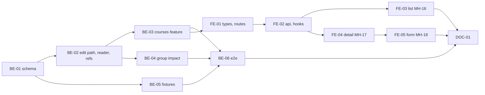

# F-04 Course Catalog — Backend + Frontend Implementation Plan

This plan builds the shared course catalog: the `Course` table, catalog lookup for every role (MH-16), the course detail page (MH-17, without relations), the course form (MH-18) for adding and editing a course, courses owned by other faculties, and the four status transitions HP-01..HP-04 (add, discontinue, reopen, cancel; never delete). It also writes the first instance of the rule every later editing feature needs: **which path an edit takes** — direct, or only through a change request — from the user's permission mode and the object's state (H-4, FR-55, F02-06). Finally it fills the `courses` list that F-03 left empty in the subject-group deactivation impact.

It deliberately excludes course relations and equivalence groups (F-05; so the happy path of "discontinue" only becomes reachable in F-05), the "used in programs" list contents (F-07), the "released" and "has study results" facts that block cancellation (F-15, F-17), Excel import of the catalog (F-09), and the change-request form that the "via request" path leads to (F-13).

> **Companion documents**
> - Requirement: `docs/requirement/REQUIREMENTS.md:414` (FR-05), `:432-438` (FR-11..FR-17), `:515` (FR-55), `:812` (BR-01), `:1192-1193` (EC-01, EC-02), `:1208` (EC-12), `:1230` (EC-24), `:1243` (EC-32), `:1271` (EC-50), `:1015` (NFR-01), `:1047-1049` (NFR-18..NFR-20)
> - Stories: `docs/planning/user-stories.md:179-221` (US-011..US-014); `:24` (H-4); `:1757` (U-1); epic EP-04
> - Tasks: `docs/planning/task-breakdown.md:137-152` (CV-032..CV-043)
> - Design: `docs/design/data-dictionary.md:194-210` (`Course`), `:802-804` (§9 `course.view`, `course.edit`, `courseRelation.edit`), `:119` (mode semantics); `docs/design/state-diagrams.md:238-241` (HP-01..HP-04), `:452` (S-10); `docs/design/screen-inventory.md:77-79` (MH-16..MH-18), `:183-185`
> - Answers: `docs/planning/feature-questions.md:106-114` (§F-04), F00-11 (decimals as strings), F00-13 (paging)
> - Builds on: `docs/implementation/f-01-auth-session-implementation-plan.md` (`ErrorDefinition`, `COMMON_ERRORS`, `AppException`, `getJson`/`sendJson`), `docs/implementation/f-02-accounts-roles-permissions-implementation-plan.md` (BE-01 pagination, BE-03 `PERMISSIONS`, BE-04 `AccessContext`, BE-06 seed, BE-07 `ref.dto.ts`, BE-10 fixtures; FE-01..FE-04), `docs/implementation/f-03-org-units-subject-groups-implementation-plan.md` (BE-01 `SubjectGroup`, BE-02 `activeMembershipWhere`, BE-04 `deactivationImpact`, `groupTarget`; FE-02 `useSubjectGroups`; FE-04 `OrgUnitSelect` `types` prop)
> - Tests: `docs/planning/test-plan.md:150-152` (KB-001..KB-003), `:157` (KB-008), `:159` (KB-010), `:253` (KB-084), `:282` (NT-B1-03), `:284` (NT-B1-05)

**Status**: Not started

---

## 0. Plan at a glance

Everything below in one table. Read this; the rest is detail for whoever builds it.

| What | Why | How and where |
|---|---|---|
| **Every role can search the course catalog** by part of the code or name, filter by faculty, group, type, status and "other faculty", sort, and page | US-011 AC1; FR-11; NFR-01, NFR-18; MH-16 | `GET /api/courses` (paged, `q` case-insensitive on code and name, five filters, four sort fields); one list page for all roles; an e2e timing case on 500 rows (BE-03, BE-06, FE-03) |
| **Course detail** — code, Vietnamese and English name, credits, type, status, faculty and group | US-011 AC2; MH-17 | `GET /api/courses/:id` with the edit path the caller would take and the programs that use the course (BE-03, FE-04) |
| **Add and edit a course** with decimal credits (0 and 2.5 accepted, negative refused with the valid range in the message), a unique code that never changes, and the required fields named when missing | US-012 AC1–AC5; BR-01; EC-01, EC-02; NFR-19 | `Course.credits Decimal(5,2)` sent as a string; `courseCode` trimmed, upper-cased, unique, absent from the update DTO (BE-01, BE-03); form page MH-18 with AntD rules (FE-05) |
| **R4 and R5 edit only courses of their own groups; R3..R5 never edit another faculty's course** | US-012 AC6; US-013 AC2; F04-01 | Course target = `{ subjectGroupIds: [ownerGroupId], orgUnitIds: [ownerFacultyId] }`; foreign courses are not open to "via request" holders, so only R1 edits them (BE-02, BE-03) |
| **One rule decides "edit directly" vs "only via a change request"** | H-4, FR-55, F02-06, F04-05; F-02 constraint "F-04 writes the shared helper" | `resolveEditPath(access, code, target, state)` in `src/shared/authz/edit-path.ts`; services refuse a via-request write with `CHANGE_REQUEST_REQUIRED` (409). F-06, F-07, F-10, F-11, F-12 reuse it (BE-02) |
| **R1 discontinues, reopens or cancels a course; nothing is ever deleted** | US-014 AC1–AC4; HP-02..HP-04; S-10; EC-50 | Transition table as data; discontinue needs an active replacement relation; cancel is final and refused when the course was ever released or has results; confirm dialog for cancel (BE-03, FE-04) |
| **Facts owned by later features are asked through one shared reader** | FR-17, HP-02, HP-04 need programs, versions, results and relations that do not exist yet | `CourseUsageReader` in `src/shared/courses/` with four methods that return "none" today; F-05, F-07, F-15, F-17 fill them (BE-02, §8) |
| **The subject-group deactivation dialog now lists the group's courses** | US-008 AC3 (F-03 constraint) | `deactivationImpact` queries courses of the group that are not Cancelled (BE-04) |

### Key behaviours worth knowing

| Behaviour | Why it is this way |
|---|---|
| Until F-05 ships, **no course can be discontinued** — the replacement check always fails | HP-02 requires a REPLACEMENT relation, and relations are F-05's table. F-04 builds the refusal; F-05 makes the happy path reachable (KB-008 runs in F-05) |
| Until F-15 and F-17 ship, **every never-cancelled course can be cancelled** | "Released" and "has results" are read from tables that do not exist yet; the reader returns `false`. No real data exists before B4/B5, so nothing wrong can be cancelled |
| Until F-15 ships, every course counts as **not released**, so R3..R5 edit their courses directly | H-4: Draft data is edited directly by both modes; FR-55 only bites once a version leaves Draft |
| R3 (`Đ`, all scope) can edit any Khoa course directly before release | Data-dictionary cell `course.edit` R3 = `Đ`; R3's program scope cannot reach a course until F-07 puts courses in programs (§8) |
| Status changes are R1-only and do not go through a request, even for a released course | HP-02..HP-04 name R1 as actor; FR-55 covers catalog info (name, credits), F04-05 |
| A Cancelled course cannot be edited or moved to any other status | S-10: Cancelled is final |
| Cancelled courses are hidden from users without `course.edit` | US-011 AC3 "chỉ thấy thông tin đã công bố"; a cancelled course was never used anywhere |
| Credits travel as strings (`"2.5"`, `"0"`) | F00-11: `Decimal(5,2)`; a JSON number would lose the decimal guarantee |
| "Khoa khác" means "owner faculty is not the home faculty `KHOA_CNTT`" | US-013 AC3, CV-040; the home faculty code is one shared constant the seed also uses |
| Search is case-insensitive but **not** accent-insensitive (`toan` does not find `Toán`) | PostgreSQL `ILIKE` on an ICU collation; `unaccent` is an extension for a convenience nobody asked for (§8) |

### Not included

| Excluded | Why |
|---|---|
| Course relations, cycle check, equivalence groups (MH-17 relations section, MH-19) | F-05 |
| Contents of "được dùng ở" (programs and versions using the course) | F-07 creates `CurriculumItem`; F-04 returns `[]` and shows the section only when non-empty |
| The change-request form behind "Tạo đề xuất" | F-13; the button is shown disabled with a tooltip until then |
| Catalog import from Excel (MH-29, B2) | F-09 |
| Syllabus link on the detail page | F-10 (B3) |
| Health-board warning for a discontinued course without replacement | F-24 (EC-12 second branch, T-2) |
| Audit-log rows | F01-07; writes log one line through `Logger` |

### Open questions

All F-04 questions are answered (`feature-questions.md` §F-04, all A). Small choices the answers did not cover:

| Question | Resolved when | Default if unanswered |
|---|---|---|
| Accent-insensitive search | When a user complains | Not built; `unaccent` + a generated column is the upgrade |
| Must a Khoa course always have an owner group | Before B1 acceptance | No (data dictionary `ownerGroup` K); a Khoa course without group is edited by R1 and R3 only |
| R3 editing scope on courses | When F-07 lands | Follow the seeded cell (`Đ`, all scope) |

---

## 1. Scope

| In scope | Why |
|---|---|
| `Course` model, `CourseType`, `CourseStatus`; migration | CV-032 |
| Catalog query: search, filters, paging, sort; timing check | CV-033, CV-035 |
| Catalog page and detail page for every role | CV-034, CV-040 |
| Add and edit with validation and scope | CV-036, CV-038, CV-039 |
| Course form with field-level messages | CV-037 |
| Status transitions with replacement check, cancel guard, confirm dialog | CV-041, CV-042, CV-043 |
| Shared edit-path helper and `CHANGE_REQUEST_REQUIRED` | H-4, FR-55; F-02 §8 guidance |
| Shared `CourseUsageReader` with empty answers | FR-17, HP-02, HP-04 |
| Shared `CourseRefDto`; `SubjectGroupRefDto` moved to shared | Features must not import each other; F-05, F-07 need both |
| Courses in the subject-group deactivation impact | F-03 §8 constraint |

| Out of scope | Deferred until |
|---|---|
| `CourseRelation`, `EquivalentCourseGroup`, cycle detection | F-05 |
| `programsUsing` contents | F-07 |
| "Released" fact for edit path and cancel guard | F-15 |
| "Has results" fact for cancel guard | F-17 |
| Change request for course edits | F-13 |
| Excel import | F-09 |

| AC | Covered by |
|---|---|
| US-011 AC1 — search by part of code or name, < 2 s, paged, sortable | BE-03 (`list`), BE-06 (timing case), FE-03 |
| US-011 AC2 — detail shows code, names, credits, type, status, faculty, group | BE-03 (`detail`), FE-04 |
| US-011 AC3 — R6 sees only published information | BE-03 (Cancelled hidden without `course.edit`; no draft state exists on a catalog row), BE-06 |
| US-012 AC1 — 2.5 credits, English name optional | BE-01, BE-03 (`CREDITS_PATTERN`), BE-06 (KB-001), FE-05 |
| US-012 AC2 — 0 credits for a conditional course | BE-03, BE-06 (KB-003) |
| US-012 AC3 — negative or non-numeric credits refused, message states valid values | BE-03 (`CREDITS_MESSAGE`), BE-06 (KB-002), FE-05 |
| US-012 AC4 — duplicate code refused; code immutable | BE-01 (`@unique`), BE-03 (`COURSE_CODE_TAKEN`; no `courseCode` in `UpdateCourseDto`), BE-06 |
| US-012 AC5 — missing name, type, faculty named | BE-03 (`VALIDATION_FAILED` with `details[].field`), FE-05 (AntD `required` rules) |
| US-012 AC6 — R4/R5 refused outside their groups | BE-02, BE-03, BE-06 |
| US-013 AC1 — course of another faculty without group | BE-03 (`assertOwners`), BE-06 (KB-010) |
| US-013 AC2 — R3..R5 refused on a foreign course; only R1 | BE-02 (`draftOpenToRequestHolders: false`), BE-06 |
| US-013 AC3 — filter separates own and other faculties | BE-03 (`foreign`, `ownerFacultyId`), FE-03 |
| US-014 AC1 — discontinue without replacement refused | BE-03 (`REPLACEMENT_REQUIRED`), BE-06; happy path F-05 |
| US-014 AC2 — discontinue with replacement, then reopen | BE-03 (transition table); end-to-end in F-05 (KB-008) |
| US-014 AC3 — cancel refused when released or has results; no delete | BE-02 (reader), BE-03 (`COURSE_IN_USE`, no delete route), BE-03 unit test; e2e in F-15/F-17 (KB-084) |
| US-014 AC4 — cancel never-used course with an irreversible confirm | BE-03, FE-04 (`CancelCourseModal`), BE-06 |
| US-008 AC3 — group deactivation lists courses (F-03 carry-over) | BE-04 |

---

## 2. Contract verification

F-04 builds on F-01..F-03 code that is **specified, not built**. Every "existing" claim cites the plan section that defines it; Rule 13 re-reads the built file before the step that uses it.

| Existing piece used | Defined at | Used by |
|---|---|---|
| `ErrorDefinition`, `COMMON_ERRORS` (`src/shared/exception/error-codes.ts`), `AppException(def, details?)` | F-01 BE-02 | BE-02, BE-03 |
| `PAGINATION`, `PageQueryDto`, `Page<T>`, `toSkipTake`, `toPage` (`src/shared/pagination/`) | F-02 BE-01 | BE-03 |
| `PERMISSIONS.COURSE_VIEW`, `PERMISSIONS.COURSE_EDIT` (catalog of 41 codes) | F-02 BE-03 | BE-03 |
| Seed cells `course.view` all X; `course.edit` R1 X, R3 Đ, R4 Đ(P), R5 Đ(P) | F-02 BE-06; `data-dictionary.md:802-803` | BE-02, BE-06 |
| `AccessContext.modeFor`, `assertCan`, `scopeFor`, `has`; `ScopeTarget`, `ResolvedScope` | F-02 BE-04 | BE-02, BE-03 |
| `ORG_UNIT_CODES` in `prisma/seed-data/org-units.ts` | F-02 BE-06 | BE-02 (`HOME_FACULTY_CODE`) |
| `OrgUnitRefDto` in `src/shared/dtos/ref.dto.ts` | F-02 BE-07 | BE-03 |
| `mapUniqueViolation` (moved to `src/shared/prisma/unique-violation.ts` by F-03 if needed) | F-02 BE-07; F-03 §8 | BE-03 |
| `SubjectGroup`, `SubjectGroupStatus` | F-03 BE-01 | BE-01, BE-03 |
| `SubjectGroupRefDto`, `SubjectGroupCourseRefDto` in `features/subject-groups/subject-group.dto.ts`; `deactivationImpact` returning `courses: []` | F-03 BE-04 | BE-02 moves, BE-04 fills |
| `createAccount`, `loginAgent`, `PERMISSION_TABLE`, `NO_ROLE`, `PLACEHOLDER_ID`; `createSubjectGroup`, `addMembership`, `daysFromToday` | F-02 BE-10, F-03 BE-06 | BE-06 |
| `getJson`, `sendJson`, `ApiError`, `withQuery`, `PageParams`, `DEFAULT_PAGE_SIZE`, `PAGE_SIZE_OPTIONS` | F-01 FE, F-02 FE-01 | FE-02 |
| `PERMISSIONS`, `useCan`, `RequirePermission`; `ROUTES`, `APP_MENU`, `router.tsx` | F-02 FE-02, FE-04 | FE-01 |
| `useOrgUnits`, `OrgUnitSelect` with `types` prop | F-02 FE-03, F-03 FE-04 | FE-03, FE-05 |
| `useSubjectGroups`, `subjectGroupsQueryKey` | F-03 FE-02 | FE-03, FE-05 |
| `DeactivateGroupModal` rendering `impact.courses` | F-03 FE-04 | BE-04 (data now non-empty) |

### 2a. Endpoints

All under `/api`, all new.

| Endpoint | Permission (guard) | Request | Response | Notes |
|---|---|---|---|---|
| `GET /courses` | `course.view` | `CourseQueryDto` | `CoursePageDto` | Cancelled rows only for callers holding `course.edit`; no scope filter (every role views the whole catalog, MH-16) |
| `GET /courses/:courseId` | `course.view` | — | `CourseDetailDto` | Cancelled → 404 for callers without `course.edit`; `editPath`, `canChangeStatus` computed for the caller |
| `POST /courses` | `course.edit` | `CreateCourseDto` | `CourseDetailDto` (201) | Service checks scope and edit path on the **new** owner target |
| `PATCH /courses/:courseId` | `course.edit` | `UpdateCourseDto` | `CourseDetailDto` | Edit path checked on the **current** target, and again on the new target when owners change |
| `POST /courses/:courseId/discontinue` | `course.edit` | — | `CourseDetailDto` (200) | R1-only by mode (D6); `REPLACEMENT_REQUIRED` until F-05 |
| `POST /courses/:courseId/reopen` | `course.edit` | — | `CourseDetailDto` (200) | |
| `POST /courses/:courseId/cancel` | `course.edit` | — | `CourseDetailDto` (200) | `COURSE_IN_USE` when the reader says released or has results |
| `GET /subject-groups/:groupId/deactivation-impact` | `orgUnit.manage` (existing, F-03) | — | `SubjectGroupDeactivationImpactDto` | `courses` now filled (BE-04) |

No `DELETE` route (US-014 AC3, EC-50).

### 2b. DTOs

Enum wire values are the Prisma enum values in BE-01.

**`CourseSummaryDto`**

| Field | Wire type | Nullable | Source | Note |
|---|---|---|---|---|
| `id` | `string` | no | BE-01 | |
| `courseCode` | `string` | no | BE-01 | Upper-cased at write |
| `courseName` | `string` | no | BE-01 | |
| `englishName` | `string` | **yes** | BE-01 | |
| `credits` | `string` | no | BE-01 `Decimal(5,2)` | `toWireDecimal`: `"2.5"`, `"0"`, `"3"` — no trailing zeros |
| `courseType` | `'THEORY' \| 'PRACTICE' \| 'LAB' \| 'PROJECT' \| 'CAPSTONE' \| 'INTERNSHIP' \| 'CONDITIONAL'` | no | BE-01 `CourseType` | |
| `status` | `'ACTIVE' \| 'DISCONTINUED' \| 'CANCELLED'` | no | BE-01 `CourseStatus` | |
| `ownerFaculty` | `OrgUnitRefDto` (`id`, `unitCode`, `unitName`) | no | F-02 BE-07 | |
| `ownerGroup` | `SubjectGroupRefDto` (`id`, `groupCode`, `groupName`, `status`) | **yes** | BE-02 (moved) | `null` for foreign courses and Khoa courses without a group |
| `isForeign` | `boolean` | no | BE-03 | Computed: `ownerFaculty.unitCode !== HOME_FACULTY_CODE` |

**`CoursePageDto`** = `{ items: CourseSummaryDto[], total: number, page: number, pageSize: number }` (F-02 `Page<T>`).

**`CourseDetailDto`** = `CourseSummaryDto` +

| Field | Wire type | Nullable | Note |
|---|---|---|---|
| `programsUsing` | `CourseUsageDto[]` (`programId`, `programCode`, `programName`, `versionLabel: string \| null`) | no | Always `[]` until F-07 (FR-17) |
| `editPath` | `'DIRECT' \| 'VIA_REQUEST'` | **yes** | For the caller; `null` = may not edit at all (no `course.edit` covering this course, or Cancelled) |
| `canChangeStatus` | `boolean` | no | Caller's raw mode on this course is `DIRECT` and the course is not Cancelled |
| `createdAt`, `updatedAt` | `string` (ISO) | no | |

**`CreateCourseDto`**

| Field | Type | Rule |
|---|---|---|
| `courseCode` | `string` | trim, upper-case, 1..`COURSE_FIELD_LIMITS.CODE_MAX` (20) |
| `courseName` | `string` | trim, 1..`NAME_MAX` (200) |
| `englishName` | `string?` | trim; empty → `null`; ≤ `NAME_MAX` |
| `credits` | `string` | `CREDITS_PATTERN` `^\d{1,3}(\.\d{1,2})?$` (0..999.99, ≤ 2 decimals) |
| `courseType` | `CourseType` | `IsEnum` |
| `ownerFacultyId` | `string` | `IsString`, non-empty |
| `ownerGroupId` | `string?` | `IsString`; omitted or `null` = no group |

**`UpdateCourseDto`**: every `CreateCourseDto` field except `courseCode`, all optional; `ownerGroupId` may be `null` to clear. A body containing `courseCode` fails `forbidNonWhitelisted` → 400 `VALIDATION_FAILED` (US-012 AC4 "không sửa được").

**`CourseQueryDto`** extends `PageQueryDto`: `q?` (trim, ≤ 100), `ownerFacultyId?`, `ownerGroupId?`, `courseType?`, `status?`, `foreign?` (`'true' | 'false'` → boolean), `sort?` (`'courseCode' | 'courseName' | 'credits' | 'updatedAt'`, default `courseCode`), `order?` (`'asc' | 'desc'`, default `asc`).

**`CourseRefDto`** (shared, replaces `SubjectGroupCourseRefDto`): `id`, `courseCode`, `courseName`.

**`SubjectGroupDeactivationImpactDto`** (F-03): `courses: CourseRefDto[]` — same fields as before, new schema name.

### 2c. Mismatch log

| Deliverable | What the doc said | What this plan does | Found at |
|---|---|---|---|
| BE-01 | `Course.equivalenceGroup` ⊕ | Not created here; F-05 adds the column with its table | `data-dictionary.md:208` |
| BE-03 | `ownerGroup` "trống với học phần của khoa khác" | Also: when set, the group must be `ACTIVE` and belong to `ownerFaculty` | `data-dictionary.md:205` |
| BE-03 | `courseCode` unique | Also immutable after creation (F04-04, US-012 AC4) | `data-dictionary.md:210` |
| BE-02 | `course.edit` R3 = `Đ` (all scope) | Kept; R3 reaches every Khoa course before release (§8) | `data-dictionary.md:803` |
| BE-03 | MH-18 "Ngừng mở lớp đòi chọn học phần thay thế" | F-04 refuses without a replacement; picking one in the dialog arrives with F-05's relation form | `screen-inventory.md:79` |
| — | CV-040 "nhãn khoa khác" has no definition of "home" | `HOME_FACULTY_CODE = 'KHOA_CNTT'`, the seeded faculty | `task-breakdown.md:149` |

The data-dictionary notes above are applied together with this plan (`docs/design/data-dictionary.md` `Course`).

---

## 3. Decisions

| # | Decision | Why | Rejected alternative |
|---|---|---|---|
| D1 | One shared function `resolveEditPath(access, code, target, state)` returns `DIRECT` or `VIA_REQUEST`; state = `{ released, draftOpenToRequestHolders }` | H-4 + FR-55 + F02-06 apply to courses, programs, curricula, syllabi, PLOs and assessment rules alike; one function keeps them consistent | Each service combining `modeFor` with its own state check |
| D2 | Direct endpoints refuse a `VIA_REQUEST` path with `COMMON_ERRORS.CHANGE_REQUEST_REQUIRED` (409) | The client gets a code it can turn into "Tạo đề xuất"; F-13 then accepts the same body as a change item | 403 — the user *is* allowed, just not this way |
| D3 | For a course: `released` = `CourseUsageReader.inReleasedVersion`; `draftOpenToRequestHolders` = not foreign | F04-05 (released → request); F04-01 (Khoa CNTT only proposes for foreign courses) | Draft-open by `ownerGroupId != null` — a Khoa course without group would be R1-only for R3 too |
| D4 | Course target = `{ subjectGroupIds: ownerGroupId ? [ownerGroupId] : [], orgUnitIds: [ownerFacultyId] }` | F-03 constraint: R4/R5 reach by group, R2-style unit scopes by faculty | Group id only — would hide courses from unit-scoped roles |
| D5 | `CourseUsageReader` lives in `src/shared/courses/` and answers four questions; F-04 implements them as "none" | The facts live in tables owned by F-05, F-07, F-15, F-17; a shared reader lets each feature fill its method without features importing each other | Each later feature editing `courses.service.ts` |
| D6 | Status transitions require the caller's **raw** mode on the course to be `DIRECT`; draft-open does not apply | HP-02..HP-04 actor is R1; F-13's request types do not include course status | A separate `course.status` permission — not in the 41-code catalog |
| D7 | Transitions are a constant table `COURSE_TRANSITIONS`; three POST routes, one service method | Same shape as F-03 deactivate/activate; adding a guard means editing one entry | `PATCH { status }` — mixes catalog edits with lifecycle and hides the guards |
| D8 | Credits: `Decimal(5,2)`, validated as a string by `CREDITS_PATTERN`, emitted by `toWireDecimal` | F00-11; BR-01 needs 0 and 2.5; a regex message can state the valid range (NFR-19) | `@IsNumber` on a JSON number — 2.5 fine but 0.1 + 0.2 class bugs and no exact decimal |
| D9 | "Foreign" = owner faculty code ≠ `HOME_FACULTY_CODE` (`src/shared/org-units/home-faculty.ts`); the seed's `ORG_UNIT_CODES.FACULTY_IT` reads it | One definition for the label, the filter and the edit rule | `ownerGroupId == null` — a Khoa course without group would be labelled foreign |
| D10 | Cancelled courses are invisible to callers without `course.edit` (list filter and detail 404) | US-011 AC3; a Cancelled course never reached a version or a student | Showing them greyed out to everyone |
| D11 | Search = `contains` + `mode: 'insensitive'` on `courseCode` and `courseName`; sort by a whitelisted field with `courseCode` as tie-breaker | NFR-01 at a few hundred rows needs no full-text index; a stable tie-breaker keeps paging deterministic | `pg_trgm` index — an extension for 500 rows |
| D12 | `SubjectGroupRefDto` moves to `src/shared/dtos/ref.dto.ts`; `SubjectGroupCourseRefDto` becomes shared `CourseRefDto` | Courses (and later relations, curricula) embed both; features must not import each other | Duplicating the ref classes |
| D13 | MH-18 is a page (`/courses/new`, `/courses/:courseId/edit`), not a modal | FR-17 shows the programs using the course above the form; seven fields plus that list do not fit a modal | Modal on the list page, as for subject groups |

---

## 5. Deliverables

### BE-01 — Prisma schema: `Course`

What/Why: CV-032; D8.

**Files**

| Action | Path |
|---|---|
| MODIFY | `prisma/schema.prisma` |
| NEW | `prisma/migrations/<timestamp>_courses/migration.sql` (generated) |

**Shape**

```prisma
enum CourseType {
  THEORY
  PRACTICE
  LAB
  PROJECT
  CAPSTONE
  INTERNSHIP
  CONDITIONAL
}

enum CourseStatus {
  ACTIVE
  DISCONTINUED
  CANCELLED
}

model Course {
  id             String       @id @default(cuid(2))
  courseCode     String       @unique
  courseName     String
  englishName    String?
  credits        Decimal      @db.Decimal(5, 2)
  courseType     CourseType
  status         CourseStatus @default(ACTIVE)
  ownerFacultyId String
  ownerFaculty   OrgUnit      @relation("CourseOwnerFaculty", fields: [ownerFacultyId], references: [id], onDelete: Restrict)
  ownerGroupId   String?
  ownerGroup     SubjectGroup? @relation("CourseOwnerGroup", fields: [ownerGroupId], references: [id], onDelete: Restrict)
  createdAt      DateTime     @default(now())
  updatedAt      DateTime     @updatedAt

  @@index([ownerFacultyId])
  @@index([ownerGroupId])
  @@index([courseName])
}
```

Back-relations: `OrgUnit.ownedCourses Course[] @relation("CourseOwnerFaculty")`, `SubjectGroup.ownedCourses Course[] @relation("CourseOwnerGroup")`.

```
pnpm prisma migrate dev --name courses
pnpm prisma generate
```

**Rationale**: Columns, enums and the unique key copy `data-dictionary.md:194-210`; conventions (cuid, timestamps, `Decimal(5,2)`) from `database_and_models.md` "Quy ước lược đồ". Relation naming mirrors F-03 BE-01 (`"MembershipHolder"`).

**Gotchas**
- `onDelete: Restrict` on both relations: units and groups are never deleted (F-03), and a cascade would erase catalog rows.
- `@@index([courseName])` serves `ORDER BY courseName` only; `ILIKE '%x%'` cannot use a btree index — fine at this size (D11).
- `equivalenceGroup` is **not** added here; F-05's migration adds it.

**Verify**: Migration applies on a fresh Testcontainers database (`pnpm test:e2e` boots); `\d "Course"` shows `numeric(5,2)` and the unique index on `courseCode`.

**Depends on**: F-03 BE-01

---

### BE-02 — Shared edit path, course usage reader, home faculty, decimal helper, shared refs

What/Why: D1–D5, D8, D9, D12.

**Files**

| Action | Path |
|---|---|
| NEW | `src/shared/authz/edit-path.ts` |
| NEW | `src/shared/authz/edit-path.spec.ts` |
| MODIFY | `src/shared/exception/error-codes.ts` (`CHANGE_REQUEST_REQUIRED`) |
| NEW | `src/shared/courses/course-usage.reader.ts` |
| NEW | `src/shared/courses/courses-shared.module.ts` |
| NEW | `src/shared/org-units/home-faculty.ts` |
| MODIFY | `prisma/seed-data/org-units.ts` (`FACULTY_IT: HOME_FACULTY_CODE`) |
| NEW | `src/shared/decimal/decimal.ts` |
| NEW | `src/shared/decimal/decimal.spec.ts` |
| MODIFY | `src/shared/dtos/ref.dto.ts` (+ `SubjectGroupRefDto`, `CourseRefDto`) |
| MODIFY | `src/features/subject-groups/subject-group.dto.ts` (import moved refs; delete local `SubjectGroupRefDto`, `SubjectGroupCourseRefDto`) |
| MODIFY | `src/features/subject-groups/subject-group-member.dto.ts` (import `SubjectGroupRefDto` from shared) |

**Shape**

```ts
// src/shared/authz/edit-path.ts
export const EDIT_PATH = { DIRECT: 'DIRECT', VIA_REQUEST: 'VIA_REQUEST' } as const;
export type EditPath = (typeof EDIT_PATH)[keyof typeof EDIT_PATH];
export const EDIT_PATHS = Object.values(EDIT_PATH);

export interface EditState {
  // The object (or the version holding it) has left Draft; FR-55 then routes every change through a request.
  released: boolean;
  // Before release, holders of a VIA_REQUEST cell may still edit directly (H-4).
  draftOpenToRequestHolders: boolean;
}

export function editPathFor(access: AccessContext, code: PermissionCode, target: ScopeTarget, state: EditState): EditPath | null {
  const mode = access.modeFor(code, target);
  if (mode === null) {
    return null;
  }
  return decide(mode, state);
}

export function resolveEditPath(access: AccessContext, code: PermissionCode, target: ScopeTarget, state: EditState): EditPath {
  return decide(access.assertCan(code, target), state);
}

export function assertDirectEdit(access: AccessContext, code: PermissionCode, target: ScopeTarget, state: EditState): void {
  if (resolveEditPath(access, code, target, state) !== EDIT_PATH.DIRECT) {
    throw new AppException(COMMON_ERRORS.CHANGE_REQUEST_REQUIRED);
  }
}

function decide(mode: PermissionMode, state: EditState): EditPath {
  if (state.released) {
    return EDIT_PATH.VIA_REQUEST;
  }
  return mode === 'DIRECT' || state.draftOpenToRequestHolders ? EDIT_PATH.DIRECT : EDIT_PATH.VIA_REQUEST;
}
```

```ts
// src/shared/exception/error-codes.ts — addition
CHANGE_REQUEST_REQUIRED: {
  status: HttpStatus.CONFLICT,
  code: 'CHANGE_REQUEST_REQUIRED',
  message: 'Dữ liệu này chỉ thay đổi được qua đề xuất thay đổi.',
},
```

```ts
// src/shared/courses/course-usage.reader.ts
export interface CourseUsage {
  programId: string;
  programCode: string;
  programName: string;
  versionLabel: string | null;
}

// Answers questions about a course whose facts live in other features' tables.
// Each method returns "none" until the table it reads exists.
@Injectable()
export class CourseUsageReader {
  constructor(private readonly prisma: PrismaService) {}

  async inReleasedVersion(_courseId: string): Promise<boolean> {
    return false;
  }

  async hasStudyResults(_courseId: string): Promise<boolean> {
    return false;
  }

  async programsUsing(_courseId: string): Promise<CourseUsage[]> {
    return [];
  }

  // A REPLACEMENT relation from this course to an ACTIVE course (HP-02).
  async hasActiveReplacement(_courseId: string): Promise<boolean> {
    return false;
  }
}
```

```ts
// src/shared/courses/courses-shared.module.ts
@Module({ providers: [CourseUsageReader], exports: [CourseUsageReader] })
export class CoursesSharedModule {}
```

```ts
// src/shared/org-units/home-faculty.ts
// The faculty this system serves; every other faculty's course is "khoa khác".
export const HOME_FACULTY_CODE = 'KHOA_CNTT';
```

```ts
// prisma/seed-data/org-units.ts — change
export const ORG_UNIT_CODES = { UNIVERSITY: 'DHBK', FACULTY_IT: HOME_FACULTY_CODE, ACADEMIC_OFFICE: 'PDT' } as const;
```

```ts
// src/shared/decimal/decimal.ts
// Decimal(5,2): up to three integer digits and two decimals.
export const CREDITS_PATTERN = /^\d{1,3}(\.\d{1,2})?$/;
export const CREDITS_MESSAGE = 'Số tín chỉ phải là số từ 0 đến 999.99, tối đa 2 chữ số thập phân (ví dụ 3, 2.5 hoặc 0).';

export function toWireDecimal(value: Prisma.Decimal): string {
  return value.toString();
}
```

```ts
// src/shared/dtos/ref.dto.ts — additions
export class SubjectGroupRefDto {
  @ApiProperty() id: string;
  @ApiProperty() groupCode: string;
  @ApiProperty() groupName: string;
  @ApiProperty({ enum: SubjectGroupStatus, enumName: 'SubjectGroupStatus' }) status: SubjectGroupStatus;
}

export class CourseRefDto {
  @ApiProperty() id: string;
  @ApiProperty() courseCode: string;
  @ApiProperty() courseName: string;
}
```

**Call sites of the moved refs** (the migration is the deliverable):

| Old symbol | Call site | Action |
|---|---|---|
| `SubjectGroupRefDto` (features/subject-groups) | `subject-group.dto.ts` (`SubjectGroupSummaryDto extends`) | Migrated: import from `src/shared/dtos/ref.dto.ts` |
| `SubjectGroupRefDto` | `subject-group-member.dto.ts` (`UserSubjectGroupMembershipDto.subjectGroup`) | Migrated |
| `SubjectGroupCourseRefDto` | `subject-group.dto.ts` (`SubjectGroupDeactivationImpactDto.courses`) | Migrated to `CourseRefDto`; old class deleted |

After the move: `grep -rn "SubjectGroupCourseRefDto" src` → nothing; `grep -rn "class SubjectGroupRefDto" src` → one hit in `ref.dto.ts`.

`edit-path.spec.ts` cases (hand-built `AccessContext` as in F-02 `access-context.spec.ts`): no cell → `editPathFor` null, `resolveEditPath` throws `PERMISSION_DENIED`; held but out of scope → `OUT_OF_SCOPE`; DIRECT + not released → DIRECT; DIRECT + released → VIA_REQUEST; VIA_REQUEST + draft-open → DIRECT; VIA_REQUEST + not draft-open → VIA_REQUEST; `assertDirectEdit` on VIA_REQUEST → `CHANGE_REQUEST_REQUIRED`.

`decimal.spec.ts`: pattern accepts `0`, `2.5`, `2.50`, `999.99`; rejects `-1`, `1.234`, `1000`, `abc`, `''`, `' 2'`; `toWireDecimal(new Prisma.Decimal('2.50'))` → `'2.5'`, `('3.00')` → `'3'`.

**Rationale**: `edit-path.ts` sits beside `access-context.ts` (F-02 BE-04) because it only combines that class with object state. The reader follows `ScopeSourceReader` (F-02 BE-04): an injectable in `src/shared/` that later features fill. `ref.dto.ts` already holds `OrgUnitRefDto`, `UserRefDto` (F-02 BE-07).

**Gotchas**
- `toWireDecimal` relies on decimal.js dropping trailing zeros; this is **UNVERIFIED** against the Prisma 7 runtime (`node_modules` is not readable here) — the spec case above settles it at build time. If it keeps zeros, normalise with `value.toDecimalPlaces(2).toString()` after `Number`-free trimming (§8).
- `_courseId` parameters keep the signatures F-05..F-17 need; the leading underscore satisfies oxlint's unused-argument rule.
- `CoursesSharedModule` must be imported by `CoursesModule` and `SubjectGroupsModule`? No — `SubjectGroupsModule` queries `course` through Prisma directly (BE-04); only `CoursesModule` imports it.
- Seed change: `prisma/seed-data` already imports from `../../src/generated/...`; importing `HOME_FACULTY_CODE` from `../../src/shared/org-units/home-faculty.js` follows the same path style.

**Verify**: `pnpm test` (edit-path, decimal, existing subject-group specs); `pnpm exec tsc --noEmit -p tsconfig.json`; `pnpm prisma db seed` twice → no change on the second run.

**Depends on**: BE-01

---

### BE-03 — Courses feature: list, detail, create, edit, status transitions

What/Why: CV-033, CV-036, CV-039, CV-041; US-011..US-014; D3, D4, D6, D7, D10, D11.

**Files**

| Action | Path |
|---|---|
| NEW | `src/features/courses/courses.module.ts` |
| NEW | `src/features/courses/courses.controller.ts` |
| NEW | `src/features/courses/courses.service.ts` |
| NEW | `src/features/courses/courses.service.spec.ts` |
| NEW | `src/features/courses/courses.errors.ts` |
| NEW | `src/features/courses/course-status.ts` |
| NEW | `src/features/courses/course.dto.ts` |
| NEW | `src/features/courses/create-course.dto.ts` |
| NEW | `src/features/courses/update-course.dto.ts` |
| NEW | `src/features/courses/course-query.dto.ts` |
| MODIFY | `src/app.module.ts` (import `CoursesModule`) |

**Shape**

```ts
// src/features/courses/courses.errors.ts
export const COURSE_ERRORS = {
  COURSE_NOT_FOUND: { status: HttpStatus.NOT_FOUND, code: 'COURSE_NOT_FOUND', message: 'Không tìm thấy học phần.' },
  COURSE_CODE_TAKEN: { status: HttpStatus.CONFLICT, code: 'COURSE_CODE_TAKEN', message: 'Mã học phần đã tồn tại.' },
  OWNER_FACULTY_INVALID: { status: HttpStatus.BAD_REQUEST, code: 'OWNER_FACULTY_INVALID', message: 'Khoa phụ trách phải là một Khoa đang hoạt động.' },
  OWNER_GROUP_INVALID: { status: HttpStatus.BAD_REQUEST, code: 'OWNER_GROUP_INVALID', message: 'Nhóm phụ trách phải là nhóm đang hoạt động của chính khoa phụ trách.' },
  COURSE_CANCELLED: { status: HttpStatus.CONFLICT, code: 'COURSE_CANCELLED', message: 'Học phần đã hủy, không sửa và không đổi trạng thái được.' },
  STATUS_TRANSITION_INVALID: { status: HttpStatus.CONFLICT, code: 'STATUS_TRANSITION_INVALID', message: 'Không chuyển được học phần sang trạng thái này từ trạng thái hiện tại.' },
  REPLACEMENT_REQUIRED: { status: HttpStatus.CONFLICT, code: 'REPLACEMENT_REQUIRED', message: 'Hãy khai báo học phần thay thế (quan hệ Thay thế tới một học phần đang sử dụng) trước khi ngừng mở lớp.' },
  COURSE_IN_USE: { status: HttpStatus.CONFLICT, code: 'COURSE_IN_USE', message: 'Học phần đã nằm trong phiên bản đã ban hành hoặc đã có kết quả học tập nên không hủy được; hãy chuyển sang Ngừng mở lớp.' },
} as const satisfies Record<string, ErrorDefinition>;

// Constraint keys in `details`, the same style as class-validator keys (F-01 FieldErrorDto).
export const OWNER_CONSTRAINT = { ACTIVE_FACULTY: 'activeFaculty', GROUP_OF_FACULTY: 'groupOfFaculty' } as const;
```

```ts
// src/features/courses/course-status.ts
export const COURSE_TRANSITION = { DISCONTINUE: 'discontinue', REOPEN: 'reopen', CANCEL: 'cancel' } as const;
export type CourseTransition = (typeof COURSE_TRANSITION)[keyof typeof COURSE_TRANSITION];

export const COURSE_TRANSITIONS: Record<CourseTransition, { from: readonly CourseStatus[]; to: CourseStatus }> = {
  [COURSE_TRANSITION.DISCONTINUE]: { from: [CourseStatus.ACTIVE], to: CourseStatus.DISCONTINUED },
  [COURSE_TRANSITION.REOPEN]: { from: [CourseStatus.DISCONTINUED], to: CourseStatus.ACTIVE },
  [COURSE_TRANSITION.CANCEL]: { from: [CourseStatus.ACTIVE, CourseStatus.DISCONTINUED], to: CourseStatus.CANCELLED },
};
```

```ts
// src/features/courses/create-course.dto.ts
export const COURSE_FIELD_LIMITS = { CODE_MAX: 20, NAME_MAX: 200, QUERY_MAX: 100 } as const;

export class CreateCourseDto {
  @ApiProperty({ maxLength: COURSE_FIELD_LIMITS.CODE_MAX })
  @Transform(({ value }) => (typeof value === 'string' ? value.trim().toUpperCase() : value))
  @IsString() @Length(1, COURSE_FIELD_LIMITS.CODE_MAX)
  courseCode: string;

  @ApiProperty({ maxLength: COURSE_FIELD_LIMITS.NAME_MAX })
  @Transform(trimString) @IsString() @Length(1, COURSE_FIELD_LIMITS.NAME_MAX)
  courseName: string;

  @ApiPropertyOptional({ maxLength: COURSE_FIELD_LIMITS.NAME_MAX, nullable: true, type: String })
  @Transform(emptyToNull) @IsOptional() @IsString() @MaxLength(COURSE_FIELD_LIMITS.NAME_MAX)
  englishName?: string | null;

  @ApiProperty({ example: '2.5', pattern: CREDITS_PATTERN.source })
  @IsString() @Matches(CREDITS_PATTERN, { message: CREDITS_MESSAGE })
  credits: string;

  @ApiProperty({ enum: CourseType, enumName: 'CourseType' }) @IsEnum(CourseType) courseType: CourseType;
  @ApiProperty() @IsString() @IsNotEmpty() ownerFacultyId: string;

  @ApiPropertyOptional({ nullable: true, type: String })
  @IsOptional() @IsString()
  ownerGroupId?: string | null;
}
```

`trimString` and `emptyToNull` are the transforms F-02's `create-user.dto.ts` uses; if they are inline there, move them to `src/shared/dtos/transforms.ts` here and migrate F-02/F-03 call sites (record per call site in the implement report).

```ts
// src/features/courses/update-course.dto.ts
export class UpdateCourseDto extends PartialType(OmitType(CreateCourseDto, ['courseCode'] as const)) {}
```

```ts
// src/features/courses/course-query.dto.ts
export const COURSE_SORT_FIELDS = ['courseCode', 'courseName', 'credits', 'updatedAt'] as const;
export type CourseSortField = (typeof COURSE_SORT_FIELDS)[number];
export const SORT_ORDERS = ['asc', 'desc'] as const;
export type SortOrder = (typeof SORT_ORDERS)[number];

export class CourseQueryDto extends PageQueryDto {
  @ApiPropertyOptional({ maxLength: COURSE_FIELD_LIMITS.QUERY_MAX })
  @Transform(trimString) @IsOptional() @IsString() @MaxLength(COURSE_FIELD_LIMITS.QUERY_MAX)
  q?: string;

  @ApiPropertyOptional() @IsOptional() @IsString() ownerFacultyId?: string;
  @ApiPropertyOptional() @IsOptional() @IsString() ownerGroupId?: string;
  @ApiPropertyOptional({ enum: CourseType, enumName: 'CourseType' }) @IsOptional() @IsEnum(CourseType) courseType?: CourseType;
  @ApiPropertyOptional({ enum: CourseStatus, enumName: 'CourseStatus' }) @IsOptional() @IsEnum(CourseStatus) status?: CourseStatus;

  @ApiPropertyOptional({ type: Boolean })
  @Transform(({ value }) => (value === 'true' ? true : value === 'false' ? false : value))
  @IsOptional() @IsBoolean()
  foreign?: boolean;

  @ApiPropertyOptional({ enum: COURSE_SORT_FIELDS, default: 'courseCode' }) @IsOptional() @IsIn(COURSE_SORT_FIELDS) sort: CourseSortField = 'courseCode';
  @ApiPropertyOptional({ enum: SORT_ORDERS, default: 'asc' }) @IsOptional() @IsIn(SORT_ORDERS) order: SortOrder = 'asc';
}
```

```ts
// src/features/courses/course.dto.ts
export class CourseSummaryDto {
  @ApiProperty() id: string;
  @ApiProperty() courseCode: string;
  @ApiProperty() courseName: string;
  @ApiProperty({ nullable: true, type: String }) englishName: string | null;
  @ApiProperty({ example: '2.5' }) credits: string;
  @ApiProperty({ enum: CourseType, enumName: 'CourseType' }) courseType: CourseType;
  @ApiProperty({ enum: CourseStatus, enumName: 'CourseStatus' }) status: CourseStatus;
  @ApiProperty({ type: OrgUnitRefDto }) ownerFaculty: OrgUnitRefDto;
  @ApiProperty({ type: SubjectGroupRefDto, nullable: true }) ownerGroup: SubjectGroupRefDto | null;
  @ApiProperty() isForeign: boolean;
}

export class CoursePageDto {
  @ApiProperty({ type: [CourseSummaryDto] }) items: CourseSummaryDto[];
  @ApiProperty() total: number;
  @ApiProperty() page: number;
  @ApiProperty() pageSize: number;
}

export class CourseUsageDto {
  @ApiProperty() programId: string;
  @ApiProperty() programCode: string;
  @ApiProperty() programName: string;
  @ApiProperty({ nullable: true, type: String }) versionLabel: string | null;
}

export class CourseDetailDto extends CourseSummaryDto {
  @ApiProperty({ type: [CourseUsageDto] }) programsUsing: CourseUsageDto[];
  @ApiProperty({ enum: EDIT_PATHS, enumName: 'EditPath', nullable: true }) editPath: EditPath | null;
  @ApiProperty() canChangeStatus: boolean;
  @ApiProperty() createdAt: string;
  @ApiProperty() updatedAt: string;
}

export const COURSE_INCLUDE = {
  ownerFaculty: { select: { id: true, unitCode: true, unitName: true } },
  ownerGroup: { select: { id: true, groupCode: true, groupName: true, status: true } },
} as const satisfies Prisma.CourseInclude;

export type CourseRow = Prisma.CourseGetPayload<{ include: typeof COURSE_INCLUDE }>;

export function toCourseSummaryDto(row: CourseRow): CourseSummaryDto {
  return {
    id: row.id, courseCode: row.courseCode, courseName: row.courseName, englishName: row.englishName,
    credits: toWireDecimal(row.credits), courseType: row.courseType, status: row.status,
    ownerFaculty: row.ownerFaculty, ownerGroup: row.ownerGroup,
    isForeign: row.ownerFaculty.unitCode !== HOME_FACULTY_CODE,
  };
}

export function courseTarget(course: { ownerFacultyId: string; ownerGroupId: string | null }): ScopeTarget {
  return { subjectGroupIds: course.ownerGroupId ? [course.ownerGroupId] : [], orgUnitIds: [course.ownerFacultyId] };
}
```

```ts
// src/features/courses/courses.service.ts
@Injectable()
export class CoursesService {
  private readonly logger = new Logger(CoursesService.name);

  constructor(
    private readonly prisma: PrismaService,
    private readonly usage: CourseUsageReader,
  ) {}

  async list(query: CourseQueryDto, access: AccessContext): Promise<Page<CourseSummaryDto>> {
    const where = this.listWhere(query, access);
    const [rows, total] = await this.prisma.$transaction([
      this.prisma.course.findMany({
        where,
        include: COURSE_INCLUDE,
        orderBy: [{ [query.sort]: query.order }, { courseCode: 'asc' }],
        ...toSkipTake(query),
      }),
      this.prisma.course.count({ where }),
    ]);
    return toPage(rows.map(toCourseSummaryDto), total, query);
  }

  async detail(courseId: string, access: AccessContext): Promise<CourseDetailDto> {
    const row = await this.findVisibleOrThrow(courseId, access);
    return this.toDetail(row, access);
  }

  async create(dto: CreateCourseDto, access: AccessContext): Promise<CourseDetailDto> {
    const owners = await this.assertOwners(dto.ownerFacultyId, dto.ownerGroupId ?? null);
    assertDirectEdit(access, PERMISSIONS.COURSE_EDIT, courseTarget(owners), {
      released: false,
      draftOpenToRequestHolders: !owners.isForeign,
    });
    try {
      const row = await this.prisma.course.create({
        data: {
          courseCode: dto.courseCode, courseName: dto.courseName, englishName: dto.englishName ?? null,
          credits: new Prisma.Decimal(dto.credits), courseType: dto.courseType,
          ownerFacultyId: owners.ownerFacultyId, ownerGroupId: owners.ownerGroupId,
        },
        include: COURSE_INCLUDE,
      });
      this.logger.log(`Course ${row.courseCode} created by ${access.userId}`);
      return this.toDetail(row, access);
    } catch (error) {
      throw mapUniqueViolation(error, COURSE_ERRORS.COURSE_CODE_TAKEN, 'courseCode');
    }
  }

  async update(courseId: string, dto: UpdateCourseDto, access: AccessContext): Promise<CourseDetailDto> {
    const current = await this.findOrThrow(courseId);
    if (current.status === CourseStatus.CANCELLED) {
      throw new AppException(COURSE_ERRORS.COURSE_CANCELLED);
    }
    assertDirectEdit(access, PERMISSIONS.COURSE_EDIT, courseTarget(current), await this.editState(current));
    const ownersChange = dto.ownerFacultyId !== undefined || dto.ownerGroupId !== undefined;
    const owners = ownersChange
      ? await this.assertOwners(dto.ownerFacultyId ?? current.ownerFacultyId, dto.ownerGroupId === undefined ? current.ownerGroupId : dto.ownerGroupId)
      : null;
    if (owners) {
      // Moving a course into another group or faculty needs the right on the destination too.
      assertDirectEdit(access, PERMISSIONS.COURSE_EDIT, courseTarget(owners), {
        released: false,
        draftOpenToRequestHolders: !owners.isForeign,
      });
    }
    const row = await this.prisma.course.update({
      where: { id: courseId },
      data: {
        courseName: dto.courseName,
        englishName: dto.englishName,
        credits: dto.credits === undefined ? undefined : new Prisma.Decimal(dto.credits),
        courseType: dto.courseType,
        ownerFacultyId: owners?.ownerFacultyId,
        ownerGroupId: owners ? owners.ownerGroupId : undefined,
      },
      include: COURSE_INCLUDE,
    });
    this.logger.log(`Course ${row.courseCode} updated by ${access.userId}`);
    return this.toDetail(row, access);
  }

  async transition(courseId: string, transition: CourseTransition, access: AccessContext): Promise<CourseDetailDto> {
    const current = await this.findOrThrow(courseId);
    if (current.status === CourseStatus.CANCELLED) {
      throw new AppException(COURSE_ERRORS.COURSE_CANCELLED);
    }
    if (access.assertCan(PERMISSIONS.COURSE_EDIT, courseTarget(current)) !== 'DIRECT') {
      throw new AppException(COMMON_ERRORS.CHANGE_REQUEST_REQUIRED);
    }
    const rule = COURSE_TRANSITIONS[transition];
    if (!rule.from.includes(current.status)) {
      throw new AppException(COURSE_ERRORS.STATUS_TRANSITION_INVALID);
    }
    if (transition === COURSE_TRANSITION.DISCONTINUE && !(await this.usage.hasActiveReplacement(courseId))) {
      throw new AppException(COURSE_ERRORS.REPLACEMENT_REQUIRED);
    }
    if (transition === COURSE_TRANSITION.CANCEL && (await this.isInUse(courseId))) {
      throw new AppException(COURSE_ERRORS.COURSE_IN_USE);
    }
    const row = await this.prisma.course.update({ where: { id: courseId }, data: { status: rule.to }, include: COURSE_INCLUDE });
    this.logger.log(`Course ${row.courseCode} ${transition} by ${access.userId}`);
    return this.toDetail(row, access);
  }

  private listWhere(query: CourseQueryDto, access: AccessContext): Prisma.CourseWhereInput {
    const and: Prisma.CourseWhereInput[] = [];
    if (query.q) {
      and.push({ OR: [
        { courseCode: { contains: query.q, mode: 'insensitive' } },
        { courseName: { contains: query.q, mode: 'insensitive' } },
      ] });
    }
    if (query.foreign !== undefined) {
      and.push({ ownerFaculty: { unitCode: query.foreign ? { not: HOME_FACULTY_CODE } : HOME_FACULTY_CODE } });
    }
    if (!access.has(PERMISSIONS.COURSE_EDIT)) {
      and.push({ status: { not: CourseStatus.CANCELLED } });
    }
    return {
      ownerFacultyId: query.ownerFacultyId,
      ownerGroupId: query.ownerGroupId,
      courseType: query.courseType,
      status: query.status,
      AND: and,
    };
  }

  private async toDetail(row: CourseRow, access: AccessContext): Promise<CourseDetailDto> {
    const cancelled = row.status === CourseStatus.CANCELLED;
    const target = courseTarget(row);
    const [programsUsing, state] = await Promise.all([this.usage.programsUsing(row.id), this.editState(row)]);
    return {
      ...toCourseSummaryDto(row),
      programsUsing,
      editPath: cancelled ? null : editPathFor(access, PERMISSIONS.COURSE_EDIT, target, state),
      canChangeStatus: !cancelled && access.modeFor(PERMISSIONS.COURSE_EDIT, target) === 'DIRECT',
      createdAt: row.createdAt.toISOString(),
      updatedAt: row.updatedAt.toISOString(),
    };
  }

  private async editState(course: { id: string; ownerFaculty?: { unitCode: string }; ownerFacultyId: string }): Promise<EditState> {
    return {
      released: await this.usage.inReleasedVersion(course.id),
      draftOpenToRequestHolders: !(await this.isForeignFaculty(course.ownerFacultyId)),
    };
  }

  private async isInUse(courseId: string): Promise<boolean> {
    const [released, results] = await Promise.all([this.usage.inReleasedVersion(courseId), this.usage.hasStudyResults(courseId)]);
    return released || results;
  }

  private async assertOwners(ownerFacultyId: string, ownerGroupId: string | null) {
    const faculty = await this.prisma.orgUnit.findUnique({ where: { id: ownerFacultyId } });
    if (!faculty || faculty.unitType !== OrgUnitType.FACULTY || faculty.status !== OrgUnitStatus.ACTIVE) {
      throw new AppException(COURSE_ERRORS.OWNER_FACULTY_INVALID, [{ field: 'ownerFacultyId', constraints: [OWNER_CONSTRAINT.ACTIVE_FACULTY] }]);
    }
    if (ownerGroupId !== null) {
      const group = await this.prisma.subjectGroup.findUnique({ where: { id: ownerGroupId } });
      if (!group || group.status !== SubjectGroupStatus.ACTIVE || group.facultyId !== ownerFacultyId) {
        throw new AppException(COURSE_ERRORS.OWNER_GROUP_INVALID, [{ field: 'ownerGroupId', constraints: [OWNER_CONSTRAINT.GROUP_OF_FACULTY] }]);
      }
    }
    return { ownerFacultyId, ownerGroupId, isForeign: faculty.unitCode !== HOME_FACULTY_CODE };
  }

  // findOrThrow(courseId): CourseRow or COURSE_NOT_FOUND
  // findVisibleOrThrow(courseId, access): as findOrThrow, but a CANCELLED row is COURSE_NOT_FOUND without course.edit
  // isForeignFaculty(orgUnitId): unitCode !== HOME_FACULTY_CODE (row already loaded via COURSE_INCLUDE — pass it instead of re-querying)
}
```

The sketch's `editState` takes the loaded row; at build, pass `row.ownerFaculty.unitCode` (always present through `COURSE_INCLUDE`) instead of a second query — `isForeignFaculty` then disappears.

```ts
// src/features/courses/courses.controller.ts
@ApiTags('courses')
@ApiCookieAuth()
@Controller('courses')
export class CoursesController {
  constructor(private readonly courses: CoursesService) {}

  @Get()
  @RequirePermission(PERMISSIONS.COURSE_VIEW)
  @ApiOkResponse({ type: CoursePageDto })
  list(@Query() query: CourseQueryDto, @CurrentAccess() access: AccessContext) { return this.courses.list(query, access); }

  @Post()
  @RequirePermission(PERMISSIONS.COURSE_EDIT)
  @ApiCreatedResponse({ type: CourseDetailDto })
  create(@Body() dto: CreateCourseDto, @CurrentAccess() access: AccessContext) { return this.courses.create(dto, access); }

  @Get(':courseId')
  @RequirePermission(PERMISSIONS.COURSE_VIEW)
  @ApiOkResponse({ type: CourseDetailDto })
  detail(@Param('courseId') courseId: string, @CurrentAccess() access: AccessContext) { return this.courses.detail(courseId, access); }

  @Patch(':courseId')
  @RequirePermission(PERMISSIONS.COURSE_EDIT)
  @ApiOkResponse({ type: CourseDetailDto })
  update(@Param('courseId') courseId: string, @Body() dto: UpdateCourseDto, @CurrentAccess() access: AccessContext) {
    return this.courses.update(courseId, dto, access);
  }

  @Post(':courseId/discontinue')
  @HttpCode(HttpStatus.OK)
  @RequirePermission(PERMISSIONS.COURSE_EDIT)
  @ApiOkResponse({ type: CourseDetailDto })
  discontinue(@Param('courseId') courseId: string, @CurrentAccess() access: AccessContext) {
    return this.courses.transition(courseId, COURSE_TRANSITION.DISCONTINUE, access);
  }
  // reopen, cancel: same shape
}
```

```ts
// src/features/courses/courses.module.ts
@Module({ imports: [CoursesSharedModule], controllers: [CoursesController], providers: [CoursesService] })
export class CoursesModule {}
```

Service spec cases (Prisma and `CourseUsageReader` mocked, `AccessContext` hand-built):

| Case | Expect |
|---|---|
| `list` with `q` | `OR` on code and name, `mode: 'insensitive'` |
| `list` as R6 (no `course.edit`) | `status: { not: CANCELLED }` in `AND` |
| `list` with `foreign: true` / `false` | `unitCode not HOME_FACULTY_CODE` / equals |
| `list` sort `credits desc` | `orderBy [{credits:'desc'},{courseCode:'asc'}]` |
| `detail` of a Cancelled course as R6 | `COURSE_NOT_FOUND` |
| `create` foreign faculty as R1 | created; `isForeign: true` |
| `create` foreign faculty as R3 (`Đ`) | `CHANGE_REQUEST_REQUIRED` |
| `create` with a group as R5 not in the group | `OUT_OF_SCOPE` |
| `create` with a group of another faculty | `OWNER_GROUP_INVALID`, `details[0].field = 'ownerGroupId'` |
| `create` with an `OFFICE` unit | `OWNER_FACULTY_INVALID` |
| `create` duplicate code | `COURSE_CODE_TAKEN`, `details[0].field = 'courseCode'` |
| `update` as R5 in group, not released | updated |
| `update` with reader `inReleasedVersion → true` as R1 | `CHANGE_REQUEST_REQUIRED` |
| `update` moving a course to a group R4 does not coordinate | `OUT_OF_SCOPE` |
| `update` a Cancelled course | `COURSE_CANCELLED` |
| `transition` discontinue, no replacement | `REPLACEMENT_REQUIRED` |
| `transition` discontinue, reader `hasActiveReplacement → true` | status `DISCONTINUED` |
| `transition` reopen from `ACTIVE` | `STATUS_TRANSITION_INVALID` |
| `transition` cancel, reader `hasStudyResults → true` | `COURSE_IN_USE` |
| `transition` cancel from `CANCELLED` | `COURSE_CANCELLED` |
| `transition` as R4 in group | `CHANGE_REQUEST_REQUIRED` |
| `detail` `editPath` for R5 in group / R5 out of group / R1 on a released course | `DIRECT` / `null` / `VIA_REQUEST` |

**Rationale**: Module, errors, DTO + mapper layout mirror F-03 BE-04 (`subject-groups.service.ts`, `subject-groups.errors.ts`, `subject-group.dto.ts`). Paged list mirrors F-02 BE-07 `users.service.ts list` (`$transaction([findMany, count])`, `toSkipTake`, `toPage`). Transition routes mirror F-03 deactivate/activate.

**Gotchas**
- `orderBy: { [query.sort]: query.order }` is safe only because `sort` is validated against `COURSE_SORT_FIELDS`; never pass an unvalidated key.
- `courseName` sorting follows the database's ICU `vi-VN` collation — Vietnamese order without extra code.
- `UpdateCourseDto` with `ownerGroupId: null` clears the group; `undefined` keeps it. `PartialType` keeps `nullable` from the base — check the generated OpenAPI so the client type is `string | null | undefined`.
- `new Prisma.Decimal(dto.credits)` only after `CREDITS_PATTERN` passed; never `Number(dto.credits)`.
- The guard admits R3..R5 to the transition routes (they hold `course.edit`); the service's raw-mode check refuses them with 409, not 403 — the permission table row uses R2 (no cell) as the denied role.
- `findVisibleOrThrow` must hide Cancelled rows **before** the scope check, so R6 cannot learn that a Cancelled id exists.
- Mutations return the full `CourseDetailDto`, so the client can replace its cached detail without a refetch.

**Verify**: `pnpm test`; `pnpm exec tsc --noEmit -p tsconfig.json`; Swagger: create `1020083` with 2.5 credits under `KHOA_CNTT` → detail shows `"credits": "2.5"`.

**Depends on**: BE-02

---

### BE-04 — Courses in the subject-group deactivation impact

What/Why: F-03 §8 constraint; US-008 AC3.

**Files**

| Action | Path |
|---|---|
| MODIFY | `src/features/subject-groups/subject-groups.service.ts` (`deactivationImpact`) |
| MODIFY | `src/features/subject-groups/subject-groups.service.spec.ts` |

**Shape**

```ts
async deactivationImpact(groupId: string): Promise<SubjectGroupDeactivationImpactDto> {
  const row = await this.prisma.subjectGroup.findUnique({ where: { id: groupId }, include: summaryInclude(todayDate()) });
  if (!row) throw new AppException(SUBJECT_GROUP_ERRORS.SUBJECT_GROUP_NOT_FOUND);
  const summary = toSubjectGroupSummaryDto(row);
  const courses = await this.prisma.course.findMany({
    where: { ownerGroupId: groupId, status: { not: CourseStatus.CANCELLED } },
    select: { id: true, courseCode: true, courseName: true },
    orderBy: { courseCode: 'asc' },
  });
  return { activeMemberCount: summary.activeMemberCount, activeCoordinators: summary.activeCoordinators, courses };
}
```

Spec case: a group with one Active, one Discontinued and one Cancelled course → `courses` lists the first two, ordered by code.

**Rationale**: F-03 BE-04 Gotchas: "F-04 adds the query here, not a new endpoint". Reading `course` through `PrismaService` keeps the subject-groups feature free of an import from the courses feature (`nestjs-rules.md` §1).

**Gotchas**: Deactivating a group does **not** clear `ownerGroupId` on its courses: the courses stay, R4/R5 of that group simply lose scope (F-03 D6). R1 re-assigns them on MH-18 if needed.

**Verify**: `pnpm test`; BE-06 e2e case; F-03's `DeactivateGroupModal` lists the courses (FE walk §7 step 7).

**Depends on**: BE-01, BE-02

---

### BE-05 — Seed: none; fixtures for tests

What/Why: Courses are entered by R1 (NT-B1-03) or imported by F-09 from program 1024034 (F00-24). The test fixture is the only producer here.

**Files**

| Action | Path |
|---|---|
| NEW | `test/fixtures/courses.ts` |

**Shape**

```ts
// test/fixtures/courses.ts
export interface CourseFixture {
  courseCode: string;
  credits?: string;
  courseType?: CourseType;
  facultyCode?: string;
  groupId?: string | null;
  status?: CourseStatus;
}

export async function createCourse(app: NestExpressApplication, fixture: CourseFixture) {
  const prisma = app.get(PrismaService);
  const faculty = await prisma.orgUnit.findUniqueOrThrow({ where: { unitCode: fixture.facultyCode ?? HOME_FACULTY_CODE } });
  return prisma.course.create({
    data: {
      courseCode: fixture.courseCode,
      courseName: `Học phần ${fixture.courseCode}`,
      credits: new Prisma.Decimal(fixture.credits ?? '3'),
      courseType: fixture.courseType ?? CourseType.THEORY,
      status: fixture.status ?? CourseStatus.ACTIVE,
      ownerFacultyId: faculty.id,
      ownerGroupId: fixture.groupId ?? null,
    },
  });
}

export async function createForeignFaculty(app: NestExpressApplication, unitCode: string) {
  // A FACULTY under the university root, created through Prisma to keep course tests independent of MH-07.
}
```

**Rationale**: Mirrors F-03 `test/fixtures/subject-groups.ts` (`createSubjectGroup(app, groupCode, facultyCode)`).

**Gotchas**: The fixture writes through Prisma, bypassing validation; e2e cases that test validation must go through HTTP.

**Verify**: Used by BE-06.

**Depends on**: BE-01

---

### BE-06 — End-to-end tests and permission table rows

What/Why: CV-035, CV-038, CV-043; KB-001..KB-003, KB-010; US-005 AC6 on courses.

**Files**

| Action | Path |
|---|---|
| NEW | `test/courses.e2e-spec.ts` |
| MODIFY | `test/permission-table.ts` |
| MODIFY | `test/subject-groups.e2e-spec.ts` (impact with courses) |

**Shape**

```ts
// test/permission-table.ts — additions
{ permission: PERMISSIONS.COURSE_VIEW, method: 'get', path: '/api/courses', allowedRole: 'R6', deniedRole: NO_ROLE },
{ permission: PERMISSIONS.COURSE_VIEW, method: 'get', path: `/api/courses/${PLACEHOLDER_ID}`, allowedRole: 'R2', deniedRole: NO_ROLE },
{ permission: PERMISSIONS.COURSE_EDIT, method: 'post', path: '/api/courses', body: { courseCode: 'X', courseName: 'X', credits: '1', courseType: 'THEORY', ownerFacultyId: PLACEHOLDER_ID }, allowedRole: 'R1', deniedRole: 'R2' },
{ permission: PERMISSIONS.COURSE_EDIT, method: 'patch', path: `/api/courses/${PLACEHOLDER_ID}`, body: {}, allowedRole: 'R1', deniedRole: 'R2' },
{ permission: PERMISSIONS.COURSE_EDIT, method: 'post', path: `/api/courses/${PLACEHOLDER_ID}/discontinue`, allowedRole: 'R1', deniedRole: 'R2' },
{ permission: PERMISSIONS.COURSE_EDIT, method: 'post', path: `/api/courses/${PLACEHOLDER_ID}/reopen`, allowedRole: 'R1', deniedRole: 'R2' },
{ permission: PERMISSIONS.COURSE_EDIT, method: 'post', path: `/api/courses/${PLACEHOLDER_ID}/cancel`, allowedRole: 'R1', deniedRole: 'R2' },
```

`courses.e2e-spec.ts` cases:

| Case | Expect |
|---|---|
| KB-001: R1 creates 2.5 credits, reads back | 201; detail and list show `"2.5"` |
| KB-003: 0 credits, `CONDITIONAL` | 201 |
| KB-002: `-1`, `"abc"`, `"1.234"` | 400 `VALIDATION_FAILED`, `details[0].field = 'credits'`, message = `CREDITS_MESSAGE` |
| Missing `courseName`, `courseType`, `ownerFacultyId` (US-012 AC5) | 400; `details` names all three fields |
| Duplicate code, different case and spaces (`" it001 "` after `IT001`) | 409 `COURSE_CODE_TAKEN` |
| PATCH with `courseCode` | 400 `VALIDATION_FAILED` |
| R5 member of G1 edits a G1 course / a G2 course | 200 / 403 `OUT_OF_SCOPE` |
| R4 coordinator of G1 moves a G1 course to G2 | 403 `OUT_OF_SCOPE` |
| KB-010: R1 creates a course of Khoa Toán without group; `foreign=true` lists it, `foreign=false` does not; R5 edits it → 403; R3 edits it → 409 `CHANGE_REQUEST_REQUIRED` | as stated |
| Discontinue without replacement (US-014 AC1) | 409 `REPLACEMENT_REQUIRED` |
| R1 cancels a never-used course; cancels again; edits it | 200; 409 `COURSE_CANCELLED`; 409 `COURSE_CANCELLED` |
| R6 lists and opens the cancelled course | not in list; 404 `COURSE_NOT_FOUND` |
| R4 calls cancel on a course of its group | 409 `CHANGE_REQUEST_REQUIRED`, status unchanged |
| No `DELETE /api/courses/:id` | 404 |
| CV-035: 500 courses (fixture loop in one `createMany`), `GET /api/courses?q=10&pageSize=20` | 200 within `CATALOG_LOOKUP_BUDGET_MS = 2000` |
| Group deactivation impact (in `subject-groups.e2e-spec.ts`) | `courses` has the group's Active and Discontinued courses, not Cancelled |

**Rationale**: Mirrors F-03 BE-06 (`subject-groups.e2e-spec.ts`: accounts per role via `createAccount`, groups via fixtures, `loginAgent`).

**Gotchas**
- The timing case measures one request on a warm app after one discarded call; Testcontainers latency must not count. Keep the budget constant at NFR-01's 2 s, not tightened.
- KB-008 (discontinue with replacement, then reopen) needs F-05's relation endpoint — it moves to F-05's e2e; this file only covers the refusal.
- KB-084 (cancel refused after results) needs F-17 data; F-17's plan adds that case.

**Verify**: `pnpm test:e2e` green; route-coverage check passes with the seven new rows.

**Depends on**: BE-03, BE-04, BE-05

---

### FE-01 — Regenerate types; permissions, routes, menu

What/Why: Codegen step; menu entry for MH-16.

**Files**

| Action | Path |
|---|---|
| MODIFY | `src/shared/api/schema.d.ts` (generated) |
| MODIFY | `src/shared/auth/permissions.ts` |
| MODIFY | `src/routes.ts` |
| MODIFY | `src/router.tsx` |
| MODIFY | `src/shared/layout/menuItems.tsx` |

**Shape**

```
# backend running, then in source/frontend
pnpm api:types
```

```ts
// src/shared/auth/permissions.ts — additions
courseView: 'course.view',
courseEdit: 'course.edit',
```

```ts
// src/routes.ts — additions
courses: '/courses',
courseNew: '/courses/new',
courseDetail: '/courses/:courseId',
courseEdit: '/courses/:courseId/edit',
```

```tsx
// src/shared/layout/menuItems.tsx — APP_MENU addition, after "Nhóm chuyên môn"
{ path: ROUTES.courses, label: 'Học phần', permission: PERMISSIONS.courseView },
```

```tsx
// src/router.tsx — children additions; courseNew before courseDetail so "new" is not read as an id
{ path: ROUTES.courses, element: <RequirePermission code={PERMISSIONS.courseView}><CourseListPage /></RequirePermission> },
{ path: ROUTES.courseNew, element: <RequirePermission code={PERMISSIONS.courseEdit}><CourseFormPage /></RequirePermission> },
{ path: ROUTES.courseDetail, element: <RequirePermission code={PERMISSIONS.courseView}><CourseDetailPage /></RequirePermission> },
{ path: ROUTES.courseEdit, element: <RequirePermission code={PERMISSIONS.courseEdit}><CourseFormPage /></RequirePermission> },
```

**Rationale**: Same steps as F-03 FE-01.

**Gotchas**: React Router 7 ranks static segments above dynamic ones, so `/courses/new` wins regardless of order; keeping it first still documents intent.

**Verify**: `pnpm exec tsc -b`; `components['schemas']['CourseDetailDto']`, `['EditPath']`, `['CourseRefDto']` exist.

**Depends on**: BE-03

---

### FE-02 — Courses API, hooks, labels

What/Why: Service and hook layer for FE-03..FE-05 (`react-vite-rules.md` §2, §6).

**Files**

| Action | Path |
|---|---|
| NEW | `src/features/courses/api/courses.ts` |
| NEW | `src/features/courses/hooks/useCourses.ts` |
| NEW | `src/features/courses/constants/courseLabels.ts` |

**Shape**

```ts
// src/features/courses/api/courses.ts
export type CourseSummary = components['schemas']['CourseSummaryDto'];
export type CourseDetail = components['schemas']['CourseDetailDto'];
export type CoursePage = components['schemas']['CoursePageDto'];
export type CourseType = components['schemas']['CourseType'];
export type CourseStatus = components['schemas']['CourseStatus'];
export type CreateCourseRequest = components['schemas']['CreateCourseDto'];
export type UpdateCourseRequest = components['schemas']['UpdateCourseDto'];
export type CourseQuery = NonNullable<operations['CoursesController_list']['parameters']['query']>;

export const COURSES_PATH = '/courses';
const coursePath = (courseId: string) => `${COURSES_PATH}/${encodeURIComponent(courseId)}`;

export const COURSE_ACTION = { DISCONTINUE: 'discontinue', REOPEN: 'reopen', CANCEL: 'cancel' } as const;
export type CourseAction = (typeof COURSE_ACTION)[keyof typeof COURSE_ACTION];

export const fetchCourses = (query: CourseQuery) => getJson<CoursePage>(withQuery(COURSES_PATH, { ...query }));
export const fetchCourse = (courseId: string) => getJson<CourseDetail>(coursePath(courseId));
export const createCourse = (body: CreateCourseRequest) => sendJson<CourseDetail>('POST', COURSES_PATH, body);
export const updateCourse = (courseId: string, body: UpdateCourseRequest) => sendJson<CourseDetail>('PATCH', coursePath(courseId), body);
export const changeCourseStatus = (courseId: string, action: CourseAction) => sendJson<CourseDetail>('POST', `${coursePath(courseId)}/${action}`);
```

```ts
// src/features/courses/hooks/useCourses.ts
export const COURSE_QUERY_KEYS = {
  all: ['courses'] as const,
  list: (query: CourseQuery) => ['courses', 'list', query] as const,
  detail: (courseId: string) => ['courses', 'detail', courseId] as const,
};

export function useCourseList(query: CourseQuery) {
  return useQuery({ queryKey: COURSE_QUERY_KEYS.list(query), queryFn: () => fetchCourses(query), placeholderData: keepPreviousData });
}

export function useCourse(courseId: string) {
  return useQuery({ queryKey: COURSE_QUERY_KEYS.detail(courseId), queryFn: () => fetchCourse(courseId) });
}

// Mutations put the returned detail in the cache and invalidate lists; subject-group impact also counts courses.
function useCourseMutation<TVars>(mutationFn: (vars: TVars) => Promise<CourseDetail>) {
  const queryClient = useQueryClient();
  return useMutation({
    mutationFn,
    onSuccess: (course) => {
      queryClient.setQueryData(COURSE_QUERY_KEYS.detail(course.id), course);
      void queryClient.invalidateQueries({ queryKey: [...COURSE_QUERY_KEYS.all, 'list'] });
      void queryClient.invalidateQueries({ queryKey: subjectGroupsQueryKey });
    },
  });
}

export const useCreateCourse = () => useCourseMutation(createCourse);
export const useUpdateCourse = () => useCourseMutation(({ courseId, body }: { courseId: string; body: UpdateCourseRequest }) => updateCourse(courseId, body));
export const useChangeCourseStatus = () => useCourseMutation(({ courseId, action }: { courseId: string; action: CourseAction }) => changeCourseStatus(courseId, action));
```

```ts
// src/features/courses/constants/courseLabels.ts
export const COURSE_TYPE_LABELS: Record<CourseType, string> = {
  THEORY: 'Lý thuyết', PRACTICE: 'Thực hành', LAB: 'Thí nghiệm', PROJECT: 'Đồ án',
  CAPSTONE: 'Đồ án tốt nghiệp', INTERNSHIP: 'Thực tập', CONDITIONAL: 'Học phần điều kiện',
};
export const COURSE_STATUS_LABELS: Record<CourseStatus, string> = {
  ACTIVE: 'Đang sử dụng', DISCONTINUED: 'Ngừng mở lớp', CANCELLED: 'Đã hủy',
};
export const COURSE_STATUS_COLORS: Record<CourseStatus, string> = { ACTIVE: 'green', DISCONTINUED: 'orange', CANCELLED: 'default' };
export const FOREIGN_COURSE_LABEL = 'Khoa khác';
export const CHANGE_REQUEST_PENDING_TOOLTIP = 'Dữ liệu đã ban hành chỉ sửa qua đề xuất thay đổi; chức năng đề xuất có từ bậc B4.';
export const COURSE_ACTION_LABELS: Record<CourseAction, string> = {
  discontinue: 'Ngừng mở lớp', reopen: 'Mở lại', cancel: 'Hủy học phần',
};
export const CANCEL_CONFIRM_TEXT = 'Học phần đã hủy không mở lại được và không sửa được. Chỉ hủy học phần chưa từng dùng trong phiên bản đã ban hành và chưa có kết quả học tập.';
```

**Rationale**: API + hook split mirrors F-03 FE-04 (`api/subjectGroupAdmin.ts`, `hooks/useSubjectGroupAdmin.ts`); paged list with `keepPreviousData` mirrors F-02 FE-05 (`useUsers`). Labels copy `data-dictionary.md:206-207`.

**Gotchas**
- `operations['CoursesController_list']` depends on the operation id Nest generates; if F-02 set a custom `operationIdFactory`, use the id it produces (check `schema.d.ts`).
- `setQueryData` with the mutation's response is safe only because every course mutation returns the full detail (BE-03 Gotchas).

**Verify**: `pnpm exec tsc -b`.

**Depends on**: FE-01

---

### FE-03 — Course catalog page (MH-16)

What/Why: US-011 AC1, US-013 AC3; CV-034, CV-040.

**Files**

| Action | Path |
|---|---|
| NEW | `src/features/courses/pages/CourseListPage.tsx` |
| NEW | `src/features/courses/pages/CourseListPage.test.tsx` |
| NEW | `src/features/courses/components/CourseFilters.tsx` |
| NEW | `src/features/courses/components/CourseStatusTag.tsx` |

**Shape**

```tsx
// src/features/courses/pages/CourseListPage.tsx
export const COURSE_SEARCH_DEBOUNCE_MS = 300;
const INITIAL_QUERY: CourseQuery = { page: 1, pageSize: DEFAULT_PAGE_SIZE, sort: 'courseCode', order: 'asc' };

export function CourseListPage() {
  const [query, setQuery] = useState<CourseQuery>(INITIAL_QUERY);
  const { data, isFetching, error } = useCourseList(query);
  const canEdit = useCan(PERMISSIONS.courseEdit);
  const navigate = useNavigate();

  const columns: ColumnsType<CourseSummary> = [
    { title: 'Mã', dataIndex: 'courseCode', key: 'courseCode', sorter: true,
      render: (code, course) => <Link to={generatePath(ROUTES.courseDetail, { courseId: course.id })}>{code}</Link> },
    { title: 'Tên học phần', dataIndex: 'courseName', key: 'courseName', sorter: true,
      render: (name, course) => <>{name}{course.isForeign && <Tag>{FOREIGN_COURSE_LABEL}</Tag>}</> },
    { title: 'Tín chỉ', dataIndex: 'credits', key: 'credits', sorter: true, align: 'right' },
    { title: 'Loại', dataIndex: 'courseType', render: (type: CourseType) => COURSE_TYPE_LABELS[type] },
    { title: 'Khoa phụ trách', dataIndex: ['ownerFaculty', 'unitName'] },
    { title: 'Nhóm phụ trách', dataIndex: ['ownerGroup', 'groupName'], render: (name?: string) => name ?? '—' },
    { title: 'Trạng thái', dataIndex: 'status', render: (status: CourseStatus) => <CourseStatusTag status={status} /> },
  ];

  return (
    <PageContainer
      title="Danh mục học phần"
      extra={canEdit && <Button type="primary" onClick={() => navigate(ROUTES.courseNew)}>Thêm học phần</Button>}
    >
      <CourseFilters value={query} onChange={(filters) => setQuery({ ...query, ...filters, page: 1 })} />
      {error ? <ApiErrorAlert error={error} /> : (
        <Table
          rowKey="id"
          columns={columns}
          dataSource={data?.items}
          loading={isFetching}
          pagination={{ current: query.page, pageSize: query.pageSize, total: data?.total, pageSizeOptions: PAGE_SIZE_OPTIONS, showSizeChanger: true }}
          onChange={(pagination, _filters, sorter) => setQuery(toCourseQuery(query, pagination, sorter))}
        />
      )}
    </PageContainer>
  );
}
```

`toCourseQuery` (same file, exported for the test) maps AntD's `sorter.columnKey` / `sorter.order` (`'ascend' | 'descend' | undefined`) to `sort` / `order`, falling back to `courseCode asc`, and keeps page and page size.

```tsx
// src/features/courses/components/CourseFilters.tsx
interface CourseFiltersProps {
  value: CourseQuery;
  onChange: (filters: Partial<CourseQuery>) => void;
}

// Search box (debounced by COURSE_SEARCH_DEBOUNCE_MS), OrgUnitSelect types={['FACULTY']} allowClear,
// subject-group Select from useSubjectGroups({ facultyId }), course-type Select from COURSE_TYPE_LABELS,
// status Select from COURSE_STATUS_LABELS (CANCELLED option only when useCan(courseEdit)),
// Segmented "Tất cả / Của Khoa / Khoa khác" → foreign undefined / false / true.
export function CourseFilters({ value, onChange }: CourseFiltersProps) { /* … */ }
```

`CourseListPage.test.tsx` (fetch stubbed): renders rows with the "Khoa khác" tag on a foreign course; typing in search fires one request after the debounce with `q=`; choosing "Khoa khác" requests `foreign=true` and resets to page 1; sorting by credits descending requests `sort=credits&order=desc`; "Thêm học phần" hidden without `course.edit`.

**Rationale**: List page layout and paging mirror F-02 FE-05 `UserListPage.tsx`; debounce constant style mirrors F-03 FE-02 `USER_SEARCH_DEBOUNCE_MS`. `OrgUnitSelect` `types` prop and `useSubjectGroups` are the shared pieces F-03 built for exactly this page.

**Gotchas**
- `useSubjectGroups` requires `subjectGroup.view`; R3, R5 and R6 do not hold it (data dictionary §9). Call it with `enabled = useCan(PERMISSIONS.subjectGroupView)` and hide the group filter otherwise — the group column still shows names from the course DTO.
- `useOrgUnits` (`GET /org-units`) is any-authenticated (F-02), so the faculty filter works for every role.
- Reset `page` to 1 on every filter change, or a filter that shrinks the result shows an empty page.

**Verify**: `pnpm test`; `pnpm exec tsc -b`; browser: §7 steps 1–3.

**Depends on**: FE-02

---

### FE-04 — Course detail page with status actions (MH-17, MH-18 status part)

What/Why: US-011 AC2, US-014 AC1–AC4; CV-042; NFR-20.

**Files**

| Action | Path |
|---|---|
| NEW | `src/features/courses/pages/CourseDetailPage.tsx` |
| NEW | `src/features/courses/pages/CourseDetailPage.test.tsx` |
| NEW | `src/features/courses/components/CourseInfoCard.tsx` |
| NEW | `src/features/courses/components/CourseStatusActions.tsx` |
| NEW | `src/features/courses/components/CourseEditButton.tsx` |
| NEW | `src/features/courses/components/ProgramsUsingList.tsx` |

**Shape**

```tsx
// src/features/courses/pages/CourseDetailPage.tsx
export function CourseDetailPage() {
  const { courseId = '' } = useParams();
  const { data: course, isLoading, error } = useCourse(courseId);
  if (isLoading) return <PageSpin />;
  if (error) return <ApiErrorResult error={error} />;
  if (!course) return null;
  return (
    <PageContainer
      title={`${course.courseCode} — ${course.courseName}`}
      extra={<Space><CourseEditButton course={course} />{course.canChangeStatus && <CourseStatusActions course={course} />}</Space>}
    >
      <CourseInfoCard course={course} />
      <ProgramsUsingList programs={course.programsUsing} />
    </PageContainer>
  );
}
```

```tsx
// src/features/courses/components/CourseEditButton.tsx
interface CourseEditButtonProps { course: CourseDetail }

export function CourseEditButton({ course }: CourseEditButtonProps) {
  const navigate = useNavigate();
  if (course.editPath === null) return null;
  if (course.editPath === 'VIA_REQUEST') {
    return <Tooltip title={CHANGE_REQUEST_PENDING_TOOLTIP}><Button disabled>Tạo đề xuất</Button></Tooltip>;
  }
  return <Button onClick={() => navigate(generatePath(ROUTES.courseEdit, { courseId: course.id }))}>Sửa</Button>;
}
```

```tsx
// src/features/courses/components/CourseStatusActions.tsx
interface CourseStatusActionsProps { course: CourseDetail }

// Offers only the transitions valid from the current status; the server re-checks every guard.
const ACTIONS_BY_STATUS: Record<CourseStatus, CourseAction[]> = {
  ACTIVE: ['discontinue', 'cancel'],
  DISCONTINUED: ['reopen', 'cancel'],
  CANCELLED: [],
};

export function CourseStatusActions({ course }: CourseStatusActionsProps) {
  const { modal, message } = App.useApp();
  const mutation = useChangeCourseStatus();
  const run = (action: CourseAction) =>
    mutation.mutate({ courseId: course.id, action }, {
      onSuccess: () => message.success(`Đã chuyển sang ${COURSE_STATUS_LABELS[NEXT_STATUS[action]]}.`),
      onError: (error) => message.error(errorMessage(error)),
    });
  const confirm = (action: CourseAction) =>
    modal.confirm({
      title: `${COURSE_ACTION_LABELS[action]} ${course.courseCode}?`,
      content: action === 'cancel' ? CANCEL_CONFIRM_TEXT : undefined,
      okButtonProps: { danger: action === 'cancel' },
      okText: COURSE_ACTION_LABELS[action],
      onOk: () => run(action),
    });
  return (
    <Dropdown menu={{ items: ACTIONS_BY_STATUS[course.status].map((action) => ({ key: action, label: COURSE_ACTION_LABELS[action], danger: action === 'cancel' })), onClick: ({ key }) => confirm(key as CourseAction) }}>
      <Button>Đổi trạng thái</Button>
    </Dropdown>
  );
}
```

`NEXT_STATUS: Record<CourseAction, CourseStatus>` lives in `courseLabels.ts` beside `COURSE_ACTION_LABELS`.

`REPLACEMENT_REQUIRED` arrives as an error with the server message, which already tells the user what to do (NFR-19); F-05 replaces the plain confirm for "discontinue" with a dialog that picks the replacement.

`ProgramsUsingList` renders nothing when the list is empty, otherwise an AntD `List` of `programCode — programName (versionLabel)`.

`CourseDetailPage.test.tsx`: shows all US-011 AC2 fields with "—" for a missing English name; `editPath: 'VIA_REQUEST'` shows a disabled "Tạo đề xuất"; `editPath: null` shows no edit button; cancel opens a confirm containing `CANCEL_CONFIRM_TEXT` and posts to `/cancel` only after OK; a `REPLACEMENT_REQUIRED` response shows its message.

**Rationale**: Detail page with header actions mirrors F-03 FE-05 `SubjectGroupDetailPage.tsx`; confirm through `App.useApp().modal` mirrors F-03 FE-04 `DeactivateGroupModal` (AntD 6 context-aware modal).

**Gotchas**
- Use `App.useApp()` rather than static `Modal.confirm`, or the `vi_VN` locale and theme tokens are lost.
- `errorMessage(error)` is F-01's helper over `ApiError`; do not read `error.message` of an unknown error.
- Never compute permissions client-side from roles; `editPath` and `canChangeStatus` come from the server.

**Verify**: `pnpm test`; browser: §7 steps 4, 6–8.

**Depends on**: FE-02

---

### FE-05 — Course form page (MH-18)

What/Why: US-012 AC1–AC5, US-013 AC1; CV-037; NFR-19; FR-17.

**Files**

| Action | Path |
|---|---|
| NEW | `src/features/courses/pages/CourseFormPage.tsx` |
| NEW | `src/features/courses/pages/CourseFormPage.test.tsx` |
| NEW | `src/features/courses/schema/courseRules.ts` |

**Shape**

```ts
// src/features/courses/schema/courseRules.ts
// Mirrors CREDITS_PATTERN, CREDITS_MESSAGE and COURSE_FIELD_LIMITS in source/backend/src/shared/decimal/decimal.ts
// and source/backend/src/features/courses/create-course.dto.ts.
export const CREDITS_PATTERN = /^\d{1,3}(\.\d{1,2})?$/;
export const CREDITS_MESSAGE = 'Số tín chỉ phải là số từ 0 đến 999.99, tối đa 2 chữ số thập phân (ví dụ 3, 2.5 hoặc 0).';
export const COURSE_CODE_MAX = 20;
export const COURSE_NAME_MAX = 200;
export const CREDITS_STEP = 0.5;

export const COURSE_RULES = {
  courseCode: [{ required: true, whitespace: true, message: 'Nhập mã học phần.' }, { max: COURSE_CODE_MAX, message: `Mã học phần tối đa ${COURSE_CODE_MAX} ký tự.` }],
  courseName: [{ required: true, whitespace: true, message: 'Nhập tên tiếng Việt của học phần.' }, { max: COURSE_NAME_MAX }],
  englishName: [{ max: COURSE_NAME_MAX }],
  credits: [{ required: true, message: 'Nhập số tín chỉ.' }, { pattern: CREDITS_PATTERN, message: CREDITS_MESSAGE }],
  courseType: [{ required: true, message: 'Chọn loại học phần.' }],
  ownerFacultyId: [{ required: true, message: 'Chọn khoa phụ trách.' }],
} satisfies Record<string, Rule[]>;
```

```tsx
// src/features/courses/pages/CourseFormPage.tsx
interface CourseFormValues {
  courseCode: string;
  courseName: string;
  englishName?: string;
  credits: string;
  courseType: CourseType;
  ownerFacultyId: string;
  ownerGroupId?: string | null;
}

export function CourseFormPage() {
  const { courseId } = useParams();
  const editing = courseId !== undefined;
  const { data: course } = useCourse(courseId ?? '', /* enabled */ editing);
  const [form] = Form.useForm<CourseFormValues>();
  const facultyId = Form.useWatch('ownerFacultyId', form);
  const canPickGroup = useCan(PERMISSIONS.subjectGroupView);
  const { data: groups = [] } = useSubjectGroups({ facultyId, status: 'ACTIVE' }, canPickGroup && Boolean(facultyId));
  const create = useCreateCourse();
  const update = useUpdateCourse();
  const navigate = useNavigate();

  const onFinish = (values: CourseFormValues) => {
    const onSuccess = (saved: CourseDetail) => navigate(generatePath(ROUTES.courseDetail, { courseId: saved.id }));
    const onError = (error: unknown) => applyFieldErrors(form, error);
    if (editing) {
      const { courseCode: _unchanged, ...body } = values;
      update.mutate({ courseId, body: { ...body, ownerGroupId: body.ownerGroupId ?? null } }, { onSuccess, onError });
    } else {
      create.mutate(values, { onSuccess, onError });
    }
  };

  return (
    <PageContainer title={editing ? `Sửa học phần ${course?.courseCode ?? ''}` : 'Thêm học phần'}>
      {editing && course && course.programsUsing.length > 0 && (
        <Alert type="warning" showIcon message="Học phần đang được dùng ở các chương trình sau" description={<ProgramsUsingList programs={course.programsUsing} />} />
      )}
      <Form form={form} layout="vertical" initialValues={toFormValues(course)} onFinish={onFinish}>
        <Form.Item name="courseCode" label="Mã học phần" rules={COURSE_RULES.courseCode} normalize={(v: string) => v.toUpperCase()}>
          <Input disabled={editing} />
        </Form.Item>
        <Form.Item name="courseName" label="Tên tiếng Việt" rules={COURSE_RULES.courseName}><Input /></Form.Item>
        <Form.Item name="englishName" label="Tên tiếng Anh" rules={COURSE_RULES.englishName}><Input /></Form.Item>
        <Form.Item name="credits" label="Số tín chỉ" rules={COURSE_RULES.credits}>
          <InputNumber<string> stringMode min="0" step={CREDITS_STEP} />
        </Form.Item>
        <Form.Item name="courseType" label="Loại học phần" rules={COURSE_RULES.courseType}>
          <Select options={Object.entries(COURSE_TYPE_LABELS).map(([value, label]) => ({ value, label }))} />
        </Form.Item>
        <Form.Item name="ownerFacultyId" label="Khoa phụ trách" rules={COURSE_RULES.ownerFacultyId}>
          <OrgUnitSelect types={['FACULTY']} onChange={() => form.setFieldValue('ownerGroupId', null)} />
        </Form.Item>
        {canPickGroup && (
          <Form.Item name="ownerGroupId" label="Nhóm phụ trách" extra="Để trống với học phần của khoa khác.">
            <Select allowClear options={groups.map((group) => ({ value: group.id, label: `${group.groupCode} — ${group.groupName}` }))} />
          </Form.Item>
        )}
        <Button type="primary" htmlType="submit" loading={create.isPending || update.isPending}>Lưu</Button>
      </Form>
    </PageContainer>
  );
}
```

`applyFieldErrors(form, error)` maps an `ApiError` whose `details` carry `field` onto `form.setFields`, and shows other errors with `message.error`; if F-02 already built it for the user form, reuse it from `src/shared/forms/`; otherwise create it there now.

`CourseFormPage.test.tsx`: required messages for name, type and faculty on empty submit (US-012 AC5); `-1` shows `CREDITS_MESSAGE` without a request; `2.5` posts `"credits":"2.5"`; a 409 `COURSE_CODE_TAKEN` puts the message under the code field; edit mode disables the code input and the PATCH body has no `courseCode`; changing faculty clears the group.

**Rationale**: Form with AntD `rules` per F00 answer (no form library); rules in `schema/` per `react-vite-rules.md` §5 adapted to AntD; field-error mapping mirrors F-02 FE-06 user form. `OrgUnitSelect types` was added by F-03 FE-04 for this form.

**Gotchas**
- `InputNumber` `stringMode` returns a string, which the backend expects; without it 2.5 becomes a float and 0.1-class values gain noise.
- Users without `subjectGroup.view` (R3, R5) cannot list groups: the group field is hidden for them and the course keeps its group on edit (`ownerGroupId` not sent). For **create**, R5 then cannot pick a group and the server would refuse a group-less course for R5 (`OUT_OF_SCOPE`). R1 (and R4) create courses; R5 edits. Recorded in §8.
- On edit, send `ownerGroupId` only when the field is rendered; sending `null` from a hidden field would clear the group.

**Verify**: `pnpm test`; `pnpm exec tsc -b`; browser: §7 step 4–5.

**Depends on**: FE-02, FE-04 (`ProgramsUsingList`)

---

### DOC-01 — Docs sync

What/Why: Rule 4; §2c into design docs.

**Files**

| Action | Path | Change |
|---|---|---|
| MODIFY | `docs/design/data-dictionary.md` | Applied with this plan: `Course` — code immutable; `ownerGroup` must be an active group of `ownerFaculty`; edit and status rules (F04-01, F04-02, F04-05). At build: nothing further unless §2c grows |
| MODIFY | `docs/architecture/database_and_models.md` | `Course`, `CourseType`, `CourseStatus`, migration `courses` |
| MODIFY | `docs/architecture/general_architecture.md` | Authorization: edit path (`resolveEditPath`, `CHANGE_REQUEST_REQUIRED`); shared `CourseUsageReader` and who fills it |
| MODIFY | `docs/architecture/features_architecture.md` | Courses feature (backend + frontend); shared refs moved |
| MODIFY | `docs/implementation/README.md`, `docs/progress/*` | Status |
| NEW | `docs/implement-report/f-04-course-catalog-implement-report.md` | Rule 14 |

**Verify**: Every path named in the architecture docs exists.

**Depends on**: all

---

## 6. Sequencing



Build order: BE-01 → BE-02 → **pause P1** → BE-03 → BE-04 → BE-05 → BE-06 → **pause P2** → FE-01 → FE-02 → FE-03 → FE-04 → **pause P3** → FE-05 → DOC-01.

| Pause | After | What the user checks |
|---|---|---|
| P1 | BE-02 | F-03 tests still green after the ref move; `edit-path` and `decimal` specs green — especially `toWireDecimal('2.50') → '2.5'` |
| P2 | BE-06 | e2e green including the timing case; Swagger walk: create, edit as R5, cancel |
| P3 | FE-04 | Browser walk §7 steps 1–3, 6–8 |

---

## 7. Verification strategy

| Layer | How |
|---|---|
| Backend unit | `edit-path`, `decimal`, `courses.service`, `subject-groups.service` (impact) |
| Backend e2e | `courses.e2e-spec.ts`, `subject-groups.e2e-spec.ts` (impact), `permission-table.e2e-spec.ts` (+7 rows) |
| Frontend unit | `CourseListPage`, `CourseDetailPage`, `CourseFormPage` |
| Build gate | As F-02 §7, through the **build-verifier** agent |
| Manual walk | 1. As admin, menu shows "Học phần"; list is empty. 2. Add Khoa Toán on MH-07 if absent. 3. MH-16: "Thêm học phần" → create `1020083` 2.5 credits Lý thuyết, Khoa CNTT, group G1; create `3190111` 0 credits Học phần điều kiện; create `MATH01` of Khoa Toán with no group (NT-B1-03). Filter "Khoa khác" shows only `MATH01`; search `102` finds the first. 4. Open `1020083`: all fields; "Sửa" → change credits to `3`; code input disabled. 5. Try credits `-1` → message names the valid range. 6. "Đổi trạng thái" → "Ngừng mở lớp" → refused with the replacement message (NT-B1-05 first half). 7. "Hủy học phần" on `3190111` → confirm text → status Đã hủy; no actions remain. 8. Log in as a lecturer of G1: list shows both live courses but not `3190111`; `1020083` shows "Sửa"; `MATH01` shows no edit button. 9. MH-08: deactivate G1 → dialog lists `1020083` |
| Test cases | KB-001..KB-003, KB-010 = steps 3–5, 8; NT-B1-03 = step 3; NT-B1-05 completes in F-05 (KB-008) |

---

## 8. Risks and open items

| Risk | Impact | Mitigation |
|---|---|---|
| F-01..F-03 are not built; every "existing" shape comes from their plans | A deviation changes call sites in BE-02..BE-04, FE-02..FE-05 | Re-read the built `access-context.ts`, `ref.dto.ts`, `subject-group.dto.ts`, `subject-groups.service.ts`, `OrgUnitSelect.tsx`, `useSubjectGroups.ts`, `test/permission-table.ts` before the step that touches them (Rule 13); log in §2c |
| `toWireDecimal` trailing-zero behaviour is UNVERIFIED for Prisma 7's Decimal | `"2.50"` on the wire; KB-001 still passes visually but tests comparing strings fail | P1 checks the spec case; fallback normalisation in BE-02 Gotchas |
| **Constraint for F-05:** `CourseUsageReader.hasActiveReplacement` returns `false` | No course can be discontinued (US-014 AC2 unreachable) | F-05 implements it as "a `REPLACEMENT` relation with `sourceCourseId` = this course and an `ACTIVE` target exists", adds KB-008 to its e2e, and upgrades `CourseStatusActions`' discontinue confirm into a dialog that can declare the replacement first (MH-18) |
| **Constraint for F-05:** `Course.equivalenceGroup` not created | — | F-05's migration adds the column with `EquivalentCourseGroup` |
| **Constraint for F-07:** `programsUsing` returns `[]` | FR-17 list never shows | F-07 fills it from `CurriculumItem` → `ProgramVersion` → `Program`, distinct per program and version |
| **Constraint for F-15:** `inReleasedVersion` returns `false` | Released courses would still be edited directly (FR-55) and could be cancelled | F-15 implements it as "a `CurriculumItem` of this course in a version whose status is not `DRAFT`"; its e2e asserts `CHANGE_REQUEST_REQUIRED` on PATCH and `COURSE_IN_USE` on cancel |
| **Constraint for F-17:** `hasStudyResults` returns `false` | A course with results could be cancelled (EC-50) | F-17 implements it over `AcademicResult` and adds KB-084 |
| **Constraint for F-06, F-07, F-10, F-11, F-12:** direct-vs-request rule | Each feature reinventing it diverges from courses | Use `resolveEditPath` / `assertDirectEdit` / `editPathFor` from `src/shared/authz/edit-path.ts`, with `released` from the program version's status and `draftOpenToRequestHolders: true` for Khoa data |
| **Constraint for F-13:** the course "Tạo đề xuất" button is a disabled placeholder | — | F-13 enables it from `editPath === 'VIA_REQUEST'` and accepts the `UpdateCourseDto` shape as a change item |
| R5 cannot create a course (cannot list groups, and a group-less course is outside R5's scope) | MH-16 says R5 "thêm học phần trong phạm vi" | Default: R4 or R1 creates, R5 edits. If the Khoa wants R5 to create, add an any-authenticated `GET /subject-groups/mine` or grant R5 `subjectGroup.view` P on MH-15 |
| R3 edits every Khoa course before release (cell `Đ`, all scope) | Wider than "R3 P" on MH-18 | Accepted per the data dictionary; R1 can change R3's `course.edit` cell to scoped on MH-15 once F-07 lets program scope reach courses |
| Search is not accent-insensitive | "toan" misses "Toán" | Users type with accents (Vietnamese keyboards); `unaccent` upgrade if asked |
| `trimString` / `emptyToNull` / `applyFieldErrors` may be inline in F-02 code | Duplication | Move to `src/shared/dtos/transforms.ts` / `src/shared/forms/` in this feature and list each migrated call site in the implement report |
