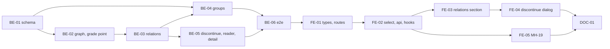

# F-05 Course Relations and Equivalence Groups — Backend + Frontend Implementation Plan

This plan builds the catalog-level relations between courses — prior study (QH1), prerequisite with an optional score threshold (QH2), corequisite (QH3) and replacement (QH5) — with a cycle check over prior study + prerequisite that names the cycle's path, and the equivalence groups that model QH4 (two-way, transitive). It adds the relations section to the course detail page (MH-17), the equivalence-group screen (MH-19), and the replacement picker in the "discontinue" dialog, which makes F-04's discontinue path reachable (KB-008).

It deliberately excludes the curriculum-level overrides (`CurriculumRequisite`, F-07) — though it writes the shared cycle function F-07 and F-09 reuse — the registration-eligibility evaluation that consumes thresholds and corequisites (F-18), the graph view (MH-20, F-24) and the health-board warning for a discontinued course without replacement (F-24).

> **Companion documents**
> - Requirement: `docs/requirement/REQUIREMENTS.md:444-447` (FR-18..FR-21), `:834` (BR-09), `:836` (BR-11), `:883` (depth-20 note), `:1127` (DEC-06), `:1168` (DEC-11), `:1205` (EC-09), `:1216-1219` (EC-15, EC-16, EC-18), `:1310` (Q-05)
> - Stories: `docs/planning/user-stories.md:225-255` (US-015..US-017); epic EP-05
> - Tasks: `docs/planning/task-breakdown.md:154-167` (CV-044..CV-053)
> - Design: `docs/design/data-dictionary.md:208` (`Course.equivalenceGroup`), `:212-234` (`CourseRelation`, `EquivalentCourseGroup`), `:335-346` (`CurriculumRequisite`), `:806` (§9 `courseRelation.edit`); `docs/design/erd.md:204-212` (M-4), `:307` (E-1), `:317` (E-11); `docs/design/screen-inventory.md:78`, `:80` (MH-17, MH-19), `:184-186`
> - Answers: `docs/planning/feature-questions.md:116-124` (§F-05, all A)
> - Builds on: `docs/implementation/f-04-course-catalog-implementation-plan.md` (BE-01 `Course`, BE-02 `edit-path.ts`, `CourseUsageReader`, `decimal.ts`, `CourseRefDto`, BE-03 `courseTarget`, `COURSE_TRANSITIONS`, transition route, FE-02 hooks, FE-04 `CourseStatusActions`), F-02 (`AccessContext`, `PERMISSIONS`, pagination, `PERMISSION_TABLE`), F-01 (`AppException`, `FieldErrorDto`)
> - Tests: `docs/planning/test-plan.md:153-157` (KB-004..KB-008), `:283-284` (NT-B1-04, NT-B1-05), `:546` (T-2)

**Status**: Not started

---

## 0. Plan at a glance

Everything below in one table. Read this; the rest is detail for whoever builds it.

| What | Why | How and where |
|---|---|---|
| **Declare prior-study, prerequisite, corequisite and replacement relations between two courses**, shown on both courses | US-015 AC1; FR-18; MH-17 | `CourseRelation` table; `POST /course-relations`, `GET /courses/:id/relations`; a "Quan hệ" section on the course detail page with a six-choice add dialog (BE-01, BE-03, FE-03) |
| **Prerequisite carries an optional score threshold on the 4-point scale** | US-015 AC2; FR-19; F05-02, F05-03 | `minScore Decimal(4,2)`, 0..4, only on PREREQUISITE; sent as a string (BE-01, BE-03) |
| **Duplicates and self-relations are refused** | US-015 AC3, AC4 | Unique (source, target, type) + a database check `source <> target` (BE-01) |
| **A relation that closes a loop over prior study + prerequisite is refused, and the message names the loop** (`A → B → C → A`) | US-016; BR-11; EC-09; F05-04 | Pure function `findRequisiteCycle` in `src/shared/courses/requisite-graph.ts`, run under a transaction lock; F-07 and F-09 reuse it (BE-02, BE-03) |
| **Corequisite and replacement never trip the cycle rule**; corequisite may be declared both ways | US-016 AC3; F05-04 | Only PRIOR and PREREQUISITE edges enter the graph (BE-02) |
| **R1 groups interchangeable courses into equivalence groups**; adding C to {A, B} makes all three equivalent; a course in another group is refused with a merge offer | US-017; BR-09; EC-15, EC-16, EC-18; M-4 | `EquivalentCourseGroup` + `Course.equivalenceGroupId`; create, add, remove, merge, dissolve; MH-19 page; equivalents listed on each course (BE-04, FE-05) |
| **"Ngừng mở lớp" now works**: the dialog shows the replacement or lets R1 pick one in the same step | US-014 AC1–AC2 (F-04 constraint); KB-008 | `CourseUsageReader.hasActiveReplacement` filled; discontinue accepts `replacementCourseId` and creates the relation atomically (BE-05, FE-04) |
| **Who may edit**: R1 everywhere; R3..R5 on relations of courses they may edit; only R1 on equivalence groups | §9 `courseRelation.edit`; US-017 role R1 | A relation's owning course decides scope and edit path through F-04's `resolveEditPath`; groups require a direct, unscoped cell (BE-03, BE-04) |

### Key behaviours worth knowing

| Behaviour | Why it is this way |
|---|---|
| A relation belongs to one course: the **target** for prior study, prerequisite and corequisite (the course that has the requirement), the **source** for replacement (the discontinued course) | Scope and edit path need one course to check against; the data dictionary fixes the direction (`sourceCourse` = the course studied first, or the discontinued one) |
| Once the owning course is in a released version, its relations change only through a change request | Same rule as the course's catalog fields (F04-05, FR-55); until F-15 fills the reader, every course counts as unreleased |
| Equivalence groups are edited directly by R1 at any time, even after release | Groups sit outside the version snapshot and apply to every version (M-4, EC-16, E-11); there is no change-request type for them |
| Removing the last active replacement of a Discontinued course is refused | HP-02's invariant would break silently; the user reopens the course or adds another replacement first |
| Cancelling or discontinuing the **replacement** course is not blocked | T-2: a discontinued course whose replacement disappears is a health-board warning (F-24), not a lock on the other course |
| No relation may touch a Cancelled course | Cancelled is final (S-10); relations to it would never be evaluated |
| Concurrent relation writes are serialised by one advisory lock | Two requests can each pass the cycle check and together close a loop; the lock makes check + insert atomic |
| A group must have at least two courses; removing one of two members is refused — "Giải thể nhóm" ends a group | A one-course group means nothing and would hide the course from a later group (one group per course) |

### Not included

| Excluded | Why |
|---|---|
| `CurriculumRequisite` (per-curriculum overrides, KB-020) | F-07 creates the table and calls `findRequisiteCycle` over catalog + override edges |
| Evaluating prerequisites for a student (thresholds, corequisite visited-set, depth 20) | F-18 |
| Graph view MH-20 | F-24 (B6) |
| Warning for a Discontinued course without an active replacement (EC-12 second branch, KB-090) | F-24 health board |
| Excel import of relations (KB-025) | F-09, reusing `findRequisiteCycle` |
| Audit rows | F01-07 |

### Open questions

All F-05 questions are answered (`feature-questions.md` §F-05, all A). Small choices left:

| Question | Resolved when | Default if unanswered |
|---|---|---|
| Should a corequisite declared A–B also forbid declaring B–A as a duplicate | First user complaint | No; F05-04 allows both directions as separate rows |
| Group code format | Before B1 acceptance | Free text, trimmed, upper-cased, unique, ≤ 20 characters (as course codes) |

---

## 1. Scope

| In scope | Why |
|---|---|
| `CourseRelation`, `CourseRelationType`, `EquivalentCourseGroup`, `Course.equivalenceGroupId`; migration with check constraints | CV-044, CV-050 |
| Relation create, threshold edit, delete; self, duplicate and threshold rules | CV-045 |
| Cycle detection with path, shared pure function | CV-047, CV-049 |
| Relation section and path display on MH-17 | CV-046, CV-048 |
| Equivalence groups: create, add, remove, merge, dissolve; MH-19 | CV-051, CV-052 |
| `hasActiveReplacement`; discontinue with replacement | F-04 constraint; KB-008 |
| Shared `CourseSelect` (remote search) | MH-17 dialog, MH-19, discontinue dialog; F-07 reuses it |

| Out of scope | Deferred until |
|---|---|
| Curriculum-level requisites | F-07 |
| Eligibility evaluation | F-18 |
| Graph view | F-24 |
| CV-053 cross-browser B1 acceptance run | After F-01..F-05 are built; tracked in `docs/progress/todo.md`, not a code deliverable |

| AC | Covered by |
|---|---|
| US-015 AC1 — PRIOR, COREQUISITE, REPLACEMENT saved and shown on both courses | BE-03 (`create`, `listForCourse`), BE-06, FE-03 |
| US-015 AC2 — threshold on PREREQUISITE, optional | BE-01 (`minScore`), BE-03 (`GRADE_POINT_PATTERN`), BE-06, FE-03 |
| US-015 AC3 — duplicate refused | BE-01 (unique), BE-03 (`RELATION_EXISTS`), BE-06 |
| US-015 AC4 — self-relation refused | BE-01 (check), BE-03 (`RELATION_SELF`), BE-06 |
| US-016 AC1 — three-node loop refused with path | BE-02, BE-03 (`REQUISITE_CYCLE`), BE-06 (KB-005), FE-03 |
| US-016 AC2 — non-loop saved | BE-02 spec, BE-06 |
| US-016 AC3 — corequisite and replacement not checked | BE-02 (edge filter), BE-06 (KB-005 second half) |
| US-017 AC1 — group of two, each shows the other | BE-04, BE-05 (detail `equivalenceGroup`), BE-06 (KB-006), FE-05 |
| US-017 AC2 — adding C makes A, B, C equivalent | BE-04 (`addMember`), BE-06 (KB-006) |
| US-017 AC3 — course in a second group refused, merge offered | BE-04 (`COURSE_ALREADY_GROUPED`, `merge`), FE-05 (merge button in the error) |
| US-017 AC4 — courses of different programs, faculties, credits allowed | BE-04 (no such checks), BE-06 (KB-007) |
| US-014 AC1–AC2 (F-04 carry-over) — discontinue needs a replacement; then reopen | BE-05, BE-06 (KB-008), FE-04 |

---

## 2. Contract verification

F-05 builds on F-01..F-04 code that is **specified, not built**. Every "existing" claim cites the plan section that defines it; Rule 13 re-reads the built file before the step that uses it.

| Existing piece used | Defined at | Used by |
|---|---|---|
| `Course`, `CourseStatus`, `courseCode` unique | F-04 BE-01 | BE-01 |
| `resolveEditPath`, `editPathFor`, `assertDirectEdit`, `EditState`, `EDIT_PATH`, `COMMON_ERRORS.CHANGE_REQUEST_REQUIRED` | F-04 BE-02 | BE-03 |
| `CourseUsageReader` (`inReleasedVersion`, `hasActiveReplacement` placeholder), `CoursesSharedModule` | F-04 BE-02 | BE-03, BE-05 |
| `toWireDecimal`, `src/shared/decimal/decimal.ts` | F-04 BE-02 | BE-02 (`GRADE_POINT_PATTERN`), BE-03 |
| `CourseRefDto`, `OrgUnitRefDto` in `src/shared/dtos/ref.dto.ts` | F-04 BE-02, F-02 BE-07 | BE-03, BE-04 |
| `HOME_FACULTY_CODE` | F-04 BE-02 | BE-03 (draft-open state) |
| `courseTarget`, `COURSE_INCLUDE`, `CourseDetailDto`, `CoursesService.transition`, `toDetail` | F-04 BE-03 | BE-03, BE-05 |
| `AccessContext.modeFor` — an `ALL` cell covers any target, including an empty one | F-02 BE-04 (`covers`, line ~745; table "ALL cell on a scoped assignment covers any target") | BE-04 (`assertSchoolWideDirect`) |
| `PERMISSIONS.COURSE_VIEW`, `COURSE_RELATION_EDIT`; seed cells `courseRelation.edit` R1 X, R3 Đ, R4 Đ(P), R5 Đ(P) | F-02 BE-03, BE-06; `data-dictionary.md:806` | BE-03, BE-04, BE-06 |
| `AppException(def, details?)`, `FieldErrorDto { field, constraints: string[] }` | F-01 BE-02, BE-03 | BE-03, BE-04 |
| `mapUniqueViolation` | F-02 BE-07 / F-03 move | BE-03, BE-04 |
| `PageQueryDto`, `toSkipTake`, `toPage` | F-02 BE-01 | BE-04 |
| `createCourse` fixture, `createAccount`, `loginAgent`, `PERMISSION_TABLE`, `PLACEHOLDER_ID`, `NO_ROLE` | F-04 BE-05, F-02 BE-10 | BE-06 |
| `useCourse`, `COURSE_QUERY_KEYS`, `CourseStatusActions`, `CourseDetailPage`, `courseLabels.ts` | F-04 FE-02, FE-04 | FE-03, FE-04 |
| `getJson`, `sendJson`, `ApiError`, `errorMessage`, `withQuery` | F-01 FE, F-02 FE-01 | FE-02..FE-05 |

### 2a. Endpoints

All under `/api`.

| Endpoint | Permission (guard) | Request | Response | Notes |
|---|---|---|---|---|
| `GET /courses/:courseId/relations` | `course.view` | — | `CourseRelationDto[]` | Every relation where the course is source or target; `editPath` per row for the caller. Cancelled course → 404 for callers without `course.edit` (same visibility as F-04 detail) |
| `POST /course-relations` | `courseRelation.edit` | `CreateCourseRelationDto` | `CourseRelationDto` (201) | Service: scope + edit path on the owning course; self, cancelled, threshold, duplicate, cycle checks under lock |
| `PATCH /course-relations/:relationId` | `courseRelation.edit` | `UpdateCourseRelationDto` | `CourseRelationDto` | Threshold only; PREREQUISITE only |
| `DELETE /course-relations/:relationId` | `courseRelation.edit` | — | 204 | Refused for the last active replacement of a Discontinued course |
| `GET /equivalence-groups` | `course.view` | `EquivalenceGroupQueryDto` | `EquivalenceGroupPageDto` | `q` matches group code or a member's course code |
| `GET /equivalence-groups/:groupId` | `course.view` | — | `EquivalenceGroupDto` | |
| `POST /equivalence-groups` | `courseRelation.edit` | `CreateEquivalenceGroupDto` | `EquivalenceGroupDto` (201) | R1 only (service) |
| `PATCH /equivalence-groups/:groupId` | `courseRelation.edit` | `UpdateEquivalenceGroupDto` | `EquivalenceGroupDto` | Code, note |
| `POST /equivalence-groups/:groupId/members` | `courseRelation.edit` | `AddEquivalenceMemberDto` | `EquivalenceGroupDto` | `COURSE_ALREADY_GROUPED` names the other group |
| `DELETE /equivalence-groups/:groupId/members/:courseId` | `courseRelation.edit` | — | `EquivalenceGroupDto` | Refused below two members |
| `POST /equivalence-groups/:groupId/merge` | `courseRelation.edit` | `MergeEquivalenceGroupsDto` | `EquivalenceGroupDto` (200) | Moves the other group's members here; deletes the other group |
| `POST /equivalence-groups/:groupId/dissolve` | `courseRelation.edit` | — | 204 | Clears every member; deletes the group |
| `POST /courses/:courseId/discontinue` (F-04, changed) | `course.edit` | `DiscontinueCourseDto` (new, optional body) | `CourseDetailDto` | `replacementCourseId` creates the REPLACEMENT relation in the same transaction |
| `GET /courses/:courseId` (F-04, changed) | `course.view` | — | `CourseDetailDto` + `equivalenceGroup` | |

### 2b. DTOs

**`CourseRelationDto`**

| Field | Wire type | Nullable | Source | Note |
|---|---|---|---|---|
| `id` | `string` | no | BE-01 | |
| `relationType` | `'PRIOR' \| 'PREREQUISITE' \| 'COREQUISITE' \| 'REPLACEMENT'` | no | BE-01 `CourseRelationType` | |
| `sourceCourse` | `RelatedCourseDto` | no | BE-03 | |
| `targetCourse` | `RelatedCourseDto` | no | BE-03 | |
| `minScore` | `string` | **yes** | BE-01 `Decimal(4,2)` | `toWireDecimal`; only PREREQUISITE can be non-null |
| `editPath` | `'DIRECT' \| 'VIA_REQUEST'` | **yes** | F-04 `editPathFor` on the owning course | `null` = caller cannot change this relation |

**`RelatedCourseDto`**: `id`, `courseCode`, `courseName`, `credits: string`, `status: CourseStatus`.

**`CreateCourseRelationDto`**: `sourceCourseId: string`, `targetCourseId: string`, `relationType: CourseRelationType`, `minScore?: string | null` (`GRADE_POINT_PATTERN`).

**`UpdateCourseRelationDto`**: `minScore: string | null`.

**`EquivalenceGroupDto`**: `id`, `groupCode`, `note: string | null`, `members: RelatedCourseDto[]` (ordered by code), `updatedAt: string`.

**`EquivalenceGroupPageDto`** = `Page<EquivalenceGroupDto>`.

**`CreateEquivalenceGroupDto`**: `groupCode` (trim, upper-case, 1..20), `note?` (≤ 500), `courseIds: string[]` (2..`EQUIVALENCE_LIMITS.MEMBERS_MAX` = 50, unique).

**`UpdateEquivalenceGroupDto`**: `groupCode?`, `note?: string | null`.

**`AddEquivalenceMemberDto`**: `courseId: string`. **`MergeEquivalenceGroupsDto`**: `otherGroupId: string`. **`DiscontinueCourseDto`**: `replacementCourseId?: string`.

**`CourseDetailDto`** (F-04) gains `equivalenceGroup: { id: string; groupCode: string; members: RelatedCourseDto[] } | null`; `members` excludes the course itself.

### 2c. Mismatch log

| Deliverable | What the doc said | What this plan does | Found at |
|---|---|---|---|
| BE-03 | `minScore` "Số thực" | `Decimal(4,2)` on the 4-point scale, 0..4 (F05-03, DEC-11) | `data-dictionary.md:221` |
| BE-03 | FR-18 "05 loại quan hệ" | Four in `CourseRelation`; the fifth (equivalent) is group membership | `erd.md:204` (M-4) |
| BE-03 | `courseRelation.edit` cells | Scope and path are checked on the relation's owning course (target, or source for REPLACEMENT) | `data-dictionary.md:806` |
| BE-04 | `courseRelation.edit` also covers equivalence groups (R3 Đ) | Groups are R1-only (US-017, MH-19): the service requires a direct unscoped cell | `screen-inventory.md:80` |
| BE-05 | F-04 discontinue had no body | Optional `replacementCourseId` | F-04 BE-03 |

The data-dictionary notes above are applied together with this plan (`docs/design/data-dictionary.md` `CourseRelation`, `EquivalentCourseGroup`).

---

## 3. Decisions

| # | Decision | Why | Rejected alternative |
|---|---|---|---|
| D1 | Two backend features: `course-relations` and `equivalence-groups`; the relations list route sits at `/courses/:courseId/relations` in the relations controller | One concern per module; the URL reads as a sub-resource of a course | Everything in `courses` — the service passes 250 lines |
| D2 | A relation's **owning course** = target for PRIOR, PREREQUISITE, COREQUISITE; source for REPLACEMENT. Permission, scope and edit path are checked on it with F-04's `courseTarget` and the course's edit state | The requirement belongs to the course that has it; the replacement belongs to the discontinued course | Requiring rights on both courses — R5 could not declare "my course needs MATH01" because MATH01 is foreign |
| D3 | Cycle check: load every PRIOR and PREREQUISITE edge, search from the new target to the new source; if reached, refuse with the path. Runs inside a transaction holding `pg_advisory_xact_lock(REQUISITE_GRAPH_LOCK_KEY)` | A few hundred edges fit in memory; the lock closes the check-then-insert race | Recursive CTE in SQL — harder to return the path; no lock — two concurrent inserts can form a loop |
| D4 | `findRequisiteCycle(edges, newEdge)` is a pure function in `src/shared/courses/requisite-graph.ts` returning the cycle as ids | F-07 (curriculum overrides, KB-020) and F-09 (Excel, KB-025) need the same check over different edge sets | Logic inside the relations service |
| D5 | The cycle path goes into the error **message** (`… : 1020083 → 1020093 → 1020083`), built from the static definition's message | F-01's `details` are `{ field, constraints }` keys, not data; the message is what NFR-19 says to show | A new `meta` field in the error envelope — changes F-01's contract for one case |
| D6 | `minScore` only on PREREQUISITE; `Decimal(4,2)`; validated by `GRADE_POINT_PATTERN` (0..4, ≤ 2 decimals) | FR-19, F05-03; a database check enforces "null unless prerequisite" too | Threshold on every type |
| D7 | Corequisite stored directed; A–B and B–A are two rows, both allowed | F05-04 | Normalising to one undirected row |
| D8 | Equivalence membership = `Course.equivalenceGroupId` (nullable FK); groups are R1-only via `assertSchoolWideDirect`; groups are not subject to the release rule | M-4, US-017, E-11 | A membership table — M-4 rejects it |
| D9 | "Already in a group" is a 409 naming the other group; the client offers "Gộp nhóm" which calls `merge` | US-017 AC3 "đề nghị gộp hai nhóm" | Merging silently on add |
| D10 | Removing a member is refused when two remain; `dissolve` ends a group | A one-member group blocks the course from joining a real group later | Auto-dissolve on removal — surprising |
| D11 | Discontinue takes an optional `replacementCourseId` and creates the relation in the same transaction | One dialog, one atomic step (MH-18 "đòi chọn học phần thay thế") | Two calls from the client — a failure between them leaves a stray relation |
| D12 | Relations are deleted for real; the guard keeps a Discontinued course's last active replacement | Relations are catalog facts with no history requirement (audit deferred); released versions keep their own copy (M-5) | Soft delete — no reader needs it |
| D13 | Shared `CourseSelect` in `src/shared/courses/` searching `GET /courses?q=` | Three dialogs here and the curriculum editor (F-07) pick courses | A select per dialog |

---

## 5. Deliverables

### BE-01 — Prisma schema: relations, groups

What/Why: CV-044, CV-050; D6, D8.

**Files**

| Action | Path |
|---|---|
| MODIFY | `prisma/schema.prisma` |
| NEW | `prisma/migrations/<timestamp>_course_relations/migration.sql` (generated, then edited) |

**Shape**

```prisma
enum CourseRelationType {
  PRIOR
  PREREQUISITE
  COREQUISITE
  REPLACEMENT
}

model CourseRelation {
  id             String             @id @default(cuid(2))
  sourceCourseId String
  sourceCourse   Course             @relation("RelationSource", fields: [sourceCourseId], references: [id], onDelete: Restrict)
  targetCourseId String
  targetCourse   Course             @relation("RelationTarget", fields: [targetCourseId], references: [id], onDelete: Restrict)
  relationType   CourseRelationType
  minScore       Decimal?           @db.Decimal(4, 2)
  createdAt      DateTime           @default(now())
  updatedAt      DateTime           @updatedAt

  @@unique([sourceCourseId, targetCourseId, relationType])
  @@index([targetCourseId])
}

model EquivalentCourseGroup {
  id        String   @id @default(cuid(2))
  groupCode String   @unique
  note      String?
  members   Course[] @relation("CourseEquivalence")
  createdAt DateTime @default(now())
  updatedAt DateTime @updatedAt
}

// Course additions
model Course {
  // …
  equivalenceGroupId String?
  equivalenceGroup   EquivalentCourseGroup? @relation("CourseEquivalence", fields: [equivalenceGroupId], references: [id], onDelete: SetNull)
  relationsAsSource  CourseRelation[] @relation("RelationSource")
  relationsAsTarget  CourseRelation[] @relation("RelationTarget")

  @@index([equivalenceGroupId])
}
```

```
pnpm prisma migrate dev --create-only --name course_relations
# append the two checks below to the generated migration.sql, then:
pnpm prisma migrate dev
pnpm prisma generate
```

```sql
-- appended to migration.sql
ALTER TABLE "CourseRelation" ADD CONSTRAINT "CourseRelation_not_self" CHECK ("sourceCourseId" <> "targetCourseId");
ALTER TABLE "CourseRelation" ADD CONSTRAINT "CourseRelation_minScore_prerequisite_only" CHECK ("minScore" IS NULL OR "relationType" = 'PREREQUISITE');
```

**Rationale**: Columns from `data-dictionary.md:212-234`; relation naming as F-04 BE-01 (`"CourseOwnerFaculty"`). Check constraints are the database's last line behind the service checks.

**Gotchas**
- Prisma does not model `CHECK`; it keeps hand-added checks across later migrations because it does not diff them. Record them in `database_and_models.md` so nobody "cleans" the SQL.
- `onDelete: SetNull` on the group: dissolve deletes the group after clearing members anyway; SetNull is the safety net.
- `@@unique` covers the duplicate rule; the index on `targetCourseId` serves "relations of a course" from the other side.

**Verify**: Migration applies on Testcontainers; `INSERT` with source = target fails with the check name.

**Depends on**: F-04 BE-01

---

### BE-02 — Shared requisite graph and grade-point pattern

What/Why: D3, D4, D6; US-016.

**Files**

| Action | Path |
|---|---|
| NEW | `src/shared/courses/requisite-graph.ts` |
| NEW | `src/shared/courses/requisite-graph.spec.ts` |
| MODIFY | `src/shared/decimal/decimal.ts` (`GRADE_POINT_PATTERN`, `GRADE_POINT_MESSAGE`) |
| MODIFY | `src/shared/decimal/decimal.spec.ts` |

**Shape**

```ts
// src/shared/courses/requisite-graph.ts
export interface RequisiteEdge {
  sourceCourseId: string;
  targetCourseId: string;
}

// Only these types order courses in time; corequisite and replacement may point both ways (BR-11, F05-04).
export const CYCLE_CHECKED_TYPES: readonly CourseRelationType[] = [CourseRelationType.PRIOR, CourseRelationType.PREREQUISITE];

// Every writer of requisite edges (catalog relations, curriculum requisites, imports) takes this lock first.
export const REQUISITE_GRAPH_LOCK_KEY = 5_001;

// Returns the loop the new edge would close, as course ids starting and ending at the new edge's target, or null.
export function findRequisiteCycle(edges: readonly RequisiteEdge[], newEdge: RequisiteEdge): string[] | null {
  const next = new Map<string, string[]>();
  for (const edge of edges) {
    const list = next.get(edge.sourceCourseId) ?? [];
    list.push(edge.targetCourseId);
    next.set(edge.sourceCourseId, list);
  }
  const cameFrom = new Map<string, string>();
  const queue = [newEdge.targetCourseId];
  const seen = new Set(queue);
  while (queue.length > 0) {
    const current = queue.shift()!;
    if (current === newEdge.sourceCourseId) {
      const path = [current];
      for (let at = current; at !== newEdge.targetCourseId; ) {
        at = cameFrom.get(at)!;
        path.unshift(at);
      }
      return [...path, newEdge.targetCourseId];
    }
    for (const following of next.get(current) ?? []) {
      if (!seen.has(following)) {
        seen.add(following);
        cameFrom.set(following, current);
        queue.push(following);
      }
    }
  }
  return null;
}
```

```ts
// src/shared/decimal/decimal.ts — additions
// 4-point scale, Decimal(4,2): 0 to 4 with at most two decimals (DEC-11).
export const GRADE_POINT_PATTERN = /^(4(\.0{1,2})?|[0-3](\.\d{1,2})?)$/;
export const GRADE_POINT_MESSAGE = 'Ngưỡng điểm theo thang 4: từ 0 đến 4, tối đa 2 chữ số thập phân (ví dụ 2 hoặc 2.5).';
```

`requisite-graph.spec.ts`:

| Case | Expect |
|---|---|
| KB-004: edges A→B; new B→A | `[A, B, A]` |
| US-016 AC1: A→B, B→C; new C→A | `[A, B, C, A]` |
| No path: A→B; new C→A | `null` |
| Diamond A→B, A→C, B→D, C→D; new D→A | a path of length 4 starting and ending with A |
| Disconnected graph of 500 edges, no cycle | `null` in < 50 ms |

`decimal.spec.ts` additions: accepts `0`, `2`, `2.5`, `4`, `4.00`; rejects `4.01`, `5`, `-1`, `2.555`.

**Rationale**: Pure functions in `src/shared/` beside `course-usage.reader.ts` (F-04 BE-02); BFS returns the shortest loop, which is the clearest message.

**Gotchas**
- Callers pass only `CYCLE_CHECKED_TYPES` edges; the function trusts its input.
- The lock key is a number in PostgreSQL's advisory-lock space shared by the whole database; F-07 and F-09 must reuse the constant, not pick another.
- BFS from target to source finds the loop the *new* edge closes; an existing loop elsewhere (impossible while the invariant holds) is not reported.

**Verify**: `pnpm test`.

**Depends on**: BE-01

---

### BE-03 — Course relations feature

What/Why: CV-045, CV-047; US-015, US-016; D1, D2, D3, D5, D12.

**Files**

| Action | Path |
|---|---|
| NEW | `src/features/course-relations/course-relations.module.ts` |
| NEW | `src/features/course-relations/course-relations.controller.ts` |
| NEW | `src/features/course-relations/course-relations.service.ts` |
| NEW | `src/features/course-relations/course-relations.service.spec.ts` |
| NEW | `src/features/course-relations/course-relations.errors.ts` |
| NEW | `src/features/course-relations/course-relation.dto.ts` |
| NEW | `src/features/course-relations/create-course-relation.dto.ts` |
| NEW | `src/features/course-relations/update-course-relation.dto.ts` |
| NEW | `src/shared/courses/related-course.ts` (`RelatedCourseDto`, `RELATED_COURSE_SELECT`, `toRelatedCourseDto`) |
| NEW | `src/shared/courses/course-edit-state.ts` (`courseEditState`) |
| MODIFY | `src/features/courses/courses.service.ts` (`editState` → shared `courseEditState`) |
| MODIFY | `src/app.module.ts` |

**Shape**

```ts
// src/features/course-relations/course-relations.errors.ts
export const COURSE_RELATION_ERRORS = {
  RELATION_NOT_FOUND: { status: HttpStatus.NOT_FOUND, code: 'RELATION_NOT_FOUND', message: 'Không tìm thấy quan hệ học phần.' },
  COURSE_NOT_FOUND: { status: HttpStatus.NOT_FOUND, code: 'COURSE_NOT_FOUND', message: 'Không tìm thấy học phần.' },
  RELATION_COURSE_NOT_FOUND: { status: HttpStatus.BAD_REQUEST, code: 'RELATION_COURSE_NOT_FOUND', message: 'Không tìm thấy một trong hai học phần của quan hệ.' },
  RELATION_SELF: { status: HttpStatus.BAD_REQUEST, code: 'RELATION_SELF', message: 'Không khai báo được quan hệ của một học phần với chính nó.' },
  RELATION_COURSE_CANCELLED: { status: HttpStatus.CONFLICT, code: 'RELATION_COURSE_CANCELLED', message: 'Không khai báo quan hệ với học phần đã hủy.' },
  RELATION_EXISTS: { status: HttpStatus.CONFLICT, code: 'RELATION_EXISTS', message: 'Hai học phần này đã có quan hệ loại này.' },
  MIN_SCORE_NOT_ALLOWED: { status: HttpStatus.BAD_REQUEST, code: 'MIN_SCORE_NOT_ALLOWED', message: 'Chỉ quan hệ tiên quyết mới có ngưỡng điểm.' },
  REQUISITE_CYCLE: { status: HttpStatus.CONFLICT, code: 'REQUISITE_CYCLE', message: 'Quan hệ này tạo thành vòng học trước/tiên quyết nên không lưu được. Đường đi của vòng' },
  REPLACEMENT_STILL_NEEDED: { status: HttpStatus.CONFLICT, code: 'REPLACEMENT_STILL_NEEDED', message: 'Đây là học phần thay thế duy nhất của một học phần đang Ngừng mở lớp; hãy thêm học phần thay thế khác hoặc mở lại học phần đó trước.' },
} as const satisfies Record<string, ErrorDefinition>;

export const RELATION_CONSTRAINT = { GRADE_POINT: 'gradePoint' } as const;
```

```ts
// src/shared/courses/course-edit-state.ts
// Catalog data of a course (fields and relations) follows the course's own release state (F04-05).
export async function courseEditState(
  usage: CourseUsageReader,
  course: { id: string; ownerFaculty: { unitCode: string } },
): Promise<EditState> {
  return {
    released: await usage.inReleasedVersion(course.id),
    draftOpenToRequestHolders: course.ownerFaculty.unitCode === HOME_FACULTY_CODE,
  };
}
```

This replaces F-04's private `CoursesService.editState`; its two call sites (`update`, `toDetail`) move to `courseEditState(this.usage, row)` — both migrated, the private method deleted.

```ts
// src/shared/courses/related-course.ts
export class RelatedCourseDto extends CourseRefDto {
  @ApiProperty({ example: '3' }) credits: string;
  @ApiProperty({ enum: CourseStatus, enumName: 'CourseStatus' }) status: CourseStatus;
}

export const RELATED_COURSE_SELECT = { id: true, courseCode: true, courseName: true, credits: true, status: true } as const satisfies Prisma.CourseSelect;

export function toRelatedCourseDto(row: Prisma.CourseGetPayload<{ select: typeof RELATED_COURSE_SELECT }>): RelatedCourseDto {
  return { ...row, credits: toWireDecimal(row.credits) };
}
```

```ts
// src/features/course-relations/create-course-relation.dto.ts
export class CreateCourseRelationDto {
  @ApiProperty() @IsString() @IsNotEmpty() sourceCourseId: string;
  @ApiProperty() @IsString() @IsNotEmpty() targetCourseId: string;
  @ApiProperty({ enum: CourseRelationType, enumName: 'CourseRelationType' }) @IsEnum(CourseRelationType) relationType: CourseRelationType;

  @ApiPropertyOptional({ nullable: true, type: String, example: '2' })
  @Transform(emptyToNull) @IsOptional() @IsString() @Matches(GRADE_POINT_PATTERN, { message: GRADE_POINT_MESSAGE })
  minScore?: string | null;
}

// update-course-relation.dto.ts
export class UpdateCourseRelationDto {
  @ApiProperty({ nullable: true, type: String })
  @Transform(emptyToNull) @ValidateIf((_, value) => value !== null) @IsString() @Matches(GRADE_POINT_PATTERN, { message: GRADE_POINT_MESSAGE })
  minScore: string | null;
}
```

```ts
// src/features/course-relations/course-relation.dto.ts
export class CourseRelationDto {
  @ApiProperty() id: string;
  @ApiProperty({ enum: CourseRelationType, enumName: 'CourseRelationType' }) relationType: CourseRelationType;
  @ApiProperty({ type: RelatedCourseDto }) sourceCourse: RelatedCourseDto;
  @ApiProperty({ type: RelatedCourseDto }) targetCourse: RelatedCourseDto;
  @ApiProperty({ nullable: true, type: String }) minScore: string | null;
  @ApiProperty({ enum: EDIT_PATHS, enumName: 'EditPath', nullable: true }) editPath: EditPath | null;
}

const OWNER_SELECT = { ...RELATED_COURSE_SELECT, ownerFacultyId: true, ownerGroupId: true, ownerFaculty: { select: { unitCode: true } } } as const;

export const RELATION_INCLUDE = {
  sourceCourse: { select: OWNER_SELECT },
  targetCourse: { select: OWNER_SELECT },
} as const satisfies Prisma.CourseRelationInclude;

export type RelationRow = Prisma.CourseRelationGetPayload<{ include: typeof RELATION_INCLUDE }>;

export function owningCourse(row: Pick<RelationRow, 'relationType' | 'sourceCourse' | 'targetCourse'>) {
  return row.relationType === CourseRelationType.REPLACEMENT ? row.sourceCourse : row.targetCourse;
}
```

```ts
// src/features/course-relations/course-relations.service.ts
@Injectable()
export class CourseRelationsService {
  private readonly logger = new Logger(CourseRelationsService.name);

  constructor(
    private readonly prisma: PrismaService,
    private readonly usage: CourseUsageReader,
  ) {}

  async listForCourse(courseId: string, access: AccessContext): Promise<CourseRelationDto[]> {
    const course = await this.prisma.course.findUnique({ where: { id: courseId }, select: { status: true } });
    if (!course || (course.status === CourseStatus.CANCELLED && !access.has(PERMISSIONS.COURSE_EDIT))) {
      throw new AppException(COURSE_RELATION_ERRORS.COURSE_NOT_FOUND);
    }
    const rows = await this.prisma.courseRelation.findMany({
      where: { OR: [{ sourceCourseId: courseId }, { targetCourseId: courseId }] },
      include: RELATION_INCLUDE,
      orderBy: [{ relationType: 'asc' }, { createdAt: 'asc' }],
    });
    return Promise.all(rows.map((row) => this.toDto(row, access)));
  }

  async create(dto: CreateCourseRelationDto, access: AccessContext): Promise<CourseRelationDto> {
    if (dto.sourceCourseId === dto.targetCourseId) {
      throw new AppException(COURSE_RELATION_ERRORS.RELATION_SELF);
    }
    if (dto.minScore != null && dto.relationType !== CourseRelationType.PREREQUISITE) {
      throw new AppException(COURSE_RELATION_ERRORS.MIN_SCORE_NOT_ALLOWED, [{ field: 'minScore', constraints: [RELATION_CONSTRAINT.GRADE_POINT] }]);
    }
    const [source, target] = await Promise.all([this.findCourse(dto.sourceCourseId), this.findCourse(dto.targetCourseId)]);
    if (source.status === CourseStatus.CANCELLED || target.status === CourseStatus.CANCELLED) {
      throw new AppException(COURSE_RELATION_ERRORS.RELATION_COURSE_CANCELLED);
    }
    const owner = owningCourse({ relationType: dto.relationType, sourceCourse: source, targetCourse: target });
    assertDirectEdit(access, PERMISSIONS.COURSE_RELATION_EDIT, courseTarget(owner), await courseEditState(this.usage, owner));

    const row = await this.prisma.$transaction(async (tx) => {
      await lockRequisiteGraph(tx);
      if (CYCLE_CHECKED_TYPES.includes(dto.relationType)) {
        await this.assertNoCycle(tx, dto);
      }
      try {
        return await tx.courseRelation.create({
          data: {
            sourceCourseId: dto.sourceCourseId,
            targetCourseId: dto.targetCourseId,
            relationType: dto.relationType,
            minScore: dto.minScore == null ? null : new Prisma.Decimal(dto.minScore),
          },
          include: RELATION_INCLUDE,
        });
      } catch (error) {
        throw mapUniqueViolation(error, COURSE_RELATION_ERRORS.RELATION_EXISTS, 'relationType');
      }
    });
    this.logger.log(`Relation ${row.relationType} ${row.sourceCourse.courseCode}→${row.targetCourse.courseCode} created by ${access.userId}`);
    return this.toDto(row, access);
  }

  async updateMinScore(relationId: string, dto: UpdateCourseRelationDto, access: AccessContext): Promise<CourseRelationDto> {
    const row = await this.findOrThrow(relationId);
    await this.assertCanChange(row, access);
    if (dto.minScore !== null && row.relationType !== CourseRelationType.PREREQUISITE) {
      throw new AppException(COURSE_RELATION_ERRORS.MIN_SCORE_NOT_ALLOWED, [{ field: 'minScore', constraints: [RELATION_CONSTRAINT.GRADE_POINT] }]);
    }
    const updated = await this.prisma.courseRelation.update({
      where: { id: relationId },
      data: { minScore: dto.minScore === null ? null : new Prisma.Decimal(dto.minScore) },
      include: RELATION_INCLUDE,
    });
    return this.toDto(updated, access);
  }

  async remove(relationId: string, access: AccessContext): Promise<void> {
    const row = await this.findOrThrow(relationId);
    await this.assertCanChange(row, access);
    if (row.relationType === CourseRelationType.REPLACEMENT && row.sourceCourse.status === CourseStatus.DISCONTINUED) {
      const others = await this.prisma.courseRelation.count({
        where: {
          id: { not: relationId },
          sourceCourseId: row.sourceCourseId,
          relationType: CourseRelationType.REPLACEMENT,
          targetCourse: { status: CourseStatus.ACTIVE },
        },
      });
      if (others === 0) {
        throw new AppException(COURSE_RELATION_ERRORS.REPLACEMENT_STILL_NEEDED);
      }
    }
    await this.prisma.courseRelation.delete({ where: { id: relationId } });
    this.logger.log(`Relation ${relationId} removed by ${access.userId}`);
  }

  private async assertNoCycle(tx: Prisma.TransactionClient, dto: CreateCourseRelationDto): Promise<void> {
    const edges = await tx.courseRelation.findMany({
      where: { relationType: { in: [...CYCLE_CHECKED_TYPES] } },
      select: { sourceCourseId: true, targetCourseId: true },
    });
    const cycle = findRequisiteCycle(edges, dto);
    if (!cycle) {
      return;
    }
    const courses = await tx.course.findMany({ where: { id: { in: cycle } }, select: { id: true, courseCode: true } });
    const codeOf = new Map(courses.map((course) => [course.id, course.courseCode]));
    const base = COURSE_RELATION_ERRORS.REQUISITE_CYCLE;
    throw new AppException({ ...base, message: `${base.message}: ${cycle.map((id) => codeOf.get(id)).join(' → ')}.` });
  }

  private async assertCanChange(row: RelationRow, access: AccessContext): Promise<void> {
    const owner = owningCourse(row);
    assertDirectEdit(access, PERMISSIONS.COURSE_RELATION_EDIT, courseTarget(owner), await courseEditState(this.usage, owner));
  }

  private async toDto(row: RelationRow, access: AccessContext): Promise<CourseRelationDto> {
    const owner = owningCourse(row);
    return {
      id: row.id,
      relationType: row.relationType,
      sourceCourse: toRelatedCourseDto(row.sourceCourse),
      targetCourse: toRelatedCourseDto(row.targetCourse),
      minScore: row.minScore === null ? null : toWireDecimal(row.minScore),
      editPath: editPathFor(access, PERMISSIONS.COURSE_RELATION_EDIT, courseTarget(owner), await courseEditState(this.usage, owner)),
    };
  }

  // findCourse(id): OWNER_SELECT row or RELATION_COURSE_NOT_FOUND
  // findOrThrow(relationId): RelationRow or RELATION_NOT_FOUND
}

// src/shared/courses/requisite-graph.ts — addition
export async function lockRequisiteGraph(tx: Prisma.TransactionClient): Promise<void> {
  await tx.$queryRaw`SELECT pg_advisory_xact_lock(${REQUISITE_GRAPH_LOCK_KEY})`;
}
```

`COURSE_RELATION_ERRORS.COURSE_NOT_FOUND` repeats F-04's code `COURSE_NOT_FOUND` on purpose: the client sees one code for "no such course", and the relations feature cannot import `COURSE_ERRORS` from the courses feature (`nestjs-rules.md` §1).

```ts
// src/features/course-relations/course-relations.controller.ts
@ApiTags('course-relations')
@ApiCookieAuth()
@Controller()
export class CourseRelationsController {
  constructor(private readonly relations: CourseRelationsService) {}

  @Get('courses/:courseId/relations')
  @RequirePermission(PERMISSIONS.COURSE_VIEW)
  @ApiOkResponse({ type: [CourseRelationDto] })
  list(@Param('courseId') courseId: string, @CurrentAccess() access: AccessContext) { return this.relations.listForCourse(courseId, access); }

  @Post('course-relations')
  @RequirePermission(PERMISSIONS.COURSE_RELATION_EDIT)
  @ApiCreatedResponse({ type: CourseRelationDto })
  create(@Body() dto: CreateCourseRelationDto, @CurrentAccess() access: AccessContext) { return this.relations.create(dto, access); }

  @Patch('course-relations/:relationId')
  @RequirePermission(PERMISSIONS.COURSE_RELATION_EDIT)
  @ApiOkResponse({ type: CourseRelationDto })
  update(@Param('relationId') relationId: string, @Body() dto: UpdateCourseRelationDto, @CurrentAccess() access: AccessContext) {
    return this.relations.updateMinScore(relationId, dto, access);
  }

  @Delete('course-relations/:relationId')
  @HttpCode(HttpStatus.NO_CONTENT)
  @RequirePermission(PERMISSIONS.COURSE_RELATION_EDIT)
  remove(@Param('relationId') relationId: string, @CurrentAccess() access: AccessContext) { return this.relations.remove(relationId, access); }
}
```

```ts
// course-relations.module.ts
@Module({ imports: [CoursesSharedModule], controllers: [CourseRelationsController], providers: [CourseRelationsService] })
export class CourseRelationsModule {}
```

Service spec cases (Prisma, reader mocked; `$transaction` mock runs the callback with the same mock):

| Case | Expect |
|---|---|
| source = target | `RELATION_SELF` |
| `minScore` on PRIOR | `MIN_SCORE_NOT_ALLOWED` |
| target Cancelled | `RELATION_COURSE_CANCELLED` |
| PREREQUISITE owned by a G1 course, R5 in G1 | created; lock query called before `create` |
| R5 in G2 on a G1-owned relation | `OUT_OF_SCOPE` |
| REPLACEMENT from a foreign course, R3 | `CHANGE_REQUEST_REQUIRED` (owner = foreign source) |
| PREREQUISITE whose target is foreign, source is a Khoa course, R1 | created |
| Edges A→B, B→C; new C→A PREREQUISITE | `REQUISITE_CYCLE`, message ends `: A → B → C → A.` with codes |
| Edges A→B; new B→A COREQUISITE | created, cycle check not called |
| P2002 | `RELATION_EXISTS` |
| `remove` last active replacement of a Discontinued source | `REPLACEMENT_STILL_NEEDED` |
| `remove` replacement of an Active source | deleted |
| `updateMinScore` on COREQUISITE with `'2'` | `MIN_SCORE_NOT_ALLOWED`; with `null` | updated |
| `listForCourse` Cancelled course, R6 | not found |

**Rationale**: Layout mirrors F-04 BE-03 (`courses.*`); the transaction with a raw lock is new — Prisma interactive transactions (`$transaction(async (tx) => …)`) are the documented form.

**Gotchas**
- `CYCLE_CHECKED_TYPES.includes(dto.relationType)` needs the array typed `readonly CourseRelationType[]`, not a tuple of literals, or TypeScript rejects the argument.
- `mapUniqueViolation` inside an interactive transaction: the P2002 aborts the transaction; rethrowing the mapped error from inside the callback rolls back cleanly.
- The default interactive-transaction timeout is 5 s; the cycle check on a few hundred edges is milliseconds — do not raise it.
- `editPath` per row computes `courseEditState` per relation; fine for a few relations per course. If F-15's `inReleasedVersion` becomes a query, batch it then.

**Verify**: `pnpm test`; `pnpm exec tsc --noEmit -p tsconfig.json`.

**Depends on**: BE-01, BE-02

---

### BE-04 — Equivalence groups feature

What/Why: CV-051; US-017; D8, D9, D10.

**Files**

| Action | Path |
|---|---|
| NEW | `src/features/equivalence-groups/equivalence-groups.module.ts` |
| NEW | `src/features/equivalence-groups/equivalence-groups.controller.ts` |
| NEW | `src/features/equivalence-groups/equivalence-groups.service.ts` |
| NEW | `src/features/equivalence-groups/equivalence-groups.service.spec.ts` |
| NEW | `src/features/equivalence-groups/equivalence-groups.errors.ts` |
| NEW | `src/features/equivalence-groups/equivalence-group.dto.ts` |
| NEW | `src/features/equivalence-groups/create-equivalence-group.dto.ts` (+ update, add-member, merge, query DTOs in their own files) |
| MODIFY | `src/shared/authz/edit-path.ts` (`assertSchoolWideDirect`) |
| MODIFY | `src/shared/authz/edit-path.spec.ts` |
| MODIFY | `src/app.module.ts` |

**Shape**

```ts
// src/shared/authz/edit-path.ts — addition
const SCHOOL_WIDE_TARGET: ScopeTarget = { subjectGroupIds: [], orgUnitIds: [] };

// Data that belongs to no unit or group (equivalence groups): only a direct, unscoped cell may change it.
export function assertSchoolWideDirect(access: AccessContext, code: PermissionCode): void {
  if (access.modeFor(code, SCHOOL_WIDE_TARGET) !== 'DIRECT') {
    throw new AppException(COMMON_ERRORS.PERMISSION_DENIED);
  }
}
```

```ts
// src/features/equivalence-groups/equivalence-groups.errors.ts
export const EQUIVALENCE_ERRORS = {
  GROUP_NOT_FOUND: { status: HttpStatus.NOT_FOUND, code: 'EQUIVALENCE_GROUP_NOT_FOUND', message: 'Không tìm thấy nhóm học phần tương đương.' },
  GROUP_CODE_TAKEN: { status: HttpStatus.CONFLICT, code: 'EQUIVALENCE_GROUP_CODE_TAKEN', message: 'Mã nhóm tương đương đã tồn tại.' },
  MEMBER_COURSE_NOT_FOUND: { status: HttpStatus.BAD_REQUEST, code: 'MEMBER_COURSE_NOT_FOUND', message: 'Không tìm thấy học phần cần đưa vào nhóm.' },
  MEMBER_COURSE_CANCELLED: { status: HttpStatus.CONFLICT, code: 'MEMBER_COURSE_CANCELLED', message: 'Không đưa học phần đã hủy vào nhóm tương đương.' },
  COURSE_ALREADY_GROUPED: { status: HttpStatus.CONFLICT, code: 'COURSE_ALREADY_GROUPED', message: 'Học phần đã thuộc một nhóm tương đương khác; hãy gộp hai nhóm' },
  GROUP_MIN_MEMBERS: { status: HttpStatus.CONFLICT, code: 'GROUP_MIN_MEMBERS', message: 'Nhóm tương đương cần ít nhất 2 học phần; hãy giải thể nhóm nếu không cần nữa.' },
  MERGE_SAME_GROUP: { status: HttpStatus.BAD_REQUEST, code: 'MERGE_SAME_GROUP', message: 'Không gộp một nhóm với chính nó.' },
  NOT_A_MEMBER: { status: HttpStatus.NOT_FOUND, code: 'EQUIVALENCE_NOT_A_MEMBER', message: 'Học phần không thuộc nhóm này.' },
} as const satisfies Record<string, ErrorDefinition>;
```

```ts
// src/features/equivalence-groups/create-equivalence-group.dto.ts
export const EQUIVALENCE_LIMITS = { CODE_MAX: 20, NOTE_MAX: 500, MEMBERS_MIN: 2, MEMBERS_MAX: 50 } as const;

export class CreateEquivalenceGroupDto {
  @ApiProperty({ maxLength: EQUIVALENCE_LIMITS.CODE_MAX })
  @Transform(({ value }) => (typeof value === 'string' ? value.trim().toUpperCase() : value))
  @IsString() @Length(1, EQUIVALENCE_LIMITS.CODE_MAX)
  groupCode: string;

  @ApiPropertyOptional({ nullable: true, type: String }) @Transform(emptyToNull) @IsOptional() @IsString() @MaxLength(EQUIVALENCE_LIMITS.NOTE_MAX)
  note?: string | null;

  @ApiProperty({ type: [String], minItems: EQUIVALENCE_LIMITS.MEMBERS_MIN })
  @IsArray() @ArrayMinSize(EQUIVALENCE_LIMITS.MEMBERS_MIN) @ArrayMaxSize(EQUIVALENCE_LIMITS.MEMBERS_MAX) @ArrayUnique() @IsString({ each: true })
  courseIds: string[];
}
```

```ts
// src/features/equivalence-groups/equivalence-groups.service.ts
@Injectable()
export class EquivalenceGroupsService {
  private readonly logger = new Logger(EquivalenceGroupsService.name);

  constructor(private readonly prisma: PrismaService) {}

  async list(query: EquivalenceGroupQueryDto): Promise<Page<EquivalenceGroupDto>> {
    const where: Prisma.EquivalentCourseGroupWhereInput = query.q
      ? { OR: [
          { groupCode: { contains: query.q, mode: 'insensitive' } },
          { members: { some: { courseCode: { contains: query.q, mode: 'insensitive' } } } },
        ] }
      : {};
    const [rows, total] = await this.prisma.$transaction([
      this.prisma.equivalentCourseGroup.findMany({ where, include: GROUP_INCLUDE, orderBy: { groupCode: 'asc' }, ...toSkipTake(query) }),
      this.prisma.equivalentCourseGroup.count({ where }),
    ]);
    return toPage(rows.map(toEquivalenceGroupDto), total, query);
  }

  async create(dto: CreateEquivalenceGroupDto, access: AccessContext): Promise<EquivalenceGroupDto> {
    assertSchoolWideDirect(access, PERMISSIONS.COURSE_RELATION_EDIT);
    await this.assertJoinable(dto.courseIds);
    try {
      const row = await this.prisma.$transaction(async (tx) => {
        const group = await tx.equivalentCourseGroup.create({ data: { groupCode: dto.groupCode, note: dto.note ?? null } });
        await this.attach(tx, group.id, dto.courseIds);
        return tx.equivalentCourseGroup.findUniqueOrThrow({ where: { id: group.id }, include: GROUP_INCLUDE });
      });
      this.logger.log(`Equivalence group ${row.groupCode} created by ${access.userId}`);
      return toEquivalenceGroupDto(row);
    } catch (error) {
      throw mapUniqueViolation(error, EQUIVALENCE_ERRORS.GROUP_CODE_TAKEN, 'groupCode');
    }
  }

  async addMember(groupId: string, courseId: string, access: AccessContext): Promise<EquivalenceGroupDto> {
    assertSchoolWideDirect(access, PERMISSIONS.COURSE_RELATION_EDIT);
    await this.findOrThrow(groupId);
    await this.assertJoinable([courseId]);
    await this.prisma.$transaction((tx) => this.attach(tx, groupId, [courseId]));
    return this.detail(groupId);
  }

  async removeMember(groupId: string, courseId: string, access: AccessContext): Promise<EquivalenceGroupDto> {
    assertSchoolWideDirect(access, PERMISSIONS.COURSE_RELATION_EDIT);
    const group = await this.findOrThrow(groupId);
    if (!group.members.some((member) => member.id === courseId)) {
      throw new AppException(EQUIVALENCE_ERRORS.NOT_A_MEMBER);
    }
    if (group.members.length <= EQUIVALENCE_LIMITS.MEMBERS_MIN) {
      throw new AppException(EQUIVALENCE_ERRORS.GROUP_MIN_MEMBERS);
    }
    await this.prisma.course.update({ where: { id: courseId }, data: { equivalenceGroupId: null } });
    return this.detail(groupId);
  }

  async merge(groupId: string, otherGroupId: string, access: AccessContext): Promise<EquivalenceGroupDto> {
    assertSchoolWideDirect(access, PERMISSIONS.COURSE_RELATION_EDIT);
    if (groupId === otherGroupId) {
      throw new AppException(EQUIVALENCE_ERRORS.MERGE_SAME_GROUP);
    }
    await Promise.all([this.findOrThrow(groupId), this.findOrThrow(otherGroupId)]);
    await this.prisma.$transaction([
      this.prisma.course.updateMany({ where: { equivalenceGroupId: otherGroupId }, data: { equivalenceGroupId: groupId } }),
      this.prisma.equivalentCourseGroup.delete({ where: { id: otherGroupId } }),
    ]);
    this.logger.log(`Equivalence group ${otherGroupId} merged into ${groupId} by ${access.userId}`);
    return this.detail(groupId);
  }

  async dissolve(groupId: string, access: AccessContext): Promise<void> {
    assertSchoolWideDirect(access, PERMISSIONS.COURSE_RELATION_EDIT);
    await this.findOrThrow(groupId);
    await this.prisma.$transaction([
      this.prisma.course.updateMany({ where: { equivalenceGroupId: groupId }, data: { equivalenceGroupId: null } }),
      this.prisma.equivalentCourseGroup.delete({ where: { id: groupId } }),
    ]);
    this.logger.log(`Equivalence group ${groupId} dissolved by ${access.userId}`);
  }

  // Joins only courses that are in no group; the conditional update makes a concurrent join lose cleanly.
  private async attach(tx: Prisma.TransactionClient, groupId: string, courseIds: string[]): Promise<void> {
    const { count } = await tx.course.updateMany({
      where: { id: { in: courseIds }, equivalenceGroupId: null, status: { not: CourseStatus.CANCELLED } },
      data: { equivalenceGroupId: groupId },
    });
    if (count !== courseIds.length) {
      throw new AppException(EQUIVALENCE_ERRORS.COURSE_ALREADY_GROUPED);
    }
  }

  private async assertJoinable(courseIds: string[]): Promise<void> {
    const courses = await this.prisma.course.findMany({
      where: { id: { in: courseIds } },
      select: { id: true, courseCode: true, status: true, equivalenceGroup: { select: { groupCode: true } } },
    });
    if (courses.length !== courseIds.length) {
      throw new AppException(EQUIVALENCE_ERRORS.MEMBER_COURSE_NOT_FOUND, [{ field: 'courseIds', constraints: ['exists'] }]);
    }
    if (courses.some((course) => course.status === CourseStatus.CANCELLED)) {
      throw new AppException(EQUIVALENCE_ERRORS.MEMBER_COURSE_CANCELLED);
    }
    const grouped = courses.filter((course) => course.equivalenceGroup !== null);
    if (grouped.length > 0) {
      const base = EQUIVALENCE_ERRORS.COURSE_ALREADY_GROUPED;
      const names = grouped.map((course) => `${course.courseCode} (nhóm ${course.equivalenceGroup!.groupCode})`).join(', ');
      throw new AppException({ ...base, message: `${base.message}: ${names}.` });
    }
  }

  // detail(groupId), findOrThrow(groupId) with GROUP_INCLUDE; update(groupId, dto, access) — code and note, P2002 → GROUP_CODE_TAKEN
}
```

```ts
// src/features/equivalence-groups/equivalence-group.dto.ts
export const GROUP_INCLUDE = {
  members: { select: RELATED_COURSE_SELECT, orderBy: { courseCode: 'asc' } },
} as const satisfies Prisma.EquivalentCourseGroupInclude;

export class EquivalenceGroupDto {
  @ApiProperty() id: string;
  @ApiProperty() groupCode: string;
  @ApiProperty({ nullable: true, type: String }) note: string | null;
  @ApiProperty({ type: [RelatedCourseDto] }) members: RelatedCourseDto[];
  @ApiProperty() updatedAt: string;
}
```

Controller: routes as §2a; `POST :groupId/merge` and `POST :groupId/dissolve` with `@HttpCode(HttpStatus.OK)` / `NO_CONTENT`; list and detail under `course.view`, the rest under `courseRelation.edit`.

The client needs the **id** of the other group to offer "Gộp nhóm": `COURSE_ALREADY_GROUPED` on `addMember` (one course) is reachable from MH-19 where the client already has the course's detail with `equivalenceGroup.id` (BE-05), so no extra payload is needed.

Spec cases: R1 creates with two ungrouped courses → members both; R3 (`Đ`) creates → `PERMISSION_DENIED`; R4 (`Đ(P)`) → `PERMISSION_DENIED`; a member already grouped → `COURSE_ALREADY_GROUPED`, message names the group; Cancelled member → `MEMBER_COURSE_CANCELLED`; `attach` count mismatch (race) → `COURSE_ALREADY_GROUPED`; remove from a two-member group → `GROUP_MIN_MEMBERS`; remove from three → ok; merge same → `MERGE_SAME_GROUP`; merge moves members and deletes the other; dissolve clears members.

`edit-path.spec.ts` addition: `assertSchoolWideDirect` passes for `X` (DIRECT, ALL), throws `PERMISSION_DENIED` for `Đ` (VIA_REQUEST, ALL) and `Đ(P)`.

**Rationale**: Layout mirrors BE-03 and F-03 BE-04. Membership through a conditional `updateMany` mirrors the optimistic pattern F-03 uses for coordinator overlap (`count` check after a guarded write).

**Gotchas**
- `merge` keeps `groupId`'s code and note; the client asks which group to keep (FE-05).
- `updateMany` + `delete` in an array transaction: the members must move before the delete, or `SetNull` clears them first.
- `assertSchoolWideDirect` depends on F-02's `covers` treating `ALL` as covering an empty target and `SCOPED` as not; Rule 13 re-reads `access-context.ts` before this step.

**Verify**: `pnpm test`; Swagger: create a group of two, add a third, try a fourth from another group.

**Depends on**: BE-01, BE-03 (`RelatedCourseDto`)

---

### BE-05 — Discontinue with replacement; reader and course detail filled

What/Why: F-04 constraints; US-014 AC1–AC2; D11; US-017 AC1 on the course page.

**Files**

| Action | Path |
|---|---|
| MODIFY | `src/shared/courses/course-usage.reader.ts` (`hasActiveReplacement`) |
| NEW | `src/shared/courses/course-usage.reader.spec.ts` |
| NEW | `src/features/courses/discontinue-course.dto.ts` |
| MODIFY | `src/features/courses/courses.controller.ts` (discontinue body) |
| MODIFY | `src/features/courses/courses.service.ts` (`transition` accepts replacement; `toDetail` adds `equivalenceGroup`) |
| MODIFY | `src/features/courses/course.dto.ts` (`CourseEquivalenceDto`, `CourseDetailDto.equivalenceGroup`) |
| MODIFY | `src/features/courses/courses.service.spec.ts` |

**Shape**

```ts
// src/shared/courses/course-usage.reader.ts — replaces the placeholder
async hasActiveReplacement(courseId: string): Promise<boolean> {
  const found = await this.prisma.courseRelation.findFirst({
    where: { sourceCourseId: courseId, relationType: CourseRelationType.REPLACEMENT, targetCourse: { status: CourseStatus.ACTIVE } },
    select: { id: true },
  });
  return found !== null;
}
```

```ts
// src/features/courses/discontinue-course.dto.ts
export class DiscontinueCourseDto {
  @ApiPropertyOptional() @IsOptional() @IsString() @IsNotEmpty()
  replacementCourseId?: string;
}
```

```ts
// src/features/courses/courses.service.ts — transition, discontinue branch
if (transition === COURSE_TRANSITION.DISCONTINUE) {
  const row = await this.prisma.$transaction(async (tx) => {
    if (options.replacementCourseId) {
      await this.addReplacement(tx, current, options.replacementCourseId);
    }
    if (!(await this.usage.hasActiveReplacement(courseId, tx))) {
      throw new AppException(COURSE_ERRORS.REPLACEMENT_REQUIRED);
    }
    return tx.course.update({ where: { id: courseId }, data: { status: CourseStatus.DISCONTINUED }, include: COURSE_INCLUDE });
  });
  // log + toDetail as before
}

private async addReplacement(tx: Prisma.TransactionClient, course: CourseRow, replacementCourseId: string): Promise<void> {
  if (replacementCourseId === course.id) {
    throw new AppException(COURSE_ERRORS.REPLACEMENT_INVALID);
  }
  const replacement = await tx.course.findUnique({ where: { id: replacementCourseId }, select: { status: true } });
  if (!replacement || replacement.status !== CourseStatus.ACTIVE) {
    throw new AppException(COURSE_ERRORS.REPLACEMENT_INVALID);
  }
  await tx.courseRelation.upsert({
    where: { sourceCourseId_targetCourseId_relationType: { sourceCourseId: course.id, targetCourseId: replacementCourseId, relationType: CourseRelationType.REPLACEMENT } },
    create: { sourceCourseId: course.id, targetCourseId: replacementCourseId, relationType: CourseRelationType.REPLACEMENT },
    update: {},
  });
}
```

`COURSE_ERRORS.REPLACEMENT_INVALID` (400): "Học phần thay thế phải là một học phần khác đang sử dụng."

`CourseUsageReader.hasActiveReplacement(courseId, client = this.prisma)` gains an optional `Prisma.TransactionClient` parameter so the check sees the relation written in the same transaction.

The replacement relation needs no separate `courseRelation.edit` check: the caller has already passed the raw-`DIRECT` `course.edit` check that transitions require (R1), and R1 holds `courseRelation.edit` `X`.

```ts
// src/features/courses/course.dto.ts — additions
export class CourseEquivalenceDto {
  @ApiProperty() id: string;
  @ApiProperty() groupCode: string;
  @ApiProperty({ type: [RelatedCourseDto] }) members: RelatedCourseDto[];
}
// CourseDetailDto:
@ApiProperty({ type: CourseEquivalenceDto, nullable: true }) equivalenceGroup: CourseEquivalenceDto | null;
```

`toDetail` loads `equivalenceGroup: { select: { id, groupCode, members: { where: { id: { not: row.id } }, select: RELATED_COURSE_SELECT, orderBy: { courseCode: 'asc' } } } }` through one extra `findUnique`, or by adding it to a `COURSE_DETAIL_INCLUDE` used only by detail and mutations.

Spec cases: discontinue without body, reader false → `REPLACEMENT_REQUIRED`; with `replacementCourseId` of an Active course → relation upserted, status `DISCONTINUED`; replacement = self or Discontinued → `REPLACEMENT_INVALID`; reader spec: replacement whose target is Discontinued → `false`.

**Rationale**: The reader was built empty in F-04 BE-02 for exactly this fill; the courses service reads relations through it and writes the one REPLACEMENT row directly, so `courses` does not import `course-relations` (`nestjs-rules.md` §1).

**Gotchas**
- The REPLACEMENT edge is not cycle-checked (D3), so writing it outside `CourseRelationsService` skips nothing; it still takes no graph lock.
- Upsert keeps an existing identical relation instead of failing on the unique key.
- `toDetail` adding a query: detail is one row; fine.

**Verify**: `pnpm test`; BE-06 KB-008.

**Depends on**: BE-01, BE-03

---

### BE-06 — End-to-end tests and permission table rows

What/Why: CV-049; KB-004..KB-008; NT-B1-04, NT-B1-05.

**Files**

| Action | Path |
|---|---|
| NEW | `test/course-relations.e2e-spec.ts` |
| NEW | `test/equivalence-groups.e2e-spec.ts` |
| MODIFY | `test/courses.e2e-spec.ts` (KB-008) |
| MODIFY | `test/permission-table.ts` |

**Shape**

```ts
// test/permission-table.ts — additions
{ permission: PERMISSIONS.COURSE_VIEW, method: 'get', path: `/api/courses/${PLACEHOLDER_ID}/relations`, allowedRole: 'R6', deniedRole: NO_ROLE },
{ permission: PERMISSIONS.COURSE_RELATION_EDIT, method: 'post', path: '/api/course-relations', body: { sourceCourseId: PLACEHOLDER_ID, targetCourseId: 'other', relationType: 'PRIOR' }, allowedRole: 'R1', deniedRole: 'R2' },
{ permission: PERMISSIONS.COURSE_RELATION_EDIT, method: 'patch', path: `/api/course-relations/${PLACEHOLDER_ID}`, body: { minScore: null }, allowedRole: 'R1', deniedRole: 'R2' },
{ permission: PERMISSIONS.COURSE_RELATION_EDIT, method: 'delete', path: `/api/course-relations/${PLACEHOLDER_ID}`, allowedRole: 'R1', deniedRole: 'R2' },
{ permission: PERMISSIONS.COURSE_VIEW, method: 'get', path: '/api/equivalence-groups', allowedRole: 'R6', deniedRole: NO_ROLE },
{ permission: PERMISSIONS.COURSE_VIEW, method: 'get', path: `/api/equivalence-groups/${PLACEHOLDER_ID}`, allowedRole: 'R6', deniedRole: NO_ROLE },
{ permission: PERMISSIONS.COURSE_RELATION_EDIT, method: 'post', path: '/api/equivalence-groups', body: { groupCode: 'X', courseIds: ['a', 'b'] }, allowedRole: 'R1', deniedRole: 'R2' },
{ permission: PERMISSIONS.COURSE_RELATION_EDIT, method: 'patch', path: `/api/equivalence-groups/${PLACEHOLDER_ID}`, body: {}, allowedRole: 'R1', deniedRole: 'R2' },
{ permission: PERMISSIONS.COURSE_RELATION_EDIT, method: 'post', path: `/api/equivalence-groups/${PLACEHOLDER_ID}/members`, body: { courseId: 'a' }, allowedRole: 'R1', deniedRole: 'R2' },
{ permission: PERMISSIONS.COURSE_RELATION_EDIT, method: 'delete', path: `/api/equivalence-groups/${PLACEHOLDER_ID}/members/a`, allowedRole: 'R1', deniedRole: 'R2' },
{ permission: PERMISSIONS.COURSE_RELATION_EDIT, method: 'post', path: `/api/equivalence-groups/${PLACEHOLDER_ID}/merge`, body: { otherGroupId: 'b' }, allowedRole: 'R1', deniedRole: 'R2' },
{ permission: PERMISSIONS.COURSE_RELATION_EDIT, method: 'post', path: `/api/equivalence-groups/${PLACEHOLDER_ID}/dissolve`, allowedRole: 'R1', deniedRole: 'R2' },
```

| File | Case | Expect |
|---|---|---|
| course-relations | US-015 AC1: PRIOR A→B; list for A and for B | both contain it |
| | US-015 AC2: PREREQUISITE with `minScore: '2.5'`, another without | 201; `"2.5"` and `null` |
| | `minScore: '4.5'` | 400 `VALIDATION_FAILED`, field `minScore` |
| | US-015 AC3: same PRIOR twice | 409 `RELATION_EXISTS` |
| | US-015 AC4: A→A | 400 `RELATION_SELF` |
| | KB-004: A→B PREREQUISITE, then B→A PREREQUISITE | 409 `REQUISITE_CYCLE`, message ends `A → B → A.` (codes) |
| | KB-005: A→B PREREQUISITE, B→C PRIOR, then C→A PREREQUISITE; D↔E COREQUISITE both ways | 409 with `A → B → C → A`; both corequisites 201 |
| | Concurrency: 2 parallel posts B→A and A→B on an empty graph | exactly one 201, one 409 |
| | R5 of G1: relation owned by a G1 course / by a G2 course | 201 / 403 `OUT_OF_SCOPE` |
| | Relation to a Cancelled course | 409 `RELATION_COURSE_CANCELLED` |
| | Remove the only replacement of a Discontinued course | 409 `REPLACEMENT_STILL_NEEDED` |
| equivalence-groups | KB-006: group {A, B}; add C; detail of C and of A | C shows A, B; A shows B, C |
| | KB-006 tail: C into a second group | 409 `COURSE_ALREADY_GROUPED`, message names the first group |
| | KB-007: old-code course, new-code course, foreign course with different credits in one group | 201 |
| | R3 creates a group | 403 `PERMISSION_DENIED` |
| | Merge G2 into G1; dissolve G1 | G1 has all members, G2 gone; members cleared |
| | Remove one of two members | 409 `GROUP_MIN_MEMBERS` |
| courses | KB-008: discontinue X → 409; discontinue X with `replacementCourseId: Y` → 200 Discontinued; reopen X → Active | as stated |

**Rationale**: Mirrors F-04 BE-06.

**Gotchas**
- The concurrency case needs two separate agents (sessions) or one agent with `Promise.all`; supertest agents are independent HTTP calls, so `Promise.all` is enough.
- The REQUISITE_CYCLE assertion compares course codes, which the fixture sets — do not compare ids.

**Verify**: `pnpm test:e2e`; route coverage passes with 12 new rows.

**Depends on**: BE-03, BE-04, BE-05

---

### FE-01 — Types, permissions, routes, menu

What/Why: Codegen; MH-19 route.

**Files**

| Action | Path |
|---|---|
| MODIFY | `src/shared/api/schema.d.ts` (generated) |
| MODIFY | `src/shared/auth/permissions.ts` (`courseRelationEdit: 'courseRelation.edit'`) |
| MODIFY | `src/routes.ts` (`equivalenceGroups: '/equivalence-groups'`) |
| MODIFY | `src/router.tsx` |
| MODIFY | `src/shared/layout/menuItems.tsx` |

**Shape**

```
pnpm api:types
```

```tsx
// router.tsx — addition
{ path: ROUTES.equivalenceGroups, element: <RequirePermission code={PERMISSIONS.courseView}><EquivalenceGroupsPage /></RequirePermission> },

// menuItems.tsx — child of "Học phần" (F-04 entry becomes a group with two children)
{ label: 'Học phần', children: [
  { path: ROUTES.courses, label: 'Danh mục học phần', permission: PERMISSIONS.courseView },
  { path: ROUTES.equivalenceGroups, label: 'Nhóm tương đương', permission: PERMISSIONS.courseView },
] },
```

**Rationale**: Same as F-04 FE-01; the nested menu follows the navigation table (`screen-inventory.md:254-255`, "Học phần › Nhóm tương đương").

**Gotchas**: If F-02's `APP_MENU` type has no `children`, extend it with an optional `children` array and filter children by permission the same way; record it in the implement report.

**Verify**: `pnpm exec tsc -b`.

**Depends on**: BE-06

---

### FE-02 — Shared course select; relation and group API + hooks; labels

What/Why: D13; service/hook layer for FE-03..FE-05.

**Files**

| Action | Path |
|---|---|
| NEW | `src/shared/courses/courseSearch.ts` |
| NEW | `src/shared/courses/CourseSelect.tsx` |
| NEW | `src/features/courses/api/courseRelations.ts` |
| NEW | `src/features/courses/hooks/useCourseRelations.ts` |
| NEW | `src/features/courses/constants/relationLabels.ts` |
| NEW | `src/features/equivalence-groups/api/equivalenceGroups.ts` |
| NEW | `src/features/equivalence-groups/hooks/useEquivalenceGroups.ts` |

**Shape**

```ts
// src/shared/courses/courseSearch.ts
export type CourseOption = components['schemas']['CourseSummaryDto'];
export const COURSE_SEARCH_PATH = '/courses';
export const COURSE_SEARCH_PAGE_SIZE = 20;
export const courseSearchQueryKey = (q: string) => ['courses', 'search', q] as const;
export const searchCourses = (q: string) =>
  getJson<components['schemas']['CoursePageDto']>(withQuery(COURSE_SEARCH_PATH, { q, pageSize: COURSE_SEARCH_PAGE_SIZE, status: 'ACTIVE' }));
```

```tsx
// src/shared/courses/CourseSelect.tsx
export const COURSE_SELECT_DEBOUNCE_MS = 300;

interface CourseSelectProps {
  value?: string;
  onChange?: (courseId: string | undefined) => void;
  excludeIds?: string[];
  placeholder?: string;
}

// Remote search over the catalog by code or name; Active courses only.
export function CourseSelect({ value, onChange, excludeIds = [], placeholder = 'Tìm theo mã hoặc tên học phần' }: CourseSelectProps) {
  const [term, setTerm] = useState('');
  const debounced = useDebouncedValue(term, COURSE_SELECT_DEBOUNCE_MS);
  const { data, isFetching } = useQuery({ queryKey: courseSearchQueryKey(debounced), queryFn: () => searchCourses(debounced) });
  const options = (data?.items ?? [])
    .filter((course) => !excludeIds.includes(course.id))
    .map((course) => ({ value: course.id, label: `${course.courseCode} — ${course.courseName} (${course.credits} TC)` }));
  return (
    <Select showSearch allowClear value={value} onChange={onChange} filterOption={false} onSearch={setTerm}
      loading={isFetching} options={options} placeholder={placeholder} notFoundContent={isFetching ? <Spin size="small" /> : null} />
  );
}
```

```ts
// src/features/courses/api/courseRelations.ts
export type CourseRelation = components['schemas']['CourseRelationDto'];
export type CourseRelationType = components['schemas']['CourseRelationType'];
export type CreateCourseRelationRequest = components['schemas']['CreateCourseRelationDto'];

const relationsOfCourse = (courseId: string) => `/courses/${encodeURIComponent(courseId)}/relations`;
const RELATIONS_PATH = '/course-relations';
const relationPath = (relationId: string) => `${RELATIONS_PATH}/${encodeURIComponent(relationId)}`;

export const fetchCourseRelations = (courseId: string) => getJson<CourseRelation[]>(relationsOfCourse(courseId));
export const createCourseRelation = (body: CreateCourseRelationRequest) => sendJson<CourseRelation>('POST', RELATIONS_PATH, body);
export const updateRelationMinScore = (relationId: string, minScore: string | null) => sendJson<CourseRelation>('PATCH', relationPath(relationId), { minScore });
export const deleteCourseRelation = (relationId: string) => sendJson<void>('DELETE', relationPath(relationId));
```

```ts
// src/features/courses/hooks/useCourseRelations.ts
export const COURSE_RELATION_QUERY_KEYS = {
  ofCourse: (courseId: string) => ['courses', 'relations', courseId] as const,
};

export const useCourseRelations = (courseId: string) =>
  useQuery({ queryKey: COURSE_RELATION_QUERY_KEYS.ofCourse(courseId), queryFn: () => fetchCourseRelations(courseId) });

// A relation shows on both courses, so every change refreshes every course's relation list.
const useRelationMutation = <TVars, TResult>(mutationFn: (vars: TVars) => Promise<TResult>) => {
  const queryClient = useQueryClient();
  return useMutation({ mutationFn, onSuccess: () => queryClient.invalidateQueries({ queryKey: ['courses', 'relations'] }) });
};

export const useCreateCourseRelation = () => useRelationMutation(createCourseRelation);
export const useUpdateRelationMinScore = () => useRelationMutation(({ relationId, minScore }: { relationId: string; minScore: string | null }) => updateRelationMinScore(relationId, minScore));
export const useDeleteCourseRelation = () => useRelationMutation(deleteCourseRelation);
```

```ts
// src/features/courses/constants/relationLabels.ts
// One choice per reading of a relation from the current course's side; `currentIs` says where the current course sits.
export const RELATION_CHOICES = [
  { key: 'needsPrior', type: 'PRIOR', currentIs: 'target', label: 'Cần học trước học phần' },
  { key: 'isPriorOf', type: 'PRIOR', currentIs: 'source', label: 'Là học phần học trước của' },
  { key: 'needsPrerequisite', type: 'PREREQUISITE', currentIs: 'target', label: 'Cần đạt tiên quyết học phần' },
  { key: 'isPrerequisiteOf', type: 'PREREQUISITE', currentIs: 'source', label: 'Là học phần tiên quyết của' },
  { key: 'corequisiteWith', type: 'COREQUISITE', currentIs: 'target', label: 'Học song hành với' },
  { key: 'replacedBy', type: 'REPLACEMENT', currentIs: 'source', label: 'Được thay thế bởi' },
  { key: 'replaces', type: 'REPLACEMENT', currentIs: 'target', label: 'Thay thế cho' },
] as const satisfies readonly { key: string; type: CourseRelationType; currentIs: 'source' | 'target'; label: string }[];

export const RELATION_TYPE_LABELS: Record<CourseRelationType, string> = {
  PRIOR: 'Học trước', PREREQUISITE: 'Tiên quyết', COREQUISITE: 'Song hành', REPLACEMENT: 'Thay thế',
};
export const MIN_SCORE_HINT = 'Thang 4, để trống nếu không yêu cầu điểm.';
```

`equivalenceGroups.ts` / `useEquivalenceGroups.ts`: `fetchEquivalenceGroups(query)`, `fetchEquivalenceGroup(id)`, `createEquivalenceGroup`, `updateEquivalenceGroup`, `addEquivalenceMember`, `removeEquivalenceMember`, `mergeEquivalenceGroups`, `dissolveEquivalenceGroup`; keys `EQUIVALENCE_QUERY_KEYS { all: ['equivalence-groups'], list(query), detail(id) }`; every mutation invalidates `['equivalence-groups']` and `['courses', 'detail']` (the course page shows equivalents).

**Rationale**: Mirrors F-04 FE-02. `CourseSelect` mirrors F-03's `UserSelect` (`src/shared/users/UserSelect.tsx`: remote search, debounce, `filterOption={false}`).

**Gotchas**
- `src/shared/courses/` must not import from `src/features/courses/` (`react-vite-rules.md` §4), hence its own path constant and fetcher.
- `useDebouncedValue`: reuse F-03's hook if it is shared; otherwise create `src/shared/hooks/useDebouncedValue.ts` and switch `UserSelect` to it (record call sites).
- `CourseSelect` filters to `ACTIVE` because no dialog here accepts a Discontinued or Cancelled course as the *other* end. F-07 needs Discontinued too — it adds a `statuses` prop then.

**Verify**: `pnpm exec tsc -b`.

**Depends on**: FE-01

---

### FE-03 — Relations section on the course detail page (MH-17)

What/Why: CV-046, CV-048; US-015, US-016.

**Files**

| Action | Path |
|---|---|
| NEW | `src/features/courses/components/CourseRelationsSection.tsx` |
| NEW | `src/features/courses/components/AddRelationModal.tsx` |
| NEW | `src/features/courses/components/AddRelationModal.test.tsx` |
| NEW | `src/features/courses/components/EquivalentCoursesCard.tsx` |
| MODIFY | `src/features/courses/pages/CourseDetailPage.tsx` |

**Shape**

```tsx
// src/features/courses/components/CourseRelationsSection.tsx
interface CourseRelationsSectionProps { course: CourseDetail }

export function CourseRelationsSection({ course }: CourseRelationsSectionProps) {
  const { data: relations = [], isLoading, error } = useCourseRelations(course.id);
  const [adding, setAdding] = useState(false);
  const canAdd = useCan(PERMISSIONS.courseRelationEdit) && course.status !== 'CANCELLED';
  const rows = relations.map((relation) => toRelationRow(relation, course.id));
  // Columns: "Quan hệ" (label from RELATION_CHOICES matched by type + side), "Học phần" (link to the other course + status tag),
  // "Ngưỡng điểm" (PREREQUISITE only; inline edit when editPath === 'DIRECT'), actions (delete with confirm when editPath === 'DIRECT';
  // a disabled "Tạo đề xuất" with CHANGE_REQUEST_PENDING_TOOLTIP when 'VIA_REQUEST').
  return (
    <Card title="Quan hệ học phần" extra={canAdd && <Button onClick={() => setAdding(true)}>Thêm quan hệ</Button>} loading={isLoading}>
      {error ? <ApiErrorAlert error={error} /> : <Table rowKey="id" columns={columns} dataSource={rows} pagination={false} />}
      {adding && <AddRelationModal course={course} onClose={() => setAdding(false)} />}
    </Card>
  );
}
```

```tsx
// src/features/courses/components/AddRelationModal.tsx
interface AddRelationModalProps { course: CourseDetail; onClose: () => void }
interface AddRelationValues { choice: RelationChoiceKey; otherCourseId: string; minScore?: string }

export function AddRelationModal({ course, onClose }: AddRelationModalProps) {
  const [form] = Form.useForm<AddRelationValues>();
  const choiceKey = Form.useWatch('choice', form);
  const choice = RELATION_CHOICES.find((item) => item.key === choiceKey);
  const create = useCreateCourseRelation();
  const [serverError, setServerError] = useState<string | null>(null);

  const onFinish = (values: AddRelationValues) => {
    const chosen = RELATION_CHOICES.find((item) => item.key === values.choice)!;
    const [sourceCourseId, targetCourseId] = chosen.currentIs === 'source' ? [course.id, values.otherCourseId] : [values.otherCourseId, course.id];
    create.mutate(
      { sourceCourseId, targetCourseId, relationType: chosen.type, minScore: chosen.type === 'PREREQUISITE' ? values.minScore || null : null },
      { onSuccess: onClose, onError: (error) => setServerError(errorMessage(error)) },
    );
  };

  return (
    <Modal open title={`Thêm quan hệ cho ${course.courseCode}`} onCancel={onClose} onOk={form.submit} confirmLoading={create.isPending} okText="Lưu">
      {serverError && <Alert type="error" showIcon message={serverError} />}
      <Form form={form} layout="vertical" onFinish={onFinish} onValuesChange={() => setServerError(null)}>
        <Form.Item name="choice" label={course.courseCode} rules={[{ required: true, message: 'Chọn loại quan hệ.' }]}>
          <Select options={RELATION_CHOICES.map((item) => ({ value: item.key, label: item.label }))} />
        </Form.Item>
        <Form.Item name="otherCourseId" label="Học phần" rules={[{ required: true, message: 'Chọn học phần.' }]}>
          <CourseSelect excludeIds={[course.id]} />
        </Form.Item>
        {choice?.type === 'PREREQUISITE' && (
          <Form.Item name="minScore" label="Ngưỡng điểm" extra={MIN_SCORE_HINT} rules={[{ pattern: GRADE_POINT_PATTERN, message: GRADE_POINT_MESSAGE }]}>
            <Input inputMode="decimal" />
          </Form.Item>
        )}
      </Form>
    </Modal>
  );
}
```

`GRADE_POINT_PATTERN` and `GRADE_POINT_MESSAGE` go in `src/features/courses/schema/courseRules.ts` beside the credits rule, with the same "mirrors backend" comment.

`EquivalentCoursesCard` renders `course.equivalenceGroup` — group code (link to MH-19 filtered by it) and member links — or "Chưa thuộc nhóm tương đương nào".

`CourseDetailPage` adds `<CourseRelationsSection course={course} />` and `<EquivalentCoursesCard course={course} />` under the info card.

`AddRelationModal.test.tsx`: "Cần đạt tiên quyết học phần" shows the threshold field, other choices hide it; `4.5` blocked client-side; "Được thay thế bởi" posts `sourceCourseId` = current course; a 409 `REQUISITE_CYCLE` shows the server message containing the path in the alert and keeps the modal open.

**Rationale**: Section card + modal mirrors F-03 FE-05 (`SubjectGroupDetailPage` member section + `AddMemberModal`).

**Gotchas**
- The cycle message is the server's; do not rebuild the path client-side.
- A relation where the current course is the *target* of a REPLACEMENT reads "Thay thế cho …"; derive the label from type + side, never from `relationType` alone.

**Verify**: `pnpm test`; browser §7 steps 2–4.

**Depends on**: FE-02

---

### FE-04 — Discontinue dialog with replacement

What/Why: D11; US-014 AC1–AC2; replaces F-04's plain confirm for "discontinue".

**Files**

| Action | Path |
|---|---|
| NEW | `src/features/courses/components/DiscontinueCourseModal.tsx` |
| NEW | `src/features/courses/components/DiscontinueCourseModal.test.tsx` |
| MODIFY | `src/features/courses/components/CourseStatusActions.tsx` |
| MODIFY | `src/features/courses/api/courses.ts` (`changeCourseStatus` takes an optional body) |

**Shape**

```tsx
// src/features/courses/components/DiscontinueCourseModal.tsx
interface DiscontinueCourseModalProps { course: CourseDetail; onClose: () => void }

export function DiscontinueCourseModal({ course, onClose }: DiscontinueCourseModalProps) {
  const { data: relations = [] } = useCourseRelations(course.id);
  const replacements = relations.filter((r) => r.relationType === 'REPLACEMENT' && r.sourceCourse.id === course.id && r.targetCourse.status === 'ACTIVE');
  const [replacementCourseId, setReplacementCourseId] = useState<string>();
  const mutation = useChangeCourseStatus();
  const { message } = App.useApp();
  const canSubmit = replacements.length > 0 || replacementCourseId !== undefined;
  return (
    <Modal open title={`Ngừng mở lớp ${course.courseCode}`} onCancel={onClose} okText="Ngừng mở lớp" okButtonProps={{ disabled: !canSubmit }}
      confirmLoading={mutation.isPending}
      onOk={() => mutation.mutate({ courseId: course.id, action: 'discontinue', body: { replacementCourseId } }, {
        onSuccess: () => { message.success('Đã chuyển sang Ngừng mở lớp.'); onClose(); },
        onError: (error) => message.error(errorMessage(error)),
      })}>
      {replacements.length > 0
        ? <Typography.Paragraph>Học phần thay thế: {replacements.map((r) => r.targetCourse.courseCode).join(', ')}.</Typography.Paragraph>
        : <Typography.Paragraph>Chọn học phần thay thế (bắt buộc):</Typography.Paragraph>}
      <CourseSelect value={replacementCourseId} onChange={setReplacementCourseId} excludeIds={[course.id]} placeholder="Thêm học phần thay thế" />
    </Modal>
  );
}
```

`CourseStatusActions`: the `discontinue` menu item opens `DiscontinueCourseModal`; `reopen` and `cancel` keep F-04's confirms. Every course-status mutation also invalidates `['courses', 'relations']`.

`DiscontinueCourseModal.test.tsx`: no replacement → OK disabled until a course is picked; posts `{ replacementCourseId }`; with an existing active replacement → OK enabled, body has no id.

**Rationale**: Modal pattern as FE-03; `useChangeCourseStatus` from F-04 FE-02 gains the body.

**Gotchas**: `sendJson('POST', path, { replacementCourseId: undefined })` serialises to `{}` — fine for the optional DTO field.

**Verify**: `pnpm test`; browser §7 step 5 (KB-008).

**Depends on**: FE-02, FE-03

---

### FE-05 — Equivalence groups page (MH-19)

What/Why: CV-052; US-017.

**Files**

| Action | Path |
|---|---|
| NEW | `src/features/equivalence-groups/pages/EquivalenceGroupsPage.tsx` |
| NEW | `src/features/equivalence-groups/pages/EquivalenceGroupsPage.test.tsx` |
| NEW | `src/features/equivalence-groups/components/EquivalenceGroupFormModal.tsx` |
| NEW | `src/features/equivalence-groups/components/AddMemberModal.tsx` |
| NEW | `src/features/equivalence-groups/components/MergeGroupsModal.tsx` |
| NEW | `src/features/equivalence-groups/schema/equivalenceGroupRules.ts` |

**Shape**

```tsx
// src/features/equivalence-groups/pages/EquivalenceGroupsPage.tsx
export function EquivalenceGroupsPage() {
  const [searchParams] = useSearchParams();
  const [query, setQuery] = useState<EquivalenceGroupQuery>({ page: 1, pageSize: DEFAULT_PAGE_SIZE, q: searchParams.get('q') ?? undefined });
  const { data, isFetching, error } = useEquivalenceGroupList(query);
  const canEdit = useCanEditSchoolWide(PERMISSIONS.courseRelationEdit);
  // Table: group code, members as tags (code + name tooltip, link to MH-17), note, actions for R1:
  // "Thêm học phần" (AddMemberModal), remove (x on a tag, confirm), "Gộp với nhóm…" (MergeGroupsModal), "Sửa", "Giải thể" (confirm, NFR-20).
  return (
    <PageContainer title="Nhóm học phần tương đương" extra={canEdit && <Button type="primary" onClick={…}>Tạo nhóm</Button>}>
      <Input.Search allowClear placeholder="Tìm theo mã nhóm hoặc mã học phần" onSearch={(q) => setQuery({ ...query, q, page: 1 })} />
      {/* Table as above */}
    </PageContainer>
  );
}
```

`useCanEditSchoolWide(code)`: the client mirror of `assertSchoolWideDirect` — true when `/api/auth/me` lists `code` with mode `DIRECT` and scope `ALL`. If F-02's `me` payload carries only codes (no mode/scope), show the buttons to holders of `courseRelation.edit` and let the server's 403 speak; recorded in §8.

`AddMemberModal`: `CourseSelect`; on `COURSE_ALREADY_GROUPED` shows the server message and a "Gộp nhóm" button that fetches the course's detail (`useCourse`) for `equivalenceGroup.id` and opens `MergeGroupsModal` with both groups preselected.

`MergeGroupsModal`: radio "Giữ mã nhóm" between the two groups; calls `merge(keptId, { otherGroupId })`; confirm text "Nhóm còn lại sẽ bị xóa; các học phần của nó chuyển sang nhóm được giữ."

`EquivalenceGroupFormModal`: code, note, and (create only) a multiple `CourseSelect` — needs a `mode="multiple"` variant; add `multiple?: boolean` to `CourseSelect` with `value: string[]` typing via an overload, or a sibling `CourseMultiSelect` in `src/shared/courses/` (pick the sibling — simpler types).

`EquivalenceGroupsPage.test.tsx`: lists groups with members; create with one course blocked client-side ("Chọn ít nhất 2 học phần"); `COURSE_ALREADY_GROUPED` shows "Gộp nhóm"; buttons hidden for a non-R1 `me`.

**Rationale**: List + modals mirrors F-03 FE-04 (`SubjectGroupListPage` + `SubjectGroupFormModal`, `DeactivateGroupModal`).

**Gotchas**
- `?q=` from the course page's group link pre-fills the search.
- The merge flow needs the other group's id; the course detail carries it (BE-05).

**Verify**: `pnpm test`; browser §7 step 6.

**Depends on**: FE-02

---

### DOC-01 — Docs sync

**Files**

| Action | Path | Change |
|---|---|---|
| MODIFY | `docs/design/data-dictionary.md` | Applied with this plan: `CourseRelation.minScore` thang 4 `Decimal(4,2)`; relation ownership; equivalence groups R1-only and outside FR-55 |
| MODIFY | `docs/architecture/database_and_models.md` | `CourseRelation`, `EquivalentCourseGroup`, `Course.equivalenceGroupId`; the two hand-written CHECK constraints |
| MODIFY | `docs/architecture/general_architecture.md` | Requisite-graph lock (`REQUISITE_GRAPH_LOCK_KEY`) as a cross-feature rule; `assertSchoolWideDirect` |
| MODIFY | `docs/architecture/features_architecture.md` | `course-relations`, `equivalence-groups` features; MH-17 sections; `CourseSelect` |
| MODIFY | `docs/implementation/README.md`, `docs/progress/*` | Status |
| NEW | `docs/implement-report/f-05-course-relations-equivalence-implement-report.md` | Rule 14 |

**Verify**: Every path named in the architecture docs exists.

**Depends on**: all

---

## 6. Sequencing



Build order: BE-01 → BE-02 → BE-03 → **pause P1** → BE-04 → BE-05 → BE-06 → **pause P2** → FE-01 → FE-02 → FE-03 → FE-04 → **pause P3** → FE-05 → DOC-01.

| Pause | After | What the user checks |
|---|---|---|
| P1 | BE-03 | Graph spec green; Swagger: A→B, B→A prerequisite refused with the path |
| P2 | BE-06 | e2e green incl. concurrency and KB-008 |
| P3 | FE-04 | Browser steps 1–5 |

---

## 7. Verification strategy

| Layer | How |
|---|---|
| Backend unit | `requisite-graph`, `decimal`, `edit-path`, `course-relations.service`, `equivalence-groups.service`, `courses.service` (discontinue), `course-usage.reader` |
| Backend e2e | `course-relations.e2e-spec.ts`, `equivalence-groups.e2e-spec.ts`, `courses.e2e-spec.ts` (KB-008), permission table (+12) |
| Frontend unit | `AddRelationModal`, `DiscontinueCourseModal`, `EquivalenceGroupsPage` |
| Build gate | **build-verifier** agent on both projects |
| Manual walk | 1. Courses A, B, C, D, E, X, Y from F-04's walk or new. 2. On A: "Là học phần tiên quyết của" B, threshold 2 → shows on A and on B ("Cần đạt tiên quyết học phần A", 2). 3. On B: "Là học phần học trước của" C. On C: "Là học phần tiên quyết của" A → alert with `A → B → C → A` (NT-B1-04). 4. On D: "Học song hành với" E; on E: "Học song hành với" D → both saved. 5. X → "Ngừng mở lớp": OK disabled; pick Y → Discontinued; reopen → Active (KB-008, NT-B1-05). 6. MH-19: create group {A, B}; add C; open C → equivalents A, B; create {D, E}; add C to it → message + "Gộp nhóm" → merge (KB-006) |
| Test cases | KB-004..KB-008; NT-B1-04, NT-B1-05 |

---

## 8. Risks and open items

| Risk | Impact | Mitigation |
|---|---|---|
| F-01..F-04 unbuilt; shapes come from their plans | Call-site drift | Rule 13 re-read of `access-context.ts`, `edit-path.ts`, `course-usage.reader.ts`, `courses.service.ts`, `CourseStatusActions.tsx` before the steps that touch them |
| `assertSchoolWideDirect` assumes `ALL` covers an empty target and `SCOPED` does not | Wrong roles managing groups | Spec case in BE-04 against the real `AccessContext` |
| **Constraint for F-07, F-09:** cycles across catalog relations + curriculum requisites | A loop formed by a curriculum override (KB-020) or an import (KB-025) slips through | Both call `findRequisiteCycle` with the union of catalog `CYCLE_CHECKED_TYPES` edges and the curriculum's own requisite edges, inside `lockRequisiteGraph(tx)` |
| **Constraint for F-07:** `CourseSelect` filters to Active | The curriculum editor must see Discontinued courses of old versions | Add a `statuses` prop when F-07 needs it |
| **Constraint for F-13:** relation edits after release need a change-request type | `editPath = VIA_REQUEST` shows a disabled button forever | F-13's course change item covers relation add/remove/threshold, or the Khoa accepts R1-direct only after release (F-13 decides) |
| **Constraint for F-18:** threshold fallback | F05-02: relation threshold, else the curriculum item's `minStudiedScore` | F-18 implements the fallback; F-05 stores `null` for "no threshold" |
| **Constraint for F-24:** EC-12 warning | A Discontinued course whose replacement is later discontinued/cancelled has no active replacement | F-24 health board lists Discontinued courses with `hasActiveReplacement = false` (KB-090) |
| `/api/auth/me` may not carry mode and scope | MH-19 shows edit buttons to R3..R5 that the server refuses | Accept the 403 message, or add `mode`/`scope` to `me` permissions in F-02 at build |
| Equivalence group edits affect re-audits of old versions (E-11) | Re-running graduation for an old cohort uses today's groups | Accepted (EC-16); each `GraduationAudit` row keeps its own result (F-19) |
