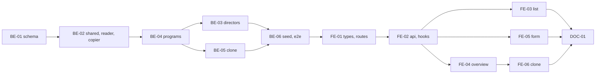

# F-06 Programs and Program Directors — Backend + Frontend Implementation Plan

This plan builds the training program record (identity in `Program`, description in `ProgramVersion` per M-3), the program list (MH-21), overview (MH-22), info form (MH-23) and clone dialog (MH-24); the dated assignment of program directors with history; and the derived R3 scope "programs I direct" that every later program-scoped permission reads. Every new program starts with one Draft version. Clone copies the program description into a new program; a shared version-content copier is created here so the curriculum (F-07) and outcomes (F-11) can add their tables to the same copy.

It deliberately excludes the curriculum itself (F-07), program objectives (F06-05, deferred), release, version numbering and the Pending/Active/Historical life cycle (F-15), change requests for released programs (F-13), and the student's view of their own program (F-20).

> **Companion documents**
> - Requirement: `docs/requirement/REQUIREMENTS.md:456-459` (FR-23..FR-26), `:814` (BR-03), `:1176-1182` (DEC-12), `:1271` (EC-50)
> - Stories: `docs/planning/user-stories.md:263-316` (US-018..US-022); epic EP-06
> - Tasks: `docs/planning/task-breakdown.md:173-188` (CV-054..CV-065)
> - Design: `docs/design/data-dictionary.md:93` (`Role.scopeSource`), `:166-173` (`ProgramDirectorAssignment`), `:244-283` (`Program`, `ProgramVersion`), `:810-813` (§9 `program.*`, `director.assign`); `docs/design/erd.md:195-201` (M-3); `docs/design/screen-inventory.md:87-90`, `:188-191` (MH-21..MH-24)
> - Answers: `docs/planning/feature-questions.md:130-139` (§F-06, all A)
> - Builds on: F-02 (`AccessContext`, `ScopeSourceReader`, `PERMISSIONS`, `UserRefDto`, pagination, `PERMISSION_TABLE`), F-03 (`src/shared/time/validity.ts`, `today.ts`, `OrgUnit`, `UserSelect`, member end/revoke pattern), F-04 (`edit-path.ts`, `decimal.ts`, `HOME_FACULTY_CODE`), F-05 (`assertSchoolWideDirect`)
> - Tests: `docs/planning/test-plan.md:165` (KB-011), `:253` (KB-084, program half), `:301` (NT-B2-08)

**Status**: Mã xong 2026-10-19 (BE-01..BE-06, FE-01..FE-06, DOC-01); còn nợ đi thử bằng trình duyệt (§7) và áp migration `20261019082727_programs` lên cơ sở dữ liệu phát triển — báo cáo dựng: `docs/implement-report/f-06-programs-directors-implement-report.md`

---

## 0. Plan at a glance

Everything below in one table. Read this; the rest is detail for whoever builds it.

| What | Why | How and where |
|---|---|---|
| **Program list** with code, name, degree level, current version, status, directors; search and filter by degree level | US-018 AC1; FR-23; MH-21 | `GET /programs`; `ProgramListPage` (BE-04, FE-03) |
| **Program overview** — description, directors with history, entry points to the curriculum and later sections | US-018 AC2; MH-22 | `GET /programs/:id`; `ProgramOverviewPage` (BE-04, FE-04) |
| **R1 adds a program; it comes with a Draft version** | US-019 AC1; M-3; F06-02 | `POST /programs` writes `Program` + `ProgramVersion(DRAFT)` in one transaction (BE-01, BE-04) |
| **Compulsory + elective credits must equal the total**; the difference is shown | US-019 AC2; BR-03; KB-011 | Server check with the gap in the message; the form shows the gap live (BE-04, FE-05) |
| **Engineer and Bachelor programs side by side** with their own credit totals and semester counts | US-019 AC3; FR-24 | `degreeLevel` on `Program`; counts on the version (BE-01) |
| **R3 edits only the programs they direct**; before the first release edits are direct, afterwards through a change request | US-019 AC4; US-021; §9 `program.editInfo` R3 P | `ScopeSourceReader` fills `PROGRAM_DIRECTOR`; F-04's `resolveEditPath` with "released = any non-Draft version" (BE-02, BE-04) |
| **Programs are never deleted**, only set to "Ngừng sử dụng" and back | US-019 AC5; EC-50 | Deactivate/reactivate routes, R1 only; no delete route (BE-04) |
| **R1 assigns one or more directors per program, with dates**; ended assignments stay visible as history | US-020; FR-08, FR-26; F06-06 | `ProgramDirectorAssignment` with the F-03 period rules (end, revoke, no overlap per person) (BE-01, BE-03, FE-04) |
| **R1 clones a program for a new intake**; the new program records its source | US-022; FR-25; F06-03, F06-04 | `POST /programs/:id/clone`; shared `VersionContentCopier` that F-07 and F-11 extend (BE-02, BE-05, FE-06) |

### Key behaviours worth knowing

| Behaviour | Why it is this way |
|---|---|
| The program list refuses students outright, even though a student holds `program.view` for their own program | US-018 AC3; students see their program through the portal (F-20) |
| Name, major, semester count and the three credit numbers live on the **version**, not the program; editing them edits the Draft | M-3: a released version must keep its own description |
| Once any version of a program has left Draft, info edits for everyone go through a change request | FR-55, same rule as courses (F04-05); until F-15 builds release, no version ever leaves Draft, so edits stay direct |
| R3's scope follows active director rows in active programs, recomputed every request | M-7; an expired assignment stops edits at once (US-021 AC2) |
| A program has at most one Draft version and at most one Active version; enforced by partial unique indexes | `ProgramVersion` constraints (BR-22); F-13 and F-15 rely on them |
| Clone copies only the program description in this feature; the curriculum appears in the clone once F-07 adds its tables to the copier | Tables that do not exist yet cannot be copied; US-022 AC1 is complete after F-07 |
| A deactivated program drops out of R3's scope and of the default list filter, but stays readable | Mirrors subject groups (F-03) |

### Not included

| Excluded | Why |
|---|---|
| Curriculum rows, elective groups, knowledge blocks | F-07 (and F-07 adds them to the clone) |
| Program objectives | F06-05 A: deferred (`deferred-scope.md`) |
| Release, version number, effective semester, Pending/Active/Historical | F-15 |
| Change requests for released programs (`editPath = VIA_REQUEST` shows a disabled button) | F-13 |
| PLO copy on clone (US-022 AC4, US-048) | F-11 |
| Student's own program page | F-20 |
| Audit rows | F01-07 |

### Open questions

All F-06 questions answered (§F-06, all A). Small choices left:

| Question | Resolved when | Default if unanswered |
|---|---|---|
| Upper bound on semester count | Before B2 acceptance | `PROGRAM_LIMITS.SEMESTERS_MAX = 12` (engineer programs run 10) |
| Should a director need an active R-role account type (e.g. lecturer flag) | First wrong pick | Any active non-student account; F-17 adds the student filter to the picker |

---

## 1. Scope

| In scope | Why |
|---|---|
| `Program`, `ProgramVersion` (Draft fields only used here), `ProgramDirectorAssignment`, enums, partial unique indexes | CV-056, CV-059 |
| List, overview, create, edit Draft info, deactivate, reactivate | CV-054, CV-055, CV-057, CV-058 |
| Director assignments: assign, end, revoke, history | CV-060, CV-061 |
| R3 scope by assigned program; permission-table rows for R3 in and out of scope | CV-062, CV-063 |
| Clone with `clonedFrom`; shared copier | CV-064, CV-065 |
| Seed: program 1024034 with one Draft version (F00-24) | B2 acceptance data |

| Out of scope | Deferred until |
|---|---|
| Copying curriculum rows, elective groups, requisites in clone | F-07 extends `VersionContentCopier` |
| Copying PLO and matrices | F-11 |
| Version release fields (`decisionNumber`, `effectiveSemester`, …) | F-15 adds the columns |

| AC | Covered by |
|---|---|
| US-018 AC1 — list with code, name, level, current version, status; search, filter | BE-04 (`list`), FE-03 |
| US-018 AC2 — overview with info, directors, way to the curriculum | BE-04 (`detail`), FE-04 |
| US-018 AC3 — R6 refused on the list | BE-04 (`assertListAll`), BE-06 |
| US-019 AC1 — R1 creates program + Draft version | BE-01, BE-04 (`create`), FE-05 |
| US-019 AC2 — credit mismatch blocked, gap shown | BE-04 (`assertCreditsAddUp`), BE-06 (KB-011), FE-05 |
| US-019 AC3 — Engineer and Bachelor coexist | BE-01, BE-06 |
| US-019 AC4 — R3 refused on an unassigned program | BE-02 (reader), BE-04, BE-06 |
| US-019 AC5 — only deactivate, no delete | BE-04 (`deactivate`), BE-06 |
| US-020 AC1 — one person directs two programs | BE-03, BE-06 |
| US-020 AC2 — ended assignment no longer counts; history visible | BE-02 (`activeDirectorWhere`), BE-03 (`list` with state), FE-04 |
| US-020 AC3 — two directors at once | BE-03 (overlap only per person), BE-06 |
| US-021 AC1 — R3 edits A, views B | BE-02, BE-04 (`editPath`), BE-06 |
| US-021 AC2 — expired assignment refused | BE-02, BE-06 |
| US-021 AC3 — R3 and R5 scopes independent | F-02 `AccessContext` union; BE-06 |
| US-022 AC1 — clone has a Draft with info (curriculum after F-07) | BE-05; F-07 constraint (§8) |
| US-022 AC2 — editing the clone leaves the source unchanged | BE-05 (copied rows, no shared ids), BE-06 |
| US-022 AC3 — clone shows its source | BE-01 (`clonedFromId`), BE-04 (`clonedFrom`), FE-04 |
| US-022 AC4 — no PLO copied in wave 1 | BE-05 (copier has no PLO step until F-11) |

---

## 2. Contract verification

F-06 builds on F-01..F-05 code that is **specified, not built**. Every "existing" claim cites the plan that defines it; Rule 13 re-reads the built file before the step that uses it.

| Existing piece used | Defined at | Used by |
|---|---|---|
| `ScopeSourceReader.activeTargets` with `PROGRAM_DIRECTOR` returning `{}` | F-02 BE-04 (`scope-source.reader.ts`) | BE-02 replaces the case |
| `ScopeTarget.programIds`, `AccessContext.modeFor/assertCan/scopeFor` | F-02 BE-04 | BE-04 |
| `PERMISSIONS.PROGRAM_VIEW`, `PROGRAM_EDIT_INFO`, `PROGRAM_CLONE`, `DIRECTOR_ASSIGN`; seed cells per §9 (`program.view` R1..R5 X, R6 P; `program.editInfo` R1 X, R3 P; `program.clone` R1 X; `director.assign` R1 X) | F-02 BE-03, BE-06; `data-dictionary.md:801,810-812` | BE-03..BE-06 |
| R3 role seeded with `scopeSource = PROGRAM_DIRECTOR` | F-02 BE-06 (`SEED_ROLES`) | BE-02 |
| `validityState`, `VALIDITY_STATES`, `parsePeriod`, `overlapsPeriod`, `coversDay`, `COMMON_ERRORS.VALIDITY_INVALID` | F-03 BE-02 (`src/shared/time/validity.ts`) | BE-02, BE-03 |
| `todayDate()`, `fromIsoDay`, `toIsoDay`, `ISO_DAY_LENGTH` | F-03 BE-02 (`src/shared/time/today.ts`) | BE-03 |
| End/revoke discipline: end only shortens `validTo`, revoke marks a mistaken row | F-03 BE-04 (`subject-group-members.service.ts` `end`, `revoke`) | BE-03 |
| `OrgUnit`, `OrgUnitType.FACULTY`, `OrgUnitRefDto`, `HOME_FACULTY_CODE` | F-02 BE-02, F-03 BE-01, F-04 BE-02 | BE-01, BE-04 |
| `resolveEditPath`, `editPathFor`, `assertDirectEdit`, `EditState`, `assertSchoolWideDirect` | F-04 BE-02, F-05 BE-04 | BE-04 |
| `CREDITS_PATTERN`, `CREDITS_MESSAGE`, `toWireDecimal` | F-04 BE-02 | BE-04 |
| `UserRefDto`, `mapUniqueViolation`, `PageQueryDto`, `toSkipTake`, `toPage` | F-02 BE-01, BE-07 | BE-03, BE-04 |
| `UserSelect` (`src/shared/users/UserSelect.tsx`) | F-03 FE (D14) | FE-04 |
| `PERMISSION_TABLE`, `PLACEHOLDER_ID`, `NO_ROLE`, `createAccount`, `loginAgent` | F-02 BE-10 | BE-06 |

### 2a. Endpoints

All under `/api`.

| Endpoint | Permission (guard) | Request | Response | Notes |
|---|---|---|---|---|
| `GET /programs` | `program.view` | `ProgramQueryDto` | `ProgramPageDto` | Service requires an unscoped `program.view` cell → students refused (US-018 AC3) |
| `POST /programs` | `program.editInfo` | `CreateProgramDto` | `ProgramDetailDto` (201) | `assertSchoolWideDirect` → R1 only |
| `GET /programs/:programId` | `program.view` | — | `ProgramDetailDto` | Scoped `assertCan` on the program target |
| `PATCH /programs/:programId` | `program.editInfo` | `UpdateProgramDto` | `ProgramDetailDto` | Writes the Draft version; `assertDirectEdit` |
| `POST /programs/:programId/deactivate` | `program.editInfo` | — | `ProgramDetailDto` | R1 only |
| `POST /programs/:programId/reactivate` | `program.editInfo` | — | `ProgramDetailDto` | R1 only |
| `POST /programs/:programId/clone` | `program.clone` | `CloneProgramDto` | `ProgramDetailDto` (201) | New program, new Draft, `clonedFromId` |
| `GET /programs/:programId/directors` | `program.view` | — | `ProgramDirectorDto[]` | Every row, newest `validFrom` first, with state |
| `POST /programs/:programId/directors` | `director.assign` | `AssignDirectorDto` | `ProgramDirectorDto` (201) | No overlap for the same person on the same program |
| `POST /programs/:programId/directors/:assignmentId/end` | `director.assign` | `EndDirectorDto` | `ProgramDirectorDto` | Only shortens |
| `POST /programs/:programId/directors/:assignmentId/revoke` | `director.assign` | — | `ProgramDirectorDto` | Entered by mistake |

### 2b. DTOs

**`ProgramSummaryDto`** (list row)

| Field | Wire type | Nullable | Note |
|---|---|---|---|
| `id` | `string` | no | |
| `programCode` | `string` | no | |
| `degreeLevel` | `'ENGINEER' \| 'BACHELOR'` | no | |
| `status` | `'ACTIVE' \| 'INACTIVE'` | no | |
| `faculty` | `OrgUnitRefDto` | no | |
| `programName` | `string` | no | From the current version |
| `currentVersion` | `ProgramVersionRefDto` | no | Active version, else the newest version (Draft before the first release) |
| `directors` | `UserRefDto[]` | no | Active rows today; may be empty |

**`ProgramVersionRefDto`**: `id`, `versionNumber: string | null`, `status: 'DRAFT' | 'PENDING' | 'ACTIVE' | 'HISTORICAL'`. The client shows `versionNumber ?? 'Nháp'`.

**`ProgramVersionInfoDto`**: `id`, `versionNumber`, `status`, `programName`, `majorCode`, `majorName`, `semesterCount: number`, `totalCredits: string`, `compulsoryCredits: string`, `electiveCredits: string`, `updatedAt`.

**`ProgramDetailDto`**: summary fields + `currentVersionInfo: ProgramVersionInfoDto`, `draftVersion: ProgramVersionInfoDto | null`, `versions: ProgramVersionRefDto[]` (newest first), `clonedFrom: { programId, programCode, version: ProgramVersionRefDto } | null`, `editPath: 'DIRECT' | 'VIA_REQUEST' | null` (for `program.editInfo`), `canManage: boolean` (R1: deactivate, reactivate, assign directors), `canClone: boolean`, `createdAt`, `updatedAt`.

**`CreateProgramDto`**: `programCode` (trim; 1..`PROGRAM_LIMITS.CODE_MAX` = 20; immutable), `facultyId?` (default the home faculty), `degreeLevel`, `programName` (≤ 200), `majorCode` (≤ 20), `majorName` (≤ 200), `semesterCount` (1..12), `totalCredits`, `compulsoryCredits`, `electiveCredits` (`CREDITS_PATTERN`).

**`UpdateProgramDto`** = `PartialType(OmitType(CreateProgramDto, ['programCode', 'facultyId']))`.

**`CloneProgramDto`**: `programCode`, `programName`, `sourceVersionId?` (default the source's current version).

**`ProgramDirectorDto`**: `id`, `director: UserRefDto`, `validFrom: string` (ISO day), `validTo: string | null`, `state: ValidityState`, `assignedBy: UserRefDto | null`, `revokedAt: string | null`, `revokedBy: UserRefDto | null`.

**`AssignDirectorDto`**: `directorId`, `validFrom` (ISO day), `validTo?`. **`EndDirectorDto`**: `validTo`.

### 2c. Mismatch log

| Deliverable | What the doc said | What this plan does | Found at |
|---|---|---|---|
| BE-01 | `ProgramDirectorAssignment.startDate`, `endDate` | `validFrom`, `validTo` + `revokedAt`, `revokedById`, `assignedById`, like every other dated table (F-03 D7), so the shared helpers apply | `data-dictionary.md:166-173` |
| BE-01 | `ProgramVersion.totalCredits` etc. "Số thực" | `Decimal(5,2)` as strings (F00 answer) | `data-dictionary.md:270-272` |
| BE-01 | `ProgramVersion` release columns | Only the columns F-06 writes; F-15 adds `decisionNumber`, `signedDate`, `effectiveSemester`, `publishedBy`, `publishedAt`, `previousVersion`, `correctionOf`, `correctionReason`, `sourceRequest`, `creditMismatchReason` | `data-dictionary.md:273-282` |
| BE-04 | MH-21 "R3 P" | R3 lists all programs (`program.view` R3 X); "P" on MH-21 refers to the edit actions | `screen-inventory.md:87` vs `data-dictionary.md:810` |

The data dictionary's `ProgramDirectorAssignment` columns are updated with this plan.

---

## 3. Decisions

| # | Decision | Why | Rejected alternative |
|---|---|---|---|
| D1 | One feature `src/features/programs/` with two services: `ProgramsService` (program + version info + clone) and `ProgramDirectorsService` | Directors are part of the program page; two services keep each under 250 lines | A separate `program-directors` feature — it needs the program lookup anyway |
| D2 | Program target for permissions = `{ programIds: [program.id], orgUnitIds: [facultyId] }` | R3 scope is program ids; a unit-scoped manual assignment on the faculty also covers it | Program ids only — breaks `UNIT` scoped assignments |
| D3 | Edit state: `released` = the program has a version whose status ≠ DRAFT; `draftOpenToRequestHolders` = true | Same rule as F-04 for catalog data; "Đ = direct until the first version" | Lock edits whenever any change request is open — that is F-13's call |
| D4 | Info edits write the Draft version; with no Draft (after release) the edit path is `VIA_REQUEST` | M-3; one Draft per program | Writing the Active version — breaks immutability (BR-23) |
| D5 | Director rows follow F-03's period discipline: no extension in place, end shortens, revoke for mistakes, no overlap for the same (program, director) | US-020 AC2 history; one helper set | Free date edits |
| D6 | `activeDirectorWhere(today)` in `src/shared/programs/active-director.ts`, used by the scope reader, the list, and later F-14's level-2 approver lookup | One definition of "director today" across permission and approval | Each caller writes its own `where` |
| D7 | Clone writes a new `Program` + Draft `ProgramVersion` with the source version's description, then calls `VersionContentCopier.copy(tx, sourceVersionId, newVersionId)` | F-07 and F-11 add their tables to the copier; F-13/F-15 reuse it for Draft copies | Clone code in the programs service that F-07 edits — features must not import each other |
| D8 | Clone source defaults to the current version (Active, else newest); `sourceVersionId` picks another | US-022 says "một chương trình hiện có"; an old version may be the base | Always the Draft |
| D9 | Partial unique indexes: one DRAFT and one ACTIVE version per program (raw SQL in the migration) | Data-dictionary constraints, race-safe | Service checks only |
| D10 | Program status changes and director assignments are R1-only via `assertSchoolWideDirect` / `director.assign`, direct even after release | Program status and directors are not version content | Routing them through change requests |

---

## 5. Deliverables

### BE-01 — Prisma schema: programs, versions, director assignments

What/Why: CV-056, CV-059; D9.

**Files**

| Action | Path |
|---|---|
| MODIFY | `prisma/schema.prisma` |
| NEW | `prisma/migrations/<timestamp>_programs/migration.sql` (generated, then edited) |

**Shape**

```prisma
enum DegreeLevel {
  ENGINEER
  BACHELOR
}

enum ProgramStatus {
  ACTIVE
  INACTIVE
}

enum ProgramVersionStatus {
  DRAFT
  PENDING
  ACTIVE
  HISTORICAL
}

model Program {
  id          String           @id @default(cuid(2))
  programCode String           @unique
  facultyId   String
  faculty     OrgUnit          @relation("ProgramFaculty", fields: [facultyId], references: [id], onDelete: Restrict)
  degreeLevel DegreeLevel
  status      ProgramStatus    @default(ACTIVE)
  clonedFromId String?
  clonedFrom  ProgramVersion?  @relation("ProgramClonedFrom", fields: [clonedFromId], references: [id], onDelete: Restrict)
  versions    ProgramVersion[] @relation("ProgramVersions")
  directors   ProgramDirectorAssignment[]
  createdAt   DateTime         @default(now())
  updatedAt   DateTime         @updatedAt

  @@index([facultyId])
}

model ProgramVersion {
  id                String               @id @default(cuid(2))
  programId         String
  program           Program              @relation("ProgramVersions", fields: [programId], references: [id], onDelete: Restrict)
  versionNumber     String?
  status            ProgramVersionStatus @default(DRAFT)
  programName       String
  majorCode         String
  majorName         String
  semesterCount     Int
  totalCredits      Decimal              @db.Decimal(5, 2)
  compulsoryCredits Decimal              @db.Decimal(5, 2)
  electiveCredits   Decimal              @db.Decimal(5, 2)
  clones            Program[]            @relation("ProgramClonedFrom")
  createdAt         DateTime             @default(now())
  updatedAt         DateTime             @updatedAt

  @@unique([programId, versionNumber])
  @@index([programId, status])
}

model ProgramDirectorAssignment {
  id           String    @id @default(cuid(2))
  programId    String
  program      Program   @relation(fields: [programId], references: [id], onDelete: Restrict)
  directorId   String
  director     User      @relation("ProgramDirector", fields: [directorId], references: [id], onDelete: Restrict)
  validFrom    DateTime  @db.Date
  validTo      DateTime? @db.Date
  assignedById String?
  assignedBy   User?     @relation("ProgramDirectorAssignedBy", fields: [assignedById], references: [id], onDelete: Restrict)
  revokedAt    DateTime?
  revokedById  String?
  revokedBy    User?     @relation("ProgramDirectorRevokedBy", fields: [revokedById], references: [id], onDelete: Restrict)
  createdAt    DateTime  @default(now())

  @@index([directorId])
  @@index([programId])
}
```

`OrgUnit` gains `programs Program[] @relation("ProgramFaculty")`; `User` gains the three back-relations.

```
pnpm prisma migrate dev --create-only --name programs
# append the two indexes below, then:
pnpm prisma migrate dev
pnpm prisma generate
```

```sql
-- appended to migration.sql
CREATE UNIQUE INDEX "ProgramVersion_one_draft" ON "ProgramVersion" ("programId") WHERE "status" = 'DRAFT';
CREATE UNIQUE INDEX "ProgramVersion_one_active" ON "ProgramVersion" ("programId") WHERE "status" = 'ACTIVE';
```

**Rationale**: Columns from `data-dictionary.md:244-283` minus the release columns (§2c). Dated-row columns mirror F-03 BE-01 `SubjectGroupMember` (`validFrom @db.Date`, `revokedAt`, `revokedById`). Relation naming mirrors F-04 BE-01.

**Gotchas**
- `@@unique([programId, versionNumber])` lets many NULLs through (PostgreSQL treats NULLs as distinct) — that is fine; the partial index caps Drafts at one.
- Prisma does not model partial indexes; record them in `database_and_models.md`, and a later `migrate dev` will not drop them.
- `Program.clonedFrom` points at a version of another program; `onDelete: Restrict` is moot (versions are never deleted) but stops accidents.

**Verify**: Migration applies; a second `INSERT` of a DRAFT for the same program fails on `ProgramVersion_one_draft`.

**Depends on**: F-03 BE-01

---

### BE-02 — Shared: active director, scope reader, version copier, program target

What/Why: CV-062; D2, D6, D7; F-02 constraint.

**Files**

| Action | Path |
|---|---|
| NEW | `src/shared/programs/active-director.ts` |
| NEW | `src/shared/programs/program-target.ts` |
| NEW | `src/shared/programs/version-content.copier.ts` |
| NEW | `src/shared/programs/programs-shared.module.ts` |
| MODIFY | `src/shared/authz/scope-source.reader.ts` (`PROGRAM_DIRECTOR` case) |
| MODIFY | `src/shared/authz/scope-source.reader.spec.ts` |

**Shape**

```ts
// src/shared/programs/active-director.ts
// One definition of "director today": scope, program summaries and level-2 approver lookups must agree.
export function activeDirectorWhere(today: Date) {
  return {
    revokedAt: null,
    ...coversDay(today),
    program: { status: ProgramStatus.ACTIVE },
  } satisfies Prisma.ProgramDirectorAssignmentWhereInput;
}
```

```ts
// src/shared/authz/scope-source.reader.ts — case filled
case ScopeSource.PROGRAM_DIRECTOR: {
  const rows = await this.prisma.programDirectorAssignment.findMany({
    where: { directorId: userId, ...activeDirectorWhere(today) },
    select: { programId: true },
    distinct: ['programId'],
  });
  return { programIds: rows.map((row) => row.programId) };
}
```

```ts
// src/shared/programs/program-target.ts
export function programTarget(program: { id: string; facultyId: string }): ScopeTarget {
  return { programIds: [program.id], orgUnitIds: [program.facultyId] };
}

export async function programEditState(prisma: Prisma.TransactionClient | PrismaService, programId: string): Promise<EditState> {
  const released = await prisma.programVersion.findFirst({
    where: { programId, status: { not: ProgramVersionStatus.DRAFT } },
    select: { id: true },
  });
  return { released: released !== null, draftOpenToRequestHolders: true };
}
```

```ts
// src/shared/programs/version-content.copier.ts
// Copies everything that hangs off a program version into another version, inside the caller's transaction.
// Each feature that adds version-owned tables adds its step here: clone (FR-25) and the Draft of a change request depend on it.
@Injectable()
export class VersionContentCopier {
  async copy(tx: Prisma.TransactionClient, fromVersionId: string, toVersionId: string): Promise<void> {
    void tx;
    void fromVersionId;
    void toVersionId;
  }
}
```

```ts
// src/shared/programs/programs-shared.module.ts
@Module({ providers: [VersionContentCopier], exports: [VersionContentCopier] })
export class ProgramsSharedModule {}
```

`scope-source.reader.spec.ts` additions: `PROGRAM_DIRECTOR` passes `directorId`, `revokedAt: null`, the day filter and `program.status: ACTIVE`; returns `programIds`; `OWN_ENROLLMENT` still `{}`.

**Rationale**: `active-director.ts` mirrors F-03's `src/shared/subject-groups/active-membership.ts`; the reader case mirrors F-03's `activeGroupIds`. The empty copier mirrors F-04's placeholder `CourseUsageReader` — a shared seam later features fill.

**Gotchas**
- The copier's `void` lines keep oxlint quiet until F-07 fills it; remove them when the first step lands.
- `programEditState` takes either client so clone and update can call it inside a transaction.

**Verify**: `pnpm test` (reader spec).

**Depends on**: BE-01

---

### BE-03 — Director assignments

What/Why: CV-060, CV-061; US-020; D5.

**Files**

| Action | Path |
|---|---|
| NEW | `src/features/programs/program-directors.service.ts` |
| NEW | `src/features/programs/program-directors.service.spec.ts` |
| NEW | `src/features/programs/program-director.dto.ts` |
| NEW | `src/features/programs/assign-director.dto.ts` (`AssignDirectorDto`, `EndDirectorDto`) |

**Shape**

```ts
// src/features/programs/program-director.dto.ts
export const DIRECTOR_SELECT = {
  id: true, validFrom: true, validTo: true, revokedAt: true,
  director: { select: USER_REF_SELECT },
  assignedBy: { select: USER_REF_SELECT },
  revokedBy: { select: USER_REF_SELECT },
} as const satisfies Prisma.ProgramDirectorAssignmentSelect;

export class ProgramDirectorDto {
  @ApiProperty() id: string;
  @ApiProperty({ type: UserRefDto }) director: UserRefDto;
  @ApiProperty({ format: 'date' }) validFrom: string;
  @ApiProperty({ format: 'date', nullable: true, type: String }) validTo: string | null;
  @ApiProperty({ enum: VALIDITY_STATES, enumName: 'ValidityState' }) state: ValidityState;
  @ApiProperty({ type: UserRefDto, nullable: true }) assignedBy: UserRefDto | null;
  @ApiProperty({ nullable: true, type: String }) revokedAt: string | null;
  @ApiProperty({ type: UserRefDto, nullable: true }) revokedBy: UserRefDto | null;
}

export function toProgramDirectorDto(row: Prisma.ProgramDirectorAssignmentGetPayload<{ select: typeof DIRECTOR_SELECT }>, today: Date): ProgramDirectorDto {
  return {
    id: row.id,
    director: row.director,
    validFrom: toIsoDay(row.validFrom),
    validTo: row.validTo && toIsoDay(row.validTo),
    state: validityState(row, today),
    assignedBy: row.assignedBy,
    revokedAt: row.revokedAt?.toISOString() ?? null,
    revokedBy: row.revokedBy,
  };
}
```

```ts
// src/features/programs/program-directors.service.ts
@Injectable()
export class ProgramDirectorsService {
  private readonly logger = new Logger(ProgramDirectorsService.name);

  constructor(private readonly prisma: PrismaService) {}

  async list(programId: string): Promise<ProgramDirectorDto[]> {
    const rows = await this.prisma.programDirectorAssignment.findMany({
      where: { programId }, select: DIRECTOR_SELECT, orderBy: [{ validFrom: 'desc' }, { createdAt: 'desc' }],
    });
    const today = todayDate();
    return rows.map((row) => toProgramDirectorDto(row, today));
  }

  async assign(programId: string, dto: AssignDirectorDto, actorId: string): Promise<ProgramDirectorDto> {
    const program = await this.prisma.program.findUnique({ where: { id: programId }, select: { status: true } });
    if (!program) throw new AppException(PROGRAM_ERRORS.PROGRAM_NOT_FOUND);
    if (program.status !== ProgramStatus.ACTIVE) throw new AppException(PROGRAM_ERRORS.PROGRAM_INACTIVE);
    const director = await this.prisma.user.findUnique({ where: { id: dto.directorId }, select: { status: true } });
    if (!director || director.status !== UserStatus.ACTIVE) {
      throw new AppException(PROGRAM_ERRORS.DIRECTOR_INVALID, [{ field: 'directorId', constraints: [PROGRAM_CONSTRAINT.ACTIVE_USER] }]);
    }
    const period = parsePeriod(dto.validFrom, dto.validTo);
    const overlap = await this.prisma.programDirectorAssignment.findFirst({
      where: { programId, directorId: dto.directorId, revokedAt: null, ...overlapsPeriod(period) },
      select: { id: true },
    });
    if (overlap) throw new AppException(PROGRAM_ERRORS.DIRECTOR_PERIOD_OVERLAP);
    const row = await this.prisma.programDirectorAssignment.create({
      data: { programId, directorId: dto.directorId, ...period, assignedById: actorId },
      select: DIRECTOR_SELECT,
    });
    this.logger.log(`Director ${dto.directorId} assigned to program ${programId} by ${actorId}`);
    return toProgramDirectorDto(row, todayDate());
  }

  async end(programId: string, assignmentId: string, dto: EndDirectorDto, actorId: string): Promise<ProgramDirectorDto> {
    const row = await this.findLiveOrThrow(programId, assignmentId);
    const validTo = fromIsoDay(dto.validTo);
    if (validTo < row.validFrom) throw new AppException(COMMON_ERRORS.VALIDITY_INVALID);
    if (row.validTo && validTo >= row.validTo) throw new AppException(PROGRAM_ERRORS.END_DATE_NOT_EARLIER);
    const updated = await this.prisma.programDirectorAssignment.update({ where: { id: row.id }, data: { validTo }, select: DIRECTOR_SELECT });
    this.logger.log(`Director row ${row.id} ended ${dto.validTo} by ${actorId}`);
    return toProgramDirectorDto(updated, todayDate());
  }

  async revoke(programId: string, assignmentId: string, actorId: string): Promise<ProgramDirectorDto> {
    const row = await this.findLiveOrThrow(programId, assignmentId);
    const updated = await this.prisma.programDirectorAssignment.update({
      where: { id: row.id }, data: { revokedAt: new Date(), revokedById: actorId }, select: DIRECTOR_SELECT,
    });
    this.logger.log(`Director row ${row.id} revoked by ${actorId}`);
    return toProgramDirectorDto(updated, todayDate());
  }

  // findLiveOrThrow: row of this program with revokedAt null, else DIRECTOR_ASSIGNMENT_NOT_FOUND
}
```

Spec cases: assign to an inactive program → `PROGRAM_INACTIVE`; disabled user → `DIRECTOR_INVALID`; overlapping period for the same person → `DIRECTOR_PERIOD_OVERLAP`; a second person over the same dates → created (US-020 AC3); end later than the current end → `END_DATE_NOT_EARLIER`; end before start → `VALIDITY_INVALID`; revoke a revoked row → not found.

**Rationale**: Mirrors F-03 BE-04 `subject-group-members.service.ts` (`add`, `end`, `revoke`) minus the coordinator nesting.

**Gotchas**
- A user who directs an inactive program keeps their history rows; R3 drops on the next request because `activeDirectorWhere` filters on program status.
- No check that the person also has some "lecturer" status — any active account may be a director until F-17 adds the student filter.

**Verify**: `pnpm test`.

**Depends on**: BE-01, BE-02, BE-04 (`PROGRAM_ERRORS`)

---

### BE-04 — Programs feature: list, detail, create, edit, status

What/Why: CV-054, CV-057; US-018, US-019, US-021; D1..D4, D10.

**Files**

| Action | Path |
|---|---|
| NEW | `src/features/programs/programs.module.ts` |
| NEW | `src/features/programs/programs.controller.ts` |
| NEW | `src/features/programs/programs.service.ts` |
| NEW | `src/features/programs/programs.service.spec.ts` |
| NEW | `src/features/programs/programs.errors.ts` |
| NEW | `src/features/programs/program.dto.ts` |
| NEW | `src/features/programs/create-program.dto.ts` |
| NEW | `src/features/programs/update-program.dto.ts` |
| NEW | `src/features/programs/program-query.dto.ts` |
| NEW | `src/features/programs/credits-check.ts` |
| MODIFY | `src/app.module.ts` |

**Shape**

```ts
// src/features/programs/programs.errors.ts
export const PROGRAM_ERRORS = {
  PROGRAM_NOT_FOUND: { status: HttpStatus.NOT_FOUND, code: 'PROGRAM_NOT_FOUND', message: 'Không tìm thấy chương trình đào tạo.' },
  PROGRAM_CODE_TAKEN: { status: HttpStatus.CONFLICT, code: 'PROGRAM_CODE_TAKEN', message: 'Mã chương trình đã tồn tại.' },
  FACULTY_INVALID: { status: HttpStatus.BAD_REQUEST, code: 'PROGRAM_FACULTY_INVALID', message: 'Khoa quản lý phải là một khoa đang hoạt động.' },
  CREDITS_MISMATCH: { status: HttpStatus.BAD_REQUEST, code: 'CREDITS_MISMATCH', message: 'Tín chỉ bắt buộc cộng tín chỉ tự chọn phải bằng tổng tín chỉ' },
  PROGRAM_INACTIVE: { status: HttpStatus.CONFLICT, code: 'PROGRAM_INACTIVE', message: 'Chương trình đã ngừng sử dụng.' },
  STATUS_UNCHANGED: { status: HttpStatus.CONFLICT, code: 'PROGRAM_STATUS_UNCHANGED', message: 'Chương trình đã ở trạng thái này.' },
  SOURCE_VERSION_INVALID: { status: HttpStatus.BAD_REQUEST, code: 'SOURCE_VERSION_INVALID', message: 'Phiên bản nguồn không thuộc chương trình được nhân bản.' },
  DIRECTOR_INVALID: { status: HttpStatus.BAD_REQUEST, code: 'DIRECTOR_INVALID', message: 'Giám đốc CTĐT phải là một tài khoản đang hoạt động.' },
  DIRECTOR_PERIOD_OVERLAP: { status: HttpStatus.CONFLICT, code: 'DIRECTOR_PERIOD_OVERLAP', message: 'Người này đã được phân công cho chương trình trong khoảng thời gian chồng lên.' },
  DIRECTOR_ASSIGNMENT_NOT_FOUND: { status: HttpStatus.NOT_FOUND, code: 'DIRECTOR_ASSIGNMENT_NOT_FOUND', message: 'Không tìm thấy phân công Giám đốc CTĐT.' },
  END_DATE_NOT_EARLIER: { status: HttpStatus.BAD_REQUEST, code: 'END_DATE_NOT_EARLIER', message: 'Ngày kết thúc mới phải sớm hơn ngày kết thúc hiện tại; muốn kéo dài thì thêm phân công mới.' },
} as const satisfies Record<string, ErrorDefinition>;

export const PROGRAM_CONSTRAINT = { ACTIVE_FACULTY: 'activeFaculty', ACTIVE_USER: 'activeUser', CREDITS_SUM: 'creditsSum' } as const;
```

```ts
// src/features/programs/credits-check.ts
export interface CreditTotals { totalCredits: string; compulsoryCredits: string; electiveCredits: string }

// BR-03; the gap goes into the message so the form can show it (KB-011).
export function assertCreditsAddUp(totals: CreditTotals): void {
  const sum = new Prisma.Decimal(totals.compulsoryCredits).plus(totals.electiveCredits);
  const gap = sum.minus(totals.totalCredits);
  if (!gap.isZero()) {
    const base = PROGRAM_ERRORS.CREDITS_MISMATCH;
    throw new AppException(
      { ...base, message: `${base.message} (chênh lệch ${gap.abs().toString()} tín chỉ).` },
      [{ field: 'totalCredits', constraints: [PROGRAM_CONSTRAINT.CREDITS_SUM] }],
    );
  }
}
```

```ts
// src/features/programs/create-program.dto.ts
export const PROGRAM_LIMITS = { CODE_MAX: 20, NAME_MAX: 200, MAJOR_CODE_MAX: 20, SEMESTERS_MIN: 1, SEMESTERS_MAX: 12, QUERY_MAX: 100 } as const;

export class CreateProgramDto {
  @ApiProperty({ maxLength: PROGRAM_LIMITS.CODE_MAX })
  @Transform(trimString) @IsString() @Length(1, PROGRAM_LIMITS.CODE_MAX)
  programCode: string;

  @ApiPropertyOptional() @IsOptional() @IsString() facultyId?: string;
  @ApiProperty({ enum: DegreeLevel, enumName: 'DegreeLevel' }) @IsEnum(DegreeLevel) degreeLevel: DegreeLevel;
  @ApiProperty() @Transform(trimString) @IsString() @Length(1, PROGRAM_LIMITS.NAME_MAX) programName: string;
  @ApiProperty() @Transform(trimString) @IsString() @Length(1, PROGRAM_LIMITS.MAJOR_CODE_MAX) majorCode: string;
  @ApiProperty() @Transform(trimString) @IsString() @Length(1, PROGRAM_LIMITS.NAME_MAX) majorName: string;
  @ApiProperty() @Type(() => Number) @IsInt() @Min(PROGRAM_LIMITS.SEMESTERS_MIN) @Max(PROGRAM_LIMITS.SEMESTERS_MAX) semesterCount: number;
  @ApiProperty({ example: '130' }) @IsString() @Matches(CREDITS_PATTERN, { message: CREDITS_MESSAGE }) totalCredits: string;
  @ApiProperty({ example: '122' }) @IsString() @Matches(CREDITS_PATTERN, { message: CREDITS_MESSAGE }) compulsoryCredits: string;
  @ApiProperty({ example: '8' }) @IsString() @Matches(CREDITS_PATTERN, { message: CREDITS_MESSAGE }) electiveCredits: string;
}

// update-program.dto.ts
export class UpdateProgramDto extends PartialType(OmitType(CreateProgramDto, ['programCode', 'facultyId'] as const)) {}

// program-query.dto.ts
export class ProgramQueryDto extends PageQueryDto {
  @ApiPropertyOptional() @Transform(trimString) @IsOptional() @IsString() @MaxLength(PROGRAM_LIMITS.QUERY_MAX) q?: string;
  @ApiPropertyOptional({ enum: DegreeLevel, enumName: 'DegreeLevel' }) @IsOptional() @IsEnum(DegreeLevel) degreeLevel?: DegreeLevel;
  @ApiPropertyOptional({ enum: ProgramStatus, enumName: 'ProgramStatus' }) @IsOptional() @IsEnum(ProgramStatus) status?: ProgramStatus;
}
```

`trimString` is the F-04 helper (`create-course.dto.ts`); if F-04 inlined it, move it to `src/shared/dtos/transforms.ts` with `emptyToNull` and record the call sites.

```ts
// src/features/programs/program.dto.ts — row shape and mapping
export const VERSION_INFO_SELECT = {
  id: true, versionNumber: true, status: true, programName: true, majorCode: true, majorName: true,
  semesterCount: true, totalCredits: true, compulsoryCredits: true, electiveCredits: true, updatedAt: true,
} as const satisfies Prisma.ProgramVersionSelect;

export const programInclude = (today: Date) => ({
  faculty: { select: ORG_UNIT_REF_SELECT },
  versions: { select: VERSION_INFO_SELECT, orderBy: { createdAt: 'desc' } },
  directors: { where: activeDirectorWhere(today), select: { director: { select: USER_REF_SELECT } } },
  clonedFrom: { select: { id: true, versionNumber: true, status: true, program: { select: { id: true, programCode: true } } } },
}) satisfies Prisma.ProgramInclude;

export type ProgramRow = Prisma.ProgramGetPayload<{ include: ReturnType<typeof programInclude> }>;

// Active version, else the newest one; before the first release that is the Draft.
export function currentVersion(row: ProgramRow) {
  return row.versions.find((version) => version.status === ProgramVersionStatus.ACTIVE) ?? row.versions[0];
}
```

`toProgramSummaryDto(row)` and `toProgramDetailDto(row, extras)` map as §2b; credits through `toWireDecimal`.

```ts
// src/features/programs/programs.service.ts
@Injectable()
export class ProgramsService {
  private readonly logger = new Logger(ProgramsService.name);

  constructor(
    private readonly prisma: PrismaService,
    private readonly copier: VersionContentCopier,
  ) {}

  async list(query: ProgramQueryDto, access: AccessContext): Promise<Page<ProgramSummaryDto>> {
    if (!access.scopeFor(PERMISSIONS.PROGRAM_VIEW).all) {
      throw new AppException(COMMON_ERRORS.PERMISSION_DENIED);
    }
    const where: Prisma.ProgramWhereInput = {
      ...(query.degreeLevel && { degreeLevel: query.degreeLevel }),
      ...(query.status && { status: query.status }),
      ...(query.q && { OR: [
        { programCode: { contains: query.q, mode: 'insensitive' } },
        { versions: { some: { programName: { contains: query.q, mode: 'insensitive' } } } },
      ] }),
    };
    const today = todayDate();
    const [rows, total] = await this.prisma.$transaction([
      this.prisma.program.findMany({ where, include: programInclude(today), orderBy: { programCode: 'asc' }, ...toSkipTake(query) }),
      this.prisma.program.count({ where }),
    ]);
    return toPage(rows.map(toProgramSummaryDto), total, query);
  }

  async detail(programId: string, access: AccessContext): Promise<ProgramDetailDto> {
    const row = await this.findOrThrow(programId);
    access.assertCan(PERMISSIONS.PROGRAM_VIEW, programTarget(row));
    return this.toDetail(row, access);
  }

  async create(dto: CreateProgramDto, access: AccessContext): Promise<ProgramDetailDto> {
    assertSchoolWideDirect(access, PERMISSIONS.PROGRAM_EDIT_INFO);
    assertCreditsAddUp(dto);
    const facultyId = await this.resolveFaculty(dto.facultyId);
    try {
      const program = await this.prisma.program.create({
        data: {
          programCode: dto.programCode, facultyId, degreeLevel: dto.degreeLevel,
          versions: { create: versionData(dto) },
        },
        select: { id: true },
      });
      this.logger.log(`Program ${dto.programCode} created by ${access.userId}`);
      return this.toDetail(await this.findOrThrow(program.id), access);
    } catch (error) {
      throw mapUniqueViolation(error, PROGRAM_ERRORS.PROGRAM_CODE_TAKEN, 'programCode');
    }
  }

  async update(programId: string, dto: UpdateProgramDto, access: AccessContext): Promise<ProgramDetailDto> {
    const row = await this.findOrThrow(programId);
    assertDirectEdit(access, PERMISSIONS.PROGRAM_EDIT_INFO, programTarget(row), await programEditState(this.prisma, row.id));
    const draft = row.versions.find((version) => version.status === ProgramVersionStatus.DRAFT);
    if (!draft) {
      throw new AppException(COMMON_ERRORS.CHANGE_REQUEST_REQUIRED);
    }
    const { degreeLevel, ...versionFields } = dto;
    assertCreditsAddUp({
      totalCredits: versionFields.totalCredits ?? draft.totalCredits.toString(),
      compulsoryCredits: versionFields.compulsoryCredits ?? draft.compulsoryCredits.toString(),
      electiveCredits: versionFields.electiveCredits ?? draft.electiveCredits.toString(),
    });
    await this.prisma.$transaction([
      this.prisma.programVersion.update({ where: { id: draft.id }, data: versionData(versionFields) }),
      ...(degreeLevel ? [this.prisma.program.update({ where: { id: row.id }, data: { degreeLevel } })] : []),
    ]);
    this.logger.log(`Program ${row.programCode} draft info updated by ${access.userId}`);
    return this.toDetail(await this.findOrThrow(row.id), access);
  }

  async setStatus(programId: string, status: ProgramStatus, access: AccessContext): Promise<ProgramDetailDto> {
    assertSchoolWideDirect(access, PERMISSIONS.PROGRAM_EDIT_INFO);
    const row = await this.findOrThrow(programId);
    if (row.status === status) throw new AppException(PROGRAM_ERRORS.STATUS_UNCHANGED);
    await this.prisma.program.update({ where: { id: row.id }, data: { status } });
    this.logger.log(`Program ${row.programCode} set ${status} by ${access.userId}`);
    return this.toDetail(await this.findOrThrow(row.id), access);
  }

  private async toDetail(row: ProgramRow, access: AccessContext): Promise<ProgramDetailDto> {
    const target = programTarget(row);
    return toProgramDetailDto(row, {
      editPath: editPathFor(access, PERMISSIONS.PROGRAM_EDIT_INFO, target, await programEditState(this.prisma, row.id)),
      canManage: access.modeFor(PERMISSIONS.DIRECTOR_ASSIGN, {}) === 'DIRECT',
      canClone: access.modeFor(PERMISSIONS.PROGRAM_CLONE, {}) === 'DIRECT',
    });
  }

  // clone: BE-05. findOrThrow(id) with programInclude(todayDate()); resolveFaculty(id?) → active FACULTY unit, default HOME_FACULTY_CODE
}

// Prisma decimals accept strings, so DTO fields pass through unchanged.
function versionData(fields: Partial<Omit<CreateProgramDto, 'programCode' | 'facultyId' | 'degreeLevel'>>) {
  const { programName, majorCode, majorName, semesterCount, totalCredits, compulsoryCredits, electiveCredits } = fields;
  return { programName, majorCode, majorName, semesterCount, totalCredits, compulsoryCredits, electiveCredits };
}
```

In `create`, `versionData(dto)` gets every field (all required on create), so the nested `create` is complete; TypeScript will flag it as possibly undefined — build the create payload from `dto` directly there and use `versionData` for updates only.

```ts
// src/features/programs/programs.controller.ts
@ApiTags('programs')
@ApiCookieAuth()
@Controller('programs')
export class ProgramsController {
  constructor(
    private readonly programs: ProgramsService,
    private readonly directors: ProgramDirectorsService,
  ) {}

  @Get() @RequirePermission(PERMISSIONS.PROGRAM_VIEW) @ApiOkResponse({ type: ProgramPageDto })
  list(@Query() query: ProgramQueryDto, @CurrentAccess() access: AccessContext) { return this.programs.list(query, access); }

  @Post() @RequirePermission(PERMISSIONS.PROGRAM_EDIT_INFO) @ApiCreatedResponse({ type: ProgramDetailDto })
  create(@Body() dto: CreateProgramDto, @CurrentAccess() access: AccessContext) { return this.programs.create(dto, access); }

  @Get(':programId') @RequirePermission(PERMISSIONS.PROGRAM_VIEW) @ApiOkResponse({ type: ProgramDetailDto })
  detail(@Param('programId') id: string, @CurrentAccess() access: AccessContext) { return this.programs.detail(id, access); }

  @Patch(':programId') @RequirePermission(PERMISSIONS.PROGRAM_EDIT_INFO) @ApiOkResponse({ type: ProgramDetailDto })
  update(@Param('programId') id: string, @Body() dto: UpdateProgramDto, @CurrentAccess() access: AccessContext) { return this.programs.update(id, dto, access); }

  @Post(':programId/deactivate') @HttpCode(HttpStatus.OK) @RequirePermission(PERMISSIONS.PROGRAM_EDIT_INFO)
  deactivate(@Param('programId') id: string, @CurrentAccess() access: AccessContext) { return this.programs.setStatus(id, ProgramStatus.INACTIVE, access); }

  @Post(':programId/reactivate') @HttpCode(HttpStatus.OK) @RequirePermission(PERMISSIONS.PROGRAM_EDIT_INFO)
  reactivate(@Param('programId') id: string, @CurrentAccess() access: AccessContext) { return this.programs.setStatus(id, ProgramStatus.ACTIVE, access); }

  @Post(':programId/clone') @RequirePermission(PERMISSIONS.PROGRAM_CLONE) @ApiCreatedResponse({ type: ProgramDetailDto })
  clone(@Param('programId') id: string, @Body() dto: CloneProgramDto, @CurrentAccess() access: AccessContext) { return this.programs.clone(id, dto, access); }

  @Get(':programId/directors') @RequirePermission(PERMISSIONS.PROGRAM_VIEW) @ApiOkResponse({ type: [ProgramDirectorDto] })
  listDirectors(@Param('programId') id: string, @CurrentAccess() access: AccessContext) { return this.programs.assertViewable(id, access).then(() => this.directors.list(id)); }

  @Post(':programId/directors') @RequirePermission(PERMISSIONS.DIRECTOR_ASSIGN) @ApiCreatedResponse({ type: ProgramDirectorDto })
  assign(@Param('programId') id: string, @Body() dto: AssignDirectorDto, @CurrentUser() user: SessionUser) { return this.directors.assign(id, dto, user.id); }

  @Post(':programId/directors/:assignmentId/end') @HttpCode(HttpStatus.OK) @RequirePermission(PERMISSIONS.DIRECTOR_ASSIGN)
  end(@Param('programId') id: string, @Param('assignmentId') assignmentId: string, @Body() dto: EndDirectorDto, @CurrentUser() user: SessionUser) {
    return this.directors.end(id, assignmentId, dto, user.id);
  }

  @Post(':programId/directors/:assignmentId/revoke') @HttpCode(HttpStatus.OK) @RequirePermission(PERMISSIONS.DIRECTOR_ASSIGN)
  revoke(@Param('programId') id: string, @Param('assignmentId') assignmentId: string, @CurrentUser() user: SessionUser) {
    return this.directors.revoke(id, assignmentId, user.id);
  }
}
```

The `.then` chain in `listDirectors` is logic in a controller; move it into `ProgramDirectorsService.list(programId, access)` with the view check inside (the service gets a `findProgramTarget` helper) — the controller only delegates.

Spec cases: list as R6 (scope not `all`) → `PERMISSION_DENIED`; list filters by level and `q` on code or version name; create with 150 = 120 + 25 → `CREDITS_MISMATCH`, message contains `chênh lệch 5`; create as R3 → `PERMISSION_DENIED`; update as R3 directing the program, never released → Draft updated; R3 not directing → `OUT_OF_SCOPE`; update when a non-Draft version exists → `CHANGE_REQUEST_REQUIRED`; update with only `electiveCredits` checks the sum against stored values; `setStatus` same status → `STATUS_UNCHANGED`; `canManage` true for R1, false for R3.

**Rationale**: Layout mirrors F-04 BE-03 (`courses.*`); status routes mirror F-04's transition routes; detail flags (`editPath`, `canManage`) mirror `CourseDetailDto.editPath`/`canChangeStatus`.

**Gotchas**
- `access.modeFor(code, {})` with an empty target is true only for `ALL` cells — the same assumption as F-05's `assertSchoolWideDirect`.
- Version list in `programInclude` loads every version of the program; programs have a handful. F-15's history page pages them separately if needed.
- `semesterCount` lowered below a curriculum row's semester must be refused — F-07 adds that check to `update` (constraint, §8).

**Verify**: `pnpm test`; `pnpm exec tsc --noEmit -p tsconfig.json`.

**Depends on**: BE-01, BE-02

---

### BE-05 — Clone

What/Why: CV-064; US-022; D7, D8.

**Files**

| Action | Path |
|---|---|
| NEW | `src/features/programs/clone-program.dto.ts` |
| MODIFY | `src/features/programs/programs.service.ts` (`clone`) |
| MODIFY | `src/features/programs/programs.module.ts` (import `ProgramsSharedModule`) |
| MODIFY | `src/features/programs/programs.service.spec.ts` |

**Shape**

```ts
// src/features/programs/clone-program.dto.ts
export class CloneProgramDto extends PickType(CreateProgramDto, ['programCode', 'programName'] as const) {
  @ApiPropertyOptional() @IsOptional() @IsString() sourceVersionId?: string;
}
```

```ts
// src/features/programs/programs.service.ts — clone
async clone(programId: string, dto: CloneProgramDto, access: AccessContext): Promise<ProgramDetailDto> {
  const source = await this.findOrThrow(programId);
  const version = dto.sourceVersionId
    ? source.versions.find((candidate) => candidate.id === dto.sourceVersionId)
    : currentVersion(source);
  if (!version) throw new AppException(PROGRAM_ERRORS.SOURCE_VERSION_INVALID);
  try {
    const created = await this.prisma.$transaction(async (tx) => {
      const program = await tx.program.create({
        data: {
          programCode: dto.programCode,
          facultyId: source.facultyId,
          degreeLevel: source.degreeLevel,
          clonedFromId: version.id,
          versions: { create: {
            programName: dto.programName,
            majorCode: version.majorCode,
            majorName: version.majorName,
            semesterCount: version.semesterCount,
            totalCredits: version.totalCredits,
            compulsoryCredits: version.compulsoryCredits,
            electiveCredits: version.electiveCredits,
          } },
        },
        select: { id: true, versions: { select: { id: true } } },
      });
      await this.copier.copy(tx, version.id, program.versions[0].id);
      return program;
    });
    this.logger.log(`Program ${source.programCode} cloned to ${dto.programCode} by ${access.userId}`);
    return this.toDetail(await this.findOrThrow(created.id), access);
  } catch (error) {
    throw mapUniqueViolation(error, PROGRAM_ERRORS.PROGRAM_CODE_TAKEN, 'programCode');
  }
}
```

Spec cases: default source = Active version when one exists, else newest; `sourceVersionId` of another program → `SOURCE_VERSION_INVALID`; the copier is called with (source version, new Draft) inside the transaction; duplicate code → `PROGRAM_CODE_TAKEN`; the new program's `clonedFromId` is the source version.

**Rationale**: Clone is one transaction so a failed copier step leaves no half program; the copier seam is BE-02.

**Gotchas**
- The guard already requires `program.clone` (R1 only); no scope check on the source — R1 is `ALL`.
- The clone gets no directors; R1 assigns them afterwards (F06-03).
- Directors and status of the source are untouched; the clone is `ACTIVE`.

**Verify**: `pnpm test`; BE-06 clone case.

**Depends on**: BE-04

---

### BE-06 — Seed, end-to-end tests, permission table rows

What/Why: CV-063; KB-011; NT-B2-08; F00-24 data.

**Files**

| Action | Path |
|---|---|
| MODIFY | `prisma/seed.ts` (program 1024034 + Draft version, upsert) |
| NEW | `prisma/seed/programs.ts` |
| NEW | `test/fixtures/programs.ts` (`createProgram`, `assignDirector`) |
| NEW | `test/programs.e2e-spec.ts` |
| MODIFY | `test/permission-table.ts` |

**Shape**

```ts
// prisma/seed/programs.ts
export const SEED_PROGRAMS = [
  {
    programCode: '1024034',
    degreeLevel: DegreeLevel.ENGINEER,
    draft: {
      programName: 'Kỹ thuật máy tính',
      majorCode: '7480106',
      majorName: 'Kỹ thuật máy tính',
      semesterCount: 10,
      totalCredits: '150',
      compulsoryCredits: '140',
      electiveCredits: '10',
    },
  },
] as const;
```

The values are placeholders until the real curriculum file is read at build time (F00-24 names program 1024034); the builder replaces them from the Khoa's Excel file and records the source in the implement report. Upsert by `programCode`; create the Draft only when the program has no version.

```ts
// test/permission-table.ts — additions
{ permission: PERMISSIONS.PROGRAM_VIEW, method: 'get', path: '/api/programs', allowedRole: 'R5', deniedRole: NO_ROLE },
{ permission: PERMISSIONS.PROGRAM_EDIT_INFO, method: 'post', path: '/api/programs', body: {}, allowedRole: 'R1', deniedRole: 'R2' },
{ permission: PERMISSIONS.PROGRAM_VIEW, method: 'get', path: `/api/programs/${PLACEHOLDER_ID}`, allowedRole: 'R5', deniedRole: NO_ROLE },
{ permission: PERMISSIONS.PROGRAM_EDIT_INFO, method: 'patch', path: `/api/programs/${PLACEHOLDER_ID}`, body: {}, allowedRole: 'R1', deniedRole: 'R2' },
{ permission: PERMISSIONS.PROGRAM_EDIT_INFO, method: 'post', path: `/api/programs/${PLACEHOLDER_ID}/deactivate`, allowedRole: 'R1', deniedRole: 'R2' },
{ permission: PERMISSIONS.PROGRAM_EDIT_INFO, method: 'post', path: `/api/programs/${PLACEHOLDER_ID}/reactivate`, allowedRole: 'R1', deniedRole: 'R2' },
{ permission: PERMISSIONS.PROGRAM_CLONE, method: 'post', path: `/api/programs/${PLACEHOLDER_ID}/clone`, body: {}, allowedRole: 'R1', deniedRole: 'R2' },
{ permission: PERMISSIONS.PROGRAM_VIEW, method: 'get', path: `/api/programs/${PLACEHOLDER_ID}/directors`, allowedRole: 'R5', deniedRole: NO_ROLE },
{ permission: PERMISSIONS.DIRECTOR_ASSIGN, method: 'post', path: `/api/programs/${PLACEHOLDER_ID}/directors`, body: {}, allowedRole: 'R1', deniedRole: 'R2' },
{ permission: PERMISSIONS.DIRECTOR_ASSIGN, method: 'post', path: `/api/programs/${PLACEHOLDER_ID}/directors/${PLACEHOLDER_ID}/end`, body: {}, allowedRole: 'R1', deniedRole: 'R2' },
{ permission: PERMISSIONS.DIRECTOR_ASSIGN, method: 'post', path: `/api/programs/${PLACEHOLDER_ID}/directors/${PLACEHOLDER_ID}/revoke`, allowedRole: 'R1', deniedRole: 'R2' },
```

| Case | Expect |
|---|---|
| US-019 AC1: R1 creates; detail | one version, status DRAFT, `versionNumber` null |
| KB-011: 150 / 120 / 25 | 400 `CREDITS_MISMATCH`, message contains "chênh lệch 5" |
| US-019 AC3: Engineer 150/10 semesters and Bachelor 120/8 | both 201 |
| US-020 AC1: user U directs A and B | list shows U on both; `/auth/me` of U lists R3 |
| US-020 AC2: row ended yesterday | U gone from A's summary; `GET directors` shows the row `EXPIRED` |
| US-020 AC3: two directors same dates | both active |
| US-021 AC1: U directs A only; PATCH A / PATCH B | 200 / 403 `OUT_OF_SCOPE` |
| US-021 AC2: end U's row yesterday; PATCH A | 403 (U no longer holds R3) |
| US-021 AC3: U also R5 of group G | course edit in G works; PATCH on B still 403 |
| US-018 AC3: R6 account `GET /programs` | 403 `PERMISSION_DENIED` (R6 needs an F-17 student to exist; until then use a manual role assignment of R6 in the test) |
| US-019 AC5: deactivate; `DELETE /programs/:id` | 200 INACTIVE; 404 (no route) |
| US-022 AC1–AC3: clone A to C; PATCH C name; detail A, detail C | A unchanged; C `clonedFrom.programCode = A` |
| Concurrency: two inserts of a DRAFT for one program at SQL level | second fails on `ProgramVersion_one_draft` |

**Rationale**: Mirrors F-04 BE-05/BE-06 (fixtures + e2e + permission rows) and F-03's seed upsert.

**Gotchas**
- R6 is derived (`OWN_ENROLLMENT`), so it cannot be assigned by hand through the API (`assignable = false`); the test inserts the `RoleAssignment` through Prisma or waits for F-17. Pick the Prisma insert and note it in the spec.
- Directors' R3 appears in `/auth/me` only on the next request — the e2e logs in after assigning.

**Verify**: `pnpm prisma db seed` twice → one program; `pnpm test:e2e` green; route coverage passes.

**Depends on**: BE-03, BE-04, BE-05

---

### FE-01 — Types, permissions, routes, menu

**Files**

| Action | Path |
|---|---|
| MODIFY | `src/shared/api/schema.d.ts` (generated) |
| MODIFY | `src/shared/auth/permissions.ts` (`programView`, `programEditInfo`, `programClone`, `directorAssign`) |
| MODIFY | `src/routes.ts` |
| MODIFY | `src/router.tsx` |
| MODIFY | `src/shared/layout/menuItems.tsx` |

**Shape**

```ts
// src/routes.ts — additions
programs: '/programs',
programNew: '/programs/new',
programDetail: '/programs/:programId',
programEdit: '/programs/:programId/edit',
```

```tsx
// router.tsx — additions (lazy pages)
{ path: ROUTES.programs, element: <RequirePermission code={PERMISSIONS.programView}><ProgramListPage /></RequirePermission> },
{ path: ROUTES.programNew, element: <RequirePermission code={PERMISSIONS.programEditInfo}><ProgramFormPage /></RequirePermission> },
{ path: ROUTES.programDetail, element: <RequirePermission code={PERMISSIONS.programView}><ProgramOverviewPage /></RequirePermission> },
{ path: ROUTES.programEdit, element: <RequirePermission code={PERMISSIONS.programEditInfo}><ProgramFormPage /></RequirePermission> },

// menuItems.tsx
{ path: ROUTES.programs, label: 'Chương trình đào tạo', permission: PERMISSIONS.programView, hideForRoles: [STUDENT_ROLE_CODE] },
```

**Rationale**: As F-04 FE-01.

**Gotchas**: Students hold `program.view` (P) but the list refuses them; the menu entry must hide for them. If F-02's menu has no role-based hide, gate on `programEditInfo || !isStudent(me)` via a small `useIsStudent()` reading `me.roles` — note the choice in the implement report.

**Verify**: `pnpm api:types`; `pnpm exec tsc -b`.

**Depends on**: BE-06

---

### FE-02 — API, hooks, labels

**Files**

| Action | Path |
|---|---|
| NEW | `src/features/programs/api/programs.ts` |
| NEW | `src/features/programs/hooks/usePrograms.ts` |
| NEW | `src/features/programs/constants/programLabels.ts` |

**Shape**

```ts
// src/features/programs/api/programs.ts
export type ProgramSummary = components['schemas']['ProgramSummaryDto'];
export type ProgramDetail = components['schemas']['ProgramDetailDto'];
export type ProgramDirector = components['schemas']['ProgramDirectorDto'];
export type ProgramQuery = operations['ProgramsController_list']['parameters']['query'];

const PROGRAMS_PATH = '/programs';
const programPath = (id: string) => `${PROGRAMS_PATH}/${encodeURIComponent(id)}`;
const directorPath = (id: string, assignmentId: string) => `${programPath(id)}/directors/${encodeURIComponent(assignmentId)}`;

export const PROGRAM_STATUS_ACTION = { deactivate: 'deactivate', reactivate: 'reactivate' } as const;

export const fetchPrograms = (query: ProgramQuery) => getJson<components['schemas']['ProgramPageDto']>(withQuery(PROGRAMS_PATH, query));
export const fetchProgram = (id: string) => getJson<ProgramDetail>(programPath(id));
export const createProgram = (body: components['schemas']['CreateProgramDto']) => sendJson<ProgramDetail>('POST', PROGRAMS_PATH, body);
export const updateProgram = (id: string, body: components['schemas']['UpdateProgramDto']) => sendJson<ProgramDetail>('PATCH', programPath(id), body);
export const changeProgramStatus = (id: string, action: keyof typeof PROGRAM_STATUS_ACTION) => sendJson<ProgramDetail>('POST', `${programPath(id)}/${action}`);
export const cloneProgram = (id: string, body: components['schemas']['CloneProgramDto']) => sendJson<ProgramDetail>('POST', `${programPath(id)}/clone`, body);
export const fetchDirectors = (id: string) => getJson<ProgramDirector[]>(`${programPath(id)}/directors`);
export const assignDirector = (id: string, body: components['schemas']['AssignDirectorDto']) => sendJson<ProgramDirector>('POST', `${programPath(id)}/directors`, body);
export const endDirector = (id: string, assignmentId: string, validTo: string) => sendJson<ProgramDirector>('POST', `${directorPath(id, assignmentId)}/end`, { validTo });
export const revokeDirector = (id: string, assignmentId: string) => sendJson<ProgramDirector>('POST', `${directorPath(id, assignmentId)}/revoke`);
```

```ts
// src/features/programs/hooks/usePrograms.ts
export const PROGRAM_QUERY_KEYS = {
  all: ['programs'] as const,
  list: (query: ProgramQuery) => ['programs', 'list', query] as const,
  detail: (id: string) => ['programs', 'detail', id] as const,
  directors: (id: string) => ['programs', 'directors', id] as const,
};

// Every program write can change the list row, the detail and the directors; refresh all program data.
const useProgramMutation = <TVars, TResult>(mutationFn: (vars: TVars) => Promise<TResult>) => {
  const queryClient = useQueryClient();
  return useMutation({ mutationFn, onSuccess: () => queryClient.invalidateQueries({ queryKey: PROGRAM_QUERY_KEYS.all }) });
};
// useProgramList, useProgram, useProgramDirectors, useCreateProgram, useUpdateProgram, useChangeProgramStatus,
// useCloneProgram, useAssignDirector, useEndDirector, useRevokeDirector
```

```ts
// src/features/programs/constants/programLabels.ts
export const DEGREE_LEVEL_LABELS: Record<DegreeLevel, string> = { ENGINEER: 'Kỹ sư', BACHELOR: 'Cử nhân' };
export const PROGRAM_STATUS_LABELS: Record<ProgramStatus, string> = { ACTIVE: 'Đang sử dụng', INACTIVE: 'Ngừng sử dụng' };
export const VERSION_STATUS_LABELS: Record<ProgramVersionStatus, string> = { DRAFT: 'Nháp', PENDING: 'Chờ hiệu lực', ACTIVE: 'Đang hiệu lực', HISTORICAL: 'Lịch sử' };
export const DRAFT_VERSION_LABEL = 'Nháp';
export const versionLabel = (version: { versionNumber: string | null }) => version.versionNumber ?? DRAFT_VERSION_LABEL;
```

**Rationale**: Mirrors F-04 FE-02 (`api/courses.ts`, `hooks/useCourses.ts`, `constants/courseLabels.ts`).

**Gotchas**: The operation id `ProgramsController_list` depends on Nest's Swagger naming; confirm in the generated file.

**Verify**: `pnpm exec tsc -b`.

**Depends on**: FE-01

---

### FE-03 — Program list (MH-21)

**Files**

| Action | Path |
|---|---|
| NEW | `src/features/programs/pages/ProgramListPage.tsx` |
| NEW | `src/features/programs/pages/ProgramListPage.test.tsx` |
| NEW | `src/features/programs/components/ProgramStatusTag.tsx` |

**Shape**

```tsx
// src/features/programs/pages/ProgramListPage.tsx
export const PROGRAM_SEARCH_DEBOUNCE_MS = 300;

export function ProgramListPage() {
  const [query, setQuery] = useState<ProgramQuery>({ page: 1, pageSize: DEFAULT_PAGE_SIZE, status: 'ACTIVE' });
  const { data, isFetching, error } = useProgramList(query);
  const canCreate = useCanEditSchoolWide(PERMISSIONS.programEditInfo);
  const columns: TableColumnsType<ProgramSummary> = [
    { title: 'Mã', dataIndex: 'programCode', render: (code, row) => <Link to={generatePath(ROUTES.programDetail, { programId: row.id })}>{code}</Link> },
    { title: 'Tên chương trình', dataIndex: 'programName' },
    { title: 'Trình độ', dataIndex: 'degreeLevel', render: (level: DegreeLevel) => DEGREE_LEVEL_LABELS[level] },
    { title: 'Phiên bản hiện hành', render: (_, row) => versionLabel(row.currentVersion) },
    { title: 'Giám đốc CTĐT', render: (_, row) => row.directors.map((user) => user.fullName).join(', ') || '—' },
    { title: 'Trạng thái', dataIndex: 'status', render: (status: ProgramStatus) => <ProgramStatusTag status={status} /> },
  ];
  // PageContainer + filters (search debounced, degree level select, status select incl. "Tất cả") + Table with server paging;
  // "Thêm chương trình" (canCreate) → ROUTES.programNew; ApiErrorAlert on error.
}
```

Test: renders rows with version label "Nháp" when `versionNumber` is null; changing the level filter refetches with `degreeLevel`; the create button hidden without the R1 cell.

**Rationale**: Mirrors F-04 FE-03 `CourseListPage`; `useCanEditSchoolWide` comes from F-05 FE-05.

**Gotchas**: Default filter `status: 'ACTIVE'`; the status select offers "Tất cả" (sends no status).

**Verify**: `pnpm test`; browser step 1.

**Depends on**: FE-02

---

### FE-04 — Program overview with directors (MH-22)

**Files**

| Action | Path |
|---|---|
| NEW | `src/features/programs/pages/ProgramOverviewPage.tsx` |
| NEW | `src/features/programs/pages/ProgramOverviewPage.test.tsx` |
| NEW | `src/features/programs/components/ProgramInfoCard.tsx` |
| NEW | `src/features/programs/components/ProgramDirectorsSection.tsx` |
| NEW | `src/features/programs/components/AssignDirectorModal.tsx` |
| NEW | `src/features/programs/components/EndDirectorModal.tsx` |
| NEW | `src/features/programs/components/ProgramStatusActions.tsx` |
| NEW | `src/features/programs/components/ProgramSectionLinks.tsx` |

**Shape**

```tsx
// src/features/programs/pages/ProgramOverviewPage.tsx
export function ProgramOverviewPage() {
  const { programId = '' } = useParams();
  const { data: program, isLoading, error } = useProgram(programId);
  if (isLoading) return <PageSkeleton />;
  if (error || !program) return <ApiErrorAlert error={error} />;
  return (
    <PageContainer
      title={`${program.programCode} — ${program.currentVersionInfo.programName}`}
      tags={<ProgramStatusTag status={program.status} />}
      extra={<Space>
        <ProgramEditButton program={program} />
        {program.canClone && <CloneProgramButton program={program} />}
        {program.canManage && <ProgramStatusActions program={program} />}
      </Space>}
    >
      <ProgramInfoCard program={program} />
      <ProgramDirectorsSection program={program} />
      <ProgramSectionLinks program={program} />
    </PageContainer>
  );
}
```

- `ProgramInfoCard`: `Descriptions` of the working version (Draft when present, else current): name, major code and name, degree level, semesters, total/compulsory/elective credits, version label + status; faculty; "Nhân bản từ" link to the source program and version label when `clonedFrom`.
- `ProgramEditButton`: `editPath === 'DIRECT'` → link to `ROUTES.programEdit`; `'VIA_REQUEST'` → disabled button with `CHANGE_REQUEST_PENDING_TOOLTIP` (F-13 enables it); `null` → hidden. Reuse F-04's tooltip constant from `src/shared/` if F-04 put it in the feature — move it to `src/shared/constants/editPath.ts` and record the call sites.
- `ProgramDirectorsSection`: table of `useProgramDirectors` rows (name, from, to, state tag via F-03's `ValidityStateTag` if shared), active rows first; R1 sees "Phân công" (`AssignDirectorModal`: `UserSelect` + `DatePicker` from/to) and per-row "Kết thúc" (`EndDirectorModal`) and "Thu hồi" (confirm: "Chỉ dùng khi phân công nhập nhầm").
- `ProgramStatusActions`: "Ngừng sử dụng" / "Dùng lại" with `App.useApp().modal.confirm` (NFR-20).
- `ProgramSectionLinks`: cards for "Khung chương trình", "Nhóm tự chọn", "Kiểm tra nhất quán" — disabled with tooltip "Có từ khi tính năng khung chương trình được dựng" until F-07 adds the routes; later features add their own cards.

Test: VIA_REQUEST shows the disabled button; directors section hides actions without `canManage`; an EXPIRED row shows its tag and no "Kết thúc".

**Rationale**: Mirrors F-04 FE-04 (`CourseDetailPage`, `CourseStatusActions`, `CourseEditButton`) and F-03's member section + modals (`SubjectGroupDetailPage`, `AddMemberModal`, `EndMemberModal`).

**Gotchas**: Dates go to the server as ISO days (`dayjs().format(ISO_DAY_FORMAT)`), same as F-03.

**Verify**: `pnpm test`; browser steps 2–4.

**Depends on**: FE-02

---

### FE-05 — Program info form (MH-23)

**Files**

| Action | Path |
|---|---|
| NEW | `src/features/programs/pages/ProgramFormPage.tsx` |
| NEW | `src/features/programs/pages/ProgramFormPage.test.tsx` |
| NEW | `src/features/programs/components/CreditsGapHint.tsx` |
| NEW | `src/features/programs/schema/programRules.ts` |

**Shape**

```tsx
// src/features/programs/components/CreditsGapHint.tsx
interface CreditsGapHintProps { total?: string; compulsory?: string; elective?: string }

// Shows the BR-03 gap while typing; the server repeats the check on save.
export function CreditsGapHint({ total, compulsory, elective }: CreditsGapHintProps) {
  if (!total || !compulsory || !elective) return null;
  const gap = Number(compulsory) + Number(elective) - Number(total);
  if (Math.abs(gap) < CREDITS_EPSILON) return <Typography.Text type="success">Khớp tổng tín chỉ.</Typography.Text>;
  return <Typography.Text type="danger">Chênh lệch {formatCredits(Math.abs(gap))} tín chỉ.</Typography.Text>;
}
```

`CREDITS_EPSILON = 0.001` in `programRules.ts` with the field rules (`CREDITS_PATTERN` mirror from `courseRules.ts`, semester count 1..12, required messages).

`ProgramFormPage`: create mode (no `programId`) → all fields incl. code and degree level; edit mode → loads detail, fills from `draftVersion`, code read-only; if `editPath !== 'DIRECT'` → redirect to the overview with a warning message. Save → `useCreateProgram` / `useUpdateProgram`, `applyFieldErrors` on 400, navigate to the overview. `CreditsGapHint` under the three credit fields via `Form.useWatch`.

Test: 150/120/25 shows "Chênh lệch 5 tín chỉ" and the save still posts (the server decides); create posts trimmed code; edit mode shows code disabled.

**Rationale**: Mirrors F-04 FE-05 `CourseFormPage` + `courseRules.ts`.

**Gotchas**: `Number()` on credit strings is display-only; never send computed numbers back.

**Verify**: `pnpm test`; browser step 2.

**Depends on**: FE-02

---

### FE-06 — Clone dialog (MH-24)

**Files**

| Action | Path |
|---|---|
| NEW | `src/features/programs/components/CloneProgramButton.tsx` |
| NEW | `src/features/programs/components/CloneProgramModal.tsx` |
| NEW | `src/features/programs/components/CloneProgramModal.test.tsx` |

**Shape**

```tsx
// src/features/programs/components/CloneProgramModal.tsx
interface CloneProgramModalProps { program: ProgramDetail; onClose: () => void }
interface CloneValues { programCode: string; programName: string; sourceVersionId: string }

export function CloneProgramModal({ program, onClose }: CloneProgramModalProps) {
  const [form] = Form.useForm<CloneValues>();
  const clone = useCloneProgram();
  const navigate = useNavigate();
  const onFinish = (values: CloneValues) =>
    clone.mutate({ id: program.id, body: values }, {
      onSuccess: (created) => navigate(generatePath(ROUTES.programDetail, { programId: created.id })),
      onError: (error) => applyFieldErrors(form, error),
    });
  return (
    <Modal open title={`Nhân bản ${program.programCode}`} onCancel={onClose} onOk={form.submit} confirmLoading={clone.isPending} okText="Nhân bản">
      <Form form={form} layout="vertical" onFinish={onFinish}
        initialValues={{ sourceVersionId: program.currentVersion.id, programName: program.currentVersionInfo.programName }}>
        <Form.Item name="sourceVersionId" label="Phiên bản nguồn">
          <Select options={program.versions.map((version) => ({ value: version.id, label: `${versionLabel(version)} — ${VERSION_STATUS_LABELS[version.status]}` }))} />
        </Form.Item>
        <Form.Item name="programCode" label="Mã chương trình mới" rules={PROGRAM_CODE_RULES}><Input /></Form.Item>
        <Form.Item name="programName" label="Tên chương trình mới" rules={PROGRAM_NAME_RULES}><Input /></Form.Item>
        <Typography.Paragraph type="secondary">{CLONE_SCOPE_NOTE}</Typography.Paragraph>
      </Form>
    </Modal>
  );
}
```

`CLONE_SCOPE_NOTE` in `programLabels.ts`: "Bản mới ở trạng thái Nháp, chép thông tin chương trình và khung; chưa chép PLO và ma trận. Giám đốc CTĐT phân công lại sau." (F-07 makes "và khung" true; until then the clone carries info only — the note is written for the shipped B2 state.)

Test: posts the selected version id; a 409 `PROGRAM_CODE_TAKEN` lands on the code field.

**Rationale**: Modal + navigate mirrors F-03's `SubjectGroupFormModal`.

**Gotchas**: The button is shown only with `canClone`.

**Verify**: `pnpm test`; browser step 5.

**Depends on**: FE-04

---

### DOC-01 — Docs sync

| Action | Path | Change |
|---|---|---|
| MODIFY | `docs/design/data-dictionary.md` | Applied with this plan: `ProgramDirectorAssignment` columns, `Program` edit rule |
| MODIFY | `docs/architecture/database_and_models.md` | Three tables, three enums, two partial indexes |
| MODIFY | `docs/architecture/general_architecture.md` | `PROGRAM_DIRECTOR` scope source filled; `VersionContentCopier` as the cross-feature seam |
| MODIFY | `docs/architecture/features_architecture.md` | `programs` feature, MH-21..MH-24 |
| MODIFY | `docs/implementation/README.md`, `docs/progress/*` | Status |
| NEW | `docs/implement-report/f-06-programs-directors-implement-report.md` | Rule 14 |

**Verify**: Every path in the architecture docs exists.

**Depends on**: all

---

## 6. Sequencing



Build order: BE-01 → BE-02 → BE-04 → BE-03 → **pause P1** → BE-05 → BE-06 → **pause P2** → FE-01 → FE-02 → FE-03 → FE-04 → FE-05 → **pause P3** → FE-06 → DOC-01.

| Pause | After | What the user checks |
|---|---|---|
| P1 | BE-03 | Swagger: create program, assign a director; the director's `/auth/me` shows R3 |
| P2 | BE-06 | e2e green; seed creates 1024034 |
| P3 | FE-05 | Browser steps 1–4 |

---

## 7. Verification strategy

| Layer | How |
|---|---|
| Backend unit | `scope-source.reader`, `programs.service`, `program-directors.service`, `credits-check` |
| Backend e2e | `programs.e2e-spec.ts`; permission table (+11) |
| Frontend unit | `ProgramListPage`, `ProgramOverviewPage`, `ProgramFormPage`, `CloneProgramModal` |
| Build gate | **build-verifier** agent on both projects |
| Manual walk | 1. R1 opens "Chương trình đào tạo": 1024034 listed, version "Nháp". 2. Add program 9999999 with 150/120/25 → gap 5 shown, save refused; fix to 30 → saved. 3. Assign lecturer U as director from today; log in as U → can edit 9999999, not 1024034. 4. End U's assignment yesterday → U gets 403 on save; history shows the row as expired. 5. Clone 1024034 to 1024035 → new program page shows "Nhân bản từ 1024034 — Nháp". 6. Deactivate 9999999 → hidden under the default filter, visible under "Tất cả" |
| Test cases | KB-011; NT-B2-08; KB-084 program half (no delete route) |

---

## 8. Risks and open items

| Risk | Impact | Mitigation |
|---|---|---|
| F-01..F-05 unbuilt; shapes come from their plans | Call-site drift | Rule 13 re-read of `scope-source.reader.ts`, `validity.ts`, `edit-path.ts`, `subject-group-members.service.ts`, `UserSelect.tsx` before the steps that use them |
| **Constraint for F-07:** clone must copy the curriculum | US-022 AC1 is only half met until then | F-07 adds a step to `VersionContentCopier.copy` for `KnowledgeBlock` (if version-owned), `ElectiveGroup`, `CurriculumItem`, `CurriculumRequisite`, remapping ids; and an e2e that clones a program with rows |
| **Constraint for F-07:** lowering `semesterCount` below a planned semester | Curriculum rows point past the last semester (EC-08) | F-07 adds the check to `ProgramsService.update` through a shared reader (e.g. `CurriculumUsageReader.maxPlannedSemester(versionId)`) |
| **Constraint for F-11:** clone must not copy PLO in wave 1, and must in wave 2 (US-048) | — | F-11 adds its step to the copier |
| **Constraint for F-13, F-15:** a change request's Draft and a correction both copy a version | Divergent copy logic | Both call `VersionContentCopier.copy`; F-15 adds the release columns to `ProgramVersion` |
| **Constraint for F-14:** level-2 approvers | Must match R3 scope | Use `activeDirectorWhere(today)`; skip disabled users |
| **Constraint for F-17:** `program.view` for R6 is scoped | R6's `OWN_ENROLLMENT` scope must contain program ids or student-facing program reads fail | F-17's reader returns `programIds` of the student's enrollments alongside `studentIds` |
| **Constraint for F-17:** director picker lists students | A student could be made a director | F-17's student-exclusion filter on `GET /users` and `UserSelect` |
| Seed values for 1024034 are placeholders | Wrong totals in demos | Replace from the Khoa's Excel file at build (BE-06) |
| Menu hides for students by role code | A role-name check in the client | Acceptable display-only check; the server refuses anyway |
