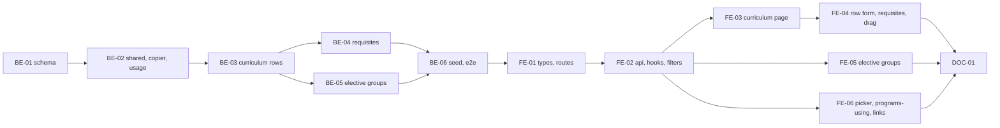

# F-07 Curriculum and Elective Groups — Backend + Frontend Implementation Plan

This plan builds the curriculum of a program version: its rows (`CurriculumItem`) with every column of the Khoa's Excel sheet, the per-curriculum requisites of each row (`CurriculumRequisite`), elective groups with their minimums (`ElectiveGroup`), and the global knowledge-block list (`KnowledgeBlock`). It delivers the curriculum screen (MH-25) in a row view and a by-semester view with filters, per-semester and per-block credit totals, drag-to-reorder inside a semester and two curriculum warnings (empty semester, requisite planned later); the elective-group screen (MH-26); the "used in programs" list on a course (FR-17); the curriculum part of program clone; and the guard that stops a program's semester count dropping below a planned row.

It deliberately excludes the program-level credit totals and the full consistency check (F-08), Excel import and export of the curriculum (F-09), the "Đăng ký được?" column (F-18, from B5), syllabus pinning and the name/credit snapshot written at release (F-15), editing through a change request after release (F-13), and a management screen for knowledge blocks.

> **Companion documents**
> - Requirement: `docs/requirement/REQUIREMENTS.md:438` (FR-17), `:464-469` (FR-27..FR-32), `:477` (FR-36, F-09), `:815` (BR-04), `:1118` (DEC-05), `:1196-1209` (EC-05..EC-10, EC-13)
> - Stories: `docs/planning/user-stories.md:318-380` (US-023..US-028); epic EP-07
> - Tasks: `docs/planning/task-breakdown.md:187` (CV-064, curriculum half), `:194-206` (CV-066..CV-078)
> - Design: `docs/design/data-dictionary.md:299-362` (`CurriculumItem`, `ElectiveGroup`, `KnowledgeBlock`, `CurriculumRequisite`), `:825` (§9 `curriculum.edit`); `docs/design/erd.md:213-220` (M-5), `:308` (E-2); `docs/design/screen-inventory.md:91-92`, `:192-193` (MH-25, MH-26)
> - Answers: `docs/planning/feature-questions.md:141-149` (§F-07, all A)
> - Builds on: F-02 (`AccessContext`, `PERMISSIONS.CURRICULUM_EDIT`, `PERMISSION_TABLE`), F-04 (`edit-path.ts`, `CourseUsageReader`, `courseTarget`, `decimal.ts`, `CourseQueryDto`, `ProgramsUsingList`), F-05 (`requisite-graph.ts`, `RelatedCourseDto`, `GRADE_POINT_PATTERN`, `CourseSelect`), F-06 (`ProgramVersion`, `programTarget`, `programEditState`, `VersionContentCopier`, `ProgramsService.update`, `ProgramSectionLinks`)
> - Tests: `docs/planning/test-plan.md:167-171` (KB-013..KB-017), `:173-174` (KB-019, KB-020), `:180` (KB-026), `:297-300` (NT-B2-04, NT-B2-05, NT-B2-07)

**Status**: Not started

---

## 0. Plan at a glance

Everything below in one table. Read this; the rest is detail for whoever builds it.

| What | Why | How and where |
|---|---|---|
| **Curriculum rows with every Excel column** — semester, course, block symbol, compulsory/elective, HT ĐA, TQ ĐA, Điểm học, Điểm chuyển, note; symbols kept exactly as typed | US-023 AC1; FR-27; DEC-05; F07-01, F07-02 | `CurriculumItem` table; add/edit/remove routes; row dialog on MH-25 (BE-01, BE-03, FE-04) |
| **A course appears once per curriculum; a row cannot sit past the declared semester count** | US-023 AC2, AC3; EC-06, EC-08; KB-015, KB-017 | Unique (version, course); semester checked against the version's `semesterCount`, message names the count (BE-03) |
| **Each row carries its own requisites**, seeded from the catalog when the row is added and editable for this curriculum only; loops refused | US-023 AC4; M-5; KB-020 | `CurriculumRequisite`; `PUT …/requisites` runs F-05's cycle check over catalog + this curriculum's edges (BE-04, FE-04) |
| **Subject-group staff edit only their own courses' rows** | US-023 AC5; §9 `curriculum.edit` | R4/R5 cells become `Đ(P)`; a row's permission target includes the course's subject group (BE-03; matrix fix in §2c) |
| **Two views: rows, or grouped by semester with credit totals**; empty semesters shown with an info warning | US-024; FR-28; EC-07; KB-016 | One `GET …/curriculum` returns rows, semester totals, block totals and warnings; `Segmented` toggle on MH-25 (BE-03, FE-03) |
| **Filter by semester, block, compulsory/elective; search by code or name**; a block filter shows the block's total | US-025; FR-32 | Client-side filters over the loaded curriculum; block totals from the server (FE-03) |
| **Drag rows inside a semester; move a row to another semester**; totals recompute; a requisite planned later is saved with a high warning | US-027; FR-30; EC-10; KB-019; F07-05 | `PUT …/curriculum-order`; semester change through the row dialog; shared `curriculumWarnings` (BE-02, BE-03, FE-04) |
| **Elective groups with a minimum in credits or in courses**; extra courses allowed; compulsory rows and rows of another group refused | US-026; FR-29; BR-04; EC-04, EC-05; KB-013, KB-014; F07-03 | `ElectiveGroup` + routes; MH-26 page (BE-05, FE-05) |
| **"Used in programs" on a course** — program, version and semester, before editing and on the detail page | US-028; FR-17; EC-38; KB-026 | F-04's `CourseUsageReader.programsUsing` filled from `CurriculumItem`; `plannedSemester` added (BE-02, FE-06) |
| **Clone copies the curriculum; a program's semester count cannot drop below a planned row** | US-022 AC1 (F-06 constraint); EC-08 | Copier steps for groups, rows, requisites; `CurriculumFactsReader.maxPlannedSemester` called from `ProgramsService.update` (BE-02) |

### Key behaviours worth knowing

| Behaviour | Why it is this way |
|---|---|
| Only a Draft version is written; before the program's first release edits are direct, afterwards every write answers `CHANGE_REQUEST_REQUIRED` until F-13 lets a request's Draft be edited | FR-55 via F-04's `resolveEditPath`, with F-06's "released = any non-Draft version" |
| A row's course cannot be changed; remove the row and add another | Requisites, group membership and later the PLO matrix (F-11) hang off the (version, course) pair (M-6) |
| Requisites are copied from the catalog **when the row is added**, not at release; later catalog changes do not flow into an existing row | US-023 AC4 needs per-curriculum requisites in the Draft; the DD and M-5 said "copied at release" — changed in §2c |
| A curriculum cannot reverse a catalog requisite (catalog A→B plus curriculum B→A is a loop) | F-05 constraint: the cycle check runs over the union of catalog and curriculum edges; change the catalog relation first |
| `sortOrder` is the order **inside a semester**; the "TT" number is derived (semester, then order) for display and Excel | Moving a row between semesters must not renumber the whole curriculum |
| A row moved to another semester lands last there | One rule, no hidden position argument |
| Semester and block totals sum every row's catalog credits, compulsory and elective alike; the program-level totals that count an elective group by its minimum are F-08's | FR-28 asks for "tổng tín chỉ từng học kỳ" like the Excel sheet; SRS §7.1 totals are US-029 |
| Deleting an elective group leaves its rows elective, without a group | `onDelete: SetNull`; the rows are still the Khoa's choices |
| A row cannot be switched to compulsory while it is in a group | EC-05 from the other side |
| R4/R5 can add, edit and remove rows of their subject group's courses in any program, but cannot reorder a semester or touch elective groups | Row target carries the course's group; ordering and groups are program-level (US-026, US-027 list R1, R3) |
| Catalog credits and names are read live from `Course` until F-15 writes the snapshot columns at release | DD: `courseNameSnapshot`, `creditsSnapshot` are written when the version leaves Draft |

### Not included

| Excluded | Why |
|---|---|
| Program-level computed totals, credit-mismatch acceptance, the full consistency check (requisite outside the curriculum, duplicates, cycles across the version) | F-08 (US-029..US-031); it extends the shared warnings function |
| Excel import and export of the curriculum (FR-36, MH-25 "Xuất Excel") | F-09; the export button appears there |
| "Đăng ký được?" column (FR-31) | F-18, B5 |
| Syllabus pin, name/credit snapshot on rows | F-15 (columns added there) |
| Editing a released program's curriculum through a request | F-13 |
| Knowledge-block management screen | Not in the screen inventory; blocks are seeded and changed by migration until a screen is asked for |
| Effective semester of a version | F07-04 A: empty until B4 |

### Open questions

All F-07 questions answered (§F-07, all A). Small choices left:

| Question | Resolved when | Default if unanswered |
|---|---|---|
| A group with both minimums set: must a student meet both, or either? | First real group with both | Both (the stricter reading); the DD note says so |
| Do the Excel's semester totals count elective rows? | When the Khoa's sheet is read at build (BE-06) | Yes, every row; adjust `semesterTotals` if the sheet differs and record it in the implement report |
| Knowledge-block codes and names | When the Khoa's sheet is read at build | Seed what the sheet lists; empty list otherwise (the filter then shows raw symbols) |

---

## 1. Scope

| In scope | Why |
|---|---|
| `CurriculumItem`, `CurriculumRequisite`, `ElectiveGroup`, `KnowledgeBlock`; check constraints | CV-066, CV-072 |
| Add, edit, remove rows; duplicate and semester checks; per-curriculum requisites | CV-067 |
| Row view and by-semester view; filters and search; semester and block totals; empty-semester warning | CV-068..CV-071 |
| Elective groups: create, edit, delete, assign rows; rules | CV-073, CV-074 |
| Reorder inside a semester; move between semesters; requisite-later warning | CV-075, CV-076 |
| Programs using a course (FR-17) on course detail and edit | CV-077, CV-078 |
| Clone copies groups, rows, requisites; semester-count guard on program edit | CV-064 (curriculum half); F-06 constraints |
| Matrix fix: `curriculum.edit` R4, R5 `Đ` → `Đ(P)` | US-023 AC5 |

| Out of scope | Deferred until |
|---|---|
| Computed totals per SRS §7.1, mismatch acceptance, consistency screen MH-27 | F-08 |
| Curriculum Excel import/export | F-09 |
| Snapshot columns, syllabus pin, freezing at release | F-15 |
| Request-Draft editing | F-13 |
| "Đăng ký được?" | F-18 |

| AC | Covered by |
|---|---|
| US-023 AC1 — row with all columns saved, symbols kept | BE-01, BE-03 (`createItem`), FE-04 |
| US-023 AC2 — same course twice refused | BE-01 (unique), BE-03 (`COURSE_ALREADY_IN_CURRICULUM`), BE-06 (KB-015) |
| US-023 AC3 — semester 9 of 8 refused | BE-03 (`SEMESTER_OUT_OF_RANGE`), BE-06 (KB-017) |
| US-023 AC4 — requisites per curriculum | BE-01, BE-04, FE-04 |
| US-023 AC5 — R4/R5 refused on another group's course | BE-03 (`itemTarget`), matrix fix, BE-06 |
| US-024 AC1 — rows under their semester with totals | BE-03 (`semesterTotals`), FE-03 |
| US-024 AC2 — empty semester shown with info warning | BE-02 (`EMPTY_SEMESTER`), FE-03 (KB-016) |
| US-024 AC3 — 60 rows under 2 s | BE-03 (one query set), BE-06 timing case, FE-03 |
| US-025 AC1..AC3 — filters, block total, search | BE-03 (`blockTotals`), FE-03 (`applyCurriculumFilters`) |
| US-026 AC1 — 6-credit minimum with 15 listed | BE-05, BE-06 (KB-013) |
| US-026 AC2 — minimum in courses; at least one minimum | BE-01 (check), BE-05 |
| US-026 AC3 — compulsory row refused | BE-05 (`GROUP_REQUIRES_ELECTIVE`), BE-06 (KB-014) |
| US-026 AC4 — one group per row | BE-01 (single FK), BE-05 (`ITEM_IN_OTHER_GROUP`) |
| US-027 AC1 — order kept | BE-03 (`reorder`), FE-04 |
| US-027 AC2 — move recomputes totals | BE-03 (`updateItem`), FE-03 (refetch) |
| US-027 AC3 — requisite later → saved + high warning | BE-02 (`REQUISITE_NOT_EARLIER`), BE-06 (KB-019) |
| US-028 AC1 — programs with version and semester before editing | BE-02 (`programsUsing`), FE-06 |
| US-028 AC2 — "chưa được chương trình nào sử dụng" | FE-06 |
| US-028 AC3 — same list on detail | F-04 `ProgramsUsingList`, FE-06 |

---

## 2. Contract verification

F-07 builds on F-01..F-06 code that is **specified, not built**. Every "existing" claim cites the plan that defines it; Rule 13 re-reads the built file before the step that uses it.

| Existing piece used | Defined at | Used by |
|---|---|---|
| `PERMISSIONS.CURRICULUM_EDIT` (`'curriculum.edit'`), seed cells `R1: X, R3: DP, R4: D, R5: D` (changed to `R4: DP, R5: DP`, §2c) | F-02 BE-03, BE-06 (`f-02-…-implementation-plan.md:569`, `:1211`); `data-dictionary.md:825` | BE-03..BE-06 |
| `PERMISSIONS.PROGRAM_VIEW`; `AccessContext.assertCan/modeFor`, `ScopeTarget.{programIds, orgUnitIds, subjectGroupIds}` | F-02 BE-03, BE-04 | BE-03 |
| `EDIT_PATH`, `EditState`, `editPathFor`, `resolveEditPath`, `assertDirectEdit` (→ `COMMON_ERRORS.CHANGE_REQUEST_REQUIRED` 409) | F-04 BE-02 (`src/shared/authz/edit-path.ts`) | BE-03..BE-05 |
| `CourseUsageReader` with stub `programsUsing`, `inReleasedVersion`; `CourseUsage {programId, programCode, programName, versionLabel}`; `CoursesSharedModule` | F-04 BE-02 (`src/shared/courses/course-usage.reader.ts`) | BE-02 fills two methods |
| `CourseUsageDto` on `CourseDetailDto.programsUsing` | F-04 BE-03 (`f-04-…-implementation-plan.md:633`) | BE-02 adds `plannedSemester` |
| `CourseQueryDto.status?: CourseStatus` (single value) | F-04 BE-03 (`f-04-…:599`) | BE-02 makes it a list |
| `CREDITS_PATTERN`, `toWireDecimal` (`src/shared/decimal/decimal.ts`); `GRADE_POINT_PATTERN`, `GRADE_POINT_MESSAGE` | F-04 BE-02, F-05 BE-01 | BE-03, BE-04 |
| `trimString`, `emptyToNull` (`src/shared/dtos/transforms.ts`, moved there by F-06 if F-04 inlined them) | F-04 BE-03, F-06 BE-04 | BE-02 adds `toArray` |
| `RequisiteEdge`, `CYCLE_CHECKED_TYPES` (= PRIOR, PREREQUISITE), `REQUISITE_GRAPH_LOCK_KEY = 5_001`, `findRequisiteCycle(edges, newEdge): string[] \| null`, `lockRequisiteGraph(tx)` | F-05 BE-02 (`src/shared/courses/requisite-graph.ts`) | BE-04 |
| `CourseRelationType {PRIOR, PREREQUISITE, COREQUISITE, REPLACEMENT}`; `CourseRelation` (`sourceCourseId`, `targetCourseId`, `type`, `minScore Decimal(4,2)?`) | F-05 BE-01 | BE-01, BE-03 (seed requisites), BE-04 |
| `RelatedCourseDto` (id, courseCode, courseName, credits: string, status), `RELATED_COURSE_SELECT`, `toRelatedCourseDto` | F-05 BE-03 (`src/shared/courses/related-course.ts`) | BE-03, BE-04 |
| `CourseSelect` (`src/shared/courses/CourseSelect.tsx`), filtered to Active | F-05 FE-03 | FE-04, FE-06 |
| `ProgramVersion` (`semesterCount`, `status`, `versionNumber`), `ProgramVersionStatus`, `Program.facultyId`, `ProgramStatus` | F-06 BE-01 | BE-01..BE-05 |
| `programTarget(program)`, `programEditState(prisma, programId)` | F-06 BE-02 (`src/shared/programs/program-target.ts`) | BE-03..BE-05 |
| `VersionContentCopier.copy(tx, from, to)` (empty, with `void` lines) | F-06 BE-02 | BE-02 fills |
| `ProgramsService.update` writing the Draft version; `PROGRAM_ERRORS` | F-06 BE-04 | BE-02 adds the semester guard |
| `ProgramDetailDto.draftVersion`, `currentVersion`, `versions` | F-06 BE-04 | FE-06 (section links) |
| `ProgramSectionLinks` with disabled "Khung chương trình", "Nhóm tự chọn" cards; `versionLabel`, `VERSION_STATUS_LABELS` | F-06 FE-02, FE-04 | FE-06 |
| `ProgramsUsingList` (renders nothing when empty); `CourseFormPage` warning shown only when non-empty | F-04 FE-04, FE-05 | FE-06 |
| `getJson`, `sendJson`, `withQuery`, `ApiErrorAlert`, `PageContainer`, `PageSkeleton`, `applyFieldErrors`, `RequirePermission` | F-01 FE, F-02 FE | FE-01..FE-05 |
| `PERMISSION_TABLE`, `PLACEHOLDER_ID`, `NO_ROLE`, `createAccount`, `loginAgent`; `createProgram` fixture; `createCourse` fixture | F-02 BE-10, F-04 BE-06, F-06 BE-06 | BE-06 |

### 2a. Endpoints

All under `/api`. Every write follows one order: load the version (404), refuse a non-Draft version (`VERSION_NOT_EDITABLE`), then `assertDirectEdit` on the target with `programEditState`.

| Endpoint | Permission (guard) | Request | Response | Notes |
|---|---|---|---|---|
| `GET /program-versions/:versionId/curriculum` | `program.view` | — | `CurriculumDto` | Scoped `assertCan` on `programTarget`; any version status (history pages reuse it) |
| `POST /program-versions/:versionId/curriculum-items` | `curriculum.edit` | `CreateCurriculumItemDto` | `CurriculumItemDto` (201) | Target = row target (D3); seeds requisites from the catalog |
| `PATCH /curriculum-items/:itemId` | `curriculum.edit` | `UpdateCurriculumItemDto` | `CurriculumItemDto` | Course not editable; a semester change puts the row last there |
| `DELETE /curriculum-items/:itemId` | `curriculum.edit` | — | 204 | Cascades its requisites |
| `PUT /program-versions/:versionId/curriculum-order` | `curriculum.edit` | `ReorderCurriculumDto` | 204 | Program target; the id set must equal the semester's rows |
| `PUT /curriculum-items/:itemId/requisites` | `curriculum.edit` | `ReplaceRequisitesDto` | `CurriculumItemDto` | Replaces all; cycle check under the advisory lock |
| `POST /program-versions/:versionId/elective-groups` | `curriculum.edit` | `CreateElectiveGroupDto` | `ElectiveGroupDto` (201) | Program target |
| `PATCH /elective-groups/:groupId` | `curriculum.edit` | `UpdateElectiveGroupDto` | `ElectiveGroupDto` | Code editable while Draft |
| `DELETE /elective-groups/:groupId` | `curriculum.edit` | — | 204 | Rows stay elective with no group |
| `PUT /elective-groups/:groupId/items` | `curriculum.edit` | `AssignGroupItemsDto` | `ElectiveGroupDto` | Replaces membership |
| `GET /courses?status=ACTIVE&status=DISCONTINUED` | `course.view` | `CourseQueryDto.status: CourseStatus[]` | unchanged | Repeated query key (BE-02) |
| `GET /courses/:courseId` | `course.view` | — | `CourseDetailDto` | `programsUsing[]` now filled, with `plannedSemester` |
| `PATCH /programs/:programId` | `program.editInfo` | `UpdateProgramDto` | unchanged | New refusal `SEMESTERS_BELOW_CURRICULUM` |

There is no list route for knowledge blocks or elective groups: both come inside `CurriculumDto`.

### 2b. DTOs

**`CurriculumDto`** (`GET …/curriculum`)

| Field | Wire type | Nullable | Note |
|---|---|---|---|
| `version` | `CurriculumVersionDto` | no | `{ id, programId, programCode, programName, versionNumber: string \| null, status: 'DRAFT' \| 'PENDING' \| 'ACTIVE' \| 'HISTORICAL', semesterCount: number }` |
| `editPath` | `'DIRECT' \| 'VIA_REQUEST' \| null` | **yes** | `editPathFor(curriculum.edit, programTarget, programEditState)` whatever the shown version's status, so F-13 can offer "Tạo đề xuất"; null when the user has no program-level cell (R4/R5) |
| `canEditStructure` | `boolean` | no | Version is DRAFT and `editPath === 'DIRECT'`: reorder, groups |
| `canAddItems` | `boolean` | no | Version is DRAFT, program never released, and `editPath === 'DIRECT'` or the user's `curriculum.edit` scope holds a subject group (R4/R5) |
| `items` | `CurriculumItemDto[]` | no | Ordered by `plannedSemester`, `sortOrder` |
| `semesters` | `SemesterTotalDto[]` | no | Exactly `semesterCount` entries, empty ones included |
| `blocks` | `BlockTotalDto[]` | no | One per distinct `blockSymbol` (null symbol → entry with `symbol: null`) |
| `knowledgeBlocks` | `KnowledgeBlockDto[]` | no | Global list for the block AutoComplete: `{ blockCode, blockName, requiredCredits: string \| null }` |
| `electiveGroups` | `ElectiveGroupDto[]` | no | Ordered by `groupCode` |
| `warnings` | `CurriculumWarningDto[]` | no | From `curriculumWarnings` |

**`CurriculumItemDto`**

| Field | Wire type | Nullable | Note |
|---|---|---|---|
| `id` | `string` | no | |
| `displayOrder` | `number` | no | TT: 1-based position in (semester, order) — derived, not stored |
| `plannedSemester` | `number` | no | 1..`semesterCount` |
| `sortOrder` | `number` | no | Position inside the semester |
| `course` | `RelatedCourseDto` | no | Live catalog name and credits (snapshots are F-15) |
| `blockSymbol` | `string` | **yes** | As typed (F07-02) |
| `blockName` | `string` | **yes** | From `KnowledgeBlock` when `blockSymbol` matches a `blockCode`; else null |
| `isElective` | `boolean` | no | |
| `electiveGroup` | `{ id: string; groupCode: string }` | **yes** | |
| `htDa` | `boolean` | no | Flag only (F07-01) |
| `tqDa` | `boolean` | no | Flag only |
| `minStudiedScore` | `string` | **yes** | Decimal(4,2) as string |
| `minTransferScore` | `string` | **yes** | |
| `note` | `string` | **yes** | |
| `requisites` | `CurriculumRequisiteDto[]` | no | Ordered by `relationType`, then source code |
| `canEdit` | `boolean` | no | `assertDirectEdit` would pass on this row's target |

**`CurriculumRequisiteDto`**: `id`, `sourceCourse: RelatedCourseDto`, `relationType: 'PRIOR' | 'PREREQUISITE' | 'COREQUISITE'`, `minScore: string | null`, `sourceSemester: number | null` (the semester the source course sits in within this curriculum; null when it is not in the curriculum — F-08 turns that into a warning).

**`SemesterTotalDto`**: `semester: number`, `totalCredits: string`, `compulsoryCredits: string`, `electiveCredits: string`, `itemCount: number`.

**`BlockTotalDto`**: `symbol: string | null`, `blockName: string | null`, `totalCredits: string`, `itemCount: number`.

**`ElectiveGroupDto`**: `id`, `groupCode`, `groupName`, `minCredits: string | null`, `minCourses: number | null`, `itemIds: string[]`, `listedCredits: string` (sum of member credits), `itemCount: number`.

**`CurriculumWarningDto`**: `code: 'EMPTY_SEMESTER' | 'REQUISITE_NOT_EARLIER'`, `severity: 'INFO' | 'HIGH'`, `message: string`, `semester: number | null`, `itemId: string | null`. F-08 widens the `code` union.

**Request DTOs**

| DTO | Fields |
|---|---|
| `CreateCurriculumItemDto` | `courseId`, `plannedSemester` (int ≥ 1), `blockSymbol?` (trim, ≤ `CURRICULUM_LIMITS.BLOCK_SYMBOL_MAX` = 20, empty → null), `isElective` (bool), `htDa?`, `tqDa?` (bool, default false), `minStudiedScore?`, `minTransferScore?` (`GRADE_POINT_PATTERN` or null), `note?` (≤ 500) |
| `UpdateCurriculumItemDto` | `PartialType(OmitType(CreateCurriculumItemDto, ['courseId']))` |
| `ReorderCurriculumDto` | `plannedSemester` (int ≥ 1), `itemIds: string[]` (1..`CURRICULUM_LIMITS.ITEMS_MAX` = 200, unique) |
| `ReplaceRequisitesDto` | `requisites: RequisiteInputDto[]` (≤ `CURRICULUM_LIMITS.REQUISITES_MAX` = 20); `RequisiteInputDto = { sourceCourseId, relationType: 'PRIOR' \| 'PREREQUISITE' \| 'COREQUISITE', minScore? }` |
| `CreateElectiveGroupDto` | `groupCode` (trim, 1..20), `groupName` (1..200), `minCredits?` (`CREDITS_PATTERN`), `minCourses?` (int ≥ 1); at least one minimum |
| `UpdateElectiveGroupDto` | `PartialType(CreateElectiveGroupDto)`; `null` clears a minimum, the result must keep one |
| `AssignGroupItemsDto` | `itemIds: string[]` (0..`ITEMS_MAX`, unique) |

**Changed elsewhere**: `CourseUsageDto` gains `plannedSemester: number`; `CourseQueryDto.status` becomes `status?: CourseStatus[]`.

### 2c. Mismatch log

| Deliverable | What the doc said | What this plan does | Found at |
|---|---|---|---|
| BE-03, matrix | §9 `curriculum.edit`: R4 `Đ`, R5 `Đ` (all programs, no scope) | R4 `Đ(P)`, R5 `Đ(P)`: US-023 AC5 refuses a row of another group's course; scope = the course's subject group | `data-dictionary.md:825` vs `user-stories.md` US-023 AC5; F-02 plan `:1211`, `:1312` updated |
| BE-01 | `CurriculumRequisite`: "chép từ CourseRelation khi ban hành" | Seeded when the row is added, edited per curriculum in the Draft, frozen at release (F-15 does not copy again) | `data-dictionary.md` §`CurriculumRequisite`; `erd.md:213` M-5 |
| BE-01 | `CurriculumItem.sortOrder` = "thứ tự hiển thị (TT)" over the whole curriculum | Order inside a semester; TT derived | `data-dictionary.md` §`CurriculumItem` |
| BE-01 | `minStudiedScore`, `minTransferScore`, `CurriculumRequisite.minScore` "Số thực" | `Decimal(4,2)` strings with `GRADE_POINT_PATTERN` (F00 answer) | same |
| BE-01 | `ElectiveGroup.minCredits` "Số thực" | `Decimal(5,2)`; with both minimums set, both apply | `data-dictionary.md` §`ElectiveGroup` |
| BE-01 | `CurriculumItem.courseNameSnapshot`, `creditsSnapshot`, `syllabusVersionId` | Not added; F-15 adds the snapshots, F-10/F-15 the syllabus pin | `data-dictionary.md` §`CurriculumItem`; CV-067 "chép tên, tín chỉ vào dòng" |
| BE-03 | `KnowledgeBlock` per program version? | Global table, matched to the free-text symbol (F07-02); no `versionId` | `data-dictionary.md` §`KnowledgeBlock` |

The data dictionary rows above are updated (in Vietnamese) with this plan; the F-02 plan's seed cell and spot check change with it.

---

## 3. Decisions

| # | Decision | Why | Rejected alternative |
|---|---|---|---|
| D1 | One feature `src/features/curriculum/` with three services: `CurriculumService` (read + rows + order), `CurriculumRequisitesService`, `ElectiveGroupsService`; one controller per route root (`program-versions`, `curriculum-items`, `elective-groups`) | Each service stays under ~250 lines; route roots match the resource | One `CurriculumService` of 600 lines; nesting every route under `/programs/:id/versions/:id` — item ids are globally unique, the long path only adds lookups |
| D2 | Write order: load → version must be DRAFT (`VERSION_NOT_EDITABLE`) → `assertDirectEdit(access, CURRICULUM_EDIT, target, await programEditState(prisma, programId))` | A Pending/Active version is immutable regardless of role; after release the Draft belongs to a change request (F-13) | Relying on `programEditState` alone — a Pending version of a never-released program would pass |
| D3 | Row target = `{ programIds: [programId], orgUnitIds: [facultyId], subjectGroupIds: course.ownerGroupId ? [course.ownerGroupId] : [] }`; structure target (order, groups) = `programTarget` | R3 matches the program, R4/R5 the course's group (US-023 AC5); groups and ordering are program-level (US-026, US-027 roles R1, R3) | Group check inside the service separate from `AccessContext` — duplicates scope logic |
| D4 | `sortOrder` per semester, gaps allowed; reorder rewrites `1..n` for one semester; a new or moved row gets `max + 1` | Moves are local; TT derived as (semester, order) | A global TT column — every insert renumbers the curriculum |
| D5 | The course of a row is immutable | Requisites, group, and F-11's mapping key on it | Allowing a course swap that silently invalidates requisites |
| D6 | Requisites seeded at row creation from catalog `CourseRelation` (target = the course, type ≠ REPLACEMENT, source not CANCELLED); `PUT` replaces all | US-023 AC4: per-curriculum, editable in the Draft; seeding gives the Excel's starting point | Copy at release (DD) — the Draft would show none; live link to the catalog — no per-curriculum edit |
| D7 | Cycle check for curriculum requisites = `findRequisiteCycle` over catalog `CYCLE_CHECKED_TYPES` edges ∪ this version's other rows' `CYCLE_CHECKED_TYPES` requisite edges, each new edge added in turn, under `lockRequisiteGraph(tx)` | F-05 constraint; the catalog and a curriculum cannot disagree on direction | Curriculum-only edges — a loop through the catalog goes unseen; separate lock key — catalog writes could race |
| D8 | Seeding skips the cycle check | Seeded edges are catalog edges, already acyclic with the catalog; the union is unchanged | Running the check anyway — wasted lock time |
| D9 | `ElectiveGroup` per version, membership by `CurriculumItem.electiveGroupId` (single FK) | One group per row (US-026 AC4) enforced by shape | A join table with a unique — two tables for one FK |
| D10 | Credit totals computed on read in the service (`semesterTotals`, `blockTotals`, `listedCredits`) with `Prisma.Decimal` | 60 rows; no stored totals to drift | Stored totals updated by triggers |
| D11 | `curriculumWarnings(input)` is a pure function in `src/shared/curriculum/`, returning `EMPTY_SEMESTER` and `REQUISITE_NOT_EARLIER`; F-08 extends it | F-08's check, F-09's import preview and this screen agree | Warnings computed in the page |
| D12 | `KnowledgeBlock` is global, seeded; the symbol on a row is free text; the AutoComplete suggests codes | F07-02: matched if a code exists, not enforced | FK from the row — rejects symbols the Excel uses |
| D13 | `CourseUsageReader.programsUsing` counts versions with status ≠ HISTORICAL of ACTIVE programs, ordered by program code, version label `versionNumber ?? 'Nháp'` decided on the client | US-028 "đang dùng"; historical versions are not "using" | Every version ever — the list grows forever |
| D14 | Program semester guard through `CurriculumFactsReader.maxPlannedSemester(versionId)` in `src/shared/curriculum/`, called by `ProgramsService.update` | Features do not import each other (F-06 constraint) | A DB trigger — error message would not name the semester |
| D15 | Drag reorder with `@dnd-kit/core` + `@dnd-kit/sortable` + `@dnd-kit/utilities` (versions pinned at build, latest stable at least two weeks old) | AntD 6 Table has no built-in row drag; dnd-kit is the AntD docs' example and supports keyboard sorting | `react-beautiful-dnd` (archived); HTML5 drag without keyboard support (NFR accessibility) |
| D16 | Filters and search run on the client over the loaded curriculum | ≤ 200 rows; US-025 instant filtering; block totals still come from the server | Query params per filter — a round trip per click |

---

## 5. Deliverables

### BE-01 — Prisma schema: knowledge blocks, elective groups, curriculum rows, requisites

What/Why: CV-066, CV-072; D4, D9, D12; US-023 AC1..AC4, US-026 AC2, AC4.

**Files**

| Action | Path |
|---|---|
| MODIFY | `prisma/schema.prisma` |
| NEW | `prisma/migrations/<timestamp>_curriculum/migration.sql` (generated, then edited) |

**Shape**

```prisma
model KnowledgeBlock {
  id              String   @id @default(cuid(2))
  blockCode       String   @unique
  blockName       String
  requiredCredits Decimal? @db.Decimal(5, 2)
  createdAt       DateTime @default(now())
  updatedAt       DateTime @updatedAt
}

model ElectiveGroup {
  id         String           @id @default(cuid(2))
  versionId  String
  version    ProgramVersion   @relation(fields: [versionId], references: [id], onDelete: Cascade)
  groupCode  String
  groupName  String
  minCredits Decimal?         @db.Decimal(5, 2)
  minCourses Int?
  items      CurriculumItem[]
  createdAt  DateTime         @default(now())
  updatedAt  DateTime         @updatedAt

  @@unique([versionId, groupCode])
}

model CurriculumItem {
  id               String                @id @default(cuid(2))
  versionId        String
  version          ProgramVersion        @relation(fields: [versionId], references: [id], onDelete: Cascade)
  plannedSemester  Int
  sortOrder        Int
  courseId         String
  course           Course                @relation("CurriculumItemCourse", fields: [courseId], references: [id], onDelete: Restrict)
  blockSymbol      String?
  isElective       Boolean
  electiveGroupId  String?
  electiveGroup    ElectiveGroup?        @relation(fields: [electiveGroupId], references: [id], onDelete: SetNull)
  htDa             Boolean               @default(false)
  tqDa             Boolean               @default(false)
  minStudiedScore  Decimal?              @db.Decimal(4, 2)
  minTransferScore Decimal?              @db.Decimal(4, 2)
  note             String?
  requisites       CurriculumRequisite[]
  createdAt        DateTime              @default(now())
  updatedAt        DateTime              @updatedAt

  @@unique([versionId, courseId])
  @@index([versionId, plannedSemester, sortOrder])
  @@index([courseId])
  @@index([electiveGroupId])
}

model CurriculumRequisite {
  id             String             @id @default(cuid(2))
  itemId         String
  item           CurriculumItem     @relation(fields: [itemId], references: [id], onDelete: Cascade)
  sourceCourseId String
  sourceCourse   Course             @relation("CurriculumRequisiteSource", fields: [sourceCourseId], references: [id], onDelete: Restrict)
  relationType   CourseRelationType
  minScore       Decimal?           @db.Decimal(4, 2)
  createdAt      DateTime           @default(now())

  @@unique([itemId, sourceCourseId, relationType])
  @@index([sourceCourseId])
}
```

`ProgramVersion` gains `electiveGroups ElectiveGroup[]` and `curriculumItems CurriculumItem[]`; `Course` gains `curriculumItems CurriculumItem[] @relation("CurriculumItemCourse")` and `curriculumRequisites CurriculumRequisite[] @relation("CurriculumRequisiteSource")`.

```
pnpm prisma migrate dev --create-only --name curriculum
# append the checks below, then:
pnpm prisma migrate dev
pnpm prisma generate
```

```sql
-- appended to migration.sql
ALTER TABLE "CurriculumItem" ADD CONSTRAINT "CurriculumItem_group_needs_elective" CHECK ("electiveGroupId" IS NULL OR "isElective");
ALTER TABLE "CurriculumItem" ADD CONSTRAINT "CurriculumItem_semester_positive" CHECK ("plannedSemester" >= 1);
ALTER TABLE "CurriculumItem" ADD CONSTRAINT "CurriculumItem_sort_positive" CHECK ("sortOrder" >= 1);
ALTER TABLE "ElectiveGroup" ADD CONSTRAINT "ElectiveGroup_has_minimum" CHECK ("minCredits" IS NOT NULL OR "minCourses" IS NOT NULL);
ALTER TABLE "CurriculumRequisite" ADD CONSTRAINT "CurriculumRequisite_not_replacement" CHECK ("relationType" <> 'REPLACEMENT');
ALTER TABLE "CurriculumRequisite" ADD CONSTRAINT "CurriculumRequisite_min_score_prerequisite" CHECK ("minScore" IS NULL OR "relationType" = 'PREREQUISITE');
```

**Rationale**: Columns from `data-dictionary.md:299-362` with the §2c changes. Relation and check style mirror F-05 BE-01 (`CourseRelation` + raw `CHECK`) and F-06 BE-01 (partial indexes appended to the generated migration).

**Gotchas**
- `onDelete: Cascade` from `ProgramVersion` is for F-13 discarding a never-submitted request Draft; versions that left Draft are never deleted, so nothing released can cascade.
- The row's group must belong to the same version; SQL cannot say that without a composite key that `SetNull` would break. `ElectiveGroupsService` checks it (BE-05).
- `@@index([versionId, plannedSemester, sortOrder])` is not unique: reorder writes the semester's rows one by one inside a transaction, and a unique index would fail mid-way.
- Reusing `CourseRelationType` keeps one enum on the wire; the check forbids `REPLACEMENT`.

**Verify**: Migration applies; inserting a row with `electiveGroupId` set and `isElective = false` fails on `CurriculumItem_group_needs_elective`; an `ElectiveGroup` with both minimums null fails.

**Depends on**: F-05 BE-01, F-06 BE-01

---

### BE-02 — Shared: warnings, curriculum facts, copier steps, course usage, program semester guard, course status list

What/Why: CV-064 (curriculum half), CV-076, CV-077; D11, D13, D14; F-04, F-05, F-06 constraints.

**Files**

| Action | Path |
|---|---|
| NEW | `src/shared/curriculum/curriculum-warnings.ts` |
| NEW | `src/shared/curriculum/curriculum-warnings.spec.ts` |
| NEW | `src/shared/curriculum/curriculum-facts.reader.ts` |
| NEW | `src/shared/curriculum/curriculum-shared.module.ts` |
| MODIFY | `src/shared/programs/version-content.copier.ts` (three steps) |
| NEW | `src/shared/programs/version-content.copier.spec.ts` |
| MODIFY | `src/shared/courses/course-usage.reader.ts` (`programsUsing`, `inReleasedVersion`, `CourseUsage.plannedSemester`) |
| MODIFY | `src/shared/courses/course-usage.reader.spec.ts` (create if F-04 has none) |
| MODIFY | `src/features/courses/course.dto.ts` (`CourseUsageDto.plannedSemester`) |
| MODIFY | `src/shared/dtos/transforms.ts` (`toArray`) |
| MODIFY | `src/features/courses/course-query.dto.ts` (`status` list) |
| MODIFY | `src/features/courses/courses.service.ts` (`listWhere`) |
| MODIFY | `src/features/courses/courses.service.spec.ts` |
| MODIFY | `src/features/programs/programs.service.ts` (`update` guard) |
| MODIFY | `src/features/programs/programs.errors.ts` (`SEMESTERS_BELOW_CURRICULUM`) |
| MODIFY | `src/features/programs/programs.module.ts` (import `CurriculumSharedModule`) |
| MODIFY | `src/features/programs/programs.service.spec.ts` |

**Shape**

```ts
// src/shared/curriculum/curriculum-warnings.ts
export const CURRICULUM_WARNING = { EMPTY_SEMESTER: 'EMPTY_SEMESTER', REQUISITE_NOT_EARLIER: 'REQUISITE_NOT_EARLIER' } as const;
export type CurriculumWarningCode = (typeof CURRICULUM_WARNING)[keyof typeof CURRICULUM_WARNING];
export const WARNING_SEVERITY = { INFO: 'INFO', HIGH: 'HIGH' } as const;
export type WarningSeverity = (typeof WARNING_SEVERITY)[keyof typeof WARNING_SEVERITY];

export interface WarningItem {
  id: string;
  courseId: string;
  courseCode: string;
  plannedSemester: number;
  requisites: readonly { sourceCourseId: string; relationType: CourseRelationType }[];
}

export interface CurriculumWarning {
  code: CurriculumWarningCode;
  severity: WarningSeverity;
  message: string;
  semester: number | null;
  itemId: string | null;
}

const ORDER_SENSITIVE_TYPES: readonly CourseRelationType[] = [CourseRelationType.PRIOR, CourseRelationType.PREREQUISITE];

// A requisite in the same or a later semester is saved (EC-10) but flagged; F-08 adds the checks that need the whole version.
export function curriculumWarnings(semesterCount: number, items: readonly WarningItem[]): CurriculumWarning[] {
  const warnings: CurriculumWarning[] = [];
  const semesterOf = new Map(items.map((item) => [item.courseId, item]));
  for (let semester = 1; semester <= semesterCount; semester += 1) {
    if (!items.some((item) => item.plannedSemester === semester)) {
      warnings.push({ code: CURRICULUM_WARNING.EMPTY_SEMESTER, severity: WARNING_SEVERITY.INFO,
        message: `Học kỳ ${semester} chưa có học phần nào.`, semester, itemId: null });
    }
  }
  for (const item of items) {
    for (const requisite of item.requisites) {
      const source = semesterOf.get(requisite.sourceCourseId);
      if (!source || !ORDER_SENSITIVE_TYPES.includes(requisite.relationType) || source.plannedSemester < item.plannedSemester) {
        continue;
      }
      warnings.push({ code: CURRICULUM_WARNING.REQUISITE_NOT_EARLIER, severity: WARNING_SEVERITY.HIGH,
        message: `${item.courseCode} (học kỳ ${item.plannedSemester}) cần ${source.courseCode} trước, nhưng ${source.courseCode} xếp ở học kỳ ${source.plannedSemester}.`,
        semester: item.plannedSemester, itemId: item.id });
    }
  }
  return warnings;
}
```

```ts
// src/shared/curriculum/curriculum-facts.reader.ts
@Injectable()
export class CurriculumFactsReader {
  constructor(private readonly prisma: PrismaService) {}

  async maxPlannedSemester(versionId: string): Promise<number | null> {
    const result = await this.prisma.curriculumItem.aggregate({ where: { versionId }, _max: { plannedSemester: true } });
    return result._max.plannedSemester;
  }
}

// src/shared/curriculum/curriculum-shared.module.ts
@Module({ providers: [CurriculumFactsReader], exports: [CurriculumFactsReader] })
export class CurriculumSharedModule {}
```

```ts
// src/shared/programs/version-content.copier.ts — steps filled; the void lines go
@Injectable()
export class VersionContentCopier {
  async copy(tx: Prisma.TransactionClient, fromVersionId: string, toVersionId: string): Promise<void> {
    const groupIds = await this.copyElectiveGroups(tx, fromVersionId, toVersionId);
    const itemIds = await this.copyCurriculumItems(tx, fromVersionId, toVersionId, groupIds);
    await this.copyRequisites(tx, itemIds);
  }

  // Returns old id → new id, matched back through the natural key (groupCode) because createMany returns no rows.
  private async copyElectiveGroups(tx: Prisma.TransactionClient, from: string, to: string): Promise<Map<string, string>> {
    const groups = await tx.electiveGroup.findMany({ where: { versionId: from } });
    await tx.electiveGroup.createMany({
      data: groups.map(({ groupCode, groupName, minCredits, minCourses }) => ({ versionId: to, groupCode, groupName, minCredits, minCourses })),
    });
    const created = await tx.electiveGroup.findMany({ where: { versionId: to }, select: { id: true, groupCode: true } });
    const newIdByCode = new Map(created.map((group) => [group.groupCode, group.id]));
    return new Map(groups.map((group) => [group.id, newIdByCode.get(group.groupCode)!]));
  }

  private async copyCurriculumItems(tx: Prisma.TransactionClient, from: string, to: string, groupIds: Map<string, string>): Promise<Map<string, string>> {
    const items = await tx.curriculumItem.findMany({ where: { versionId: from } });
    await tx.curriculumItem.createMany({
      data: items.map(({ id: _id, versionId: _from, electiveGroupId, createdAt: _c, updatedAt: _u, ...fields }) => ({
        ...fields,
        versionId: to,
        electiveGroupId: electiveGroupId ? groupIds.get(electiveGroupId)! : null,
      })),
    });
    const created = await tx.curriculumItem.findMany({ where: { versionId: to }, select: { id: true, courseId: true } });
    const newIdByCourse = new Map(created.map((item) => [item.courseId, item.id]));
    return new Map(items.map((item) => [item.id, newIdByCourse.get(item.courseId)!]));
  }

  private async copyRequisites(tx: Prisma.TransactionClient, itemIds: Map<string, string>): Promise<void> {
    const requisites = await tx.curriculumRequisite.findMany({ where: { itemId: { in: [...itemIds.keys()] } } });
    await tx.curriculumRequisite.createMany({
      data: requisites.map(({ itemId, sourceCourseId, relationType, minScore }) => ({ itemId: itemIds.get(itemId)!, sourceCourseId, relationType, minScore })),
    });
  }
}
```

```ts
// src/shared/courses/course-usage.reader.ts — two methods filled
export interface CourseUsage {
  programId: string;
  programCode: string;
  programName: string;
  versionLabel: string | null;
  plannedSemester: number;
}

async inReleasedVersion(courseId: string): Promise<boolean> {
  const row = await this.prisma.curriculumItem.findFirst({
    where: { courseId, version: { status: { not: ProgramVersionStatus.DRAFT } } },
    select: { id: true },
  });
  return row !== null;
}

// Versions still in play (Draft, Pending, Active) of programs in use; one entry per program version.
async programsUsing(courseId: string): Promise<CourseUsage[]> {
  const rows = await this.prisma.curriculumItem.findMany({
    where: { courseId, version: { status: { not: ProgramVersionStatus.HISTORICAL }, program: { status: ProgramStatus.ACTIVE } } },
    select: {
      plannedSemester: true,
      version: { select: { programName: true, versionNumber: true, program: { select: { id: true, programCode: true } } } },
    },
    orderBy: [{ version: { program: { programCode: 'asc' } } }, { version: { createdAt: 'asc' } }],
  });
  return rows.map(({ plannedSemester, version }) => ({
    programId: version.program.id,
    programCode: version.program.programCode,
    programName: version.programName,
    versionLabel: version.versionNumber,
    plannedSemester,
  }));
}
```

`CourseUsageDto` gains `@ApiProperty() plannedSemester: number;`.

```ts
// src/shared/dtos/transforms.ts — addition
// `?status=A` arrives as a string, `?status=A&status=B` as an array.
export const toArray = ({ value }: TransformFnParams) => (value === undefined || Array.isArray(value) ? value : [value]);

// src/features/courses/course-query.dto.ts — status becomes a list
@ApiPropertyOptional({ enum: CourseStatus, enumName: 'CourseStatus', isArray: true })
@Transform(toArray) @IsOptional() @IsEnum(CourseStatus, { each: true })
status?: CourseStatus[];

// src/features/courses/courses.service.ts — listWhere
status: query.status ? { in: query.status } : undefined,
```

```ts
// src/features/programs/programs.errors.ts — addition
SEMESTERS_BELOW_CURRICULUM: { status: HttpStatus.CONFLICT, code: 'SEMESTERS_BELOW_CURRICULUM', message: 'Khung chương trình đã có học phần ở học kỳ' },

// src/features/programs/programs.service.ts — update, after the Draft is found
if (dto.semesterCount !== undefined) {
  const planned = await this.curriculumFacts.maxPlannedSemester(draft.id);
  if (planned !== null && dto.semesterCount < planned) {
    const base = PROGRAM_ERRORS.SEMESTERS_BELOW_CURRICULUM;
    throw new AppException(
      { ...base, message: `${base.message} ${planned}; chuyển các học phần đó trước khi giảm số học kỳ.` },
      [{ field: 'semesterCount', constraints: [PROGRAM_CONSTRAINT.SEMESTERS_COVER_CURRICULUM] }],
    );
  }
}
```

`PROGRAM_CONSTRAINT` gains `SEMESTERS_COVER_CURRICULUM: 'semestersCoverCurriculum'`; `ProgramsService` injects `CurriculumFactsReader`.

**Call sites of `CourseQueryDto.status`** (Rule 13 — the type changes from one value to a list):

| Call site | Change |
|---|---|
| F-04 `courses.service.ts` `listWhere` | `{ in: query.status }` (above) |
| F-04 FE `CourseFilters` (status `Select`) | Sends `[value]`; the generated query type is now `CourseStatus[]` |
| F-05 FE `src/shared/courses/courseSearch.ts` `searchCourses` | Sends `status: statuses` (FE-06) |
| F-04 e2e `courses.e2e-spec.ts` status filter case | `?status=ACTIVE` still works through `toArray` — keep, add a two-value case |

Spec cases:
- `curriculumWarnings`: 8 semesters, rows only in 1..7 → one `EMPTY_SEMESTER` for 8 (KB-016); B in 4 requires A PREREQUISITE in 5 → `REQUISITE_NOT_EARLIER` HIGH naming both (KB-019); same semester → warned; COREQUISITE in a later semester → not warned; source outside the curriculum → no warning here.
- Copier: two groups, three rows (one in a group), two requisites → new rows point at the new group ids and new item ids; source rows untouched; an empty version copies nothing and does not call `createMany` with an empty `in`.
- Reader: a course in a Draft and in an Active version of the same program → two entries; HISTORICAL excluded; INACTIVE program excluded; `inReleasedVersion` false with only Draft rows.
- `ProgramsService.update`: rows planned up to semester 8, `semesterCount: 7` → `SEMESTERS_BELOW_CURRICULUM`, message contains `8`; `semesterCount: 8` → saved; no rows → saved.
- `courses.service` list: `status: ['ACTIVE', 'DISCONTINUED']` → `where.status = { in: [...] }`.

**Rationale**: `curriculum-warnings.ts` is a pure function like F-05's `requisite-graph.ts`; the facts reader mirrors F-04's `CourseUsageReader` (a shared reader a feature calls without importing another feature); the copier steps fill F-06's seam.

**Gotchas**
- `createMany` returns a count, not rows; the copier reads back by the natural keys `(versionId, groupCode)` and `(versionId, courseId)`, both unique (BE-01).
- In `copyRequisites`, `itemIds.keys()` may be empty — skip the call when it is, Prisma accepts `in: []` but the extra round trip is wasted.
- `programsUsing` orders through a relation (`version.program.programCode`); Prisma supports nested `orderBy` on to-one relations — confirm it compiles, otherwise sort in memory.
- `CourseUsage.versionLabel` stays the raw `versionNumber` (null for a Draft); the client prints `'Nháp'` with F-06's `versionLabel`.
- `toArray` must run before `@IsEnum(..., { each: true })`; `@Transform` decorators run in the transform phase, validators after, so the order of decorators does not matter but `transform: true` on the global pipe does (F-01 set it).

**Verify**: `pnpm test`; `pnpm exec tsc --noEmit -p tsconfig.json`.

**Depends on**: BE-01

---

### BE-03 — Curriculum feature: read, rows, order

What/Why: CV-067..CV-071, CV-075; US-023, US-024, US-025, US-027; D1..D5, D10.

**Files**

| Action | Path |
|---|---|
| NEW | `src/features/curriculum/curriculum.module.ts` |
| NEW | `src/features/curriculum/program-versions-curriculum.controller.ts` |
| NEW | `src/features/curriculum/curriculum-items.controller.ts` |
| NEW | `src/features/curriculum/curriculum.service.ts` |
| NEW | `src/features/curriculum/curriculum.service.spec.ts` |
| NEW | `src/features/curriculum/curriculum-access.ts` |
| NEW | `src/features/curriculum/curriculum-totals.ts` |
| NEW | `src/features/curriculum/curriculum-totals.spec.ts` |
| NEW | `src/features/curriculum/curriculum.errors.ts` |
| NEW | `src/features/curriculum/curriculum.dto.ts` (response DTOs, selects, mappers) |
| NEW | `src/features/curriculum/create-curriculum-item.dto.ts` (`CreateCurriculumItemDto`, `UpdateCurriculumItemDto`, `CURRICULUM_LIMITS`) |
| NEW | `src/features/curriculum/reorder-curriculum.dto.ts` |
| MODIFY | `src/app.module.ts` |

**Shape**

```ts
// src/features/curriculum/curriculum.errors.ts
export const CURRICULUM_ERRORS = {
  VERSION_NOT_FOUND: { status: HttpStatus.NOT_FOUND, code: 'PROGRAM_VERSION_NOT_FOUND', message: 'Không tìm thấy phiên bản chương trình.' },
  VERSION_NOT_EDITABLE: { status: HttpStatus.CONFLICT, code: 'VERSION_NOT_EDITABLE', message: 'Chỉ sửa được khung của phiên bản nháp.' },
  ITEM_NOT_FOUND: { status: HttpStatus.NOT_FOUND, code: 'CURRICULUM_ITEM_NOT_FOUND', message: 'Không tìm thấy dòng khung chương trình.' },
  COURSE_NOT_FOUND: { status: HttpStatus.BAD_REQUEST, code: 'COURSE_NOT_FOUND', message: 'Không tìm thấy học phần.' },
  COURSE_NOT_ACTIVE: { status: HttpStatus.CONFLICT, code: 'COURSE_NOT_ACTIVE', message: 'Chỉ thêm được học phần đang sử dụng vào khung.' },
  COURSE_ALREADY_IN_CURRICULUM: { status: HttpStatus.CONFLICT, code: 'COURSE_ALREADY_IN_CURRICULUM', message: 'Học phần đã có trong khung' },
  SEMESTER_OUT_OF_RANGE: { status: HttpStatus.BAD_REQUEST, code: 'SEMESTER_OUT_OF_RANGE', message: 'Học kỳ vượt quá số học kỳ của chương trình' },
  ITEM_IN_ELECTIVE_GROUP: { status: HttpStatus.CONFLICT, code: 'ITEM_IN_ELECTIVE_GROUP', message: 'Học phần đang thuộc một nhóm tự chọn; gỡ khỏi nhóm trước khi đổi thành bắt buộc.' },
  ORDER_MISMATCH: { status: HttpStatus.CONFLICT, code: 'CURRICULUM_ORDER_MISMATCH', message: 'Danh sách sắp xếp không khớp các học phần của học kỳ; tải lại trang rồi thử lại.' },
  ELECTIVE_GROUP_NOT_FOUND: { status: HttpStatus.NOT_FOUND, code: 'ELECTIVE_GROUP_NOT_FOUND', message: 'Không tìm thấy nhóm tự chọn.' },
  GROUP_CODE_TAKEN: { status: HttpStatus.CONFLICT, code: 'ELECTIVE_GROUP_CODE_TAKEN', message: 'Mã nhóm tự chọn đã có trong phiên bản này.' },
  GROUP_MINIMUM_REQUIRED: { status: HttpStatus.BAD_REQUEST, code: 'GROUP_MINIMUM_REQUIRED', message: 'Nhóm tự chọn cần ít nhất một yêu cầu tối thiểu: số tín chỉ hoặc số học phần.' },
  GROUP_REQUIRES_ELECTIVE: { status: HttpStatus.CONFLICT, code: 'GROUP_REQUIRES_ELECTIVE', message: 'Học phần bắt buộc không được đưa vào nhóm tự chọn' },
  ITEM_IN_OTHER_GROUP: { status: HttpStatus.CONFLICT, code: 'ITEM_IN_OTHER_GROUP', message: 'Học phần đã thuộc nhóm tự chọn khác' },
  ITEM_NOT_IN_VERSION: { status: HttpStatus.BAD_REQUEST, code: 'ITEM_NOT_IN_VERSION', message: 'Có dòng không thuộc phiên bản của nhóm.' },
  REQUISITE_SELF: { status: HttpStatus.BAD_REQUEST, code: 'REQUISITE_SELF', message: 'Học phần không thể là điều kiện của chính nó.' },
  REQUISITE_COURSE_CANCELLED: { status: HttpStatus.CONFLICT, code: 'REQUISITE_COURSE_CANCELLED', message: 'Không dùng học phần đã hủy làm điều kiện.' },
  REQUISITE_DUPLICATE: { status: HttpStatus.BAD_REQUEST, code: 'REQUISITE_DUPLICATE', message: 'Một điều kiện được khai báo hai lần.' },
  MIN_SCORE_NOT_ALLOWED: { status: HttpStatus.BAD_REQUEST, code: 'MIN_SCORE_NOT_ALLOWED', message: 'Chỉ quan hệ tiên quyết mới có ngưỡng điểm.' },
  REQUISITE_CYCLE: { status: HttpStatus.CONFLICT, code: 'REQUISITE_CYCLE', message: 'Điều kiện này tạo thành vòng học trước/tiên quyết nên không lưu được. Đường đi của vòng' },
} as const satisfies Record<string, ErrorDefinition>;

export const CURRICULUM_CONSTRAINT = { SEMESTER_RANGE: 'semesterRange', UNIQUE_COURSE: 'uniqueCourse', GROUP_MINIMUM: 'groupMinimum' } as const;
```

`REQUISITE_CYCLE`, `MIN_SCORE_NOT_ALLOWED` reuse F-05's codes so the client handles one code for both screens; the messages are this screen's.

```ts
// src/features/curriculum/create-curriculum-item.dto.ts
export const CURRICULUM_LIMITS = {
  BLOCK_SYMBOL_MAX: 20, NOTE_MAX: 500, ITEMS_MAX: 200, REQUISITES_MAX: 20, GROUP_CODE_MAX: 20, GROUP_NAME_MAX: 200, SEMESTER_MIN: 1,
} as const;

export class CreateCurriculumItemDto {
  @ApiProperty() @IsString() courseId: string;
  @ApiProperty() @Type(() => Number) @IsInt() @Min(CURRICULUM_LIMITS.SEMESTER_MIN) plannedSemester: number;

  @ApiPropertyOptional({ nullable: true, type: String, maxLength: CURRICULUM_LIMITS.BLOCK_SYMBOL_MAX })
  @Transform(emptyToNull) @IsOptional() @IsString() @MaxLength(CURRICULUM_LIMITS.BLOCK_SYMBOL_MAX)
  blockSymbol?: string | null;

  @ApiProperty() @IsBoolean() isElective: boolean;
  @ApiPropertyOptional() @IsOptional() @IsBoolean() htDa?: boolean;
  @ApiPropertyOptional() @IsOptional() @IsBoolean() tqDa?: boolean;

  @ApiPropertyOptional({ nullable: true, type: String, example: '4' })
  @IsOptional() @IsString() @Matches(GRADE_POINT_PATTERN, { message: GRADE_POINT_MESSAGE })
  minStudiedScore?: string | null;

  @ApiPropertyOptional({ nullable: true, type: String, example: '4' })
  @IsOptional() @IsString() @Matches(GRADE_POINT_PATTERN, { message: GRADE_POINT_MESSAGE })
  minTransferScore?: string | null;

  @ApiPropertyOptional({ nullable: true, type: String }) @Transform(emptyToNull) @IsOptional() @IsString() @MaxLength(CURRICULUM_LIMITS.NOTE_MAX)
  note?: string | null;
}

export class UpdateCurriculumItemDto extends PartialType(OmitType(CreateCurriculumItemDto, ['courseId'] as const)) {}

// src/features/curriculum/reorder-curriculum.dto.ts
export class ReorderCurriculumDto {
  @ApiProperty() @Type(() => Number) @IsInt() @Min(CURRICULUM_LIMITS.SEMESTER_MIN) plannedSemester: number;
  @ApiProperty({ type: [String] }) @IsArray() @ArrayMinSize(1) @ArrayMaxSize(CURRICULUM_LIMITS.ITEMS_MAX) @ArrayUnique() @IsString({ each: true }) itemIds: string[];
}
```

`emptyToNull` trims and turns `''` into `null`, so a blank block symbol clears it; `@IsOptional()` lets `null` through.

```ts
// src/features/curriculum/curriculum-access.ts
export const VERSION_ACCESS_SELECT = {
  id: true, status: true, semesterCount: true, programId: true,
  program: { select: { id: true, facultyId: true } },
} as const satisfies Prisma.ProgramVersionSelect;
export type VersionAccessRow = Prisma.ProgramVersionGetPayload<{ select: typeof VERSION_ACCESS_SELECT }>;

// A row is reachable through its program (R1, R3) or through its course's subject group (R4, R5).
export function itemTarget(version: VersionAccessRow, course: { ownerGroupId: string | null }): ScopeTarget {
  return { ...programTarget(version.program), subjectGroupIds: course.ownerGroupId ? [course.ownerGroupId] : [] };
}

export function assertDraft(version: VersionAccessRow): void {
  if (version.status !== ProgramVersionStatus.DRAFT) {
    throw new AppException(CURRICULUM_ERRORS.VERSION_NOT_EDITABLE);
  }
}

// Draft check first: a Pending version of a never-released program is still frozen.
export async function assertCurriculumWrite(
  prisma: PrismaService | Prisma.TransactionClient, access: AccessContext, version: VersionAccessRow, target: ScopeTarget,
): Promise<void> {
  assertDraft(version);
  assertDirectEdit(access, PERMISSIONS.CURRICULUM_EDIT, target, await programEditState(prisma, version.programId));
}
```

```ts
// src/features/curriculum/curriculum-totals.ts
export interface TotalsItem { plannedSemester: number; isElective: boolean; credits: Prisma.Decimal; blockSymbol: string | null }

// Every row counts, as on the Khoa's sheet; the program-level totals that count a group by its minimum are F-08's.
export function semesterTotals(semesterCount: number, items: readonly TotalsItem[]): SemesterTotalDto[] {
  return Array.from({ length: semesterCount }, (_, index) => {
    const semester = index + 1;
    const rows = items.filter((item) => item.plannedSemester === semester);
    const sum = (filter: (item: TotalsItem) => boolean) =>
      rows.filter(filter).reduce((total, item) => total.plus(item.credits), new Prisma.Decimal(0));
    return {
      semester,
      totalCredits: toWireDecimal(sum(() => true)),
      compulsoryCredits: toWireDecimal(sum((item) => !item.isElective)),
      electiveCredits: toWireDecimal(sum((item) => item.isElective)),
      itemCount: rows.length,
    };
  });
}

export function blockTotals(items: readonly TotalsItem[], blockNames: ReadonlyMap<string, string>): BlockTotalDto[] {
  const bySymbol = new Map<string | null, { total: Prisma.Decimal; count: number }>();
  for (const item of items) {
    const entry = bySymbol.get(item.blockSymbol) ?? { total: new Prisma.Decimal(0), count: 0 };
    bySymbol.set(item.blockSymbol, { total: entry.total.plus(item.credits), count: entry.count + 1 });
  }
  return [...bySymbol.entries()]
    .sort(([a], [b]) => (a ?? '').localeCompare(b ?? '', 'vi'))
    .map(([symbol, entry]) => ({
      symbol,
      blockName: symbol ? blockNames.get(symbol) ?? null : null,
      totalCredits: toWireDecimal(entry.total),
      itemCount: entry.count,
    }));
}
```

```ts
// src/features/curriculum/curriculum.dto.ts — row select and mapping (DTO classes per §2b)
export const ITEM_INCLUDE = {
  course: { select: { ...RELATED_COURSE_SELECT, ownerGroupId: true } },
  electiveGroup: { select: { id: true, groupCode: true } },
  requisites: { include: { sourceCourse: { select: RELATED_COURSE_SELECT } }, orderBy: [{ relationType: 'asc' }, { sourceCourse: { courseCode: 'asc' } }] },
} as const satisfies Prisma.CurriculumItemInclude;
export type ItemRow = Prisma.CurriculumItemGetPayload<{ include: typeof ITEM_INCLUDE }>;

export const ITEM_ORDER = [{ plannedSemester: 'asc' }, { sortOrder: 'asc' }, { id: 'asc' }] as const satisfies Prisma.CurriculumItemOrderByWithRelationInput[];

export interface ItemContext {
  displayOrder: number;
  semesterOfCourse: ReadonlyMap<string, number>;
  blockNames: ReadonlyMap<string, string>;
  canEdit: boolean;
}

export function toCurriculumItemDto(row: ItemRow, context: ItemContext): CurriculumItemDto {
  return {
    id: row.id,
    displayOrder: context.displayOrder,
    plannedSemester: row.plannedSemester,
    sortOrder: row.sortOrder,
    course: toRelatedCourseDto(row.course),
    blockSymbol: row.blockSymbol,
    blockName: row.blockSymbol ? context.blockNames.get(row.blockSymbol) ?? null : null,
    isElective: row.isElective,
    electiveGroup: row.electiveGroup,
    htDa: row.htDa,
    tqDa: row.tqDa,
    minStudiedScore: row.minStudiedScore ? toWireDecimal(row.minStudiedScore) : null,
    minTransferScore: row.minTransferScore ? toWireDecimal(row.minTransferScore) : null,
    note: row.note,
    requisites: row.requisites.map((requisite) => ({
      id: requisite.id,
      sourceCourse: toRelatedCourseDto(requisite.sourceCourse),
      relationType: requisite.relationType as CurriculumRequisiteType,
      minScore: requisite.minScore ? toWireDecimal(requisite.minScore) : null,
      sourceSemester: context.semesterOfCourse.get(requisite.sourceCourseId) ?? null,
    })),
    canEdit: context.canEdit,
  };
}
```

`CurriculumRequisiteType` is a TS union `'PRIOR' | 'PREREQUISITE' | 'COREQUISITE'` exported with `CURRICULUM_REQUISITE_TYPES` (an array used by `@IsIn` in BE-04 and by `@ApiProperty({ enum })`, `enumName: 'CurriculumRequisiteType'`).

```ts
// src/features/curriculum/curriculum.service.ts
@Injectable()
export class CurriculumService {
  private readonly logger = new Logger(CurriculumService.name);

  constructor(
    private readonly prisma: PrismaService,
    private readonly requisites: CurriculumRequisitesService,
  ) {}

  async read(versionId: string, access: AccessContext): Promise<CurriculumDto> {
    const version = await this.findVersion(versionId);
    access.assertCan(PERMISSIONS.PROGRAM_VIEW, programTarget(version.program));
    const [rows, groups, blocks, state] = await Promise.all([
      this.prisma.curriculumItem.findMany({ where: { versionId }, include: ITEM_INCLUDE, orderBy: ITEM_ORDER }),
      this.prisma.electiveGroup.findMany({ where: { versionId }, include: { items: { select: { id: true, course: { select: { credits: true } } } } }, orderBy: { groupCode: 'asc' } }),
      this.prisma.knowledgeBlock.findMany({ orderBy: { blockCode: 'asc' } }),
      programEditState(this.prisma, version.programId),
    ]);
    const blockNames = new Map(blocks.map((block) => [block.blockCode, block.blockName]));
    const semesterOfCourse = new Map(rows.map((row) => [row.courseId, row.plannedSemester]));
    const editable = version.status === ProgramVersionStatus.DRAFT;
    const editPath = editPathFor(access, PERMISSIONS.CURRICULUM_EDIT, programTarget(version.program), state);
    const items = rows.map((row, index) => toCurriculumItemDto(row, {
      displayOrder: index + 1,
      semesterOfCourse,
      blockNames,
      canEdit: editable && editPathFor(access, PERMISSIONS.CURRICULUM_EDIT, itemTarget(version, row.course), state) === EDIT_PATH.DIRECT,
    }));
    const totalsInput = rows.map((row) => ({ plannedSemester: row.plannedSemester, isElective: row.isElective, credits: row.course.credits, blockSymbol: row.blockSymbol }));
    return {
      version: toCurriculumVersionDto(version),
      editPath,
      canEditStructure: editable && editPath === EDIT_PATH.DIRECT,
      canAddItems: editable && !state.released && (editPath === EDIT_PATH.DIRECT || holdsGroupScope(access)),
      items,
      semesters: semesterTotals(version.semesterCount, totalsInput),
      blocks: blockTotals(totalsInput, blockNames),
      knowledgeBlocks: blocks.map(toKnowledgeBlockDto),
      electiveGroups: groups.map(toElectiveGroupDto),
      warnings: curriculumWarnings(version.semesterCount, rows.map(toWarningItem)),
    };
  }

  async createItem(versionId: string, dto: CreateCurriculumItemDto, access: AccessContext): Promise<CurriculumItemDto> {
    const version = await this.findVersion(versionId);
    const course = await this.prisma.course.findUnique({ where: { id: dto.courseId }, select: { id: true, courseCode: true, status: true, ownerGroupId: true } });
    if (!course) throw new AppException(CURRICULUM_ERRORS.COURSE_NOT_FOUND, [{ field: 'courseId', constraints: [] }]);
    await assertCurriculumWrite(this.prisma, access, version, itemTarget(version, course));
    if (course.status !== CourseStatus.ACTIVE) throw new AppException(CURRICULUM_ERRORS.COURSE_NOT_ACTIVE);
    assertSemesterInRange(version, dto.plannedSemester);
    await this.assertCourseNotListed(versionId, course);
    const item = await this.prisma.$transaction(async (tx) => {
      const created = await tx.curriculumItem.create({
        data: {
          versionId, courseId: course.id, plannedSemester: dto.plannedSemester,
          sortOrder: await nextSortOrder(tx, versionId, dto.plannedSemester),
          blockSymbol: dto.blockSymbol ?? null, isElective: dto.isElective,
          htDa: dto.htDa ?? false, tqDa: dto.tqDa ?? false,
          minStudiedScore: dto.minStudiedScore ?? null, minTransferScore: dto.minTransferScore ?? null, note: dto.note ?? null,
        },
        select: { id: true },
      });
      await this.requisites.seedFromCatalog(tx, created.id, course.id);
      return created;
    }).catch((error: unknown) => {
      throw mapUniqueViolation(error, CURRICULUM_ERRORS.COURSE_ALREADY_IN_CURRICULUM, 'courseId');
    });
    this.logger.log(`Curriculum item ${course.courseCode} added to version ${versionId} by ${access.userId}`);
    return this.itemDto(item.id, access);
  }

  async updateItem(itemId: string, dto: UpdateCurriculumItemDto, access: AccessContext): Promise<CurriculumItemDto> {
    const item = await this.findItem(itemId);
    await assertCurriculumWrite(this.prisma, access, item.version, itemTarget(item.version, item.course));
    if (dto.isElective === false && item.electiveGroupId) throw new AppException(CURRICULUM_ERRORS.ITEM_IN_ELECTIVE_GROUP);
    const semesterChanged = dto.plannedSemester !== undefined && dto.plannedSemester !== item.plannedSemester;
    if (semesterChanged) assertSemesterInRange(item.version, dto.plannedSemester!);
    await this.prisma.$transaction(async (tx) => {
      await tx.curriculumItem.update({
        where: { id: itemId },
        data: {
          ...dto,
          ...(semesterChanged && { sortOrder: await nextSortOrder(tx, item.versionId, dto.plannedSemester!) }),
        },
      });
    });
    this.logger.log(`Curriculum item ${itemId} updated by ${access.userId}`);
    return this.itemDto(itemId, access);
  }

  async removeItem(itemId: string, access: AccessContext): Promise<void> {
    const item = await this.findItem(itemId);
    await assertCurriculumWrite(this.prisma, access, item.version, itemTarget(item.version, item.course));
    await this.prisma.curriculumItem.delete({ where: { id: itemId } });
    this.logger.log(`Curriculum item ${itemId} (${item.course.courseCode}) removed by ${access.userId}`);
  }

  async reorder(versionId: string, dto: ReorderCurriculumDto, access: AccessContext): Promise<void> {
    const version = await this.findVersion(versionId);
    await assertCurriculumWrite(this.prisma, access, version, programTarget(version.program));
    await this.prisma.$transaction(async (tx) => {
      const current = await tx.curriculumItem.findMany({ where: { versionId, plannedSemester: dto.plannedSemester }, select: { id: true } });
      const sameSet = current.length === dto.itemIds.length && current.every((row) => dto.itemIds.includes(row.id));
      if (!sameSet) throw new AppException(CURRICULUM_ERRORS.ORDER_MISMATCH);
      for (const [index, id] of dto.itemIds.entries()) {
        await tx.curriculumItem.update({ where: { id }, data: { sortOrder: index + 1 } });
      }
    });
    this.logger.log(`Semester ${dto.plannedSemester} of version ${versionId} reordered by ${access.userId}`);
  }

  // findVersion(id) → VERSION_ACCESS_SELECT + programCode, programName, versionNumber, or VERSION_NOT_FOUND;
  // findItem(id) → item with version (VERSION_ACCESS_SELECT) and course { courseCode, ownerGroupId }, or ITEM_NOT_FOUND;
  // itemDto(id, access) re-reads the row with ITEM_INCLUDE and the version's other rows' semesters for `sourceSemester`;
  // assertCourseNotListed → COURSE_ALREADY_IN_CURRICULUM with "ở học kỳ N" appended, before the insert for the message,
  // the unique index still catches a race.
}

export function assertSemesterInRange(version: { semesterCount: number }, semester: number): void {
  if (semester > version.semesterCount) {
    const base = CURRICULUM_ERRORS.SEMESTER_OUT_OF_RANGE;
    throw new AppException(
      { ...base, message: `${base.message} (${version.semesterCount} học kỳ).` },
      [{ field: 'plannedSemester', constraints: [CURRICULUM_CONSTRAINT.SEMESTER_RANGE] }],
    );
  }
}

async function nextSortOrder(tx: Prisma.TransactionClient, versionId: string, plannedSemester: number): Promise<number> {
  const result = await tx.curriculumItem.aggregate({ where: { versionId, plannedSemester }, _max: { sortOrder: true } });
  return (result._max.sortOrder ?? 0) + 1;
}

// R4/R5 hold curriculum.edit scoped to subject groups; whether a given course matches is decided per row.
function holdsGroupScope(access: AccessContext): boolean {
  const scope = access.scopeFor(PERMISSIONS.CURRICULUM_EDIT);
  return scope.all || (scope.subjectGroupIds?.size ?? 0) > 0;
}
```

```ts
// src/features/curriculum/program-versions-curriculum.controller.ts
@ApiTags('curriculum')
@ApiCookieAuth()
@Controller('program-versions/:versionId')
export class ProgramVersionsCurriculumController {
  constructor(
    private readonly curriculum: CurriculumService,
    private readonly groups: ElectiveGroupsService,
  ) {}

  @Get('curriculum') @RequirePermission(PERMISSIONS.PROGRAM_VIEW) @ApiOkResponse({ type: CurriculumDto })
  read(@Param('versionId') versionId: string, @CurrentAccess() access: AccessContext) { return this.curriculum.read(versionId, access); }

  @Post('curriculum-items') @RequirePermission(PERMISSIONS.CURRICULUM_EDIT) @ApiCreatedResponse({ type: CurriculumItemDto })
  createItem(@Param('versionId') versionId: string, @Body() dto: CreateCurriculumItemDto, @CurrentAccess() access: AccessContext) {
    return this.curriculum.createItem(versionId, dto, access);
  }

  @Put('curriculum-order') @HttpCode(HttpStatus.NO_CONTENT) @RequirePermission(PERMISSIONS.CURRICULUM_EDIT)
  reorder(@Param('versionId') versionId: string, @Body() dto: ReorderCurriculumDto, @CurrentAccess() access: AccessContext) {
    return this.curriculum.reorder(versionId, dto, access);
  }

  @Post('elective-groups') @RequirePermission(PERMISSIONS.CURRICULUM_EDIT) @ApiCreatedResponse({ type: ElectiveGroupDto })
  createGroup(@Param('versionId') versionId: string, @Body() dto: CreateElectiveGroupDto, @CurrentAccess() access: AccessContext) {
    return this.groups.create(versionId, dto, access);
  }
}

// src/features/curriculum/curriculum-items.controller.ts
@ApiTags('curriculum')
@ApiCookieAuth()
@Controller('curriculum-items/:itemId')
export class CurriculumItemsController {
  constructor(
    private readonly curriculum: CurriculumService,
    private readonly requisites: CurriculumRequisitesService,
  ) {}

  @Patch() @RequirePermission(PERMISSIONS.CURRICULUM_EDIT) @ApiOkResponse({ type: CurriculumItemDto })
  update(@Param('itemId') itemId: string, @Body() dto: UpdateCurriculumItemDto, @CurrentAccess() access: AccessContext) {
    return this.curriculum.updateItem(itemId, dto, access);
  }

  @Delete() @HttpCode(HttpStatus.NO_CONTENT) @RequirePermission(PERMISSIONS.CURRICULUM_EDIT)
  remove(@Param('itemId') itemId: string, @CurrentAccess() access: AccessContext) { return this.curriculum.removeItem(itemId, access); }

  @Put('requisites') @RequirePermission(PERMISSIONS.CURRICULUM_EDIT) @ApiOkResponse({ type: CurriculumItemDto })
  replaceRequisites(@Param('itemId') itemId: string, @Body() dto: ReplaceRequisitesDto, @CurrentAccess() access: AccessContext) {
    return this.requisites.replace(itemId, dto, access);
  }
}
```

```ts
// src/features/curriculum/curriculum.module.ts
@Module({
  imports: [ProgramsSharedModule],
  controllers: [ProgramVersionsCurriculumController, CurriculumItemsController, ElectiveGroupsController],
  providers: [CurriculumService, CurriculumRequisitesService, ElectiveGroupsService],
})
export class CurriculumModule {}
```

Spec cases (Prisma mocked, `AccessContext` hand-built):

| Case | Expect |
|---|---|
| `read` as R6 with no program scope | `OUT_OF_SCOPE` |
| `read`, 8 semesters, rows in 1..7 | `semesters.length = 8`, semester 8 `itemCount 0`, warning `EMPTY_SEMESTER` |
| `read`, rows in (2, order 2), (1, order 5), (2, order 1) | `displayOrder` 1, 2, 3 for (1,5), (2,1), (2,2) |
| `read` as R4 of group G on a Draft, never released | `editPath = null`, `canEditStructure = false`, `canAddItems = true`; a row of a G course `canEdit = true`, another row `false` |
| `read` of an ACTIVE version as R1 | `canEditStructure = false`, `canAddItems = false`, `editPath = 'VIA_REQUEST'` |
| `createItem` course already listed in semester 3 | `COURSE_ALREADY_IN_CURRICULUM`, message ends `ở học kỳ 3.` (KB-015) |
| `createItem` semester 9 on an 8-semester version | `SEMESTER_OUT_OF_RANGE`, message contains `8 học kỳ` (KB-017) |
| `createItem` Discontinued course | `COURSE_NOT_ACTIVE` |
| `createItem` as R4 of G, course of group H | `OUT_OF_SCOPE` (US-023 AC5) |
| `createItem` on a PENDING version | `VERSION_NOT_EDITABLE`, before any permission check |
| `createItem` after release (a non-Draft version exists) as R1, Draft version | `CHANGE_REQUEST_REQUIRED` |
| `createItem` puts the row last: semester has orders 1, 2, 4 | `sortOrder = 5`; `seedFromCatalog` called inside the transaction |
| `updateItem` `isElective: false` on a grouped row | `ITEM_IN_ELECTIVE_GROUP` |
| `updateItem` semester 3 → 5 | `sortOrder` = last of 5 + 1 |
| `updateItem` same semester | `sortOrder` untouched |
| `reorder` ids missing one row of the semester | `ORDER_MISMATCH` |
| `reorder` as R4 | `OUT_OF_SCOPE` |
| `semesterTotals` 3 + 2.5 compulsory, 3 elective | total `8.5`, compulsory `5.5`, elective `3` |
| `blockTotals` null and `'A1'` symbols | Two entries, the null symbol first, `blockName` from the map for `A1` |

**Rationale**: Layout mirrors F-04 BE-03 and F-06 BE-04; the write order mirrors F-06's `update` (`assertDirectEdit` with `programEditState`); messages with appended facts mirror F-06's `assertCreditsAddUp`.

**Gotchas**
- `editPathFor` is called once per row in `read`; it is in-memory over the user's assignments, so 200 rows cost nothing — do not add a cache.
- In `updateItem` the DTO spreads straight into `data`; `UpdateCurriculumItemDto` has no `courseId`, and `forbidNonWhitelisted` rejects one sent anyway.
- `nextSortOrder` runs inside the transaction but without a lock; two concurrent adds to one semester can get the same order. Order ties are harmless (the index is not unique; `ITEM_ORDER` ends with `id` to break ties), and the next reorder fixes them.
- A Prisma `aggregate` on an empty set returns `_max: { sortOrder: null }` — handled by `?? 0`.
- `read` loads all `KnowledgeBlock` rows each time; the table holds a few dozen.
- `scopeFor(...).subjectGroupIds` is a `Set` when `all` is false (F-02 `ResolvedScope`); read the F-02 type before writing `holdsGroupScope`.
- The R4/R5 scope reader must return subject-group ids only (no `orgUnitIds` for the faculty); otherwise `programTarget` would match R4 too and structure edits open up. Rule 13: re-read F-02's `scope-source.reader.ts` cases.

**Verify**: `pnpm test`; `pnpm exec tsc --noEmit -p tsconfig.json`; Swagger shows the routes.

**Depends on**: BE-02

---

### BE-04 — Curriculum requisites: seed and replace

What/Why: CV-073, CV-074; US-023 AC4; KB-019, KB-020; D6..D8.

**Files**

| Action | Path |
|---|---|
| NEW | `src/features/curriculum/curriculum-requisites.service.ts` |
| NEW | `src/features/curriculum/curriculum-requisites.service.spec.ts` |
| NEW | `src/features/curriculum/replace-requisites.dto.ts` |

**Shape**

```ts
// src/features/curriculum/replace-requisites.dto.ts
export const CURRICULUM_REQUISITE_TYPES = [CourseRelationType.PRIOR, CourseRelationType.PREREQUISITE, CourseRelationType.COREQUISITE] as const;
export type CurriculumRequisiteType = (typeof CURRICULUM_REQUISITE_TYPES)[number];

export class RequisiteInputDto {
  @ApiProperty() @IsString() sourceCourseId: string;
  @ApiProperty({ enum: CURRICULUM_REQUISITE_TYPES, enumName: 'CurriculumRequisiteType' }) @IsIn(CURRICULUM_REQUISITE_TYPES) relationType: CurriculumRequisiteType;
  @ApiPropertyOptional({ nullable: true, type: String, example: '4' })
  @Transform(emptyToNull) @IsOptional() @IsString() @Matches(GRADE_POINT_PATTERN, { message: GRADE_POINT_MESSAGE })
  minScore?: string | null;
}

export class ReplaceRequisitesDto {
  @ApiProperty({ type: [RequisiteInputDto] })
  @IsArray() @ArrayMaxSize(CURRICULUM_LIMITS.REQUISITES_MAX) @ValidateNested({ each: true }) @Type(() => RequisiteInputDto)
  requisites: RequisiteInputDto[];
}
```

```ts
// src/features/curriculum/curriculum-requisites.service.ts
@Injectable()
export class CurriculumRequisitesService {
  private readonly logger = new Logger(CurriculumRequisitesService.name);

  constructor(private readonly prisma: PrismaService) {}

  // The catalog is the starting point; the edges are copied, not linked, so later catalog edits do not reach this curriculum.
  async seedFromCatalog(tx: Prisma.TransactionClient, itemId: string, courseId: string): Promise<void> {
    const relations = await tx.courseRelation.findMany({
      where: {
        targetCourseId: courseId,
        relationType: { in: [...CURRICULUM_REQUISITE_TYPES] },
        sourceCourse: { status: { not: CourseStatus.CANCELLED } },
      },
      select: { sourceCourseId: true, relationType: true, minScore: true },
    });
    if (relations.length === 0) {
      return;
    }
    await tx.curriculumRequisite.createMany({ data: relations.map((relation) => ({ itemId, ...relation })) });
  }

  async replace(itemId: string, dto: ReplaceRequisitesDto, access: AccessContext): Promise<CurriculumItemDto> {
    const item = await this.findItem(itemId);
    await assertCurriculumWrite(this.prisma, access, item.version, itemTarget(item.version, item.course));
    assertRequisiteInput(item.courseId, dto.requisites);
    await this.assertSourcesUsable(dto.requisites);
    await this.prisma.$transaction(async (tx) => {
      await lockRequisiteGraph(tx);
      await tx.curriculumRequisite.deleteMany({ where: { itemId } });
      await this.assertNoCycle(tx, item.versionId, item.courseId, dto.requisites);
      if (dto.requisites.length > 0) {
        await tx.curriculumRequisite.createMany({
          data: dto.requisites.map(({ sourceCourseId, relationType, minScore }) => ({ itemId, sourceCourseId, relationType, minScore: minScore ?? null })),
        });
      }
    });
    this.logger.log(`Requisites of curriculum item ${itemId} replaced (${dto.requisites.length}) by ${access.userId}`);
    return this.itemDto(itemId, access);
  }

  // The graph is the catalog plus this version's own requisites; the item's old edges are already deleted in the transaction.
  private async assertNoCycle(tx: Prisma.TransactionClient, versionId: string, courseId: string, requisites: readonly RequisiteInputDto[]): Promise<void> {
    const [catalog, curriculum] = await Promise.all([
      tx.courseRelation.findMany({ where: { relationType: { in: [...CYCLE_CHECKED_TYPES] } }, select: { sourceCourseId: true, targetCourseId: true } }),
      tx.curriculumRequisite.findMany({
        where: { item: { versionId }, relationType: { in: [...CYCLE_CHECKED_TYPES] } },
        select: { sourceCourseId: true, item: { select: { courseId: true } } },
      }),
    ]);
    const edges: RequisiteEdge[] = [
      ...catalog,
      ...curriculum.map((edge) => ({ sourceCourseId: edge.sourceCourseId, targetCourseId: edge.item.courseId })),
    ];
    for (const requisite of requisites.filter((entry) => CYCLE_CHECKED_TYPES.includes(entry.relationType))) {
      const newEdge = { sourceCourseId: requisite.sourceCourseId, targetCourseId: courseId };
      const cycle = findRequisiteCycle(edges, newEdge);
      if (cycle) {
        await throwCycle(tx, cycle);
      }
      edges.push(newEdge);
    }
  }

  private async assertSourcesUsable(requisites: readonly RequisiteInputDto[]): Promise<void> {
    const ids = requisites.map((requisite) => requisite.sourceCourseId);
    const courses = await this.prisma.course.findMany({ where: { id: { in: ids } }, select: { id: true, status: true } });
    if (courses.length !== new Set(ids).size) {
      throw new AppException(CURRICULUM_ERRORS.COURSE_NOT_FOUND, [{ field: 'requisites', constraints: [] }]);
    }
    if (courses.some((course) => course.status === CourseStatus.CANCELLED)) {
      throw new AppException(CURRICULUM_ERRORS.REQUISITE_COURSE_CANCELLED);
    }
  }

  // findItem / itemDto: same lookups as CurriculumService — move them to `curriculum-item.reader.ts` (an injectable
  // in this feature) when the second copy appears, rather than duplicating the select.
}

function assertRequisiteInput(courseId: string, requisites: readonly RequisiteInputDto[]): void {
  const keys = new Set<string>();
  for (const requisite of requisites) {
    if (requisite.sourceCourseId === courseId) throw new AppException(CURRICULUM_ERRORS.REQUISITE_SELF);
    if (requisite.minScore && requisite.relationType !== CourseRelationType.PREREQUISITE) {
      throw new AppException(CURRICULUM_ERRORS.MIN_SCORE_NOT_ALLOWED, [{ field: 'minScore', constraints: [RELATION_CONSTRAINT.GRADE_POINT] }]);
    }
    const key = `${requisite.sourceCourseId}:${requisite.relationType}`;
    if (keys.has(key)) throw new AppException(CURRICULUM_ERRORS.REQUISITE_DUPLICATE);
    keys.add(key);
  }
}

async function throwCycle(tx: Prisma.TransactionClient, cycle: readonly string[]): Promise<never> {
  const courses = await tx.course.findMany({ where: { id: { in: [...cycle] } }, select: { id: true, courseCode: true } });
  const codeOf = new Map(courses.map((course) => [course.id, course.courseCode]));
  const base = CURRICULUM_ERRORS.REQUISITE_CYCLE;
  throw new AppException({ ...base, message: `${base.message}: ${cycle.map((id) => codeOf.get(id)).join(' → ')}.` });
}
```

`RELATION_CONSTRAINT` lives in F-05's `course-relations` feature; move it to `src/shared/courses/requisite-graph.ts` beside `CYCLE_CHECKED_TYPES` and migrate F-05's call sites (`course-relations.service.ts` ×2, the DTO), recording each in the implement report.

Spec cases:

| Case | Expect |
|---|---|
| `seedFromCatalog`, catalog has A →PREREQUISITE (min 2) B, C →REPLACEMENT B, D (CANCELLED) →PRIOR B | One row: A PREREQUISITE `minScore 2` |
| `seedFromCatalog`, no relations | No `createMany` |
| `replace` source = the row's own course | `REQUISITE_SELF` |
| `replace` COREQUISITE with `minScore` | `MIN_SCORE_NOT_ALLOWED` |
| `replace` same source + type twice | `REQUISITE_DUPLICATE` |
| `replace` source CANCELLED | `REQUISITE_COURSE_CANCELLED` |
| `replace` on B with A PREREQUISITE, while this version has B → A (curriculum) | `REQUISITE_CYCLE`, message `… A → B → A.` shaped by `findRequisiteCycle` (KB-020) |
| `replace` loop closed only by the catalog (catalog B → A) | `REQUISITE_CYCLE` |
| `replace` loop that only exists in another version's requisites | Saved — versions do not share edges |
| `replace` two new edges that close a loop together | Second edge refused (edges are pushed as they pass) |
| `replace` `[]` | All removed; no `createMany` |
| `replace` COREQUISITE both ways | Saved (not cycle-checked) |
| `replace` as R4 on a row of another group's course | `OUT_OF_SCOPE` |

**Rationale**: `assertNoCycle` and `throwCycle` mirror F-05's `CourseRelationsService.assertNoCycle` (`f-05-…-implementation-plan.md:601-613`); the lock is F-05's `lockRequisiteGraph`, which F-05 states every writer of requisite edges takes first.

**Gotchas**
- The delete happens before the cycle check inside the transaction, so the row's previous edges do not block a reorder of the same edges; if the check throws, the transaction rolls the delete back.
- Seeding skips the cycle check (D8): the catalog edges it copies are already acyclic with the catalog, and copied edges repeat them for the same course.
- `minScore` from `CourseRelation` is already `Decimal(4,2)`; `createMany` takes the `Prisma.Decimal` as is.
- `CYCLE_CHECKED_TYPES.includes(entry.relationType)` — `entry.relationType` is the narrowed union; `includes` on `readonly CourseRelationType[]` accepts it.
- `itemDto` re-reads with `ITEM_INCLUDE`; requisites come back ordered by type then source code.

**Verify**: `pnpm test`.

**Depends on**: BE-03

---

### BE-05 — Elective groups

What/Why: CV-072; US-026; KB-026; D9.

**Files**

| Action | Path |
|---|---|
| NEW | `src/features/curriculum/elective-groups.controller.ts` |
| NEW | `src/features/curriculum/elective-groups.service.ts` |
| NEW | `src/features/curriculum/elective-groups.service.spec.ts` |
| NEW | `src/features/curriculum/elective-group.dto.ts` (request DTOs, `ElectiveGroupDto`, `toElectiveGroupDto`) |

**Shape**

```ts
// src/features/curriculum/elective-group.dto.ts
export class CreateElectiveGroupDto {
  @ApiProperty({ maxLength: CURRICULUM_LIMITS.GROUP_CODE_MAX })
  @Transform(trimString) @IsString() @Length(1, CURRICULUM_LIMITS.GROUP_CODE_MAX) groupCode: string;

  @ApiProperty({ maxLength: CURRICULUM_LIMITS.GROUP_NAME_MAX })
  @Transform(trimString) @IsString() @Length(1, CURRICULUM_LIMITS.GROUP_NAME_MAX) groupName: string;

  @ApiPropertyOptional({ nullable: true, type: String, example: '6' })
  @Transform(emptyToNull) @IsOptional() @IsString() @Matches(CREDITS_PATTERN, { message: CREDITS_MESSAGE })
  minCredits?: string | null;

  @ApiPropertyOptional({ nullable: true, type: Number })
  @IsOptional() @IsInt() @Min(1)
  minCourses?: number | null;
}

export class UpdateElectiveGroupDto extends PartialType(CreateElectiveGroupDto) {}

export class AssignGroupItemsDto {
  @ApiProperty({ type: [String] }) @IsArray() @ArrayMaxSize(CURRICULUM_LIMITS.ITEMS_MAX) @ArrayUnique() @IsString({ each: true }) itemIds: string[];
}

export const GROUP_INCLUDE = {
  items: { select: { id: true, course: { select: { credits: true } } }, orderBy: [{ plannedSemester: 'asc' }, { sortOrder: 'asc' }] },
} as const satisfies Prisma.ElectiveGroupInclude;

export function toElectiveGroupDto(row: Prisma.ElectiveGroupGetPayload<{ include: typeof GROUP_INCLUDE }>): ElectiveGroupDto {
  return {
    id: row.id,
    groupCode: row.groupCode,
    groupName: row.groupName,
    minCredits: row.minCredits ? toWireDecimal(row.minCredits) : null,
    minCourses: row.minCourses,
    itemIds: row.items.map((item) => item.id),
    listedCredits: toWireDecimal(row.items.reduce((total, item) => total.plus(item.course.credits), new Prisma.Decimal(0))),
    itemCount: row.items.length,
  };
}
```

```ts
// src/features/curriculum/elective-groups.service.ts
@Injectable()
export class ElectiveGroupsService {
  private readonly logger = new Logger(ElectiveGroupsService.name);

  constructor(private readonly prisma: PrismaService) {}

  async create(versionId: string, dto: CreateElectiveGroupDto, access: AccessContext): Promise<ElectiveGroupDto> {
    const version = await this.findVersion(versionId);
    await assertCurriculumWrite(this.prisma, access, version, programTarget(version.program));
    assertHasMinimum(dto.minCredits ?? null, dto.minCourses ?? null);
    const group = await this.prisma.electiveGroup
      .create({ data: { versionId, groupCode: dto.groupCode, groupName: dto.groupName, minCredits: dto.minCredits ?? null, minCourses: dto.minCourses ?? null }, include: GROUP_INCLUDE })
      .catch((error: unknown) => { throw mapUniqueViolation(error, CURRICULUM_ERRORS.GROUP_CODE_TAKEN, 'groupCode'); });
    this.logger.log(`Elective group ${dto.groupCode} created in version ${versionId} by ${access.userId}`);
    return toElectiveGroupDto(group);
  }

  async update(groupId: string, dto: UpdateElectiveGroupDto, access: AccessContext): Promise<ElectiveGroupDto> {
    const group = await this.findGroup(groupId);
    await assertCurriculumWrite(this.prisma, access, group.version, programTarget(group.version.program));
    const minCredits = dto.minCredits === undefined ? group.minCredits : dto.minCredits;
    const minCourses = dto.minCourses === undefined ? group.minCourses : dto.minCourses;
    assertHasMinimum(minCredits, minCourses);
    const updated = await this.prisma.electiveGroup
      .update({ where: { id: groupId }, data: dto, include: GROUP_INCLUDE })
      .catch((error: unknown) => { throw mapUniqueViolation(error, CURRICULUM_ERRORS.GROUP_CODE_TAKEN, 'groupCode'); });
    this.logger.log(`Elective group ${groupId} updated by ${access.userId}`);
    return toElectiveGroupDto(updated);
  }

  // Rows keep isElective = true and lose the group (onDelete: SetNull).
  async remove(groupId: string, access: AccessContext): Promise<void> {
    const group = await this.findGroup(groupId);
    await assertCurriculumWrite(this.prisma, access, group.version, programTarget(group.version.program));
    await this.prisma.electiveGroup.delete({ where: { id: groupId } });
    this.logger.log(`Elective group ${group.groupCode} removed from version ${group.versionId} by ${access.userId}`);
  }

  async assignItems(groupId: string, dto: AssignGroupItemsDto, access: AccessContext): Promise<ElectiveGroupDto> {
    const group = await this.findGroup(groupId);
    await assertCurriculumWrite(this.prisma, access, group.version, programTarget(group.version.program));
    const items = await this.prisma.curriculumItem.findMany({
      where: { id: { in: dto.itemIds } },
      select: { id: true, versionId: true, isElective: true, electiveGroupId: true, course: { select: { courseCode: true } } },
    });
    assertAssignable(group, dto.itemIds, items);
    await this.prisma.$transaction([
      this.prisma.curriculumItem.updateMany({ where: { electiveGroupId: groupId, id: { notIn: dto.itemIds } }, data: { electiveGroupId: null } }),
      this.prisma.curriculumItem.updateMany({ where: { id: { in: dto.itemIds } }, data: { electiveGroupId: groupId } }),
    ]);
    this.logger.log(`Elective group ${group.groupCode} now holds ${dto.itemIds.length} rows (by ${access.userId})`);
    return toElectiveGroupDto(await this.prisma.electiveGroup.findUniqueOrThrow({ where: { id: groupId }, include: GROUP_INCLUDE }));
  }

  // findVersion(id) → VERSION_ACCESS_SELECT or VERSION_NOT_FOUND; findGroup(id) → group + version (VERSION_ACCESS_SELECT) or ELECTIVE_GROUP_NOT_FOUND
}

function assertHasMinimum(minCredits: Prisma.Decimal | string | null, minCourses: number | null): void {
  if (minCredits === null && minCourses === null) {
    throw new AppException(CURRICULUM_ERRORS.GROUP_MINIMUM_REQUIRED, [
      { field: 'minCredits', constraints: [CURRICULUM_CONSTRAINT.GROUP_MINIMUM] },
      { field: 'minCourses', constraints: [CURRICULUM_CONSTRAINT.GROUP_MINIMUM] },
    ]);
  }
}

// Checks the database cannot: same version, and a clear message naming the course.
function assertAssignable(group: { id: string; versionId: string }, ids: readonly string[], items: readonly AssignableItem[]): void {
  if (items.length !== ids.length || items.some((item) => item.versionId !== group.versionId)) {
    throw new AppException(CURRICULUM_ERRORS.ITEM_NOT_IN_VERSION);
  }
  const compulsory = items.find((item) => !item.isElective);
  if (compulsory) {
    const base = CURRICULUM_ERRORS.GROUP_REQUIRES_ELECTIVE;
    throw new AppException({ ...base, message: `${base.message}: ${compulsory.course.courseCode}.` });
  }
  const elsewhere = items.find((item) => item.electiveGroupId !== null && item.electiveGroupId !== group.id);
  if (elsewhere) {
    const base = CURRICULUM_ERRORS.ITEM_IN_OTHER_GROUP;
    throw new AppException({ ...base, message: `${base.message}: ${elsewhere.course.courseCode}.` });
  }
}
```

```ts
// src/features/curriculum/elective-groups.controller.ts
@ApiTags('curriculum')
@ApiCookieAuth()
@Controller('elective-groups/:groupId')
export class ElectiveGroupsController {
  constructor(private readonly groups: ElectiveGroupsService) {}

  @Patch() @RequirePermission(PERMISSIONS.CURRICULUM_EDIT) @ApiOkResponse({ type: ElectiveGroupDto })
  update(@Param('groupId') groupId: string, @Body() dto: UpdateElectiveGroupDto, @CurrentAccess() access: AccessContext) {
    return this.groups.update(groupId, dto, access);
  }

  @Delete() @HttpCode(HttpStatus.NO_CONTENT) @RequirePermission(PERMISSIONS.CURRICULUM_EDIT)
  remove(@Param('groupId') groupId: string, @CurrentAccess() access: AccessContext) { return this.groups.remove(groupId, access); }

  @Put('items') @RequirePermission(PERMISSIONS.CURRICULUM_EDIT) @ApiOkResponse({ type: ElectiveGroupDto })
  assignItems(@Param('groupId') groupId: string, @Body() dto: AssignGroupItemsDto, @CurrentAccess() access: AccessContext) {
    return this.groups.assignItems(groupId, dto, access);
  }
}
```

Spec cases:

| Case | Expect |
|---|---|
| `create` with neither minimum | `GROUP_MINIMUM_REQUIRED`, both fields in `details` |
| `create` duplicate code in the version (P2002) | `GROUP_CODE_TAKEN` |
| `create` as R4 | `OUT_OF_SCOPE` (structure target) |
| `update` `{ minCredits: null }` when `minCourses` is null | `GROUP_MINIMUM_REQUIRED` |
| `update` `{ minCredits: null }` when `minCourses = 2` | Saved |
| `assignItems` with a compulsory row | `GROUP_REQUIRES_ELECTIVE`, message names the course (US-026 AC3) |
| `assignItems` row in group G2 into G1 | `ITEM_IN_OTHER_GROUP` |
| `assignItems` row of another version | `ITEM_NOT_IN_VERSION` |
| `assignItems` `[a, b]` when the group held `[b, c]` | `c` ungrouped, `a`, `b` grouped; `listedCredits` = a + b |
| `assignItems` `[]` | All members ungrouped |
| `remove` | Group deleted; rows untouched by the service (SetNull in the DB) |

**Rationale**: Group writes take the program target (structure, D3), like F-06's program edits; message-with-fact errors mirror BE-03.

**Gotchas**
- `assertAssignable` reads all items in one query; the result order is not `ids` order, so compare lengths, never positions.
- The `$transaction([...])` array form is enough: no read in between depends on a write.
- A row of a never-released program being edited by R4 can be elective; R4 still cannot put it in a group — grouping is structure.
- `update` spreads the DTO into `data`; Prisma takes `null` for the optional columns, and the check constraint is the last guard.

**Verify**: `pnpm test`.

**Depends on**: BE-03

---

### BE-06 — Knowledge-block seed, end-to-end tests, permission table rows

What/Why: KB-013..KB-017, KB-019, KB-020, KB-026; US-023 AC5; F-06 clone constraint.

**Files**

| Action | Path |
|---|---|
| NEW | `prisma/seed/knowledge-blocks.ts` |
| MODIFY | `prisma/seed.ts` (call `seedKnowledgeBlocks`) |
| MODIFY | `prisma/seed/program-1024034.ts` (F-06) — add a few curriculum rows to the Draft |
| NEW | `test/fixtures/curriculum.ts` |
| NEW | `test/curriculum.e2e-spec.ts` |
| MODIFY | `test/permission-matrix.e2e-spec.ts` (`PERMISSION_TABLE` rows) |
| MODIFY | `test/programs.e2e-spec.ts` (clone with rows; semester guard) |
| MODIFY | `test/courses.e2e-spec.ts` (`programsUsing`, status list) |

**Shape**

```ts
// prisma/seed/knowledge-blocks.ts
// Codes and names come from the Khoa's curriculum workbook; the rows' block column uses these codes.
export const SEED_KNOWLEDGE_BLOCKS: readonly { blockCode: string; blockName: string; requiredCredits: string | null }[] = [
  // filled at build from the workbook's block legend; may stay empty — the symbol on a row is free text
];

export async function seedKnowledgeBlocks(prisma: PrismaClient): Promise<void> {
  for (const block of SEED_KNOWLEDGE_BLOCKS) {
    await prisma.knowledgeBlock.upsert({ where: { blockCode: block.blockCode }, update: block, create: block });
  }
}
```

```ts
// test/fixtures/curriculum.ts
export async function addCurriculumItem(
  app: INestApplication, agent: TestAgent, versionId: string,
  input: { courseId: string; plannedSemester: number; isElective?: boolean; blockSymbol?: string },
): Promise<CurriculumItemDto> {
  const response = await agent.post(`/api/program-versions/${versionId}/curriculum-items`)
    .send({ isElective: false, ...input }).expect(HttpStatus.CREATED);
  return response.body;
}
// releaseVersionForTest(prisma, versionId): sets status ACTIVE and versionNumber '1.0' directly — F-15 replaces it with the real flow
```

`test/curriculum.e2e-spec.ts`:

| Case | Expect |
|---|---|
| R1 adds 3 rows to 1024034's Draft in semesters 1, 1, 2; GET | `items` ordered, `displayOrder` 1..3, `semesters[0].itemCount = 2` |
| Add a 2.5-credit course | `semesters[n].totalCredits` shows `2.5` exactly |
| Add the same course again | 409 `COURSE_ALREADY_IN_CURRICULUM`, message names the semester (KB-015) |
| Add in semester 9 of 8 | 400 `SEMESTER_OUT_OF_RANGE` (KB-017) |
| 8-semester version, rows in 1..7 | warning `EMPTY_SEMESTER` for 8 (KB-016) |
| Row B in semester 2 with catalog A → PREREQUISITE B, A in semester 3 | `requisites[0].sourceSemester = 3`, warning `REQUISITE_NOT_EARLIER` HIGH (KB-019) |
| `PUT …/requisites` closing a loop with the catalog | 409 `REQUISITE_CYCLE` with the path (KB-020) |
| Two concurrent `PUT …/requisites` that together close a loop | One 409, one 200 (advisory lock) |
| Elective group: create with minCredits 6; assign five 3-credit elective rows | 200; `listedCredits = 15` (KB-013) |
| Assign a compulsory row | 409 `GROUP_REQUIRES_ELECTIVE` naming the course (KB-014) |
| Delete the group | Rows still `isElective`, `electiveGroup = null` |
| R4 (coordinator of G) on a never-released program adds a G course | 201 |
| R4 adds a course of group H | 403 `OUT_OF_SCOPE` (US-023 AC5) |
| R4 creates an elective group | 403 `OUT_OF_SCOPE` |
| R4 GET | `canAddItems = true`, `canEditStructure = false` |
| Release the version (`releaseVersionForTest`), clone-free: R1 adds a row to a new Draft | 409 `CHANGE_REQUEST_REQUIRED` |
| Write on the ACTIVE version | 409 `VERSION_NOT_EDITABLE` |
| Reorder semester 1 with its ids reversed | 204; GET shows the new order |
| Reorder with one id missing | 409 `CURRICULUM_ORDER_MISMATCH` |
| 60 rows seeded; GET timed | < 1 s on the CI container (NFR performance smoke, not a gate) |

`test/programs.e2e-spec.ts` additions: clone 1024034 with 3 rows, a group and a requisite → the clone's curriculum has 3 rows, the group with its members, the requisite; the source is unchanged. `PATCH /programs/:id { semesterCount: 7 }` with a row in 8 → 409 `SEMESTERS_BELOW_CURRICULUM`.

`test/courses.e2e-spec.ts` additions: after adding course X to 1024034's Draft, `GET /courses/X` → `programsUsing = [{ programCode: '1024034', versionLabel: null, plannedSemester }]` (KB-026); `?status=ACTIVE&status=DISCONTINUED` returns both kinds; once the version is released, `PATCH /courses/X` → 409 `CHANGE_REQUEST_REQUIRED` (F-04's `inReleasedVersion` seam now live).

```ts
// test/permission-matrix.e2e-spec.ts — PERMISSION_TABLE additions
{ permission: PERMISSIONS.PROGRAM_VIEW, method: 'get', path: `/api/program-versions/${PLACEHOLDER_ID}/curriculum`, allowedRole: 'R5', deniedRole: NO_ROLE },
{ permission: PERMISSIONS.CURRICULUM_EDIT, method: 'post', path: `/api/program-versions/${PLACEHOLDER_ID}/curriculum-items`, body: {}, allowedRole: 'R1', deniedRole: 'R2' },
{ permission: PERMISSIONS.CURRICULUM_EDIT, method: 'patch', path: `/api/curriculum-items/${PLACEHOLDER_ID}`, body: {}, allowedRole: 'R1', deniedRole: 'R2' },
{ permission: PERMISSIONS.CURRICULUM_EDIT, method: 'delete', path: `/api/curriculum-items/${PLACEHOLDER_ID}`, allowedRole: 'R1', deniedRole: 'R2' },
{ permission: PERMISSIONS.CURRICULUM_EDIT, method: 'put', path: `/api/program-versions/${PLACEHOLDER_ID}/curriculum-order`, body: {}, allowedRole: 'R1', deniedRole: 'R2' },
{ permission: PERMISSIONS.CURRICULUM_EDIT, method: 'put', path: `/api/curriculum-items/${PLACEHOLDER_ID}/requisites`, body: {}, allowedRole: 'R1', deniedRole: 'R2' },
{ permission: PERMISSIONS.CURRICULUM_EDIT, method: 'post', path: `/api/program-versions/${PLACEHOLDER_ID}/elective-groups`, body: {}, allowedRole: 'R1', deniedRole: 'R2' },
{ permission: PERMISSIONS.CURRICULUM_EDIT, method: 'patch', path: `/api/elective-groups/${PLACEHOLDER_ID}`, body: {}, allowedRole: 'R1', deniedRole: 'R2' },
{ permission: PERMISSIONS.CURRICULUM_EDIT, method: 'delete', path: `/api/elective-groups/${PLACEHOLDER_ID}`, allowedRole: 'R1', deniedRole: 'R2' },
{ permission: PERMISSIONS.CURRICULUM_EDIT, method: 'put', path: `/api/elective-groups/${PLACEHOLDER_ID}/items`, body: {}, allowedRole: 'R1', deniedRole: 'R2' },
```

**Rationale**: Mirrors F-06 BE-06 (seed module per entity, fixture helpers, table rows) and F-05 BE-06 (concurrency case under the advisory lock).

**Gotchas**
- `deniedRole: 'R2'` holds because the F-02 catalog gives `curriculum.edit` to R1, R3, R4, R5 only (`f-02-…-implementation-plan.md:1211`); re-check the built `permission-catalog.ts` before writing the rows.
- `releaseVersionForTest` writes the status directly; mark it test-only and delete it when F-15's release exists (F-15 constraint).
- The concurrency case needs two separate agents and `Promise.all`; it is flaky only if the lock is missing, which is what it detects.

**Verify**: `pnpm test:e2e`; `pnpm prisma db seed` twice — no duplicates.

**Depends on**: BE-04, BE-05

---

### FE-01 — Types, permissions, routes

**Files**

| Action | Path |
|---|---|
| MODIFY | `src/shared/api/schema.d.ts` (generated) |
| MODIFY | `src/shared/auth/permissions.ts` (`curriculumEdit`) |
| MODIFY | `src/routes.ts` |
| MODIFY | `src/router.tsx` |

**Shape**

```ts
// src/routes.ts — additions
curriculum: '/programs/:programId/versions/:versionId/curriculum',
electiveGroups: '/programs/:programId/versions/:versionId/elective-groups',
```

```tsx
// router.tsx — additions (lazy pages)
{ path: ROUTES.curriculum, element: <RequirePermission code={PERMISSIONS.programView}><CurriculumPage /></RequirePermission> },
{ path: ROUTES.electiveGroups, element: <RequirePermission code={PERMISSIONS.programView}><ElectiveGroupsPage /></RequirePermission> },
```

No menu entry: both pages are reached from the program overview.

**Rationale**: As F-06 FE-01.

**Gotchas**: `generatePath(ROUTES.curriculum, { programId, versionId })` builds links; never concatenate.

**Verify**: `pnpm api:types`; `pnpm exec tsc -b`.

**Depends on**: BE-06

---

### FE-02 — API, hooks, filters, labels

**Files**

| Action | Path |
|---|---|
| NEW | `src/features/curriculum/api/curriculum.ts` |
| NEW | `src/features/curriculum/hooks/useCurriculum.ts` |
| NEW | `src/features/curriculum/hooks/useCurriculumFilters.ts` |
| NEW | `src/features/curriculum/hooks/useCurriculumFilters.test.ts` |
| NEW | `src/features/curriculum/constants/curriculumLabels.ts` |

**Shape**

```ts
// src/features/curriculum/api/curriculum.ts
export type Curriculum = components['schemas']['CurriculumDto'];
export type CurriculumItem = components['schemas']['CurriculumItemDto'];
export type ElectiveGroup = components['schemas']['ElectiveGroupDto'];
export type CurriculumRequisiteType = components['schemas']['CurriculumRequisiteType'];

const versionPath = (versionId: string) => `/program-versions/${encodeURIComponent(versionId)}`;
const itemPath = (itemId: string) => `/curriculum-items/${encodeURIComponent(itemId)}`;
const groupPath = (groupId: string) => `/elective-groups/${encodeURIComponent(groupId)}`;

export const fetchCurriculum = (versionId: string) => getJson<Curriculum>(`${versionPath(versionId)}/curriculum`);
export const createItem = (versionId: string, body: components['schemas']['CreateCurriculumItemDto']) => sendJson<CurriculumItem>('POST', `${versionPath(versionId)}/curriculum-items`, body);
export const updateItem = (itemId: string, body: components['schemas']['UpdateCurriculumItemDto']) => sendJson<CurriculumItem>('PATCH', itemPath(itemId), body);
export const deleteItem = (itemId: string) => sendJson<void>('DELETE', itemPath(itemId));
export const reorderSemester = (versionId: string, body: components['schemas']['ReorderCurriculumDto']) => sendJson<void>('PUT', `${versionPath(versionId)}/curriculum-order`, body);
export const replaceRequisites = (itemId: string, body: components['schemas']['ReplaceRequisitesDto']) => sendJson<CurriculumItem>('PUT', `${itemPath(itemId)}/requisites`, body);
export const createGroup = (versionId: string, body: components['schemas']['CreateElectiveGroupDto']) => sendJson<ElectiveGroup>('POST', `${versionPath(versionId)}/elective-groups`, body);
export const updateGroup = (groupId: string, body: components['schemas']['UpdateElectiveGroupDto']) => sendJson<ElectiveGroup>('PATCH', groupPath(groupId), body);
export const deleteGroup = (groupId: string) => sendJson<void>('DELETE', groupPath(groupId));
export const assignGroupItems = (groupId: string, itemIds: string[]) => sendJson<ElectiveGroup>('PUT', `${groupPath(groupId)}/items`, { itemIds });
```

```ts
// src/features/curriculum/hooks/useCurriculum.ts
export const CURRICULUM_QUERY_KEYS = {
  all: ['curriculum'] as const,
  version: (versionId: string) => ['curriculum', versionId] as const,
};

// A row write changes totals, warnings and group credits; one refetch of the version is simpler than patching the cache.
// Program and course pages show curriculum facts (section counts, programs-using), so they refresh too.
const useCurriculumMutation = <TVars, TResult>(versionId: string, mutationFn: (vars: TVars) => Promise<TResult>) => {
  const queryClient = useQueryClient();
  return useMutation({
    mutationFn,
    onSuccess: () => Promise.all([
      queryClient.invalidateQueries({ queryKey: CURRICULUM_QUERY_KEYS.version(versionId) }),
      queryClient.invalidateQueries({ queryKey: COURSE_QUERY_ROOT }),
    ]),
  });
};

export function useCurriculum(versionId: string) {
  return useQuery({ queryKey: CURRICULUM_QUERY_KEYS.version(versionId), queryFn: () => fetchCurriculum(versionId) });
}
// useCreateItem(versionId), useUpdateItem(versionId), useDeleteItem(versionId), useReorderSemester(versionId),
// useReplaceRequisites(versionId), useCreateGroup, useUpdateGroup, useDeleteGroup, useAssignGroupItems — all via useCurriculumMutation
```

`COURSE_QUERY_ROOT = ['courses']` goes in `src/shared/courses/courseQueryKeys.ts` (features cannot import F-04's `COURSE_QUERY_KEYS`); F-04's `COURSE_QUERY_KEYS.all` and F-05's `courseSearchQueryKey` spread it — record both call sites.

```ts
// src/features/curriculum/hooks/useCurriculumFilters.ts
export interface CurriculumFilters {
  search: string;
  semester: number | null;
  blockSymbol: string | null;
  kind: 'all' | 'compulsory' | 'elective';
}

export const EMPTY_CURRICULUM_FILTERS: CurriculumFilters = { search: '', semester: null, blockSymbol: null, kind: 'all' };

export function applyCurriculumFilters(items: readonly CurriculumItem[], filters: CurriculumFilters): CurriculumItem[] {
  const needle = filters.search.trim().toLocaleLowerCase('vi');
  return items.filter((item) =>
    (needle === '' || item.course.courseCode.toLocaleLowerCase('vi').includes(needle) || item.course.courseName.toLocaleLowerCase('vi').includes(needle))
    && (filters.semester === null || item.plannedSemester === filters.semester)
    && (filters.blockSymbol === null || item.blockSymbol === filters.blockSymbol)
    && (filters.kind === 'all' || item.isElective === (filters.kind === 'elective')));
}

export function useCurriculumFilters(items: readonly CurriculumItem[]) {
  const [filters, setFilters] = useState(EMPTY_CURRICULUM_FILTERS);
  const visible = useMemo(() => applyCurriculumFilters(items, filters), [items, filters]);
  return { filters, setFilters, visible, filtered: visible.length !== items.length };
}
```

```ts
// src/features/curriculum/constants/curriculumLabels.ts
export const REQUISITE_TYPE_LABELS: Record<CurriculumRequisiteType, string> = { PRIOR: 'Học trước', PREREQUISITE: 'Tiên quyết', COREQUISITE: 'Song hành' };
export const ELECTIVE_KIND_LABELS = { compulsory: 'Bắt buộc', elective: 'Tự chọn' } as const;
export const HT_DA_LABEL = 'HT ĐA';
export const TQ_DA_LABEL = 'TQ ĐA';
export const CURRICULUM_VIEW = { rows: 'rows', semesters: 'semesters' } as const;
export const CURRICULUM_VIEW_LABELS: Record<keyof typeof CURRICULUM_VIEW, string> = { rows: 'Dạng dòng', semesters: 'Theo học kỳ' };
export const NO_BLOCK_LABEL = '(Chưa gán khối)';
```

Test: search matches code and name, case-insensitive with Vietnamese letters (`'giải'` matches `'Giải tích'`); semester + kind combine; empty filters return every row.

**Rationale**: Mirrors F-06 FE-02; filters are a pure function so they are unit-tested without rendering (D16).

**Gotchas**: Reuse F-05's `REQUISITE_TYPE_LABELS` if F-05 put one in `src/shared/courses/`; otherwise this file owns the curriculum subset — do not import F-05's feature constant.

**Verify**: `pnpm test`; `pnpm exec tsc -b`.

**Depends on**: FE-01

---

### FE-03 — Curriculum page (MH-25)

**Files**

| Action | Path |
|---|---|
| NEW | `src/features/curriculum/pages/CurriculumPage.tsx` |
| NEW | `src/features/curriculum/pages/CurriculumPage.test.tsx` |
| NEW | `src/features/curriculum/components/CurriculumTable.tsx` |
| NEW | `src/features/curriculum/components/SemesterBoard.tsx` |
| NEW | `src/features/curriculum/components/CurriculumFiltersBar.tsx` |
| NEW | `src/features/curriculum/components/CurriculumTotals.tsx` |
| NEW | `src/features/curriculum/components/CurriculumWarningsPanel.tsx` |
| NEW | `src/features/curriculum/components/RequisiteTags.tsx` |

**Shape**

```tsx
// src/features/curriculum/pages/CurriculumPage.tsx
export function CurriculumPage() {
  const { programId = '', versionId = '' } = useParams();
  const { data: curriculum, isLoading, error } = useCurriculum(versionId);
  const [view, setView] = useState<keyof typeof CURRICULUM_VIEW>(CURRICULUM_VIEW.rows);
  const { filters, setFilters, visible, filtered } = useCurriculumFilters(curriculum?.items ?? []);
  const [editing, setEditing] = useState<CurriculumItem | 'new' | null>(null);
  if (isLoading) return <PageSkeleton />;
  if (error || !curriculum) return <ApiErrorAlert error={error} />;
  return (
    <PageContainer
      title={`Khung chương trình — ${curriculum.version.programCode} (${versionLabel(curriculum.version)})`}
      backTo={generatePath(ROUTES.programDetail, { programId })}
      extra={<Space>
        <Segmented value={view} onChange={setView} options={Object.entries(CURRICULUM_VIEW_LABELS).map(([value, label]) => ({ value, label }))} />
        <Link to={generatePath(ROUTES.electiveGroups, { programId, versionId })}>Nhóm tự chọn</Link>
        <CurriculumAddButton curriculum={curriculum} onAdd={() => setEditing('new')} />
      </Space>}
    >
      <CurriculumWarningsPanel warnings={curriculum.warnings} />
      <CurriculumFiltersBar curriculum={curriculum} filters={filters} onChange={setFilters} />
      {view === CURRICULUM_VIEW.rows
        ? <CurriculumTable curriculum={curriculum} items={visible} sortable={!filtered && curriculum.canEditStructure} onEdit={setEditing} />
        : <SemesterBoard curriculum={curriculum} items={visible} onEdit={setEditing} />}
      <CurriculumTotals curriculum={curriculum} />
      {editing && <CurriculumItemModal curriculum={curriculum} item={editing === 'new' ? null : editing} onClose={() => setEditing(null)} />}
    </PageContainer>
  );
}
```

- `CurriculumAddButton`: `canAddItems` → "Thêm học phần"; else `editPath === 'VIA_REQUEST'` → disabled with `CHANGE_REQUEST_PENDING_TOOLTIP` (F-13 turns it into "Tạo đề xuất"); else hidden.
- `CurriculumTable` (AntD `Table`, `rowKey="id"`, no pagination — ≤ 200 rows): columns TT (`displayOrder`), Mã HP, Tên HP, TC (`course.credits`), Học kỳ, Khối (`blockSymbol` with `blockName` tooltip), Loại (Bắt buộc/Tự chọn + group code tag), HT ĐA / TQ ĐA (check icons), Điều kiện (`RequisiteTags`), Ghi chú, actions (Sửa / Điều kiện / Xóa when `item.canEdit`). Rows are grouped visually by a semester header row (`expandable` off; a `rowClassName` stripe per semester). Drag handle column only when `sortable` (FE-04).
- `SemesterBoard`: one `Card` per semester (all `semesterCount`, empty ones included with "Chưa có học phần"), header "Học kỳ N — X TC (BB Y / TC Z)" from `curriculum.semesters`, rows as a compact `List`.
- `RequisiteTags`: one `Tag` per requisite — `REQUISITE_TYPE_LABELS[type]: CODE`, `≥ minScore` for prerequisites; red border + tooltip "Học phần điều kiện xếp ở học kỳ N, không trước học kỳ này" when `sourceSemester !== null && sourceSemester >= item.plannedSemester` for PRIOR/PREREQUISITE.
- `CurriculumTotals`: two small tables — per semester (`semesters`) and per block (`blocks`, null symbol shown as `NO_BLOCK_LABEL`); a grand total line `Σ totalCredits` computed with the decimal helper in `src/shared/decimal/` (no float addition of strings).
- `CurriculumWarningsPanel`: `Alert` list grouped by severity (HIGH = `warning`, INFO = `info`), each with "Xem" scrolling to `itemId` when set; hidden when empty.
- `CurriculumFiltersBar`: `Input.Search`, semester `Select` (1..`semesterCount`), block `Select` (from `blocks`), kind `Segmented` (Tất cả / Bắt buộc / Tự chọn), "Xóa lọc".

Test: renders 3 rows in TT order; filter by "Tự chọn" hides compulsory rows and the drag handles; `VIA_REQUEST` shows the disabled add button; a warning with `itemId` renders "Xem"; the board view shows an empty semester card.

**Rationale**: Mirrors F-06 FE-04 (`ProgramOverviewPage` with `PageContainer`, skeleton, error alert) and F-04's list table; the Excel's row order is the default view (MH-25, US-025).

**Gotchas**
- Drag is off while a filter is active: reordering a filtered subset would send an incomplete id list and hit `ORDER_MISMATCH`.
- Totals come from the server; the client only sums the per-semester strings for the grand total, using the shared decimal helper.
- `Segmented`'s `onChange` gives `string | number`; narrow with the `CURRICULUM_VIEW` keys.

**Verify**: `pnpm test`; browser steps 1–3.

**Depends on**: FE-02

---

### FE-04 — Row form, requisites, drag reorder (MH-25 dialogs)

**Files**

| Action | Path |
|---|---|
| NEW | `src/features/curriculum/components/CurriculumItemModal.tsx` |
| NEW | `src/features/curriculum/components/CurriculumItemModal.test.tsx` |
| NEW | `src/features/curriculum/components/RequisitesModal.tsx` |
| NEW | `src/features/curriculum/components/SortableRow.tsx` |
| NEW | `src/features/curriculum/hooks/useSemesterReorder.ts` |
| MODIFY | `package.json` (`@dnd-kit/core`, `@dnd-kit/sortable`, `@dnd-kit/utilities`) |

**Shape**

```tsx
// src/features/curriculum/components/CurriculumItemModal.tsx
interface CurriculumItemModalProps {
  curriculum: Curriculum;
  item: CurriculumItem | null;
  onClose: () => void;
}

export function CurriculumItemModal({ curriculum, item, onClose }: CurriculumItemModalProps) {
  const [form] = Form.useForm<CurriculumItemFormValues>();
  const create = useCreateItem(curriculum.version.id);
  const update = useUpdateItem(curriculum.version.id);
  const mutation = item ? update : create;
  const existingCourseIds = curriculum.items.map((row) => row.course.id);

  const submit = (values: CurriculumItemFormValues) => {
    const body = toItemBody(values);
    const onSuccess = () => { message.success(item ? 'Đã lưu học phần trong khung' : 'Đã thêm học phần vào khung'); onClose(); };
    if (item) update.mutate({ itemId: item.id, body }, { onSuccess, onError: (error) => applyFieldErrors(form, error) });
    else create.mutate({ courseId: values.courseId, ...body }, { onSuccess, onError: (error) => applyFieldErrors(form, error) });
  };

  return (
    <Modal open title={item ? `Sửa ${item.course.courseCode}` : 'Thêm học phần vào khung'} onCancel={onClose} onOk={form.submit} confirmLoading={mutation.isPending} destroyOnHidden>
      <Form form={form} layout="vertical" initialValues={toItemFormValues(item)} onFinish={submit}>
        {item
          ? <Form.Item label="Học phần"><Typography.Text>{item.course.courseCode} — {item.course.courseName}</Typography.Text></Form.Item>
          : <Form.Item name="courseId" label="Học phần" rules={[{ required: true, message: 'Chọn học phần' }]}>
              <CourseSelect excludeIds={existingCourseIds} />
            </Form.Item>}
        <Form.Item name="plannedSemester" label="Học kỳ" rules={[{ required: true, message: 'Chọn học kỳ' }]}>
          <Select options={semesterOptions(curriculum.version.semesterCount)} />
        </Form.Item>
        <Form.Item name="blockSymbol" label="Khối kiến thức" rules={[{ max: CURRICULUM_FORM_LIMITS.BLOCK_SYMBOL_MAX }]}>
          <AutoComplete options={curriculum.knowledgeBlocks.map((block) => ({ value: block.blockCode, label: `${block.blockCode} — ${block.blockName}` }))} allowClear />
        </Form.Item>
        <Form.Item name="isElective" label="Loại">
          <Radio.Group disabled={Boolean(item?.electiveGroup)} options={[{ value: false, label: ELECTIVE_KIND_LABELS.compulsory }, { value: true, label: ELECTIVE_KIND_LABELS.elective }]} />
        </Form.Item>
        <Space>
          <Form.Item name="htDa" valuePropName="checked"><Checkbox>{HT_DA_LABEL}</Checkbox></Form.Item>
          <Form.Item name="tqDa" valuePropName="checked"><Checkbox>{TQ_DA_LABEL}</Checkbox></Form.Item>
        </Space>
        <Space>
          <Form.Item name="minStudiedScore" label="Điểm tối thiểu (học)" rules={[{ pattern: GRADE_POINT_PATTERN, message: GRADE_POINT_MESSAGE }]}><Input /></Form.Item>
          <Form.Item name="minTransferScore" label="Điểm tối thiểu (chuyển)" rules={[{ pattern: GRADE_POINT_PATTERN, message: GRADE_POINT_MESSAGE }]}><Input /></Form.Item>
        </Space>
        <Form.Item name="note" label="Ghi chú" rules={[{ max: CURRICULUM_FORM_LIMITS.NOTE_MAX }]}><Input.TextArea rows={2} /></Form.Item>
      </Form>
    </Modal>
  );
}
```

- `CURRICULUM_FORM_LIMITS` in `src/features/curriculum/schema/curriculumRules.ts`, "mirrors backend `CURRICULUM_LIMITS`" comment, as F-04's `courseRules.ts`. `GRADE_POINT_PATTERN` / `GRADE_POINT_MESSAGE`: import from F-05's location if it is under `src/shared/`; if F-05 left them in `features/courses/schema/courseRules.ts`, move them to `src/shared/courses/gradePoint.ts` and record the call sites.
- `isElective` radio is disabled with a hint "Gỡ khỏi nhóm tự chọn trước" when the row is grouped (server `ITEM_IN_ELECTIVE_GROUP` is the guard).
- `toItemBody` / `toItemFormValues` turn `''` into `null` for the optional strings.
- `RequisitesModal`: `Form.List` of rows `{ sourceCourseId: CourseSelect (statuses ACTIVE + DISCONTINUED, excludes the row's own course), relationType: Select of REQUISITE_TYPE_LABELS, minScore: Input shown only for PREREQUISITE }`, "Thêm điều kiện" up to `CURRICULUM_FORM_LIMITS.REQUISITES_MAX`; submit → `useReplaceRequisites`; a `REQUISITE_CYCLE` error shows its message (it carries the path) in an `Alert` inside the modal, not a toast. Intro text: "Điều kiện ở đây chỉ áp dụng cho khung này; danh mục học phần không đổi."
- Drag:

```tsx
// src/features/curriculum/hooks/useSemesterReorder.ts
// Reorder is within one semester; moving between semesters is the row form's job.
export function useSemesterReorder(curriculum: Curriculum) {
  const reorder = useReorderSemester(curriculum.version.id);
  const sensors = useSensors(useSensor(PointerSensor), useSensor(KeyboardSensor, { coordinateGetter: sortableKeyboardCoordinates }));
  const onDragEnd = ({ active, over }: DragEndEvent) => {
    if (!over || active.id === over.id) return;
    const moved = curriculum.items.find((item) => item.id === active.id);
    const target = curriculum.items.find((item) => item.id === over.id);
    if (!moved || !target || moved.plannedSemester !== target.plannedSemester) return;
    const ids = curriculum.items.filter((item) => item.plannedSemester === moved.plannedSemester).map((item) => item.id);
    reorder.mutate({ plannedSemester: moved.plannedSemester, itemIds: arrayMove(ids, ids.indexOf(moved.id), ids.indexOf(target.id)) });
  };
  return { sensors, onDragEnd, isSaving: reorder.isPending };
}
```

`CurriculumTable` wraps the body in `DndContext` + one `SortableContext` per semester (`verticalListSortingStrategy`), with `components={{ body: { row: SortableRow } }}` — the AntD 6 Table "drag sorting" demo shape. `SortableRow` uses `useSortable({ id: props['data-row-key'] })` and renders a `HolderOutlined` handle with `aria-label="Kéo để đổi thứ tự"`.

Test (`CurriculumItemModal.test.tsx`): new row — course already listed is excluded from the select; a grouped row's type radio is disabled; server `SEMESTER_OUT_OF_RANGE` lands on the semester field; minScore `5` shows the pattern message before submit.

**Rationale**: Modal + `Form` + `applyFieldErrors` mirrors F-05's `AddRelationModal` and F-04's `CourseFormPage`; `CourseSelect` is F-05's shared picker.

**Gotchas**
- The optimistic order is not applied; the table re-renders after the refetch (≈ one round trip). If the jump bothers the walk-through, add `onMutate` cache reordering later — not in this plan.
- dnd-kit with AntD Table needs `rowKey` equal to the sortable id; the row component reads `data-row-key`.
- `KeyboardSensor` gives the keyboard path (space to lift, arrows, space to drop); keep it — the tests and NFR accessibility rely on it.
- Pin `@dnd-kit/*` to exact versions at install, each released at least two weeks earlier; record them in `technical_reference.md`.

**Verify**: `pnpm test`; browser steps 4–6.

**Depends on**: FE-03

---

### FE-05 — Elective groups page (MH-26)

**Files**

| Action | Path |
|---|---|
| NEW | `src/features/curriculum/pages/ElectiveGroupsPage.tsx` |
| NEW | `src/features/curriculum/pages/ElectiveGroupsPage.test.tsx` |
| NEW | `src/features/curriculum/components/ElectiveGroupFormModal.tsx` |
| NEW | `src/features/curriculum/components/AssignItemsModal.tsx` |

**Shape**

```tsx
// src/features/curriculum/pages/ElectiveGroupsPage.tsx
export function ElectiveGroupsPage() {
  const { programId = '', versionId = '' } = useParams();
  const { data: curriculum, isLoading, error } = useCurriculum(versionId);
  const [editing, setEditing] = useState<ElectiveGroup | 'new' | null>(null);
  const [assigning, setAssigning] = useState<ElectiveGroup | null>(null);
  if (isLoading) return <PageSkeleton />;
  if (error || !curriculum) return <ApiErrorAlert error={error} />;
  const ungrouped = curriculum.items.filter((item) => item.isElective && !item.electiveGroup);
  return (
    <PageContainer
      title={`Nhóm tự chọn — ${curriculum.version.programCode} (${versionLabel(curriculum.version)})`}
      backTo={generatePath(ROUTES.curriculum, { programId, versionId })}
      extra={curriculum.canEditStructure && <Button type="primary" onClick={() => setEditing('new')}>Thêm nhóm</Button>}
    >
      {ungrouped.length > 0 && <Alert type="info" showIcon message={`${ungrouped.length} học phần tự chọn chưa thuộc nhóm nào`} />}
      <ElectiveGroupTable curriculum={curriculum} onEdit={setEditing} onAssign={setAssigning} />
      {editing && <ElectiveGroupFormModal versionId={versionId} group={editing === 'new' ? null : editing} onClose={() => setEditing(null)} />}
      {assigning && <AssignItemsModal curriculum={curriculum} group={assigning} onClose={() => setAssigning(null)} />}
    </PageContainer>
  );
}
```

- `ElectiveGroupTable` (inside the page file or `components/`, one component per file — put it in `components/ElectiveGroupTable.tsx`): columns Mã nhóm, Tên nhóm, Yêu cầu tối thiểu (`minCredits` TC and/or `minCourses` HP, both when both), Tín chỉ đã liệt kê (`listedCredits`), Số HP, actions (Sửa / Chọn học phần / Xóa with confirm "Các học phần trong nhóm vẫn là tự chọn") when `canEditStructure`. Expandable row lists the member courses from `curriculum.items` by `itemIds`. A `Tag color="warning"` "Ít hơn yêu cầu" when `listedCredits < minCredits` or `itemCount < minCourses` (display only; F-08 owns the blocking check).
- `ElectiveGroupFormModal`: code, name, `minCredits` (`CREDITS_PATTERN`), `minCourses` (InputNumber ≥ 1); a form-level validator "Nhập ít nhất một yêu cầu tối thiểu" across both fields; server `GROUP_MINIMUM_REQUIRED` maps onto both fields via `applyFieldErrors`.
- `AssignItemsModal`: AntD `Transfer` — left: elective rows with no group plus the group's own rows; right: the group's rows; rows of other groups are not offered; compulsory rows never appear. Submit → `useAssignGroupItems`.

Test: R4 (`canEditStructure = false`) sees no actions; "Ít hơn yêu cầu" shows for 3 listed credits against 6; the Transfer omits a compulsory row and a row of another group.

**Rationale**: Mirrors FE-03 page shape; `Transfer` matches US-026 "chọn học phần vào nhóm".

**Gotchas**: Comparing `listedCredits` to `minCredits` needs the shared decimal compare, not `Number()` — 2.5 + 3.5 must equal 6.

**Verify**: `pnpm test`; browser step 7.

**Depends on**: FE-02

---

### FE-06 — Shared course picker statuses, programs-using, section links

**Files**

| Action | Path |
|---|---|
| MODIFY | `src/shared/courses/courseSearch.ts` (statuses) |
| MODIFY | `src/shared/courses/CourseSelect.tsx` (`statuses` prop) |
| MODIFY | `src/features/courses/components/ProgramsUsingList.tsx` (semester, empty state) |
| MODIFY | `src/features/courses/pages/CourseFormPage.tsx` (empty-state info) |
| MODIFY | `src/features/courses/pages/CourseDetailPage.tsx` (empty-state info) |
| MODIFY | `src/features/programs/components/ProgramSectionLinks.tsx` (enable two cards) |
| MODIFY | `src/features/programs/components/ProgramSectionLinks.test.tsx` (or the overview test) |

**Shape**

```ts
// src/shared/courses/courseSearch.ts
export const DEFAULT_SEARCH_STATUSES: readonly CourseStatus[] = ['ACTIVE'];
export const courseSearchQueryKey = (q: string, statuses: readonly CourseStatus[]) => [...COURSE_QUERY_ROOT, 'search', q, statuses] as const;
export const searchCourses = (q: string, statuses: readonly CourseStatus[] = DEFAULT_SEARCH_STATUSES) =>
  getJson<CoursePage>(withQuery(COURSE_SEARCH_PATH, { q, pageSize: COURSE_SEARCH_PAGE_SIZE, status: [...statuses] }));
```

`withQuery` must serialise an array as repeated keys (`status=A&status=B`); if F-01's helper does not, extend it there (record the change — every caller with scalar values is unaffected).

```tsx
// src/shared/courses/CourseSelect.tsx — props
interface CourseSelectProps {
  value?: string;
  onChange?: (value: string | undefined) => void;
  excludeIds?: readonly string[];
  placeholder?: string;
  statuses?: readonly CourseStatus[];
}
```

```tsx
// src/features/courses/components/ProgramsUsingList.tsx
export function ProgramsUsingList({ usages }: ProgramsUsingListProps) {
  if (usages.length === 0) {
    return <Typography.Text type="secondary">{NOT_USED_BY_PROGRAMS}</Typography.Text>;
  }
  return (
    <List size="small" dataSource={usages} renderItem={(usage) => (
      <List.Item>
        <Link to={generatePath(ROUTES.programDetail, { programId: usage.programId })}>{usage.programCode} — {usage.programName}</Link>
        {` (${usage.versionLabel ?? DRAFT_VERSION_LABEL}, học kỳ ${usage.plannedSemester})`}
      </List.Item>
    )} />
  );
}
```

`NOT_USED_BY_PROGRAMS = 'Học phần chưa được chương trình nào sử dụng'` in `features/courses/constants/courseLabels.ts`. `DRAFT_VERSION_LABEL` belongs to F-06's programs feature; move it to `src/shared/constants/versionLabels.ts` and re-export from `programLabels.ts` (record the move). `CourseFormPage` keeps its warning `Alert` for a non-empty list and shows the secondary text otherwise (US-028 AC2); the detail page always renders the list.

```tsx
// src/features/programs/components/ProgramSectionLinks.tsx — the two curriculum cards
const workingVersion = program.draftVersion ?? program.currentVersion;
const curriculumLink = workingVersion && generatePath(ROUTES.curriculum, { programId: program.id, versionId: workingVersion.id });
const groupsLink = workingVersion && generatePath(ROUTES.electiveGroups, { programId: program.id, versionId: workingVersion.id });
```

The "Kiểm tra nhất quán" card stays disabled with its tooltip until F-08. `CLONE_SCOPE_NOTE` ("chép thông tin chương trình và khung") is already right once the copier steps land — no change.

**Rationale**: `searchCourses` and `CourseSelect` are F-05's shared picker (`src/shared/courses/`); the requisites dialog needs DISCONTINUED sources (US-023 AC4 keeps old prerequisites valid).

**Gotchas**
- `courseSearchQueryKey` gains a parameter — call sites: F-05 `CourseSelect`, F-05 `CourseMultiSelect`, any F-05 test that builds the key; update each, list them in the implement report (Rule 13 shared-function change).
- `CourseQueryDto.status` is now an array in the generated types; F-04's `CourseFilters` sends `[value]` (BE-02 table).

**Verify**: `pnpm test`; `pnpm exec tsc -b`; browser step 8.

**Depends on**: FE-02; F-04 FE-04, F-05 FE-02, F-06 FE-04 built

---

### DOC-01 — Docs sync

| Action | Path | Change |
|---|---|---|
| MODIFY | `docs/design/data-dictionary.md` | Applied with this plan: §9 matrix R4/R5 `curriculum.edit` → `Đ(P)`; notes on `CurriculumItem` (sortOrder per semester, TT derived), score columns `Decimal(4,2)`, `CurriculumRequisite` seeded at row creation and frozen at release, `ElectiveGroup` minimums, `KnowledgeBlock` global |
| MODIFY | `docs/architecture/database_and_models.md` | Four tables, six checks, the `onDelete` choices |
| MODIFY | `docs/architecture/general_architecture.md` | `src/shared/curriculum/` (warnings, facts reader); copier steps; requisite-graph lock now has two writers |
| MODIFY | `docs/architecture/features_architecture.md` | `curriculum` feature, MH-25, MH-26 |
| MODIFY | `docs/technical/technical_reference.md` | `@dnd-kit/*` versions and why (D15) |
| MODIFY | `docs/implementation/README.md`, `docs/progress/*` | Status |
| NEW | `docs/implement-report/f-07-curriculum-elective-groups-implement-report.md` | Rule 14 |

**Verify**: Every path in the architecture docs exists.

**Depends on**: all

---

## 6. Sequencing



Build order: BE-01 → BE-02 → BE-03 → **pause P1** → BE-04 → BE-05 → BE-06 → **pause P2** → FE-01 → FE-02 → FE-03 → FE-04 → **pause P3** → FE-05 → FE-06 → DOC-01.

| Pause | After | What the user checks |
|---|---|---|
| P1 | BE-03 | Swagger: add three rows to 1024034's Draft; GET shows TT order, semester totals with 2.5 credits, an empty-semester warning |
| P2 | BE-06 | e2e green, including the clone-with-rows case and the concurrent requisite case |
| P3 | FE-04 | Browser steps 1–6 |

---

## 7. Verification strategy

| Layer | How |
|---|---|
| Backend unit | `curriculum-warnings`, `curriculum-totals`, `version-content.copier`, `course-usage.reader`, `curriculum.service`, `curriculum-requisites.service`, `elective-groups.service`, `programs.service` (semester guard), `courses.service` (status list) |
| Backend e2e | `curriculum.e2e-spec.ts`; additions to `programs`, `courses`; permission table (+10) |
| Frontend unit | `applyCurriculumFilters`, `CurriculumPage`, `CurriculumItemModal`, `ElectiveGroupsPage`, `ProgramsUsingList` |
| Build gate | **build-verifier** agent on both projects |
| Manual walk | 1. R1 opens 1024034 → "Khung chương trình": rows in TT order, totals per semester and per block. 2. Switch to "Theo học kỳ": 8 cards, an empty one says so; the warnings panel lists it. 3. Filter "Tự chọn" + search "giải": only matching rows; drag handles gone. 4. Add a course already listed → refused naming its semester; add one in semester 9 → refused naming 8. 5. Open "Điều kiện" on B, add A as Tiên quyết ≥ 2 while A sits in a later semester → saved, row tag turns red, warning HIGH; add a loop → refused with the path. 6. Drag a row up within semester 1 → order persists after reload; keyboard drag with space/arrows works. 7. "Nhóm tự chọn": add group TC1 with min 6 TC, pick two 3-credit elective rows → listed 6, no "Ít hơn yêu cầu"; try to pick a compulsory row → not offered. 8. Open a course used by 1024034 → "Chương trình đang sử dụng" lists 1024034 (Nháp, học kỳ N); an unused course shows "Học phần chưa được chương trình nào sử dụng". 9. Log in as R4 of group G → can add a G course, cannot add another group's course, sees no group actions |
| Test cases | KB-013..KB-017, KB-019, KB-020, KB-026; NT-B2-04, NT-B2-05, NT-B2-07 and the KB-019/KB-020 half of NT-B2-06 (`docs/planning/test-plan.md:297-300`) |

---

## 8. Risks and open items

| Risk | Impact | Mitigation |
|---|---|---|
| F-01..F-06 unbuilt; shapes come from their plans | Call-site drift | Rule 13 re-read of `edit-path.ts`, `program-target.ts`, `version-content.copier.ts`, `course-usage.reader.ts`, `requisite-graph.ts`, `CourseSelect.tsx`, `courseSearch.ts`, `withQuery` before the steps that use them |
| R4/R5 scope reader returns faculty ids too | `programTarget` would match R4 and open structure edits | BE-03 gotcha: confirm F-02's subject-group scope source yields only `subjectGroupIds`; e2e "R4 creates an elective group → 403" catches it |
| `@dnd-kit` + AntD 6 Table row component | Drag breaks on an AntD minor upgrade | Pinned versions; one component (`SortableRow`) to fix |
| Knowledge-block legend not supplied | AutoComplete empty | Symbols stay free text (D12); seed fills later without code change |
| **Constraint for F-08:** consistency check | Must extend, not fork, the warnings | Add codes to `curriculumWarnings` (`REQUISITE_OUTSIDE` when `sourceSemester` is null, group minimum unmet, credit totals vs program) and make Error-level codes block submission; a catalog edge added after a curriculum requisite may now close a loop across the two — F-08 re-runs `findRequisiteCycle` over the union for the whole version |
| **Constraint for F-09:** Excel import | Duplicate row rules | Import calls the same row rules (`assertSemesterInRange`, active course, unique course) through a shared helper, `findRequisiteCycle` + `lockRequisiteGraph` for requisites; TT is derived, never imported |
| **Constraint for F-11:** PLO mappings | Copier and row deletion | F-11 adds its copier step after requisites (item id map available) and decides what deleting a curriculum row does to its mappings |
| **Constraint for F-13:** change requests | "Tạo đề xuất" and request-Draft editing | Enable the add button and row actions when `editPath === 'VIA_REQUEST'`; a request's Draft copy is edited through these same endpoints with the request's own check replacing `assertDirectEdit`; reuse `VersionContentCopier` |
| **Constraint for F-15:** release | Live catalog values and test-only release | Snapshot `courseNameSnapshot` / `creditsSnapshot` and pin the syllabus at release; requisites are already per-version and freeze with the version; replace `releaseVersionForTest`; `inReleasedVersion` e2e for `CHANGE_REQUEST_REQUIRED` / `COURSE_IN_USE` |
| **Constraint for F-18:** progress view | "Đăng ký được?" | Reads `CurriculumRequisite` of the student's version, not the catalog |
| **Constraint for F-20:** student view | Read-only curriculum | Reuses `GET …/curriculum` with `program.view` (P) for R6, or a trimmed student endpoint; `canEdit*` already false |
| Concurrent `nextSortOrder` | Two rows share an order | Harmless; `id` breaks ties; the next reorder rewrites 1..n |
