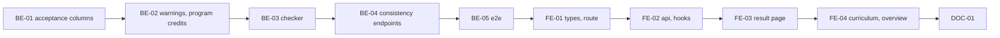

# F-08 Consistency Check — Backend + Frontend Implementation Plan

This plan builds the consistency check of a curriculum version: program-level credit totals that count each elective group by its minimum (FR-77), the comparison with the declared credits and a stored, reasoned acceptance of a mismatch (FR-78, BR-05), and the structural checks — requisite planned later, requisite outside the curriculum, duplicate course, cycle across the catalog and the curriculum, elective group whose minimum its members cannot reach, elective row with no group (FR-79..81). It delivers the result screen (MH-27), the program total on the curriculum screen (MH-25), the "Kiểm tra nhất quán" entry points, and a shared `ConsistencyChecker` whose `assertPasses` the submit (F-13) and release (F-15) flows call so that an Error blocks them.

It deliberately excludes calling the checker from submit and release (F-13, F-15 own those flows and call it), the import preview (F-09 calls the same pure function), the program health board that also collects PLO and syllabus gaps (MH-28, F-24, B6), detection of two equivalent courses in one curriculum (F-24), and storing check results (F08-03).

> **Companion documents**
> - Requirement: `docs/requirement/REQUIREMENTS.md:555-559` (FR-77..FR-81), `:814` (BR-03), `:816` (BR-05), `:1194` (EC-03), `:1196-1209` (EC-06, EC-09, EC-10, EC-13)
> - Stories: `docs/planning/user-stories.md:383-412` (US-029..US-031); epic EP-08 (`docs/planning/epics.md:79`)
> - Design: `docs/design/data-dictionary.md:270-297` (`ProgramVersion`, incl. `creditMismatchReason`), `:323-336` (`ElectiveGroup`); `docs/design/erd.md:251` (computed values, no entity); `docs/design/screen-inventory.md:93`, `:194` (MH-27); `docs/design/sequence-diagrams.md:169` (release runs the check)
> - Answers: `docs/planning/feature-questions.md:151-157` (§F-08, all A)
> - Builds on: F-02 (`AccessContext`, `PERMISSIONS.PROGRAM_VIEW`, `PROGRAM_EDIT_INFO`, `PERMISSION_TABLE`), F-04 (`decimal.ts`), F-05 (`requisite-graph.ts`), F-06 (`ProgramVersion` credit columns, `programTarget`, `ProgramSectionLinks`), F-07 (`curriculum-warnings.ts`, `CurriculumSharedModule`, `CurriculumService.read`, `CurriculumDto`, `CurriculumPage`, `CurriculumTotals`, `CurriculumWarningsPanel`)
> - Tests: `docs/planning/test-plan.md:167` (KB-013), `:172-175` (KB-018..KB-021), `:299` (NT-B2-06)

**Status**: Not started

---

## 0. Plan at a glance

Everything below in one table. Read this; the rest is detail for whoever builds it.

| What | Why | How and where |
|---|---|---|
| **Program total = compulsory credits + each elective group's minimum**, shown on the curriculum screen next to the declared figure | US-029 AC1, AC2; FR-77; KB-013 | Pure `programCredits` in `src/shared/curriculum/`; `CurriculumDto.programCredits`; the grand-total line of `CurriculumTotals` switches to it (BE-02, FE-04) |
| **A result screen listing Errors and Warnings of one version**, run on open and on "Chạy lại"; a clean run says "Không có lỗi, không có cảnh báo." | US-031 AC5; FR-79..81; MH-27; F08-01, F08-03 | `GET /api/program-versions/:versionId/consistency` recomputes every time; nothing stored (BE-04, FE-03) |
| **Credit mismatch warning with declared, computed and difference; accept with a reason** | US-030 AC1..AC3; FR-78; BR-05; EC-03; KB-018 | `PUT …/credit-mismatch-acceptance` stores reason, accepter, time and the accepted gaps on the version (BE-01, BE-04, FE-03) |
| **An accepted mismatch comes back when the difference changes** | US-030 AC4; KB-018 | The acceptance holds only while the current compulsory and elective gaps equal the stored ones (BE-03) |
| **New checks**: requisite outside the curriculum, elective row with no group (Warnings); duplicate course, unreachable group minimum, requisite cycle (Errors) | US-031 AC2..AC4; EC-06, EC-09, EC-13; KB-020, KB-021 | Pure checks added to F-07's `curriculumWarnings`; the cycle check over catalog + curriculum edges in the checker (BE-02, BE-03) |
| **Errors block submit and release; Warnings only show** | F08-02; sequence diagram "Chạy toàn bộ kiểm tra nhất quán" | `ConsistencyChecker.assertPasses(versionId, tx)` → 409 `CONSISTENCY_FAILED`; F-13 and F-15 call it (BE-03, §8) |
| **Entry points**: "Kiểm tra nhất quán" on the curriculum page and on the program overview | F08-01; MH-27 | Button in `CurriculumPage`; the disabled F-06 card enabled (FE-04) |
| **Click an issue to go where it is fixed** | MH-27 "bấm một dòng để tới chỗ cần sửa" | Row → curriculum page `?focus=<itemId>`, group → elective groups `?focus=<groupId>`, credits → program overview (FE-03, FE-04) |

**Key behaviours worth knowing**

| Behaviour | Why it is this way |
|---|---|
| The check is a GET with no side effects; each open or "Chạy lại" recomputes | F08-03: results are not stored, so there is nothing to go stale |
| The acceptance is stored, although results are not | US-030 AC3 asks for the reason and accepter to be viewable later; `ProgramVersion.creditMismatchReason` already exists in the data dictionary |
| An acceptance is a fingerprint of the gaps, not a flag | US-030 AC4: changing the curriculum or the declared credits so that a gap moves makes the warning come back with no write to clear it |
| A group with a course-count minimum counts at least the credits of its cheapest members | The program total needs credits; the fewest credits a student can take to satisfy the group is the honest lower bound (D3) |
| An elective row outside every group adds nothing to the program total | US-029 AC1 counts groups by their minimum; a loose elective row has no minimum. It is flagged instead |
| The duplicate-course check cannot fire on stored rows | F-07's unique (version, course) index already refuses them; the check exists for F-09's preview, which runs the same function over file rows (KB-025) |
| Errors do not block saving a row | F08-02 and BR-05: only submit and release are blocked; F-07's write rules (cycle, duplicate) still refuse the write itself |
| R5 can open the result screen | It is gated by `program.view` like MH-25; the inventory row is updated (§2c) |

**Not included**

| Excluded | Why |
|---|---|
| Calling the checker from submit / release | Those flows are F-13 and F-15; this plan ships `assertPasses` and an e2e that calls it directly |
| Equivalent courses both in one curriculum | Not in FR-79..81; belongs to the health board (MH-28, F-24) |
| Withdrawing an acceptance | No story asks for it; a new acceptance replaces the old one, and a changed gap voids it |
| Checking versions other than through their program's permission | One gate (`program.view`) for every version status; released versions can be checked for history |

**Open questions**: none — §F-08 answered (all A).

---

## 1. Scope

| In scope | Why |
|---|---|
| Program credit totals (compulsory, elective by group minimum, total) and per-group requirement | US-029; FR-77 |
| Credit comparison with the declared figures, acceptance with reason, accepter, time, accepted gaps | US-030; FR-78; BR-05 |
| Checks: requisite later (F-07), requisite outside, duplicate course, unreachable group minimum, elective without group, empty semester (F-07), cycle over the union, credit mismatch | US-031; FR-79..81; F-07 constraint |
| `ConsistencyChecker` with `check` and `assertPasses` | F08-01, F08-02; F-13, F-15 call it |
| MH-27 page; program total and check button on MH-25; overview card | MH-27; F08-01 |

| Out of scope | Deferred until |
|---|---|
| Submit / release blocking in place | F-13, F-15 |
| Import preview using the checks | F-09 |
| Health board, equivalent-course duplicates | F-24 (B6) |

| AC | Covered by |
|---|---|
| US-029 AC1 — total = compulsory + group minimums | BE-02 (`programCredits`), BE-05 (KB-013), FE-04 |
| US-029 AC2 — 0 and 2.5 credits exact | BE-02 (Decimal arithmetic), BE-05 |
| US-029 AC3 — totals recomputed after a row change | BE-02 (computed in `GET …/curriculum`), FE-04 (F-07's mutation refetch) |
| US-030 AC1 — warning with both numbers and the gap; save not blocked | BE-03 (`CREDIT_MISMATCH` HIGH), FE-03 |
| US-030 AC2 — accept without reason blocked | BE-04 (`AcceptCreditMismatchDto`), FE-03 (form rule) |
| US-030 AC3 — accepted state, reason and accepter viewable | BE-01, BE-04, FE-03 |
| US-030 AC4 — gap changes → warning again | BE-03 (`acceptanceCurrent`), BE-05 (KB-018) |
| US-031 AC1 — requisite later, HIGH, both courses and semesters | F-07 `REQUISITE_NOT_EARLIER`; BE-05 (KB-019 on the report) |
| US-031 AC2 — loop refused on save with its path; shown in the result | F-07 BE-04 (save); BE-03 (`REQUISITE_CYCLE` in the report, KB-020) |
| US-031 AC3 — requisite outside the curriculum warned | BE-02 (`REQUISITE_OUTSIDE`), BE-05 (KB-021) |
| US-031 AC4 — duplicate rows are a blocking error | BE-02 (`DUPLICATE_COURSE` ERROR) |
| US-031 AC5 — clean run says so | BE-04 (`issues: []`), FE-03 (`CLEAN_RESULT_MESSAGE`) |

---

## 2. Contract verification

F-08 builds on F-01..F-07 code that is **specified, not built**. Every "existing" claim cites the plan that defines it; Rule 13 re-reads the built file before the step that uses it.

| Existing piece used | Defined at | Used by |
|---|---|---|
| `PERMISSIONS.PROGRAM_VIEW` (R1..R5 X, R6 P), `PERMISSIONS.PROGRAM_EDIT_INFO` (R1 X, R3 P); `AccessContext.assertCan`, `modeFor(code, target): PermissionMode \| null`, `userId` | F-02 BE-03, BE-04 (`f-02-…-implementation-plan.md:566-567`, `:706`, `:1209`) | BE-04 |
| `@RequirePermission`, `@CurrentAccess()`, `AppException(definition, details?)`, `ErrorDefinition {status, code, message}` | F-01 D4 (`f-01-…:205`, `:330`), F-02 | BE-03, BE-04 |
| `CREDITS_PATTERN`, `CREDITS_MESSAGE`, `toWireDecimal(value: Prisma.Decimal): string` (`src/shared/decimal/decimal.ts`) | F-04 BE-02 (`f-04-…:446`) | BE-02, BE-04 |
| `RequisiteEdge {sourceCourseId, targetCourseId}`, `CYCLE_CHECKED_TYPES`, `findRequisiteCycle(edges, newEdge): string[] \| null` (path of ids from the new edge's target back to it), `lockRequisiteGraph(tx)` | F-05 BE-02 (`f-05-…:316-345`, `:639`) | BE-03 |
| `CourseRelation {sourceCourseId, targetCourseId, type, minScore}` | F-05 BE-01 | BE-03 |
| `ProgramVersion.{semesterCount, totalCredits, compulsoryCredits, electiveCredits, status}` (`Decimal(5,2)`); no acceptance columns | F-06 BE-01 (`f-06-…:259-279`) | BE-01, BE-03 |
| Clone copies version fields through an explicit pick list (`programName` … `electiveCredits`) | F-06 BE-04 (`f-06-…:759-760`) | BE-01 (acceptance not cloned) |
| `programTarget(program: {id, facultyId})` | F-06 BE-02 (`f-06-…:372`) | BE-04 |
| `ProgramSectionLinks` with the disabled "Kiểm tra nhất quán" card | F-06 FE-04; F-07 FE-06 (`f-07-…:2010`) | FE-04 |
| `curriculumWarnings(semesterCount, items)`, `CURRICULUM_WARNING {EMPTY_SEMESTER, REQUISITE_NOT_EARLIER}`, `WARNING_SEVERITY {INFO, HIGH}`, `WarningItem`, `CurriculumWarning`; `CurriculumFactsReader`; `CurriculumSharedModule` | F-07 BE-02 (`f-07-…:417-480`) | BE-02, BE-03 |
| `ElectiveGroup {minCredits Decimal(5,2)?, minCourses Int?}` with a check that one is set; `CurriculumItem {isElective, electiveGroupId, plannedSemester}` unique (version, course); `CurriculumRequisite {itemId, sourceCourseId, relationType}` | F-07 BE-01 (`f-07-…:275-370`) | BE-02, BE-03 |
| `CurriculumService.read` — the only caller of `curriculumWarnings`; `ITEM_INCLUDE` (course `RELATED_COURSE_SELECT` incl. `courseCode`, `credits`; requisites with `sourceCourse`), groups loaded with member credits | F-07 BE-03 (`f-07-…:794-881`) | BE-02 |
| `CurriculumDto`, `CurriculumWarningDto {code, severity, message, semester, itemId}` | F-07 §2b (`f-07-…:174-215`) | BE-02 |
| `CurriculumPage`, `CurriculumTotals` (grand total = Σ every row), `CurriculumWarningsPanel`, `useCurriculumMutation` (refetches the version) | F-07 FE-02, FE-03 (`f-07-…:1633-1764`) | FE-04 |
| `ROUTES.curriculum`, `ROUTES.electiveGroups`, `ROUTES.programDetail`; `getJson`, `sendJson`, `ApiErrorAlert`, `PageContainer`, `PageSkeleton`, `applyFieldErrors`, `RequirePermission` | F-01, F-02, F-06, F-07 FE-01 | FE-01..FE-03 |
| `PERMISSION_TABLE`, `PLACEHOLDER_ID`, `NO_ROLE`, `loginAgent`, `createProgram`, `createCourse`, `addCurriculumItem` | F-02 BE-10, F-06 BE-06, F-07 BE-06 (`f-07-…:1489`) | BE-05 |

### 2a. Endpoints

All under `/api`.

| Endpoint | Permission (guard) | Request | Response | Notes |
|---|---|---|---|---|
| `GET /program-versions/:versionId/consistency` | `program.view` | — | `ConsistencyReportDto` | Scoped `assertCan` on `programTarget`; any version status; recomputed per call, no write |
| `PUT /program-versions/:versionId/credit-mismatch-acceptance` | `program.editInfo` | `AcceptCreditMismatchDto` | `ConsistencyReportDto` | Scoped `assertCan`; version must be Draft; refused when there is no mismatch or the gaps moved since the user looked |
| `GET /program-versions/:versionId/curriculum` (F-07) | `program.view` | — | `CurriculumDto` + `programCredits` | `warnings` now carry the new pure codes |

### 2b. DTOs

**`ConsistencyReportDto`**

| Field | Wire type | Nullable | Note |
|---|---|---|---|
| `version` | `{ id, programId, programCode, programName, versionNumber: string \| null, status: 'DRAFT' \| 'PENDING' \| 'ACTIVE' \| 'HISTORICAL' }` | no | |
| `checkedAt` | `string` (ISO) | no | Server time of this run |
| `credits` | `CreditCheckDto` | no | |
| `groups` | `GroupRequirementDto[]` | no | Ordered by `groupCode` |
| `issues` | `ConsistencyIssueDto[]` | no | Errors first, then HIGH, then INFO; inside a severity by semester, then message |
| `errorCount` | `number` | no | Issues with severity `ERROR` |
| `warningCount` | `number` | no | Issues with severity `HIGH` or `INFO` |
| `passes` | `boolean` | no | `errorCount === 0` — what `assertPasses` would decide |
| `canAcceptMismatch` | `boolean` | no | Version is Draft and the caller holds `program.editInfo` on the program |

**`CreditCheckDto`**

| Field | Wire type | Nullable | Note |
|---|---|---|---|
| `declared` | `CreditBreakdownDto` | no | From the version's columns |
| `computed` | `CreditBreakdownDto` | no | `programCredits` |
| `gap` | `CreditBreakdownDto` | no | computed − declared; may be negative (`'-2'`) |
| `mismatch` | `boolean` | no | Any of the three gaps ≠ 0 |
| `acceptance` | `CreditAcceptanceDto` | **yes** | The stored acceptance, current or not |
| `acceptanceCurrent` | `boolean` | no | `acceptance` set and its gaps equal `gap.compulsory`, `gap.elective` |

**`CreditBreakdownDto`**: `compulsory: string`, `elective: string`, `total: string` (Decimal strings, `toWireDecimal`).

**`CreditAcceptanceDto`**: `reason: string`, `compulsoryGap: string`, `electiveGap: string`, `acceptedBy: { id: string; fullName: string }`, `acceptedAt: string`.

**`GroupRequirementDto`**: `id`, `groupCode`, `groupName`, `minCredits: string | null`, `minCourses: number | null`, `requiredCredits: string` (what the group adds to the total), `listedCredits: string`, `itemCount: number`.

**`ConsistencyIssueDto`**: `code`, `severity: 'ERROR' | 'HIGH' | 'INFO'`, `message: string`, `semester: number | null`, `itemId: string | null`, `groupId: string | null`.

`code` values, verbatim: `'EMPTY_SEMESTER' | 'REQUISITE_NOT_EARLIER' | 'REQUISITE_OUTSIDE' | 'ELECTIVE_WITHOUT_GROUP' | 'DUPLICATE_COURSE' | 'GROUP_MINIMUM_UNREACHABLE' | 'REQUISITE_CYCLE' | 'CREDIT_MISMATCH' | 'CREDIT_MISMATCH_ACCEPTED'`.

| Code | Severity | Where computed | Message names |
|---|---|---|---|
| `EMPTY_SEMESTER` | INFO | pure (F-07) | the semester |
| `REQUISITE_NOT_EARLIER` | HIGH | pure (F-07) | both courses and semesters |
| `REQUISITE_OUTSIDE` | HIGH | pure | the row's course and the outside course |
| `ELECTIVE_WITHOUT_GROUP` | HIGH | pure | the course; "không được tính vào tổng" |
| `DUPLICATE_COURSE` | ERROR | pure | the course and its semesters |
| `GROUP_MINIMUM_UNREACHABLE` | ERROR | pure | the group, its minimum, what its members offer |
| `REQUISITE_CYCLE` | ERROR | checker | the loop as course codes `A → B → A` |
| `CREDIT_MISMATCH` | HIGH | checker | declared, computed, gap |
| `CREDIT_MISMATCH_ACCEPTED` | INFO | checker | the gap and the accepter |

**`AcceptCreditMismatchDto`** (request): `reason` (trim, 1..`CONSISTENCY_LIMITS.REASON_MAX` = 500), `compulsoryGap`, `electiveGap` (`CREDIT_GAP_PATTERN`: the gaps the user saw).

**`CurriculumDto` (F-07) gains** `programCredits: ProgramCreditsDto` = `{ computed: CreditBreakdownDto; declared: CreditBreakdownDto; mismatch: boolean }`. `CurriculumWarningDto` gains `groupId: string | null`; its `code` and `severity` unions widen to the lists above (cycle and credit codes never appear there — they need the database and the acceptance, so they are on MH-27 only).

### 2c. Mismatch log

| Deliverable | What the doc said | What this plan does | Found at |
|---|---|---|---|
| BE-01 | `ProgramVersion.creditMismatchReason` only | Adds accepted gaps, accepter and time — US-030 AC3 (accepter viewable) and AC4 (warning returns when the gap changes) need them | `data-dictionary.md` §`ProgramVersion` |
| BE-01 | `erd.md:251`: consistency warnings computed, no entity | Still true for results; the acceptance is columns on `ProgramVersion`, not an entity | `erd.md:251` |
| BE-04 | MH-27 roles: R1 T, R2 X, R3 P, R4 X, R5 — | R5 X too: the screen is gated by `program.view`, and R5 already reads the same curriculum on MH-25 | `screen-inventory.md:93`, `:194` |
| BE-02 | F-07 `read` calls `toWarningItem` | No F-07 deliverable defines it; BE-02 defines it in `src/shared/curriculum/curriculum-warnings.ts` so the checker can use it too | `f-07-…:881` |
| BE-02 | F-07 `CurriculumTotals` grand total = Σ every row | Program total = compulsory + group minimums (US-029 AC1); per-semester and per-block totals keep counting every row as on the Khoa sheet | `f-07-…:1763`, `user-stories.md` US-029 AC1 |

The data dictionary and screen inventory rows above are updated (in Vietnamese) with this plan.

---

## 3. Decisions

| # | Decision | Why | Rejected alternative |
|---|---|---|---|
| D1 | Severities `ERROR` (blocks submit/release), `HIGH`, `INFO` (show only); `ERROR` added to F-07's `WARNING_SEVERITY` | F08-02 two levels; F-07 asked to extend, not fork | A separate issue type for the check — two lists of codes to keep in step |
| D2 | `curriculumWarnings(input)` takes `{ semesterCount, items, groups }` and holds every check that needs only rows and groups; the checker adds cycle and credit checks that need the database | F-09's preview runs the pure part over file rows; the curriculum page shows the pure part on every load | Everything in the checker — F-09 could not reuse it without saved rows |
| D3 | A group adds the larger of `minCredits` and the credits of its `minCourses` cheapest members (a missing minimum counts as 0) | The program total is in credits; this is the least a student can take to satisfy the group | Listed credits — US-029 AC1 forbids; skip count-only groups — the total would be too low |
| D4 | Ungrouped elective rows add nothing to the total and raise `ELECTIVE_WITHOUT_GROUP` (HIGH) | US-029 AC1 counts groups; F-07 lets a row stay elective with no group | Count them as compulsory — misstates the program |
| D5 | The credit check compares all three buckets; the acceptance stores the compulsory and elective gaps (total gap = their sum) | A total that matches with a wrong split is still a BR-03 mismatch; two gaps are the smallest fingerprint | Store only the total gap — a moved split would keep an old acceptance |
| D6 | The accept request carries the gaps the user saw; the server refuses `CREDIT_GAP_CHANGED` if they moved | A reason written for "lệch 2" must not be stored against "lệch 5" | Server takes the current gaps blindly — races silently |
| D7 | Accept: `program.editInfo` scoped on the program + version Draft; no edit-path check | Matches MH-27 "R1, R3"; accepting annotates the Draft under review, it does not change content | `curriculum.edit` — R4/R5 would accept program-level gaps; edit path — after release the only Draft is a request Draft, and the request carries its own acceptance |
| D8 | Cycle report: for each curriculum requisite edge, `findRequisiteCycle(all other edges, edge)`; loops deduplicated by their course set | Reuses F-05's tested function; a version has at most a few hundred edges | A new SCC algorithm — a second graph routine to test |
| D9 | `assertPasses(versionId, db)` takes a transaction client; callers run it after `lockRequisiteGraph(tx)` | A catalog edge written between check and release would otherwise slip in | Check outside the transaction |
| D10 | GET for the check; "Chạy lại" refetches | No side effects, nothing stored (F08-03) | POST "run" — implies a stored run |
| D11 | New feature module `src/features/consistency/` for the two routes; the checker in `src/shared/curriculum/` | F-13 (change requests) and F-15 (versions) call the checker without importing a feature (`nestjs-rules.md` §1) | Routes inside `curriculum` — that module is already large; checker inside a feature — F-13/F-15 could not reach it |

---

## 5. Deliverables

### BE-01 — Prisma schema: credit-mismatch acceptance on the version

What/Why: US-030 AC3, AC4; D5, D6. The acceptance is the only stored part of the check (F08-03 stores no results).

**Files**

| Action | Path |
|---|---|
| MODIFY | `prisma/schema.prisma` (`ProgramVersion`, `User`) |
| NEW | `prisma/migrations/<timestamp>_credit_mismatch_acceptance/migration.sql` (generated, then edited) |

**Shape**

```prisma
model ProgramVersion {
  // … F-06 fields unchanged
  creditMismatchReason        String?
  creditMismatchCompulsoryGap Decimal?  @db.Decimal(5, 2)
  creditMismatchElectiveGap   Decimal?  @db.Decimal(5, 2)
  creditMismatchAcceptedById  String?
  creditMismatchAcceptedBy    User?     @relation("CreditMismatchAcceptedBy", fields: [creditMismatchAcceptedById], references: [id], onDelete: Restrict)
  creditMismatchAcceptedAt    DateTime?
}

model User {
  // … F-01..F-07 fields unchanged
  creditMismatchAcceptances ProgramVersion[] @relation("CreditMismatchAcceptedBy")
}
```

```
pnpm prisma migrate dev --create-only --name credit_mismatch_acceptance
# append the check below, then:
pnpm prisma migrate dev
pnpm prisma generate
```

```sql
-- appended to migration.sql
ALTER TABLE "ProgramVersion" ADD CONSTRAINT "ProgramVersion_credit_acceptance_complete"
  CHECK (num_nulls("creditMismatchReason", "creditMismatchCompulsoryGap", "creditMismatchElectiveGap", "creditMismatchAcceptedById", "creditMismatchAcceptedAt") IN (0, 5));
```

**Rationale**: Mirrors F-06's `ProgramDirectorAssignment.assignedBy` (`f-06-…:291`) for the accepter relation and F-07 BE-01's appended checks (`f-07-…:366-371`). Columns, not a table: a version holds at most one current acceptance and a new one replaces it (Not included: no withdrawal, no history).

**Gotchas**
- The gap columns are signed (computed − declared). `Decimal(5,2)` holds −999.99..999.99, which covers any difference of two `Decimal(5,2)` totals ≤ 999.99.
- F-06's clone picks version fields by name (`f-06-…:759-760`); the new columns are not in the list, so a cloned program starts without an acceptance — intended. Do not switch the clone to a spread.
- `onDelete: Restrict` on the accepter: accounts are locked, never deleted (F-02).

**Verify**: `pnpm prisma migrate dev` applies; `pnpm exec tsc --noEmit -p tsconfig.json`; in psql, an `UPDATE` setting only `creditMismatchReason` fails with `ProgramVersion_credit_acceptance_complete`.

**Depends on**: F-06 BE-01, F-07 BE-01 built

---

### BE-02 — Shared: extended warnings, program credits, the F-07 caller

What/Why: US-029 AC1..AC3, US-031 AC3, AC4; D1..D4; F-07 constraint "extend, not fork".

**Files**

| Action | Path |
|---|---|
| MODIFY | `src/shared/curriculum/curriculum-warnings.ts` |
| MODIFY | `src/shared/curriculum/curriculum-warnings.spec.ts` |
| NEW | `src/shared/curriculum/program-credits.ts` |
| NEW | `src/shared/curriculum/program-credits.spec.ts` |
| MODIFY | `src/features/curriculum/curriculum.service.ts` (`read`, `findVersion` select) |
| MODIFY | `src/features/curriculum/curriculum.service.spec.ts` |
| NEW | `src/shared/curriculum/credit-breakdown.dto.ts` (`CreditBreakdownDto`, `toCreditBreakdownDto`) |
| MODIFY | `src/features/curriculum/curriculum.dto.ts` (`CurriculumWarningDto`, `ProgramCreditsDto`, `CurriculumDto.programCredits`) |

**Shape**

```ts
// src/shared/curriculum/program-credits.ts
export interface CreditItem {
  credits: Prisma.Decimal;
  isElective: boolean;
  electiveGroupId: string | null;
}

export interface CreditGroup {
  id: string;
  minCredits: Prisma.Decimal | null;
  minCourses: number | null;
}

export interface ProgramCredits {
  compulsory: Prisma.Decimal;
  elective: Prisma.Decimal;
  total: Prisma.Decimal;
}

const ZERO = new Prisma.Decimal(0);

function sum(values: readonly Prisma.Decimal[]): Prisma.Decimal {
  return values.reduce((total, value) => total.plus(value), ZERO);
}

// The least a student can take to satisfy the group: its credit minimum, or the credits of its cheapest
// members when only a course count is set, whichever is larger when both are.
export function groupRequiredCredits(group: CreditGroup, memberCredits: readonly Prisma.Decimal[]): Prisma.Decimal {
  const cheapest = [...memberCredits].sort((a, b) => a.comparedTo(b)).slice(0, group.minCourses ?? 0);
  return Prisma.Decimal.max(group.minCredits ?? ZERO, sum(cheapest));
}

// Elective rows outside every group add nothing; they are flagged by curriculumWarnings.
export function programCredits(items: readonly CreditItem[], groups: readonly CreditGroup[]): ProgramCredits {
  const compulsory = sum(items.filter((item) => !item.isElective).map((item) => item.credits));
  const elective = sum(groups.map((group) =>
    groupRequiredCredits(group, items.filter((item) => item.electiveGroupId === group.id).map((item) => item.credits))));
  return { compulsory, elective, total: compulsory.plus(elective) };
}
```

```ts
// src/shared/curriculum/curriculum-warnings.ts — after the change
export const CURRICULUM_WARNING = {
  EMPTY_SEMESTER: 'EMPTY_SEMESTER',
  REQUISITE_NOT_EARLIER: 'REQUISITE_NOT_EARLIER',
  REQUISITE_OUTSIDE: 'REQUISITE_OUTSIDE',
  ELECTIVE_WITHOUT_GROUP: 'ELECTIVE_WITHOUT_GROUP',
  DUPLICATE_COURSE: 'DUPLICATE_COURSE',
  GROUP_MINIMUM_UNREACHABLE: 'GROUP_MINIMUM_UNREACHABLE',
  REQUISITE_CYCLE: 'REQUISITE_CYCLE',
  CREDIT_MISMATCH: 'CREDIT_MISMATCH',
  CREDIT_MISMATCH_ACCEPTED: 'CREDIT_MISMATCH_ACCEPTED',
} as const;
export type CurriculumWarningCode = (typeof CURRICULUM_WARNING)[keyof typeof CURRICULUM_WARNING];

// ERROR blocks submit and release; HIGH and INFO only show.
export const WARNING_SEVERITY = { ERROR: 'ERROR', HIGH: 'HIGH', INFO: 'INFO' } as const;
export type WarningSeverity = (typeof WARNING_SEVERITY)[keyof typeof WARNING_SEVERITY];
const SEVERITY_RANK: Record<WarningSeverity, number> = { ERROR: 0, HIGH: 1, INFO: 2 };

export interface WarningItem extends CreditItem {
  id: string;
  courseId: string;
  courseCode: string;
  plannedSemester: number;
  requisites: readonly { sourceCourseId: string; sourceCourseCode: string; relationType: CourseRelationType }[];
}

export interface WarningGroup extends CreditGroup {
  groupCode: string;
}

export interface CurriculumWarning {
  code: CurriculumWarningCode;
  severity: WarningSeverity;
  message: string;
  semester: number | null;
  itemId: string | null;
  groupId: string | null;
}

export interface WarningInput {
  semesterCount: number;
  items: readonly WarningItem[];
  groups: readonly WarningGroup[];
}

// Structural rows from F-07's ITEM_INCLUDE and the checker's select both satisfy this.
export interface WarningItemRow {
  id: string;
  courseId: string;
  plannedSemester: number;
  isElective: boolean;
  electiveGroupId: string | null;
  course: { courseCode: string; credits: Prisma.Decimal };
  requisites: readonly { sourceCourseId: string; relationType: CourseRelationType; sourceCourse: { courseCode: string } }[];
}

export function toWarningItem(row: WarningItemRow): WarningItem {
  return {
    id: row.id, courseId: row.courseId, courseCode: row.course.courseCode, plannedSemester: row.plannedSemester,
    credits: row.course.credits, isElective: row.isElective, electiveGroupId: row.electiveGroupId,
    requisites: row.requisites.map((requisite) => ({
      sourceCourseId: requisite.sourceCourseId, sourceCourseCode: requisite.sourceCourse.courseCode, relationType: requisite.relationType,
    })),
  };
}

export function sortWarnings(warnings: CurriculumWarning[]): CurriculumWarning[] {
  return warnings.sort((a, b) => SEVERITY_RANK[a.severity] - SEVERITY_RANK[b.severity]
    || (a.semester ?? Number.MAX_SAFE_INTEGER) - (b.semester ?? Number.MAX_SAFE_INTEGER)
    || a.message.localeCompare(b.message, 'vi'));
}

export function curriculumWarnings({ semesterCount, items, groups }: WarningInput): CurriculumWarning[] {
  return sortWarnings([
    ...emptySemesters(semesterCount, items),
    ...requisiteWarnings(items),
    ...duplicateCourses(items),
    ...groupWarnings(items, groups),
  ]);
}
```

The four private helpers, in the same file:

| Helper | Emits | Rule |
|---|---|---|
| `emptySemesters` | `EMPTY_SEMESTER` INFO | F-07's loop, unchanged |
| `requisiteWarnings` | `REQUISITE_NOT_EARLIER` HIGH (F-07's rule, unchanged); `REQUISITE_OUTSIDE` HIGH | Outside = no item has `courseId === requisite.sourceCourseId`, for every relation type. Message: `` `${item.courseCode} cần ${requisite.sourceCourseCode} (${REQUISITE_TYPE_LABEL[type]}), nhưng ${requisite.sourceCourseCode} không có trong khung.` `` `semester` = the row's |
| `duplicateCourses` | `DUPLICATE_COURSE` ERROR, once per repeated course | Group items by `courseId`; message lists the semesters: `` `${courseCode} xuất hiện ${n} lần trong khung (học kỳ ${semesters.join(', ')}).` ``; `itemId` = the second occurrence |
| `groupWarnings` | `ELECTIVE_WITHOUT_GROUP` HIGH per loose elective row; `GROUP_MINIMUM_UNREACHABLE` ERROR per group | Loose: `isElective && electiveGroupId === null`, message `` `${courseCode} là học phần tự chọn nhưng chưa thuộc nhóm nào nên không được tính vào tổng tín chỉ.` ``. Unreachable: members' credits < `minCredits`, or member count < `minCourses`; message names the group, the minimum and what the members offer; `groupId` set, `itemId` null |

`REQUISITE_TYPE_LABEL` (`{ PRIOR: 'học trước', PREREQUISITE: 'tiên quyết', COREQUISITE: 'song hành' }`) is a constant in this file; the client has its own labels.

```ts
// src/features/curriculum/curriculum.service.ts — read(), changed lines only
const warningItems = rows.map(toWarningItem);
const warningGroups = groups.map((group) => ({ id: group.id, groupCode: group.groupCode, minCredits: group.minCredits, minCourses: group.minCourses }));
const computed = programCredits(warningItems, warningGroups);
// …
  programCredits: {
    computed: toCreditBreakdownDto(computed),
    declared: toCreditBreakdownDto({ compulsory: version.compulsoryCredits, elective: version.electiveCredits, total: version.totalCredits }),
    mismatch: !computed.compulsory.equals(version.compulsoryCredits) || !computed.elective.equals(version.electiveCredits),
  },
  warnings: curriculumWarnings({ semesterCount: version.semesterCount, items: warningItems, groups: warningGroups }),
```

```ts
// src/shared/curriculum/credit-breakdown.dto.ts — shared because the consistency feature returns it too
export class CreditBreakdownDto {
  @ApiProperty() compulsory: string;
  @ApiProperty() elective: string;
  @ApiProperty() total: string;
}

export function toCreditBreakdownDto(credits: ProgramCredits): CreditBreakdownDto {
  return { compulsory: toWireDecimal(credits.compulsory), elective: toWireDecimal(credits.elective), total: toWireDecimal(credits.total) };
}
```

```ts
// src/features/curriculum/curriculum.dto.ts — additions
export class ProgramCreditsDto {
  @ApiProperty({ type: CreditBreakdownDto }) computed: CreditBreakdownDto;
  @ApiProperty({ type: CreditBreakdownDto }) declared: CreditBreakdownDto;
  @ApiProperty() mismatch: boolean;
}
// CurriculumWarningDto: code/severity enums from CURRICULUM_WARNING / WARNING_SEVERITY (enumName 'CurriculumWarningCode', 'WarningSeverity'); + groupId: string | null
// CurriculumDto: + programCredits: ProgramCreditsDto
```

`findVersion` in `curriculum.service.ts` adds `totalCredits`, `compulsoryCredits`, `electiveCredits` to its select.

**Rationale**: Extends F-07's file (`f-07-…:417-462`) rather than adding a second warnings module (D1, D2). `programCredits` mirrors F-07's `semesterTotals` Decimal reduction (`f-07-…:759-773`). `toWarningItem` is in the shared file because the checker (BE-03) cannot import the curriculum feature; F-07's `read` already called it (`f-07-…:881`) without defining it.

**Gotchas**
- **Shared-function change (Rule 13):** `curriculumWarnings` changes signature. Callers today: F-07 `CurriculumService.read` only — grep `curriculumWarnings(` and list each call site with "migrated" in the implement report. F-09 is the next caller and uses the new signature from the start.
- `curriculumWarnings` stays pure — no Prisma client, no `Date`. The cycle and credit codes are in the union but emitted only by the checker.
- `mismatch` on the curriculum page compares compulsory and elective only: F-06 enforces declared total = compulsory + elective (`f-06-…:588-590`), so a total gap cannot exist without one of the two.
- F-07's `semesterTotals` and `blockTotals` keep counting every row (the Khoa sheet's per-semester view); only the program line uses `programCredits` (§2c).
- `Prisma.Decimal.max` and `comparedTo` exist on decimal.js; do not convert to `number` anywhere — 2.5 must stay exact (US-029 AC2).

Unit cases (`program-credits.spec.ts`, `curriculum-warnings.spec.ts`):

| Case | Expect |
|---|---|
| 3 compulsory rows 3 + 2.5 + 0; group min 6 TC with five 3-credit rows | compulsory `5.5`, elective `6`, total `11.5` (KB-013) |
| Group minCourses 2 with members 3, 2, 4 | required `5` |
| Group minCredits 4 and minCourses 2 with members 3, 3 | required `6` |
| Elective row with no group, 3 credits | adds nothing; `ELECTIVE_WITHOUT_GROUP` HIGH |
| Row B requires X (PREREQUISITE), X not listed | `REQUISITE_OUTSIDE` HIGH naming B and X (KB-021) |
| COREQUISITE to an outside course | `REQUISITE_OUTSIDE` too |
| Same `courseId` in semesters 2 and 5 | one `DUPLICATE_COURSE` ERROR naming 2, 5 |
| Group min 9 TC, members 3 + 3 | `GROUP_MINIMUM_UNREACHABLE` ERROR with `groupId` |
| Group minCourses 3, 2 members | `GROUP_MINIMUM_UNREACHABLE` ERROR |
| One of each severity | order ERROR, HIGH, INFO |
| F-07's existing cases | unchanged results through the new signature |

**Verify**: `pnpm test src/shared/curriculum src/features/curriculum`; `pnpm exec tsc --noEmit -p tsconfig.json`; `GET …/curriculum` in Swagger shows `programCredits`.

**Depends on**: BE-01; F-07 BE-02, BE-03 built

---

### BE-03 — Shared: `ConsistencyChecker` (cycles over the union, credit check, `assertPasses`)

What/Why: US-030 AC1, AC4; US-031 AC2; F08-02; D5, D8, D9.

**Files**

| Action | Path |
|---|---|
| NEW | `src/shared/curriculum/curriculum-cycles.ts` |
| NEW | `src/shared/curriculum/curriculum-cycles.spec.ts` |
| NEW | `src/shared/curriculum/consistency-checker.ts` |
| NEW | `src/shared/curriculum/consistency-checker.spec.ts` |
| NEW | `src/shared/curriculum/consistency-errors.ts` |
| MODIFY | `src/shared/curriculum/curriculum-shared.module.ts` (provide + export `ConsistencyChecker`) |

**Shape**

```ts
// src/shared/curriculum/curriculum-cycles.ts
// Each loop that runs through at least one curriculum edge, once, as course ids starting and ending at the same id.
// Loops made of catalog edges alone are F-05's concern and were refused when written.
export function curriculumCycles(catalogEdges: readonly RequisiteEdge[], curriculumEdges: readonly RequisiteEdge[]): string[][] {
  const all = [...catalogEdges, ...curriculumEdges];
  const seen = new Set<string>();
  const cycles: string[][] = [];
  for (const edge of curriculumEdges) {
    const path = findRequisiteCycle(all.filter((other) => other !== edge), edge);
    if (!path) continue;
    const key = [...new Set(path)].sort().join('|');
    if (seen.has(key)) continue;
    seen.add(key);
    cycles.push(path);
  }
  return cycles;
}
```

```ts
// src/shared/curriculum/consistency-errors.ts
export const CONSISTENCY_ERRORS = {
  VERSION_NOT_FOUND: { status: HttpStatus.NOT_FOUND, code: 'PROGRAM_VERSION_NOT_FOUND', message: 'Không tìm thấy phiên bản chương trình.' },
  CONSISTENCY_FAILED: { status: HttpStatus.CONFLICT, code: 'CONSISTENCY_FAILED', message: 'Khung chương trình còn lỗi nhất quán; sửa các lỗi rồi thử lại.' },
} as const satisfies Record<string, ErrorDefinition>;
```

```ts
// src/shared/curriculum/consistency-checker.ts
type Db = PrismaService | Prisma.TransactionClient;

const CHECK_VERSION_SELECT = {
  id: true, programId: true, versionNumber: true, status: true, programName: true, semesterCount: true,
  totalCredits: true, compulsoryCredits: true, electiveCredits: true,
  program: { select: { id: true, facultyId: true, programCode: true } },
  creditMismatchReason: true, creditMismatchCompulsoryGap: true, creditMismatchElectiveGap: true, creditMismatchAcceptedAt: true,
  creditMismatchAcceptedBy: { select: { id: true, fullName: true } },
} as const satisfies Prisma.ProgramVersionSelect;
export type CheckedVersion = Prisma.ProgramVersionGetPayload<{ select: typeof CHECK_VERSION_SELECT }>;

const CHECK_ITEM_SELECT = {
  id: true, courseId: true, plannedSemester: true, isElective: true, electiveGroupId: true,
  course: { select: { courseCode: true, credits: true } },
  requisites: { select: { sourceCourseId: true, relationType: true, sourceCourse: { select: { courseCode: true } } } },
} as const satisfies Prisma.CurriculumItemSelect;

export interface CreditAcceptance {
  reason: string;
  compulsoryGap: Prisma.Decimal;
  electiveGap: Prisma.Decimal;
  acceptedBy: { id: string; fullName: string };
  acceptedAt: Date;
}

export interface GroupRequirement {
  id: string;
  groupCode: string;
  groupName: string;
  minCredits: Prisma.Decimal | null;
  minCourses: number | null;
  requiredCredits: Prisma.Decimal;
  listedCredits: Prisma.Decimal;
  itemCount: number;
}

export interface ConsistencyResult {
  version: CheckedVersion;
  credits: {
    declared: ProgramCredits;
    computed: ProgramCredits;
    gap: ProgramCredits;
    mismatch: boolean;
    acceptance: CreditAcceptance | null;
    acceptanceCurrent: boolean;
  };
  groups: GroupRequirement[];
  issues: CurriculumWarning[];
}

@Injectable()
export class ConsistencyChecker {
  constructor(private readonly prisma: PrismaService) {}

  async check(versionId: string, db: Db = this.prisma): Promise<ConsistencyResult> {
    const version = await db.programVersion.findUnique({ where: { id: versionId }, select: CHECK_VERSION_SELECT });
    if (!version) throw new AppException(CONSISTENCY_ERRORS.VERSION_NOT_FOUND);
    const [rows, groupRows, catalogRelations] = await Promise.all([
      db.curriculumItem.findMany({ where: { versionId }, select: CHECK_ITEM_SELECT }),
      db.electiveGroup.findMany({ where: { versionId }, orderBy: { groupCode: 'asc' } }),
      db.courseRelation.findMany({ where: { type: { in: [...CYCLE_CHECKED_TYPES] } }, select: { sourceCourseId: true, targetCourseId: true } }),
    ]);
    const items = rows.map(toWarningItem);
    const groups = groupRows.map((group) => ({ id: group.id, groupCode: group.groupCode, minCredits: group.minCredits, minCourses: group.minCourses }));
    const credits = this.creditCheck(version, programCredits(items, groups));
    const cycles = await this.cycleIssues(db, catalogRelations, items);
    return {
      version,
      credits,
      groups: groupRows.map((group) => toGroupRequirement(group, items)),
      issues: sortWarnings([...curriculumWarnings({ semesterCount: version.semesterCount, items, groups }), ...cycles, ...creditIssues(credits)]),
    };
  }

  // Callers inside a submit or release transaction run lockRequisiteGraph(tx) first, so no catalog edge lands between check and write.
  async assertPasses(versionId: string, db: Db = this.prisma): Promise<void> {
    const { issues } = await this.check(versionId, db);
    const errors = issues.filter((issue) => issue.severity === WARNING_SEVERITY.ERROR);
    if (errors.length > 0) {
      throw new AppException(CONSISTENCY_ERRORS.CONSISTENCY_FAILED, errors.map((issue) => ({ field: issue.code, constraints: [issue.message] })));
    }
  }

  private creditCheck(version: CheckedVersion, computed: ProgramCredits): ConsistencyResult['credits'] { /* see table */ }
  private async cycleIssues(db: Db, catalog: readonly RequisiteEdge[], items: readonly WarningItem[]): Promise<CurriculumWarning[]> { /* see table */ }
}
```

| Piece | Behaviour |
|---|---|
| `creditCheck` | `declared` from the three version columns; `gap` = computed − declared per bucket; `mismatch` = compulsory or elective gap ≠ 0; `acceptance` from the five columns when `creditMismatchAcceptedAt` is set; `acceptanceCurrent` = `mismatch && acceptance && acceptance.compulsoryGap.equals(gap.compulsory) && acceptance.electiveGap.equals(gap.elective)` |
| `creditIssues(credits)` (module function) | No mismatch → none. Current acceptance → `CREDIT_MISMATCH_ACCEPTED` INFO: `` `Đã chấp nhận chênh lệch ${abs(gap.total)} tín chỉ (${acceptedBy.fullName}, ${date}): ${reason}` ``. Else → `CREDIT_MISMATCH` HIGH: `` `Tín chỉ khai báo: ${declared.total} (bắt buộc ${…}, tự chọn ${…}); tính từ khung: ${computed.total} (bắt buộc ${…}, tự chọn ${…}); chênh lệch ${abs(gap.total)}.` `` — `semester`, `itemId`, `groupId` all null |
| `cycleIssues` | Curriculum edges = each item's requisites whose type is in `CYCLE_CHECKED_TYPES`, as `{ sourceCourseId, targetCourseId: item.courseId }`; `curriculumCycles(catalog, edges)`; ids not among `items` are resolved with one `db.course.findMany({ where: { id: { in } }, select: { id, courseCode } })`; one `REQUISITE_CYCLE` ERROR per loop, message `` `Vòng điều kiện: ${codes.join(' → ')}.` ``, `itemId` = the row whose requisite closed it |
| `toGroupRequirement` | `requiredCredits` from `groupRequiredCredits`; `listedCredits` and `itemCount` over the group's items |

`curriculum-shared.module.ts`: `providers: [CurriculumFactsReader, ConsistencyChecker]`, `exports` the same.

**Rationale**: `curriculumCycles` reuses F-05's `findRequisiteCycle` (`f-05-…:328`) per D8 — the same function that refuses writes reports the loop, so the path in the report and the path in the refusal agree. The checker lives in `src/shared/curriculum/` beside F-07's `CurriculumFactsReader` (`f-07-…:466-480`) so F-13 and F-15 inject it without importing a feature (D11).

**Gotchas**
- A loop through the curriculum appears only when a catalog edge was written after the curriculum requisite (F-05 checks catalog writes against the catalog only); F-07 refuses the reverse order at write time. The report is where it surfaces (US-031 AC2, KB-020).
- `all.filter((other) => other !== edge)` compares by reference: the curriculum edge objects are built once per call; do not rebuild them inside the loop.
- `check` accepts a transaction client so F-13/F-15 read inside their transaction. Do not call `this.prisma` inside `check` — every query goes through `db`.
- `CYCLE_CHECKED_TYPES` is readonly; spread it for Prisma's `in`.
- Reading every catalog relation is fine at the Khoa's size (hundreds of edges); F-05 does the same on every relation write.

Unit cases (`curriculum-cycles.spec.ts`, `consistency-checker.spec.ts` with a mocked Prisma):

| Case | Expect |
|---|---|
| Curriculum B←A (A before B); catalog A←B | one cycle `[A, B, A]` (or rotation) |
| Two curriculum edges on the same loop | reported once |
| Catalog-only loop | not reported |
| Declared 150 (100/50), computed 148 (98/50) | `gap.total = -2`, `CREDIT_MISMATCH` HIGH, message has 150, 148, 2 (KB-018) |
| Acceptance stored with gaps −2 / 0 | `CREDIT_MISMATCH_ACCEPTED` INFO, `acceptanceCurrent` |
| Same acceptance, computed now 145 | `CREDIT_MISMATCH` HIGH again, `acceptanceCurrent = false`, `acceptance` still returned |
| No mismatch, old acceptance stored | no credit issue; `acceptanceCurrent = false` |
| `assertPasses` with one `DUPLICATE_COURSE` | 409 `CONSISTENCY_FAILED`, `details[0] = { field: 'DUPLICATE_COURSE', constraints: [message] }` |
| `assertPasses` with only HIGH issues | resolves |
| Unknown id | 404 `PROGRAM_VERSION_NOT_FOUND` |

**Verify**: `pnpm test src/shared/curriculum`; `pnpm exec tsc --noEmit -p tsconfig.json`.

**Depends on**: BE-02; F-05 BE-02 built

---

### BE-04 — Feature `consistency`: report and acceptance endpoints

What/Why: MH-27; US-030 AC1..AC3, US-031 AC5; D6, D7, D10, D11.

**Files**

| Action | Path |
|---|---|
| NEW | `src/features/consistency/consistency.module.ts` |
| NEW | `src/features/consistency/consistency.controller.ts` |
| NEW | `src/features/consistency/consistency.service.ts` |
| NEW | `src/features/consistency/consistency.service.spec.ts` |
| NEW | `src/features/consistency/consistency.dto.ts` (response DTOs, `toConsistencyReportDto`) |
| NEW | `src/features/consistency/accept-credit-mismatch.dto.ts` (`AcceptCreditMismatchDto`, `CONSISTENCY_LIMITS`, `CREDIT_GAP_PATTERN`) |
| NEW | `src/features/consistency/consistency.errors.ts` |
| MODIFY | `src/app.module.ts` |

**Shape**

```ts
// src/features/consistency/consistency.errors.ts
export const CONSISTENCY_FEATURE_ERRORS = {
  VERSION_NOT_EDITABLE: { status: HttpStatus.CONFLICT, code: 'VERSION_NOT_EDITABLE', message: 'Chỉ chấp nhận chênh lệch tín chỉ trên phiên bản nháp.' },
  NO_CREDIT_MISMATCH: { status: HttpStatus.CONFLICT, code: 'NO_CREDIT_MISMATCH', message: 'Số tín chỉ khai báo đã khớp với khung; không có chênh lệch để chấp nhận.' },
  CREDIT_GAP_CHANGED: { status: HttpStatus.CONFLICT, code: 'CREDIT_GAP_CHANGED', message: 'Chênh lệch tín chỉ đã thay đổi; chạy lại kiểm tra rồi chấp nhận lại.' },
} as const satisfies Record<string, ErrorDefinition>;
```

```ts
// src/features/consistency/accept-credit-mismatch.dto.ts
export const CONSISTENCY_LIMITS = { REASON_MAX: 500 } as const;
export const CREDIT_GAP_PATTERN = /^-?\d{1,3}(\.\d{1,2})?$/;
export const CREDIT_GAP_MESSAGE = 'Chênh lệch tín chỉ không hợp lệ.';

export class AcceptCreditMismatchDto {
  @ApiProperty({ maxLength: CONSISTENCY_LIMITS.REASON_MAX })
  @Transform(trimString) @IsString() @IsNotEmpty({ message: 'Nhập lý do chấp nhận chênh lệch.' }) @MaxLength(CONSISTENCY_LIMITS.REASON_MAX)
  reason: string;

  @ApiProperty({ example: '-2' }) @Matches(CREDIT_GAP_PATTERN, { message: CREDIT_GAP_MESSAGE }) compulsoryGap: string;
  @ApiProperty({ example: '0' }) @Matches(CREDIT_GAP_PATTERN, { message: CREDIT_GAP_MESSAGE }) electiveGap: string;
}
```

```ts
// src/features/consistency/consistency.controller.ts
@ApiTags('consistency')
@ApiCookieAuth()
@Controller('program-versions/:versionId')
export class ConsistencyController {
  constructor(private readonly consistency: ConsistencyService) {}

  @Get('consistency')
  @RequirePermission(PERMISSIONS.PROGRAM_VIEW)
  @ApiOkResponse({ type: ConsistencyReportDto })
  report(@Param('versionId') versionId: string, @CurrentAccess() access: AccessContext): Promise<ConsistencyReportDto> {
    return this.consistency.report(versionId, access);
  }

  @Put('credit-mismatch-acceptance')
  @RequirePermission(PERMISSIONS.PROGRAM_EDIT_INFO)
  @ApiOkResponse({ type: ConsistencyReportDto })
  accept(
    @Param('versionId') versionId: string, @Body() dto: AcceptCreditMismatchDto, @CurrentAccess() access: AccessContext,
  ): Promise<ConsistencyReportDto> {
    return this.consistency.acceptMismatch(versionId, dto, access);
  }
}
```

```ts
// src/features/consistency/consistency.service.ts
@Injectable()
export class ConsistencyService {
  private readonly logger = new Logger(ConsistencyService.name);

  constructor(
    private readonly prisma: PrismaService,
    private readonly checker: ConsistencyChecker,
  ) {}

  async report(versionId: string, access: AccessContext): Promise<ConsistencyReportDto> {
    const result = await this.checker.check(versionId);
    access.assertCan(PERMISSIONS.PROGRAM_VIEW, programTarget(result.version.program));
    return toConsistencyReportDto(result, new Date(), canAccept(result.version, access));
  }

  async acceptMismatch(versionId: string, dto: AcceptCreditMismatchDto, access: AccessContext): Promise<ConsistencyReportDto> {
    const { version, credits } = await this.checker.check(versionId);
    access.assertCan(PERMISSIONS.PROGRAM_EDIT_INFO, programTarget(version.program));
    if (version.status !== ProgramVersionStatus.DRAFT) throw new AppException(CONSISTENCY_FEATURE_ERRORS.VERSION_NOT_EDITABLE);
    if (!credits.mismatch) throw new AppException(CONSISTENCY_FEATURE_ERRORS.NO_CREDIT_MISMATCH);
    if (!credits.gap.compulsory.equals(dto.compulsoryGap) || !credits.gap.elective.equals(dto.electiveGap)) {
      throw new AppException(CONSISTENCY_FEATURE_ERRORS.CREDIT_GAP_CHANGED);
    }
    const { count } = await this.prisma.programVersion.updateMany({
      where: { id: versionId, status: ProgramVersionStatus.DRAFT },
      data: {
        creditMismatchReason: dto.reason,
        creditMismatchCompulsoryGap: credits.gap.compulsory,
        creditMismatchElectiveGap: credits.gap.elective,
        creditMismatchAcceptedById: access.userId,
        creditMismatchAcceptedAt: new Date(),
      },
    });
    if (count === 0) throw new AppException(CONSISTENCY_FEATURE_ERRORS.VERSION_NOT_EDITABLE);
    this.logger.log(`Credit mismatch accepted on version ${versionId} by ${access.userId}`);
    return this.report(versionId, access);
  }
}

function canAccept(version: CheckedVersion, access: AccessContext): boolean {
  return version.status === ProgramVersionStatus.DRAFT && access.modeFor(PERMISSIONS.PROGRAM_EDIT_INFO, programTarget(version.program)) !== null;
}
```

`consistency.dto.ts` holds the classes of §2b (`ConsistencyReportDto`, `CreditCheckDto`, `CreditAcceptanceDto`, `GroupRequirementDto`, `ConsistencyIssueDto`, `ConsistencyVersionDto`) with `@ApiProperty({ enum, enumName })` on `code` (`'CurriculumWarningCode'`), `severity` (`'WarningSeverity'`) and `status` (`'ProgramVersionStatus'`), reusing `CreditBreakdownDto` and `toCreditBreakdownDto` from `src/shared/curriculum/credit-breakdown.dto.ts` (BE-02), since a feature does not import another feature. `toConsistencyReportDto(result, checkedAt, canAcceptMismatch)` maps decimals with `toWireDecimal`, counts `errorCount` / `warningCount`, and sets `passes = errorCount === 0`.

`consistency.module.ts`: `imports: [CurriculumSharedModule]`, `controllers: [ConsistencyController]`, `providers: [ConsistencyService]`. `app.module.ts` imports `ConsistencyModule`.

**Rationale**: Controller mirrors F-07's `program-versions-curriculum.controller.ts` (`@Controller('program-versions/:versionId')`, `@RequirePermission` + scoped `assertCan` in the service). The conditional `updateMany` mirrors F-07's Draft-guarded writes. D7 explains the permission.

**Gotchas**
- The check and the update are not one transaction, on purpose: the stored gaps are a fingerprint, so a curriculum edit that lands in between leaves an acceptance that no longer matches and the warning shows again (US-030 AC4). Nothing can be accepted that the user did not see.
- `assertCan` comes after the 404: a missing version is 404 for everyone, as in F-07.
- `Prisma.Decimal.equals` takes a string; `'-2'` and `'-2.00'` compare equal.
- `report` passes `new Date()` for `checkedAt` — the only clock read; keep it out of the checker so the checker stays deterministic in tests.
- R5 reaches `report` (it holds `program.view` X). MH-27 listed R5 as "—"; recorded in §2c and the inventory is updated.

Unit cases (`consistency.service.spec.ts`, checker mocked):

| Case | Expect |
|---|---|
| R3 out of faculty scope GET | 403 `OUT_OF_SCOPE` |
| Accept on an ACTIVE version | 409 `VERSION_NOT_EDITABLE` |
| Accept with no mismatch | 409 `NO_CREDIT_MISMATCH` |
| Accept with gaps `-2`/`0` while current is `-5`/`0` | 409 `CREDIT_GAP_CHANGED` |
| Accept with matching gaps | `updateMany` called with the gaps, `access.userId`; report returned |
| `updateMany` count 0 (released meanwhile) | 409 `VERSION_NOT_EDITABLE` |
| R2 GET on a Draft | `canAcceptMismatch = false` |

**Verify**: `pnpm test src/features/consistency`; `pnpm exec tsc --noEmit -p tsconfig.json`; Swagger shows both routes under `consistency`.

**Depends on**: BE-03; F-02 BE-03 built

---

### BE-05 — End-to-end tests and permission table rows

What/Why: KB-013, KB-018..KB-021, NT-B2-06; US-031 AC5; F08-02 via `assertPasses`.

**Files**

| Action | Path |
|---|---|
| NEW | `test/consistency.e2e-spec.ts` |
| MODIFY | `test/permission-matrix.e2e-spec.ts` (`PERMISSION_TABLE` rows) |
| MODIFY | `test/curriculum.e2e-spec.ts` (`programCredits` on GET) |

**Shape**

`test/consistency.e2e-spec.ts` (program built with `createProgram`, declared 150 = 100 + 50 unless stated; rows with `addCurriculumItem`):

| Case | Expect |
|---|---|
| Curriculum: 98 compulsory credits; group TC1 min 6 with five 3-credit rows; group TC2 min 44 with enough rows; GET consistency | `credits.computed` = 98 / 50 / 148; `groups[TC1].requiredCredits = '6'`, `listedCredits = '15'` (KB-013) |
| Same | `credits.gap.total = '-2'`, issue `CREDIT_MISMATCH` HIGH with 150, 148, 2; `passes = true` (KB-018) |
| R1 `PUT …/credit-mismatch-acceptance` `{ reason: '' , compulsoryGap: '-2', electiveGap: '0' }` | 400, `details[0].field = 'reason'` (KB-018) |
| R1 accepts with a reason | 200; issue `CREDIT_MISMATCH_ACCEPTED` INFO; `credits.acceptance.acceptedBy.fullName` = R1's name |
| Remove a 3-credit compulsory row; GET | `CREDIT_MISMATCH` HIGH again, `gap.total = '-5'`, `acceptanceCurrent = false` (KB-018) |
| Accept with the old gaps `-2`/`0` | 409 `CREDIT_GAP_CHANGED` |
| B in semester 2 requires A (PREREQUISITE), A in semester 3 | `REQUISITE_NOT_EARLIER` HIGH naming both semesters (KB-019) |
| Curriculum requisite B ← A, then `POST /api/course-relations` making A require B in the catalog (allowed by F-05) | `REQUISITE_CYCLE` ERROR, message `A → B → A` with codes; `passes = false` (KB-020) |
| `ConsistencyChecker.assertPasses(versionId)` from the test module on that version | rejects with `CONSISTENCY_FAILED`, one detail `REQUISITE_CYCLE` |
| B requires X, X not in the curriculum | `REQUISITE_OUTSIDE` HIGH; adding rows still 201 (KB-021) |
| Group TC3 min 9 with two 3-credit rows | `GROUP_MINIMUM_UNREACHABLE` ERROR with `groupId` |
| A program whose curriculum matches its declared credits and has no warnings | `issues = []`, `errorCount = 0`, `warningCount = 0` (US-031 AC5) |
| R4 accepts | 403 (`program.editInfo` not held) |
| R2 GET | 200, `canAcceptMismatch = false` |
| Accept on the ACTIVE version (`releaseVersionForTest`) | 409 `VERSION_NOT_EDITABLE` |
| Clone the program with an acceptance stored (F-06 clone) | The clone's report has `acceptance = null` |

```ts
// test/permission-matrix.e2e-spec.ts — PERMISSION_TABLE additions
{ permission: PERMISSIONS.PROGRAM_VIEW, method: 'get', path: `/api/program-versions/${PLACEHOLDER_ID}/consistency`, allowedRole: 'R5', deniedRole: NO_ROLE },
{ permission: PERMISSIONS.PROGRAM_EDIT_INFO, method: 'put', path: `/api/program-versions/${PLACEHOLDER_ID}/credit-mismatch-acceptance`, allowedRole: 'R3', deniedRole: 'R4' },
```

`test/curriculum.e2e-spec.ts` addition: after the KB-013 rows, `GET …/curriculum` → `programCredits.computed.elective = '6'` (not `'15'`) and `programCredits.mismatch = true`.

**Rationale**: Mirrors F-07 BE-06 (`f-07-…:1455-1540`): one spec per feature, fixtures from F-06/F-07, permission rows in the shared table. The `assertPasses` case calls the provider through `app.get(ConsistencyChecker)` because no route calls it until F-13/F-15.

**Gotchas**
- The KB-020 case needs the catalog write to succeed: F-05 checks only catalog edges, which is exactly the gap this report covers. If F-05 is later changed to include curriculum edges, the case must build the loop by direct insert and say so.
- `PLACEHOLDER_ID` rows hit the guard before the service; a 404 after the guard counts as allowed (F-02 convention).

**Verify**: `pnpm test:e2e test/consistency.e2e-spec.ts test/permission-matrix.e2e-spec.ts test/curriculum.e2e-spec.ts`.

**Depends on**: BE-04; F-06 BE-06, F-07 BE-06 built

---

### FE-01 — Types, route

**Files**

| Action | Path |
|---|---|
| MODIFY | `src/shared/api/schema.d.ts` (generated) |
| MODIFY | `src/routes.ts` |
| MODIFY | `src/router.tsx` |

**Shape**

```ts
// src/routes.ts — additions
consistency: '/programs/:programId/versions/:versionId/consistency',

// Row or group to scroll to and highlight on arrival; set by the consistency result list.
export const FOCUS_PARAM = 'focus';
```

```tsx
// router.tsx — addition (lazy page)
{ path: ROUTES.consistency, element: <RequirePermission code={PERMISSIONS.programView}><ConsistencyPage /></RequirePermission> },
```

No menu entry: reached from the curriculum page and the program overview.

**Rationale**: As F-07 FE-01 (`f-07-…:1557-1590`).

**Gotchas**: Run `pnpm api:types` against a backend with BE-02 and BE-04 built; `CurriculumWarningDto.code` widens, so any `switch` over it in F-07 code must still compile (there is none in F-07's plan — the panel prints `message`).

**Verify**: `pnpm api:types`; `pnpm exec tsc -b`.

**Depends on**: BE-05

---

### FE-02 — API, hooks, labels

**Files**

| Action | Path |
|---|---|
| NEW | `src/features/consistency/api/consistency.ts` |
| NEW | `src/features/consistency/hooks/useConsistency.ts` |
| NEW | `src/features/consistency/constants/consistencyLabels.ts` |
| NEW | `src/features/consistency/utils/issueTarget.ts` |
| NEW | `src/features/consistency/utils/issueTarget.test.ts` |

**Shape**

```ts
// src/features/consistency/api/consistency.ts
export type ConsistencyReport = components['schemas']['ConsistencyReportDto'];
export type ConsistencyIssue = components['schemas']['ConsistencyIssueDto'];
export type AcceptCreditMismatchInput = components['schemas']['AcceptCreditMismatchDto'];

const versionPath = (versionId: string) => `/program-versions/${encodeURIComponent(versionId)}`;

export const fetchConsistency = (versionId: string) => getJson<ConsistencyReport>(`${versionPath(versionId)}/consistency`);
export const acceptCreditMismatch = (versionId: string, body: AcceptCreditMismatchInput) =>
  sendJson<ConsistencyReport>('PUT', `${versionPath(versionId)}/credit-mismatch-acceptance`, body);
```

```ts
// src/features/consistency/hooks/useConsistency.ts
export const CONSISTENCY_QUERY_KEYS = {
  all: ['consistency'] as const,
  version: (versionId: string) => ['consistency', versionId] as const,
};

// Results are never stored; each mount and each "Chạy lại" recomputes on the server.
export function useConsistency(versionId: string) {
  return useQuery({ queryKey: CONSISTENCY_QUERY_KEYS.version(versionId), queryFn: () => fetchConsistency(versionId), staleTime: 0 });
}

export function useAcceptCreditMismatch(versionId: string) {
  const queryClient = useQueryClient();
  return useMutation({
    mutationFn: (body: AcceptCreditMismatchInput) => acceptCreditMismatch(versionId, body),
    onSuccess: (report) => queryClient.setQueryData(CONSISTENCY_QUERY_KEYS.version(versionId), report),
  });
}
```

```ts
// src/features/consistency/constants/consistencyLabels.ts
export const SEVERITY_LABELS = { ERROR: 'Lỗi', HIGH: 'Cảnh báo', INFO: 'Lưu ý' } as const;
export const SEVERITY_ALERT_TYPE = { ERROR: 'error', HIGH: 'warning', INFO: 'info' } as const;
export const CLEAN_RESULT_MESSAGE = 'Không có lỗi, không có cảnh báo.';
export const BLOCKING_NOTE = 'Còn lỗi: chưa gửi duyệt hoặc ban hành được phiên bản này.';
export const RERUN_LABEL = 'Chạy lại';
export const ACCEPT_LABEL = 'Chấp nhận chênh lệch';
```

```ts
// src/features/consistency/utils/issueTarget.ts
export function issueTarget(issue: ConsistencyIssue, ids: { programId: string; versionId: string }): string | null {
  if (issue.itemId) return `${generatePath(ROUTES.curriculum, ids)}?${new URLSearchParams({ [FOCUS_PARAM]: issue.itemId })}`;
  if (issue.groupId) return `${generatePath(ROUTES.electiveGroups, ids)}?${new URLSearchParams({ [FOCUS_PARAM]: issue.groupId })}`;
  if (issue.code === 'CREDIT_MISMATCH' || issue.code === 'CREDIT_MISMATCH_ACCEPTED') return generatePath(ROUTES.programDetail, { programId: ids.programId });
  return null;
}
```

**Rationale**: Mirrors F-07 FE-02 (`f-07-…:1594-1660`). The accept mutation writes the returned report into the cache instead of refetching — the PUT already returns the recomputed report. The curriculum query is untouched: accepting changes no curriculum field.

**Gotchas**
- `staleTime: 0` is the TanStack default; it is written out so nobody raises it to "save a request" and shows a stale check.
- `issueTarget` is a pure function so the routing rules are unit-tested; a `REQUISITE_CYCLE` issue carries `itemId` and lands on the row.

**Verify**: `pnpm test src/features/consistency`; `pnpm exec tsc -b`.

**Depends on**: FE-01

---

### FE-03 — Consistency result page (MH-27)

**Files**

| Action | Path |
|---|---|
| NEW | `src/features/consistency/pages/ConsistencyPage.tsx` |
| NEW | `src/features/consistency/pages/ConsistencyPage.test.tsx` |
| NEW | `src/features/consistency/components/CreditSummaryCard.tsx` |
| NEW | `src/features/consistency/components/IssueList.tsx` |
| NEW | `src/features/consistency/components/AcceptMismatchModal.tsx` |
| NEW | `src/features/consistency/components/AcceptMismatchModal.test.tsx` |

**Shape**

```tsx
// src/features/consistency/pages/ConsistencyPage.tsx
export function ConsistencyPage() {
  const { programId = '', versionId = '' } = useParams();
  const { data: report, isLoading, isFetching, error, refetch } = useConsistency(versionId);
  const [accepting, setAccepting] = useState(false);
  if (isLoading) return <PageSkeleton />;
  if (error || !report) return <ApiErrorAlert error={error} />;
  return (
    <PageContainer
      title={`Kiểm tra nhất quán — ${report.version.programCode} (${versionLabel(report.version)})`}
      backTo={generatePath(ROUTES.curriculum, { programId, versionId })}
      extra={<Button icon={<ReloadOutlined />} loading={isFetching} onClick={() => refetch()}>{RERUN_LABEL}</Button>}
    >
      <Typography.Text type="secondary">Kiểm tra lúc {formatDateTime(report.checkedAt)}</Typography.Text>
      {!report.passes && <Alert type="error" showIcon message={BLOCKING_NOTE} />}
      <CreditSummaryCard credits={report.credits} groups={report.groups} canAccept={report.canAcceptMismatch} onAccept={() => setAccepting(true)} />
      {report.issues.length === 0
        ? <Result status="success" title={CLEAN_RESULT_MESSAGE} />
        : <IssueList issues={report.issues} programId={programId} versionId={versionId} />}
      {accepting && <AcceptMismatchModal versionId={versionId} gap={report.credits.gap} onClose={() => setAccepting(false)} />}
    </PageContainer>
  );
}
```

- `CreditSummaryCard`: `Descriptions` with three columns (Khai báo / Tính từ khung / Chênh lệch) × three rows (Bắt buộc / Tự chọn / Tổng), gap cells red when ≠ 0. Below it, a small `Table` of `groups` (Mã nhóm, Tên, Tối thiểu — "6 TC" / "2 HP" / both, Tính vào tổng `requiredCredits`, Đã liệt kê `listedCredits` (`itemCount` HP)). When `credits.acceptance` is set: a `Descriptions` block "Đã chấp nhận chênh lệch" with reason, `acceptedBy.fullName`, `acceptedAt`, the accepted gaps, and a `Tag` "Đã hết hiệu lực — chênh lệch đã đổi" when `!acceptanceCurrent`. The `ACCEPT_LABEL` button shows when `credits.mismatch && !credits.acceptanceCurrent && canAccept`.
- `IssueList`: one `List` per severity present, in ERROR → HIGH → INFO order, header `SEVERITY_LABELS[severity] (n)`; each row an icon by `SEVERITY_ALERT_TYPE`, the message, "Học kỳ N" when `semester` is set, and a "Tới chỗ sửa" `Link` when `issueTarget(...)` is not null.
- `AcceptMismatchModal`: AntD `Form` with one `Input.TextArea` `reason` — rules `required` with "Nhập lý do chấp nhận chênh lệch.", `whitespace: true`, `max: REASON_MAX` (`REASON_MAX = 500` in `consistencyLabels.ts`, same as the server's limit); shows the gap it accepts; submits `{ reason, compulsoryGap: gap.compulsory, electiveGap: gap.elective }`. On `CREDIT_GAP_CHANGED` it shows the server message and refetches the report; on 400 `applyFieldErrors`.

Tests:

| Component | Case |
|---|---|
| `ConsistencyPage` | Report with no issues → `CLEAN_RESULT_MESSAGE`; one ERROR → `BLOCKING_NOTE` and the issue under "Lỗi (1)"; "Chạy lại" calls the API again |
| `ConsistencyPage` | `canAcceptMismatch = false` with a mismatch → no accept button |
| `AcceptMismatchModal` | Empty or spaces-only reason → validation message, no request; valid → PUT body carries the shown gaps |

**Rationale**: Page frame mirrors F-07's `CurriculumPage` (`f-07-…:1727-1757`); grouping by severity mirrors `CurriculumWarningsPanel` (`f-07-…:1764`). `Result status="success"` is AntD's empty-success pattern.

**Gotchas**
- Gaps are strings; show them as received. A positive gap means the curriculum has more than declared — prefix `+` in the cell (`formatGap` helper in the card), never parse to `number`.
- The modal sends the gaps from the report it was opened from, not from a refetch, so the server can refuse a stale acceptance (D6).

**Verify**: `pnpm test src/features/consistency`; `pnpm exec tsc -b`; browser steps 1–4.

**Depends on**: FE-02

---

### FE-04 — Curriculum page and program overview hooks

**Files**

| Action | Path |
|---|---|
| MODIFY | `src/features/curriculum/components/CurriculumTotals.tsx` (program line) |
| MODIFY | `src/features/curriculum/components/CurriculumWarningsPanel.tsx` (ERROR severity) |
| MODIFY | `src/features/curriculum/pages/CurriculumPage.tsx` (button, `focus`) |
| MODIFY | `src/features/curriculum/pages/CurriculumPage.test.tsx` |
| MODIFY | `src/features/curriculum/components/CurriculumTable.tsx` (highlight focused row) |
| MODIFY | `src/features/curriculum/pages/ElectiveGroupsPage.tsx` (`focus`) |
| MODIFY | `src/features/programs/components/ProgramSectionLinks.tsx` (enable the card) |

**Shape**

```tsx
// src/features/curriculum/pages/CurriculumPage.tsx — additions
const [searchParams] = useSearchParams();
const focusId = searchParams.get(FOCUS_PARAM);
// …
extra={<Space>
  {/* … F-07 controls */}
  <Link to={generatePath(ROUTES.consistency, { programId, versionId })}><Button>Kiểm tra nhất quán</Button></Link>
</Space>}
// …
<CurriculumTable … focusId={focusId} />
```

```tsx
// src/features/curriculum/components/CurriculumTotals.tsx — replaces the Σ totalCredits line
function ProgramCreditsLine({ credits }: ProgramCreditsLineProps) {
  return (
    <Descriptions size="small" column={3} title="Tổng tín chỉ chương trình (nhóm tự chọn tính theo mức tối thiểu)">
      <Descriptions.Item label="Bắt buộc">{credits.computed.compulsory} / {credits.declared.compulsory}</Descriptions.Item>
      <Descriptions.Item label="Tự chọn">{credits.computed.elective} / {credits.declared.elective}</Descriptions.Item>
      <Descriptions.Item label="Tổng">
        {credits.computed.total} / {credits.declared.total}
        {credits.mismatch && <Tag color="warning" style={{ marginLeft: 8 }}>Lệch so với khai báo</Tag>}
      </Descriptions.Item>
    </Descriptions>
  );
}
```

Values read "tính từ khung / khai báo". `ProgramCreditsLineProps` is `{ credits: Curriculum['programCredits'] }`.

- `CurriculumWarningsPanel`: severity map gains `ERROR → 'error'`, shown first (the server already sorts).
- `CurriculumTable`: when `focusId` matches a row, scroll it into view once after the first render (`useEffect` on `focusId` + rows loaded) and give it the `rowClassName` highlight; a filter that hides the row is cleared first. If the id is unknown, nothing happens.
- `ElectiveGroupsPage`: same for `focusId` against its group cards.
- `ProgramSectionLinks`: the "Kiểm tra nhất quán" card links to `generatePath(ROUTES.consistency, { programId: program.id, versionId: workingVersion.id })` when `workingVersion` exists; the disabled tooltip goes.

Test (`CurriculumPage.test.tsx` additions): the program line shows `11.5 / 150` style values from `programCredits`; `?focus=<id>` highlights that row; the "Kiểm tra nhất quán" link points at the consistency route.

**Rationale**: US-029 AC1 replaces F-07's every-row grand total (§2c); the per-semester and per-block tables stay. The `focus` parameter keeps the result page free of curriculum internals — it only knows ids and routes.

**Gotchas**
- Remove F-07's `Σ totalCredits` client addition entirely; the program figure comes from the server so the page, the check and F-15's release agree.
- The "Kiểm tra nhất quán" button shows for every version status — a released version can be checked for the record.
- `ProgramSectionLinks` belongs to the programs feature; it links by route constant only and imports nothing from `consistency`.

**Verify**: `pnpm test src/features/curriculum src/features/programs`; `pnpm exec tsc -b`; browser steps 5–6.

**Depends on**: FE-03; F-06 FE-04, F-07 FE-03, FE-05 built

---

### DOC-01 — Docs sync

| Action | Path | Change |
|---|---|---|
| MODIFY | `docs/design/data-dictionary.md` | Applied with this plan: `ProgramVersion` gains `creditMismatchCompulsoryGap`, `creditMismatchElectiveGap`, `creditMismatchAcceptedBy`, `creditMismatchAcceptedAt` (⊕) beside `creditMismatchReason`, with the "five set or none" rule and the "acceptance holds while the gaps are unchanged" note |
| MODIFY | `docs/design/erd.md` | Applied with this plan: line 251 notes that the result is computed but the credit acceptance is stored on `ProgramVersion` |
| MODIFY | `docs/design/screen-inventory.md` | Applied with this plan: MH-27 R5 `—` → `X` |
| MODIFY | `docs/architecture/database_and_models.md` | Five columns, the check |
| MODIFY | `docs/architecture/general_architecture.md` | `src/shared/curriculum/` now holds `program-credits`, `curriculum-cycles`, `ConsistencyChecker`; who calls `assertPasses` |
| MODIFY | `docs/architecture/features_architecture.md` | `consistency` feature, MH-27; MH-25 program total |
| MODIFY | `docs/implementation/README.md`, `docs/progress/*` | Status |
| NEW | `docs/implement-report/f-08-consistency-check-implement-report.md` | Rule 14; lists every `curriculumWarnings` call site migrated |

**Verify**: Every path in the architecture docs exists.

**Depends on**: all

---

## 6. Sequencing



Build order: BE-01 → BE-02 → **pause P1** → BE-03 → BE-04 → BE-05 → **pause P2** → FE-01 → FE-02 → FE-03 → **pause P3** → FE-04 → DOC-01.

| Pause | After | What the user checks |
|---|---|---|
| P1 | BE-02 | Swagger `GET …/curriculum` on 1024034's Draft: `programCredits` counts a group by its minimum; F-07's warnings unchanged |
| P2 | BE-05 | e2e green, including the KB-020 cross-catalog loop and the KB-018 accept → change → reappear sequence |
| P3 | FE-03 | Browser steps 1–4 |

---

## 7. Verification strategy

| Layer | How |
|---|---|
| Backend unit | `program-credits`, `curriculum-warnings` (new and old cases), `curriculum-cycles`, `consistency-checker`, `consistency.service`, `curriculum.service` (`programCredits`) |
| Backend e2e | `consistency.e2e-spec.ts`; `curriculum.e2e-spec.ts` addition; permission table (+2) |
| Frontend unit | `issueTarget`, `ConsistencyPage`, `AcceptMismatchModal`, `CurriculumPage` additions |
| Build gate | **build-verifier** agent on both projects |
| Manual walk | 1. R1 opens 1024034's Draft curriculum → "Kiểm tra nhất quán": credit card shows declared, computed, gap; groups table shows each group's "Tính vào tổng". 2. With a mismatch: warning lists both totals and the gap; "Chấp nhận chênh lệch" with an empty reason is refused; with a reason the block shows reason, name, time. 3. Remove a row in the curriculum, come back: the warning is back and the acceptance is marked out of date. 4. Add a catalog relation that loops with a curriculum requisite (F-05 screen) → "Lỗi (1)" with the path `A → B → A` and the blocking note; "Tới chỗ sửa" lands on the row, highlighted. 5. Curriculum page: the program line counts a group by its minimum; the per-semester table still counts every row. 6. Program overview: the "Kiểm tra nhất quán" card opens the page. 7. Log in as R2: the page opens, no accept button. 8. A clean program shows "Không có lỗi, không có cảnh báo." |
| Test cases | KB-013, KB-018..KB-021; NT-B2-06 (`docs/planning/test-plan.md:167`, `:172-175`, `:299`) |

---

## 8. Risks and open items

| Risk | Impact | Mitigation |
|---|---|---|
| F-01..F-07 unbuilt; shapes come from their plans | Call-site drift | Rule 13 re-read of `curriculum-warnings.ts`, `curriculum.service.ts` (`read`, `findVersion`), `requisite-graph.ts`, `program-target.ts`, `CurriculumTotals.tsx`, `ProgramSectionLinks.tsx` before the steps that use them |
| The Khoa reads a count-only group differently (e.g. by its listed credits) | Program total disagrees with the paper sheet | D3 is one function (`groupRequiredCredits`); the KB-013 case pins the credit-minimum case, which is the one the sheet uses |
| Catalog grows large | `check` reads every cycle-checked catalog edge per run | Hundreds of edges today; if it grows, restrict to edges reachable from the version's courses — one function to change |
| F-05 later checks catalog writes against curriculum edges | KB-020's e2e cannot build the loop through the API | BE-05 gotcha: switch that case to a direct insert |
| **Constraint for F-09:** Excel import | The preview must show the same checks before saving | Call `curriculumWarnings` over the file rows (with `toWarningItem`-shaped input) and `programCredits`; `DUPLICATE_COURSE` ERROR blocks the import of that row (KB-025) |
| **Constraint for F-13:** change requests | Submit must be blocked by Errors | Call `ConsistencyChecker.assertPasses(draftVersionId, tx)` in the submit transaction after `lockRequisiteGraph(tx)`; the request Draft does not copy the acceptance (fresh gaps); a requester without `program.editInfo` (R4) cannot accept — R1/R3 accept on the request's Draft |
| **Constraint for F-15:** release | Release must be blocked by Errors | `assertPasses(versionId, tx)` inside the release transaction after `lockRequisiteGraph(tx)`; the acceptance columns freeze with the version and stay readable on MH-27 for the historical version |
| **Constraint for F-24:** health board | Second consumer of the same check | Inject `ConsistencyChecker` and add PLO, syllabus and equivalent-course findings beside its `issues`; do not copy the checks |
