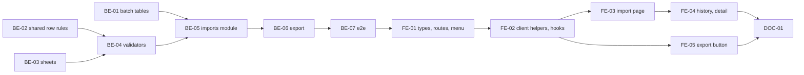

# F-09 Excel Import and Export — Backend + Frontend Implementation Plan

This plan builds Excel import for the course catalog and for the curriculum of a Draft version, and Excel export of a curriculum in the same template (FR-33..36, FR-96..101, EP-09). An import is a stored batch: the file is uploaded, checked row by row in a BullMQ worker without writing anything (dry-run), shown as a report with LỖI / CẢNH BÁO / LƯU Ý per row, and written only when the user who ran it confirms and the whole file passes again — all rows or none. It delivers the import screen (MH-29), the import history with its detail report (MH-30), template downloads, the export button on the curriculum screen, and the first BullMQ processor of the project.

It deliberately excludes the student-list and academic-result imports (wave 2, F09-03: their tables arrive with F-17 and F-19 in B5), importing into a version that has left Draft (F09-01: that is a change request, F-13), reading the program header values into the version (they are compared, not applied — D9), and the exact column layout of the Khoa's own sheet until the file is supplied (F09-04 🏫 — D6 keeps it to one constant per type).

> **Companion documents**
> - Requirement: `docs/requirement/REQUIREMENTS.md:370-397` (SRS 4.3 column mapping), `:474-477` (FR-33..FR-36), `:586-591` (FR-96..FR-101), `:1019` (NFR-05), `:1048` (NFR-19), `:1118` (DEC-05), `:1266-1268` (EC-45..EC-47)
> - Stories: `docs/planning/user-stories.md:416-480` (US-032..US-037); epic EP-09 (`docs/planning/epics.md`)
> - Design: `docs/design/data-dictionary.md:751-764` (`ImportBatch`), `:832`, `:854` (permission rows); `docs/design/state-diagrams.md:273-298` (§8 `ImportBatch`); `docs/design/sequence-diagrams.md:100-150` (import sequence); `docs/design/screen-inventory.md:95-96` (MH-29, MH-30), `:257-258`, `:354-355` (menu)
> - Answers: `docs/planning/feature-questions.md:159-167` (§F-09, all A)
> - Builds on: F-01 (`AppException`, `COMMON_ERRORS`, `QueueModule` in `src/shared/queue/`, `createTestApp`, Redis container, `client.ts`), F-02 (`AccessContext`, `PERMISSIONS.DATA_IMPORT_EXCEL`, `CURRICULUM_IMPORT_EXPORT_EXCEL`, `PERMISSION_TABLE`, `APP_MENU`), F-03 (`OrgUnit`, `SubjectGroup`), F-04 (`Course`, `CoursesService.assertOwners`, `CourseUsageReader`, `edit-path.ts`, `decimal.ts`, `HOME_FACULTY_CODE`), F-05 (`requisite-graph.ts`, `CourseRelation`, `GRADE_POINT_PATTERN`), F-06 (`programTarget`, `programEditState`), F-07 (`CurriculumItem`, `CurriculumRequisite`, `ElectiveGroup`, `assertSemesterInRange`, `CURRICULUM_LIMITS`, `curriculum-access.ts`, `CurriculumPage`), F-08 (`curriculumWarnings`, `programCredits`, `curriculumCycles`, `WARNING_SEVERITY`)
> - Tests: `docs/planning/test-plan.md:84-86` (DL-2, DL-4), `:176-179` (KB-022..KB-025), `:294-302` (NT-B2-01, -02, -03, -09), `:384` (NFR-05), `:399` (NFR-20)

**Status**: Not started

---

## 0. Plan at a glance

Everything below in one table. Read this; the rest is detail for whoever builds it.

| What | Why | How and where |
|---|---|---|
| **Blank templates per import type**, with the Khoa's columns, downloadable from the import screen | US-032; FR-96 | One sheet spec constant per type drives the template, the parser and the export (D6); `GET /api/imports/templates/:importType` (BE-03, BE-05) |
| **Upload → dry-run report, nothing written**: each row OK / LỖI / CẢNH BÁO / LƯU Ý with row number, column and reason; totals | US-033, US-034; FR-34, FR-97, FR-98; KB-022, KB-023 | `POST /api/imports` checks the header at once, stores the file, queues a `validate` job; the worker writes the report on the batch; the screen polls until it is ready (BE-04, BE-05, FE-03) |
| **A wrong or missing column is refused at once**, naming the column | US-034 AC1; EC-45 | The header check runs in the request; the batch is recorded as "Không ghi do lỗi" with the format errors (BE-03, BE-05) |
| **Catalog rows**: duplicate codes name both rows, 0 credits warn, existing codes say "sẽ cập nhật", released courses are refused | US-033 AC2..AC4; BR-02; KB-024 | `validateCatalogRows` over the catalog and owners loaded once (BE-04) |
| **Curriculum rows**: unknown code, inactive course, semester out of range, duplicate course, requisite loop with its path are LỖI; name or credits differing from the catalog warn | US-034 AC2..AC4; KB-023, KB-025; F-07 and F-08 constraints | `validateCurriculumRows` calls the same shared row rules as the curriculum screen and F-08's `curriculumWarnings`, `programCredits`, `curriculumCycles` (BE-02, BE-04) |
| **Confirm writes all or nothing**, only by the user who ran the dry-run, after re-checking the whole file; data changed since → "Không ghi do lỗi" with a new report | US-035 AC1..AC3; F09-02; NFR-20 | `POST /api/imports/:id/commit` queues a `commit` job; one transaction re-validates and writes under the requisite lock (BE-05) |
| **Only Drafts of never-released programs can be imported into** | US-035 AC5; F09-01 | Same gate as the curriculum screen's direct edit; otherwise 409 pointing to change requests (BE-05) |
| **History of every batch** with type, file, user, time, totals, status, and the detail report; R3 sees only programs in scope | US-036; FR-99; MH-30 | `GET /api/imports`, `GET /api/imports/:id`; original file downloadable for 30 days (F09-05) (BE-05, FE-04) |
| **Export a curriculum in the import template**; re-importing it gives no LỖI | US-037; FR-36, FR-101 | `GET /api/program-versions/:versionId/curriculum/export`; "Xuất Excel" on the curriculum page (BE-06, FE-05) |

**Key behaviours worth knowing**

| Behaviour | Why it is this way |
|---|---|
| A dry-run with any LỖI ends "Không ghi do lỗi", not "Chạy thử" | State diagram NL-04: `errorRows > 0` → `ABORTED`; the user fixes the file and uploads it again, and the report of the refused run stays in history |
| Two transient states, "Đang chạy thử" and "Đang ghi", precede "Chạy thử" and "Đã ghi" | `tech-stack.md:65` runs Excel work in a BullMQ worker, so the request returns before the result exists; the diagram's states stay as they are and gain these two (D2, §2c) |
| Each job is a no-op unless the batch is still in the state that queued it | Redis jobs must be safe to re-run (`tech-stack.md` §3); a retried `commit` after the data was written finds "Đã ghi" and stops |
| "Đã ghi" is written in the same transaction as the data | A crash between the two cannot leave written rows on a batch that says otherwise (US-035 AC3) |
| A header (format) error records an "Không ghi do lỗi" batch without queuing anything | The sequence diagram records it too; the history then shows refused files (US-036) |
| The stored file, not the screen's copy of the report, is what confirm writes | F09-02: confirm re-reads and re-checks the file; a report shown an hour ago proves nothing about now |
| A curriculum import replaces the version's rows by course: kept courses keep their row id, new ones are added, missing ones are removed (each named as a warning) | The import is "the curriculum is this file"; keeping ids keeps F-11's PLO matrix and elective group memberships attached to the course rows that stay (D10) |
| Program header values in the file are compared with the version, never applied | Credits and semester count are edited on the program screen (F-06) with their own rules; the file is not a second way in (D9) |
| The catalog import is R1 only | `data.importExcel` is checked against the whole catalog (no program, no group); only an ALL scope covers it, which R1 holds (F-02 `AccessContext`) |
| The screen polls the batch every `IMPORT_POLL_INTERVAL_MS` while it is transient | A short poll while the user waits on the screen; it renews the idle session, which is right here — the user is active (F-01 constraint targets F-14's background long poll) |
| An unconfirmed dry-run stays "Chạy thử" in history; the daily job deletes its file after 30 days, and confirm then answers "tệp đã hết hạn" | State diagram §8 closing note; F09-05 |

**Not included**

| Excluded | Why |
|---|---|
| Student list and academic result imports | F09-03 wave 2 (B5): `Student` (F-17) and `StudyResult` (F-19) do not exist yet. The enum values exist now; F-17 and F-19 add a sheet spec, a validator and a writer (§8) |
| Import into a Pending / Active / Historical version, or into a Draft of a program that has a released version | F09-01: those edits go through a change request (F-13). Refused with `CHANGE_REQUEST_REQUIRED` |
| Importing elective group definitions | Groups need a minimum (credits or courses) that has no column in SRS 4.3; groups are created on MH-26 (F-07) and memberships of kept rows survive the import (D10) |
| Applying the program header (name, semester count, credits) | D9 |
| The Khoa's exact sheet | 🏫 F09-04 needs the file; `CURRICULUM_SHEET` follows SRS 4.3 until then (§8) |

**Open questions**

| Question | Resolved when | Default if unanswered |
|---|---|---|
| Exact column labels, header position and program-header layout of the Khoa's sheet (F09-04 🏫) | The Khoa supplies the file | SRS 4.3 labels in the order listed there; program header as label/value pairs above the table (D6, §8) |

---

## 1. Scope

| In scope | Why |
|---|---|
| `ImportBatch` with type, file, user, totals, status, report; the uploaded file kept 30 days | DD `ImportBatch`; FR-99; F09-05 |
| Catalog and curriculum templates, parsing, dry-run, confirm, history, detail | US-032..US-036; F09-03 wave 1 |
| Curriculum export in the template | US-037; FR-36, FR-101 |
| Shared row rules moved out of F-04 and F-07 so the import and the screens refuse the same rows | F-07 §8 constraint; F-08 §8 constraint |
| MH-29, MH-30; "Nhập liệu" menu; export button on MH-25 | Screen inventory |

| Out of scope | Deferred until |
|---|---|
| Student list, academic result imports | F-17, F-19 (B5) |
| Import into released programs | F-13 (change requests) |
| The Khoa's exact template | 🏫 file supplied |

| AC | Covered by |
|---|---|
| US-032 AC1 — template per type with every column incl. Ký hiệu, HT ĐA, TQ ĐA, Điểm học, Điểm chuyển | BE-03 (`CURRICULUM_SHEET`, `COURSE_CATALOG_SHEET`, `writeTemplate`), FE-03 |
| US-032 AC2 — empty template uploaded → "tệp không có dòng dữ liệu" | BE-03 (`IMPORT_FORMAT.NO_DATA_ROWS`), BE-07 |
| US-033 AC1 — catalog dry-run per row, nothing written | BE-04 (`validateCatalogRows`), BE-05 (`validate` job), BE-07 (DL-2) |
| US-033 AC2 — duplicate code in the file names both rows | BE-04 (`DUPLICATE_CODE_IN_FILE`), BE-07 |
| US-033 AC3 — 0 credits is CẢNH BÁO | BE-04 (`ZERO_CREDITS` HIGH) |
| US-033 AC4 — existing code reported as "sẽ cập nhật" | BE-04 (`WILL_UPDATE` HIGH) |
| US-034 AC1 — missing or misnamed column refused at once, naming it | BE-03 (`readSheet`), BE-05 (synchronous format check), BE-07 (KB-022) |
| US-034 AC2 — "Dòng 15: LỖI — Mã HP … không tồn tại" | BE-04 (`COURSE_UNKNOWN`), FE-03 (row label), BE-07 (KB-023) |
| US-034 AC3 — loop → LỖI with the path | BE-04 (`curriculumCycles` over catalog + file edges), BE-07 (KB-025) |
| US-034 AC4 — confirm enabled only without LỖI | BE-05 (`IMPORT_HAS_ERRORS`), FE-03 (button disabled) |
| US-034 AC5 — R3 outside scope refused | BE-05 (`assertCan` on `programTarget`), BE-07 |
| US-035 AC1 — all-or-nothing | BE-05 (one transaction), BE-07 (DL-4) |
| US-035 AC2 — data changed since dry-run → aborted with a new report | BE-05 (re-validate inside the transaction), BE-07 |
| US-035 AC3 — a crash leaves no rows | BE-05 ("Đã ghi" in the data transaction; stale-batch sweep), BE-07 |
| US-035 AC4 — 1000 rows < 60 s per step | BE-04 (one load, in-memory rules), BE-05 (`createMany`), BE-07 (NFR-05 timing case) |
| US-035 AC5 — program with a released version refused, pointing to change requests | BE-05 (`assertDirectEdit` with `programEditState`), BE-07 |
| US-036 AC1 — history columns | BE-05 (`ImportBatchSummaryDto`), FE-04 |
| US-036 AC2 — detail report | BE-05 (`ImportBatchDetailDto`), FE-04 |
| US-036 AC3 — R3 sees only own programs | BE-05 (`list` scope filter), BE-07 |
| US-037 AC1 — export has the same columns, order and symbols | BE-03 (`writeCurriculum` from `CURRICULUM_SHEET`), BE-06 |
| US-037 AC2 — re-importing the export gives no LỖI | BE-07 (round trip) |
| US-037 AC3 — "Đăng ký được?" blank | BE-06 |

---

## 2. Contract verification

F-09 builds on F-01..F-08 code that is **specified, not built**. Every "existing" claim cites the plan that defines it; Rule 13 re-reads the built file before the step that uses it.

| Existing piece used | Defined at | Used by |
|---|---|---|
| `PERMISSIONS.DATA_IMPORT_EXCEL = 'data.importExcel'` (R1 X, R3 P), `PERMISSIONS.CURRICULUM_IMPORT_EXPORT_EXCEL = 'curriculum.importExportExcel'` (R1 X, R3 P); seed rows | F-02 BE-03 (`f-02-…:570`, `:587`, `:1212`, `:1229`) | BE-05, BE-06 |
| `AccessContext.has`, `assertCan(code, target)`, `scopeFor(code)`, `userId`; an empty target is covered only by an ALL scope | F-02 BE-04 (`f-02-…:640-760`) | BE-05, BE-06 |
| `@RequirePermission`, `@CurrentAccess()`, `AppException(definition, details?)`, `COMMON_ERRORS` | F-01 BE-03 (`f-01-…:342`), F-02 | BE-05 |
| `QueueModule` (`BullModule.forRootAsync` over `REDIS_HOST`, `REDIS_PORT`) at `src/shared/queue/queue.module.ts`; no queue or processor registered yet | Built at `source/backend/src/queue/queue.module.ts:1-19`; moved by F-01 (`f-01-…:236`) | BE-05 |
| `@nestjs/bullmq ^12.0.0`, `bullmq ^6.3.15`, `@nestjs/platform-express ^12.1.3` installed; `exceljs`, `@types/multer` absent | `source/backend/package.json:26-34` | BE-03, BE-05 |
| ExcelJS is the chosen library; heavy Excel work runs in a BullMQ worker | `docs/design/tech-stack.md:44`, `:65` | D1, D2 |
| `Course {courseCode @unique, courseName, englishName?, credits Decimal(5,2), courseType, status, ownerFacultyId, ownerGroupId?}`; `CourseType` 7 values; `CourseStatus` ACTIVE / DISCONTINUED / CANCELLED | F-04 BE-01 (`f-04-…:261-295`) | BE-04 |
| `CoursesService.assertOwners(facultyId, groupId)` (private; faculty ACTIVE `FACULTY`, group ACTIVE of that faculty), `OWNER_FACULTY_INVALID`, `OWNER_GROUP_INVALID`, `HOME_FACULTY_CODE` | F-04 BE-03 (`f-04-…:522`, `:700`, `:729`, `:826-838`) | BE-02 |
| `COURSE_FIELD_LIMITS {CODE_MAX: 20, NAME_MAX: 200}`; `CreateCourseDto` trims and upper-cases the code | F-04 BE-03 | BE-04 |
| `CourseUsageReader.inReleasedVersion(courseId)` = a `CurriculumItem` of the course in a non-Draft version | F-04 BE-02 (`f-04-…:401`), filled by F-07 BE-02 (`f-07-…:537-542`) | BE-02 (batched form) |
| `CREDITS_PATTERN`, `toWireDecimal`, `GRADE_POINT_PATTERN` in `src/shared/decimal/decimal.ts` | F-04 BE-02, F-05 BE-01 (`f-05-…:360-364`) | BE-04 |
| `RequisiteEdge`, `CYCLE_CHECKED_TYPES`, `findRequisiteCycle`, `lockRequisiteGraph(tx)` | F-05 BE-02 (`f-05-…:316-345`, `:639`) | BE-04, BE-05 |
| `CourseRelation {sourceCourseId, targetCourseId, type, minScore}` | F-05 BE-01 | BE-04 |
| `programTarget({id, facultyId})`, `programEditState(prisma \| tx, programId)` (`released` = some version not Draft) | F-06 BE-02 (`f-06-…:372-411`) | BE-05, BE-06 |
| `ProgramVersion {programId, status, semesterCount, totalCredits, compulsoryCredits, electiveCredits, versionNumber}`; `Program {programCode, programName, majorCode, facultyId}` | F-06 BE-01 (`f-06-…:245-279`) | BE-01, BE-04 |
| `CurriculumItem` (unique version + course; `plannedSemester`, `sortOrder`, `blockSymbol`, `isElective`, `electiveGroupId`, `htDa`, `tqDa`, `minStudiedScore`, `minTransferScore`, `note`), `CurriculumRequisite {itemId, sourceCourseId, relationType, minScore}`; versions cascade to items | F-07 BE-01 (`f-07-…:275-377`) | BE-04, BE-05, BE-06 |
| `CURRICULUM_ERRORS` (`COURSE_NOT_ACTIVE`, `SEMESTER_OUT_OF_RANGE`, …), `CURRICULUM_LIMITS {BLOCK_SYMBOL_MAX: 20, NOTE_MAX: 500, …}` | F-07 BE-03 (`f-07-…:656-690`) | BE-02, BE-04 |
| `assertSemesterInRange(version, semester)` exported from `curriculum.service.ts`; active-course check inline in `createItem` | F-07 BE-03 (`f-07-…:890-891`, `:960-967`) | BE-02 |
| `VERSION_ACCESS_SELECT`, `assertDraft`, `assertCurriculumWrite` in `src/features/curriculum/curriculum-access.ts` | F-07 BE-03 (`f-07-…:727-751`) | BE-05 (shape mirrored, not imported) |
| `curriculumWarnings({semesterCount, items, groups})`, `WarningItem`, `WarningGroup`, `CURRICULUM_WARNING` (incl. `DUPLICATE_COURSE` ERROR), `WARNING_SEVERITY {ERROR, HIGH, INFO}`; `programCredits(items, groups)`; `curriculumCycles(catalogEdges, curriculumEdges)` | F-08 BE-02, BE-03 (`f-08-…:300-430`, `:517-529`) | BE-04 |
| `createTestApp`, `startPostgres`, `startRedis`, `setAppEnv`; `PERMISSION_TABLE`; `loginAgent`, `createProgram`, `createCourse`, `addCurriculumItem`, `releaseVersionForTest` | F-01 BE-10 (`f-01-…:797-805`, `:1500-1544`), F-02 (`f-02-…:2059`), F-06 BE-06, F-07 BE-06 (`f-07-…:1489-1498`) | BE-07 |
| Frontend: `getJson`, `sendJson`, `ApiError`, `CSRF_HEADER` in `src/shared/api/client.ts` (JSON only; no upload or file download helper) | F-01 FE-03 (`f-01-…:1656`, `:1674-1730`) | FE-02 |
| `APP_MENU`, `toMenuItems`, `ROUTES`, `router.tsx` lazy pages, `RequirePermission`, `useCan`, `PageContainer`, `ApiErrorAlert` | F-02 FE-02, FE-04 (`f-02-…:2334-2358`) | FE-01, FE-03..FE-05 |
| `CurriculumPage` (toolbar), `COURSE_TYPE_LABELS` (client) | F-07 FE-03 (`f-07-…:1716`), F-04 FE (`f-04-…:1223`) | FE-05 |

### 2a. Endpoints

All under `/api`. "Scoped" means `assertCan` in the service on top of the guard.

| Endpoint | Permission (guard) | Request | Response | Notes |
|---|---|---|---|---|
| `GET /imports/types` | `data.importExcel` or `curriculum.importExportExcel` | — | `ImportTypeOptionDto[]` | The types the caller can import: `COURSE_CATALOG` only with an ALL scope on `data.importExcel`; `CURRICULUM` with `curriculum.importExportExcel` in any scope. The client builds its type select from this, since `MeDto` carries codes, not scopes |
| `GET /imports/curriculum-targets` | `curriculum.importExportExcel` | — | `ImportTargetDto[]` | Draft versions of never-released programs in the caller's scope, ordered by program code. Exists because `GET /programs` needs `program.view` with ALL scope (F-06), which R3 does not have |
| `GET /imports/templates/:importType` | `data.importExcel` or `curriculum.importExportExcel` (by type, in the service) | path `COURSE_CATALOG \| CURRICULUM` | `.xlsx` stream, `Content-Disposition: attachment` | Wave-2 types → 404 `IMPORT_TYPE_UNAVAILABLE` |
| `POST /imports` | either of the two (service picks by type) | `multipart/form-data`: `file`, `importType`, `versionId?` (required for `CURRICULUM`) | `ImportBatchDetailDto` (201) | Size, type and header checked in the request; a header error returns the batch "Không ghi do lỗi" (201, not an error status — the batch exists); otherwise status `VALIDATING` and a `validate` job queued |
| `GET /imports` | either of the two | `ImportListQueryDto` (`importType?`, `status?`, `mine?`, `page`, `pageSize`) | `Page<ImportBatchSummaryDto>` | Catalog batches only with `data.importExcel` ALL; curriculum batches filtered to the caller's program scope |
| `GET /imports/:batchId` | either of the two | — | `ImportBatchDetailDto` | Same visibility as the list; the client polls it while `VALIDATING` / `COMMITTING` |
| `POST /imports/:batchId/commit` | either of the two | — | `ImportBatchDetailDto` (202) | Only `performedBy`; only from `DRY_RUN`; file still kept; status → `COMMITTING`, `commit` job queued |
| `GET /imports/:batchId/file` | either of the two | — | original bytes, original file name | 410 `IMPORT_FILE_EXPIRED` after 30 days |
| `GET /program-versions/:versionId/curriculum/export` | `curriculum.importExportExcel` | — | `.xlsx` stream | Scoped on `programTarget`; any version status (export is a read) |

### 2b. DTOs

**`ImportTypeOptionDto`**: `importType: 'COURSE_CATALOG' | 'CURRICULUM'`, `needsVersion: boolean` (true for `CURRICULUM`). Modeled as `ImportTypeOption`; the label comes from the client's `IMPORT_TYPE_LABELS`.

**`ImportTargetDto`**: `versionId`, `programId`, `programCode`, `programName` (of the Draft), all `string`, none nullable. Modeled as `ImportTarget`; the version select shows `programCode — programName`.

**`ImportBatchSummaryDto`** (list rows)

| Field | Wire type | Nullable | Source | Modeled as | Note |
|---|---|---|---|---|---|
| `id` | `string` | no | BE-01 | `ImportBatchSummary.id` | |
| `importType` | `'COURSE_CATALOG' \| 'CURRICULUM' \| 'STUDENT_LIST' \| 'ACADEMIC_RESULT'` | no | BE-01 `ImportType` | label via `IMPORT_TYPE_LABELS` | the two B5 values never appear until F-17, F-19 |
| `fileName` | `string` | no | BE-01 | shown | as uploaded, trimmed to `IMPORT_LIMITS.FILE_NAME_MAX` |
| `performedBy` | `{ id, fullName }` | no | BE-05 | shown | |
| `program` | `{ id, programCode, programName } \| null` | **yes** | BE-05 | shown | null for catalog batches |
| `versionLabel` | `string \| null` | **yes** | BE-05 | shown | `versionNumber ?? 'Nháp'`; null when not curriculum or the request Draft was discarded |
| `totalRows`, `successRows`, `errorRows` | `number` | no | BE-01 | shown | 0 until the dry-run finishes |
| `status` | `'VALIDATING' \| 'DRY_RUN' \| 'COMMITTING' \| 'COMMITTED' \| 'ABORTED'` | no | BE-01 `ImportBatchStatus` | label via `IMPORT_STATUS_LABELS` | |
| `recordedAt` | `string` (ISO) | no | BE-01 | shown | upload time |
| `finishedAt` | `string \| null` | **yes** | BE-01 | shown | time of the last transition to `DRY_RUN`, `COMMITTED` or `ABORTED` |

**`ImportBatchDetailDto`** = summary +

| Field | Wire type | Nullable | Source | Modeled as | Note |
|---|---|---|---|---|---|
| `report` | `ImportReportDto \| null` | **yes** | BE-04 | report table | null while `VALIDATING` |
| `canCommit` | `boolean` | no | BE-05 | confirm button | `DRY_RUN` (which implies no LỖI) ∧ caller is `performedBy` ∧ file kept |
| `fileAvailable` | `boolean` | no | BE-05 | download link | `ImportBatchFile` row exists |

**`ImportReportDto`**

| Field | Wire type | Nullable | Note |
|---|---|---|---|
| `formatErrors` | `{ column: string \| null; message: string }[]` | no | non-empty only on a header-refused batch; `column` is the template label |
| `issues` | `ImportIssueDto[]` | no | sorted by row number (file-level first), then severity |

**`ImportIssueDto`**

| Field | Wire type | Nullable | Note |
|---|---|---|---|
| `rowNumber` | `number \| null` | **yes** | the Excel row number as the user sees it; null = whole file |
| `severity` | `'ERROR' \| 'HIGH' \| 'INFO'` | no | F-08 `WARNING_SEVERITY`; client labels LỖI / CẢNH BÁO / LƯU Ý |
| `code` | `string` | no | `IMPORT_ISSUE` codes or F-08 `CURRICULUM_WARNING` codes |
| `column` | `string \| null` | **yes** | template label |
| `message` | `string` (Vietnamese) | no | |

A row with no issue is OK and is not listed (D5); the totals carry the counts.

### 2c. Mismatch log

| Deliverable | What the design says | What this plan does | Found at |
|---|---|---|---|
| BE-01 | `ImportBatch.status`: `DRY_RUN`, `COMMITTED`, `ABORTED` | Adds `VALIDATING` and `COMMITTING` before `DRY_RUN` and `COMMITTED`; the worker runs between (D2). DD and state diagram updated with this plan | `data-dictionary.md:762`; `state-diagrams.md:273-298`; `tech-stack.md:65` |
| BE-01 | `ImportBatch` has no link to a program or version | `programId` (required for curriculum) and `versionId` (nullable) so R3's history can be filtered and confirm knows its target (US-036 AC3). DD updated | `data-dictionary.md:751-764` |
| BE-01 | The uploaded file is not in the dictionary; F09-05 keeps it 30 days | `ImportBatchFile` table, one row per batch, deleted after `IMPORT_LIMITS.FILE_RETENTION_DAYS` (D4). DD updated | `feature-questions.md:167` |
| BE-02 | F-07's §8 asks for the curriculum row rules "through a shared helper"; `assertSemesterInRange` is exported from the feature's service, the active-course check is inline | Both move to `src/shared/curriculum/curriculum-row-rules.ts` as pure checks; F-07's call sites migrate (BE-02 table) | `f-07-…:890-891`, `:960`, `:2095` |
| BE-02 | `assertOwners` is a private method that queries per call | A pure `ownerProblem(owners, facultyId, groupId)` in `src/shared/courses/course-owners.ts`; `assertOwners` keeps its signature and calls it | `f-04-…:826-838` |
| BE-02 | `CourseUsageReader.inReleasedVersion` answers one course per query | Adds `releasedCourseIds(courseIds)` — one query for a 1000-row file (NFR-05) | `f-07-…:537-542` |

---

## 3. Decisions

| # | Decision | Why | Rejected alternative |
|---|---|---|---|
| D1 | ExcelJS reads and writes `.xlsx` only; `.xls` and `.csv` are refused at upload | `tech-stack.md:44` chose ExcelJS; ExcelJS does not read `.xls`; the Khoa's files are `.xlsx` | SheetJS for `.xls` — a second library for a format nobody named |
| D2 | The batch is created in the request; the dry-run and the commit run as BullMQ jobs; two transient states `VALIDATING` and `COMMITTING` | `tech-stack.md:65`; 1000 rows with catalog lookups must not hold an HTTP request; the states make a retried or lost job visible | Synchronous dry-run in the request — fits 1000 rows today, but breaks the stack decision and gives no place for wave 2's larger files |
| D3 | Jobs are idempotent by state: `validate` acts only on `VALIDATING`, `commit` only on `COMMITTING`; `COMMITTED` is written inside the data transaction; exhausted attempts → `ABORTED` with a system issue; a daily sweep aborts batches stuck in a transient state longer than `IMPORT_LIMITS.STALE_AFTER_MS` | Jobs must be safe to re-run; a worker killed mid-job must not leave a batch "Đang ghi" forever | Job id = batch id alone — stops duplicates in the queue but not a re-run after a crash |
| D4 | The file is kept in PostgreSQL (`ImportBatchFile.content Bytes`), separate from `ImportBatch`, max `IMPORT_LIMITS.FILE_MAX_BYTES` (5 MB) | Redis holds queues only; no object storage in the stack; a separate table keeps history queries light; 30-day retention is one `deleteMany` | Disk under the app — lost on redeploy, not shared between API and worker processes |
| D5 | Report shape `{formatErrors, issues}` with F-08's severities (`ERROR` / `HIGH` / `INFO`, shown LỖI / CẢNH BÁO / LƯU Ý); only rows with issues are listed | One severity scale across the consistency screen and the import; US-033 names exactly these three levels; listing 1000 OK rows adds nothing | A row-by-row status array — 1000 entries of "OK" in a JSON column |
| D6 | One sheet spec constant per type (`COURSE_CATALOG_SHEET`, `CURRICULUM_SHEET`): column keys, labels, required flag, order. Template, parser and export all read it | 🏫 F09-04: when the Khoa's file arrives, adapting is one constant; US-037's "same columns, same order" holds by construction | Hard-coded column indexes in three places |
| D7 | The header row is found by scanning the first `IMPORT_LIMITS.HEADER_SCAN_ROWS` rows for the first one that contains every required label; labels compare after NFC, trim, whitespace collapse and case fold; columns not in the spec are ignored with one INFO | The Khoa sheet carries a program header above the table; users retype labels with stray spaces; extra columns (e.g. their own notes) are harmless | Fixed header on row 1 — fails on the real sheet's layout |
| D8 | Rows are validated in memory against data loaded once (catalog, relations, owners, the Draft's rows); the same pure rules as the screens | NFR-05 (1000 rows < 60 s); one rule set (F-07, F-08 constraints) | Calling the curriculum service per row — a query per row and its errors are exceptions, not a list |
| D9 | Program header cells (Mã chương trình, Tên CTĐT, Số học kỳ, Tổng TC, TC bắt buộc, TC tự chọn, Mã ngành) are read and compared: a different program code is a file-level LỖI; other differences are CẢNH BÁO; none are written | The file targets one Draft chosen on screen; a file for another program is a mistake; credits and semester count have their own edit rules on MH-24 | Writing them — a second edit path for version info that F-06 guards |
| D10 | A curriculum import makes the Draft's rows equal to the file, matched by course: kept rows are updated in place (same id), new rows inserted, absent rows deleted (one CẢNH BÁO each, before confirm); requisites of every file row are replaced by the file's columns; elective group membership is kept unless the row turns compulsory (CẢNH BÁO) | Re-importing an edited export is the main use (US-037 AC2); stable ids keep F-11's matrices and MH-26 memberships; deletion warnings make the replace visible before confirm | Delete-all then insert — every row id changes, every matrix and membership is lost |
| D11 | `TT` is ignored; `sortOrder` is the file order within each semester | F-07 §8: "TT is derived, never imported" | Reading TT — it is a running number across semesters on the sheet |
| D12 | Curriculum name and credits come from the catalog; a different "Tên học phần" or "Số tín chỉ" in the file is CẢNH BÁO, not applied | The catalog owns both (F-04); changing them is a catalog import or a catalog edit | Applying them — a curriculum file would silently edit the catalog |
| D13 | Requisite cells hold entries separated by newline, `;` or `,`; the leading token of each entry is the course code ("3190111 – Giải tích 1" → `3190111`); a PREREQUISITE's minimum score is copied from the catalog relation between the same two courses when one exists | SRS 4.3 example; there is no score column per requisite in the sheet | A separate requisite sheet — not in the Khoa's layout |
| D14 | Flags (`Tự chọn`, `HT ĐA`, `TQ ĐA`) accept `x`, `1`, `true`, `có` (case-insensitive) as true and blank as false; anything else is LỖI; export writes `x` | The Khoa sheet marks with `x`; tolerance for the common alternatives costs nothing | Strict `x` only — fails on files exported from other tools |
| D15 | Commit runs in one interactive transaction with `timeout: IMPORT_LIMITS.TX_TIMEOUT_MS`: `lockRequisiteGraph(tx)` → re-read file → re-validate with `tx` reads → any LỖI → throw, the batch is set `ABORTED` with the new report after rollback; else write rows and set `COMMITTED` | US-035 AC1..AC3; Prisma's default 5 s interactive timeout is too short for 1000 rows; the lock makes the cycle check hold until commit | Validate outside the transaction, write inside — another write can slip in between |
| D16 | Catalog permission: `data.importExcel` with an empty target (R1 only). Curriculum permission: `curriculum.importExportExcel` on `programTarget`, then the Draft and "never released" checks of the curriculum screen | Catalog rows span every group and faculty; the curriculum is per program (US-034 AC5) | Checking `course.edit` per catalog row — R3 could import part of a file |
---

## 5. Deliverables

Backend paths are under `source/backend/`, frontend paths under `source/frontend/`.

### BE-01 — Prisma schema: `ImportBatch`, `ImportBatchFile`

What/Why: DD `ImportBatch`; FR-99; F09-05; D2, D4. The batch is the unit the screens, the jobs and the history all address.

**Files**

| Action | Path |
|---|---|
| MODIFY | `prisma/schema.prisma` (`ImportType`, `ImportBatchStatus`, `ImportBatch`, `ImportBatchFile`; back-relations on `User`, `Program`, `ProgramVersion`) |
| NEW | `prisma/migrations/<timestamp>_import_batches/migration.sql` (generated, then edited) |

**Shape**

```prisma
enum ImportType {
  COURSE_CATALOG
  CURRICULUM
  STUDENT_LIST
  ACADEMIC_RESULT
}

enum ImportBatchStatus {
  VALIDATING
  DRY_RUN
  COMMITTING
  COMMITTED
  ABORTED
}

model ImportBatch {
  id            String            @id @default(cuid(2))
  importType    ImportType
  fileName      String
  performedById String
  performedBy   User              @relation("ImportBatchPerformedBy", fields: [performedById], references: [id], onDelete: Restrict)
  programId     String?
  program       Program?          @relation("ImportBatchProgram", fields: [programId], references: [id], onDelete: Restrict)
  versionId     String?
  version       ProgramVersion?   @relation("ImportBatchVersion", fields: [versionId], references: [id], onDelete: SetNull)
  status        ImportBatchStatus
  totalRows     Int               @default(0)
  successRows   Int               @default(0)
  errorRows     Int               @default(0)
  errorReport   Json?
  recordedAt    DateTime          @default(now())
  finishedAt    DateTime?
  file          ImportBatchFile?

  @@index([performedById, recordedAt])
  @@index([programId, recordedAt])
  @@index([status, recordedAt])
}

model ImportBatchFile {
  batchId   String      @id
  batch     ImportBatch @relation(fields: [batchId], references: [id], onDelete: Cascade)
  content   Bytes
  sizeBytes Int
  expiresAt DateTime

  @@index([expiresAt])
}
```

Back-relations: `User.importBatches ImportBatch[] @relation("ImportBatchPerformedBy")`, `Program.importBatches ImportBatch[] @relation("ImportBatchProgram")`, `ProgramVersion.importBatches ImportBatch[] @relation("ImportBatchVersion")`.

```
pnpm prisma migrate dev --create-only --name import_batches
# append the checks below, then:
pnpm prisma migrate dev
pnpm prisma generate
```

```sql
-- appended to migration.sql
ALTER TABLE "ImportBatch" ADD CONSTRAINT "ImportBatch_program_for_curriculum"
  CHECK (("importType" = 'CURRICULUM') = ("programId" IS NOT NULL));
ALTER TABLE "ImportBatch" ADD CONSTRAINT "ImportBatch_row_counts"
  CHECK ("totalRows" >= 0 AND "successRows" >= 0 AND "errorRows" >= 0 AND "successRows" + "errorRows" = "totalRows");
```

**Rationale**: Relations mirror F-08's `creditMismatchAcceptedBy` (`f-08-…:226`) and the appended checks mirror F-07 BE-01 (`f-07-…:366-371`). `programId` is required for a curriculum batch and never cleared, because programs are deactivated, not deleted (F-06); `versionId` is `SetNull` because F-13 deletes a discarded request Draft and its items cascade (`f-07-…:377`) — the batch must survive as history. The file is its own table so `GET /imports` never drags 5 MB blobs through a `findMany` (D4).

**Gotchas**
- `errorReport` is `Json?`: Prisma types it `Prisma.JsonValue`; write it as `report satisfies ImportReport as unknown as Prisma.InputJsonValue` in one helper (`toReportJson`, BE-05), read it with the reverse cast in `toDetailDto`. Do not scatter casts.
- `Bytes` maps to `Uint8Array` in Prisma 7 (not `Buffer`); ExcelJS's `load` takes an `ArrayBuffer`-like — pass `content` directly, and wrap multer's `Buffer` with `new Uint8Array(file.buffer)` on write.
- The row-count check holds from the start because every count defaults to 0.

**Verify**: `pnpm prisma migrate dev` applies; `pnpm exec tsc --noEmit -p tsconfig.json`; in psql, inserting a `CURRICULUM` batch without `programId` fails with `ImportBatch_program_for_curriculum`.

**Depends on**: F-02 BE-01 (`User`), F-06 BE-01 built

---

### BE-02 — Shared row rules: owners, semester range, addable course, released courses in one query

What/Why: F-07 §8 constraint ("the same row rules through a shared helper"); D8; NFR-05. The import must refuse exactly the rows the screens refuse, without one query per row.

**Files**

| Action | Path |
|---|---|
| NEW | `src/shared/courses/course-owners.ts` |
| NEW | `src/shared/courses/course-owners.spec.ts` |
| MODIFY | `src/features/courses/courses.service.ts` (`assertOwners` body) |
| MODIFY | `src/shared/courses/course-usage.reader.ts` (`releasedCourseIds`; `inReleasedVersion` delegates) |
| MODIFY | `src/shared/courses/course-usage.reader.spec.ts` |
| NEW | `src/shared/curriculum/curriculum-row-rules.ts` |
| NEW | `src/shared/curriculum/curriculum-row-rules.spec.ts` |
| MODIFY | `src/features/curriculum/curriculum.service.ts` (`assertSemesterInRange` body, `createItem` status check) |

**Shape**

```ts
// src/shared/courses/course-owners.ts
import { OrgUnitStatus, OrgUnitType, SubjectGroupStatus } from '../../generated/prisma/client.js';

export interface OwnerFacultyRow {
  id: string;
  unitCode: string;
  unitType: OrgUnitType;
  status: OrgUnitStatus;
}

export interface OwnerGroupRow {
  id: string;
  facultyId: string;
  status: SubjectGroupStatus;
}

export const OWNER_PROBLEM = { FACULTY_INVALID: 'FACULTY_INVALID', GROUP_INVALID: 'GROUP_INVALID' } as const;
export type OwnerProblem = (typeof OWNER_PROBLEM)[keyof typeof OWNER_PROBLEM];

export function ownerProblem(faculty: OwnerFacultyRow | null, group: OwnerGroupRow | null, groupWanted: boolean): OwnerProblem | null {
  if (!faculty || faculty.unitType !== OrgUnitType.FACULTY || faculty.status !== OrgUnitStatus.ACTIVE) {
    return OWNER_PROBLEM.FACULTY_INVALID;
  }
  if (groupWanted && (!group || group.status !== SubjectGroupStatus.ACTIVE || group.facultyId !== faculty.id)) {
    return OWNER_PROBLEM.GROUP_INVALID;
  }
  return null;
}
```

```ts
// src/features/courses/courses.service.ts — assertOwners after the change; signature and callers unchanged
private async assertOwners(ownerFacultyId: string, ownerGroupId: string | null) {
  const [faculty, group] = await Promise.all([
    this.prisma.orgUnit.findUnique({ where: { id: ownerFacultyId } }),
    ownerGroupId === null ? null : this.prisma.subjectGroup.findUnique({ where: { id: ownerGroupId } }),
  ]);
  const problem = ownerProblem(faculty, group, ownerGroupId !== null);
  if (problem === OWNER_PROBLEM.FACULTY_INVALID) {
    throw new AppException(COURSE_ERRORS.OWNER_FACULTY_INVALID, [{ field: 'ownerFacultyId', constraints: [OWNER_CONSTRAINT.ACTIVE_FACULTY] }]);
  }
  if (problem === OWNER_PROBLEM.GROUP_INVALID) {
    throw new AppException(COURSE_ERRORS.OWNER_GROUP_INVALID, [{ field: 'ownerGroupId', constraints: [OWNER_CONSTRAINT.GROUP_OF_FACULTY] }]);
  }
  return { ownerFacultyId, ownerGroupId, isForeign: faculty!.unitCode !== HOME_FACULTY_CODE };
}
```

```ts
// src/shared/curriculum/curriculum-row-rules.ts
import { CourseStatus } from '../../generated/prisma/client.js';

export const FIRST_SEMESTER = 1;

export function isSemesterInRange(semesterCount: number, semester: number): boolean {
  return Number.isInteger(semester) && semester >= FIRST_SEMESTER && semester <= semesterCount;
}

// Only courses in use can be added; a Discontinued course already in the curriculum may stay.
export function isCourseAddable(status: CourseStatus): boolean {
  return status === CourseStatus.ACTIVE;
}
```

```ts
// src/features/curriculum/curriculum.service.ts — after the change
export function assertSemesterInRange(version: { semesterCount: number }, semester: number): void {
  if (!isSemesterInRange(version.semesterCount, semester)) {
    // … the F-07 throw, unchanged
  }
}
// in createItem:
if (!isCourseAddable(course.status)) throw new AppException(CURRICULUM_ERRORS.COURSE_NOT_ACTIVE);
```

```ts
// src/shared/courses/course-usage.reader.ts — additions
// One query for a whole import file; inReleasedVersion is the one-course case.
async releasedCourseIds(courseIds: readonly string[], client: PrismaClientLike = this.prisma): Promise<Set<string>> {
  if (courseIds.length === 0) return new Set();
  const rows = await client.curriculumItem.findMany({
    where: { courseId: { in: [...courseIds] }, version: { status: { not: ProgramVersionStatus.DRAFT } } },
    select: { courseId: true },
    distinct: ['courseId'],
  });
  return new Set(rows.map((row) => row.courseId));
}

async inReleasedVersion(courseId: string): Promise<boolean> {
  return (await this.releasedCourseIds([courseId])).has(courseId);
}
```

`PrismaClientLike = PrismaService | Prisma.TransactionClient` — reuse the alias if F-06's `programEditState` exported one; otherwise declare it once in `src/shared/prisma/prisma-client-like.ts` and use it here and in BE-04.

**Call sites** (Rule 13 — every caller of a moved rule, recorded in the implement report)

| Rule | Caller | Disposition |
|---|---|---|
| `assertOwners` | `CoursesService.create` (`f-04-…:700`) | Unchanged call; body now calls `ownerProblem` |
| `assertOwners` | `CoursesService.update` (`f-04-…:729`) | Unchanged call |
| `ownerProblem` | `validateCatalogRows` (BE-04) | New caller, over preloaded maps |
| `assertSemesterInRange` | `CurriculumService.createItem` (`f-07-…:891`), `updateItem` (`:918`) | Unchanged calls; body now calls `isSemesterInRange` |
| `isSemesterInRange` | `validateCurriculumRows` (BE-04) | New caller |
| active-course check | `CurriculumService.createItem` (`f-07-…:890`) | Migrated to `isCourseAddable` |
| `isCourseAddable` | `validateCurriculumRows` (BE-04) | New caller |
| `inReleasedVersion` | `CoursesService.editState`, `isInUse` (`f-04-…:815-822`), F-05 `courseEditState` (`f-05-…:440`) | Unchanged calls; delegates to `releasedCourseIds` |
| `releasedCourseIds` | `validateCatalogRows` (BE-04) | New caller |

**Rationale**: Pure rules over rows the caller already holds, as F-08's `curriculum-warnings.ts` (`f-08-…:300-430`). The services keep their exception mapping; only the decision moves, so the screens' error codes and field details stay byte-for-byte the same and their tests need no change. `isSemesterInRange` also rejects 0 and non-integers, which F-07's DTO (`@IsInt() @Min(1)`) already did before the call — the import has no DTO in front of it.

**Gotchas**
- `assertOwners` used to query the group only after the faculty passed; querying both in parallel is fine (two reads) but keep the faculty error first, as `ownerProblem` does.
- `distinct` with `findMany` needs the `select` to include the distinct field — it does.

**Verify**: `course-owners.spec.ts`: inactive faculty, `OFFICE` unit, inactive group, group of another faculty, no group wanted with a null group → null. `curriculum-row-rules.spec.ts`: 0, 1, n, n+1, 2.5. Reader spec: two courses, one in an ACTIVE version → set of one; empty input → no query. F-04 and F-07 service specs pass unchanged.

**Depends on**: F-04 BE-02, BE-03, F-07 BE-02, BE-03 built

---

### BE-03 — Sheet specs, reader, writer (ExcelJS)

What/Why: US-032, US-034 AC1, US-037 AC1; D1, D6, D7, D11, D13, D14. One description of each sheet that the template, the parser and the export all read.

**Files**

| Action | Path |
|---|---|
| MODIFY | `package.json` (`exceljs` dependency; `@types/multer` dev dependency for BE-05) |
| NEW | `src/features/imports/import.constants.ts` |
| NEW | `src/features/imports/sheets/sheet-spec.ts` |
| NEW | `src/features/imports/sheets/course-catalog.sheet.ts` |
| NEW | `src/features/imports/sheets/curriculum.sheet.ts` |
| NEW | `src/features/imports/sheets/sheet-reader.ts` |
| NEW | `src/features/imports/sheets/sheet-reader.spec.ts` |
| NEW | `src/features/imports/sheets/sheet-writer.ts` |
| NEW | `src/features/imports/sheets/sheet-writer.spec.ts` |

```
pnpm add exceljs
pnpm add -D @types/multer
```

**Shape**

```ts
// src/features/imports/import.constants.ts
export const IMPORT_QUEUE = 'imports';

export const IMPORT_JOB = { VALIDATE: 'validate', COMMIT: 'commit', SWEEP: 'sweep' } as const;
export type ImportJobName = (typeof IMPORT_JOB)[keyof typeof IMPORT_JOB];

export const IMPORT_LIMITS = {
  FILE_MAX_BYTES: 5 * 1024 * 1024,
  FILE_NAME_MAX: 255,
  ROWS_MAX: 2000,
  HEADER_SCAN_ROWS: 20,
  FILE_RETENTION_DAYS: 30,
  STALE_AFTER_MS: 60 * 60 * 1000,
  TX_TIMEOUT_MS: 120_000,
  JOB_ATTEMPTS: 3,
  JOB_BACKOFF_MS: 5_000,
} as const;

export const IMPORT_SWEEP = { SCHEDULER_ID: 'imports-sweep', CRON: '0 2 * * *', TIME_ZONE: 'Asia/Ho_Chi_Minh' } as const;

export const XLSX_MIME = 'application/vnd.openxmlformats-officedocument.spreadsheetml.sheet';
export const XLSX_EXTENSION = '.xlsx';
```

```ts
// src/features/imports/sheets/sheet-spec.ts
export interface SheetColumn<K extends string = string> {
  key: K;
  label: string;
  required: boolean;
  // Written by the export and the template, never read back (e.g. "Đăng ký được?").
  ignoredOnRead?: boolean;
  width: number;
}

export interface SheetSpec<K extends string = string, H extends string = string> {
  sheetName: string;
  columns: readonly SheetColumn<K>[];
  // Label/value pairs above the table; empty for sheets without a program header.
  headerFields: readonly { key: H; label: string }[];
}

export function normalizeLabel(text: string): string {
  return text.normalize('NFC').replace(/\s+/g, ' ').trim().toLocaleLowerCase('vi');
}
```

```ts
// src/features/imports/sheets/curriculum.sheet.ts
// Column labels and order follow SRS 4.3 until the Khoa's file is supplied; adapting to it is a change here only.
export const CURRICULUM_SHEET = {
  sheetName: 'Khung chương trình',
  headerFields: [
    { key: 'programCode', label: 'Mã chương trình' },
    { key: 'programName', label: 'Tên CTĐT' },
    { key: 'semesterCount', label: 'Số học kỳ' },
    { key: 'totalCredits', label: 'Tổng TC' },
    { key: 'compulsoryCredits', label: 'TC bắt buộc' },
    { key: 'electiveCredits', label: 'TC tự chọn' },
    { key: 'majorCode', label: 'Mã ngành' },
  ],
  columns: [
    { key: 'sequence', label: 'TT', required: false, ignoredOnRead: true, width: 6 },
    { key: 'blockSymbol', label: 'Ký hiệu', required: false, width: 10 },
    { key: 'courseCode', label: 'Mã HP', required: true, width: 12 },
    { key: 'courseName', label: 'Tên học phần', required: true, width: 40 },
    { key: 'credits', label: 'Số tín chỉ', required: true, width: 10 },
    { key: 'plannedSemester', label: 'Học kỳ', required: true, width: 8 },
    { key: 'isElective', label: 'Tự chọn', required: true, width: 9 },
    { key: 'htDa', label: 'HT ĐA', required: true, width: 8 },
    { key: 'tqDa', label: 'TQ ĐA', required: true, width: 8 },
    { key: 'minStudiedScore', label: 'Điểm học', required: true, width: 9 },
    { key: 'minTransferScore', label: 'Điểm chuyển', required: true, width: 11 },
    { key: 'registrable', label: 'Đăng ký được?', required: false, ignoredOnRead: true, width: 12 },
    { key: 'priorCourses', label: 'HP cần học trước', required: true, width: 30 },
    { key: 'corequisites', label: 'HP song hành', required: true, width: 30 },
    { key: 'prerequisites', label: 'Cần HP tiên quyết', required: true, width: 30 },
    { key: 'note', label: 'Ghi chú', required: true, width: 30 },
  ],
} as const satisfies SheetSpec;

export type CurriculumColumnKey = (typeof CURRICULUM_SHEET.columns)[number]['key'];
export type ProgramHeaderKey = (typeof CURRICULUM_SHEET.headerFields)[number]['key'];

export const REQUISITE_COLUMNS = [
  { key: 'priorCourses', relationType: CourseRelationType.PRIOR },
  { key: 'corequisites', relationType: CourseRelationType.COREQUISITE },
  { key: 'prerequisites', relationType: CourseRelationType.PREREQUISITE },
] as const satisfies readonly { key: CurriculumColumnKey; relationType: CourseRelationType }[];

export const SHEET_TRUE_VALUES = ['x', '1', 'true', 'có'] as const;
export const SHEET_TRUE_MARK = 'x';
export const REQUISITE_ENTRY_SEPARATOR = /[\n;,]+/;
export const REQUISITE_CODE_TOKEN = /^\s*([^\s–-]+)/;
export const REQUISITE_EXPORT_SEPARATOR = '\n';
export const REQUISITE_EXPORT_NAME_SEPARATOR = ' – ';
```

```ts
// src/features/imports/sheets/course-catalog.sheet.ts
export const COURSE_CATALOG_SHEET = {
  sheetName: 'Danh mục học phần',
  headerFields: [],
  columns: [
    { key: 'courseCode', label: 'Mã HP', required: true, width: 12 },
    { key: 'courseName', label: 'Tên học phần', required: true, width: 40 },
    { key: 'englishName', label: 'Tên tiếng Anh', required: true, width: 40 },
    { key: 'credits', label: 'Số tín chỉ', required: true, width: 10 },
    { key: 'courseType', label: 'Loại học phần', required: true, width: 18 },
    { key: 'ownerFacultyCode', label: 'Mã khoa phụ trách', required: true, width: 18 },
    { key: 'ownerGroupCode', label: 'Mã nhóm chuyên môn', required: true, width: 20 },
  ],
} as const satisfies SheetSpec;

export type CatalogColumnKey = (typeof COURSE_CATALOG_SHEET.columns)[number]['key'];

// The client's COURSE_TYPE_LABELS show the same words; the sheet accepts either the label or the enum value.
export const COURSE_TYPE_SHEET_LABELS: Record<CourseType, string> = {
  THEORY: 'Lý thuyết', PRACTICE: 'Thực hành', LAB: 'Thí nghiệm', PROJECT: 'Đồ án',
  CAPSTONE: 'Đồ án tốt nghiệp', INTERNSHIP: 'Thực tập', CONDITIONAL: 'Học phần điều kiện',
};
```

`required` means "the column header must be present" (US-034 AC1), not "the cell must be filled"; which cells may be blank is the validator's rule (BE-04).

```ts
// src/features/imports/sheets/sheet-reader.ts
export interface SheetRow<K extends string> {
  rowNumber: number;
  cells: Record<K, string>;
}

export interface FormatError {
  column: string | null;
  message: string;
}

export interface ParsedSheet<K extends string, H extends string> {
  header: Partial<Record<H, string>>;
  rows: SheetRow<K>[];
  unknownColumns: string[];
  formatErrors: FormatError[];
}

export const FORMAT_MESSAGE = {
  NOT_XLSX: 'Tệp không phải bảng tính Excel (.xlsx).',
  NO_HEADER: 'Không tìm thấy dòng tiêu đề của bảng.',
  MISSING_COLUMN: (label: string) => `Thiếu cột "${label}" hoặc tên cột không đúng mẫu.`,
  NO_DATA_ROWS: 'Tệp không có dòng dữ liệu.',
  TOO_MANY_ROWS: (max: number) => `Tệp có quá ${max} dòng dữ liệu; hãy tách thành nhiều tệp.`,
} as const;

export async function readSheet<K extends string, H extends string>(
  content: Uint8Array, spec: SheetSpec<K, H>,
): Promise<ParsedSheet<K, H>> {
  // 1. new ExcelJS.Workbook().xlsx.load(content); a throw → NOT_XLSX
  // 2. worksheet = the one named spec.sheetName, else the first
  // 3. header row = first row within HEADER_SCAN_ROWS whose normalized cells contain every required label; none → the
  //    row with the most matches is reported, one MISSING_COLUMN per absent required label (NO_HEADER when nothing matches)
  // 4. rows above the header: a cell whose normalized text equals a headerFields label → the next non-empty cell to its right
  // 5. data rows: every row below the header with at least one non-empty cell among the spec's columns; trailing blank rows
  //    ignored; none → NO_DATA_ROWS; more than ROWS_MAX → TOO_MANY_ROWS
  // 6. each cell → cellText(); columns in the sheet but not in the spec → unknownColumns
}

// ExcelJS hands back numbers, rich text, formula results, hyperlinks and dates; the import reads them all as trimmed text.
export function cellText(value: ExcelJS.CellValue): string { /* … */ }
```

```ts
// src/features/imports/sheets/sheet-writer.ts
export async function writeTemplate(spec: SheetSpec): Promise<Uint8Array>;
export async function writeSheet<K extends string, H extends string>(
  spec: SheetSpec<K, H>, header: Partial<Record<H, string>>, rows: readonly Partial<Record<K, string>>[],
): Promise<Uint8Array>;
// Layout: header fields as label/value pairs from row 1 (none for the catalog), one blank row, the column header row
// (bold, frozen, widths from the spec), then data rows. Returns workbook.xlsx.writeBuffer().
```

**Rationale**: The spec-as-data approach is what lets US-037's "same columns, same order" hold by construction and what makes the 🏫 template change a one-file edit (D6). `cellText` exists because ExcelJS's `CellValue` is a union of seven shapes; course codes typed into Excel as numbers (`3190111`) come back as `number` and must read as the same code.

**Gotchas**
- ESM: `exceljs` is CommonJS; import it as `import ExcelJS from 'exceljs';` and use `new ExcelJS.Workbook()`. Named imports fail at runtime under NodeNext.
- A number cell `2.5` reads `'2.5'`, but `2.50` typed as a number also reads `'2.5'`; that is fine for `CREDITS_PATTERN`. A date-formatted cell reads its ISO date and fails the pattern with a clear message — do not try to recover it.
- `normalizeLabel` folds case with the `vi` locale: "Mã HP" and "mã hp" match; "Ma HP" (no diacritics) does not — it is a misnamed column (US-034 AC1).
- Merged cells: ExcelJS repeats the master value into merged cells' `value`; the reader takes `cell.isMerged && cell.master !== cell` as empty so a merged label does not read twice.
- `writeBuffer()` returns a Node `Buffer`; wrap with `new Uint8Array(buffer)` so both writer paths return one type.

**Verify**: `sheet-reader.spec.ts` builds workbooks in memory with the writer: template round trip (empty → `NO_DATA_ROWS`, KB-022-shaped); header on row 9 under a program block; "Học Kỳ" with double space matches; "Mã môn" instead of "Mã HP" → `MISSING_COLUMN` naming "Mã HP"; extra column "Ghi chú riêng" → `unknownColumns`; number cell `3190111` → `'3190111'`; rich-text cell; formula with result; 2001 rows → `TOO_MANY_ROWS`; a `.docx` buffer → `NOT_XLSX`. `sheet-writer.spec.ts`: column order equals the spec; header pairs present.

**Depends on**: —

---

### BE-04 — Validators: catalog and curriculum dry-run over one loaded context

What/Why: US-033, US-034, US-035 AC2; D5, D8..D14; F-07 and F-08 §8 constraints. Pure functions that turn parsed rows plus a loaded context into a report and a write plan; the same functions run in the dry-run and again inside the commit transaction.

**Files**

| Action | Path |
|---|---|
| NEW | `src/features/imports/validation/import-report.ts` |
| NEW | `src/features/imports/validation/import-issues.ts` |
| NEW | `src/features/imports/validation/catalog-context.ts` |
| NEW | `src/features/imports/validation/catalog-validator.ts` |
| NEW | `src/features/imports/validation/catalog-validator.spec.ts` |
| NEW | `src/features/imports/validation/curriculum-context.ts` |
| NEW | `src/features/imports/validation/curriculum-validator.ts` |
| NEW | `src/features/imports/validation/curriculum-validator.spec.ts` |

**Shape**

```ts
// src/features/imports/validation/import-report.ts
import { WARNING_SEVERITY, type WarningSeverity } from '../../../shared/curriculum/curriculum-warnings.js';
import type { FormatError } from '../sheets/sheet-reader.js';

export interface ImportIssue {
  rowNumber: number | null;
  severity: WarningSeverity;
  code: string;
  column: string | null;
  message: string;
}

export interface ImportReport {
  formatErrors: FormatError[];
  issues: ImportIssue[];
}

export interface ValidationResult<P> {
  report: ImportReport;
  totalRows: number;
  errorRows: number;
  plan: P;
}

export class IssueCollector {
  private readonly issues: ImportIssue[] = [];

  add(rowNumber: number | null, severity: WarningSeverity, code: string, message: string, column: string | null = null): void {
    this.issues.push({ rowNumber, severity, code, column, message });
  }

  hasError(rowNumber: number): boolean {
    return this.issues.some((issue) => issue.rowNumber === rowNumber && issue.severity === WARNING_SEVERITY.ERROR);
  }

  // A file-level ERROR (row null) fails every row: nothing can be written.
  result<P>(totalRows: number, rowNumbers: readonly number[], plan: P): ValidationResult<P> {
    const fileError = this.issues.some((issue) => issue.rowNumber === null && issue.severity === WARNING_SEVERITY.ERROR);
    const errorRows = fileError ? totalRows : rowNumbers.filter((row) => this.hasError(row)).length;
    return { report: { formatErrors: [], issues: sortIssues(this.issues) }, totalRows, errorRows, plan };
  }
}

// File-level issues first, then by row; ERROR before HIGH before INFO within a row.
export function sortIssues(issues: ImportIssue[]): ImportIssue[] { /* … */ }
```

```ts
// src/features/imports/validation/import-issues.ts
export const IMPORT_ISSUE = {
  UNKNOWN_COLUMN: 'UNKNOWN_COLUMN',
  REQUIRED_EMPTY: 'REQUIRED_EMPTY',
  VALUE_INVALID: 'VALUE_INVALID',
  DUPLICATE_CODE_IN_FILE: 'DUPLICATE_CODE_IN_FILE',
  ZERO_CREDITS: 'ZERO_CREDITS',
  WILL_UPDATE: 'WILL_UPDATE',
  UNCHANGED: 'UNCHANGED',
  COURSE_CANCELLED: 'COURSE_CANCELLED',
  COURSE_RELEASED: 'COURSE_RELEASED',
  OWNER_FACULTY_INVALID: 'OWNER_FACULTY_INVALID',
  OWNER_GROUP_INVALID: 'OWNER_GROUP_INVALID',
  PROGRAM_MISMATCH: 'PROGRAM_MISMATCH',
  HEADER_DIFFERS: 'HEADER_DIFFERS',
  COURSE_UNKNOWN: 'COURSE_UNKNOWN',
  COURSE_NOT_ACTIVE: 'COURSE_NOT_ACTIVE',
  SEMESTER_OUT_OF_RANGE: 'SEMESTER_OUT_OF_RANGE',
  CATALOG_DIFFERS: 'CATALOG_DIFFERS',
  REQUISITE_UNKNOWN: 'REQUISITE_UNKNOWN',
  REQUISITE_CANCELLED: 'REQUISITE_CANCELLED',
  REQUISITE_SELF: 'REQUISITE_SELF',
  REQUISITE_DUPLICATE: 'REQUISITE_DUPLICATE',
  ROW_REMOVED: 'ROW_REMOVED',
  GROUP_DROPPED: 'GROUP_DROPPED',
  CREDIT_MISMATCH: 'CREDIT_MISMATCH',
} as const;
```

Every row-level issue carries `column` = the template label of the offending cell. Messages are Vietnamese sentences built in the validator, e.g. `` `Mã HP ${code} không tồn tại trong danh mục.` `` (US-034 AC2); the client prefixes "Dòng N: LỖI — ".

| Code | Severity | When |
|---|---|---|
| `UNKNOWN_COLUMN` | INFO | file-level, one per column not in the spec |
| `REQUIRED_EMPTY` | ERROR | Mã HP, Tên học phần, Số tín chỉ, Loại học phần (catalog); Mã HP, Học kỳ (curriculum) blank |
| `VALUE_INVALID` | ERROR | credits not `CREDITS_PATTERN`; score not `GRADE_POINT_PATTERN`; flag not in `SHEET_TRUE_VALUES` and not blank; semester not an integer; text over its limit (`COURSE_FIELD_LIMITS`, `CURRICULUM_LIMITS.BLOCK_SYMBOL_MAX`, `NOTE_MAX`) |
| `DUPLICATE_CODE_IN_FILE` | ERROR | catalog: on every occurrence, naming all rows ("Mã HP X lặp lại ở các dòng 4, 17") (US-033 AC2) |
| `ZERO_CREDITS` | HIGH | catalog: credits = 0 (BR-02, US-033 AC3) |
| `WILL_UPDATE` | HIGH | catalog: code exists and a field differs; message lists the fields (US-033 AC4) |
| `UNCHANGED` | INFO | catalog: code exists and nothing differs |
| `COURSE_CANCELLED` | ERROR | catalog: existing course is Cancelled |
| `COURSE_RELEASED` | ERROR | catalog: existing course in a released version and a field differs — "đã ban hành, sửa qua đề xuất thay đổi" (FR-55) |
| `OWNER_FACULTY_INVALID`, `OWNER_GROUP_INVALID` | ERROR | catalog: `ownerProblem` over the loaded maps; unknown codes are the same problems |
| `PROGRAM_MISMATCH` | ERROR (file) | curriculum: "Mã chương trình" present and ≠ the Draft's program code (D9) |
| `HEADER_DIFFERS` | HIGH (file) | curriculum: another header field present and ≠ the version's value; not applied (D9) |
| `COURSE_UNKNOWN` | ERROR | curriculum: code not in the catalog (US-034 AC2, KB-023) |
| `COURSE_NOT_ACTIVE` | ERROR / HIGH | curriculum: not `isCourseAddable` — ERROR for a new row; HIGH when the course is already in the Draft (it may stay) |
| `SEMESTER_OUT_OF_RANGE` | ERROR | curriculum: `!isSemesterInRange(version.semesterCount, n)` |
| `CATALOG_DIFFERS` | HIGH | curriculum: "Tên học phần" or "Số tín chỉ" ≠ catalog; the catalog value is kept (D12) |
| `DUPLICATE_COURSE` (F-08 code) | ERROR | curriculum: second and later occurrences of a course, naming the first row; the first occurrence stays valid (F-08 §8, KB-025) |
| `REQUISITE_UNKNOWN`, `REQUISITE_CANCELLED`, `REQUISITE_SELF`, `REQUISITE_DUPLICATE` | ERROR | curriculum: per entry of the three requisite columns; F-07's requisite rules (`f-07-…:656-678`) |
| `REQUISITE_CYCLE` (F-08 code) | ERROR | curriculum: `curriculumCycles(catalogEdges, fileEdges)`; on the row of the path's first course, message "Vòng lặp điều kiện: A → B → A" (US-034 AC3) |
| F-08 `curriculumWarnings` codes | as F-08 | curriculum: run over the would-be curriculum; item-level warnings land on the row, semester-level on the file |
| `ROW_REMOVED` | HIGH (file) | curriculum: a Draft row whose course is not in the file — "Học phần X (học kỳ n) sẽ bị xóa khỏi khung" (D10) |
| `GROUP_DROPPED` | HIGH | curriculum: a kept row in an elective group marked compulsory in the file — it leaves the group (D10) |
| `CREDIT_MISMATCH` | HIGH (file) | curriculum: `programCredits` of the would-be curriculum ≠ the version's declared compulsory / elective credits — same comparison as F-08's checker |

```ts
// src/features/imports/validation/catalog-context.ts
export interface CatalogContext {
  coursesByCode: Map<string, CatalogCourseRow>;
  releasedCourseIds: Set<string>;
  facultiesByCode: Map<string, OwnerFacultyRow>;
  groupsByCode: Map<string, OwnerGroupRow>;
  homeFacultyCode: string;
}

// Three reads whatever the file size; `client` is the transaction during commit.
export async function loadCatalogContext(
  client: PrismaClientLike, usage: CourseUsageReader, codes: readonly string[],
): Promise<CatalogContext>;
```

```ts
// src/features/imports/validation/catalog-validator.ts
export interface CatalogPlan {
  creates: Prisma.CourseCreateManyInput[];
  updates: { id: string; data: Prisma.CourseUpdateInput }[];
}

export function validateCatalogRows(
  rows: readonly SheetRow<CatalogColumnKey>[], context: CatalogContext,
): ValidationResult<CatalogPlan>;
```

Per row, in order: required cells → normalize the code (trim, upper-case, as `CreateCourseDto`) → value formats → course type (label via `COURSE_TYPE_SHEET_LABELS` reversed after `normalizeLabel`, or enum value) → owners (`ownerFacultyCode` blank → `homeFacultyCode`; group blank → none; `ownerProblem`) → duplicates across the file (a second pass) → existing course: Cancelled → ERROR; diff of name, English name, credits (`Decimal.equals`), type, faculty, group → none: `UNCHANGED`; some: released → `COURSE_RELEASED`, else `WILL_UPDATE` → credits 0 → `ZERO_CREDITS`. Rows without ERROR go into the plan. A new course's English name blank → `null`.

```ts
// src/features/imports/validation/curriculum-context.ts
export interface CurriculumContext {
  version: { id: string; semesterCount: number; compulsoryCredits: Prisma.Decimal; electiveCredits: Prisma.Decimal; totalCredits: Prisma.Decimal };
  program: { programCode: string; programName: string; majorCode: string };
  coursesByCode: Map<string, CurriculumCourseRow>; // id, courseCode, courseName, credits, status
  existingItems: Map<string, ExistingItemRow>;    // by courseId: id, plannedSemester, electiveGroupId, course code
  groups: WarningGroup[];                          // the Draft's elective groups
  catalogEdges: RequisiteEdge[];                   // CYCLE_CHECKED_TYPES between non-cancelled courses
  catalogMinScores: Map<string, Prisma.Decimal>;   // `${source}>${target}` of PREREQUISITE relations with a minScore
}

export async function loadCurriculumContext(client: PrismaClientLike, versionId: string, codes: readonly string[]): Promise<CurriculumContext>;
```

```ts
// src/features/imports/validation/curriculum-validator.ts
export interface CurriculumPlanRow {
  courseId: string;
  existingItemId: string | null;
  plannedSemester: number;
  sortOrder: number;
  blockSymbol: string | null;
  isElective: boolean;
  electiveGroupId: string | null;
  htDa: boolean;
  tqDa: boolean;
  minStudiedScore: Prisma.Decimal | null;
  minTransferScore: Prisma.Decimal | null;
  note: string | null;
  requisites: { sourceCourseId: string; relationType: CourseRelationType; minScore: Prisma.Decimal | null }[];
}

export interface CurriculumPlan {
  rows: CurriculumPlanRow[];
  removedItemIds: string[];
}

export function validateCurriculumRows(
  parsed: { header: Partial<Record<ProgramHeaderKey, string>>; rows: readonly SheetRow<CurriculumColumnKey>[] },
  context: CurriculumContext,
): ValidationResult<CurriculumPlan>;
```

Order inside `validateCurriculumRows`:

1. Header fields vs version and program (D9).
2. Per row: required cells, formats, flags (D14), course lookup, addable, semester range, catalog differences (D12), duplicate course (first occurrence wins).
3. `sortOrder` = position of the row among the file's rows of its semester, starting at 1 (D11).
4. Requisite entries (D13): split, take the code token, look up, refuse unknown / cancelled / self / duplicate (same source and type twice on a row); PREREQUISITE `minScore` from `catalogMinScores`.
5. Cycles: `curriculumCycles(context.catalogEdges, fileEdges)` where `fileEdges` are the cycle-checked requisite entries of rows that resolved; codes for the message from `coursesByCode`.
6. Would-be curriculum: every resolved first-occurrence row as a `WarningItem` with `id = String(rowNumber)`; groups = `context.groups`; `electiveGroupId` = the kept row's group when the row stays elective, else null and `GROUP_DROPPED`. Run `curriculumWarnings` and map each warning to `rowNumber = Number(itemId)` or `null`; compare `programCredits` with the declared credits → `CREDIT_MISMATCH`.
7. `ROW_REMOVED` for every `existingItems` entry whose course is not among the file's resolved courses; their ids → `removedItemIds`.

**Rationale**: The F-08 checks are called, not copied (F-08 §8 constraint); the row rules come from BE-02 (F-07 §8 constraint). Loading everything once and validating in memory is what makes 1000 rows a sub-second step (NFR-05). The context loaders take a client so the commit re-runs the identical code inside its transaction (D15). `DUPLICATE_COURSE` is emitted by the import on each repeated row, and the would-be curriculum passed to `curriculumWarnings` holds first occurrences only — the same code and severity as F-08, on the row the user must fix, and F-08's per-course duplicate warning does not fire a second time.

**Gotchas**
- Row numbers are the sheet's own (`row.number`), so "Dòng 15" matches what the user sees in Excel, header rows included.
- Compare credits with `Prisma.Decimal.equals`, never as strings: `'3'` and `'3.00'` are the same credit.
- A requisite pointing to a course that is in the catalog but not in the file is legal; F-08's `REQUISITE_OUTSIDE` warns about it.
- `curriculumCycles` returns course-id paths from the closing edge's target back to it; map `path[0]` to the first row with that course, not to the requisite's row.
- Rows with an ERROR still count in `totalRows`; only rows without one are in the plan. With any ERROR the plan is never written (D15), so a partial plan is harmless.
- The catalog validator never reads the curriculum; a course added by the same catalog file is not visible to a curriculum file in the same minute unless the catalog batch was committed first — two files, two batches, in order.

**Verify**: `catalog-validator.spec.ts`: two rows with one code → both rows ERROR naming "4, 17"; credits `0` → HIGH; existing code with a new name → `WILL_UPDATE` naming "tên"; same but released → `COURSE_RELEASED`; identical → `UNCHANGED` INFO, plan empty; label "Đồ án" and value `PROJECT` both parse; faculty code of an `OFFICE` → `OWNER_FACULTY_INVALID`; group of another faculty → `OWNER_GROUP_INVALID`. `curriculum-validator.spec.ts`: unknown code on row 15 → `COURSE_UNKNOWN` with `rowNumber 15` (KB-023); semester 9 of 8 → ERROR; course twice → second row `DUPLICATE_COURSE` naming the first (KB-025); catalog A →PRIOR B and file row A requiring B → `REQUISITE_CYCLE` "B → A → B" (KB-025); "3190111 – Giải tích 1; 3190121" parses two entries; flag `X` true, `không` ERROR; Draft row absent from the file → `ROW_REMOVED` and its id in `removedItemIds`; kept grouped row now compulsory → `GROUP_DROPPED`, plan row `electiveGroupId null`; program code differs → file ERROR and `errorRows = totalRows`; "Tên học phần" differs → `CATALOG_DIFFERS`, no ERROR; a row of 1000 generated rows validates in < 1 s (timing assertion with a generous bound, `IMPORT_TEST_BUDGET_MS`).

**Depends on**: BE-02, BE-03; F-08 BE-02, BE-03 built
---

### BE-05 — Imports module: upload, jobs, commit, history, file, sweep

What/Why: US-032..US-036; FR-96..FR-99; D2, D3, D4, D15, D16. The HTTP surface and the BullMQ worker that drive a batch through VALIDATING → DRY_RUN → COMMITTING → COMMITTED, or to ABORTED.

**Files**

| Action | Path |
|---|---|
| NEW | `src/features/imports/imports.module.ts` |
| NEW | `src/features/imports/imports.controller.ts` |
| NEW | `src/features/imports/imports.service.ts` |
| NEW | `src/features/imports/imports.service.spec.ts` |
| NEW | `src/features/imports/imports.processor.ts` |
| NEW | `src/features/imports/imports.processor.spec.ts` |
| NEW | `src/features/imports/import-access.ts` |
| NEW | `src/features/imports/import-errors.ts` |
| NEW | `src/features/imports/dto/import.dto.ts` |
| NEW | `src/features/imports/dto/import-response.dto.ts` |
| NEW | `src/features/imports/writers/catalog-writer.ts` |
| NEW | `src/features/imports/writers/curriculum-writer.ts` |
| NEW | `src/features/imports/import-mapping.ts` |
| MODIFY | `src/app.module.ts` (import `ImportsModule`) |
| MODIFY | `src/shared/exception/error-codes.ts` (413 in `ERRORS_BY_STATUS`) |

**Shape**

```ts
// src/features/imports/import-errors.ts
export const IMPORT_ERRORS = {
  FILE_REQUIRED: { status: HttpStatus.BAD_REQUEST, code: 'IMPORT_FILE_REQUIRED', message: 'Chưa chọn tệp để nhập.' },
  FILE_NOT_XLSX: { status: HttpStatus.BAD_REQUEST, code: 'IMPORT_FILE_NOT_XLSX', message: 'Chỉ nhận tệp Excel (.xlsx).' },
  VERSION_REQUIRED: { status: HttpStatus.BAD_REQUEST, code: 'IMPORT_VERSION_REQUIRED', message: 'Nhập khung chương trình cần chọn phiên bản bản nháp.' },
  VERSION_NOT_ALLOWED: { status: HttpStatus.BAD_REQUEST, code: 'IMPORT_VERSION_NOT_ALLOWED', message: 'Loại dữ liệu này không gắn với phiên bản chương trình.' },
  TYPE_UNAVAILABLE: { status: HttpStatus.NOT_FOUND, code: 'IMPORT_TYPE_UNAVAILABLE', message: 'Loại dữ liệu này chưa hỗ trợ nhập.' },
  VERSION_NOT_DRAFT: { status: HttpStatus.CONFLICT, code: 'IMPORT_VERSION_NOT_DRAFT', message: 'Chỉ nhập vào phiên bản đang là bản nháp.' },
  BATCH_NOT_FOUND: { status: HttpStatus.NOT_FOUND, code: 'IMPORT_BATCH_NOT_FOUND', message: 'Không tìm thấy lần nhập.' },
  NOT_COMMITTABLE: { status: HttpStatus.CONFLICT, code: 'IMPORT_NOT_COMMITTABLE', message: 'Lần nhập này không thể ghi vào hệ thống.' },
  HAS_ERRORS: { status: HttpStatus.CONFLICT, code: 'IMPORT_HAS_ERRORS', message: 'Báo cáo còn LỖI; sửa tệp và nhập lại.' },
  NOT_OWNER: { status: HttpStatus.FORBIDDEN, code: 'IMPORT_NOT_OWNER', message: 'Chỉ người tải tệp lên mới được xác nhận ghi.' },
  FILE_EXPIRED: { status: HttpStatus.GONE, code: 'IMPORT_FILE_EXPIRED', message: 'Tệp gốc đã hết hạn lưu trữ.' },
} as const satisfies Record<string, ErrorDefinition>;

// Words the worker writes into the report when it stops a batch for a reason other than the file's content.
export const IMPORT_ABORT_MESSAGE = {
  JOB_FAILED: 'Xử lý tệp gặp sự cố; hãy nhập lại.',
  STALE: 'Lần nhập bị gián đoạn quá lâu; hãy nhập lại.',
  CHANGED_SINCE_DRY_RUN: 'Dữ liệu đã thay đổi kể từ lần chạy thử và tệp nay có LỖI; xem báo cáo mới.',
  VERSION_GONE: 'Phiên bản đích không còn là bản nháp.',
} as const;
```

`410 GONE` is not in `ERRORS_BY_STATUS`, which is fine — `FILE_EXPIRED` is thrown as an `AppException` with its own code; 413 is added because multer's `PayloadTooLargeException` is a Nest exception with no code of ours (`[HttpStatus.PAYLOAD_TOO_LARGE]: { code: 'PAYLOAD_TOO_LARGE', message: 'Tệp vượt quá dung lượng cho phép.' }`).

```ts
// src/features/imports/import-access.ts
// Wave-2 types exist in the enum for history only; their sheets arrive with F-17 and F-19.
export const IMPORT_TYPE_SUPPORT = {
  COURSE_CATALOG: { enabled: true, needsVersion: false },
  CURRICULUM: { enabled: true, needsVersion: true },
  STUDENT_LIST: { enabled: false, needsVersion: false },
  ACADEMIC_RESULT: { enabled: false, needsVersion: false },
} as const satisfies Record<ImportType, { enabled: boolean; needsVersion: boolean }>;

export const IMPORT_PERMISSION = {
  COURSE_CATALOG: PERMISSIONS.DATA_IMPORT_EXCEL,
  CURRICULUM: PERMISSIONS.CURRICULUM_IMPORT_EXPORT_EXCEL,
  STUDENT_LIST: PERMISSIONS.DATA_IMPORT_EXCEL,
  ACADEMIC_RESULT: PERMISSIONS.DATA_IMPORT_EXCEL,
} as const satisfies Record<ImportType, PermissionCode>;

// The catalog is faculty-wide data; only an ALL-scope holder may import it (D16).
export function assertCatalogImport(access: AccessContext): void {
  if (!access.scopeFor(PERMISSIONS.DATA_IMPORT_EXCEL).all) {
    throw new AppException(access.has(PERMISSIONS.DATA_IMPORT_EXCEL) ? COMMON_ERRORS.OUT_OF_SCOPE : COMMON_ERRORS.PERMISSION_DENIED);
  }
}

export const IMPORT_VERSION_SELECT = {
  id: true, status: true, programId: true, program: { select: { id: true, facultyId: true } },
} as const satisfies Prisma.ProgramVersionSelect;
export type ImportVersionRow = Prisma.ProgramVersionGetPayload<{ select: typeof IMPORT_VERSION_SELECT }>;

// Same gate as a manual curriculum edit: Draft, in scope, and the program never released — otherwise via request.
export async function assertCurriculumImport(
  client: PrismaClientLike, access: AccessContext, version: ImportVersionRow,
): Promise<void> {
  if (version.status !== ProgramVersionStatus.DRAFT) throw new AppException(IMPORT_ERRORS.VERSION_NOT_DRAFT);
  assertDirectEdit(access, PERMISSIONS.CURRICULUM_IMPORT_EXPORT_EXCEL, programTarget(version.program), await programEditState(client, version.programId));
}
```

```ts
// src/features/imports/dto/import.dto.ts
export class CreateImportDto {
  @ApiProperty({ enum: ImportType, enumName: 'ImportType' }) @IsEnum(ImportType) importType: ImportType;
  @ApiPropertyOptional() @IsOptional() @IsString() @IsNotEmpty() versionId?: string;
}

export class ImportListQueryDto extends PageQueryDto {
  @ApiPropertyOptional({ enum: ImportType, enumName: 'ImportType' }) @IsOptional() @IsEnum(ImportType) importType?: ImportType;
  @ApiPropertyOptional({ enum: ImportBatchStatus, enumName: 'ImportBatchStatus' }) @IsOptional() @IsEnum(ImportBatchStatus) status?: ImportBatchStatus;
  @ApiPropertyOptional() @IsOptional() @Transform(({ value }) => value === 'true' || value === true) @IsBoolean() mine?: boolean;
}

// Swagger-only: documents the multipart body the interceptor reads.
export class CreateImportFormDto extends CreateImportDto {
  @ApiProperty({ type: 'string', format: 'binary' }) file: unknown;
}
```

Response DTOs are the §2b classes (`ImportTypeOptionDto`, `ImportBatchSummaryDto`, `ImportBatchDetailDto`, `ImportReportDto`, `ImportIssueDto`, `ImportFormatErrorDto`) with `@ApiProperty` on every field, mirroring `src/features/curriculum/dto/curriculum-response.dto.ts` (F-07 BE-02). `performedBy` uses `UserRefDto` (`src/shared/dto/ref.dto.ts`, F-02 BE-07); `program` is `{ id, programCode, programName }` with the name taken from the batch's version, else the program's current version.

```ts
// src/features/imports/imports.controller.ts
@ApiTags('imports')
@Controller('imports')
export class ImportsController {
  constructor(private readonly imports: ImportsService) {}

  @Get('types')
  @RequirePermission(PERMISSIONS.DATA_IMPORT_EXCEL, PERMISSIONS.CURRICULUM_IMPORT_EXPORT_EXCEL)
  @ApiOkResponse({ type: [ImportTypeOptionDto] })
  types(@CurrentAccess() access: AccessContext) { return this.imports.types(access); }

  @Get('curriculum-targets')
  @RequirePermission(PERMISSIONS.CURRICULUM_IMPORT_EXPORT_EXCEL)
  @ApiOkResponse({ type: [ImportTargetDto] })
  targets(@CurrentAccess() access: AccessContext) { return this.imports.curriculumTargets(access); }

  @Get('templates/:importType')
  @RequirePermission(PERMISSIONS.DATA_IMPORT_EXCEL, PERMISSIONS.CURRICULUM_IMPORT_EXPORT_EXCEL)
  @ApiProduces(XLSX_MIME)
  async template(@Param('importType', new ParseEnumPipe(ImportType)) importType: ImportType, @Res({ passthrough: true }) res: Response) {
    const file = await this.imports.template(importType);
    return sendXlsx(res, file.content, file.fileName);
  }

  @Post()
  @HttpCode(HttpStatus.CREATED)
  @RequirePermission(PERMISSIONS.DATA_IMPORT_EXCEL, PERMISSIONS.CURRICULUM_IMPORT_EXPORT_EXCEL)
  @UseInterceptors(FileInterceptor('file', { storage: memoryStorage(), limits: { fileSize: IMPORT_LIMITS.FILE_MAX_BYTES, files: 1 } }))
  @ApiConsumes('multipart/form-data')
  @ApiBody({ type: CreateImportFormDto })
  @ApiCreatedResponse({ type: ImportBatchDetailDto })
  create(@UploadedFile() file: Express.Multer.File | undefined, @Body() dto: CreateImportDto, @CurrentAccess() access: AccessContext) {
    return this.imports.create(file, dto, access);
  }

  @Get()
  @RequirePermission(PERMISSIONS.DATA_IMPORT_EXCEL, PERMISSIONS.CURRICULUM_IMPORT_EXPORT_EXCEL)
  @ApiOkResponse({ type: ImportBatchPageDto })
  list(@Query() query: ImportListQueryDto, @CurrentAccess() access: AccessContext) { return this.imports.list(query, access); }

  @Get(':batchId')
  @RequirePermission(PERMISSIONS.DATA_IMPORT_EXCEL, PERMISSIONS.CURRICULUM_IMPORT_EXPORT_EXCEL)
  @ApiOkResponse({ type: ImportBatchDetailDto })
  detail(@Param('batchId') batchId: string, @CurrentAccess() access: AccessContext) { return this.imports.detail(batchId, access); }

  @Post(':batchId/commit')
  @HttpCode(HttpStatus.ACCEPTED)
  @RequirePermission(PERMISSIONS.DATA_IMPORT_EXCEL, PERMISSIONS.CURRICULUM_IMPORT_EXPORT_EXCEL)
  @ApiAcceptedResponse({ type: ImportBatchDetailDto })
  commit(@Param('batchId') batchId: string, @CurrentAccess() access: AccessContext) { return this.imports.commit(batchId, access); }

  @Get(':batchId/file')
  @RequirePermission(PERMISSIONS.DATA_IMPORT_EXCEL, PERMISSIONS.CURRICULUM_IMPORT_EXPORT_EXCEL)
  @ApiProduces(XLSX_MIME)
  async file(@Param('batchId') batchId: string, @CurrentAccess() access: AccessContext, @Res({ passthrough: true }) res: Response) {
    const file = await this.imports.file(batchId, access);
    return sendXlsx(res, file.content, file.fileName);
  }
}
```

```ts
// src/features/imports/import-mapping.ts (excerpt)
// RFC 5987 so Vietnamese file names survive the header; the ASCII fallback is for old clients.
export function sendXlsx(res: Response, content: Uint8Array, fileName: string): StreamableFile {
  res.set({
    'Content-Type': XLSX_MIME,
    'Content-Disposition': `attachment; filename="${asciiFileName(fileName)}"; filename*=UTF-8''${encodeURIComponent(fileName)}`,
  });
  return new StreamableFile(content);
}

export function toReportJson(report: ImportReport): Prisma.InputJsonValue {
  return report as unknown as Prisma.InputJsonValue;
}

export function fromReportJson(value: Prisma.JsonValue | null): ImportReport | null {
  return value as unknown as ImportReport | null;
}
```

`asciiFileName` replaces non-ASCII characters with `_` for the `filename` fallback. F-10 BE-02 moves this header logic to the shared `sendFile` (`src/shared/files/send-file.ts`); `sendXlsx` then keeps its signature and wraps it.

```ts
// src/features/imports/imports.service.ts
export interface ImportJobData {
  batchId: string;
}

@Injectable()
export class ImportsService {
  constructor(
    private readonly prisma: PrismaService,
    @InjectQueue(IMPORT_QUEUE) private readonly queue: Queue<ImportJobData, void, ImportJobName>,
  ) {}

  types(access: AccessContext): ImportTypeOptionDto[];           // enabled types whose permission the user holds
  // Draft versions of programs with no non-Draft version, filtered by scopeFor(CURRICULUM_IMPORT_EXPORT_EXCEL) on programId / facultyId.
  async curriculumTargets(access: AccessContext): Promise<ImportTargetDto[]>;
  async template(importType: ImportType): Promise<{ content: Uint8Array; fileName: string }>;

  async create(file: Express.Multer.File | undefined, dto: CreateImportDto, access: AccessContext): Promise<ImportBatchDetailDto> {
    // 1. file present (FILE_REQUIRED); extension .xlsx (FILE_NOT_XLSX); type enabled (TYPE_UNAVAILABLE)
    // 2. needsVersion ↔ dto.versionId (VERSION_REQUIRED / VERSION_NOT_ALLOWED)
    // 3. catalog: assertCatalogImport; curriculum: load IMPORT_VERSION_SELECT (404 PROGRAM_VERSION_NOT_FOUND), assertCurriculumImport
    // 4. readSheet(content, specFor(type)) in the request: a header or format error is known before any row is checked (US-034 AC1)
    // 5. one transaction: ImportBatch + ImportBatchFile { content, sizeBytes, expiresAt }; status ABORTED with { formatErrors, issues: [] }
    //    and finishedAt when step 4 failed, else VALIDATING
    // 6. VALIDATING only: queue.add(IMPORT_JOB.VALIDATE, { batchId }, jobOptions(IMPORT_JOB.VALIDATE, batchId))
    // 7. return the detail — 201 either way: the batch exists and is listed in the history
  }

  async list(query: ImportListQueryDto, access: AccessContext): Promise<Page<ImportBatchSummaryDto>>;
  async detail(batchId: string, access: AccessContext): Promise<ImportBatchDetailDto>;

  async commit(batchId: string, access: AccessContext): Promise<ImportBatchDetailDto> {
    // 1. load + visibility (as detail); performedById === access.userId (NOT_OWNER)
    // 2. curriculum: assertCurriculumImport again — the permission may have changed since the dry-run
    // 3. errorRows > 0 or formatErrors present → HAS_ERRORS
    // 4. updateMany({ where: { id, status: DRY_RUN, file: { isNot: null } }, data: { status: COMMITTING } }); count 0 → NOT_COMMITTABLE
    // 5. queue.add(IMPORT_JOB.COMMIT, …); return the detail
  }

  async file(batchId: string, access: AccessContext): Promise<{ content: Uint8Array; fileName: string }>; // FILE_EXPIRED when the row is gone
}

export function jobOptions(name: ImportJobName, batchId: string): JobsOptions {
  return {
    jobId: `${name}-${batchId}`,
    attempts: IMPORT_LIMITS.JOB_ATTEMPTS,
    backoff: { type: 'exponential', delay: IMPORT_LIMITS.JOB_BACKOFF_MS },
    removeOnComplete: true,
    removeOnFail: { age: IMPORT_LIMITS.FILE_RETENTION_DAYS * DAY_SECONDS },
  };
}
```

Visibility in `list` and `detail` (D16), as a `Prisma.ImportBatchWhereInput` built once in `visibleBatches(access)`:

| Holder | Sees |
|---|---|
| `DATA_IMPORT_EXCEL` with ALL scope | every catalog (and wave-2) batch |
| `CURRICULUM_IMPORT_EXPORT_EXCEL` with ALL scope | every curriculum batch |
| `CURRICULUM_IMPORT_EXPORT_EXCEL` scoped | curriculum batches whose `programId` is in `scope.programIds` or whose program's `facultyId` is in `scope.orgUnitIds` |
| anyone | their own batches (`performedById = access.userId`) — a user who lost the permission still reads what they did |

`detail` of a batch outside that filter → `IMPORT_BATCH_NOT_FOUND` (404, not 403: existence is not disclosed). `canCommit` = `status DRY_RUN ∧ performedById = me ∧ errorRows = 0 ∧ no format errors ∧ fileAvailable`.

```ts
// src/features/imports/imports.processor.ts
@Processor(IMPORT_QUEUE)
export class ImportsProcessor extends WorkerHost implements OnModuleInit {
  private readonly logger = new Logger(ImportsProcessor.name);

  constructor(
    private readonly prisma: PrismaService,
    private readonly usage: CourseUsageReader,
    @InjectQueue(IMPORT_QUEUE) private readonly queue: Queue<ImportJobData, void, ImportJobName>,
  ) { super(); }

  async onModuleInit(): Promise<void> {
    await this.queue.upsertJobScheduler(
      IMPORT_SWEEP.SCHEDULER_ID,
      { pattern: IMPORT_SWEEP.CRON, tz: IMPORT_SWEEP.TIME_ZONE },
      { name: IMPORT_JOB.SWEEP, data: { batchId: '' } },
    );
  }

  async process(job: Job<ImportJobData, void, ImportJobName>): Promise<void> {
    switch (job.name) {
      case IMPORT_JOB.VALIDATE: return this.validate(job.data.batchId);
      case IMPORT_JOB.COMMIT: return this.commit(job.data.batchId);
      case IMPORT_JOB.SWEEP: return this.sweep();
    }
  }

  // Each step starts by checking the stored state, so a retried or duplicated job does nothing twice.
  private async validate(batchId: string): Promise<void> {
    // batch.status !== VALIDATING → return
    // readSheet(file.content, specFor(type)) again — `create` already refused format errors, so this only yields rows
    // load context (this.prisma), run the validator
    // finish: status = errorRows > 0 || file-level ERROR ? ABORTED : DRY_RUN; totals; report; finishedAt (ABORTED only)
  }

  private async commit(batchId: string): Promise<void> {
    // batch.status !== COMMITTING → return
    // parse the stored file again (it is unchanged; parsing is cheap next to the transaction)
    // prisma.$transaction(async (tx) => {
    //   curriculum: SELECT … FROM "ProgramVersion" WHERE id = $1 FOR UPDATE; still DRAFT and program never released, else VERSION_GONE
    //   catalog: pg_advisory_xact_lock(IMPORT_CATALOG_LOCK_KEY) so two catalog commits serialize
    //   reload context with tx; re-validate
    //   any ERROR → write ABORTED with the new report and CHANGED_SINCE_DRY_RUN; return
    //   writer(tx, plan); status COMMITTED, successRows, finishedAt
    // }, { timeout: IMPORT_LIMITS.TX_TIMEOUT_MS })
  }

  // Ends batches whose worker died mid-way and drops expired files; safe to run twice.
  private async sweep(): Promise<void> {
    // updateMany status in (VALIDATING, COMMITTING) and recordedAt < now − STALE_AFTER_MS → ABORTED, STALE message, finishedAt
    // importBatchFile.deleteMany({ where: { expiresAt: { lt: now } } })
  }

  @OnWorkerEvent('failed')
  async onFailed(job: Job<ImportJobData, void, ImportJobName>, error: Error): Promise<void> {
    this.logger.error(`Import job ${job.id} failed: ${error.message}`, error.stack);
    if (job.name === IMPORT_JOB.SWEEP || job.attemptsMade < (job.opts.attempts ?? 1)) return;
    // updateMany where id and status in (VALIDATING, COMMITTING) → ABORTED, JOB_FAILED message, finishedAt
  }
}
```

The ABORTED transition when the commit's re-validation finds errors is written **inside** the same transaction and the function returns normally — the transaction commits the status change and nothing else. A thrown error (P2002 from a concurrent manual edit, timeout) rolls the whole transaction back; BullMQ retries; the retry finds `COMMITTING` and tries again; after the last attempt `onFailed` writes ABORTED.

```ts
// src/features/imports/writers/catalog-writer.ts
export async function writeCatalog(tx: Prisma.TransactionClient, plan: CatalogPlan): Promise<void> {
  if (plan.creates.length > 0) await tx.course.createMany({ data: plan.creates });
  for (const update of plan.updates) {
    await tx.course.update({ where: { id: update.id }, data: update.data });
  }
}
```

```ts
// src/features/imports/writers/curriculum-writer.ts
// Kept rows are updated in place so their ids — and anything attached to them — survive the import.
export async function writeCurriculum(tx: Prisma.TransactionClient, versionId: string, plan: CurriculumPlan): Promise<void> {
  // 1. deleteMany items in plan.removedItemIds (their requisites cascade)
  // 2. update each kept row (existingItemId) with the plan's fields
  // 3. createMany new rows; read back { id, courseId } where versionId and courseId in the new course ids
  // 4. deleteMany CurriculumItemRequisite where itemId in all plan rows' ids; createMany the plan's requisites
}
```

`writeCurriculum` writes the same columns F-07's `CurriculumService.createItem` / `updateItem` / `RequisitesService.replace` write (`f-07-…:885-930`, `:1146`), with `sortOrder` from the plan instead of `nextSortOrder` — the import owns the whole order of every semester it touches.

**Rationale**: The controller and service mirror `src/features/curriculum/` (F-07 BE-03): permissions on the route, scope and state in the service. The processor mirrors nothing in the repo yet — it is the first BullMQ worker — so it follows `@nestjs/bullmq`'s `WorkerHost` pattern exactly and keeps all its idempotency in "read the status first" (D3, `nestjs-rules.md` §7). Re-running the validator inside the commit transaction is what makes a dry-run that is an hour old still safe (D15). The imports feature does not import from `curriculum` or `courses`: it uses the shared rules (BE-02), `programTarget` / `programEditState` (`src/shared/programs/`, F-06), and `assertDirectEdit` (`src/shared/authz/edit-path.ts`, F-04).

**Gotchas**
- `@nestjs/platform-express`'s `FileInterceptor` throws `PayloadTooLargeException` before the controller runs; the global filter maps it via the new 413 entry. The FE pre-checks the size too (FE-03) so this is the fallback.
- Multer gives `file.originalname` as latin1 for UTF-8 names; decode it before storing `fileName`, then cut to `FILE_NAME_MAX`. If F-10 is built first, call the shared `uploadedFileName` (`src/shared/files/uploaded-file-name.ts`, F-10 BE-02) instead of decoding inline; otherwise F-10 moves this decode there.
- BullMQ refuses custom job ids containing `:`; `${name}-${batchId}` is safe because cuid2 ids are alphanumeric. A second `queue.add` with the same id while the first exists is a no-op — that is the dedup.
- `Queue.add` happens **after** the batch transaction commits; if Redis is down the request fails with 500 and the batch sits in VALIDATING until the sweep ends it — acceptable, and the user simply uploads again.
- The worker has no `AccessContext`; every permission check happens in `create` and `commit` (request time). The worker re-checks only object state (Draft, never released), never the user's grants.
- `prisma.$transaction` interactive form defaults to a 5 s timeout; pass `IMPORT_LIMITS.TX_TIMEOUT_MS` or a 2000-row commit times out.
- `createMany` does not return ids in Prisma 7 for PostgreSQL unless `createManyAndReturn` is used — use `createManyAndReturn({ select: { id: true, courseId: true } })` and skip the read-back if it is available in the generated client; otherwise the read-back query in step 3.
- Course codes that two catalog rows create concurrently with a manual `POST /courses`: P2002 → the transaction throws, retry re-validates and now sees `WILL_UPDATE`/`UNCHANGED` instead — the second attempt either succeeds or aborts on a real error.

**Verify**: `imports.service.spec.ts` (Prisma and queue mocked): curriculum without `versionId` → `VERSION_REQUIRED`; catalog with `versionId` → `VERSION_NOT_ALLOWED`; `.xls` → `FILE_NOT_XLSX`; `STUDENT_LIST` → `TYPE_UNAVAILABLE`; scoped `DATA_IMPORT_EXCEL` on catalog → `OUT_OF_SCOPE`; released program → `CHANGE_REQUEST_REQUIRED`; commit by another user → `NOT_OWNER`; commit with `errorRows 1` → `HAS_ERRORS`; commit when `updateMany` count 0 → `NOT_COMMITTABLE`; `create` adds exactly one job with id `validate-<id>`; a file without a required column → ABORTED batch returned, no job; `curriculumTargets` for a scoped R3 → only its program's Draft, never a released program's. `imports.processor.spec.ts`: validate on a COMMITTED batch → no write; format error → ABORTED with `formatErrors`; commit whose re-validation finds an ERROR → ABORTED, writer not called; `onFailed` with attempts left → no write, last attempt → ABORTED. `pnpm exec tsc --noEmit -p tsconfig.json`.

**Depends on**: BE-01, BE-03, BE-04; F-01 `QueueModule` in `src/shared/queue/`

---

### BE-06 — Curriculum export

What/Why: US-037; FR-100; D6. Download any version's curriculum in the import layout, so an export re-imports unchanged.

**Files**

| Action | Path |
|---|---|
| NEW | `src/features/imports/curriculum-export.controller.ts` |
| NEW | `src/features/imports/curriculum-export.service.ts` |
| NEW | `src/features/imports/curriculum-export.service.spec.ts` |
| MODIFY | `src/features/imports/imports.module.ts` (controller + provider) |

**Shape**

```ts
// src/features/imports/curriculum-export.controller.ts
@ApiTags('imports')
@Controller('program-versions/:versionId/curriculum/export')
export class CurriculumExportController {
  constructor(private readonly exporter: CurriculumExportService) {}

  @Get()
  @RequirePermission(PERMISSIONS.CURRICULUM_IMPORT_EXPORT_EXCEL)
  @ApiProduces(XLSX_MIME)
  async export(@Param('versionId') versionId: string, @CurrentAccess() access: AccessContext, @Res({ passthrough: true }) res: Response) {
    const file = await this.exporter.export(versionId, access);
    return sendXlsx(res, file.content, file.fileName);
  }
}
```

```ts
// src/features/imports/curriculum-export.service.ts
@Injectable()
export class CurriculumExportService {
  constructor(private readonly prisma: PrismaService) {}

  async export(versionId: string, access: AccessContext): Promise<{ content: Uint8Array; fileName: string }> {
    // version + program (404 PROGRAM_VERSION_NOT_FOUND); access.assertCan(CURRICULUM_IMPORT_EXPORT_EXCEL, programTarget(program))
    // items ordered by (plannedSemester, sortOrder) with course { courseCode, courseName, credits } and requisites { relationType, minScore, source { courseCode, courseName } }
    // header: programCode, programName, semesterCount, totalCredits, compulsoryCredits, electiveCredits, majorCode (decimals via toWireDecimal)
    // rows: sequence = index + 1; flags SHEET_TRUE_MARK or ''; scores toWireDecimal or ''; registrable ''
    // requisite cells: `${code}${REQUISITE_EXPORT_NAME_SEPARATOR}${name}` joined by REQUISITE_EXPORT_SEPARATOR, per REQUISITE_COLUMNS
    // writeSheet(CURRICULUM_SHEET, header, rows); fileName = `${programCode}_${versionLabel}.xlsx`, unsafe characters replaced
  }
}
```

**Rationale**: Export reads any version state (Draft, Pending, Released, Superseded) because US-037 is a read; the permission is the one cell R1/R3 hold for both directions. The requisite cell format "code – name" is what the parser's `REQUISITE_CODE_TOKEN` reads back, so the round trip is exact (D13). Living in the imports feature keeps every sheet format in one folder (D6); it reads curriculum tables directly with Prisma, like F-08's checker does (`f-08-…` BE-03), rather than importing `CurriculumService`.

**Gotchas**
- Decimal credits through `toWireDecimal` (`src/shared/decimal/decimal.ts`), never `Number(...)`: `2.5` must not become `2.5000000001` and `3` must not become `3.00` on a round trip that the validator then compares as text.
- The version label can contain `/` (e.g. "2025/1"); replace `[\\/:*?"<>|]` with `_` in the file name.
- "Đăng ký được?" is written blank: the value is derived per student in F-21, not stored on the curriculum.

**Verify**: Spec: two semesters, a requisite with minScore → requisite cell "3190111 – Giải tích 1", flags "x", order by semester then sortOrder. Round trip lives in BE-07.

**Depends on**: BE-03, BE-05

---

### BE-07 — End-to-end tests and permission rows

What/Why: KB-022..KB-025, DL-2, DL-4, NFR-05, US-033..US-037; the F-02 `PERMISSION_TABLE` check for the two import cells.

**Files**

| Action | Path |
|---|---|
| NEW | `test/imports.e2e-spec.ts` |
| NEW | `test/support/xlsx-builder.ts` |
| MODIFY | `test/support/create-test-app.ts` (start Redis for suites that ask for it; already wired by F-01 `startRedis`) |
| MODIFY | `test/permissions.e2e-spec.ts` (rows for `POST /imports`, `GET …/curriculum/export`) |

**Shape**

```ts
// test/support/xlsx-builder.ts
// Builds workbooks through the production writer, so tests and the template never disagree on layout.
export async function curriculumXlsx(header: Partial<Record<ProgramHeaderKey, string>>, rows: Partial<Record<CurriculumColumnKey, string>>[]): Promise<Buffer>;
export async function catalogXlsx(rows: Partial<Record<CatalogColumnKey, string>>[]): Promise<Buffer>;

export async function waitForBatch(agent: TestAgent, batchId: string, until: readonly ImportBatchStatus[]): Promise<ImportBatchDetailDto> {
  // poll GET /imports/:id every IMPORT_TEST_POLL_MS until status ∈ until, fail after IMPORT_TEST_TIMEOUT_MS
}
```

Cases:

| Case | Expectation |
|---|---|
| KB-022 — curriculum file without the "Học kỳ" column | 201 with status ABORTED in the response itself (no job queued); `formatErrors` names "Học kỳ"; no batch COMMITTED (US-034 AC1) |
| Empty template uploaded | ABORTED; `formatErrors` = "Tệp không có dòng dữ liệu." |
| KB-023 — row 15 unknown course | ABORTED, issue `{ rowNumber: 15, code: COURSE_UNKNOWN, severity: ERROR }`; `canCommit false`; Draft unchanged (count of items before = after) |
| KB-024 — catalog with two rows of one code, a 2.5-credit row, a 0-credit row | first upload: ABORTED, `DUPLICATE_CODE_IN_FILE` on both row numbers; fixed file: DRY_RUN, 0-credit row `ZERO_CREDITS` HIGH (not ERROR); commit → the course reads `credits "2.5"` |
| 30 valid rows into an empty Draft | DRY_RUN, `totalRows 30`, `errorRows 0`; commit → COMMITTED; `GET /program-versions/:id/curriculum` lists 30 rows in file order per semester |
| KB-025 — duplicate course and catalog cycle | ABORTED; `DUPLICATE_COURSE` on the second row naming the first; `REQUISITE_CYCLE` with "→" path |
| DL-2 — commit when a course became Cancelled after the dry-run | ABORTED with `CHANGED_SINCE_DRY_RUN`; nothing written |
| DL-4 — 2000-row catalog file, then a second commit attempt | COMMITTED once; second `POST commit` → 409 `IMPORT_NOT_COMMITTABLE` |
| Round trip | export a seeded Draft → import into a copy Draft → DRY_RUN with only INFO issues → commit → curriculum equal row for row, item ids of kept rows unchanged |
| D10 — Draft row absent from file | `ROW_REMOVED` in the report; after commit the row is gone |
| NFR-05 — 1000-row curriculum | VALIDATING → DRY_RUN within `IMPORT_E2E_BUDGET_MS` (30 s, generous for CI) |
| Released program | `POST /imports` curriculum → 409 `CHANGE_REQUEST_REQUIRED` |
| R3 of program A on program B's Draft | 403 `OUT_OF_SCOPE`; R3 on A succeeds |
| R3 lists history | sees A's batches, not B's, not catalog batches |
| Commit by another R1 | 403 `IMPORT_NOT_OWNER` |
| 6 MB upload | 413 `PAYLOAD_TOO_LARGE` |
| File after expiry (set `expiresAt` in the past, run the sweep job directly) | `GET /imports/:id/file` → 410; batch still listed |
| Catalog `WILL_UPDATE` then commit | course name changed; `COURSE_RELEASED` refused for a course in a released version |

`permissions.e2e-spec.ts`: add `POST /imports` (catalog) — R1 201, R3 403; `POST /imports` (curriculum, own program) — R1 201, R3 201, R4 403; `GET …/curriculum/export` — R1, R3 200, R7 403 — following the table F-02 BE-08 drives from `PERMISSION_TABLE` (`f-02-…:2059`).

**Rationale**: The suite runs the real worker against Testcontainers Redis, as F-01's harness already supports (`f-01-…:797-805`); polling the batch is exactly what the client does, so the test proves the contract the screen relies on. Building fixtures through `sheet-writer` keeps the test files and the template in lockstep.

**Gotchas**
- Close the worker in `afterAll` (`app.close()` does it through `WorkerHost`) or Vitest hangs on the open Redis connection.
- The sweep scheduler registers in `onModuleInit`; in tests, call the processor's `process({ name: IMPORT_JOB.SWEEP })` directly instead of waiting for the cron.
- supertest: `.attach('file', buffer, 'khung.xlsx').field('importType', 'CURRICULUM').field('versionId', id)`; send the CSRF header as every other e2e call does.

**Verify**: `pnpm test:e2e -- imports permissions` green.

**Depends on**: BE-05, BE-06
---

### FE-01 — Types, permissions, routes, menu, labels

**Files**

| Action | Path |
|---|---|
| MODIFY | `src/shared/api/schema.d.ts` (generated) |
| MODIFY | `src/shared/auth/permissions.ts` (`dataImportExcel`, `curriculumImportExportExcel`) |
| MODIFY | `src/routes.ts` |
| MODIFY | `src/router.tsx` |
| MODIFY | `src/shared/layout/menuItems.tsx` |
| NEW | `src/features/imports/constants/importLabels.ts` |

**Shape**

```ts
// src/routes.ts — additions
imports: '/imports',
importHistory: '/imports/history',
importDetail: '/imports/history/:batchId',

// Preselect the import form when arriving from a curriculum page.
export const IMPORT_TYPE_PARAM = 'type';
export const IMPORT_VERSION_PARAM = 'versionId';
```

```tsx
// router.tsx — additions (lazy pages)
{ path: ROUTES.imports, element: <RequirePermission code={PERMISSIONS.curriculumImportExportExcel}><ImportPage /></RequirePermission> },
{ path: ROUTES.importHistory, element: <RequirePermission code={PERMISSIONS.curriculumImportExportExcel}><ImportHistoryPage /></RequirePermission> },
{ path: ROUTES.importDetail, element: <RequirePermission code={PERMISSIONS.curriculumImportExportExcel}><ImportDetailPage /></RequirePermission> },
```

```tsx
// src/shared/layout/menuItems.tsx — APP_MENU additions
{ path: ROUTES.imports, label: 'Nhập liệu', permission: PERMISSIONS.curriculumImportExportExcel },
{ path: ROUTES.importHistory, label: 'Lịch sử nhập liệu', permission: PERMISSIONS.curriculumImportExportExcel },
```

```ts
// src/features/imports/constants/importLabels.ts
export const IMPORT_TYPE_LABELS = {
  COURSE_CATALOG: 'Danh mục học phần',
  CURRICULUM: 'Khung chương trình',
  STUDENT_LIST: 'Danh sách sinh viên',
  ACADEMIC_RESULT: 'Kết quả học tập',
} as const satisfies Record<ImportType, string>;

export const IMPORT_STATUS_LABELS = {
  VALIDATING: 'Đang chạy thử',
  DRY_RUN: 'Chạy thử',
  COMMITTING: 'Đang ghi',
  COMMITTED: 'Đã ghi',
  ABORTED: 'Không ghi do lỗi',
} as const satisfies Record<ImportBatchStatus, string>;

export const IMPORT_STATUS_COLORS = {
  VALIDATING: 'processing', DRY_RUN: 'blue', COMMITTING: 'processing', COMMITTED: 'success', ABORTED: 'default',
} as const satisfies Record<ImportBatchStatus, string>;

// Upper-case words as in the SRS report sample ("Dòng 15: LỖI — …").
export const IMPORT_SEVERITY_LABELS = { ERROR: 'LỖI', HIGH: 'CẢNH BÁO', INFO: 'LƯU Ý' } as const;
export const IMPORT_SEVERITY_ALERT_TYPE = { ERROR: 'error', HIGH: 'warning', INFO: 'info' } as const;

export const TRANSIENT_IMPORT_STATUSES: readonly ImportBatchStatus[] = ['VALIDATING', 'COMMITTING'];
export const IMPORT_POLL_INTERVAL_MS = 1500;
export const IMPORT_FILE_MAX_BYTES = 5 * 1024 * 1024;
export const IMPORT_ACCEPT = '.xlsx';
export const FILE_LEVEL_ROW_LABEL = 'Toàn tệp';
```

**Rationale**: As F-07 FE-01 (`f-07-…:1557-1590`) and F-02's `APP_MENU` (`f-02-…:2334-2358`). The menu and route guard use `curriculumImportExportExcel` because every holder of `data.importExcel` (R1) also holds it (`PERMISSION_TABLE`), so one code covers both without widening `AppMenuItem` to "any of" — the screen then offers only the types `GET /imports/types` returns.

**Gotchas**
- `IMPORT_FILE_MAX_BYTES` duplicates the backend's `IMPORT_LIMITS.FILE_MAX_BYTES`; the backend's 413 is authoritative, the client check only saves an upload. Note both in `technical_reference.md` (DOC-01).
- If a later role holds `data.importExcel` without the curriculum cell, the guard must become any-of — `PERMISSION_TABLE` change review catches it (§8).

**Verify**: `pnpm api:types`; `pnpm exec tsc -b`.

**Depends on**: BE-05, BE-06

---

### FE-02 — Upload and download helpers, API, hooks

**Files**

| Action | Path |
|---|---|
| MODIFY | `src/shared/api/client.ts` (`sendForm`, `downloadFile`) |
| MODIFY | `src/shared/api/client.test.ts` |
| NEW | `src/features/imports/api/imports.ts` |
| NEW | `src/features/imports/hooks/useImports.ts` |
| MODIFY | `src/features/curriculum/api/curriculum.ts` (`exportCurriculum`) |
| MODIFY | `src/features/curriculum/hooks/useCurriculum.ts` (`useExportCurriculum`) |

**Shape**

```ts
// src/shared/api/client.ts — additions
// No Content-Type: the browser sets the multipart boundary itself.
export function sendForm<T>(path: string, form: FormData): Promise<T> {
  return request<T>(path, { method: 'POST', body: form }, []);
}

// Saves the response under the server's file name; errors still arrive as the JSON envelope.
export async function downloadFile(path: string, fallbackName: string): Promise<void> {
  const response = await fetch(`${API_BASE_URL}${path}`, { headers: { ...CSRF_HEADER } });
  if (!response.ok) {
    throw new ApiError(response.status, await readErrorBody(response));
  }
  const url = URL.createObjectURL(await response.blob());
  const anchor = document.createElement('a');
  anchor.href = url;
  anchor.download = fileNameFrom(response.headers.get('Content-Disposition')) ?? fallbackName;
  anchor.click();
  URL.revokeObjectURL(url);
}

const UTF8_FILE_NAME = /filename\*=UTF-8''([^;]+)/i;

function fileNameFrom(disposition: string | null): string | null {
  const match = disposition?.match(UTF8_FILE_NAME);
  return match ? decodeURIComponent(match[1]) : null;
}
```

```ts
// src/features/imports/api/imports.ts
export type ImportType = components['schemas']['ImportType'];
export type ImportBatchStatus = components['schemas']['ImportBatchStatus'];
export type ImportTypeOption = components['schemas']['ImportTypeOptionDto'];
export type ImportBatchSummary = components['schemas']['ImportBatchSummaryDto'];
export type ImportBatchDetail = components['schemas']['ImportBatchDetailDto'];
export type ImportIssue = components['schemas']['ImportIssueDto'];
export type ImportBatchPage = components['schemas']['ImportBatchPageDto'];
export type ImportTarget = components['schemas']['ImportTargetDto'];

export interface ImportListQuery {
  importType?: ImportType;
  status?: ImportBatchStatus;
  mine?: boolean;
  page: number;
  pageSize: number;
}

export interface CreateImportInput {
  importType: ImportType;
  versionId?: string;
  file: File;
}

const batchPath = (batchId: string) => `/imports/${encodeURIComponent(batchId)}`;

export const fetchImportTypes = () => getJson<ImportTypeOption[]>('/imports/types');
export const fetchImportTargets = () => getJson<ImportTarget[]>('/imports/curriculum-targets');
export const fetchImports = (query: ImportListQuery) => getJson<ImportBatchPage>(`/imports?${toSearchParams(query)}`);
export const fetchImport = (batchId: string) => getJson<ImportBatchDetail>(batchPath(batchId));

export function createImport(input: CreateImportInput) {
  const form = new FormData();
  form.append('importType', input.importType);
  if (input.versionId) form.append('versionId', input.versionId);
  form.append('file', input.file);
  return sendForm<ImportBatchDetail>('/imports', form);
}

export const commitImport = (batchId: string) => sendJson<ImportBatchDetail>('POST', `${batchPath(batchId)}/commit`);
export const downloadTemplate = (importType: ImportType) => downloadFile(`/imports/templates/${importType}`, `mau-${importType}.xlsx`);
export const downloadImportFile = (batch: ImportBatchSummary) => downloadFile(`${batchPath(batch.id)}/file`, batch.fileName);
```

`toSearchParams` is the helper F-04's course list uses for its query (`f-04-…:1195`); reuse it from `src/shared/api/`.

```ts
// src/features/imports/hooks/useImports.ts
export const IMPORT_QUERY_KEYS = {
  all: ['imports'] as const,
  types: ['imports', 'types'] as const,
  targets: ['imports', 'targets'] as const,
  list: (query: ImportListQuery) => ['imports', 'list', query] as const,
  detail: (batchId: string) => ['imports', 'detail', batchId] as const,
};

export function useImportTypes() {
  return useQuery({ queryKey: IMPORT_QUERY_KEYS.types, queryFn: fetchImportTypes, staleTime: Infinity });
}

export function useImportTargets(enabled: boolean) {
  return useQuery({ queryKey: IMPORT_QUERY_KEYS.targets, queryFn: fetchImportTargets, enabled });
}

export function useImportList(query: ImportListQuery) {
  return useQuery({
    queryKey: IMPORT_QUERY_KEYS.list(query),
    queryFn: () => fetchImports(query),
    refetchInterval: (q) => (q.state.data?.items.some((b) => isTransient(b.status)) ? IMPORT_POLL_INTERVAL_MS : false),
  });
}

// Polls only while the worker owns the batch; stops on DRY_RUN, COMMITTED or ABORTED.
export function useImportBatch(batchId: string | undefined) {
  return useQuery({
    queryKey: IMPORT_QUERY_KEYS.detail(batchId ?? ''),
    queryFn: () => fetchImport(batchId!),
    enabled: batchId !== undefined,
    refetchInterval: (q) => (q.state.data && isTransient(q.state.data.status) ? IMPORT_POLL_INTERVAL_MS : false),
  });
}

export function useCreateImport() {
  const queryClient = useQueryClient();
  return useMutation({
    mutationFn: createImport,
    onSuccess: (batch) => {
      queryClient.setQueryData(IMPORT_QUERY_KEYS.detail(batch.id), batch);
      void queryClient.invalidateQueries({ queryKey: IMPORT_QUERY_KEYS.all, exact: false });
    },
  });
}

export function useCommitImport() {
  const queryClient = useQueryClient();
  return useMutation({
    mutationFn: commitImport,
    onSuccess: (batch) => queryClient.setQueryData(IMPORT_QUERY_KEYS.detail(batch.id), batch),
  });
}

export function useDownloadTemplate() {
  return useMutation({ mutationFn: downloadTemplate });
}

export function useDownloadImportFile() {
  return useMutation({ mutationFn: downloadImportFile });
}

export function isTransient(status: ImportBatchStatus): boolean {
  return TRANSIENT_IMPORT_STATUSES.includes(status);
}
```

```ts
// src/features/curriculum/api/curriculum.ts — addition
export const exportCurriculum = (versionId: string, fallbackName: string) =>
  downloadFile(`${versionPath(versionId)}/curriculum/export`, fallbackName);

// src/features/curriculum/hooks/useCurriculum.ts — addition
export function useExportCurriculum(versionId: string) {
  return useMutation({ mutationFn: (fallbackName: string) => exportCurriculum(versionId, fallbackName) });
}
```

**Rationale**: `client.ts` stays the one place that talks `fetch` (`react-vite-rules.md` §6); the two helpers reuse its private `request`, `readErrorBody` and `CSRF_HEADER` so an upload fails with the same `ApiError` as any JSON call. Downloads are mutations because they are user-triggered actions with a pending state for the button, not cached data. The export lives in the curriculum feature's own API file, so `features/curriculum` does not import `features/imports`.

**Gotchas**
- A committed batch must refresh the curriculum and catalog screens: when `useImportBatch` sees the status turn `COMMITTED`, invalidate the curriculum query of `batch.versionId` and the course list — do it in `ImportPage` through `queryClient.invalidateQueries` with the curriculum and course key roots imported from `src/shared/api/queryRoots.ts` (add `CURRICULUM_QUERY_ROOT`, `COURSE_QUERY_ROOT` there if F-04/F-07 kept them feature-local; record the move in the implement report).
- Polling a protected endpoint keeps the server session alive (60-minute idle, NFR-08). The intervals stop as soon as the batch leaves a transient state, so an idle screen does not poll forever; F-14's constraint about polls not renewing the session applies to its notification poll, not to this bounded one (§8).
- `URL.revokeObjectURL` right after `click()` is safe in current browsers; Safari needs the anchor in the document — append then remove it if the manual walk on Safari fails.

**Verify**: `client.test.ts`: `sendForm` sends no `Content-Type` and the CSRF header; `downloadFile` on 410 throws `ApiError` with `IMPORT_FILE_EXPIRED`; `fileNameFrom` decodes `Khung%20ch%C6%B0%C6%A1ng%20tr%C3%ACnh.xlsx`. `pnpm exec tsc -b`.

**Depends on**: FE-01

---

### FE-03 — Import page (MH-29)

**Files**

| Action | Path |
|---|---|
| NEW | `src/features/imports/pages/ImportPage.tsx` |
| NEW | `src/features/imports/pages/ImportPage.test.tsx` |
| NEW | `src/features/imports/components/ImportUploadForm.tsx` |
| NEW | `src/features/imports/components/ImportReport.tsx` |
| NEW | `src/features/imports/components/ImportReport.test.tsx` |
| NEW | `src/features/imports/components/ImportStatusTag.tsx` |
| NEW | `src/features/imports/components/CommitImportButton.tsx` |

**Shape**

```tsx
// src/features/imports/pages/ImportPage.tsx
export function ImportPage() {
  const [batchId, setBatchId] = useState<string>();
  const batch = useImportBatch(batchId);
  return (
    <PageContainer title="Nhập liệu từ Excel">
      <ImportUploadForm onUploaded={setBatchId} />
      {batch.isError && <ApiErrorAlert error={batch.error} />}
      {batch.data && (
        <>
          <ImportStatusTag status={batch.data.status} />
          <ImportReport batch={batch.data} />
          <CommitImportButton batch={batch.data} />
        </>
      )}
    </PageContainer>
  );
}
```

```tsx
// src/features/imports/components/ImportUploadForm.tsx
interface ImportUploadFormProps {
  onUploaded: (batchId: string) => void;
}

interface ImportUploadValues {
  importType: ImportType;
  versionId?: string;
  file: UploadFile[];
}

export function ImportUploadForm({ onUploaded }: ImportUploadFormProps) {
  // Form: Select importType from useImportTypes(); Select versionId (shown when the option's needsVersion) from useImportTargets(needsVersion);
  // initial importType / versionId from the `type` / `versionId` search params (set by the curriculum page's link);
  // "Tải tệp mẫu" button → useDownloadTemplate; Upload with accept=IMPORT_ACCEPT, maxCount 1, beforeUpload returns false (no auto-upload)
  // and rejects files over IMPORT_FILE_MAX_BYTES with "Tệp vượt quá 5 MB."; submit "Chạy thử" → useCreateImport → onUploaded(batch.id)
  // ApiError details mapped with applyFieldErrors
}
```

The version select lists `GET /imports/curriculum-targets`: only Drafts the server would accept, so R3 sees its own programs and a released program never appears. The server still re-checks on upload.

```tsx
// src/features/imports/components/ImportReport.tsx
interface ImportReportProps {
  batch: ImportBatchDetail;
}

export function ImportReport({ batch }: ImportReportProps) {
  // VALIDATING / COMMITTING: Spin with the status label
  // formatErrors: one Alert type="error" listing each "Cột …: message"
  // totals: Descriptions — Tổng số dòng, Dòng hợp lệ (successRows or totalRows − errorRows), Dòng lỗi
  // issues: Table [Dòng (rowNumber ?? FILE_LEVEL_ROW_LABEL), Mức (Tag by IMPORT_SEVERITY_LABELS), Cột, Nội dung]; filter by severity;
  //   pagination at 50; rowKey = index (issues have no id)
  // no issues and no format errors: Result "Tệp hợp lệ, không có lưu ý."
}

export function issueLine(issue: ImportIssue): string {
  const where = issue.rowNumber === null ? FILE_LEVEL_ROW_LABEL : `Dòng ${issue.rowNumber}`;
  return `${where}: ${IMPORT_SEVERITY_LABELS[issue.severity]} — ${issue.message}`;
}
```

```tsx
// src/features/imports/components/CommitImportButton.tsx
interface CommitImportButtonProps {
  batch: ImportBatchDetail;
}

export function CommitImportButton({ batch }: CommitImportButtonProps) {
  // Button "Xác nhận ghi", disabled unless batch.canCommit; tooltip when disabled with the reason
  //   (status ABORTED: "Báo cáo còn LỖI"; not the uploader: "Chỉ người tải tệp lên được xác nhận"; DRY_RUN expired file: "Tệp gốc đã hết hạn")
  // click → Modal.confirm (NFR-20): "Ghi {totalRows} dòng vào {IMPORT_TYPE_LABELS[type]}{program ? ` của ${program.programCode}` : ''}?
  //   Các cảnh báo trong báo cáo sẽ không chặn việc ghi." → useCommitImport
  // COMMITTED: Alert success "Đã ghi {successRows} dòng." with a link to the curriculum (generatePath(ROUTES.curriculum, …)) or the course list
}
```

**Rationale**: Page frame mirrors F-08's `ConsistencyPage` (`f-08-…:989-1042`), severity tags mirror its `IssueList`. One page holds upload, report and commit because MH-29 is one screen (`screen-inventory.md:95`); the batch id in state (not the URL) keeps a refresh from re-polling a batch the user has moved past — the history page is where a batch is reopened. AntD `Upload` with `beforeUpload → false` keeps the file in the form and lets `useCreateImport` send it, so the upload goes through `client.ts`.

**Gotchas**
- `Upload`'s value is `UploadFile[]`; the form needs `valuePropName="fileList"` and `getValueFromEvent={(e) => e.fileList}`; send `values.file[0].originFileObj`.
- Changing the type clears `versionId` (`form.resetFields(['versionId'])`), or a curriculum version id is sent with a catalog import → 400 `IMPORT_VERSION_NOT_ALLOWED`.
- A 201 ABORTED batch is a success of the mutation: show the report, not the error alert.

**Verify**: `ImportReport.test.tsx`: file-level issue shows "Toàn tệp"; `issueLine` gives "Dòng 15: LỖI — Mã HP 9999999 không tồn tại trong danh mục."; format errors render as one alert. `ImportPage.test.tsx` (MSW): upload → VALIDATING → DRY_RUN (polling stops) → confirm → COMMITTING → COMMITTED; ABORTED batch → button disabled; file of 6 MB refused without a request.

**Depends on**: FE-02

---

### FE-04 — Import history and detail (MH-30)

**Files**

| Action | Path |
|---|---|
| NEW | `src/features/imports/pages/ImportHistoryPage.tsx` |
| NEW | `src/features/imports/pages/ImportHistoryPage.test.tsx` |
| NEW | `src/features/imports/pages/ImportDetailPage.tsx` |

**Shape**

```tsx
// src/features/imports/pages/ImportHistoryPage.tsx
export function ImportHistoryPage() {
  // filters: importType (Select), status (Select), "Chỉ của tôi" (Switch → mine); page/pageSize in the URL search params
  // Table columns: Thời điểm (recordedAt, dd/MM/yyyy HH:mm), Loại, Chương trình (program?.programCode ?? '—'), Tệp, Người thực hiện,
  //   Tổng / Hợp lệ / Lỗi, Trạng thái (ImportStatusTag); row click → generatePath(ROUTES.importDetail, { batchId })
}
```

```tsx
// src/features/imports/pages/ImportDetailPage.tsx
export function ImportDetailPage() {
  const { batchId } = useParams();
  const batch = useImportBatch(batchId);
  // PageContainer backTo=ROUTES.importHistory; Descriptions of the summary; "Tải tệp gốc" (disabled when !fileAvailable,
  //   tooltip "Tệp gốc đã hết hạn lưu trữ") → useDownloadImportFile; ImportReport; CommitImportButton (a DRY_RUN batch can be
  //   confirmed from here by its uploader, so leaving MH-29 loses nothing)
}
```

**Rationale**: List page mirrors F-04's `CourseListPage` (`f-04-…:1271`) — filters in the URL, `Page<T>` pagination. The detail page reuses FE-03's components unchanged.

**Gotchas**
- `useParams()` gives `string | undefined`; `useImportBatch` takes `undefined` and stays disabled, which only happens on a malformed URL.
- A batch outside the user's scope returns 404 `IMPORT_BATCH_NOT_FOUND`; `ApiErrorAlert` shows it — do not special-case 403.

**Verify**: `ImportHistoryPage.test.tsx`: three batches render with labels; filter by status sets `?status=COMMITTED`; a VALIDATING row makes the list poll, which stops after it turns DRY_RUN.

**Depends on**: FE-03

---

### FE-05 — "Xuất Excel" and "Nhập từ Excel" on the curriculum page

**Files**

| Action | Path |
|---|---|
| MODIFY | `src/features/curriculum/pages/CurriculumPage.tsx` |
| MODIFY | `src/features/curriculum/pages/CurriculumPage.test.tsx` |

**Shape**

```tsx
// src/features/curriculum/pages/CurriculumPage.tsx — toolbar addition
const canExport = useCan(PERMISSIONS.curriculumImportExportExcel);
const exportCurriculum = useExportCurriculum(versionId);
{canExport && (
  <Button icon={<DownloadOutlined />} loading={exportCurriculum.isPending} onClick={() => exportCurriculum.mutate(`${programCode}.xlsx`)}>
    Xuất Excel
  </Button>
)}
{canExport && isDraft && (
  <Link to={`${ROUTES.imports}?${new URLSearchParams({ [IMPORT_TYPE_PARAM]: 'CURRICULUM', [IMPORT_VERSION_PARAM]: versionId })}`}>
    <Button icon={<UploadOutlined />}>Nhập từ Excel</Button>
  </Link>
)}
{exportCurriculum.isError && <ApiErrorAlert error={exportCurriculum.error} />}
```

**Rationale**: Beside F-08's "Kiểm tra nhất quán" button in the same toolbar (`f-08-…:1071-1077`). `useCan` answers "holds the permission somewhere"; a scoped R3 viewing another program gets the server's 403 in the alert — the button is not hidden per program because `MeDto.permissions` carries no scopes (F-02).

`IMPORT_TYPE_PARAM` / `IMPORT_VERSION_PARAM` live in `src/routes.ts` beside `FOCUS_PARAM` (F-08), so the curriculum feature links to the import page without importing the imports feature.

**Gotchas**: The page is also used for Released and Superseded versions; export works on every state (BE-06), so "Xuất Excel" shows regardless of status, while "Nhập từ Excel" shows on a Draft only (a released program's Draft is still refused by the server with `CHANGE_REQUEST_REQUIRED`).

**Verify**: `CurriculumPage.test.tsx`: with the permission the button shows and calls the export URL of the version; without it the button is absent.

**Depends on**: FE-02

---

### DOC-01 — Docs sync

| Action | Path | Change |
|---|---|---|
| MODIFY | `docs/design/data-dictionary.md` | Applied with this plan: `ImportBatch` — status values gain VALIDATING / COMMITTING, `programId` and `versionId` (⊕), `fileName` kept, the file moved to `ImportBatchFile` (⊕ new entity, 30-day retention); "Không ghi do lỗi" also covers a batch the sweep or a failed job ended |
| MODIFY | `docs/design/state-diagrams.md` | Applied with this plan: §8 `ImportBatch` gains the two transient states and the stale-sweep exit |
| MODIFY | `docs/architecture/database_and_models.md` | Two tables, two enums, the two checks |
| MODIFY | `docs/architecture/general_architecture.md` | First BullMQ worker: queue `imports`, job ids, idempotency by state, daily sweep via `upsertJobScheduler`; `src/shared/courses/course-owners.ts`, `src/shared/curriculum/curriculum-row-rules.ts`; `client.ts` upload/download helpers |
| MODIFY | `docs/architecture/features_architecture.md` | `imports` feature, MH-29, MH-30, export on MH-25 |
| MODIFY | `docs/technical/technical_reference.md` | `exceljs` (CJS default import), `@types/multer`; 5 MB limit held on both sides |
| MODIFY | `docs/implementation/README.md`, `docs/progress/*` | Status |
| NEW | `docs/implement-report/f-09-excel-import-export-implement-report.md` | Rule 14; the BE-02 call-site table with each caller's disposition |

**Verify**: Every path in the architecture docs exists.

**Depends on**: all

---

## 6. Sequencing



Build order: BE-01 → BE-02 → BE-03 → BE-04 → **pause P1** → BE-05 → BE-06 → BE-07 → **pause P2** → FE-01 → FE-02 → FE-03 → **pause P3** → FE-04 → FE-05 → DOC-01.

| Pause | After | What the user checks |
|---|---|---|
| P1 | BE-04 | Unit specs green; the 🏫 template question — open the generated template (`writeTemplate`, run from a spec) beside the Khoa's file for 1024034 and confirm or correct the column labels before the module is built on them |
| P2 | BE-07 | e2e green incl. the round trip and NFR-05 timing; Swagger: upload the DL-2 file into a Draft → DRY_RUN report readable |
| P3 | FE-03 | Browser steps 1–5 |

---

## 7. Verification strategy

| Layer | How |
|---|---|
| Backend unit | `course-owners`, `curriculum-row-rules`, `course-usage.reader` (`releasedCourseIds`), `sheet-reader`, `sheet-writer`, `catalog-validator`, `curriculum-validator`, `imports.service`, `imports.processor`, `curriculum-export.service`; F-04 `courses.service` and F-07 `curriculum.service` specs unchanged and green |
| Backend e2e | `imports.e2e-spec.ts` (real worker on Testcontainers Redis); `permissions.e2e-spec.ts` (+3 rows) |
| Frontend unit | `client` (`sendForm`, `downloadFile`), `ImportReport`, `ImportPage`, `ImportHistoryPage`, `CurriculumPage` addition |
| Build gate | **build-verifier** agent on both projects |
| Manual walk | 1. R1 → "Nhập liệu" → type "Khung chương trình", pick 1024034's Draft → "Tải tệp mẫu": the file opens in Excel with the program block and every column incl. Ký hiệu, HT ĐA, TQ ĐA, Điểm học, Điểm chuyển. 2. Upload the DL-2 file → "Đang chạy thử" → report with totals; warnings listed; "Xác nhận ghi" → modal names the row count and program → "Đã ghi"; the curriculum page shows the rows. 3. "Xuất Excel" on that curriculum → re-import the exported file into a new Draft → no LỖI. 4. Upload the DL-4 files: missing column → "Không ghi do lỗi" at once naming the column; unknown code → row number and code, button disabled; duplicate + cycle → both LỖI with the path. 5. Catalog file with a duplicate code, a 2.5 and a 0 credit row → duplicate rows named; fix → 0 credits is CẢNH BÁO; commit → 2.5 shown as 2.5. 6. "Lịch sử nhập liệu" lists every attempt with status; detail reopens the report; "Tải tệp gốc" downloads the file. 7. Log in as R3 of 1024034: catalog type absent from the type list; history shows only that program's batches; importing into another program's Draft → "ngoài phạm vi". 8. Try a released program's version → refused "cần đề xuất thay đổi". |
| Test cases | KB-022..KB-025 (`docs/planning/test-plan.md:176-179`); NT-B2-01, -02, -03, -09 (`:294-302`); NFR-05 (`:384`), NFR-20 (`:399`); DL-2, DL-4 (`:84-86`) |

---

## 8. Risks and open items

| Risk | Impact | Mitigation |
|---|---|---|
| 🏫 The Khoa's real curriculum file differs from the SRS 4.3 column list (labels, a program block laid out differently, merged header cells) | DL-2 cannot be imported as is; CV-097 round trip fails | Column labels and the program block are data in `curriculum.sheet.ts` (D6); pause P1 compares against the real file; header matching ignores case and spacing; unknown columns are LƯU Ý, not LỖI |
| F-01..F-08 unbuilt; shapes come from their plans | Call-site drift | Rule 13 re-read before BE-02 of `courses.service.ts` (`assertOwners`), `curriculum.service.ts` (`assertSemesterInRange`, `createItem`), `course-usage.reader.ts`, `curriculum-warnings.ts`, `curriculum-cycles.ts`, `program-credits.ts`, `edit-path.ts`, `program-target.ts`, `queue.module.ts` |
| First BullMQ worker in the project | Worker lifecycle issues (hung tests, duplicated jobs) surface here first | Idempotency by state (D3), custom job ids, `app.close()` in e2e, stale sweep; `general_architecture.md` records the pattern for F-17, F-19, F-22 |
| Large files and the 2-minute commit transaction | Locks on the Draft version (curriculum) or the advisory lock (catalog) held while writing | `ROWS_MAX` 2000 bounds the work; NFR-05 measured in BE-07; raise `TX_TIMEOUT_MS` only with a measurement |
| Files kept in PostgreSQL | Table grows by up to 5 MB per upload | 30-day retention, daily sweep, `ImportBatchFile` separate from list queries (D4) |
| Menu and route guard use one permission code | A future role with `data.importExcel` only would not see the menu | FE-01 gotcha; the `PERMISSION_TABLE` review for that role changes the guard to any-of |
| **Constraint for F-11:** PLO matrices | Matrix rows attached to curriculum items vanish if an import deletes and recreates items | The curriculum writer updates kept rows in place (item ids survive); removed rows are reported as `ROW_REMOVED` before commit; F-11's matrix rows must cascade from `CurriculumItem` so a removed row takes its matrix row with it |
| **Constraint for F-13:** change requests | Importing into a request's Draft would bypass review; deleting a discarded request Draft must not break history | `assertCurriculumImport` refuses any program that was ever released (`CHANGE_REQUEST_REQUIRED`) — F-13 decides whether a request Draft may be imported into, and if so adds that path explicitly; `ImportBatch.versionId` is `SetNull`, so discarding a Draft keeps its batches |
| **Constraint for F-15:** release | `releasedCourseIds` and `inReleasedVersion` mean "in any non-Draft version" | When F-15 adds statuses, keep "not DRAFT" as the definition, or update both methods together (they share one query) |
| **Constraint for F-17, F-19:** wave-2 imports (student list, academic results) | Need their own sheet, validator and writer | Add a sheet spec, a context loader + validator returning `ValidationResult`, a writer, and flip `IMPORT_TYPE_SUPPORT[...].enabled`; the module, jobs, report, history and screens are reused unchanged |
