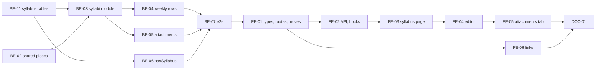

# F-10 Syllabus — Backend + Frontend Implementation Plan

This plan builds the shared syllabus of a course (FR-44..FR-48, EP-10): one syllabus per course, used by every program that has the course, stored as numbered revisions. It delivers the first Draft revision and its direct editing (state diagram DC-01, DC-02), the content sections in a rich text editor with server-side sanitizing, weekly content rows, the optional English description with a VI/EN view toggle, signed-copy attachments stored on the server disk, the read-only syllabus screen (MH-36) and the editor (MH-37) with its Nội dung, Nội dung theo tuần and Đính kèm tabs, and links to the syllabus from the course detail and the curriculum table.

It deliberately excludes CLOs and the CLOs of a week (F-11, EP-11), the grading formula and the failing score (F-12, EP-12), publication of a revision when a program version is first released (DC-03, F-15), new revisions through a change request (DC-04, DC-05, F-13), reading the revision pinned by a program version (S-9, F-15), the release block for a course without a syllabus (EC-44, F-15), and attachments kept per published revision (US-077, F-15).

> **Companion documents**
> - Requirement: `docs/requirement/REQUIREMENTS.md:496-500` (FR-44..FR-48), `:791` (R5 scope by subject group), `:1260` (EC-44), `:1350` (Q-27)
> - Stories: `docs/planning/user-stories.md:489-530` (US-038..US-041); epic EP-10 (`docs/planning/epics.md`)
> - Design: `docs/design/data-dictionary.md:468-488` (`Syllabus`), `:490-500` (`WeeklyContent`), `:542-553` (`SyllabusAttachment`), `:323` (`CurriculumItem.syllabus`), `:853-854` (permission rows); `docs/design/state-diagrams.md:191-215` (§5 `Syllabus`), `:460` (S-9); `docs/design/screen-inventory.md:107-108` (MH-36, MH-37), `:274`, `:280`, `:289-290` (links)
> - Answers: `docs/planning/feature-questions.md:177-180` (§F-10, all A), `:55` (F00-15), `:60` (F00-20)
> - Builds on: F-01 (`AppException`, `COMMON_ERRORS`, `Env`, `createTestApp`, `client.ts`), F-02 (`AccessContext`, `PERMISSIONS.SYLLABUS_VIEW`, `SYLLABUS_EDIT`, `PROGRAM_VIEW`, `PERMISSION_TABLE`), F-04 (`Course`, `courseTarget`, `edit-path.ts`, `CourseUsageReader`, `HOME_FACULTY_CODE`, `CourseDetailPage`, `CourseEditButton`), F-05 (`course-relations.service.ts` call sites), F-07 (`CurriculumItemDto`, `CurriculumTable`, `ProgramsUsingList`), F-09 (`sendXlsx`, `sendForm`, `downloadFile`, the 413 entry in `ERRORS_BY_STATUS`)
> - Tests: `docs/planning/test-plan.md:195` (KB-036), `:310-311` (NT-B3-01, NT-B3-02)

**Status**: Not started

---

## 0. Plan at a glance

Everything below in one table. Read this; the rest is detail for whoever builds it.

| What | Why | How and where |
|---|---|---|
| **One syllabus per course, read the same from anywhere** — from the course page or any program's curriculum | US-038 AC1; FR-44; DEC-02 | Syllabus rows hang off `Course`, never off a program; the screen route is `/courses/:courseId/syllabus` (BE-01, BE-03, FE-03) |
| **"Chưa có đề cương" with a create button for those who may write it** | US-038 AC3; EC-44; KB-036 | `GET /courses/:courseId/syllabus` returns no revision and `canCreate`; `POST` makes revision 1 as a Draft (BE-03, FE-03) |
| **Sections in a rich text editor**: description, objectives, teaching methods, assessment methods, references — bold, lists and tables kept | US-039 AC1; FR-45, FR-46; F10-03 | TipTap on the client; the server keeps only an allowlist of tags through `sanitize-html` before saving (BE-02, BE-03, FE-04) |
| **Pasted script never runs** | US-039 AC5 | Sanitized on every write; the read view renders only stored, sanitized HTML (BE-02, FE-03) |
| **Weekly content rows in order** — label, content, teaching activities | US-039 AC2; FR-45 | `WeeklyContent` with `sortOrder`; add, edit, delete, drag to reorder (BE-04, FE-04). The CLOs of a week arrive with the CLOs themselves (F-11) |
| **Programs using the course are shown before editing** | US-039 AC3 | The editor opens with the list from `CourseUsageReader.programsUsing` (BE-03, FE-04) |
| **R5 can only edit syllabi of their own subject group** | US-039 AC4; Q-27 | `syllabus.edit` checked on the course's owner group and faculty — the same target as the course itself (BE-02 shared `courseTarget`) |
| **English description optional; VI/EN view toggle marks what is not translated** | US-040; FR-48; F10-01 | `englishDescription` column; the toggle shows Vietnamese plus a "Chưa dịch" tag where English is empty (BE-01, FE-03) |
| **Signed copies attached to the Draft**, up to 20 MB, PDF / Word / Excel / image | US-041; FR-47 (wave 1); F10-04; F00-20 | Files on the server disk under `FILES_ROOT`, relative path in `SyllabusAttachment`; type checked by extension and file signature; only the uploader removes one (BE-02, BE-05, FE-05) |
| **"Đề cương" link on the course page and on every curriculum row**, tagged when missing | MH-17 → MH-36, MH-25 → MH-36; EC-44 warning | `CurriculumItemDto.hasSyllabus` (BE-06); links built from `ROUTES.syllabus` (FE-06) |

**Key behaviours worth knowing**

| Behaviour | Why it is this way |
|---|---|
| Only the Draft is edited here, and only until the course has a published revision | DC-02 edits the Draft; after DC-03 every change is a change request (DC-04). F-10's edit path is `VIA_REQUEST` as soon as a published revision exists, and writes answer 409 `CHANGE_REQUEST_REQUIRED` |
| Nothing in F-10 publishes a revision | DC-03 publishes the Draft when a program version that pins it is released (F-15). Tests use `publishSyllabusForTest` until then |
| R3, R4 and R5 edit the Draft directly although their `syllabus.edit` cell is "via request" | The F-04 edit-path rule: a never-released object of the home faculty is open to request holders in scope (`draftOpenToRequestHolders`). A foreign faculty's course is R1's alone |
| Drafts are hidden from students | MH-36: R6 sees published content only. A Draft is returned only to callers whose `program.view` scope is ALL (R1..R5) |
| The view shows the latest published revision, not the one a program pinned | S-9: the applied revision comes from `CurriculumItem.syllabus`, which F-15 adds. Until then there is exactly one published revision per course at most |
| Each section saves on its own | `PATCH /syllabi/:id` takes only the fields sent; two people editing different sections do not overwrite each other. The same section edited twice is last-write-wins (§8) |
| Emptying the editor stores `null`, not `<p></p>` | An empty section must read as missing for DC-03's "has content" check (F-15) and for the "Chưa dịch" tag |
| The VI/EN toggle changes only the course name and the description | FR-48 names exactly name, description and CLO. Other sections have no English field and show Vietnamese with no tag; CLO joins with F-11 |
| An attachment's file name on disk is a random id, never the uploaded name | Uploaded names carry Vietnamese, spaces and path characters; the original name is kept in the row and sent back on download |
| The attachment row and the file are written file-first, removed row-first | A failure leaves at worst an unreferenced file on disk, never a row pointing at nothing visible to users |

**Not included**

| Excluded | Why |
|---|---|
| CLOs, the CLO tab, CLOs linked to a week (`CLO`, `WeeklyContentCLO`) | F-11 (EP-11) owns CLOs and their PLO mapping; US-039 AC2's "CLO liên quan" lands there (§8 constraint) |
| Grading formula tab, mapping tab, `failingScore` | F-12 (EP-12); its columns are added by the feature that writes them |
| Publishing (DC-03), new revisions by change request (DC-04, DC-05), `previousVersion` in use, `sourceRequest` | F-15 and F-13. `previousVersionId` exists now (no writer yet); `sourceRequestId` is added with `ChangeRequest` (F-13) |
| Showing the revision pinned by a program version; the release block for a missing syllabus | F-15 (S-9, EC-44) |
| Attachments of a published revision (US-077) | F-15; F-10 attaches to the Draft only (US-041 AC1) |
| Scope by "the lecturer who wrote the syllabus" | Q-27 answered: scope stays by subject group; no author column |

---

## 1. Scope

| In scope | Why |
|---|---|
| `Syllabus` (revision, status, sections, English description, publication time), `WeeklyContent`, `SyllabusAttachment` | DD §5; FR-44, FR-45, FR-47, FR-48 |
| Create the first Draft; edit sections; weekly rows; attachments | DC-01, DC-02; US-038 AC3, US-039, US-041 |
| Read view with VI/EN toggle; editor with three tabs | MH-36, MH-37; US-038, US-040 |
| Server disk storage for files, shared for later attachment features | F00-20; F10-04 |
| Shared rich text sanitizer and editor component | F10-03; reused by F-13 change items and any later long text |
| "Đề cương" links and the "chưa có đề cương" tag in the curriculum | MH-17, MH-25 links; EC-44 warning |

| Out of scope | Deferred until |
|---|---|
| CLO list, week–CLO links, bilingual CLO | F-11 |
| Grading formula, assessment–CLO mapping, failing score | F-12 |
| Change request on a published syllabus | F-13 |
| Publication on first release, pinned revision, release block (EC-44), versioned attachments (US-077) | F-15 |
| Syllabus export to Word/PDF | Not asked by any story |

| AC | Covered by |
|---|---|
| US-038 AC1 — same syllabus from two programs | BE-01 (syllabus on `Course`), BE-03, FE-03, FE-06; NT-B3-02 |
| US-038 AC2 — all parts shown | BE-03, FE-03 (description, objectives, weekly content, teaching methods, assessment methods, references); CLO and formula sections appear with F-11, F-12 |
| US-038 AC3 — "chưa có đề cương" + create button | BE-03 (`canCreate`), FE-03; KB-036 |
| US-039 AC1 — sections saved with bold, lists, tables | BE-02 (allowlist), BE-03, FE-04 |
| US-039 AC2 — weekly rows in order | BE-04, FE-04 (CLO column: F-11) |
| US-039 AC3 — programs list before editing | BE-03 (`programsUsing`), FE-04 |
| US-039 AC4 — R5 refused outside their group | BE-02 (`courseTarget`), BE-03 (`assertDirectEdit`), BE-07 |
| US-039 AC5 — embedded script neutralized | BE-02, BE-07, FE-03 |
| US-040 AC1 — both languages saved | BE-01, BE-03, FE-04 |
| US-040 AC2 — English optional | BE-03 (no rule on English fields) |
| US-040 AC3 — "chưa dịch" marker | FE-03 |
| US-041 AC1 — attach on a Draft; name, uploader, time listed | BE-05, FE-05 |
| US-041 AC2 — wrong type or too large refused, message names types and size | BE-05, FE-05 |
| US-041 AC3 — the uploader removes a file | BE-05, FE-05 |

---

## 2. Contract verification

F-10 builds on F-01..F-09 code that is **specified, not built**. Every "existing" claim cites the plan that defines it; Rule 13 re-reads the built file before the step that uses it.

| Existing piece used | Defined at | Used by |
|---|---|---|
| `PERMISSIONS.SYLLABUS_VIEW = 'syllabus.view'` (R1..R6 X), `SYLLABUS_EDIT = 'syllabus.edit'` (R1 X; R3, R4, R5 Đ(P)); seed rows | F-02 BE-03 (`f-02-…:575-576`, `:1217-1218`); `data-dictionary.md:853-854` | BE-03..BE-05 |
| `PERMISSIONS.PROGRAM_VIEW` (R1..R5 X, R6 P) | F-02 BE-03; F-06 (`f-06-…:119`) | BE-03 (who sees Drafts) |
| `AccessContext.has`, `modeFor`, `assertCan`, `scopeFor(code): { all: true } \| { all: false } & ScopeIds`, `userId` | F-02 BE-04 (`f-02-…:664`, `:700-740`) | BE-03..BE-05 |
| `EditState {released, draftOpenToRequestHolders}`, `editPathFor`, `assertDirectEdit` (→ 409 `CHANGE_REQUEST_REQUIRED`), `EDIT_PATH` | F-04 BE-02 (`f-04-…:354-376`) | BE-03..BE-05 |
| `courseTarget({ownerFacultyId, ownerGroupId}): ScopeTarget` — in the feature file `src/features/courses/course.dto.ts` | F-04 BE-03 (`f-04-…:664-666`) | BE-02 (moved) |
| `courseTarget` call sites: `courses.service.ts` ×5; `course-relations.service.ts` ×3 | `f-04-…:701`, `:726`, `:733`, `:759`, `:802`; `f-05-…:543`, `:619`, `:630` | BE-02 |
| `Course {id, courseCode, courseName, englishName?, credits Decimal(5,2), status, ownerFacultyId, ownerGroupId?}`; `CourseStatus` ACTIVE / DISCONTINUED / CANCELLED; Cancelled rows hidden from callers without `course.edit` | F-04 BE-01, BE-03 (`f-04-…:261-295`, `:840-841`, `:149`) | BE-01, BE-03 |
| `COURSE_NOT_FOUND` repeated per feature because features cannot import `COURSE_ERRORS` | F-05 (`f-05-…:419`, `:644`) | BE-03 |
| `CourseUsageReader.programsUsing(courseId): CourseUsage[]` (`programId`, `programCode`, `programName`, `versionLabel`, `plannedSemester`) in `src/shared/courses/` | F-04 BE-02, filled by F-07 BE-02 (`f-07-…:525-560`) | BE-03 |
| `CourseUsageDto` declared in `src/features/courses/course.dto.ts` | F-04 BE-03, F-07 (`f-07-…:404`) | BE-02 (moved) |
| `HOME_FACULTY_CODE` in `src/shared/org-units/home-faculty.ts`; `courseEditState` pattern | F-04, F-05 (`f-05-…:433-444`) | BE-02 (`syllabusEditState`) |
| `AppException(definition, details?)`, `COMMON_ERRORS.VALIDATION_FAILED`, field details `{ field, constraints }` | F-01 BE-03 (`f-01-…:342-347`); F-05 (`f-05-…:883`) | BE-03, BE-04 |
| `Env` class in `src/shared/config/env.validation.ts`, defaults as named constants, `ConfigService<Env, true>` | F-01 BE-05 (`f-01-…:663-673`, `:713`) | BE-02 |
| 413 → `PAYLOAD_TOO_LARGE` in `ERRORS_BY_STATUS`; `@types/multer` installed; `FileInterceptor` with `memoryStorage()` | F-09 BE-05 (`f-09-…:947`, `:976`, `:1065`) | BE-05 |
| `sendXlsx(res, content, fileName)` with RFC 5987 `Content-Disposition`, in the feature file `src/features/imports/import-mapping.ts`; callers at `f-09-…:1059`, `:1094`, `:1317` | F-09 BE-05 (`f-09-…:1100-1108`) | BE-02 (header logic moved) |
| Multer `originalname` latin1 decode, written inline in the imports service | F-09 BE-05 gotcha (`f-09-…:1276`) | BE-02 (moved to a helper) |
| `CurriculumItemDto` (`course: RelatedCourseDto` with `id`, `courseCode`, …) built in `curriculum.service.ts` `read` | F-07 BE-03 (`f-07-…:189-207`, `:881`); F-05 (`f-05-…:162`) | BE-06 |
| `createTestApp`, `loginAgent`, `createCourse`, `createProgram`, `addCurriculumItem`, `releaseVersionForTest`; `PERMISSION_TABLE` e2e | F-01 BE-10, F-02, F-06 BE-06, F-07 BE-06 (`f-07-…:1489-1498`) | BE-07 |
| `@nestjs/platform-express ^12.1.3` installed; `sanitize-html` absent | `source/backend/package.json:26-40` | BE-02 |
| Frontend: `getJson`, `sendJson`, `ApiError`; `sendForm(path, form)`, `downloadFile(path, fallbackName)` | F-01 FE-03; F-09 FE-02 (`f-09-…:1516-1540`) | FE-02 |
| `ROUTES`, `router.tsx` lazy pages, `RequirePermission`, `PERMISSIONS` camelCase (`courseView`, …), `PageContainer`, `PageSpin`, `ApiErrorResult` | F-02 FE-02, F-04 FE-01 (`f-04-…:1110-1125`) | FE-01, FE-03, FE-04 |
| `CourseDetailPage` (`PageContainer` extra = `CourseEditButton` + status actions; body `CourseInfoCard` + `ProgramsUsingList`) | F-04 FE-04 (`f-04-…:1360-1376`) | FE-06 |
| `ProgramsUsingList({ usages })` in `src/features/courses/components/`, `NOT_USED_BY_PROGRAMS`; call sites `CourseDetailPage`, `CourseFormPage` | F-04 FE-04 (`f-04-…:1354`, `:1372`, `:1520`), F-07 FE-06 (`f-07-…:1985-1999`) | FE-01 (moved) |
| `CurriculumTable` actions column (Sửa / Điều kiện / Xóa when `item.canEdit`) | F-07 FE-03 (`f-07-…:1760`) | FE-06 |
| `@tiptap/*` absent; React `^19.3.1`, antd `^6.6.6` | `source/frontend/package.json:20-28` | FE-04 |

### 2a. Endpoints

All under `/api`. "Scoped" means `assertCan` / `assertDirectEdit` in the service on top of the guard.

| Endpoint | Permission (guard) | Request | Response | Notes |
|---|---|---|---|---|
| `GET /courses/:courseId/syllabus` | `syllabus.view` | — | `CourseSyllabusDto` | Always 200 for a visible course: `published` and `draft` may both be null (US-038 AC3). `draft` only for callers with `program.view` ALL. Cancelled course without `course.edit` → 404 `COURSE_NOT_FOUND` |
| `POST /courses/:courseId/syllabus` | `syllabus.edit` | — | `CourseSyllabusDto` (201) | Scoped; DC-01. Any existing revision → 409 `SYLLABUS_ALREADY_EXISTS`; Cancelled course → 409 `COURSE_CANCELLED` |
| `PATCH /syllabi/:syllabusId` | `syllabus.edit` | `UpdateSyllabusDto` | `SyllabusDto` | Scoped; Draft only (409 `SYLLABUS_NOT_DRAFT`); only the fields sent change; each value sanitized, empty → null |
| `POST /syllabi/:syllabusId/weekly-contents` | `syllabus.edit` | `CreateWeeklyContentDto` | `WeeklyContentDto` (201) | Appended last |
| `PATCH /weekly-contents/:weeklyContentId` | `syllabus.edit` | `UpdateWeeklyContentDto` | `WeeklyContentDto` | |
| `DELETE /weekly-contents/:weeklyContentId` | `syllabus.edit` | — | 204 | Following rows close the gap |
| `PUT /syllabi/:syllabusId/weekly-contents/order` | `syllabus.edit` | `ReorderWeeklyContentsDto` (`ids`) | `WeeklyContentDto[]` | `ids` must be exactly the Draft's rows → else 409 `SYLLABUS_ORDER_MISMATCH` |
| `POST /syllabi/:syllabusId/attachments` | `syllabus.edit` | `multipart/form-data`: `file` | `SyllabusAttachmentDto` (201) | Scoped; Draft only; size by multer (413), type by extension + signature (400 `ATTACHMENT_TYPE_NOT_ALLOWED`), count (409 `ATTACHMENT_LIMIT_REACHED`) |
| `GET /syllabus-attachments/:attachmentId/file` | `syllabus.view` | — | file bytes, `Content-Disposition: attachment` with the original name | Same visibility as the revision it belongs to; file gone from disk → 404 `FILE_MISSING` |
| `DELETE /syllabus-attachments/:attachmentId` | `syllabus.edit` | — | 204 | Scoped; Draft only; only `uploadedBy` (403 `ATTACHMENT_NOT_UPLOADER`) |

### 2b. DTOs

**`CourseSyllabusDto`**

| Field | Wire type | Nullable | Source | Modeled as | Note |
|---|---|---|---|---|---|
| `course` | `SyllabusCourseDto` | no | BE-03 | header | |
| `programsUsing` | `CourseUsageDto[]` | no | `CourseUsageReader.programsUsing` | `ProgramsUsingList` | moved to shared (BE-02); same Swagger name, so the generated client type is unchanged |
| `published` | `SyllabusDto \| null` | **yes** | BE-03 | view default | the one `PUBLISHED` revision; always null until F-15 publishes |
| `draft` | `SyllabusDto \| null` | **yes** | BE-03 | view toggle, editor | null for R6, and when no Draft exists |
| `canCreate` | `boolean` | no | BE-03 | "Tạo đề cương" | no revision ∧ course not Cancelled ∧ edit path `DIRECT` |
| `editPath` | `'DIRECT' \| 'VIA_REQUEST' \| null` | **yes** | F-04 `EDIT_PATH` | "Sửa đề cương" / disabled "Tạo đề xuất" | null = no `syllabus.edit` on this course |
| `attachmentRules` | `{ maxBytes: number; fileTypes: AttachmentFileType[] }` | no | BE-05 | upload hint and client pre-check | from `ATTACHMENT_MAX_MB` and `ATTACHMENT_TYPES` |

**`SyllabusCourseDto`**: `id`, `courseCode`, `courseName` (`string`), `englishName: string | null`, `credits: string` (Decimal as string), `status: 'ACTIVE' | 'DISCONTINUED' | 'CANCELLED'`. Modeled as `SyllabusCourse`; the English name is shown by the toggle (edited on the course form, F-04).

**`SyllabusDto`**

| Field | Wire type | Nullable | Source | Modeled as | Note |
|---|---|---|---|---|---|
| `id` | `string` | no | BE-01 | key | |
| `revisionNumber` | `number` | no | BE-01 | "Bản số N" | 1 for the first Draft |
| `status` | `'DRAFT' \| 'PUBLISHED' \| 'HISTORICAL'` | no | BE-01 `SyllabusStatus` | tag via `SYLLABUS_STATUS_LABELS` | `HISTORICAL` is never returned by F-10's endpoints |
| `courseDescription`, `englishDescription`, `objectives`, `teachingMethods`, `assessmentMethods`, `references` | `string` (sanitized HTML) | **yes** | BE-01 | sections | null = section empty |
| `publishedAt` | `string` (ISO) | **yes** | BE-01 | "Ban hành ngày" | null on a Draft |
| `updatedAt` | `string` (ISO) | no | BE-01 | "Cập nhật lúc" | |
| `weeklyContents` | `WeeklyContentDto[]` | no | BE-04 | weekly table | ordered by `sortOrder` |
| `attachments` | `SyllabusAttachmentDto[]` | no | BE-05 | attachment list | ordered by `recordedAt` |

**`WeeklyContentDto`**: `id: string`, `weekLabel: string`, `sortOrder: number` (1-based, contiguous), `content: string` (sanitized HTML), `teachingActivities: string | null`.

**`SyllabusAttachmentDto`**

| Field | Wire type | Nullable | Source | Modeled as | Note |
|---|---|---|---|---|---|
| `id` | `string` | no | BE-01 | key | |
| `fileName` | `string` | no | BE-05 | link text | original name, UTF-8 decoded |
| `fileType` | `'PDF' \| 'DOCX' \| 'XLSX' \| 'IMAGE'` | no | BE-01 `AttachmentFileType` | icon via `ATTACHMENT_TYPE_LABELS` | |
| `sizeBytes` | `number` | no | BE-01 | "2,4 MB" | |
| `uploadedBy` | `{ id: string; fullName: string }` | no | BE-05 | shown | |
| `recordedAt` | `string` (ISO) | no | BE-01 | shown | |
| `canDelete` | `boolean` | no | BE-05 | delete button | caller is the uploader ∧ revision is a Draft ∧ direct edit allowed |

**Request DTOs**

| DTO | Fields |
|---|---|
| `UpdateSyllabusDto` | each of the six section fields optional, `string \| null`, `@MaxLength(SYLLABUS_LIMITS.RICH_TEXT_MAX)` |
| `CreateWeeklyContentDto` | `weekLabel` (trimmed, 1..`WEEK_LABEL_MAX`), `content` (rich text, required non-empty after sanitizing), `teachingActivities?` (rich text) |
| `UpdateWeeklyContentDto` | the same three, all optional |
| `ReorderWeeklyContentsDto` | `ids: string[]`, unique, `@ArrayMaxSize(SYLLABUS_LIMITS.WEEKLY_ROWS_MAX)` |

### 2c. Mismatch log

| Deliverable | What the design says | What this plan does | Found at |
|---|---|---|---|
| BE-01 | `SyllabusAttachment.fileType`: `PDF` · `WORD`; US-041 says PDF or Word | `PDF` · `DOCX` · `XLSX` · `IMAGE` (PNG, JPEG), 20 MB, per F10-04. DD and US-041 updated with this plan | `data-dictionary.md:551`; `user-stories.md:525-527`; `feature-questions.md:180` |
| BE-01 | `SyllabusAttachment` has no size | `sizeBytes` (⊕) so the list and the limit check need no disk read. DD updated | `data-dictionary.md:542-553` |
| BE-01 | DD lists `failingScore`, `sourceRequest` on `Syllabus` | Not created now: `failingScore` with F-12 (its writer), `sourceRequestId` with `ChangeRequest` (F-13). `previousVersionId` is created now (self-relation, no writer until F-13) | `data-dictionary.md:481-483` |
| BE-02 | `courseTarget` lives in the courses feature; F-05's relations service uses it | A feature importing another feature breaks `nestjs-rules.md` §1, and the syllabi service needs it too. Moved to `src/shared/courses/course-target.ts`; every call site migrated (BE-02 table) | `f-04-…:664`; `f-05-…:543`, `:619`, `:630` |
| BE-02 | `sendXlsx` is in the imports feature | The `Content-Disposition` logic moves to `src/shared/files/send-file.ts`; `sendXlsx` keeps its signature and calls it, so its three callers do not change | `f-09-…:1100-1108` |
| BE-03 | S-9: "screens and APIs that look up a syllabus must take a program or semester context" | F-10 reads the course's current revisions only; the program context arrives with the pin (F-15 constraint, §8) | `state-diagrams.md:460` |

---

## 3. Decisions

| # | Decision | Why | Rejected alternative |
|---|---|---|---|
| D1 | The syllabus belongs to `Course`; routes are course-based (`/courses/:courseId/syllabus`); revision ids are used only for writes | FR-44, DEC-02: one syllabus shared by every program. A course-based URL is the same from every entry point (US-038 AC1) | A route under the program — two URLs for one syllabus |
| D2 | F-10 creates only revision 1 as a Draft (DC-01) and edits only a Draft (DC-02); any existing revision makes `POST` a 409 | DC-01's guard is "no revision yet"; every later revision comes from a change request (DC-04, F-13) | Letting `POST` start revision N+1 after publication — a second way to change a published syllabus without review |
| D3 | Edit state: `released` = the course has a `PUBLISHED` revision; `draftOpenToRequestHolders` = the course belongs to the home faculty. Permission `syllabus.edit` on `courseTarget(course)` | Mirrors `courseEditState` (F-05) so the syllabus behaves like the course it describes; R5's scope is the owner subject group (Q-27) | `released` from the course's curriculum use — before F-15 a course can sit in a released version with an unpublished Draft only through test helpers, and after F-15 the two coincide (DC-03 publishes on first release) |
| D4 | Drafts are returned only when `access.scopeFor(PROGRAM_VIEW).all` is true | MH-36: R6 never sees drafts; `program.view` ALL is the existing line between staff and students (F-06 `assertListAll`) | A new permission code for "see drafts" — a matrix change for a rule the matrix already implies |
| D5 | Rich text is stored as HTML, sanitized on the server with `sanitize-html` and an allowlist (`RICH_TEXT_POLICY`); empty text after sanitizing is stored as `null` | F10-03 A; US-039 AC5. The server is the only place every write passes through | Client-side sanitizing only — any API caller bypasses it; Markdown — F10-03 chose rich text |
| D6 | The client edits with TipTap (`@tiptap/react`, `@tiptap/starter-kit`, `@tiptap/extension-table`) configured to the same tags the server allows; read views render stored HTML through one `RichTextView` component | TipTap outputs clean semantic HTML and has table support; one render point keeps `dangerouslySetInnerHTML` in a single reviewed file | AntD has no rich text editor; Quill — weaker table support; rendering through a read-only TipTap instance — dozens of editor instances on a 15-week syllabus |
| D7 | Section saves are partial: `PATCH` changes only the fields present | Several people may edit one syllabus; whole-object saves would overwrite sections others changed | Optimistic locking on `updatedAt` — safer for the same section, but every save conflicts with any other section's save (§8) |
| D8 | Weekly rows keep a contiguous 1-based `sortOrder`; reorder takes the full id list | Mirrors F-07's curriculum reorder (`ORDER_MISMATCH` on a partial list) | Fractional order keys — no benefit at ≤ 60 rows |
| D9 | Files go to a disk folder `FILES_ROOT` behind a shared `FileStorageService`; the row stores a relative path `syllabi/<syllabusId>/<uuid><ext>` | F00-20 A; F-26 backs up that folder; later attachment features (US-077) reuse the service | `bytea` like F-09's import files — F00-20 chose disk for attachments; F-09's 30-day temporary files are a different case |
| D10 | Allowed types `ATTACHMENT_TYPES`: PDF, DOCX, XLSX, PNG, JPEG — checked by extension **and** file signature; max size `ATTACHMENT_MAX_MB` (env, default 20); at most `ATTACHMENTS_MAX` per revision | F10-04 A; F00-15 A (business parameters in env). The signature check stops a renamed executable | Trusting the browser's MIME type — set by the client |
| D11 | Multer limits come from `MulterModule.registerAsync` in `SyllabiModule`, not from the decorator | The size is an env value, and decorator arguments are static | A constant in the decorator — the env setting would not apply |
| D12 | Only the uploader removes an attachment, and only from a Draft they may still edit directly | US-041 AC3 names the uploader; a published revision's files are history (US-077) | R1 removes anyone's file — not asked; a removal by someone else would be invisible to the uploader |
| D13 | The curriculum row carries `hasSyllabus`; the curriculum table tags rows without a syllabus | EC-44: allowed in the curriculum "with a warning". The release block is F-15's | A new F-08 warning code now — F-15 adds the release check and the checker entry together (§8) |
| D14 | `ProgramsUsingList`, `CourseUsageDto` and `courseTarget` move to shared, with every call site migrated | The syllabi feature needs all three, and features cannot import each other (`nestjs-rules.md` §1, `react-vite-rules.md` §4) | Copies in the syllabi feature — two lists of "programs using this course" that drift |

---

## 5. Deliverables

Backend paths are under `source/backend/`, frontend paths under `source/frontend/`.

### BE-01 — Prisma schema: `Syllabus`, `WeeklyContent`, `SyllabusAttachment`

What/Why: DD §5 (`Syllabus`, `WeeklyContent`, `SyllabusAttachment`); FR-44, FR-45, FR-47, FR-48; D1, D2. The revision row is what every later syllabus feature (CLO, formula, request, publication) hangs off.

**Files**

| Action | Path |
|---|---|
| MODIFY | `prisma/schema.prisma` (`SyllabusStatus`, `AttachmentFileType`, three models; back-relations on `Course`, `User`) |
| NEW | `prisma/migrations/<timestamp>_syllabi/migration.sql` (generated, then edited) |

**Shape**

```prisma
enum SyllabusStatus {
  DRAFT
  PUBLISHED
  HISTORICAL
}

enum AttachmentFileType {
  PDF
  DOCX
  XLSX
  IMAGE
}

model Syllabus {
  id                 String               @id @default(cuid(2))
  courseId           String
  course             Course               @relation(fields: [courseId], references: [id], onDelete: Restrict)
  revisionNumber     Int
  status             SyllabusStatus       @default(DRAFT)
  courseDescription  String?
  englishDescription String?
  objectives         String?
  teachingMethods    String?
  assessmentMethods  String?
  references         String?
  previousVersionId  String?              @unique
  previousVersion    Syllabus?            @relation("SyllabusLineage", fields: [previousVersionId], references: [id], onDelete: Restrict)
  nextVersion        Syllabus?            @relation("SyllabusLineage")
  publishedAt        DateTime?
  createdAt          DateTime             @default(now())
  updatedAt          DateTime             @updatedAt
  weeklyContents     WeeklyContent[]
  attachments        SyllabusAttachment[]

  @@unique([courseId, revisionNumber])
}

model WeeklyContent {
  id                 String   @id @default(cuid(2))
  syllabusId         String
  syllabus           Syllabus @relation(fields: [syllabusId], references: [id], onDelete: Cascade)
  weekLabel          String
  sortOrder          Int
  content            String
  teachingActivities String?

  @@index([syllabusId, sortOrder])
}

model SyllabusAttachment {
  id           String             @id @default(cuid(2))
  syllabusId   String
  syllabus     Syllabus           @relation(fields: [syllabusId], references: [id], onDelete: Restrict)
  fileName     String
  fileType     AttachmentFileType
  filePath     String             @unique
  sizeBytes    Int
  uploadedById String
  uploadedBy   User               @relation("SyllabusAttachmentUploadedBy", fields: [uploadedById], references: [id], onDelete: Restrict)
  recordedAt   DateTime           @default(now())

  @@index([syllabusId, recordedAt])
}
```

Back-relations: `Course.syllabi Syllabus[]`, `User.syllabusAttachments SyllabusAttachment[] @relation("SyllabusAttachmentUploadedBy")`.

```
pnpm prisma migrate dev --create-only --name syllabi
# append the statements below, then:
pnpm prisma migrate dev
pnpm prisma generate
```

```sql
-- appended to migration.sql
-- DC-01..DC-05: at most one Draft and one Published revision per course; any number of Historical.
CREATE UNIQUE INDEX "Syllabus_one_draft" ON "Syllabus" ("courseId") WHERE "status" = 'DRAFT';
CREATE UNIQUE INDEX "Syllabus_one_published" ON "Syllabus" ("courseId") WHERE "status" = 'PUBLISHED';
ALTER TABLE "Syllabus" ADD CONSTRAINT "Syllabus_revision_positive" CHECK ("revisionNumber" >= 1);
ALTER TABLE "Syllabus" ADD CONSTRAINT "Syllabus_published_has_time" CHECK (("status" = 'DRAFT') = ("publishedAt" IS NULL));
ALTER TABLE "WeeklyContent" ADD CONSTRAINT "WeeklyContent_order_positive" CHECK ("sortOrder" >= 1);
ALTER TABLE "SyllabusAttachment" ADD CONSTRAINT "SyllabusAttachment_size_positive" CHECK ("sizeBytes" > 0);
```

**Rationale**: Raw partial indexes after `--create-only` mirror F-06 BE-01's "one Draft per program" index and F-09 BE-01's appended checks (`f-09-…:316-321`). Prisma cannot declare a partial unique index, so the schema carries only `@@unique([courseId, revisionNumber])` and the migration carries the state rules. `previousVersionId` is `@unique` because a revision is succeeded by at most one revision (DC-04 creates N+1 from N); the self-relation is the DD's `previousVersion` (`data-dictionary.md:482`). Attachments are `Restrict` because the file on disk cannot be removed by a cascade — the service removes rows and files together (BE-05). Weekly rows cascade: they have no life outside their revision.

**Gotchas**
- `references` is an SQL keyword. Prisma quotes every identifier, so the column works; never write it unquoted in a raw query.
- `--create-only` then the edit: `prisma migrate dev` later regenerates nothing for the raw indexes, and `prisma migrate diff` reports them as drift only if someone removes them from the SQL — keep them in the migration file, not in `schema.prisma`.
- Do not add `failingScore` or `sourceRequestId` now (§2c): a column with no writer gets filled by guesses.
- The `Syllabus_published_has_time` check means F-15's publish sets `publishedAt` in the same update as the status, and DC-05's move to HISTORICAL keeps `publishedAt` — both states are "not Draft".

**Verify**: `pnpm prisma migrate dev` applies; `pnpm exec tsc --noEmit -p tsconfig.json`; in psql, a second `DRAFT` row for one course fails with `Syllabus_one_draft`; a `PUBLISHED` row with null `publishedAt` fails with `Syllabus_published_has_time`.

**Depends on**: F-02 BE-01 (`User`), F-04 BE-01 (`Course`) built

---

### BE-02 — Shared pieces: course target, usage DTO, rich text, file storage, env

What/Why: The syllabi feature needs `courseTarget` and `CourseUsageDto`, which live in the courses feature, and two capabilities nobody has built yet: sanitizing rich text (F10-03, US-039 AC5) and storing files on disk (F00-20). All of it goes to `src/shared/`, so no feature imports another (D14, D5, D9).

**Files**

| Action | Path |
|---|---|
| NEW | `src/shared/courses/course-target.ts` (`courseTarget` moved) |
| MODIFY | `src/features/courses/course.dto.ts` (remove `courseTarget`, `CourseUsageDto`; import from shared) |
| MODIFY | `src/features/courses/courses.service.ts` (import path, 5 call sites) |
| MODIFY | `src/features/course-relations/course-relations.service.ts` (import path, 3 call sites) |
| NEW | `src/shared/courses/course-usage.dto.ts` (`CourseUsageDto` moved) |
| NEW | `src/shared/rich-text/sanitize-rich-text.ts` |
| NEW | `src/shared/rich-text/sanitize-rich-text.spec.ts` |
| NEW | `src/shared/files/files.module.ts` |
| NEW | `src/shared/files/file-storage.service.ts` |
| NEW | `src/shared/files/file-storage.service.spec.ts` |
| NEW | `src/shared/files/file.errors.ts` |
| NEW | `src/shared/files/send-file.ts` (`sendFile`, `asciiFileName`) |
| NEW | `src/shared/files/uploaded-file-name.ts` |
| NEW | `src/shared/files/attachment-types.ts` (`ATTACHMENT_TYPE_SPECS`, `detectAttachmentType`, `mimeForPath`) |
| NEW | `src/shared/files/attachment-types.spec.ts` |
| MODIFY | `src/features/imports/import-mapping.ts` (`sendXlsx` calls `sendFile`) |
| MODIFY | `src/features/imports/imports.service.ts` (`uploadedFileName(file.originalname)` replaces the inline decode) |
| MODIFY | `src/shared/config/env.validation.ts` (`FILES_ROOT`, `ATTACHMENT_MAX_MB`) |
| MODIFY | `src/app.setup.ts` (JSON body limit) |
| MODIFY | `README.md` (env rows), `.gitignore` (`files/`) |
| MODIFY | `package.json` (`sanitize-html`, `@types/sanitize-html`) |

**Shape**

```ts
// src/shared/courses/course-target.ts
export function courseTarget(course: { ownerFacultyId: string; ownerGroupId: string | null }): ScopeTarget {
  return { subjectGroupIds: course.ownerGroupId ? [course.ownerGroupId] : [], orgUnitIds: [course.ownerFacultyId] };
}
```

Call sites of `courseTarget` — every one migrated to the shared import, none left on the old path:

| Call site | Defined at | Status |
|---|---|---|
| `courses.service.ts` `create` | `f-04-…:701` | migrated |
| `courses.service.ts` `update` | `f-04-…:726` | migrated |
| `courses.service.ts` `update` (owner change) | `f-04-…:733` | migrated |
| `courses.service.ts` `transition` | `f-04-…:759` | migrated |
| `courses.service.ts` `toDetail` | `f-04-…:802` | migrated |
| `course-relations.service.ts` relation writes | `f-05-…:543` | migrated |
| `course-relations.service.ts` equivalence writes | `f-05-…:619` | migrated |
| `course-relations.service.ts` equivalence removal | `f-05-…:630` | migrated |
| `syllabi` service (BE-03..BE-05) | this plan | new caller |

`CourseUsageDto` moves unchanged (F-04 fields plus F-07's `plannedSemester`) to `src/shared/courses/course-usage.dto.ts`; `CourseDetailDto.programsUsing` imports it from there. The class name is the Swagger schema name, so `components['schemas']['CourseUsageDto']` in the generated client does not change.

```ts
// src/shared/rich-text/sanitize-rich-text.ts
import sanitizeHtml from 'sanitize-html';

// Must match the tags the client editor can produce (RichTextEditor); anything else is dropped, text kept.
export const RICH_TEXT_POLICY: sanitizeHtml.IOptions = {
  allowedTags: ['p', 'br', 'hr', 'strong', 'em', 'u', 's', 'code', 'pre', 'ul', 'ol', 'li', 'h3', 'h4', 'blockquote',
    'table', 'colgroup', 'col', 'thead', 'tbody', 'tr', 'th', 'td', 'a'],
  allowedAttributes: { a: ['href'], th: ['colspan', 'rowspan', 'colwidth'], td: ['colspan', 'rowspan', 'colwidth'] },
  allowedSchemes: ['http', 'https', 'mailto'],
  allowProtocolRelative: false,
  disallowedTagsMode: 'discard',
  transformTags: {
    a: sanitizeHtml.simpleTransform('a', { rel: 'noopener noreferrer nofollow', target: '_blank' }, true),
  },
};

const NBSP = /&nbsp;|\u00a0/g;

export function sanitizeRichText(html: string | null | undefined): string | null {
  if (html === null || html === undefined) return null;
  const clean = sanitizeHtml(html, RICH_TEXT_POLICY).trim();
  const text = sanitizeHtml(clean, { allowedTags: [], allowedAttributes: {} }).replace(NBSP, ' ').trim();
  return text === '' ? null : clean;
}
```

```ts
// src/shared/files/file.errors.ts
export const FILE_ERRORS = {
  FILE_MISSING: { status: HttpStatus.NOT_FOUND, code: 'FILE_MISSING', message: 'Không tìm thấy tệp trên máy chủ. Hãy báo quản trị viên hệ thống.' },
} as const satisfies Record<string, ErrorDefinition>;
```

```ts
// src/shared/files/file-storage.service.ts
const TEMP_SUFFIX = '.part';

// Paths in the database are relative with '/' separators; the root comes from FILES_ROOT, so moving the folder needs no data change.
@Injectable()
export class FileStorageService implements OnModuleInit {
  private readonly logger = new Logger(FileStorageService.name);
  private readonly root: string;

  constructor(config: ConfigService<Env, true>) {
    this.root = path.resolve(config.get('FILES_ROOT', { infer: true }));
  }

  async onModuleInit(): Promise<void> {
    await mkdir(this.root, { recursive: true });
  }

  async write(relativePath: string, content: Uint8Array): Promise<void> {
    const target = this.resolve(relativePath);
    await mkdir(path.dirname(target), { recursive: true });
    const temp = `${target}${TEMP_SUFFIX}`;
    await writeFile(temp, content, { flag: 'wx' });
    await rename(temp, target);
  }

  async open(relativePath: string): Promise<{ stream: Readable; sizeBytes: number }> {
    const target = this.resolve(relativePath);
    const info = await stat(target).catch(() => null);
    if (!info?.isFile()) {
      this.logger.error(`Stored file missing: ${relativePath}`);
      throw new AppException(FILE_ERRORS.FILE_MISSING);
    }
    return { stream: createReadStream(target), sizeBytes: info.size };
  }

  async remove(relativePath: string): Promise<void> {
    await rm(this.resolve(relativePath), { force: true });
  }

  private resolve(relativePath: string): string {
    const target = path.resolve(this.root, ...relativePath.split('/'));
    if (!target.startsWith(this.root + path.sep)) {
      throw new Error(`File path escapes FILES_ROOT: ${relativePath}`);
    }
    return target;
  }
}

// src/shared/files/files.module.ts
@Module({ providers: [FileStorageService], exports: [FileStorageService] })
export class FilesModule {}
```

```ts
// src/shared/files/send-file.ts
const NON_ASCII = /[^\x20-\x7e]|["\\]/g;
const ASCII_FALLBACK_CHAR = '_';

// RFC 5987 so Vietnamese file names survive the header; the ASCII fallback is for old clients.
export function sendFile(res: Response, body: Uint8Array | Readable, fileName: string, mime: string): StreamableFile {
  res.set({
    'Content-Type': mime,
    'Content-Disposition': `attachment; filename="${asciiFileName(fileName)}"; filename*=UTF-8''${encodeURIComponent(fileName)}`,
  });
  return new StreamableFile(body);
}

export function asciiFileName(fileName: string): string {
  return fileName.normalize('NFD').replace(/\p{M}/gu, '').replace(/[đĐ]/g, (c) => (c === 'đ' ? 'd' : 'D')).replace(NON_ASCII, ASCII_FALLBACK_CHAR);
}

// src/features/imports/import-mapping.ts — after
export function sendXlsx(res: Response, content: Uint8Array, fileName: string): StreamableFile {
  return sendFile(res, content, fileName, XLSX_MIME);
}
```

`sendXlsx` keeps its signature; its three callers (`f-09-…:1059`, `:1094`, `:1317`) are untouched. If F-09 was built with its own `asciiFileName`, that function is deleted from `import-mapping.ts` in this change — one definition only.

```ts
// src/shared/files/uploaded-file-name.ts
export const FILE_NAME_MAX = 255;
const CONTROL_CHARS = /[\u0000-\u001f\u007f]/g;
const UNNAMED_FILE = 'tep-dinh-kem';

// Multer hands over the multipart file name as latin1; UTF-8 names (Vietnamese) need re-decoding.
export function uploadedFileName(originalname: string): string {
  const decoded = Buffer.from(originalname, 'latin1').toString('utf8');
  const base = decoded.replaceAll('\\', '/').split('/').pop() ?? '';
  return base.replace(CONTROL_CHARS, '').trim().slice(0, FILE_NAME_MAX) || UNNAMED_FILE;
}
```

Call sites of the inline latin1 decode: F-09 `imports.service.ts` `create` (the gotcha at `f-09-…:1276`) — migrated to `uploadedFileName`. No other uploader exists before F-10.

```ts
// src/shared/files/attachment-types.ts
const PDF_SIGNATURE = [0x25, 0x50, 0x44, 0x46, 0x2d];
const ZIP_SIGNATURE = [0x50, 0x4b, 0x03, 0x04];
const PNG_SIGNATURE = [0x89, 0x50, 0x4e, 0x47, 0x0d, 0x0a, 0x1a, 0x0a];
const JPEG_SIGNATURE = [0xff, 0xd8, 0xff];

interface AttachmentTypeSpec {
  type: AttachmentFileType;
  extension: string;
  mime: string;
  signature: readonly number[];
}

// DOCX and XLSX are ZIP containers, so their signature only proves "ZIP"; the extension picks the type.
export const ATTACHMENT_TYPE_SPECS: readonly AttachmentTypeSpec[] = [
  { type: AttachmentFileType.PDF, extension: '.pdf', mime: 'application/pdf', signature: PDF_SIGNATURE },
  { type: AttachmentFileType.DOCX, extension: '.docx', mime: 'application/vnd.openxmlformats-officedocument.wordprocessingml.document', signature: ZIP_SIGNATURE },
  { type: AttachmentFileType.XLSX, extension: '.xlsx', mime: 'application/vnd.openxmlformats-officedocument.spreadsheetml.sheet', signature: ZIP_SIGNATURE },
  { type: AttachmentFileType.IMAGE, extension: '.png', mime: 'image/png', signature: PNG_SIGNATURE },
  { type: AttachmentFileType.IMAGE, extension: '.jpg', mime: 'image/jpeg', signature: JPEG_SIGNATURE },
  { type: AttachmentFileType.IMAGE, extension: '.jpeg', mime: 'image/jpeg', signature: JPEG_SIGNATURE },
];

export const ATTACHMENT_EXTENSIONS = ATTACHMENT_TYPE_SPECS.map((spec) => spec.extension);
export const OCTET_STREAM = 'application/octet-stream';

export function detectAttachmentType(fileName: string, content: Uint8Array): AttachmentTypeSpec | null {
  const extension = path.extname(fileName).toLowerCase();
  const spec = ATTACHMENT_TYPE_SPECS.find((candidate) => candidate.extension === extension);
  if (!spec) return null;
  return spec.signature.every((byte, index) => content[index] === byte) ? spec : null;
}

export function mimeForPath(filePath: string): string {
  const extension = path.extname(filePath).toLowerCase();
  return ATTACHMENT_TYPE_SPECS.find((spec) => spec.extension === extension)?.mime ?? OCTET_STREAM;
}
```

```ts
// src/shared/config/env.validation.ts — added
const DEFAULT_FILES_ROOT = 'files';
const DEFAULT_ATTACHMENT_MAX_MB = 20;

  @IsString() @IsNotEmpty()
  FILES_ROOT: string = DEFAULT_FILES_ROOT;

  @IsInt() @Min(1)
  ATTACHMENT_MAX_MB: number = DEFAULT_ATTACHMENT_MAX_MB;
```

```ts
// src/app.setup.ts — added next to the existing pipes and filters
// A syllabus section with a table can exceed Express's 100 KB JSON default.
const JSON_BODY_LIMIT = '1mb';
app.useBodyParser('json', { limit: JSON_BODY_LIMIT });
```

README env table (Vietnamese, as F-01's rows at `f-01-…:813-820`):

| Biến | Giá trị mẫu | Bắt buộc |
|---|---|---|
| `FILES_ROOT` | `files` (thư mục lưu tệp đính kèm, tương đối với thư mục chạy hoặc tuyệt đối; cần sao lưu) | Không |
| `ATTACHMENT_MAX_MB` | `20` | Không |

**Rationale**: The moves follow F-05's precedent of lifting `courseEditState` into `src/shared/courses/` (`f-05-…:433-446`) and F-09's lifting of the curriculum row rules (`f-09-…:214`). The env pattern mirrors `SESSION_IDLE_MINUTES` (`f-01-…:663-673`). `sanitize-html` is chosen over DOMPurify + jsdom because it needs no DOM on the server and its allowlist is a plain object the spec can assert on. `detectAttachmentType` lives in shared because US-077 (F-15) attaches files to published revisions through another feature. The temp-then-rename write means a crash never leaves a half-written file under the final name.

**Gotchas**
- `sanitize-html` is CommonJS. With the backend's ESM build, `import sanitizeHtml from 'sanitize-html'` works (Node exposes `module.exports` as the default); a named import `{ simpleTransform }` does not — call it as `sanitizeHtml.simpleTransform`.
- Pin `sanitize-html` and `@types/sanitize-html` to the latest 2.x release at least two weeks old at install time.
- `sanitizeRichText` on a text node like `a < b` returns `a &lt; b` — the stored HTML is escaped; never sanitize twice on read.
- `path.resolve` on Windows dev machines uses `\`; the escape check compares against `this.root + path.sep`, and stored paths always use `/` (`path.posix.join` in BE-05).
- `app.useBodyParser` needs the app typed `NestExpressApplication`; if F-01's `main.ts` creates a plain `INestApplication`, change the generic there (Rule 13: read `main.ts` and `app.setup.ts` before this step).
- `asciiFileName` replaces every non-ASCII character after stripping Vietnamese marks, so "Đề cương.pdf" falls back to `De cuong.pdf`.

**Verify**: `sanitize-rich-text.spec.ts`: `<script>alert(1)</script><p>x</p>` → `<p>x</p>`; `` → null; `<a href="javascript:alert(1)">x</a>` → `<a rel=… target="_blank">x</a>` without `href`; `<table><tr><td colspan="2">x</td></tr></table>` kept; `<p style="color:red">x</p>` → `<p>x</p>`; `<p></p>` and `<p>&nbsp;</p>` → null. `file-storage.service.spec.ts` (temp dir as `FILES_ROOT`): write then open returns the bytes and size; open of a missing path → `FILE_MISSING`; `../outside.txt` → throws; write twice to one path → second fails (`wx`). `attachment-types.spec.ts`: PDF bytes as `.pdf` → PDF; PDF bytes as `.docx` → null; ZIP bytes as `.xlsx` → XLSX; `.exe` → null; `.JPG` → IMAGE. `uploadedFileName` spec: latin1 of "Đề cương.pdf" → "Đề cương.pdf"; `C:\x\a.pdf` → `a.pdf`. F-04, F-05 and F-09 specs pass unchanged. `pnpm exec tsc --noEmit -p tsconfig.json`.

**Depends on**: F-04 BE-03, F-05 BE-03, F-09 BE-05 built

---

### BE-03 — Syllabi module: read, create, edit sections

What/Why: US-038 (read, "chưa có đề cương"), US-039 AC1/AC3/AC4/AC5, US-040; DC-01, DC-02; D2..D5, D7.

**Files**

| Action | Path |
|---|---|
| NEW | `src/features/syllabi/syllabi.module.ts` |
| NEW | `src/features/syllabi/syllabi.controller.ts` |
| NEW | `src/features/syllabi/syllabi.service.ts` |
| NEW | `src/features/syllabi/syllabus-access.ts` (selects, `syllabusEditState`, visibility, write guard) |
| NEW | `src/features/syllabi/syllabus.errors.ts` |
| NEW | `src/features/syllabi/syllabus.dto.ts` (response DTOs and mapping) |
| NEW | `src/features/syllabi/update-syllabus.dto.ts` |
| NEW | `src/features/syllabi/syllabi.service.spec.ts` |
| MODIFY | `src/app.module.ts` (import `SyllabiModule`) |

**Shape**

```ts
// src/features/syllabi/syllabus.errors.ts
export const SYLLABUS_LIMITS = {
  RICH_TEXT_MAX: 100_000,
  WEEK_LABEL_MAX: 50,
  WEEKLY_ROWS_MAX: 60,
  ATTACHMENTS_MAX: 10,
  FIRST_REVISION: 1,
} as const;

export const SYLLABUS_ERRORS = {
  // Same code as COURSE_ERRORS.COURSE_NOT_FOUND; repeated because features do not import each other.
  COURSE_NOT_FOUND: { status: HttpStatus.NOT_FOUND, code: 'COURSE_NOT_FOUND', message: 'Không tìm thấy học phần.' },
  COURSE_CANCELLED: { status: HttpStatus.CONFLICT, code: 'COURSE_CANCELLED', message: 'Học phần đã hủy, không sửa đề cương được.' },
  SYLLABUS_NOT_FOUND: { status: HttpStatus.NOT_FOUND, code: 'SYLLABUS_NOT_FOUND', message: 'Không tìm thấy đề cương.' },
  SYLLABUS_ALREADY_EXISTS: { status: HttpStatus.CONFLICT, code: 'SYLLABUS_ALREADY_EXISTS', message: 'Học phần đã có đề cương. Tải lại trang để xem bản hiện có.' },
  SYLLABUS_NOT_DRAFT: { status: HttpStatus.CONFLICT, code: 'SYLLABUS_NOT_DRAFT', message: 'Chỉ sửa được bản đề cương đang ở trạng thái Nháp.' },
  WEEKLY_CONTENT_NOT_FOUND: { status: HttpStatus.NOT_FOUND, code: 'WEEKLY_CONTENT_NOT_FOUND', message: 'Không tìm thấy dòng nội dung theo tuần.' },
  WEEKLY_ROWS_LIMIT: { status: HttpStatus.CONFLICT, code: 'SYLLABUS_WEEKLY_ROWS_LIMIT', message: `Đề cương có tối đa ${SYLLABUS_LIMITS.WEEKLY_ROWS_MAX} dòng nội dung theo tuần.` },
  ORDER_MISMATCH: { status: HttpStatus.CONFLICT, code: 'SYLLABUS_ORDER_MISMATCH', message: 'Danh sách sắp xếp không khớp các dòng hiện có; tải lại trang rồi thử lại.' },
  ATTACHMENT_NOT_FOUND: { status: HttpStatus.NOT_FOUND, code: 'ATTACHMENT_NOT_FOUND', message: 'Không tìm thấy tệp đính kèm.' },
  ATTACHMENT_FILE_REQUIRED: { status: HttpStatus.BAD_REQUEST, code: 'ATTACHMENT_FILE_REQUIRED', message: 'Hãy chọn một tệp để đính kèm.' },
  ATTACHMENT_TYPE_NOT_ALLOWED: { status: HttpStatus.BAD_REQUEST, code: 'ATTACHMENT_TYPE_NOT_ALLOWED', message: 'Chỉ nhận tệp PDF, Word (.docx), Excel (.xlsx) hoặc ảnh PNG/JPEG.' },
  ATTACHMENT_LIMIT_REACHED: { status: HttpStatus.CONFLICT, code: 'ATTACHMENT_LIMIT_REACHED', message: `Mỗi bản đề cương có tối đa ${SYLLABUS_LIMITS.ATTACHMENTS_MAX} tệp đính kèm.` },
  ATTACHMENT_NOT_UPLOADER: { status: HttpStatus.FORBIDDEN, code: 'ATTACHMENT_NOT_UPLOADER', message: 'Chỉ người đã tải tệp lên mới gỡ được tệp này.' },
} as const satisfies Record<string, ErrorDefinition>;
```

```ts
// src/features/syllabi/syllabus-access.ts
export const SYLLABUS_COURSE_SELECT = {
  id: true, courseCode: true, courseName: true, englishName: true, credits: true, status: true,
  ownerFacultyId: true, ownerGroupId: true, ownerFaculty: { select: { unitCode: true } },
} as const satisfies Prisma.CourseSelect;
export type SyllabusCourseRow = Prisma.CourseGetPayload<{ select: typeof SYLLABUS_COURSE_SELECT }>;

export const SYLLABUS_ACCESS_SELECT = {
  id: true, status: true, courseId: true, course: { select: SYLLABUS_COURSE_SELECT },
} as const satisfies Prisma.SyllabusSelect;
export type SyllabusAccessRow = Prisma.SyllabusGetPayload<{ select: typeof SYLLABUS_ACCESS_SELECT }>;

// The syllabus follows the course: home-faculty courses are open to request holders until a revision is published.
export async function syllabusEditState(prisma: PrismaService, course: SyllabusCourseRow): Promise<EditState> {
  const published = await prisma.syllabus.findFirst({
    where: { courseId: course.id, status: { not: SyllabusStatus.DRAFT } },
    select: { id: true },
  });
  return { released: published !== null, draftOpenToRequestHolders: course.ownerFaculty.unitCode === HOME_FACULTY_CODE };
}

// Students (program.view scoped to their own program) read published revisions only.
export function seesDrafts(access: AccessContext): boolean {
  return access.has(PERMISSIONS.PROGRAM_VIEW) && access.scopeFor(PERMISSIONS.PROGRAM_VIEW).all;
}

export function assertCourseVisible(course: SyllabusCourseRow | null, access: AccessContext): asserts course is SyllabusCourseRow {
  if (!course || (course.status === CourseStatus.CANCELLED && !access.has(PERMISSIONS.COURSE_EDIT))) {
    throw new AppException(SYLLABUS_ERRORS.COURSE_NOT_FOUND);
  }
}

export function assertRevisionVisible(row: SyllabusAccessRow | null, access: AccessContext): asserts row is SyllabusAccessRow {
  if (!row || (row.status !== SyllabusStatus.PUBLISHED && !seesDrafts(access))) {
    throw new AppException(SYLLABUS_ERRORS.SYLLABUS_NOT_FOUND);
  }
  assertCourseVisible(row.course, access);
}

// Every write to a revision or its rows goes through here, in this order.
export async function assertDraftWrite(prisma: PrismaService, access: AccessContext, row: SyllabusAccessRow | null): Promise<SyllabusAccessRow> {
  assertRevisionVisible(row, access);
  assertDirectEdit(access, PERMISSIONS.SYLLABUS_EDIT, courseTarget(row.course), await syllabusEditState(prisma, row.course));
  if (row.status !== SyllabusStatus.DRAFT) throw new AppException(SYLLABUS_ERRORS.SYLLABUS_NOT_DRAFT);
  if (row.course.status === CourseStatus.CANCELLED) throw new AppException(SYLLABUS_ERRORS.COURSE_CANCELLED);
  return row;
}
```

```ts
// src/features/syllabi/update-syllabus.dto.ts
export class UpdateSyllabusDto {
  @ApiPropertyOptional({ nullable: true, type: String }) @IsOptional() @IsString() @MaxLength(SYLLABUS_LIMITS.RICH_TEXT_MAX)
  courseDescription?: string | null;
  // englishDescription, objectives, teachingMethods, assessmentMethods, references: same decorators
}

export const SYLLABUS_SECTION_FIELDS = [
  'courseDescription', 'englishDescription', 'objectives', 'teachingMethods', 'assessmentMethods', 'references',
] as const satisfies readonly (keyof UpdateSyllabusDto)[];
```

```ts
// src/features/syllabi/syllabus.dto.ts — mapping (DTO classes per §2b)
export const SYLLABUS_INCLUDE = {
  weeklyContents: { orderBy: [{ sortOrder: 'asc' }, { id: 'asc' }] },
  attachments: { include: { uploadedBy: { select: { id: true, fullName: true } } }, orderBy: [{ recordedAt: 'asc' }, { id: 'asc' }] },
} as const satisfies Prisma.SyllabusInclude;
export type SyllabusRow = Prisma.SyllabusGetPayload<{ include: typeof SYLLABUS_INCLUDE }>;

export function toSyllabusDto(row: SyllabusRow, canDeleteFrom: (uploadedById: string) => boolean): SyllabusDto {
  return {
    id: row.id, revisionNumber: row.revisionNumber, status: row.status,
    courseDescription: row.courseDescription, englishDescription: row.englishDescription, objectives: row.objectives,
    teachingMethods: row.teachingMethods, assessmentMethods: row.assessmentMethods, references: row.references,
    publishedAt: row.publishedAt?.toISOString() ?? null, updatedAt: row.updatedAt.toISOString(),
    weeklyContents: row.weeklyContents.map(toWeeklyContentDto),
    attachments: row.attachments.map((attachment) => toAttachmentDto(attachment, canDeleteFrom(attachment.uploadedById))),
  };
}
```

```ts
// src/features/syllabi/syllabi.controller.ts (BE-03 routes; BE-04, BE-05 add theirs to this controller)
@ApiTags('syllabi')
@Controller()
export class SyllabiController {
  constructor(private readonly syllabi: SyllabiService) {}

  @Get('courses/:courseId/syllabus')
  @RequirePermission(PERMISSIONS.SYLLABUS_VIEW)
  @ApiOkResponse({ type: CourseSyllabusDto })
  forCourse(@Param('courseId') courseId: string, @CurrentAccess() access: AccessContext) { return this.syllabi.forCourse(courseId, access); }

  @Post('courses/:courseId/syllabus')
  @HttpCode(HttpStatus.CREATED)
  @RequirePermission(PERMISSIONS.SYLLABUS_EDIT)
  @ApiCreatedResponse({ type: CourseSyllabusDto })
  create(@Param('courseId') courseId: string, @CurrentAccess() access: AccessContext) { return this.syllabi.create(courseId, access); }

  @Patch('syllabi/:syllabusId')
  @RequirePermission(PERMISSIONS.SYLLABUS_EDIT)
  @ApiOkResponse({ type: SyllabusDto })
  update(@Param('syllabusId') syllabusId: string, @Body() dto: UpdateSyllabusDto, @CurrentAccess() access: AccessContext) {
    return this.syllabi.update(syllabusId, dto, access);
  }
}
```

```ts
// src/features/syllabi/syllabi.service.ts
@Injectable()
export class SyllabiService {
  constructor(
    private readonly prisma: PrismaService,
    private readonly usage: CourseUsageReader,
    private readonly config: ConfigService<Env, true>,
  ) {}

  async forCourse(courseId: string, access: AccessContext): Promise<CourseSyllabusDto> {
    const course = await this.prisma.course.findUnique({ where: { id: courseId }, select: SYLLABUS_COURSE_SELECT });
    assertCourseVisible(course, access);
    const revisions = await this.prisma.syllabus.findMany({
      where: { courseId, status: { in: [SyllabusStatus.PUBLISHED, SyllabusStatus.DRAFT] } },
      include: SYLLABUS_INCLUDE,
    });
    const state = await syllabusEditState(this.prisma, course);
    const editPath = editPathFor(access, PERMISSIONS.SYLLABUS_EDIT, courseTarget(course), state);
    const hasAnyRevision = revisions.length > 0 || state.released;
    const published = revisions.find((row) => row.status === SyllabusStatus.PUBLISHED) ?? null;
    const draft = seesDrafts(access) ? revisions.find((row) => row.status === SyllabusStatus.DRAFT) ?? null : null;
    const canDeleteFrom = (uploadedById: string) => uploadedById === access.userId && editPath === EDIT_PATH.DIRECT;
    return {
      course: toSyllabusCourseDto(course),
      programsUsing: await this.usage.programsUsing(courseId),
      published: published && toSyllabusDto(published, () => false),
      draft: draft && toSyllabusDto(draft, canDeleteFrom),
      canCreate: !hasAnyRevision && course.status !== CourseStatus.CANCELLED && editPath === EDIT_PATH.DIRECT,
      editPath,
      attachmentRules: this.attachmentRules(),
    };
  }

  async create(courseId: string, access: AccessContext): Promise<CourseSyllabusDto> {
    const course = await this.prisma.course.findUnique({ where: { id: courseId }, select: SYLLABUS_COURSE_SELECT });
    assertCourseVisible(course, access);
    assertDirectEdit(access, PERMISSIONS.SYLLABUS_EDIT, courseTarget(course), await syllabusEditState(this.prisma, course));
    if (course.status === CourseStatus.CANCELLED) throw new AppException(SYLLABUS_ERRORS.COURSE_CANCELLED);
    if (await this.prisma.syllabus.count({ where: { courseId } }) > 0) throw new AppException(SYLLABUS_ERRORS.SYLLABUS_ALREADY_EXISTS);
    try {
      await this.prisma.syllabus.create({ data: { courseId, revisionNumber: SYLLABUS_LIMITS.FIRST_REVISION, status: SyllabusStatus.DRAFT } });
    } catch (error) {
      if (isUniqueViolation(error)) throw new AppException(SYLLABUS_ERRORS.SYLLABUS_ALREADY_EXISTS);
      throw error;
    }
    return this.forCourse(courseId, access);
  }

  async update(syllabusId: string, dto: UpdateSyllabusDto, access: AccessContext): Promise<SyllabusDto> {
    const row = await this.prisma.syllabus.findUnique({ where: { id: syllabusId }, select: SYLLABUS_ACCESS_SELECT });
    await assertDraftWrite(this.prisma, access, row);
    const data: Prisma.SyllabusUpdateInput = {};
    for (const field of SYLLABUS_SECTION_FIELDS) {
      if (dto[field] !== undefined) data[field] = sanitizeRichText(dto[field]);
    }
    const updated = await this.prisma.syllabus.update({ where: { id: syllabusId }, data, include: SYLLABUS_INCLUDE });
    return toSyllabusDto(updated, (uploadedById) => uploadedById === access.userId);
  }

  attachmentRules(): AttachmentRulesDto {
    return {
      maxBytes: this.config.get('ATTACHMENT_MAX_MB', { infer: true }) * BYTES_PER_MB,
      fileTypes: [...new Set(ATTACHMENT_TYPE_SPECS.map((spec) => spec.type))],
    };
  }
}
```

```ts
// src/features/syllabi/syllabi.module.ts (BE-05 adds MulterModule)
@Module({
  imports: [CoursesSharedModule, FilesModule],
  controllers: [SyllabiController],
  providers: [SyllabiService],
})
export class SyllabiModule {}
```

`BYTES_PER_MB` (`1024 * 1024`) goes in `src/shared/files/attachment-types.ts` next to the specs; the client receives `maxBytes`, never megabytes, so there is one conversion.

**Rationale**: The service shape mirrors `CurriculumService.read` (`f-07-…:850-880`): one read that carries `editPath` and capability flags so the screen never guesses. `syllabus-access.ts` mirrors `curriculum-access.ts` (`f-07-…:725-760`): selects plus the guard sequence every write repeats. `isUniqueViolation` is the P2002 helper F-04 BE-03 uses for course codes. `CoursesSharedModule` is F-04's module around `CourseUsageReader` (`src/shared/courses/courses-shared.module.ts`, `f-04-…:424-426`).

**Gotchas**
- `seesDrafts` must check `access.has` first: Rule 13 — read F-02's `scopeFor` for a code the user does not hold (throw vs empty scope) and keep this order either way.
- `released` counts `HISTORICAL` too: a course whose only non-Draft revision was superseded is still a released syllabus (F-15/F-13 paths). In F-10 no row reaches HISTORICAL.
- `canCreate` uses `state.released` as well as `revisions.length`: a HISTORICAL-only course (not reachable in F-10) must not offer "Tạo đề cương".
- `@IsOptional()` lets `null` through and keeps `undefined` as "not sent"; `whitelist` drops unknown fields, `forbidNonWhitelisted` refuses them — a client sending `status` gets 400, which is wanted.
- In `update`, the `canDeleteFrom` callback needs the edit path too, but `assertDraftWrite` has just proved direct edit; the uploader test alone is correct here.
- `toSyllabusCourseDto` emits `credits` with `toWireDecimal` (`src/shared/decimal/decimal.ts`, `f-04-…:441-447`).

**Verify**: `syllabi.service.spec.ts` (Prisma and `CourseUsageReader` mocked, `AccessContext` hand-built): no revision + R3 in scope → `canCreate true`, `editPath DIRECT`; same for R6 → `canCreate false`, `editPath null`, `draft null`; Draft exists + R6 → `draft null`; foreign-faculty course + R3 → `editPath VIA_REQUEST`, `canCreate false`; Cancelled course + R5 → `COURSE_NOT_FOUND`; `create` twice → `SYLLABUS_ALREADY_EXISTS`; P2002 on create → `SYLLABUS_ALREADY_EXISTS`; `create` on a Cancelled course with R1 → `COURSE_CANCELLED`; `update` R5 outside group → `OUT_OF_SCOPE`; `update` on a PUBLISHED row → `CHANGE_REQUEST_REQUIRED` (released) before `SYLLABUS_NOT_DRAFT`; `update` with only `objectives` writes only `objectives`; `'<p></p>'` stored as null. `pnpm exec tsc --noEmit -p tsconfig.json`.

**Depends on**: BE-01, BE-02; F-02 BE-04, F-04 BE-02, F-07 BE-02 built

---

### BE-04 — Weekly content rows

What/Why: US-039 AC2 (rows kept in order); FR-45; D8.

**Files**

| Action | Path |
|---|---|
| NEW | `src/features/syllabi/weekly-content.dto.ts` (`CreateWeeklyContentDto`, `UpdateWeeklyContentDto`, `ReorderWeeklyContentsDto`, `WeeklyContentDto`, `toWeeklyContentDto`) |
| NEW | `src/features/syllabi/weekly-contents.service.ts` |
| NEW | `src/features/syllabi/weekly-contents.service.spec.ts` |
| MODIFY | `src/features/syllabi/syllabi.controller.ts` (four routes) |
| MODIFY | `src/features/syllabi/syllabi.module.ts` (provider) |

**Shape**

```ts
// src/features/syllabi/weekly-content.dto.ts
export class CreateWeeklyContentDto {
  @ApiProperty() @Transform(trimString) @IsString() @Length(1, SYLLABUS_LIMITS.WEEK_LABEL_MAX)
  weekLabel: string;

  @ApiProperty() @IsString() @MaxLength(SYLLABUS_LIMITS.RICH_TEXT_MAX)
  content: string;

  @ApiPropertyOptional({ nullable: true, type: String }) @IsOptional() @IsString() @MaxLength(SYLLABUS_LIMITS.RICH_TEXT_MAX)
  teachingActivities?: string | null;
}

export class UpdateWeeklyContentDto extends PartialType(CreateWeeklyContentDto) {}

export class ReorderWeeklyContentsDto {
  @ApiProperty({ type: [String] }) @IsArray() @ArrayMinSize(1) @ArrayMaxSize(SYLLABUS_LIMITS.WEEKLY_ROWS_MAX) @ArrayUnique() @IsString({ each: true })
  ids: string[];
}

export const WEEKLY_CONTENT_FIELD = { CONTENT: 'content' } as const;
```

```ts
// src/features/syllabi/weekly-contents.service.ts
@Injectable()
export class WeeklyContentsService {
  constructor(private readonly prisma: PrismaService) {}

  async create(syllabusId: string, dto: CreateWeeklyContentDto, access: AccessContext): Promise<WeeklyContentDto> {
    await assertDraftWrite(this.prisma, access, await this.findRevision(syllabusId));
    const content = requiredRichText(dto.content);
    return this.prisma.$transaction(async (tx) => {
      const count = await tx.weeklyContent.count({ where: { syllabusId } });
      if (count >= SYLLABUS_LIMITS.WEEKLY_ROWS_MAX) throw new AppException(SYLLABUS_ERRORS.WEEKLY_ROWS_LIMIT);
      const created = await tx.weeklyContent.create({
        data: { syllabusId, weekLabel: dto.weekLabel, sortOrder: count + 1, content, teachingActivities: sanitizeRichText(dto.teachingActivities) },
      });
      await tx.syllabus.update({ where: { id: syllabusId }, data: { updatedAt: new Date() } });
      return toWeeklyContentDto(created);
    });
  }

  async update(weeklyContentId: string, dto: UpdateWeeklyContentDto, access: AccessContext): Promise<WeeklyContentDto>;
  // load row with syllabus: SYLLABUS_ACCESS_SELECT (404 WEEKLY_CONTENT_NOT_FOUND); assertDraftWrite;
  // weekLabel as sent; content → requiredRichText when sent; teachingActivities → sanitizeRichText when sent; touch syllabus.updatedAt

  async remove(weeklyContentId: string, access: AccessContext): Promise<void>;
  // load + assertDraftWrite; in one transaction: delete, then renumber the remaining rows 1..n by current order

  async reorder(syllabusId: string, dto: ReorderWeeklyContentsDto, access: AccessContext): Promise<WeeklyContentDto[]> {
    await assertDraftWrite(this.prisma, access, await this.findRevision(syllabusId));
    return this.prisma.$transaction(async (tx) => {
      const rows = await tx.weeklyContent.findMany({ where: { syllabusId }, select: { id: true } });
      const current = new Set(rows.map((row) => row.id));
      if (rows.length !== dto.ids.length || dto.ids.some((id) => !current.has(id))) {
        throw new AppException(SYLLABUS_ERRORS.ORDER_MISMATCH);
      }
      for (const [index, id] of dto.ids.entries()) {
        await tx.weeklyContent.update({ where: { id }, data: { sortOrder: index + 1 } });
      }
      await tx.syllabus.update({ where: { id: syllabusId }, data: { updatedAt: new Date() } });
      return (await tx.weeklyContent.findMany({ where: { syllabusId }, orderBy: { sortOrder: 'asc' } })).map(toWeeklyContentDto);
    });
  }

  private findRevision(syllabusId: string): Promise<SyllabusAccessRow | null> {
    return this.prisma.syllabus.findUnique({ where: { id: syllabusId }, select: SYLLABUS_ACCESS_SELECT });
  }
}

function requiredRichText(html: string): string {
  const clean = sanitizeRichText(html);
  if (clean === null) {
    throw new AppException(COMMON_ERRORS.VALIDATION_FAILED, [{ field: WEEKLY_CONTENT_FIELD.CONTENT, constraints: ['Nội dung tuần không được để trống.'] }]);
  }
  return clean;
}
```

Routes added to `SyllabiController`: `POST syllabi/:syllabusId/weekly-contents` (201), `PATCH weekly-contents/:weeklyContentId`, `DELETE weekly-contents/:weeklyContentId` (204), `PUT syllabi/:syllabusId/weekly-contents/order` — all `@RequirePermission(PERMISSIONS.SYLLABUS_EDIT)`.

**Rationale**: Reorder mirrors F-07's semester reorder (`f-07-…:717-722`, `ORDER_MISMATCH` at `:666`); append-last mirrors `nextSortOrder` (`f-07-…:897`). The parent's `updatedAt` is touched so "Cập nhật lúc" on the screen reflects row edits too. Field-level validation details mirror F-05's `{ field, constraints }` (`f-05-…:883`).

**Gotchas**
- No unique index on `(syllabusId, sortOrder)` (BE-01): the reorder loop passes through duplicate values mid-transaction.
- The count-then-create in `create` runs in a transaction but at READ COMMITTED; two parallel adds can both read 59 and land at 61 rows. The cap is a usability bound, not an integrity rule, so this is accepted — do not add a lock for it.
- `PartialType` from `@nestjs/swagger` (not `@nestjs/mapped-types`) keeps the OpenAPI schema; it also keeps the `@Transform(trimString)` on `weekLabel`.
- `DELETE` renumbering reads rows ordered by `sortOrder` then `id` so ties from an interrupted reorder resolve deterministically.

**Verify**: `weekly-contents.service.spec.ts`: add three rows → `sortOrder` 1, 2, 3; delete the middle → 1, 2; reorder with a missing id → `ORDER_MISMATCH`; reorder with an extra id → `ORDER_MISMATCH`; `content: '<p> </p>'` → `VALIDATION_FAILED` on `content`; 61st row → `WEEKLY_ROWS_LIMIT`; on a published revision → `CHANGE_REQUEST_REQUIRED`. `pnpm exec tsc --noEmit -p tsconfig.json`.

**Depends on**: BE-03

---

### BE-05 — Attachments: upload, download, remove

What/Why: US-041; FR-47 (wave 1); F10-04, F00-20; D9..D12.

**Files**

| Action | Path |
|---|---|
| NEW | `src/features/syllabi/syllabus-attachments.service.ts` |
| NEW | `src/features/syllabi/syllabus-attachments.service.spec.ts` |
| NEW | `src/features/syllabi/syllabus-attachment.dto.ts` (`SyllabusAttachmentDto`, `AttachmentRulesDto`, `UploadAttachmentFormDto`, `toAttachmentDto`) |
| MODIFY | `src/features/syllabi/syllabi.controller.ts` (three routes) |
| MODIFY | `src/features/syllabi/syllabi.module.ts` (`MulterModule.registerAsync`, provider) |

**Shape**

```ts
// src/features/syllabi/syllabi.module.ts — after
@Module({
  imports: [
    CoursesSharedModule,
    FilesModule,
    MulterModule.registerAsync({
      inject: [ConfigService],
      useFactory: (config: ConfigService<Env, true>) => ({
        storage: memoryStorage(),
        limits: { fileSize: config.get('ATTACHMENT_MAX_MB', { infer: true }) * BYTES_PER_MB, files: 1 },
      }),
    }),
  ],
  controllers: [SyllabiController],
  providers: [SyllabiService, WeeklyContentsService, SyllabusAttachmentsService],
})
export class SyllabiModule {}
```

```ts
// src/features/syllabi/syllabi.controller.ts — attachment routes
@Post('syllabi/:syllabusId/attachments')
@HttpCode(HttpStatus.CREATED)
@RequirePermission(PERMISSIONS.SYLLABUS_EDIT)
@UseInterceptors(FileInterceptor('file'))
@ApiConsumes('multipart/form-data')
@ApiBody({ type: UploadAttachmentFormDto })
@ApiCreatedResponse({ type: SyllabusAttachmentDto })
upload(@Param('syllabusId') syllabusId: string, @UploadedFile() file: Express.Multer.File | undefined, @CurrentAccess() access: AccessContext) {
  return this.attachments.upload(syllabusId, file, access);
}

@Get('syllabus-attachments/:attachmentId/file')
@RequirePermission(PERMISSIONS.SYLLABUS_VIEW)
@ApiProduces(...ATTACHMENT_MIMES)
async download(@Param('attachmentId') attachmentId: string, @CurrentAccess() access: AccessContext, @Res({ passthrough: true }) res: Response) {
  const file = await this.attachments.open(attachmentId, access);
  return sendFile(res, file.stream, file.fileName, file.mime);
}

@Delete('syllabus-attachments/:attachmentId')
@HttpCode(HttpStatus.NO_CONTENT)
@RequirePermission(PERMISSIONS.SYLLABUS_EDIT)
remove(@Param('attachmentId') attachmentId: string, @CurrentAccess() access: AccessContext) {
  return this.attachments.remove(attachmentId, access);
}
```

```ts
// src/features/syllabi/syllabus-attachments.service.ts
const SYLLABUS_FILES_DIR = 'syllabi';

@Injectable()
export class SyllabusAttachmentsService {
  private readonly logger = new Logger(SyllabusAttachmentsService.name);

  constructor(private readonly prisma: PrismaService, private readonly files: FileStorageService) {}

  async upload(syllabusId: string, file: Express.Multer.File | undefined, access: AccessContext): Promise<SyllabusAttachmentDto> {
    const revision = await assertDraftWrite(this.prisma, access, await this.prisma.syllabus.findUnique({ where: { id: syllabusId }, select: SYLLABUS_ACCESS_SELECT }));
    if (!file) throw new AppException(SYLLABUS_ERRORS.ATTACHMENT_FILE_REQUIRED);
    const fileName = uploadedFileName(file.originalname);
    const content = new Uint8Array(file.buffer);
    const spec = detectAttachmentType(fileName, content);
    if (!spec) throw new AppException(SYLLABUS_ERRORS.ATTACHMENT_TYPE_NOT_ALLOWED);
    if (await this.prisma.syllabusAttachment.count({ where: { syllabusId } }) >= SYLLABUS_LIMITS.ATTACHMENTS_MAX) {
      throw new AppException(SYLLABUS_ERRORS.ATTACHMENT_LIMIT_REACHED);
    }
    const filePath = path.posix.join(SYLLABUS_FILES_DIR, revision.id, `${randomUUID()}${spec.extension}`);
    await this.files.write(filePath, content);
    try {
      const row = await this.prisma.syllabusAttachment.create({
        data: { syllabusId, fileName, fileType: spec.type, filePath, sizeBytes: content.byteLength, uploadedById: access.userId },
        include: { uploadedBy: { select: { id: true, fullName: true } } },
      });
      return toAttachmentDto(row, true);
    } catch (error) {
      await this.files.remove(filePath);
      throw error;
    }
  }

  async open(attachmentId: string, access: AccessContext): Promise<{ stream: Readable; fileName: string; mime: string }> {
    const row = await this.prisma.syllabusAttachment.findUnique({
      where: { id: attachmentId },
      select: { fileName: true, filePath: true, syllabus: { select: SYLLABUS_ACCESS_SELECT } },
    });
    if (!row) throw new AppException(SYLLABUS_ERRORS.ATTACHMENT_NOT_FOUND);
    assertRevisionVisible(row.syllabus, access);
    const { stream } = await this.files.open(row.filePath);
    return { stream, fileName: row.fileName, mime: mimeForPath(row.filePath) };
  }

  async remove(attachmentId: string, access: AccessContext): Promise<void> {
    const row = await this.prisma.syllabusAttachment.findUnique({
      where: { id: attachmentId },
      select: { id: true, filePath: true, uploadedById: true, syllabus: { select: SYLLABUS_ACCESS_SELECT } },
    });
    if (!row) throw new AppException(SYLLABUS_ERRORS.ATTACHMENT_NOT_FOUND);
    await assertDraftWrite(this.prisma, access, row.syllabus);
    if (row.uploadedById !== access.userId) throw new AppException(SYLLABUS_ERRORS.ATTACHMENT_NOT_UPLOADER);
    await this.prisma.syllabusAttachment.delete({ where: { id: row.id } });
    await this.files.remove(row.filePath).catch((error: unknown) => this.logger.warn(`Orphan file left: ${row.filePath} (${String(error)})`));
  }
}
```

`ATTACHMENT_MIMES` is the distinct `mime` list of `ATTACHMENT_TYPE_SPECS` (exported from `attachment-types.ts`). `UploadAttachmentFormDto` has one property `@ApiProperty({ type: 'string', format: 'binary' }) file` so the generated client knows the field name, as F-09's `CreateImportFormDto`.

**Rationale**: The upload mirrors F-09's `POST /imports` (`f-09-…:1062-1071`), with the limits moved to the module because they come from env (D11). File first, row second, file removed on a failed insert — and row first, file second on delete (§0 key behaviours). The random stored name keeps user text out of the filesystem; the original name travels in the row and the `Content-Disposition` header.

**Gotchas**
- `FileInterceptor('file')` merges `MULTER_MODULE_OPTIONS` from the module only when no local `limits` are passed; do not add options in the decorator.
- Over-size uploads fail inside multer before the service runs: the response is F-09's 413 `PAYLOAD_TOO_LARGE`, and its message does not know the attachment limit — the client builds the "tối đa 20 MB" text from `attachmentRules` (FE-05).
- The service runs `assertDraftWrite` before looking at the file: a user out of scope learns nothing about type rules, and a missing file is still refused with 400 after the permission check.
- `memoryStorage` holds up to 20 MB per upload in RAM; with the Khoa's handful of concurrent editors this is fine (§8).
- `Readable` from `createReadStream` is closed by `StreamableFile` when the response ends; on a client abort Nest destroys it. Do not `await` the stream in the service.
- `remove` checks the uploader **after** `assertDraftWrite`, so a request holder on a released syllabus gets `CHANGE_REQUEST_REQUIRED`, not "not uploader".

**Verify**: `syllabus-attachments.service.spec.ts` (Prisma and `FileStorageService` mocked): no file → `ATTACHMENT_FILE_REQUIRED`; `.exe` → `ATTACHMENT_TYPE_NOT_ALLOWED`; PDF bytes named `.pdf` → row with `PDF`, path `syllabi/<id>/<uuid>.pdf`; 11th file → `ATTACHMENT_LIMIT_REACHED`, nothing written; DB create throws → `files.remove` called with the same path; remove by another user → `ATTACHMENT_NOT_UPLOADER`, no delete; remove when `files.remove` rejects → resolves, warning logged; `open` of a Draft attachment by R6 → `SYLLABUS_NOT_FOUND`. `pnpm exec tsc --noEmit -p tsconfig.json`.

**Depends on**: BE-03; F-09 BE-05 (413 entry, `@types/multer`) built

---

### BE-06 — "Has a syllabus" on curriculum rows

What/Why: EC-44 says a course without a syllabus may be in a curriculum "with a warning"; MH-25 links each row to MH-36 (`screen-inventory.md:280`). The curriculum row gains one flag; the release block stays with F-15 (D13).

**Files**

| Action | Path |
|---|---|
| MODIFY | `src/features/curriculum/curriculum.dto.ts` (`ITEM_INCLUDE`, `CurriculumItemDto.hasSyllabus`, `toCurriculumItemDto`) |
| MODIFY | `src/features/curriculum/curriculum.service.spec.ts` (one case) |

**Shape**

```ts
// src/features/curriculum/curriculum.dto.ts — changed lines
export const ITEM_INCLUDE = {
  course: { select: { ...RELATED_COURSE_SELECT, ownerGroupId: true, syllabi: { select: { id: true }, take: 1 } } },
  electiveGroup: { select: { id: true, groupCode: true } },
  requisites: { include: { sourceCourse: { select: RELATED_COURSE_SELECT } }, orderBy: [{ relationType: 'asc' }, { sourceCourse: { courseCode: 'asc' } }] },
} as const satisfies Prisma.CurriculumItemInclude;

export class CurriculumItemDto {
  // … F-07 fields
  @ApiProperty() hasSyllabus: boolean;
}

// in toCurriculumItemDto
    hasSyllabus: row.course.syllabi.length > 0,
```

**Rationale**: The flag rides on the existing row include (`f-07-…:793-797`), so the curriculum read stays one query; `take: 1` keeps it to an existence check. Any revision counts (Draft included): "has a syllabus" for the curriculum is "someone started one", and the release check (F-15) asks the stricter question.

**Gotchas**
- `toRelatedCourseDto(row.course)` receives an object with extra keys (`ownerGroupId`, `syllabi`); it maps fields explicitly, so nothing leaks to the wire — Rule 13: confirm that at build.
- The curriculum feature reads the `syllabus` table directly through Prisma, as F-08's checker reads curriculum tables; it does not import the syllabi feature.
- F-09's curriculum export uses its own select, not `ITEM_INCLUDE`; it is unaffected.

**Verify**: Curriculum service spec: a row whose course has one Draft → `hasSyllabus true`; none → `false`. `pnpm exec tsc --noEmit -p tsconfig.json`.

**Depends on**: BE-01; F-07 BE-03 built

---

### BE-07 — End-to-end tests and permission rows

What/Why: KB-036, NT-B3-01, NT-B3-02; US-038..US-041; the F-02 `PERMISSION_TABLE` check for the two syllabus cells.

**Files**

| Action | Path |
|---|---|
| NEW | `test/syllabi.e2e-spec.ts` |
| NEW | `test/support/syllabus-helpers.ts` (`createSyllabusDraft`, `publishSyllabusForTest`) |
| NEW | `test/fixtures/attachments/` (`sample.pdf`, `sample.docx`, `sample.png`, `renamed-exe.pdf`) |
| MODIFY | `test/permissions.e2e-spec.ts` (rows for `GET …/syllabus`, `PATCH /syllabi/:id`) |
| MODIFY | `test/support/create-test-app.ts` (`FILES_ROOT` = a fresh temp dir per suite, removed in `afterAll`) |

**Shape**

```ts
// test/support/syllabus-helpers.ts
// Stands in for DC-03 until program release publishes syllabi; replace every call when that lands.
export async function publishSyllabusForTest(prisma: PrismaClient, syllabusId: string): Promise<void> {
  await prisma.syllabus.update({ where: { id: syllabusId }, data: { status: SyllabusStatus.PUBLISHED, publishedAt: new Date() } });
}

export async function createSyllabusDraft(agent: TestAgent, courseId: string): Promise<CourseSyllabusDto>;
```

Cases:

| Case | Expectation |
|---|---|
| KB-036 — R3 opens a course with no syllabus | 200; `published` and `draft` null; `canCreate true`; `POST` → 201 with `draft.revisionNumber 1`, `status DRAFT` |
| NT-B3-01 — R4 edits a Draft section with bold, a list and a table | `PATCH` 200; `GET` returns the same tags |
| NT-B3-02 / US-038 AC1 — course in programs A and B | `GET /courses/:id/syllabus` returns one revision id; `programsUsing` lists A and B |
| US-039 AC4 — R5 of group G edits a course of group H | 403 `OUT_OF_SCOPE`; on a course of G → 200 |
| US-039 AC5 — `<script>`, `onerror`, `javascript:` link pasted | stored HTML has none of them; text around them kept |
| US-040 — `englishDescription` saved, then cleared with `null` | read back as the HTML, then null |
| Weekly rows | three added, reordered 3-1-2, read back in that order; delete one → `sortOrder` 1, 2 |
| US-041 AC1 — upload `sample.pdf` (Vietnamese file name) | 201; listed with the original name, uploader, time; `GET …/file` returns the same bytes and a `filename*` header |
| US-041 AC2 — `renamed-exe.pdf`; a 21 MB buffer | 400 `ATTACHMENT_TYPE_NOT_ALLOWED`; 413 `PAYLOAD_TOO_LARGE`; nothing written under `FILES_ROOT` |
| US-041 AC3 — uploader removes; another R3 removes | 204 and the file is gone from disk; 403 `ATTACHMENT_NOT_UPLOADER` |
| R6 student | `draft` null; `GET` of a Draft attachment → 404 `SYLLABUS_NOT_FOUND`; after `publishSyllabusForTest` sees `published` |
| Released syllabus | after `publishSyllabusForTest`: `PATCH` → 409 `CHANGE_REQUEST_REQUIRED`; `editPath VIA_REQUEST`; `POST` → 409 `SYLLABUS_ALREADY_EXISTS` |
| Concurrent create | two parallel `POST` → one 201, one 409 `SYLLABUS_ALREADY_EXISTS` |
| Foreign-faculty course | R3 → `editPath VIA_REQUEST`, `canCreate false`; R1 → `DIRECT` |
| Curriculum flag | `GET …/curriculum` row of a course without syllabus → `hasSyllabus false`; after `POST` → true |

`permissions.e2e-spec.ts`: `GET /courses/:id/syllabus` — R1..R6 200, R7 403; `PATCH /syllabi/:id` on a home-faculty Draft — R1, R3 (scope), R4 (scope), R5 (group) 200, R2, R6 403 — following the table F-02 BE-08 drives from `PERMISSION_TABLE` (`f-02-…:2059`).

**Rationale**: As F-09 BE-07 (`f-09-…:1352-1410`): the suite runs against the real app and Testcontainers PostgreSQL. A temp `FILES_ROOT` per suite keeps disk writes out of the repo and lets the test assert the file is gone after removal.

**Gotchas**
- Generate the 21 MB buffer in the test (`Buffer.alloc`), do not commit it.
- `renamed-exe.pdf` is a few bytes starting with `MZ` — enough for the signature check; do not commit a real executable.
- supertest: `.attach('file', buffer, { filename: 'Đề cương ký.pdf' })` sends the UTF-8 name the browser would.

**Verify**: `pnpm test:e2e -- syllabi permissions` green.

**Depends on**: BE-03..BE-06

---

### FE-01 — Types, permissions, routes, shared moves

What/Why: The generated client types, the two routes, and the three pieces the syllabi feature needs from other features moved to `src/shared/` (D14, `react-vite-rules.md` §4).

**Files**

| Action | Path |
|---|---|
| MODIFY | `src/shared/api/schema.d.ts` (generated) |
| MODIFY | `src/shared/auth/permissions.ts` (`syllabusView`, `syllabusEdit`) |
| MODIFY | `src/routes.ts` |
| MODIFY | `src/router.tsx` |
| NEW | `src/shared/courses/ProgramsUsingList.tsx` (moved from `src/features/courses/components/`) |
| NEW | `src/shared/courses/ProgramsUsingList.test.tsx` (moved, if F-04/F-07 wrote one) |
| NEW | `src/shared/courses/courseUsageLabels.ts` (`NOT_USED_BY_PROGRAMS` moved) |
| DELETE | `src/features/courses/components/ProgramsUsingList.tsx` |
| MODIFY | `src/features/courses/constants/courseLabels.ts` (remove `NOT_USED_BY_PROGRAMS`) |
| MODIFY | `src/features/courses/pages/CourseDetailPage.tsx`, `src/features/courses/pages/CourseFormPage.tsx` (import path) |
| NEW | `src/shared/components/SortableRow.tsx` (moved from `src/features/curriculum/components/`) |
| DELETE | `src/features/curriculum/components/SortableRow.tsx` |
| MODIFY | `src/features/curriculum/components/CurriculumTable.tsx` (import path) |
| NEW | `src/shared/curriculum/curriculumQueryRoot.ts` (`CURRICULUM_QUERY_ROOT`) |
| MODIFY | `src/features/curriculum/hooks/useCurriculum.ts` (`CURRICULUM_QUERY_KEYS` spreads the root) |

**Shape**

```ts
// src/routes.ts — additions
syllabus: '/courses/:courseId/syllabus',
syllabusEdit: '/courses/:courseId/syllabus/edit',
```

```ts
// src/shared/auth/permissions.ts — additions
syllabusView: 'syllabus.view',
syllabusEdit: 'syllabus.edit',
```

```tsx
// router.tsx — additions (lazy pages)
{ path: ROUTES.syllabus, element: <RequirePermission code={PERMISSIONS.syllabusView}><SyllabusPage /></RequirePermission> },
{ path: ROUTES.syllabusEdit, element: <RequirePermission code={PERMISSIONS.syllabusEdit}><SyllabusEditorPage /></RequirePermission> },
```

```ts
// src/shared/curriculum/curriculumQueryRoot.ts
export const CURRICULUM_QUERY_ROOT = ['curriculum'] as const;

// src/features/curriculum/hooks/useCurriculum.ts — after
export const CURRICULUM_QUERY_KEYS = {
  all: CURRICULUM_QUERY_ROOT,
  version: (versionId: string) => [...CURRICULUM_QUERY_ROOT, versionId] as const,
};
```

Moves and their call sites — every one migrated:

| Moved | Call site | Status |
|---|---|---|
| `ProgramsUsingList` | `CourseDetailPage` (`f-04-…:1372`) | migrated |
| `ProgramsUsingList` | `CourseFormPage` (`f-04-…:1520`, `f-07-…:1999`) | migrated |
| `ProgramsUsingList` | `SyllabusEditorPage` (FE-04) | new caller |
| `NOT_USED_BY_PROGRAMS` | `ProgramsUsingList` | migrated; grep `features/courses` for any other import at build |
| `SortableRow` | `CurriculumTable` (`f-07-…:1875`) | migrated |
| `SortableRow` | `WeeklyContentTable` (FE-04) | new caller |
| `CURRICULUM_QUERY_ROOT` | `CURRICULUM_QUERY_KEYS.all`, `.version` | migrated |
| `CURRICULUM_QUERY_ROOT` | `useCreateSyllabus` (FE-02) | new caller |

No menu entry: the syllabus is reached from a course or a curriculum row (`screen-inventory.md:274`, `:280`).

**Rationale**: As F-07 FE-01 (`f-07-…:1557-1590`). The query-root move mirrors F-07's `COURSE_QUERY_ROOT` (`f-07-…:1658`). `ProgramsUsingList` goes next to F-05's shared `CourseSelect` in `src/shared/courses/` because both are course widgets used by several features.

**Gotchas**
- `ProgramsUsingList` imports `ROUTES` and `DRAFT_VERSION_LABEL` (`src/shared/constants/versionLabels.ts`, `f-07-…:1996`); both are app-level or shared, so the moved file has no feature import.
- `pnpm api:types` must run after the backend changes of BE-03..BE-06 are served; `CourseUsageDto` keeps its schema name (BE-02), so the moved component's prop type is unchanged.

**Verify**: `pnpm api:types`; `pnpm exec tsc -b`; `pnpm test` (moved tests green); grep finds no `features/courses/components/ProgramsUsingList` and no `features/curriculum/components/SortableRow`.

**Depends on**: BE-03..BE-06

---

### FE-02 — API and hooks

**Files**

| Action | Path |
|---|---|
| NEW | `src/features/syllabi/api/syllabi.ts` |
| NEW | `src/features/syllabi/hooks/useSyllabus.ts` |
| NEW | `src/features/syllabi/constants/syllabusLabels.ts` |

**Shape**

```ts
// src/features/syllabi/api/syllabi.ts
export type CourseSyllabus = components['schemas']['CourseSyllabusDto'];
export type Syllabus = components['schemas']['SyllabusDto'];
export type WeeklyContent = components['schemas']['WeeklyContentDto'];
export type SyllabusAttachment = components['schemas']['SyllabusAttachmentDto'];
export type AttachmentRules = components['schemas']['AttachmentRulesDto'];
export type AttachmentFileType = components['schemas']['AttachmentFileType'];
export type SyllabusSectionField = keyof Pick<components['schemas']['UpdateSyllabusDto'],
  'courseDescription' | 'englishDescription' | 'objectives' | 'teachingMethods' | 'assessmentMethods' | 'references'>;

const coursePath = (courseId: string) => `/courses/${encodeURIComponent(courseId)}/syllabus`;
const syllabusPath = (syllabusId: string) => `/syllabi/${encodeURIComponent(syllabusId)}`;
const weekPath = (weeklyContentId: string) => `/weekly-contents/${encodeURIComponent(weeklyContentId)}`;
const attachmentPath = (attachmentId: string) => `/syllabus-attachments/${encodeURIComponent(attachmentId)}`;
const ATTACHMENT_FIELD = 'file';

export const fetchCourseSyllabus = (courseId: string) => getJson<CourseSyllabus>(coursePath(courseId));
export const createSyllabus = (courseId: string) => sendJson<CourseSyllabus>('POST', coursePath(courseId));
export const updateSyllabus = (syllabusId: string, body: components['schemas']['UpdateSyllabusDto']) => sendJson<Syllabus>('PATCH', syllabusPath(syllabusId), body);
export const createWeek = (syllabusId: string, body: components['schemas']['CreateWeeklyContentDto']) => sendJson<WeeklyContent>('POST', `${syllabusPath(syllabusId)}/weekly-contents`, body);
export const updateWeek = (weeklyContentId: string, body: components['schemas']['UpdateWeeklyContentDto']) => sendJson<WeeklyContent>('PATCH', weekPath(weeklyContentId), body);
export const deleteWeek = (weeklyContentId: string) => sendJson<void>('DELETE', weekPath(weeklyContentId));
export const reorderWeeks = (syllabusId: string, ids: string[]) => sendJson<WeeklyContent[]>('PUT', `${syllabusPath(syllabusId)}/weekly-contents/order`, { ids });
export function uploadAttachment(syllabusId: string, file: File): Promise<SyllabusAttachment> {
  const form = new FormData();
  form.append(ATTACHMENT_FIELD, file);
  return sendForm<SyllabusAttachment>(`${syllabusPath(syllabusId)}/attachments`, form);
}
export const deleteAttachment = (attachmentId: string) => sendJson<void>('DELETE', attachmentPath(attachmentId));
export const downloadAttachment = (attachment: SyllabusAttachment) => downloadFile(`${attachmentPath(attachment.id)}/file`, attachment.fileName);
```

```ts
// src/features/syllabi/hooks/useSyllabus.ts
export const SYLLABUS_QUERY_KEYS = {
  all: ['syllabi'] as const,
  course: (courseId: string) => ['syllabi', courseId] as const,
};

// Every write returns a fragment; refetching the course's syllabus keeps timestamps and canDelete flags right.
function useSyllabusMutation<TVars, TResult>(courseId: string, mutationFn: (vars: TVars) => Promise<TResult>) {
  const queryClient = useQueryClient();
  return useMutation({ mutationFn, onSuccess: () => queryClient.invalidateQueries({ queryKey: SYLLABUS_QUERY_KEYS.course(courseId) }) });
}

export function useCourseSyllabus(courseId: string) {
  return useQuery({ queryKey: SYLLABUS_QUERY_KEYS.course(courseId), queryFn: () => fetchCourseSyllabus(courseId) });
}

// The curriculum shows "Chưa có đề cương" per row, so a new syllabus refreshes it too.
export function useCreateSyllabus(courseId: string) {
  const queryClient = useQueryClient();
  return useMutation({
    mutationFn: () => createSyllabus(courseId),
    onSuccess: (data) => {
      queryClient.setQueryData(SYLLABUS_QUERY_KEYS.course(courseId), data);
      return queryClient.invalidateQueries({ queryKey: CURRICULUM_QUERY_ROOT });
    },
  });
}

export const useUpdateSyllabus = (courseId: string) =>
  useSyllabusMutation(courseId, ({ syllabusId, body }: { syllabusId: string; body: components['schemas']['UpdateSyllabusDto'] }) => updateSyllabus(syllabusId, body));
// useCreateWeek, useUpdateWeek, useDeleteWeek, useReorderWeeks, useUploadAttachment, useDeleteAttachment — all via useSyllabusMutation(courseId, …)

export function useDownloadAttachment() {
  return useMutation({ mutationFn: downloadAttachment });
}
```

```ts
// src/features/syllabi/constants/syllabusLabels.ts
export const SYLLABUS_STATUS_LABELS: Record<Syllabus['status'], string> = { DRAFT: 'Nháp', PUBLISHED: 'Ban hành', HISTORICAL: 'Lịch sử' };
export const ATTACHMENT_TYPE_LABELS: Record<AttachmentFileType, string> = { PDF: 'PDF', DOCX: 'Word', XLSX: 'Excel', IMAGE: 'Ảnh' };
export const SECTION_LABELS: Record<SyllabusSectionField, string> = {
  courseDescription: 'Mô tả học phần',
  englishDescription: 'Mô tả học phần (tiếng Anh)',
  objectives: 'Mục tiêu học phần',
  teachingMethods: 'Phương pháp giảng dạy',
  assessmentMethods: 'Phương pháp đánh giá',
  references: 'Tài liệu tham khảo',
};
export const WEEKLY_SECTION_LABEL = 'Nội dung theo tuần';
export const ATTACHMENTS_SECTION_LABEL = 'Tệp đính kèm';
export const NO_SYLLABUS = 'Học phần chưa có đề cương';
export const NOT_TRANSLATED = 'Chưa dịch';
export const EMPTY_SECTION = 'Chưa có nội dung';
export const LANGUAGE_OPTIONS = [{ label: 'Tiếng Việt', value: 'vi' }, { label: 'English', value: 'en' }] as const;
export type SyllabusLanguage = (typeof LANGUAGE_OPTIONS)[number]['value'];
export const ACCEPTED_EXTENSIONS: Record<AttachmentFileType, readonly string[]> = {
  PDF: ['.pdf'], DOCX: ['.docx'], XLSX: ['.xlsx'], IMAGE: ['.png', '.jpg', '.jpeg'],
};
```

**Rationale**: As F-07 FE-02 (`f-07-…:1594-1656`) for the API file and the mutation helper; uploads and downloads go through F-09's `sendForm` / `downloadFile` (`f-09-…:1516-1532`), so `client.ts` stays the only place that calls `fetch`.

**Gotchas**
- `ACCEPTED_EXTENSIONS` duplicates the server's `ATTACHMENT_TYPE_SPECS` extensions for the `accept` attribute and the pre-check only; the server is the authority, and `attachmentRules.fileTypes` decides which entries apply.
- `createSyllabus` sends no body; `sendJson('POST', path)` must send no `Content-Type` either, or the JSON parser sees an empty body — Rule 13: read `sendJson` for the bodiless case.

**Verify**: `pnpm exec tsc -b`.

**Depends on**: FE-01

---

### FE-03 — Syllabus page (MH-36) and the rich text view

What/Why: US-038 (one syllabus, all parts, "chưa có đề cương" with a create button — KB-036), US-040 AC3 (VI/EN toggle with "Chưa dịch"), MH-36 (R6 sees published content only).

**Files**

| Action | Path |
|---|---|
| NEW | `src/shared/components/rich-text/RichTextView.tsx` |
| NEW | `src/shared/components/rich-text/RichText.module.css` |
| NEW | `src/features/syllabi/pages/SyllabusPage.tsx` |
| NEW | `src/features/syllabi/pages/SyllabusPage.test.tsx` |
| NEW | `src/features/syllabi/components/SyllabusSections.tsx` |
| NEW | `src/features/syllabi/components/WeeklyContentView.tsx` |
| NEW | `src/features/syllabi/components/AttachmentList.tsx` |
| NEW | `src/features/syllabi/components/SyllabusActions.tsx` |
| NEW | `src/features/syllabi/syllabusLanguage.ts` (`translated`) |
| NEW | `src/features/syllabi/syllabusLanguage.test.ts` |

**Shape**

```tsx
// src/shared/components/rich-text/RichTextView.tsx
interface RichTextViewProps {
  html: string | null;
  emptyText: string;
}

// The one place stored rich text becomes markup; the server sanitizes every write (sanitize-rich-text.ts).
export function RichTextView({ html, emptyText }: RichTextViewProps) {
  if (!html) {
    return <Typography.Text type="secondary">{emptyText}</Typography.Text>;
  }
  // oxlint-disable-next-line react/no-danger -- server-sanitized HTML, allowlist in sanitize-rich-text.ts
  return <div className={styles.richText} dangerouslySetInnerHTML={{ __html: html }} />;
}
```

```css
/* src/shared/components/rich-text/RichText.module.css */
.richText table { border-collapse: collapse; margin-block: 8px; }
.richText th, .richText td { border: 1px solid var(--ant-color-border); padding: 4px 8px; vertical-align: top; }
.richText th { background: var(--ant-color-fill-tertiary); }
.richText blockquote { border-inline-start: 3px solid var(--ant-color-border); margin-inline: 0; padding-inline-start: 12px; }
```

```ts
// src/features/syllabi/syllabusLanguage.ts
export interface TranslatedText {
  text: string | null;
  missing: boolean;
}

// English mode falls back to Vietnamese and flags the gap; Vietnamese mode never flags.
export function translated(language: SyllabusLanguage, vietnamese: string | null, english: string | null): TranslatedText {
  if (language === 'vi') return { text: vietnamese, missing: false };
  return english ? { text: english, missing: false } : { text: vietnamese, missing: vietnamese !== null };
}
```

```tsx
// src/features/syllabi/pages/SyllabusPage.tsx
export function SyllabusPage() {
  const { courseId = '' } = useParams();
  const query = useCourseSyllabus(courseId);
  const [language, setLanguage] = useState<SyllabusLanguage>('vi');
  if (query.isPending) return <PageSpin />;
  if (query.isError) return <ApiErrorResult error={query.error} />;
  const data = query.data;
  const name = translated(language, data.course.courseName, data.course.englishName);
  const revisions = [data.published, data.draft].filter((revision): revision is Syllabus => revision !== null);
  return (
    <PageContainer
      title={<Space>{`${data.course.courseCode} — ${name.text}`}{name.missing && <Tag>{NOT_TRANSLATED}</Tag>}</Space>}
      extra={<Space><Segmented options={[...LANGUAGE_OPTIONS]} value={language} onChange={setLanguage} /><SyllabusActions data={data} /></Space>}
    >
      {revisions.length === 0 ? (
        <Empty description={NO_SYLLABUS} />
      ) : (
        <Tabs items={revisions.map((revision) => ({
          key: revision.id,
          label: `${SYLLABUS_STATUS_LABELS[revision.status]} — bản ${revision.revisionNumber}`,
          children: <SyllabusSections syllabus={revision} language={language} />,
        }))} />
      )}
    </PageContainer>
  );
}
```

`SyllabusActions`: "Tạo đề cương" (`canCreate`, runs `useCreateSyllabus`, then navigates to `ROUTES.syllabusEdit`); "Sửa đề cương" (`draft` present and `editPath === 'DIRECT'`); for `VIA_REQUEST` it renders the same disabled "Đề xuất thay đổi" button with tooltip as F-04's `CourseEditButton` (`f-04-…:1360-1366`); nothing for `null`. `SyllabusSections` renders, in order: course description (through `translated` with `englishDescription`), objectives, `WeeklyContentView` (a read-only AntD `Table`: Tuần, Nội dung, Hoạt động dạy học — each cell a `RichTextView`), teaching methods, assessment methods, references, `AttachmentList` (name as a download button, type tag, size, uploader, time). Sections without an English field show Vietnamese in both modes with no tag (§0). Each section title is a `Typography.Title level={5}` from `SECTION_LABELS`.

**Rationale**: Page frame mirrors F-04's `CourseDetailPage` (`f-04-…:1360-1378`). `Tabs` over the revisions is the MH-36 "phiên bản đề cương" list in its F-10 form: at most one published and one Draft. The CSS module is the one stylesheet this feature adds: injected HTML cannot take AntD props, and CLAUDE.md's no-inline-style deviation leaves CSS for exactly that case; it reads AntD 6's CSS variables so dark and light themes both work.

**Gotchas**
- AntD 6 emits CSS variables by default (`--ant-color-border`); if F-01's `ConfigProvider` turned `cssVar` off, use the token values through `theme.useToken()` on a wrapper instead — Rule 13: read `src/main.tsx`'s `ConfigProvider` first.
- Links inside stored HTML open in a new tab (`target="_blank"` added by the server); React Router does not intercept them, which is wanted for external references.
- `Segmented`'s `onChange` gives `SyllabusLanguage` only if `options` is typed `as const`; spread into a mutable array for AntD's prop type.

**Verify**: `syllabusLanguage.test.ts`: en + null English + Vietnamese → `{ text: vi, missing: true }`; en + both null → `missing false`; vi → never missing. `SyllabusPage.test.tsx` (MSW): no revision + `canCreate` → "Học phần chưa có đề cương" and "Tạo đề cương" (KB-036); `canCreate false` → no button; published + draft → two tabs; EN toggle with no `englishName` → Vietnamese name and "Chưa dịch"; a stored `<table>` renders a table; `` never reaches the page because the fixture is server output (comment-free assertion that `RichTextView` renders the fixture verbatim). `pnpm exec tsc -b`.

**Depends on**: FE-02

---

### FE-04 — Syllabus editor (MH-37): content and weekly tabs, rich text editor

What/Why: US-039 AC1..AC3, US-040 AC1/AC2; MH-37; F10-03 rich text; D6, D7.

**Files**

| Action | Path |
|---|---|
| MODIFY | `package.json` (`@tiptap/react`, `@tiptap/pm`, `@tiptap/starter-kit`, `@tiptap/extension-table`) |
| NEW | `src/shared/components/rich-text/RichTextEditor.tsx` |
| NEW | `src/shared/components/rich-text/RichTextToolbar.tsx` |
| NEW | `src/shared/components/rich-text/richTextExtensions.ts` |
| NEW | `src/shared/components/rich-text/richTextLabels.ts` |
| NEW | `src/shared/components/rich-text/RichTextEditor.test.tsx` |
| NEW | `src/features/syllabi/pages/SyllabusEditorPage.tsx` |
| NEW | `src/features/syllabi/pages/SyllabusEditorPage.test.tsx` |
| NEW | `src/features/syllabi/components/SyllabusContentForm.tsx` |
| NEW | `src/features/syllabi/components/WeeklyContentTable.tsx` |
| NEW | `src/features/syllabi/components/WeeklyContentModal.tsx` |
| NEW | `src/features/syllabi/hooks/useWeeklyReorder.ts` |
| NEW | `src/features/syllabi/syllabusSectionChanges.ts` (`changedSections`) |
| NEW | `src/features/syllabi/syllabusSectionChanges.test.ts` |

**Shape**

```ts
// src/shared/components/rich-text/richTextExtensions.ts
// Keep in step with RICH_TEXT_POLICY in the backend (sanitize-rich-text.ts): a node the server drops is lost on save.
const HEADING_LEVELS = [3, 4] as const;
const LINK_PROTOCOLS = ['http', 'https', 'mailto'];

export const RICH_TEXT_EXTENSIONS = [
  StarterKit.configure({
    heading: { levels: [...HEADING_LEVELS] },
    link: { openOnClick: false, autolink: true, protocols: LINK_PROTOCOLS, defaultProtocol: 'https' },
  }),
  TableKit.configure({ table: { resizable: false } }),
];
```

```tsx
// src/shared/components/rich-text/RichTextEditor.tsx
// Value contract with AntD Form: HTML string, or null when the editor is empty.
interface RichTextEditorProps {
  value?: string | null;
  onChange?: (value: string | null) => void;
  disabled?: boolean;
  'aria-label'?: string;
}

export function RichTextEditor({ value = null, onChange, disabled = false, 'aria-label': ariaLabel }: RichTextEditorProps) {
  const editor = useEditor({
    extensions: RICH_TEXT_EXTENSIONS,
    content: value ?? '',
    editable: !disabled,
    editorProps: { attributes: { 'aria-label': ariaLabel ?? '', role: 'textbox', 'aria-multiline': 'true' } },
    onUpdate: ({ editor: current }) => onChange?.(current.isEmpty ? null : current.getHTML()),
  });

  // Form reset or a refetch replaces the value from outside; skip when it is the editor's own echo.
  useEffect(() => {
    if (!editor) return;
    const current = editor.isEmpty ? null : editor.getHTML();
    if (current !== value) editor.commands.setContent(value ?? '', { emitUpdate: false });
  }, [editor, value]);

  useEffect(() => { editor?.setEditable(!disabled); }, [editor, disabled]);

  return (
    <div className={styles.editor}>
      <RichTextToolbar editor={editor} disabled={disabled} />
      <EditorContent editor={editor} className={styles.richText} />
    </div>
  );
}
```

`RichTextToolbar` buttons (labels and `aria-label`s from `RICH_TEXT_LABELS`, icons from `@ant-design/icons`): bold, italic, underline, strike, heading 3, heading 4, bullet list, ordered list, blockquote, link (a `Popover` with an `Input` for the URL; empty URL removes the link), insert table (3 × 3 with a header row), add row after, add column after, delete row, delete column, delete table, undo, redo. Each button is `type={editor.isActive(mark) ? 'primary' : 'text'}`. `RichText.module.css` (FE-03) gains `.editor` (border, min height `RICH_TEXT_MIN_HEIGHT` 160px) and the ProseMirror focus outline.

```ts
// src/features/syllabi/syllabusSectionChanges.ts
// Sends only what the user changed, so two people editing different sections do not overwrite each other.
export function changedSections(initial: Syllabus, values: Partial<Record<SyllabusSectionField, string | null>>): UpdateSyllabusBody {
  return Object.fromEntries(
    SYLLABUS_SECTION_FIELDS.filter((field) => field in values && (values[field] ?? null) !== initial[field]).map((field) => [field, values[field] ?? null]),
  );
}
export const SYLLABUS_SECTION_FIELDS = Object.keys(SECTION_LABELS) as SyllabusSectionField[];
```

```tsx
// src/features/syllabi/pages/SyllabusEditorPage.tsx
// The order users see; F-11 and F-12 append CLO, grading formula and mapping tabs here.
const EDITOR_TABS = [
  { key: 'content', label: 'Nội dung', render: (props: EditorTabProps) => <SyllabusContentForm {...props} /> },
  { key: 'weekly', label: WEEKLY_SECTION_LABEL, render: (props: EditorTabProps) => <WeeklyContentTable {...props} /> },
  { key: 'attachments', label: ATTACHMENTS_SECTION_LABEL, render: (props: EditorTabProps) => <AttachmentPanel {...props} /> },
] as const;

export function SyllabusEditorPage() {
  const { courseId = '' } = useParams();
  const query = useCourseSyllabus(courseId);
  if (query.isPending) return <PageSpin />;
  if (query.isError) return <ApiErrorResult error={query.error} />;
  const { course, draft, editPath, programsUsing, attachmentRules } = query.data;
  const backLink = generatePath(ROUTES.syllabus, { courseId });
  if (!draft || editPath !== 'DIRECT') {
    return <Result status="info" title={NOT_DIRECTLY_EDITABLE} extra={<Link to={backLink}>{BACK_TO_SYLLABUS}</Link>} />;
  }
  const tabProps: EditorTabProps = { courseId, syllabus: draft, attachmentRules };
  return (
    <PageContainer title={`Sửa đề cương — ${course.courseCode} ${course.courseName}`} onBack={backLink}>
      <Alert type="info" showIcon message={PROGRAMS_USING_NOTICE} description={<ProgramsUsingList usages={programsUsing} />} />
      <Tabs items={EDITOR_TABS.map((tab) => ({ key: tab.key, label: tab.label, children: tab.render(tabProps) }))} />
    </PageContainer>
  );
}
```

`EditorTabProps { courseId: string; syllabus: Syllabus; attachmentRules: AttachmentRules }` lives in `src/features/syllabi/types.ts` (one interface shared by the tab components). Labels added to `syllabusLabels.ts`: `NOT_DIRECTLY_EDITABLE = 'Bản đề cương này không sửa trực tiếp được. Sau khi đề cương đã ban hành, mọi thay đổi đi qua đề xuất thay đổi.'`, `BACK_TO_SYLLABUS = 'Về trang đề cương'`, `PROGRAMS_USING_NOTICE = 'Đề cương này dùng chung cho các chương trình sau; thay đổi áp dụng cho tất cả:'`, `SAVE_SECTIONS = 'Lưu nội dung'`, `NOTHING_CHANGED = 'Chưa có thay đổi để lưu.'`, `SAVED = 'Đã lưu.'`.

`SyllabusContentForm`: AntD `Form` with one `Form.Item` per section (`name` = field, `label` from `SECTION_LABELS`, child `RichTextEditor` with `aria-label` = the label), `initialValues` from the Draft; "Lưu nội dung" runs `changedSections(syllabus, form.getFieldsValue())` → `NOTHING_CHANGED` info when empty, else `useUpdateSyllabus`; on success `message.success(SAVED)` and `form.resetFields()` once the refetched Draft arrives (keyed by `syllabus.updatedAt`). A `RICH_TEXT_MAX` client rule is not added: the server's 400 lands on the field through `applyFieldErrors`.

`WeeklyContentTable`: AntD `Table` (columns: drag handle, Tuần, Nội dung, Hoạt động dạy học, actions Sửa / Xóa with `Popconfirm`), "Thêm tuần" button; rows wrapped in `DndContext` + `SortableContext` with the shared `SortableRow`; `useWeeklyReorder` mirrors F-07's `useSemesterReorder` (`f-07-…:1840-1870`): local order while saving, `useReorderWeeks` with the full id list, rollback on error. `WeeklyContentModal`: `Form` with `weekLabel` (`Input`, `rules` required + `max: WEEK_LABEL_MAX`), `content` (`RichTextEditor`, rule required — a validator rejecting `null`), `teachingActivities` (`RichTextEditor`); errors through `applyFieldErrors` (`src/shared/forms/`).

**Rationale**: Page shape mirrors F-07's `CurriculumPage` + `CurriculumItemModal` (`f-07-…:1710-1830`); the tabs array is data so later features append without editing the page logic. The editor is a controlled AntD form control (value/onChange), the contract every `Form.Item` child follows. TipTap's StarterKit 3 already includes Link and Underline, so the extension list is two entries.

**Gotchas**
- Pin `@tiptap/*` to one 3.x version, the latest at least two weeks old at install; all `@tiptap` packages must share the exact version or ProseMirror plugins clash ("Adding different instances of a keyed plugin").
- `@tiptap/pm` is a peer of the others and must be installed explicitly with pnpm.
- `useEditor` in v3 re-renders on every transaction unless `shouldRerenderOnTransaction: false`; the toolbar needs `isActive` to update, so keep the default for the toolbar or use `useEditorState` there.
- TipTap's empty document serializes as `<p></p>`; `editor.isEmpty` is the test, not string comparison — and the server maps `<p></p>` to null anyway.
- jsdom lacks `getClientRects` and `elementFromPoint`, which ProseMirror calls on selection changes; stub them in `src/test/setup.ts` if the editor test throws.
- The `oxlint` jsx-a11y rules want a label on the contenteditable; the `aria-label` prop is required by every call site in this feature.

**Verify**: `syllabusSectionChanges.test.ts`: unchanged values → `{}`; one changed field → only that field; a cleared field → `{ field: null }`. `RichTextEditor.test.tsx`: renders initial `<p><strong>x</strong></p>` as bold; `onChange` receives `null` after `editor.commands.clearContent(true)` (editor exposed through a test-only ref wrapper in the test file). `SyllabusEditorPage.test.tsx` (MSW): `editPath VIA_REQUEST` → the info result and no form; Draft → programs-using alert lists the two fixture programs, three tabs; save with one section changed sends a body with that key only; weekly modal with empty content → required message, no request. `pnpm exec tsc -b`.

**Depends on**: FE-03

---

### FE-05 — Attachments tab

What/Why: US-041 AC1..AC3 (attach to a Draft, refuse wrong type or size with a message naming both, uploader removes); D10, D12.

**Files**

| Action | Path |
|---|---|
| NEW | `src/features/syllabi/components/AttachmentPanel.tsx` |
| NEW | `src/features/syllabi/components/AttachmentPanel.test.tsx` |
| NEW | `src/features/syllabi/attachmentRules.ts` (`checkAttachment`, `attachmentHint`) |
| NEW | `src/features/syllabi/attachmentRules.test.ts` |

**Shape**

```ts
// src/features/syllabi/attachmentRules.ts
const BYTES_PER_MB = 1024 * 1024;

export function attachmentHint(rules: AttachmentRules): string {
  const types = rules.fileTypes.map((type) => ATTACHMENT_TYPE_LABELS[type]).join(', ');
  return `Nhận tệp ${types}; tối đa ${rules.maxBytes / BYTES_PER_MB} MB mỗi tệp.`;
}

export function acceptedExtensions(rules: AttachmentRules): string[] {
  return rules.fileTypes.flatMap((type) => [...ACCEPTED_EXTENSIONS[type]]);
}

// Mirrors the server check so a wrong file is refused before a 20 MB upload; the server still decides.
export function checkAttachment(file: Pick<File, 'name' | 'size'>, rules: AttachmentRules): string | null {
  const extension = file.name.slice(file.name.lastIndexOf('.')).toLowerCase();
  if (!acceptedExtensions(rules).includes(extension) || file.size > rules.maxBytes) {
    return `Không nhận tệp "${file.name}". ${attachmentHint(rules)}`;
  }
  return null;
}
```

```tsx
// src/features/syllabi/components/AttachmentPanel.tsx
export function AttachmentPanel({ courseId, syllabus, attachmentRules }: EditorTabProps) {
  const upload = useUploadAttachment(courseId);
  const remove = useDeleteAttachment(courseId);
  const beforeUpload = (file: File) => {
    const problem = checkAttachment(file, attachmentRules);
    if (problem) {
      message.error(problem);
      return Upload.LIST_IGNORE;
    }
    upload.mutate(file, {
      onSuccess: () => message.success(ATTACHED),
      onError: (error) => message.error(isPayloadTooLarge(error) ? `${errorMessage(error)} ${attachmentHint(attachmentRules)}` : errorMessage(error)),
    });
    return false;
  };
  return (
    <Space direction="vertical" style={{ width: '100%' }}>
      <Upload.Dragger accept={acceptedExtensions(attachmentRules).join(',')} beforeUpload={beforeUpload} showUploadList={false} multiple={false} disabled={upload.isPending}>
        <p>{UPLOAD_PROMPT}</p>
        <Typography.Text type="secondary">{attachmentHint(attachmentRules)}</Typography.Text>
      </Upload.Dragger>
      <AttachmentList attachments={syllabus.attachments} onDelete={(attachment) => remove.mutate(attachment.id)} />
    </Space>
  );
}
```

`AttachmentList` (FE-03) gains an optional `onDelete`; the delete button (with `Popconfirm`) shows only where `attachment.canDelete`. `isPayloadTooLarge(error)` = `error instanceof ApiError && error.body.code === 'PAYLOAD_TOO_LARGE'` — the code constant comes from `src/shared/api/errorCodes.ts` if F-01 has one; otherwise a `PAYLOAD_TOO_LARGE_CODE` constant in this file. Labels: `ATTACHED = 'Đã đính kèm tệp.'`, `UPLOAD_PROMPT = 'Kéo tệp vào đây hoặc bấm để chọn tệp (bản đề cương đã ký)'`.

**Rationale**: `beforeUpload` returning `false` keeps AntD from posting by itself, as F-09's import page (`f-09-…:1777`), so the upload goes through `client.ts` with the CSRF header. The hint is built from `attachmentRules`, so the env value is the single source of the "20 MB" text (US-041 AC2).

**Gotchas**
- `Upload.LIST_IGNORE` keeps a refused file out of AntD's internal list; plain `false` would list it.
- The 413 body comes from Nest's exception filter mapping (F-09), not from `SYLLABUS_ERRORS`; its message is generic, hence the appended hint.
- `rules.maxBytes / BYTES_PER_MB` is an integer for the env's whole-MB setting; no rounding needed.

**Verify**: `attachmentRules.test.ts`: `.exe` → message naming PDF, Word, Excel, Ảnh and "20 MB"; 21 MB `.pdf` → same message; `.PDF` of 1 MB → null. `AttachmentPanel.test.tsx` (MSW): drop a 1 KB PDF → one POST with field `file`, list refetched; a 21 MB file → no request, error message; delete visible only on `canDelete` rows. `pnpm exec tsc -b`.

**Depends on**: FE-04

---

### FE-06 — Links from the course page and the curriculum

What/Why: MH-17 → MH-36 and MH-25 → MH-36 (`screen-inventory.md:274`, `:280`); EC-44's warning on a curriculum row whose course has no syllabus (D13).

**Files**

| Action | Path |
|---|---|
| MODIFY | `src/features/courses/pages/CourseDetailPage.tsx` (button in `extra`) |
| MODIFY | `src/features/curriculum/components/CurriculumTable.tsx` (action link, tag) |
| MODIFY | `src/features/curriculum/constants/curriculumLabels.ts` (`SYLLABUS_LINK`, `NO_SYLLABUS_TAG`) |
| MODIFY | `src/features/courses/constants/courseLabels.ts` (`SYLLABUS_LINK`) |
| MODIFY | `src/features/curriculum/components/CurriculumTable.test.tsx` (or the page test) |

**Shape**

```tsx
// CourseDetailPage — extra, first entry
{can(PERMISSIONS.syllabusView) && (
  <Link to={generatePath(ROUTES.syllabus, { courseId: course.id })}><Button icon={<FileTextOutlined />}>{SYLLABUS_LINK}</Button></Link>
)}
```

```tsx
// CurriculumTable — course cell and actions column
<Space>
  {item.course.courseName}
  {!item.hasSyllabus && <Tag color="warning">{NO_SYLLABUS_TAG}</Tag>}
</Space>

// actions column: rendered for every row, before the canEdit actions
<Link to={generatePath(ROUTES.syllabus, { courseId: item.course.id })}>{SYLLABUS_LINK}</Link>
```

`SYLLABUS_LINK = 'Đề cương'`, `NO_SYLLABUS_TAG = 'Chưa có đề cương'` — repeated in each feature's labels file (features do not import each other's constants).

**Rationale**: `can` is the F-02 permission hook the course page already uses for `CourseEditButton`. Both links go through `ROUTES` and `generatePath` (`react-vite-rules.md` §7). The tag is a curriculum display of the BE-06 flag; the curriculum's warning list (F-08) is untouched until F-15 adds the release check.

**Gotchas**
- The curriculum actions column today renders nothing for rows without `canEdit` (`f-07-…:1760`); the link must render for read-only viewers too (R2, R6 reading a program).
- Every curriculum fixture in F-07's tests needs `hasSyllabus` once the types regenerate; add `hasSyllabus: true` to the shared fixture builder.

**Verify**: Curriculum table test: a row with `hasSyllabus false` shows "Chưa có đề cương"; a read-only row still links to `/courses/<id>/syllabus`. `pnpm exec tsc -b`.

**Depends on**: FE-01, BE-06

---

### DOC-01 — Docs sync

| Action | Path | Change |
|---|---|---|
| MODIFY | `docs/design/data-dictionary.md` | Applied with this plan: `SyllabusAttachment.fileType` = PDF · DOCX · XLSX · IMAGE, ⊕ `sizeBytes`, ≤ 20 MB (`ATTACHMENT_MAX_MB`), files under `FILES_ROOT`; `Syllabus` note on the partial unique indexes and on `failingScore` / `sourceRequest` landing with F-12 / F-13 |
| MODIFY | `docs/planning/user-stories.md` | Applied with this plan: US-041 AC1/AC2 name PDF, Word, Excel, image and the 20 MB limit |
| MODIFY | `docs/implementation/f-09-excel-import-export-implementation-plan.md` | Applied with this plan: the latin1 gotcha points at the shared `uploadedFileName`; `sendXlsx` wraps the shared `sendFile` |
| MODIFY | `docs/architecture/database_and_models.md` | Three tables, two enums, partial indexes and checks |
| MODIFY | `docs/architecture/general_architecture.md` | `src/shared/files/` (`FileStorageService`, `FILES_ROOT`, temp-then-rename, relative paths), `src/shared/rich-text/` (server allowlist), `src/shared/courses/course-target.ts`, `course-usage.dto.ts`; FE `src/shared/components/rich-text/`, `SortableRow`, `ProgramsUsingList`, `CURRICULUM_QUERY_ROOT`; JSON body limit |
| MODIFY | `docs/architecture/features_architecture.md` | `syllabi` feature, MH-36, MH-37, links from MH-17 and MH-25 |
| MODIFY | `docs/technical/technical_reference.md` | `sanitize-html` (CJS default import), TipTap 3 (one pinned version for all `@tiptap/*`), env `FILES_ROOT`, `ATTACHMENT_MAX_MB` |
| MODIFY | `docs/implementation/README.md`, `docs/progress/*` | Status |
| NEW | `docs/implement-report/f-10-syllabus-implement-report.md` | Rule 14; the BE-02 and FE-01 call-site tables with each caller's disposition |

**Verify**: Every path in the architecture docs exists.

**Depends on**: all

---

## 6. Sequencing



Build order: BE-01 → BE-02 → BE-03 → **pause P1** → BE-04 → BE-05 → BE-06 → BE-07 → **pause P2** → FE-01 → FE-02 → FE-03 → **pause P3** → FE-04 → FE-05 → FE-06 → DOC-01.

| Pause | After | What the user checks |
|---|---|---|
| P1 | BE-03 | Unit specs green, F-04/F-05/F-09 specs unchanged after the moves; Swagger: create a Draft for a course, `PATCH` a section with a pasted `<script>` → stored without it |
| P2 | BE-07 | e2e green; a real signed PDF uploaded through Swagger downloads with its Vietnamese name; the file sits under `FILES_ROOT/syllabi/<id>/` |
| P3 | FE-03 | Browser: a course without syllabus shows "Học phần chưa có đề cương" and the create button (R3), no button (R2); the EN toggle marks "Chưa dịch" |

---

## 7. Verification strategy

| Layer | How |
|---|---|
| Backend unit | `sanitize-rich-text`, `file-storage.service`, `attachment-types`, `uploaded-file-name`, `syllabi.service`, `weekly-contents.service`, `syllabus-attachments.service`, curriculum service (`hasSyllabus`); F-04 `courses.service`, F-05 `course-relations.service`, F-09 `imports.service` specs unchanged and green |
| Backend e2e | `syllabi.e2e-spec.ts` (temp `FILES_ROOT`); `permissions.e2e-spec.ts` (+2 rows) |
| Frontend unit | `syllabusLanguage`, `syllabusSectionChanges`, `attachmentRules`, `RichTextEditor`, `SyllabusPage`, `SyllabusEditorPage`, `AttachmentPanel`, curriculum table; moved `ProgramsUsingList` test |
| Build gate | **build-verifier** agent on both projects |
| Manual walk | 1. R3 → a Khoa course without syllabus → "Đề cương" → "Học phần chưa có đề cương" → "Tạo đề cương" → editor opens; the alert lists the programs using the course. 2. Type a description with bold, a bullet list and a 3 × 3 table; paste a snippet containing `<script>` from a web page; "Lưu nội dung" → back on the view page the formatting is kept and no script ran. 3. "Nội dung theo tuần": add weeks 1–3, drag week 3 to the top, reload → order kept. 4. Fill the English description, toggle EN → English shown; clear it → "Chưa dịch". 5. "Đính kèm": drop a signed PDF with a Vietnamese name → listed with name, uploader, time; download → same name; drop a `.zip` → refused, message names the types and "20 MB"; another R3 sees no delete button. 6. Open the same syllabus from two programs' curricula → same page (US-038 AC1); a row without syllabus shows "Chưa có đề cương". 7. Log in as R5 of another subject group → editor answers "ngoài phạm vi"; as R6 → the Draft is not visible. |
| Test cases | KB-036 (`docs/planning/test-plan.md:195`); NT-B3-01, NT-B3-02 (`:310-311`) |

---

## 8. Risks and open items

| Risk | Impact | Mitigation |
|---|---|---|
| F-01..F-09 unbuilt; shapes come from their plans | Call-site drift in the moves | Rule 13 re-read before BE-02 of `course.dto.ts` (`courseTarget`, `CourseUsageDto`), `courses.service.ts`, `course-relations.service.ts`, `import-mapping.ts`, `imports.service.ts`, `env.validation.ts`, `app.setup.ts`, `main.ts`; before FE-01 of `ProgramsUsingList.tsx`, `SortableRow.tsx`, `useCurriculum.ts` |
| Editor and sanitizer allowlists drift apart | Formatting silently lost on save | One comment at each end naming the other; the BE spec asserts every tag the toolbar can produce; manual walk step 2 |
| TipTap 3 with React 19 and jsdom | Install peer warnings; editor tests throw on missing DOM APIs | One pinned version for all `@tiptap/*`; jsdom stubs (FE-04 gotcha); editor logic that matters (`changedSections`, empty → null) is tested as pure functions |
| `FILES_ROOT` on a container's ephemeral disk | Attachments lost on redeploy | Default is a relative folder for development; **constraint for F-27**: mount `FILES_ROOT` on a persistent volume writable by the app user |
| Files and rows diverge (crash between file write and row insert; failed delete) | Unreferenced files on disk; never a row without a file except by manual deletion | Write order and logging (BE-05); **constraint for F-26**: the backup copies `FILES_ROOT` together with the database dump, and a restore check compares `SyllabusAttachment.filePath` with the folder |
| `memoryStorage` with 20 MB uploads | RAM spike with many concurrent uploads | Low concurrency in the Khoa; switch to multer `diskStorage` into a temp folder if monitoring shows pressure — the service then reads the temp file instead of `file.buffer` |
| ZIP signature does not prove DOCX/XLSX | A renamed `.zip` passes as `.docx` | Accepted: it is still a document container, never executed by the server, downloaded with `Content-Disposition: attachment` |
| Two people save the same section | Last write wins for that section | Partial saves keep other sections safe (D7); "Cập nhật lúc" shows the last save; optimistic locking if users report lost edits |
| **Constraint for F-11:** CLOs | CLO and `WeeklyContentCLO` hang off this feature's revision and weekly rows | `CLO.syllabusId` → `Syllabus` (Cascade with the Draft, Restrict once published); `WeeklyContentCLO` cascades from `WeeklyContent`; writes go through `assertDraftWrite` — if CLOs are a separate feature, move `syllabus-access.ts` to `src/shared/syllabi/` first and record the call sites; append the CLO tab to `EDITOR_TABS` and a CLO column to `WeeklyContentTable` (US-039 AC2); the VI/EN toggle covers the CLO description (FR-48) |
| **Constraint for F-12:** grading formula | `failingScore` and assessment components not in the schema | F-12 adds `Syllabus.failingScore` and its tables with their first writer, appends its tabs to `EDITOR_TABS`, and uses `assertDraftWrite` the same way |
| **Constraint for F-13:** change requests | A published syllabus answers `CHANGE_REQUEST_REQUIRED` to every F-10 write, including on a request's Draft | F-13 creates revision N+1 (DC-04) by copying sections, weekly rows and attachment rows (same `filePath`, or copied files — decide with US-077) with `previousVersionId` set and its own `sourceRequestId` column; request-Draft edits get their own write path tied to the request, not a widened `syllabusEditState`; every applied rich text value goes through `sanitizeRichText` |
| **Constraint for F-15:** publication and pinning | F-10 shows the latest published revision; nothing publishes | DC-03 on first release: in one transaction, move any PUBLISHED to HISTORICAL **before** setting the Draft PUBLISHED with `publishedAt` (the partial unique index refuses the other order); add `CurriculumItem.syllabusId` (S-9) and a program-context read (`GET /courses/:courseId/syllabus?versionId=`), R6 reading the pinned revision; block release of a curriculum with a course without a published or Draft syllabus (EC-44) and add `MISSING_SYLLABUS` to the F-08 checker; versioned attachments (US-077); replace every `publishSyllabusForTest` call |
| **Constraint for F-20:** student views | Students must see the revision of their own program version | Read through F-15's program-context endpoint, never the course-level `published` |
| **Constraint for F-26:** backup | Attachments are outside PostgreSQL | Back up `FILES_ROOT` with the database (row above) |
