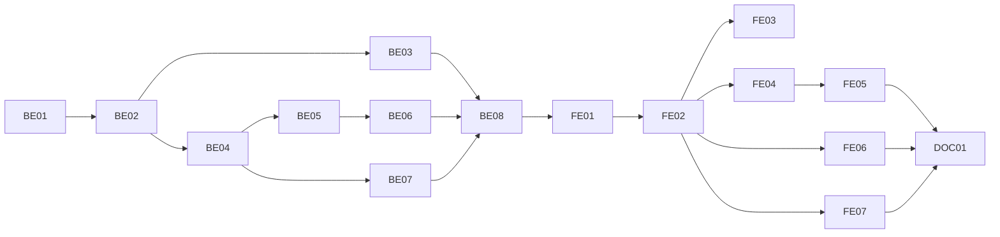

# F-11 PLO, CLO and Outcome Matrices — Backend + Frontend Implementation Plan

This plan builds the learning outcomes of EP-11 (FR-38..FR-42): the PLOs of a program version with their Vietnamese and English descriptions and competency group (MH-31); the CLOs of a course, kept in its shared syllabus and linked to weekly content rows (the CLO tab of MH-37, the CLO section of MH-36); the course–PLO matrix entered directly with a weight per cell (MH-34); the CLO–PLO links of one course in one program, limited to the PLOs that course already maps (MH-33); the program-wide CLO–PLO view with semester and PLO filters (MH-32); the coverage report listing PLOs without a course, CLOs without a PLO and courses without a PLO (MH-35); and the copy of PLOs and both matrices when a program is cloned (US-048).

It deliberately excludes performance indicators (PI, F11-06), measuring PLO attainment (F11-07, outside the system), a public outcome page (F11-08, the website reads F-21's API), the assessment–CLO mapping and its "CLO not assessed" warning (F-12, EP-12), editing outcomes of a released version through a change request (F-13), re-pointing CLO links when a program pins a new syllabus revision (F-15), the outcome rows of the program health board (F-24) and the Excel export of the matrices (F-25).

> **Companion documents**
> - Requirement: `docs/requirement/REQUIREMENTS.md` FR-38..FR-42, BR-17..BR-21, DEC-03, EC-41, Q-25, Q-26 (closed 2026-10-18), Q-28
> - Stories: `docs/planning/user-stories.md:533-606` (US-042..US-048, rewritten 2026-10-18 for F11-02 B); epic EP-11 (`docs/planning/epics.md`)
> - Design: `docs/design/data-dictionary.md:408-461` (`PLO`, `CLO`, `CLOPLOMapping`, `CoursePLOMapping`), `:500-509` (`WeeklyContentCLO`); `docs/design/erd.md` E-5 (resolved); `docs/design/screen-inventory.md:102-106` (MH-31..MH-35), `:198-202` (role grid)
> - Answers: `docs/planning/feature-questions.md:182-193` (§F-11: F11-02 B, F11-03 not applicable, the rest A)
> - Builds on: F-01 (`AppException`, `COMMON_ERRORS`, `createTestApp`, `client.ts`), F-02 (`AccessContext`, `PERMISSIONS.OUTCOME_VIEW`, `PLO_EDIT`, `CLO_EDIT`, `PERMISSION_TABLE`), F-04 (`edit-path.ts`, `decimal.ts`, `mapUniqueViolation`), F-06 (`ProgramVersion`, `programTarget`, `programEditState`, `VersionContentCopier`, `ProgramSectionLinks`, `CLONE_SCOPE_NOTE`), F-07 (`CurriculumItem`, `curriculum-access.ts` `itemTarget`, copier steps, `CurriculumSharedModule`), F-09 (item ids kept on import), F-10 (`Syllabus`, `WeeklyContent`, `syllabus-access.ts`, `SyllabiController`, `EDITOR_TABS`, `WeeklyContentTable`, `translated`)
> - Tests: `docs/planning/test-plan.md:190-194` (KB-031..KB-035), `:312-314` (NT-B3-03..NT-B3-05)

**Status**: Mã xong 2026-10-19 (BE-01..BE-08, FE-01..FE-07); còn nợ đi thử bằng trình duyệt và áp migration `20261019102707_outcomes` — xem `docs/implement-report/f-11-plo-clo-matrices-implement-report.md`

---

## 0. Plan at a glance

Everything below in one table. Read this; the rest is detail for whoever builds it.

| What | Why | How and where |
|---|---|---|
| **PLOs per program version** — code, Vietnamese and English description, competency group, order | US-042; FR-38; BR-17 | `PLO` rows on `ProgramVersion`, unique code per version; list and form on a new "Chuẩn đầu ra" screen; R1 and R3 edit a Draft version (BE-01, BE-04, FE-03) |
| **Deleting a PLO in use says what goes with it** | US-042 AC4; NFR-20 | Each PLO row carries its course-cell and CLO-link counts; the confirm dialog names both; the database cascades (BE-04, FE-03) |
| **CLOs live in the shared syllabus**, edited in a new CLO tab, linked to weekly rows, shown with the VI/EN toggle | US-043; US-039 AC2; FR-39, FR-48; DEC-03 | `CLO` on `Syllabus`, `WeeklyContentCLO`; routes added to the syllabi feature, guarded by `clo.edit` on the Draft (BE-03, FE-07) |
| **Course–PLO matrix entered directly with a weight in (0, 1]** | US-046; FR-41; F11-02 B | `CoursePLOMapping(curriculumItem, plo, weight Decimal(3,2))`; grid with one weight per cell, clear-a-cell with a confirm naming the CLO links it removes (BE-05, FE-04) |
| **CLO–PLO links per (program, course), only to PLOs the course maps, no level** | US-044; FR-40; BR-19; F11-03 | `CLOPLOMapping` references the `(curriculumItem, plo)` course cell by a composite foreign key, so a link cannot exist without its cell and dies with it; tick grid saved as a whole set (BE-01, BE-06, FE-05) |
| **Program-wide CLO–PLO view, filterable by semester and PLO; read-only for viewers** | US-045 | One read per version; filters run on the client over ≤ 200 rows (BE-06, FE-05) |
| **Coverage gaps as warnings, never blocks** — PLO without course, CLO without PLO, course without PLO; R4 sees only their group's courses | US-047; FR-42; BR-20; EC-41 | Pure `outcomeGaps` in `src/shared/outcomes/` behind a shared reader (F-24 reuses it); scope filter in the feature (BE-02, BE-07, FE-06) |
| **Clone carries PLOs and both matrices; syllabi stay shared** | US-048; FR-25 wave 2; F-06 and F-07 constraints | Three copier steps after requisites, keyed through the item and PLO id maps; CLO ids are reused, never copied (BE-02) |
| **Released versions are not edited here** | BR-23; F-04 edit-path rule | Every write: Draft version, then `assertDirectEdit` with `programEditState`; a released program answers 409 `CHANGE_REQUEST_REQUIRED` (BE-04..BE-06) |

**Key behaviours worth knowing**

| Behaviour | Why it is this way |
|---|---|
| A CLO–PLO tick is only possible on a PLO column the course already has a weight for | F11-02 B: the course–PLO cell is the program's statement that the course contributes; CLO links refine it. Enforced in SQL by the composite foreign key, and in the UI by disabling the other columns |
| Clearing a course–PLO cell deletes that cell's CLO–PLO links too | Same composite key, `ON DELETE CASCADE`; the confirm states the count first (MH-34) |
| Deleting a curriculum row deletes its course–PLO cells and CLO–PLO links | F-07 and F-09 constraints: matrix rows cascade from `CurriculumItem`. An import keeps the ids of rows it keeps, so only removed courses lose their cells |
| The CLOs a program maps are those of the course's published syllabus revision, or its Draft when nothing is published | Until F-15 pins a revision per curriculum row (`CurriculumItem.syllabus`), a course has at most one revision; F-15 replaces the one helper that decides this |
| CLOs are shared; CLO–PLO links are not | DEC-03: the same CLO1 can link to PLO2 in program A and PLO5 in program B (KB-033); editing CLO text changes it for every program |
| Deleting a CLO removes its links in every program | The CLO belongs to the syllabus Draft; its delete dialog lists the program codes that link it (US-043 AC4) |
| R6 sees PLOs of their own program and CLOs in the syllabus, but no matrix and no coverage screen | F11-05. R6 is the only role whose `outcome.view` is scoped; the matrix and coverage reads require an unscoped `outcome.view` |
| Coverage never blocks a save | US-047 AC4. Gaps are computed on read; F-15's release check and F-24's board decide whether a gap matters |
| PLO and CLO codes are stored upper-case and trimmed | "plo1" and "PLO1" must collide (KB-031, KB-032); same transform as course codes (F-04) |
| A clone copies PLO rows with new ids but links them to the same CLO rows | US-048 AC3: the syllabus is shared, so its CLOs are too |

**Not included**

| Excluded | Why |
|---|---|
| Performance indicators (PI) | F11-06 A — deferred (`deferred-scope.md`) |
| PLO attainment measurement | F11-07 — outside the system (the PLO-CLO repo's job) |
| Public outcome page without login | F11-08 A — the university website reads F-21's API |
| Assessment–CLO mapping, "CLO chưa được đánh giá" (BR-14, EC-40) | F-12 (EP-12); F-12 adds its count to the CLO delete dialog |
| Outcome edits on a released version | F-13 (change requests); writes answer `CHANGE_REQUEST_REQUIRED` until then |
| Re-pointing CLO links when a newer syllabus revision is pinned | F-15 (§8 constraint) |
| Outcome rows on the program health board, gap page in the accreditation pack | F-24 reuses `OutcomeGapsReader` (§8) |
| Excel export of the matrices | F-25 (US-107) |
| Synchronising with `plo-clo-backend` | F11-04 A — independent; the model keeps that repo's shape (weight on the course cell) so a later sync maps 1:1 |

---

## 1. Scope

| In scope | Why |
|---|---|
| `PLO`, `CLO`, `WeeklyContentCLO`, `CoursePLOMapping`, `CLOPLOMapping` | DD §4, §5; FR-38..FR-41 |
| PLO list and editing per version (MH-31) | US-042, US-045 |
| CLO tab, weekly CLO column and CLO section in the syllabus (MH-36, MH-37) | US-043, US-039 AC2, US-040 (CLO half of FR-48) |
| Course–PLO matrix with weights (MH-34) | US-046 |
| CLO–PLO matrix of one course (MH-33) and of the whole program (MH-32) | US-044, US-045 |
| Coverage report (MH-35) and a shared gap calculator | US-047; F-24 reuses it |
| Copier steps for PLOs and both matrices | US-048; F-06 constraint `f-06-…:1377`, F-07 constraint `f-07-…:2096` |
| Section cards on the program overview; clone note | MH-22 links; US-048 |

| Out of scope | Deferred until |
|---|---|
| PI | Deferred scope (F11-06) |
| Assessment–CLO mapping, "CLO not assessed" warning | F-12 |
| Changes to outcomes of a released version | F-13 |
| Per-row pinned syllabus revision, re-pointing links | F-15 |
| Health board, accreditation pack | F-24 |
| Excel export of matrices | F-25 |

| AC | Covered by |
|---|---|
| US-042 AC1 — add PLO with code and Vietnamese description; English and group optional | BE-01, BE-04, FE-03 |
| US-042 AC2 — duplicate code in the version blocked | BE-01 (unique), BE-04 (`PLO_CODE_TAKEN`), FE-03 |
| US-042 AC3 — two programs' "PLO1" independent | BE-01 (PLO per version), BE-04 test, BE-08 (KB-031) |
| US-042 AC4 — delete in use names the cells lost, confirms | BE-04 (`courseCount`, `cloLinkCount`), FE-03 |
| US-043 AC1 — add CLO with code, description, cognitive level, in order | BE-03, FE-07 |
| US-043 AC2 — duplicate CLO code blocked | BE-01, BE-03 (`CLO_CODE_TAKEN`) |
| US-043 AC3 — two programs see the same CLO list | BE-06 (CLOs from the course's revision, never per program), BE-08 (KB-032) |
| US-043 AC4 — delete a CLO in use names where, confirms | BE-03 (`linkedPrograms`), FE-07; assessment usage joins with F-12 |
| US-044 AC1 — link CLO1 to PLO2 for (A, course) | BE-06, FE-05 |
| US-044 AC2 — same course in B links independently | BE-01 (link keyed by curriculum item), BE-08 (KB-033) |
| US-044 AC3 — PLO not mapped by the course is refused; no level | BE-01 (composite FK), BE-06 (`PLO_NOT_MAPPED_TO_COURSE`), FE-05 (disabled columns) |
| US-044 AC4 — any course in the curriculum, other faculties included | BE-06 (no ownership filter on rows; F11-01 A) |
| US-045 AC1 — PLO list and program-wide matrix, rows course + CLO, columns PLO | BE-04, BE-06, FE-03, FE-05 |
| US-045 AC2 — filter by semester or PLO | FE-05 (`useCloPloFilters`) |
| US-045 AC3 — view-only users cannot edit any cell | BE-05, BE-06 (`canEdit`), FE-04, FE-05 |
| US-046 AC1 — weight 0.5 stored on the cell | BE-05, FE-04 |
| US-046 AC2 — weight outside (0, 1] or > 2 decimals refused | BE-01 (CHECK), BE-05 (`WEIGHT_PATTERN`), FE-04 |
| US-046 AC3 — clearing a cell names its CLO links, confirms, removes them | BE-01 (cascade), BE-05 (`cloLinkCount`), FE-04 |
| US-047 AC1..AC3 — three gap lists | BE-02 (`outcomeGaps`), BE-07, FE-06 |
| US-047 AC4 — gaps never block saving | BE-04..BE-06 (no gap check on write), BE-08 |
| US-047 AC5 — R4 sees only their group's course gaps | BE-07 (`courseGroupFilter`) |
| US-048 AC1 — clone has all PLOs, all CLO–PLO and course–PLO cells | BE-02 (copier steps) |
| US-048 AC2 — editing the clone's PLO leaves the source's | BE-02 (new PLO rows), BE-08 (KB-035) |
| US-048 AC3 — the clone's syllabus is the shared one | BE-02 (CLO ids reused), BE-08 (KB-035) |
| US-039 AC2 (CLO half) — weekly rows list their CLOs | BE-03 (`cloIds`), FE-07 |
| US-040 / FR-48 (CLO half) — CLO description under the VI/EN toggle | BE-03 (`englishDescription`), FE-07 |

---

## 2. Contract verification

Every existing piece F-11 consumes is defined in an earlier plan (F-01..F-10 are unbuilt). Each row is re-read at build time (Rule 13) before the deliverable that uses it.

| Existing piece used | Defined at | Used by |
|---|---|---|
| `PERMISSIONS.OUTCOME_VIEW` `'outcome.view'`, `PLO_EDIT` `'plo.edit'`, `CLO_EDIT` `'clo.edit'`; cells: `OUTCOME_VIEW` = `ALL_STAFF_VIEW` + R6 P, `PLO_EDIT` = R1 X, R3 DP, `CLO_EDIT` = `SCOPED_EDIT` (R1 X, R3/R4/R5 DP) | F-02 (`f-02-…:572-574`, `:1191-1192`, `:1214-1216`) | BE-03..BE-07, FE-01 |
| `AccessContext.has`, `modeFor`, `assertCan`, `scopeFor` (returns `{ all: true }` or the union of `ScopeIds`; a code not held gives the empty union), `ScopeTarget` | F-02 BE (`f-02-…:640-760`) | BE-04..BE-07 |
| `EDIT_PATH`, `EditState`, `editPathFor` (null without the permission), `assertDirectEdit` (409 `CHANGE_REQUEST_REQUIRED` on a via-request path) | F-04 BE-02 (`f-04-…:340-376`) | BE-03..BE-06 |
| `toWireDecimal(Prisma.Decimal): string`, pattern-plus-message style (`CREDITS_PATTERN`, `CREDITS_MESSAGE`) | F-04 BE-02 (`f-04-…:440-448`) | BE-05 |
| `mapUniqueViolation(error, definition, field)` | F-02 BE-07 / F-03 (`f-04-…:133`, `:717`) | BE-03, BE-04 |
| Upper-casing code transform `@Transform(({ value }) => (typeof value === 'string' ? value.trim().toUpperCase() : value))` | F-04 (`f-04-…:552`) | BE-03, BE-04 |
| `programTarget(program{id, facultyId})`, `programEditState(prisma \| tx, programId)` → released = any non-Draft version, `draftOpenToRequestHolders: true` | F-06 BE-02 (`f-06-…:365-420`) | BE-04..BE-06 |
| `VersionContentCopier.copy(tx, from, to)` with `copyElectiveGroups` → `copyCurriculumItems` (returns old → new item id map) → `copyRequisites` | F-06 BE-02, F-07 BE-02 (`f-07-…:484-520`) | BE-02 |
| `ProgramSectionLinks` (cards per section, `workingVersion = program.draftVersion ?? program.currentVersion`), `CLONE_SCOPE_NOTE` in `programLabels.ts` | F-06 FE-04 (`f-06-…:1197`, `:1295`), F-07 FE-06 (`f-07-…:2004-2010`) | FE-01 |
| `CurriculumItem` (`versionId` Cascade, `@@unique([versionId, courseId])`, `plannedSemester`, `sortOrder`) | F-07 BE-01 (`f-07-…:300-325`) | BE-01 (relations), BE-05..BE-07 |
| `itemTarget(version, course{ownerGroupId})` in `src/features/curriculum/curriculum-access.ts`; callers `curriculum.service.ts` (`read`, `createItem`, `updateItem`, `removeItem`) and `curriculum-requisites.service.ts` (`replace`) | F-07 BE-03 (`f-07-…:733-736`, `:868`, `:889`, `:915`, `:934`, `:1148`) | BE-02 (moved) |
| `VERSION_ACCESS_SELECT` (`id, status, semesterCount, programId, program{id, facultyId}`), `assertDraft` | F-07 BE-03 (`f-07-…:727-745`) | BE-04 (shape mirrored, not imported — as F-09 BE-05 did, `f-09-…:136`) |
| `ITEM_ORDER` (semester, sort order) | F-07 BE-03 (`f-07-…:856`) | BE-05..BE-07 (mirrored as `OUTCOME_ITEM_ORDER`) |
| Import updates kept curriculum rows in place | F-09 constraint (`f-09-…:1947`) | BE-01 (cascade choice) |
| `Syllabus`, `WeeklyContent` (Cascade from `Syllabus`), `SyllabusStatus` | F-10 BE-01 (`f-10-…:255-300`) | BE-01 |
| `SYLLABUS_ACCESS_SELECT`, `assertDraftWrite(prisma, access, row)` (hard-codes `PERMISSIONS.SYLLABUS_EDIT`), `SYLLABUS_LIMITS`, `SYLLABUS_ERRORS`, `SYLLABUS_INCLUDE`, `toSyllabusDto`, `WeeklyContentsService`, `SyllabiController` routes, `forCourse` | F-10 BE-03, BE-04 (`f-10-…:640-720`, `:780-860`, `:880-985`) | BE-03 |
| `EDITOR_TABS`, `EditorTabProps`, `WeeklyContentTable`, `WeeklyContentModal`, `SyllabusSections`, `translated`, `SYLLABUS_QUERY_KEYS`, `useSyllabusMutation` | F-10 FE-02..FE-04 (`f-10-…:1363-1392`, `:1489-1493`, `:1633-1663`) | FE-07 |
| `getJson`, `sendJson`, `errorMessage`, `applyFieldErrors`, `PageContainer`, `PageSpin`, `ApiErrorResult`, `RequirePermission` | F-01 FE, F-07 FE-02 (`f-07-…:1594-1640`) | FE-02..FE-07 |

### 2a. Endpoints

All under the global `/api` prefix, all requiring a session.

| Endpoint | Permission | Request | Response | Notes |
|---|---|---|---|---|
| `GET /program-versions/:versionId/plos` | `outcome.view` on `programTarget` | — | `PloListDto` | R6 reaches it for their own program (F11-05); 404 `VERSION_NOT_FOUND` |
| `POST /program-versions/:versionId/plos` | `plo.edit` | `CreatePloDto` | 201 `PloDto` | Draft + direct edit; appended last; 409 `PLO_CODE_TAKEN` on `ploCode`; 409 `PLOS_LIMIT` |
| `PATCH /plos/:ploId` | `plo.edit` | `UpdatePloDto` | `PloDto` | same guards; code change re-checked for uniqueness |
| `DELETE /plos/:ploId` | `plo.edit` | — | 204 | cascades course cells and CLO links of that PLO; renumbers `sortOrder` |
| `PUT /program-versions/:versionId/plos/order` | `plo.edit` | `ReorderOutcomeRowsDto` | `PloDto[]` | 409 `ORDER_MISMATCH` when the ids differ from the version's rows |
| `GET /program-versions/:versionId/course-plo-matrix` | `outcome.view`, unscoped | — | `CoursePloMatrixDto` | R6 → 403 `PERMISSION_DENIED` |
| `PUT /curriculum-items/:itemId/plo-weights/:ploId` | `plo.edit` | `SetPloWeightDto` | `CoursePloCellDto` | upsert; 409 `PLO_NOT_IN_VERSION` when the PLO belongs to another version |
| `DELETE /curriculum-items/:itemId/plo-weights/:ploId` | `plo.edit` | — | 204 | cascades the cell's CLO links; 404 `CELL_NOT_FOUND` |
| `GET /program-versions/:versionId/clo-plo-matrix` | `outcome.view`, unscoped | — | `ProgramCloPloMatrixDto` | every curriculum row with its CLOs and links |
| `GET /curriculum-items/:itemId/clo-plo-matrix` | `outcome.view`, unscoped | — | `ItemCloPloMatrixDto` | `canEdit` from `clo.edit` on `itemTarget` |
| `PUT /curriculum-items/:itemId/clo-plo-links` | `clo.edit` | `ReplaceCloPloLinksDto` | `ItemCloPloMatrixDto` | replaces the item's whole set; 409 `PLO_NOT_MAPPED_TO_COURSE`, 400 `CLO_NOT_IN_REVISION` |
| `GET /program-versions/:versionId/outcome-coverage` | `outcome.view`, unscoped | — | `OutcomeCoverageDto` | course-bound lists filtered to the caller's subject groups for group-scoped callers |
| `POST /syllabi/:syllabusId/clos` | `clo.edit` | `CreateCloDto` | 201 `CloDto` | via `assertDraftWrite(…, PERMISSIONS.CLO_EDIT)`; 409 `CLO_CODE_TAKEN`, `CLOS_LIMIT` |
| `PATCH /clos/:cloId` | `clo.edit` | `UpdateCloDto` | `CloDto` | |
| `DELETE /clos/:cloId` | `clo.edit` | — | 204 | cascades CLO–PLO links (all programs) and weekly links |
| `PUT /syllabi/:syllabusId/clos/order` | `clo.edit` | `ReorderClosDto` | `CloDto[]` | 409 `SYLLABUS_ORDER_MISMATCH` (F-10's code) |
| `POST /syllabi/:syllabusId/weekly-contents`, `PATCH /weekly-contents/:id` (F-10, extended) | `syllabus.edit` | + `cloIds?: string[]` | `WeeklyContentDto` + `cloIds` | 400 `CLO_NOT_IN_SYLLABUS` on `cloIds` |
| `GET /courses/:courseId/syllabus` (F-10, extended) | `syllabus.view` | — | `CourseSyllabusDto` + `canEditClos`; `SyllabusDto` + `clos` | |

### 2b. DTOs

**`OutcomeVersionDto`**: `id`, `programId`, `programCode`, `programName` (`string`), `versionNumber: string | null` (null on a Draft), `status: 'DRAFT' | 'PENDING' | 'ACTIVE' | 'HISTORICAL'` (`ProgramVersionStatus`, F-06 BE-01 — Rule 13: copy the literal set from `schema.prisma` at build). Modeled as the page header (`versionLabel` from F-06 FE).

**`PloListDto`**

| Field | Wire type | Nullable | Source | Modeled as | Note |
|---|---|---|---|---|---|
| `version` | `OutcomeVersionDto` | no | BE-04 | header | |
| `plos` | `PloDto[]` | no | BE-04 | table | ordered by `sortOrder` |
| `editPath` | `'DIRECT' \| 'VIA_REQUEST' \| null` | **yes** | F-04 `editPathFor(PLO_EDIT)` | disabled "Tạo đề xuất" | null = no `plo.edit` on this program |
| `canEdit` | `boolean` | no | BE-04 | add / edit / delete / drag | version is Draft ∧ `editPath === 'DIRECT'` |

**`PloDto`**

| Field | Wire type | Nullable | Source | Modeled as | Note |
|---|---|---|---|---|---|
| `id` | `string` | no | BE-01 | key | |
| `ploCode` | `string` | no | BE-01 | "Mã" | upper-case |
| `description` | `string` | no | BE-01 | "Mô tả" (vi) | plain text |
| `englishDescription` | `string` | **yes** | BE-01 | "Mô tả" (en) | null = not translated |
| `competencyGroup` | `string` | **yes** | BE-01 | "Nhóm năng lực" | |
| `sortOrder` | `number` | no | BE-01 | order | 1-based, contiguous |
| `courseCount` | `number` | no | BE-04 (`_count.courseMappings`) | delete confirm, column "Số HP" | |
| `cloLinkCount` | `number` | no | BE-04 (`_count.cloLinks`) | delete confirm | |

**`CoursePloMatrixDto`**

| Field | Wire type | Nullable | Source | Modeled as | Note |
|---|---|---|---|---|---|
| `version` | `OutcomeVersionDto` | no | BE-05 | header | |
| `plos` | `PloHeaderDto[]` | no | BE-05 | columns | `{ id, ploCode, description }` by `sortOrder` |
| `rows` | `CoursePloRowDto[]` | no | BE-05 | rows | by semester, then curriculum order |
| `editPath` | `'DIRECT' \| 'VIA_REQUEST' \| null` | **yes** | `editPathFor(PLO_EDIT)` | | |
| `canEdit` | `boolean` | no | BE-05 | editable cells | Draft ∧ DIRECT |

**`CoursePloRowDto`**: `itemId: string`, `plannedSemester: number`, `course: { id, courseCode, courseName, credits: string }`, `cells: CoursePloCellDto[]` (only mapped PLOs). **`CoursePloCellDto`**: `ploId: string`, `weight: string` (`toWireDecimal`, e.g. `"0.5"`, `"1"`), `cloLinkCount: number`.

**`ItemCloPloMatrixDto`**

| Field | Wire type | Nullable | Source | Modeled as | Note |
|---|---|---|---|---|---|
| `version` | `OutcomeVersionDto` | no | BE-06 | header | |
| `item` | `{ id: string; plannedSemester: number; course: { id, courseCode, courseName } }` | no | BE-06 | title | |
| `revision` | `{ id: string; revisionNumber: number; status: 'DRAFT' \| 'PUBLISHED' }` | **yes** | BE-02 `currentRevisionByCourse` | "Theo đề cương bản N" | null = course has no syllabus → empty grid, link to MH-36 |
| `clos` | `CloRefDto[]` | no | BE-06 | rows | `{ id, cloCode, description, englishDescription }` by `sortOrder` |
| `plos` | `ItemPloColumnDto[]` | no | BE-06 | columns | `{ id, ploCode, description, weight: string \| null }` — null = course does not map it; column disabled |
| `links` | `{ cloId: string; ploId: string }[]` | no | BE-06 | ticks | |
| `editPath` | `'DIRECT' \| 'VIA_REQUEST' \| null` | **yes** | `editPathFor(CLO_EDIT, itemTarget)` | | |
| `canEdit` | `boolean` | no | BE-06 | tick + save | Draft ∧ DIRECT ∧ `revision` non-null |

**`ProgramCloPloMatrixDto`**: `version: OutcomeVersionDto`, `plos: PloHeaderDto[]`, `rows: ProgramCloPloRowDto[]`. **`ProgramCloPloRowDto`**: `itemId`, `plannedSemester`, `course: { id, courseCode, courseName }`, `revisionNumber: number | null`, `clos: CloRefDto[]`, `mappedPloIds: string[]` (course cells), `links: { cloId, ploId }[]`.

**`OutcomeCoverageDto`**

| Field | Wire type | Nullable | Source | Modeled as | Note |
|---|---|---|---|---|---|
| `version` | `OutcomeVersionDto` | no | BE-07 | header | |
| `plosWithoutCourse` | `PloHeaderDto[]` | no | BE-02 `outcomeGaps` | "PLO chưa có học phần đóng góp" | never filtered |
| `closWithoutPlo` | `{ itemId, courseCode, courseName, cloId, cloCode, cloDescription }[]` | no | BE-02 | "CLO chưa gắn PLO" | filtered by `courseGroupFilter` |
| `coursesWithoutPlo` | `{ itemId, courseCode, courseName, plannedSemester }[]` | no | BE-02 | "Học phần chưa đóng góp PLO" | filtered |
| `coursesWithoutSyllabus` | `number` | no | BE-02 | footnote | rows skipped from the CLO list because no revision exists (EC-44 lives in F-15/F-24) |
| `filteredToGroups` | `boolean` | no | BE-07 | "Chỉ hiện học phần thuộc nhóm của bạn" | |

**`CloDto`** (syllabi feature)

| Field | Wire type | Nullable | Source | Modeled as | Note |
|---|---|---|---|---|---|
| `id` | `string` | no | BE-01 | key | |
| `cloCode` | `string` | no | BE-01 | "Mã" | upper-case |
| `description` | `string` | no | BE-01 | via `translated` | plain text |
| `englishDescription` | `string` | **yes** | BE-01 | via `translated` | |
| `cognitiveLevel` | `string` | **yes** | BE-01 | "Mức nhận thức" | free text with suggestions |
| `sortOrder` | `number` | no | BE-01 | order | |
| `linkedPrograms` | `string[]` | no | BE-03 `cloProgramUsage` | delete confirm | program codes with a CLO–PLO link, sorted; F-12 adds assessment usage beside it |

**`SyllabusDto`** (F-10) gains `clos: CloDto[]`; **`WeeklyContentDto`** gains `cloIds: string[]` (in CLO `sortOrder`); **`CourseSyllabusDto`** gains `canEditClos: boolean` (Draft exists ∧ `editPathFor(CLO_EDIT, courseTarget)` is `DIRECT`).

**Request DTOs**

| DTO | Fields |
|---|---|
| `CreatePloDto` | `ploCode` (trim + upper, 1..`PLO_CODE_MAX`), `description` (trim, 1..`TEXT_MAX`), `englishDescription?` (`string \| null`, ≤ `TEXT_MAX`, blank → null), `competencyGroup?` (`string \| null`, ≤ `GROUP_MAX`, blank → null) |
| `UpdatePloDto` | `PartialType(CreatePloDto)` |
| `ReorderOutcomeRowsDto` | `ids: string[]`, unique, 1..`PLOS_MAX` |
| `SetPloWeightDto` | `weight: string` matching `WEIGHT_PATTERN` |
| `ReplaceCloPloLinksDto` | `links: { cloId: string; ploId: string }[]`, ≤ `LINKS_MAX`, nested `@ValidateNested` + `@Type` |
| `CreateCloDto` | `cloCode` (trim + upper, 1..`CLO_CODE_MAX`), `description` (1..`CLO_TEXT_MAX`), `englishDescription?`, `cognitiveLevel?` (≤ `COGNITIVE_LEVEL_MAX`) |
| `UpdateCloDto` | `PartialType(CreateCloDto)` |
| `ReorderClosDto` | `ids: string[]`, unique, 1..`CLOS_MAX` |
| `CreateWeeklyContentDto` / `UpdateWeeklyContentDto` (F-10) | + `cloIds?: string[]`, unique, ≤ `CLOS_MAX` |

### 2c. Mismatch log

| Deliverable | What the earlier doc said | What this plan does | Found at |
|---|---|---|---|
| BE-01 | DD lists `CLOPLOMapping.curriculumItem` and `.plo` as two references | One composite reference to `CoursePLOMapping(curriculumItemId, ploId)` over the same two columns; item and PLO are reached through the cell | `data-dictionary.md:440-447`; DD note "Xóa dòng `CoursePLOMapping` thì các dòng CLO–PLO … bị xóa theo" is what the key enforces |
| BE-01 | DD `CLOPLOMapping.clo`: "Thuộc bản đề cương mà `curriculumItem` đang ghim" | No pin exists before F-15; the service checks "the course's current revision" (`currentRevisionByCourse`) | `data-dictionary.md:446`; `CurriculumItem.syllabus` is F-15's column |
| BE-02 | F-06: "clone must not copy PLO in wave 1, and must in wave 2" | The copier copies PLOs from the moment F-11 ships; wave 1 is the state before F-11 | `f-06-…:1377`; US-022 AC4 / US-048 |
| BE-07 | MH-35 grants R5 nothing ("—") | R5 holds `outcome.view` unscoped (`ALL_STAFF_VIEW`) and reaches the report with the group filter, like R4; the menu shows the card | `screen-inventory.md:202`; `f-02-…:1191`, `:1214` — the role grid cannot be enforced without a role-name check (F-02 D2 forbids) |
| BE-04 | MH-31: "R6 chỉ thấy PLO của phiên bản áp dụng cho mình" | R6 sees the PLOs of any version of their own program, as F-07's curriculum read does for R6 | `screen-inventory.md:102`; `f-07-…:853`; the applied version needs `CohortProgram` (F-16) — §8 constraint for F-20 |
| — | Test plan KB-033, NT-B3-03, NT-B3-04 still describe levels and overrides | Rewritten 2026-10-18 for F11-02 B | `test-plan.md:192`, `:312-313` |
| — | Naming map `mucDoDongGop` → `contributionLevel` on both join tables | Renamed to `weight` on `CoursePLOMapping` only (2026-10-18) | `naming-map.md` |
| — | `courseTarget` in `syllabus-access.ts` | Moved by F-10 to `src/shared/courses/course-target.ts` | `f-10-…` BE-02 |

---

## 3. Decisions

| # | Decision | Why | Rejected alternative |
|---|---|---|---|
| D1 | CLO CRUD and week–CLO links live in the **syllabi** feature; PLO, matrices and coverage in a new **outcomes** feature | A CLO is a section of the syllabus (BR-18, MH-37 tab); its guard is the syllabus Draft guard and its UI is an editor tab. The matrices hang off curriculum rows and program versions, a different guard | All of EP-11 in `outcomes`, moving `syllabus-access.ts` to `src/shared/syllabi/` — moves four F-10 call sites and splits the editor tab from its feature |
| D2 | `assertDraftWrite` takes the permission as a parameter defaulting to `syllabus.edit` | CLO writes are `clo.edit` (F-02 row "Sửa CLO, ma trận CLO–PLO"); the rest of the sequence is identical. The default keeps F-10's call sites untouched | A second guard function copying the sequence |
| D3 | `CLOPLOMapping` references the course cell through a composite foreign key `(curriculumItemId, ploId)` → `CoursePLOMapping`, `ON DELETE CASCADE` | F11-02 B's rule "a CLO only links to a PLO the course maps" and MH-34's "deleting a cell removes its CLO links" become one database fact that no writer can skip — including the copier and F-13's apply | Two plain references plus a service check — the cascade on cell delete would need its own code path, and the copier could insert orphans |
| D4 | The CLO–PLO grid of one item is saved as a whole set (`PUT …/clo-plo-links`) | MH-33 is "tick, then save"; a full replace inside one transaction is simple and idempotent | One request per tick — many writes, partial states visible to the other tab |
| D5 | Weights are `Decimal(3, 2)` with `CHECK (weight > 0 AND weight <= 1)`, sent as strings matching `WEIGHT_PATTERN` | BR-21 as rewritten: real number in (0, 1], two decimals; same string-decimal convention as credits (F-04 D8) | JSON numbers — float rounding (0.1 + 0.2) and no way to say "two decimals" in the schema |
| D6 | "Which CLOs a curriculum row maps" = the course's PUBLISHED revision, else its DRAFT — in one shared helper `currentRevisionByCourse` | Before F-15 a course has at most one revision; one helper is the single point F-15 replaces with the pin | Reading `Syllabus` with ad-hoc filters in each service |
| D7 | Matrix and coverage reads require `outcome.view` with scope ALL | F11-05: students do not open matrix screens. R6 is the only scoped holder of `outcome.view`; the rule is stated on the permission, not on a role name (F-02 D2) | A role-code check, or a new permission row |
| D8 | Coverage filters course-bound gaps for callers whose `clo.edit` scope is by subject group only | US-047 AC5 names R4; a group-scoped `clo.edit` is what makes a caller a group head or member. PLO gaps are about the program and stay visible | Filtering by `outcome.view` scope — it is ALL for every staff role, so nothing would filter |
| D9 | `PloDto` carries `courseCount` and `cloLinkCount`; `CoursePloCellDto` carries `cloLinkCount`; `CloDto` carries `linkedPrograms` | Each confirm dialog states the consequence (NFR-20, US-042 AC4, US-043 AC4, US-046 AC3) from data already on screen, no extra request | A usage endpoint per delete |
| D10 | `OutcomeGapsReader` and the pure `outcomeGaps` live in `src/shared/outcomes/` | F-24's health board and F-26's accreditation pack need the same three lists; features cannot import each other | Computing gaps inside the outcomes service |
| D11 | Codes are trimmed and upper-cased on input | KB-031 / KB-032 collisions must not depend on case; matches course codes | Case-insensitive unique index — differs from every other code column |
| D12 | `itemTarget` moves to `src/shared/curriculum/item-target.ts`; `VERSION_ACCESS_SELECT` and `assertDraft` are mirrored, not shared | `itemTarget` is an authorization rule — two copies would drift. The select and the Draft check carry feature-specific error codes, which are repeated per feature by convention (F-09 did the same) | Mirroring `itemTarget` too |
| D13 | Model names stay as `naming-map.md` writes them (`PLO`, `CLO`, `CLOPLOMapping`, `CoursePLOMapping`, `WeeklyContentCLO`); client accessors are `prisma.pLO`, `prisma.cLO`, `prisma.cLOPLOMapping` | One name per concept across docs and code | `Plo` / `Clo` — readable accessors, but a second spelling of every table name |

---

## 5. Deliverables

Backend paths are under `source/backend/`, frontend paths under `source/frontend/`.

### BE-01 — Prisma schema: PLO, CLO, week–CLO links, course–PLO cells, CLO–PLO links

What/Why: FR-38..FR-41, BR-17..BR-19, BR-21; D3, D5, D13.

**Files**

| Action | Path |
|---|---|
| MODIFY | `prisma/schema.prisma` |
| NEW | `prisma/migrations/<timestamp>_outcomes/migration.sql` (generated, then edited for the CHECK) |

**Shape**

```prisma
model PLO {
  id                 String             @id @default(cuid(2))
  versionId          String
  version            ProgramVersion     @relation(fields: [versionId], references: [id], onDelete: Cascade)
  ploCode            String
  description        String
  englishDescription String?
  competencyGroup    String?
  sortOrder          Int
  courseMappings     CoursePLOMapping[]
  createdAt          DateTime           @default(now())
  updatedAt          DateTime           @updatedAt

  @@unique([versionId, ploCode])
  @@index([versionId, sortOrder])
}

model CLO {
  id                 String             @id @default(cuid(2))
  syllabusId         String
  syllabus           Syllabus           @relation(fields: [syllabusId], references: [id], onDelete: Cascade)
  cloCode            String
  description        String
  englishDescription String?
  cognitiveLevel     String?
  sortOrder          Int
  ploLinks           CLOPLOMapping[]
  weeklyLinks        WeeklyContentCLO[]
  createdAt          DateTime           @default(now())
  updatedAt          DateTime           @updatedAt

  @@unique([syllabusId, cloCode])
  @@index([syllabusId, sortOrder])
}

model WeeklyContentCLO {
  id              String        @id @default(cuid(2))
  weeklyContentId String
  weeklyContent   WeeklyContent @relation(fields: [weeklyContentId], references: [id], onDelete: Cascade)
  cloId           String
  clo             CLO           @relation(fields: [cloId], references: [id], onDelete: Cascade)

  @@unique([weeklyContentId, cloId])
  @@index([cloId])
}

model CoursePLOMapping {
  id               String          @id @default(cuid(2))
  curriculumItemId String
  curriculumItem   CurriculumItem  @relation(fields: [curriculumItemId], references: [id], onDelete: Cascade)
  ploId            String
  plo              PLO             @relation(fields: [ploId], references: [id], onDelete: Cascade)
  weight           Decimal         @db.Decimal(3, 2)
  cloLinks         CLOPLOMapping[]
  createdAt        DateTime        @default(now())
  updatedAt        DateTime        @updatedAt

  @@unique([curriculumItemId, ploId])
  @@index([ploId])
}

// Item and PLO are reached through the course cell: a link cannot outlive the cell it refines.
model CLOPLOMapping {
  id               String           @id @default(cuid(2))
  curriculumItemId String
  ploId            String
  coursePlo        CoursePLOMapping @relation(fields: [curriculumItemId, ploId], references: [curriculumItemId, ploId], onDelete: Cascade)
  cloId            String
  clo              CLO              @relation(fields: [cloId], references: [id], onDelete: Cascade)
  createdAt        DateTime         @default(now())

  @@unique([curriculumItemId, cloId, ploId])
  @@index([cloId])
}
```

Back-relations added to existing models: `ProgramVersion.plos PLO[]`, `Syllabus.clos CLO[]`, `WeeklyContent.cloLinks WeeklyContentCLO[]`, `CurriculumItem.ploMappings CoursePLOMapping[]`.

Appended to the generated migration:

```sql
ALTER TABLE "CoursePLOMapping"
  ADD CONSTRAINT "CoursePLOMapping_weight_range" CHECK ("weight" > 0 AND "weight" <= 1);
```

**Rationale**: Model names follow `naming-map.md:56-62` (abbreviations stay upper-case), as `CurriculumItem` and `ElectiveGroup` follow it in F-07 BE-01 (`f-07-…:290-330`). Cascades follow the F-07 and F-10 constraints: matrix rows die with their curriculum row (`f-09-…:1947`), CLOs with their syllabus revision (`f-10-…:1888`). `Decimal(3, 2)` holds 0.01..1.00 exactly. The surrogate `id` on the join tables follows F00-10 (every table has a cuid key) — `WeeklyContentCLO` and `CLOPLOMapping` still carry their natural unique keys.

**Gotchas**
- Prisma lower-cases only the first letter of the model name for the client accessor: `prisma.pLO`, `prisma.cLO`, `prisma.cLOPLOMapping`, `prisma.coursePLOMapping`, `prisma.weeklyContentCLO`. Rule 13: confirm the names in the generated client before writing BE-02; every shape below uses them.
- The composite relation needs the referenced pair to be unique — `@@unique([curriculumItemId, ploId])` on `CoursePLOMapping` is that key. Prisma names the compound unique input `curriculumItemId_ploId` (used by `upsert` in BE-05).
- Two cascade paths reach `CLOPLOMapping` from `CurriculumItem` (through the cell) and one from `PLO` (through the cell); PostgreSQL accepts multiple cascade paths, unlike SQL Server.
- "PLO in the same version as the curriculum row" is not a database rule (it would need a `versionId` copy on the cell); BE-05 checks it and the copier preserves it by construction.
- The CHECK is not in `schema.prisma`; `prisma migrate dev` on a later change does not drop it, but `prisma db push` would not create it — the e2e harness runs `migrate deploy` (F-01 `createTestApp`), so the test database has it.
- After the change: `pnpm exec prisma generate` before any type check.

**Verify**: `pnpm exec prisma migrate dev --name outcomes` applies on a database holding F-10 rows; `pnpm exec prisma generate`; `pnpm exec tsc --noEmit -p tsconfig.json`; in `psql`, inserting a `CoursePLOMapping` with weight `0` or `1.01` fails on `CoursePLOMapping_weight_range`; inserting a `CLOPLOMapping` without its cell fails on the foreign key; deleting the cell removes the link.

**Depends on**: F-07 BE-01, F-10 BE-01 built

---

### BE-02 — Shared groundwork: `itemTarget` moved, permission parameter on `assertDraftWrite`, current revision, copier steps, gap calculator

What/Why: The outcomes feature needs the curriculum row's authorization target (owned by the curriculum feature) and the syllabus Draft guard with a different permission; the copier must carry PLOs and both matrices (US-048); F-24 needs the gap lists (D2, D6, D10, D12).

**Files**

| Action | Path |
|---|---|
| NEW | `src/shared/curriculum/item-target.ts` (`itemTarget` moved) |
| MODIFY | `src/features/curriculum/curriculum-access.ts` (remove `itemTarget`) |
| MODIFY | `src/features/curriculum/curriculum.service.ts` (import from shared) |
| MODIFY | `src/features/curriculum/curriculum-requisites.service.ts` (import from shared) |
| MODIFY | `src/features/syllabi/syllabus-access.ts` (`assertDraftWrite` permission parameter) |
| NEW | `src/shared/syllabi/current-revision.ts` |
| NEW | `src/shared/syllabi/current-revision.spec.ts` |
| MODIFY | `src/shared/programs/version-content.copier.ts` (three steps) |
| MODIFY | `src/shared/programs/version-content.copier.spec.ts` |
| NEW | `src/shared/outcomes/outcome-gaps.ts` |
| NEW | `src/shared/outcomes/outcome-gaps.spec.ts` |
| NEW | `src/shared/outcomes/outcome-gaps.reader.ts` |
| NEW | `src/shared/outcomes/outcomes-shared.module.ts` |

**Shape**

```ts
// src/shared/curriculum/item-target.ts
// A row is reachable through its program (R1, R3) or through its course's subject group (R4, R5).
export function itemTarget(version: { program: { id: string; facultyId: string } }, course: { ownerGroupId: string | null }): ScopeTarget {
  return { ...programTarget(version.program), subjectGroupIds: course.ownerGroupId ? [course.ownerGroupId] : [] };
}
```

Call sites of `itemTarget` — every one migrated to the shared import, none left on the old path:

| Call site | Defined at | Status |
|---|---|---|
| `curriculum.service.ts` `read` | `f-07-…:868` | migrated |
| `curriculum.service.ts` `createItem` | `f-07-…:889` | migrated |
| `curriculum.service.ts` `updateItem` | `f-07-…:915` | migrated |
| `curriculum.service.ts` `removeItem` | `f-07-…:934` | migrated |
| `curriculum-requisites.service.ts` `replace` | `f-07-…:1148` | migrated |
| `curriculum-access.ts` (definition) | `f-07-…:733` | deleted; the file keeps `VERSION_ACCESS_SELECT`, `assertDraft`, `assertCurriculumWrite` |
| F-09 import (`src/features/curriculum-import/…`) | `f-09-…:136` | Rule 13: grep for `itemTarget(` at build — F-09 mirrored the select, and any call it makes is migrated too |

```ts
// src/features/syllabi/syllabus-access.ts — after
// Every write to a revision or its rows goes through here, in this order.
export async function assertDraftWrite(
  prisma: PrismaService, access: AccessContext, row: SyllabusAccessRow | null, permission: PermissionCode = PERMISSIONS.SYLLABUS_EDIT,
): Promise<SyllabusAccessRow> {
  assertRevisionVisible(row, access);
  assertDirectEdit(access, permission, courseTarget(row.course), await syllabusEditState(prisma, row.course));
  if (row.status !== SyllabusStatus.DRAFT) throw new AppException(SYLLABUS_ERRORS.SYLLABUS_NOT_DRAFT);
  if (row.course.status === CourseStatus.CANCELLED) throw new AppException(SYLLABUS_ERRORS.COURSE_CANCELLED);
  return row;
}
```

```ts
// src/shared/syllabi/current-revision.ts
export interface CurrentRevision { id: string; revisionNumber: number; status: SyllabusStatus }

// Published wins over Draft. Until curriculum rows pin a revision, this is the revision a program maps.
export async function currentRevisionByCourse(
  prisma: PrismaService | Prisma.TransactionClient, courseIds: readonly string[],
): Promise<Map<string, CurrentRevision>> {
  const rows = await prisma.syllabus.findMany({
    where: { courseId: { in: [...courseIds] }, status: { in: [SyllabusStatus.PUBLISHED, SyllabusStatus.DRAFT] } },
    select: { id: true, courseId: true, revisionNumber: true, status: true },
  });
  const byCourse = new Map<string, CurrentRevision>();
  for (const { courseId, ...revision } of rows) {
    const held = byCourse.get(courseId);
    if (!held || revision.status === SyllabusStatus.PUBLISHED) byCourse.set(courseId, revision);
  }
  return byCourse;
}
```

```ts
// src/shared/programs/version-content.copier.ts — after
async copy(tx: Prisma.TransactionClient, fromVersionId: string, toVersionId: string): Promise<void> {
  const groupIds = await this.copyElectiveGroups(tx, fromVersionId, toVersionId);
  const itemIds = await this.copyCurriculumItems(tx, fromVersionId, toVersionId, groupIds);
  await this.copyRequisites(tx, itemIds);
  const ploIds = await this.copyPlos(tx, fromVersionId, toVersionId);
  await this.copyCoursePloMappings(tx, itemIds, ploIds);
  await this.copyCloPloLinks(tx, itemIds, ploIds);
}

private async copyPlos(tx: Prisma.TransactionClient, from: string, to: string): Promise<Map<string, string>> {
  const plos = await tx.pLO.findMany({ where: { versionId: from } });
  await tx.pLO.createMany({
    data: plos.map(({ ploCode, description, englishDescription, competencyGroup, sortOrder }) => ({
      versionId: to, ploCode, description, englishDescription, competencyGroup, sortOrder,
    })),
  });
  const created = await tx.pLO.findMany({ where: { versionId: to }, select: { id: true, ploCode: true } });
  const newIdByCode = new Map(created.map((plo) => [plo.ploCode, plo.id]));
  return new Map(plos.map((plo) => [plo.id, newIdByCode.get(plo.ploCode)!]));
}

private async copyCoursePloMappings(tx: Prisma.TransactionClient, itemIds: Map<string, string>, ploIds: Map<string, string>): Promise<void> {
  const cells = await tx.coursePLOMapping.findMany({ where: { curriculumItemId: { in: [...itemIds.keys()] } } });
  await tx.coursePLOMapping.createMany({
    data: cells.map(({ curriculumItemId, ploId, weight }) => ({ curriculumItemId: itemIds.get(curriculumItemId)!, ploId: ploIds.get(ploId)!, weight })),
  });
}

// CLO ids are kept: the clone shares the syllabus, so it shares its CLOs.
private async copyCloPloLinks(tx: Prisma.TransactionClient, itemIds: Map<string, string>, ploIds: Map<string, string>): Promise<void> {
  const links = await tx.cLOPLOMapping.findMany({ where: { curriculumItemId: { in: [...itemIds.keys()] } } });
  await tx.cLOPLOMapping.createMany({
    data: links.map(({ curriculumItemId, ploId, cloId }) => ({ curriculumItemId: itemIds.get(curriculumItemId)!, ploId: ploIds.get(ploId)!, cloId })),
  });
}
```

```ts
// src/shared/outcomes/outcome-gaps.ts
export interface GapPlo { id: string; ploCode: string; description: string }
export interface GapItem {
  itemId: string; plannedSemester: number; courseCode: string; courseName: string; ownerGroupId: string | null;
  clos: { id: string; cloCode: string; description: string }[] | null; // null = the course has no syllabus revision
}
export interface OutcomeGapInput {
  plos: readonly GapPlo[];
  items: readonly GapItem[];
  cells: readonly { curriculumItemId: string; ploId: string }[];
  links: readonly { curriculumItemId: string; cloId: string }[];
}
export interface CourseGap { itemId: string; plannedSemester: number; courseCode: string; courseName: string; ownerGroupId: string | null }
export interface CloGap extends CourseGap { cloId: string; cloCode: string; cloDescription: string }
export interface OutcomeGaps {
  plosWithoutCourse: GapPlo[];
  closWithoutPlo: CloGap[];
  coursesWithoutPlo: CourseGap[];
  coursesWithoutSyllabus: CourseGap[];
}

export function outcomeGaps({ plos, items, cells, links }: OutcomeGapInput): OutcomeGaps {
  const mappedPlos = new Set(cells.map((cell) => cell.ploId));
  const mappedItems = new Set(cells.map((cell) => cell.curriculumItemId));
  const linkedClos = new Set(links.map((link) => `${link.curriculumItemId}:${link.cloId}`));
  const courseGap = ({ clos: _clos, ...item }: GapItem): CourseGap => item;
  return {
    plosWithoutCourse: plos.filter((plo) => !mappedPlos.has(plo.id)),
    closWithoutPlo: items.flatMap((item) => (item.clos ?? [])
      .filter((clo) => !linkedClos.has(`${item.itemId}:${clo.id}`))
      .map((clo) => ({ ...courseGap(item), cloId: clo.id, cloCode: clo.cloCode, cloDescription: clo.description }))),
    coursesWithoutPlo: items.filter((item) => !mappedItems.has(item.itemId)).map(courseGap),
    coursesWithoutSyllabus: items.filter((item) => item.clos === null).map(courseGap),
  };
}
```

```ts
// src/shared/outcomes/outcome-gaps.reader.ts
@Injectable()
export class OutcomeGapsReader {
  constructor(private readonly prisma: PrismaService) {}

  async forVersion(versionId: string): Promise<OutcomeGaps> {
    const [plos, items, cells, links] = await Promise.all([
      this.prisma.pLO.findMany({ where: { versionId }, select: { id: true, ploCode: true, description: true }, orderBy: { sortOrder: 'asc' } }),
      this.prisma.curriculumItem.findMany({
        where: { versionId },
        select: { id: true, plannedSemester: true, course: { select: { id: true, courseCode: true, courseName: true, ownerGroupId: true } } },
        orderBy: [{ plannedSemester: 'asc' }, { sortOrder: 'asc' }, { id: 'asc' }],
      }),
      this.prisma.coursePLOMapping.findMany({ where: { curriculumItem: { versionId } }, select: { curriculumItemId: true, ploId: true } }),
      this.prisma.cLOPLOMapping.findMany({ where: { coursePlo: { curriculumItem: { versionId } } }, select: { curriculumItemId: true, cloId: true } }),
    ]);
    const revisions = await currentRevisionByCourse(this.prisma, items.map((item) => item.course.id));
    const closByRevision = await this.closOf([...revisions.values()].map((revision) => revision.id));
    return outcomeGaps({
      plos,
      items: items.map(({ id, plannedSemester, course }) => {
        const revision = revisions.get(course.id);
        return {
          itemId: id, plannedSemester, courseCode: course.courseCode, courseName: course.courseName, ownerGroupId: course.ownerGroupId,
          clos: revision ? closByRevision.get(revision.id) ?? [] : null,
        };
      }),
      cells,
      links,
    });
  }

  private async closOf(syllabusIds: string[]): Promise<Map<string, { id: string; cloCode: string; description: string }[]>>;
  // one findMany on CLO where syllabusId in ids, ordered by sortOrder, grouped by syllabusId
}

// src/shared/outcomes/outcomes-shared.module.ts
@Module({ providers: [OutcomeGapsReader], exports: [OutcomeGapsReader] })
export class OutcomesSharedModule {}
```

**Rationale**: The `itemTarget` move mirrors F-10 BE-02's move of `courseTarget` (`f-10-…:356-395`), with the same call-site table. The parameter type is widened to the two fields it reads, so the outcomes feature can pass its own select without importing `VersionAccessRow`. The copier steps mirror `copyElectiveGroups` / `copyRequisites` (`f-07-…:484-520`): `createMany`, then read back by the natural key (`ploCode`) to build the id map. `outcomeGaps` is pure like F-07's `semesterTotals` (`f-07-…:765`) so its spec needs no Prisma; `OutcomeGapsReader` mirrors `CurriculumFactsReader` in `CurriculumSharedModule` (`f-07-…:465-480`).

**Gotchas**
- Copier order matters: PLOs before course cells, course cells before CLO–PLO links (composite foreign key). Items come from the earlier step, so `itemIds` is complete.
- `copyCloPloLinks` copies links whose CLO is in any revision — after F-15 a row may pin an older revision; the link still points at a real CLO, so it is copied as is. F-15 owns re-pointing (§8).
- `createMany` with an empty `data` array is a no-op in Prisma; no guard needed for versions with no PLOs.
- `currentRevisionByCourse` must not filter by `seesDrafts`: it decides which CLOs a program maps, not what a viewer may read. The matrices are staff-only (D7).
- `closWithoutPlo` is keyed by `(item, clo)`: the same CLO is a gap in program A and covered in program B (DEC-03).
- Default value on `assertDraftWrite` keeps all F-10 call sites (`syllabi.service.ts` `update`, `weekly-contents.service.ts` ×4, `syllabus-attachments.service.ts` ×2) unchanged; list them in the implement report as "left on the default, deliberately".

**Verify**: `current-revision.spec.ts` (Prisma mocked): Draft only → Draft; Published + Draft → Published; none → absent. `outcome-gaps.spec.ts`: PLO with no cell listed; course with no cell listed; CLO linked in item A but not item B listed once for B; course without revision → in `coursesWithoutSyllabus`, not in `closWithoutPlo`. `version-content.copier.spec.ts` (`tx` mocked): PLO ids remapped by code; cells remapped on both ids with the weight kept; links remapped, `cloId` unchanged; call order PLO → cells → links. `grep -rn "itemTarget" src` shows only the shared definition and imports. `pnpm exec tsc --noEmit -p tsconfig.json`.

**Depends on**: BE-01; F-06 BE-02, F-07 BE-02/BE-03, F-10 BE-03 built

---

### BE-03 — CLOs in the syllabus; week–CLO links

What/Why: US-043, US-039 AC2, FR-39, FR-48; D1, D2, D9, D11.

**Files**

| Action | Path |
|---|---|
| NEW | `src/features/syllabi/clo.dto.ts` (`CreateCloDto`, `UpdateCloDto`, `ReorderClosDto`, `CloDto`, `CLO_INCLUDE`, `toCloDto`) |
| NEW | `src/features/syllabi/clos.service.ts` |
| NEW | `src/features/syllabi/clos.service.spec.ts` |
| MODIFY | `src/features/syllabi/syllabus.errors.ts` (limits, errors) |
| MODIFY | `src/features/syllabi/syllabus.dto.ts` (`SYLLABUS_INCLUDE` + `clos`, weekly `cloLinks`; `SyllabusDto.clos`; `CourseSyllabusDto.canEditClos`) |
| MODIFY | `src/features/syllabi/weekly-content.dto.ts` (`cloIds`, `WEEKLY_CONTENT_INCLUDE`) |
| MODIFY | `src/features/syllabi/weekly-contents.service.ts` (write `cloIds`) |
| MODIFY | `src/features/syllabi/weekly-contents.service.spec.ts` |
| MODIFY | `src/features/syllabi/syllabi.service.ts` (`canEditClos`) |
| MODIFY | `src/features/syllabi/syllabi.controller.ts` (four routes) |
| MODIFY | `src/features/syllabi/syllabi.module.ts` (provider) |

**Shape**

```ts
// src/features/syllabi/syllabus.errors.ts — additions
export const SYLLABUS_LIMITS = {
  // …F-10 keys
  CLOS_MAX: 30,
  CLO_CODE_MAX: 20,
  CLO_TEXT_MAX: 2000,
  COGNITIVE_LEVEL_MAX: 50,
} as const;

// SYLLABUS_ERRORS additions
CLO_NOT_FOUND: { status: HttpStatus.NOT_FOUND, code: 'CLO_NOT_FOUND', message: 'Không tìm thấy CLO.' },
CLO_CODE_TAKEN: { status: HttpStatus.CONFLICT, code: 'CLO_CODE_TAKEN', message: 'Mã CLO đã có trong đề cương này.' },
CLOS_LIMIT: { status: HttpStatus.CONFLICT, code: 'SYLLABUS_CLOS_LIMIT', message: `Đề cương có tối đa ${SYLLABUS_LIMITS.CLOS_MAX} CLO.` },
CLO_NOT_IN_SYLLABUS: { status: HttpStatus.BAD_REQUEST, code: 'CLO_NOT_IN_SYLLABUS', message: 'CLO được chọn không thuộc bản đề cương này; tải lại trang rồi thử lại.' },
```

```ts
// src/features/syllabi/clo.dto.ts
const upperTrim = ({ value }: TransformFnParams) => (typeof value === 'string' ? value.trim().toUpperCase() : value);

export class CreateCloDto {
  @ApiProperty() @Transform(upperTrim) @IsString() @Length(1, SYLLABUS_LIMITS.CLO_CODE_MAX)
  cloCode: string;

  @ApiProperty() @Transform(trimString) @IsString() @Length(1, SYLLABUS_LIMITS.CLO_TEXT_MAX)
  description: string;

  @ApiPropertyOptional({ nullable: true, type: String }) @IsOptional() @Transform(emptyToNull) @IsString() @MaxLength(SYLLABUS_LIMITS.CLO_TEXT_MAX)
  englishDescription?: string | null;

  @ApiPropertyOptional({ nullable: true, type: String }) @IsOptional() @Transform(emptyToNull) @IsString() @MaxLength(SYLLABUS_LIMITS.COGNITIVE_LEVEL_MAX)
  cognitiveLevel?: string | null;
}

export class UpdateCloDto extends PartialType(CreateCloDto) {}

export class ReorderClosDto {
  @ApiProperty({ type: [String] }) @IsArray() @ArrayMinSize(1) @ArrayMaxSize(SYLLABUS_LIMITS.CLOS_MAX) @ArrayUnique() @IsString({ each: true })
  ids: string[];
}

export const CLO_FIELD = { CODE: 'cloCode', WEEKLY_CLOS: 'cloIds' } as const;

export const CLO_INCLUDE = {
  ploLinks: { select: { coursePlo: { select: { curriculumItem: { select: { version: { select: { program: { select: { programCode: true } } } } } } } } } },
} as const satisfies Prisma.CLOInclude;
export type CloRow = Prisma.CLOGetPayload<{ include: typeof CLO_INCLUDE }>;

export function toCloDto(row: CloRow): CloDto {
  const programs = new Set(row.ploLinks.map((link) => link.coursePlo.curriculumItem.version.program.programCode));
  return {
    id: row.id, cloCode: row.cloCode, description: row.description, englishDescription: row.englishDescription,
    cognitiveLevel: row.cognitiveLevel, sortOrder: row.sortOrder, linkedPrograms: [...programs].sort(),
  };
}
```

```ts
// src/features/syllabi/clos.service.ts
@Injectable()
export class ClosService {
  constructor(private readonly prisma: PrismaService) {}

  async create(syllabusId: string, dto: CreateCloDto, access: AccessContext): Promise<CloDto> {
    await assertDraftWrite(this.prisma, access, await this.findRevision(syllabusId), PERMISSIONS.CLO_EDIT);
    return this.prisma.$transaction(async (tx) => {
      const count = await tx.cLO.count({ where: { syllabusId } });
      if (count >= SYLLABUS_LIMITS.CLOS_MAX) throw new AppException(SYLLABUS_ERRORS.CLOS_LIMIT);
      try {
        const created = await tx.cLO.create({
          data: {
            syllabusId, cloCode: dto.cloCode, description: dto.description, sortOrder: count + 1,
            englishDescription: dto.englishDescription ?? null, cognitiveLevel: dto.cognitiveLevel ?? null,
          },
          include: CLO_INCLUDE,
        });
        await tx.syllabus.update({ where: { id: syllabusId }, data: { updatedAt: new Date() } });
        return toCloDto(created);
      } catch (error) {
        throw mapUniqueViolation(error, SYLLABUS_ERRORS.CLO_CODE_TAKEN, CLO_FIELD.CODE);
      }
    });
  }

  async update(cloId: string, dto: UpdateCloDto, access: AccessContext): Promise<CloDto>;
  // load CLO with syllabus: SYLLABUS_ACCESS_SELECT (404 CLO_NOT_FOUND); assertDraftWrite(…, CLO_EDIT);
  // write only the fields sent; P2002 → CLO_CODE_TAKEN; touch syllabus.updatedAt

  async remove(cloId: string, access: AccessContext): Promise<void>;
  // load + assertDraftWrite(…, CLO_EDIT); one transaction: delete (cascades CLO–PLO links in every program
  // and week–CLO links), renumber the remaining CLOs 1..n by (sortOrder, id); touch syllabus.updatedAt

  async reorder(syllabusId: string, dto: ReorderClosDto, access: AccessContext): Promise<CloDto[]>;
  // same body as WeeklyContentsService.reorder over tx.cLO; SYLLABUS_ERRORS.ORDER_MISMATCH

  private findRevision(syllabusId: string): Promise<SyllabusAccessRow | null> {
    return this.prisma.syllabus.findUnique({ where: { id: syllabusId }, select: SYLLABUS_ACCESS_SELECT });
  }
}
```

```ts
// src/features/syllabi/weekly-content.dto.ts — additions
// on CreateWeeklyContentDto (UpdateWeeklyContentDto inherits it through PartialType)
@ApiPropertyOptional({ type: [String] }) @IsOptional() @IsArray() @ArrayMaxSize(SYLLABUS_LIMITS.CLOS_MAX) @ArrayUnique() @IsString({ each: true })
cloIds?: string[];

export const WEEKLY_CONTENT_INCLUDE = {
  cloLinks: { select: { cloId: true, clo: { select: { sortOrder: true } } } },
} as const satisfies Prisma.WeeklyContentInclude;
export type WeeklyContentRow = Prisma.WeeklyContentGetPayload<{ include: typeof WEEKLY_CONTENT_INCLUDE }>;

export function toWeeklyContentDto(row: WeeklyContentRow): WeeklyContentDto {
  return {
    id: row.id, weekLabel: row.weekLabel, sortOrder: row.sortOrder, content: row.content, teachingActivities: row.teachingActivities,
    cloIds: [...row.cloLinks].sort((a, b) => a.clo.sortOrder - b.clo.sortOrder).map((link) => link.cloId),
  };
}
```

```ts
// src/features/syllabi/weekly-contents.service.ts — the CLO part of create and update
private async assertClosInSyllabus(tx: Prisma.TransactionClient, syllabusId: string, cloIds: string[]): Promise<void> {
  if (cloIds.length === 0) return;
  const found = await tx.cLO.count({ where: { id: { in: cloIds }, syllabusId } });
  if (found !== cloIds.length) {
    throw new AppException(SYLLABUS_ERRORS.CLO_NOT_IN_SYLLABUS, [{ field: CLO_FIELD.WEEKLY_CLOS, constraints: [SYLLABUS_ERRORS.CLO_NOT_IN_SYLLABUS.message] }]);
  }
}
// create: after the row cap check → assertClosInSyllabus(tx, syllabusId, dto.cloIds ?? []);
//   data gets cloLinks: { createMany: { data: (dto.cloIds ?? []).map((cloId) => ({ cloId })) } }; include WEEKLY_CONTENT_INCLUDE
// update: when dto.cloIds !== undefined → assertClosInSyllabus; tx.weeklyContentCLO.deleteMany({ where: { weeklyContentId } });
//   tx.weeklyContentCLO.createMany(…); every read of a weekly row (create, update, reorder) includes WEEKLY_CONTENT_INCLUDE
```

```ts
// src/features/syllabi/syllabus.dto.ts — SYLLABUS_INCLUDE after
export const SYLLABUS_INCLUDE = {
  weeklyContents: { include: WEEKLY_CONTENT_INCLUDE, orderBy: [{ sortOrder: 'asc' }, { id: 'asc' }] },
  attachments: { include: { uploadedBy: { select: { id: true, fullName: true } } }, orderBy: [{ recordedAt: 'asc' }, { id: 'asc' }] },
  clos: { include: CLO_INCLUDE, orderBy: [{ sortOrder: 'asc' }, { id: 'asc' }] },
} as const satisfies Prisma.SyllabusInclude;
// toSyllabusDto adds: clos: row.clos.map(toCloDto)
```

```ts
// src/features/syllabi/syllabi.service.ts — forCourse, added to the returned object
canEditClos: draft !== null && editPathFor(access, PERMISSIONS.CLO_EDIT, courseTarget(course), state) === EDIT_PATH.DIRECT,
```

Routes added to `SyllabiController`, all `@RequirePermission(PERMISSIONS.CLO_EDIT)`: `POST syllabi/:syllabusId/clos` (201, `CloDto`), `PATCH clos/:cloId` (`CloDto`), `DELETE clos/:cloId` (204), `PUT syllabi/:syllabusId/clos/order` (`CloDto[]`).

**Rationale**: `ClosService` mirrors `WeeklyContentsService` (`f-10-…:918-960`) — append-last with a cap, delete-then-renumber, reorder with `ORDER_MISMATCH` — and keeps the F-10 guard order through `assertDraftWrite`. The unique-code mapping mirrors F-04's course code (`f-04-…:717`). The week–CLO links ride on the existing weekly DTOs so the weekly modal saves in one request (US-039 AC2).

**Gotchas**
- A P2002 inside the interactive transaction aborts it; throwing the mapped error out of the callback rolls back, which is what is wanted. Do not catch and continue inside `tx`.
- `mapUniqueViolation` rethrows anything that is not P2002 (Rule 13: confirm its contract in `src/shared/prisma/unique-violation.ts`); the `CLOS_LIMIT` `AppException` thrown above it in the same `try` must pass through untouched — keep the count check outside the `try`, as shown.
- `CLO_INCLUDE` walks four relations per link; a CLO has at most a handful of links per program, and a syllabus ≤ 30 CLOs — acceptable. If F-12 adds assessment usage, add it to the same include.
- `weeklyContentCLO.deleteMany` is safe: nothing references `WeeklyContentCLO`.
- `canEditClos` uses the Draft only: CLOs of a published revision change through F-13.
- `UpdateWeeklyContentDto` without `cloIds` must leave the links alone — `undefined` means "not sent" (F-10 convention).

**Verify**: `clos.service.spec.ts`: add "clo1" → stored `CLO1`, order 1; add a second `CLO1` → `CLO_CODE_TAKEN` on `cloCode`; 31st → `CLOS_LIMIT`; R5 outside group → `OUT_OF_SCOPE`; R2 (no `clo.edit`) → `PERMISSION_DENIED`; on a published revision → `CHANGE_REQUEST_REQUIRED`; delete the middle of three → 1, 2; `toCloDto` with links from programs B, A, A → `linkedPrograms ['A', 'B']`. `weekly-contents.service.spec.ts` additions: create with a CLO of another syllabus → `CLO_NOT_IN_SYLLABUS`; update with `cloIds: []` clears links; update without `cloIds` keeps them; `cloIds` come back in CLO order. `pnpm exec tsc --noEmit -p tsconfig.json`.

**Depends on**: BE-01, BE-02

---

### BE-04 — Outcomes feature; PLO list and editing

What/Why: US-042, US-045 AC1; FR-38, BR-17; D7, D9, D11, D12.

**Files**

| Action | Path |
|---|---|
| NEW | `src/features/outcomes/outcomes.module.ts` |
| NEW | `src/features/outcomes/outcomes.controller.ts` |
| NEW | `src/features/outcomes/outcome.errors.ts` (`OUTCOME_LIMITS`, `OUTCOME_ERRORS`) |
| NEW | `src/features/outcomes/outcome-access.ts` |
| NEW | `src/features/outcomes/outcome-version.dto.ts` (`OutcomeVersionDto`, `PloHeaderDto`, `toOutcomeVersionDto`, `OUTCOME_ITEM_ORDER`) |
| NEW | `src/features/outcomes/plo.dto.ts` (`CreatePloDto`, `UpdatePloDto`, `ReorderOutcomeRowsDto`, `PloDto`, `PloListDto`) |
| NEW | `src/features/outcomes/plos.service.ts` |
| NEW | `src/features/outcomes/plos.service.spec.ts` |
| MODIFY | `src/app.module.ts` (import `OutcomesModule`) |

**Shape**

```ts
// src/features/outcomes/outcome.errors.ts
export const OUTCOME_LIMITS = {
  PLOS_MAX: 30,
  PLO_CODE_MAX: 20,
  TEXT_MAX: 2000,
  GROUP_MAX: 100,
  LINKS_MAX: 900, // CLOS_MAX × PLOS_MAX
} as const;

export const OUTCOME_ERRORS = {
  // Same codes as CURRICULUM_ERRORS; repeated because features do not import each other.
  VERSION_NOT_FOUND: { status: HttpStatus.NOT_FOUND, code: 'VERSION_NOT_FOUND', message: 'Không tìm thấy phiên bản chương trình.' },
  VERSION_NOT_EDITABLE: { status: HttpStatus.CONFLICT, code: 'VERSION_NOT_EDITABLE', message: 'Chỉ sửa được phiên bản đang ở trạng thái Nháp.' },
  ITEM_NOT_FOUND: { status: HttpStatus.NOT_FOUND, code: 'CURRICULUM_ITEM_NOT_FOUND', message: 'Không tìm thấy học phần trong khung.' },
  PLO_NOT_FOUND: { status: HttpStatus.NOT_FOUND, code: 'PLO_NOT_FOUND', message: 'Không tìm thấy PLO.' },
  PLO_CODE_TAKEN: { status: HttpStatus.CONFLICT, code: 'PLO_CODE_TAKEN', message: 'Mã PLO đã có trong phiên bản này.' },
  PLOS_LIMIT: { status: HttpStatus.CONFLICT, code: 'PLOS_LIMIT', message: `Mỗi phiên bản có tối đa ${OUTCOME_LIMITS.PLOS_MAX} PLO.` },
  ORDER_MISMATCH: { status: HttpStatus.CONFLICT, code: 'OUTCOME_ORDER_MISMATCH', message: 'Danh sách sắp xếp không khớp các PLO hiện có; tải lại trang rồi thử lại.' },
  PLO_NOT_IN_VERSION: { status: HttpStatus.CONFLICT, code: 'PLO_NOT_IN_VERSION', message: 'PLO không thuộc phiên bản của học phần này.' },
  CELL_NOT_FOUND: { status: HttpStatus.NOT_FOUND, code: 'COURSE_PLO_CELL_NOT_FOUND', message: 'Học phần chưa gắn PLO này.' },
  PLO_NOT_MAPPED_TO_COURSE: { status: HttpStatus.CONFLICT, code: 'PLO_NOT_MAPPED_TO_COURSE', message: 'Học phần chưa gắn PLO này trong ma trận học phần–PLO; gắn ở đó trước.' },
  CLO_NOT_IN_REVISION: { status: HttpStatus.BAD_REQUEST, code: 'CLO_NOT_IN_REVISION', message: 'CLO không thuộc bản đề cương đang dùng của học phần; tải lại trang rồi thử lại.' },
} as const satisfies Record<string, ErrorDefinition>;
```

Rule 13: copy `VERSION_NOT_FOUND`, `VERSION_NOT_EDITABLE` and `CURRICULUM_ITEM_NOT_FOUND` codes and messages from `curriculum.errors.ts` (`f-07-…:660-670`) at build so both features answer identically.

```ts
// src/features/outcomes/outcome-access.ts
export const OUTCOME_VERSION_SELECT = {
  id: true, status: true, versionNumber: true, programName: true, programId: true,
  program: { select: { id: true, facultyId: true, programCode: true } },
} as const satisfies Prisma.ProgramVersionSelect;
export type OutcomeVersionRow = Prisma.ProgramVersionGetPayload<{ select: typeof OUTCOME_VERSION_SELECT }>;

export function assertVersionFound(version: OutcomeVersionRow | null): asserts version is OutcomeVersionRow {
  if (!version) throw new AppException(OUTCOME_ERRORS.VERSION_NOT_FOUND);
}

// Draft check first, as for curriculum rows: a Pending version of a never-released program is still frozen.
export async function assertOutcomeWrite(
  prisma: PrismaService | Prisma.TransactionClient, access: AccessContext, version: OutcomeVersionRow, permission: PermissionCode, target: ScopeTarget,
): Promise<void> {
  if (version.status !== ProgramVersionStatus.DRAFT) throw new AppException(OUTCOME_ERRORS.VERSION_NOT_EDITABLE);
  assertDirectEdit(access, permission, target, await programEditState(prisma, version.programId));
}

// Matrices and coverage are staff screens; the one scoped holder of outcome.view is a student.
export function assertMatrixReader(access: AccessContext): void {
  if (!access.scopeFor(PERMISSIONS.OUTCOME_VIEW).all) throw new AppException(COMMON_ERRORS.PERMISSION_DENIED);
}

export function outcomeEditPath(access: AccessContext, version: OutcomeVersionRow, permission: PermissionCode, target: ScopeTarget, state: EditState) {
  const editPath = editPathFor(access, permission, target, state);
  return { editPath, canEdit: version.status === ProgramVersionStatus.DRAFT && editPath === EDIT_PATH.DIRECT };
}
```

```ts
// src/features/outcomes/plo.dto.ts — request DTOs
export class CreatePloDto {
  @ApiProperty() @Transform(upperTrim) @IsString() @Length(1, OUTCOME_LIMITS.PLO_CODE_MAX)
  ploCode: string;

  @ApiProperty() @Transform(trimString) @IsString() @Length(1, OUTCOME_LIMITS.TEXT_MAX)
  description: string;

  @ApiPropertyOptional({ nullable: true, type: String }) @IsOptional() @Transform(emptyToNull) @IsString() @MaxLength(OUTCOME_LIMITS.TEXT_MAX)
  englishDescription?: string | null;

  @ApiPropertyOptional({ nullable: true, type: String }) @IsOptional() @Transform(emptyToNull) @IsString() @MaxLength(OUTCOME_LIMITS.GROUP_MAX)
  competencyGroup?: string | null;
}

export class UpdatePloDto extends PartialType(CreatePloDto) {}

export class ReorderOutcomeRowsDto {
  @ApiProperty({ type: [String] }) @IsArray() @ArrayMinSize(1) @ArrayMaxSize(OUTCOME_LIMITS.PLOS_MAX) @ArrayUnique() @IsString({ each: true })
  ids: string[];
}

export const PLO_FIELD = { CODE: 'ploCode' } as const;
```

```ts
// src/features/outcomes/plos.service.ts
@Injectable()
export class PlosService {
  constructor(private readonly prisma: PrismaService) {}

  async list(versionId: string, access: AccessContext): Promise<PloListDto> {
    const version = await this.findVersion(versionId);
    access.assertCan(PERMISSIONS.OUTCOME_VIEW, programTarget(version.program));
    const state = await programEditState(this.prisma, version.programId);
    return {
      version: toOutcomeVersionDto(version),
      plos: await this.plosOf(versionId),
      ...outcomeEditPath(access, version, PERMISSIONS.PLO_EDIT, programTarget(version.program), state),
    };
  }

  async create(versionId: string, dto: CreatePloDto, access: AccessContext): Promise<PloDto> {
    const version = await this.findVersion(versionId);
    await assertOutcomeWrite(this.prisma, access, version, PERMISSIONS.PLO_EDIT, programTarget(version.program));
    return this.prisma.$transaction(async (tx) => {
      const count = await tx.pLO.count({ where: { versionId } });
      if (count >= OUTCOME_LIMITS.PLOS_MAX) throw new AppException(OUTCOME_ERRORS.PLOS_LIMIT);
      try {
        const created = await tx.pLO.create({
          data: {
            versionId, ploCode: dto.ploCode, description: dto.description, sortOrder: count + 1,
            englishDescription: dto.englishDescription ?? null, competencyGroup: dto.competencyGroup ?? null,
          },
        });
        return toPloDto(created, NO_USAGE);
      } catch (error) {
        throw mapUniqueViolation(error, OUTCOME_ERRORS.PLO_CODE_TAKEN, PLO_FIELD.CODE);
      }
    });
  }

  async update(ploId: string, dto: UpdatePloDto, access: AccessContext): Promise<PloDto>;
  // load PLO with version: OUTCOME_VERSION_SELECT (404 PLO_NOT_FOUND); assertOutcomeWrite(PLO_EDIT, programTarget);
  // write only the fields sent; P2002 → PLO_CODE_TAKEN; return with its usage counts

  async remove(ploId: string, access: AccessContext): Promise<void>;
  // load + assertOutcomeWrite; one transaction: delete (cascades course cells, then their CLO links),
  // renumber the version's remaining PLOs 1..n by (sortOrder, id)

  async reorder(versionId: string, dto: ReorderOutcomeRowsDto, access: AccessContext): Promise<PloDto[]>;
  // findVersion + assertOutcomeWrite; WeeklyContentsService.reorder body over tx.pLO; OUTCOME_ERRORS.ORDER_MISMATCH

  private async plosOf(versionId: string): Promise<PloDto[]> {
    const plos = await this.prisma.pLO.findMany({
      where: { versionId }, include: { _count: { select: { courseMappings: true } } }, orderBy: [{ sortOrder: 'asc' }, { id: 'asc' }],
    });
    const links = await this.prisma.cLOPLOMapping.groupBy({ by: ['ploId'], where: { ploId: { in: plos.map((plo) => plo.id) } }, _count: { _all: true } });
    const linkCount = new Map(links.map((row) => [row.ploId, row._count._all]));
    return plos.map((plo) => toPloDto(plo, { courseCount: plo._count.courseMappings, cloLinkCount: linkCount.get(plo.id) ?? 0 }));
  }

  private async findVersion(versionId: string): Promise<OutcomeVersionRow> {
    const version = await this.prisma.programVersion.findUnique({ where: { id: versionId }, select: OUTCOME_VERSION_SELECT });
    assertVersionFound(version);
    return version;
  }
}
```

`NO_USAGE = { courseCount: 0, cloLinkCount: 0 }` sits beside `toPloDto` in `plo.dto.ts`.

Controller (`@ApiTags('outcomes') @Controller()`), routes for this deliverable: `GET program-versions/:versionId/plos` (`OUTCOME_VIEW`), `POST program-versions/:versionId/plos` (201), `PATCH plos/:ploId`, `DELETE plos/:ploId` (204), `PUT program-versions/:versionId/plos/order` — writes `@RequirePermission(PERMISSIONS.PLO_EDIT)`.

```ts
// src/features/outcomes/outcomes.module.ts (BE-05..BE-07 add their providers)
@Module({
  imports: [OutcomesSharedModule],
  controllers: [OutcomesController],
  providers: [PlosService],
})
export class OutcomesModule {}
```

**Rationale**: `outcome-access.ts` mirrors `curriculum-access.ts` (`f-07-…:725-760`): one select, the Draft-then-direct-edit sequence. The select is mirrored, not imported — the F-09 precedent (`f-09-…:136`, D12). `PlosService` mirrors `WeeklyContentsService` for append, renumber and reorder, and `CurriculumService.read` (`f-07-…:850-880`) for the read that carries `editPath` and `canEdit`. `upperTrim` and `trimString`/`emptyToNull` are the F-04 transforms (Rule 13: import the shared `trimString`/`emptyToNull` from where F-04 put them; `upperTrim` is written inline per file as F-02..F-05 did).

**Gotchas**
- The PLO list read uses `assertCan` on `programTarget`, which R6 passes for their own program (scope `OWN_ENROLLMENT` gives `programIds`); the matrix reads (BE-05..BE-07) add `assertMatrixReader`, which R6 fails.
- `groupBy` on `CLOPLOMapping.ploId` — the column exists on the link row itself (BE-01), so no join is needed.
- `remove` relies on the database cascade; do not `deleteMany` the cells first (nothing to gain, and nestjs-rules §3 asks to verify cascades rather than hand-roll them).
- `ProgramVersionStatus` values are `DRAFT`, `PENDING`, `ACTIVE`, `HISTORICAL` (`f-06-…:236-241`).

**Verify**: `plos.service.spec.ts`: R3 of program A adds "plo1" to A's Draft → `PLO1`, order 1; same code again → `PLO_CODE_TAKEN` on `ploCode`; R3 of program B → `OUT_OF_SCOPE`; R4 → `PERMISSION_DENIED`; on an ACTIVE version → `VERSION_NOT_EDITABLE`; on the Draft of a released program → `CHANGE_REQUEST_REQUIRED`; 31st → `PLOS_LIMIT`; list returns `courseCount`/`cloLinkCount` from the counts; R6 list of own program → ok, `editPath null`, `canEdit false`; reorder with a foreign id → `ORDER_MISMATCH`. `pnpm exec tsc --noEmit -p tsconfig.json`.

**Depends on**: BE-01, BE-02

---

### BE-05 — Course–PLO matrix with weights

What/Why: US-046, US-045 AC3, FR-41, BR-21; D3, D5, D9.

**Files**

| Action | Path |
|---|---|
| NEW | `src/features/outcomes/course-plo-matrix.dto.ts` (`SetPloWeightDto`, `WEIGHT_PATTERN`, `WEIGHT_MESSAGE`, `CoursePloMatrixDto`, `CoursePloRowDto`, `CoursePloCellDto`) |
| NEW | `src/features/outcomes/course-plo-matrix.service.ts` |
| NEW | `src/features/outcomes/course-plo-matrix.service.spec.ts` |
| MODIFY | `src/features/outcomes/outcomes.controller.ts` (three routes) |
| MODIFY | `src/features/outcomes/outcomes.module.ts` (provider) |

**Shape**

```ts
// src/features/outcomes/course-plo-matrix.dto.ts
// (0, 1] with at most two decimals: 0.01 … 0.99, 1, 1.0, 1.00.
export const WEIGHT_PATTERN = /^(?:0\.(?:0[1-9]|[1-9]\d?)|1(?:\.00?)?)$/;
export const WEIGHT_MESSAGE = 'Trọng số phải lớn hơn 0, không quá 1 và có tối đa hai chữ số thập phân.';

export class SetPloWeightDto {
  @ApiProperty({ example: '0.5' }) @IsString() @Matches(WEIGHT_PATTERN, { message: WEIGHT_MESSAGE })
  weight: string;
}
```

```ts
// src/features/outcomes/course-plo-matrix.service.ts
const ITEM_WITH_VERSION_SELECT = {
  id: true, versionId: true, plannedSemester: true,
  course: { select: { id: true, courseCode: true, courseName: true, ownerGroupId: true } },
  version: { select: OUTCOME_VERSION_SELECT },
} as const satisfies Prisma.CurriculumItemSelect;

@Injectable()
export class CoursePloMatrixService {
  constructor(private readonly prisma: PrismaService) {}

  async read(versionId: string, access: AccessContext): Promise<CoursePloMatrixDto> {
    const version = await this.prisma.programVersion.findUnique({ where: { id: versionId }, select: OUTCOME_VERSION_SELECT });
    assertVersionFound(version);
    access.assertCan(PERMISSIONS.OUTCOME_VIEW, programTarget(version.program));
    assertMatrixReader(access);
    const [plos, items, cells, links] = await Promise.all([
      this.prisma.pLO.findMany({ where: { versionId }, select: PLO_HEADER_SELECT, orderBy: [{ sortOrder: 'asc' }, { id: 'asc' }] }),
      this.prisma.curriculumItem.findMany({
        where: { versionId },
        select: { id: true, plannedSemester: true, course: { select: { id: true, courseCode: true, courseName: true, credits: true } } },
        orderBy: OUTCOME_ITEM_ORDER,
      }),
      this.prisma.coursePLOMapping.findMany({ where: { curriculumItem: { versionId } }, select: { curriculumItemId: true, ploId: true, weight: true } }),
      this.prisma.cLOPLOMapping.groupBy({ by: ['curriculumItemId', 'ploId'], where: { coursePlo: { curriculumItem: { versionId } } }, _count: { _all: true } }),
    ]);
    const linkCount = new Map(links.map((row) => [cellKey(row), row._count._all]));
    const cellsByItem = Map.groupBy(cells, (cell) => cell.curriculumItemId);
    const state = await programEditState(this.prisma, version.programId);
    return {
      version: toOutcomeVersionDto(version),
      plos,
      rows: items.map((item) => ({
        itemId: item.id, plannedSemester: item.plannedSemester,
        course: { ...item.course, credits: toWireDecimal(item.course.credits) },
        cells: (cellsByItem.get(item.id) ?? []).map((cell) => toCellDto(cell, linkCount.get(cellKey(cell)) ?? 0)),
      })),
      ...outcomeEditPath(access, version, PERMISSIONS.PLO_EDIT, programTarget(version.program), state),
    };
  }

  async setWeight(itemId: string, ploId: string, dto: SetPloWeightDto, access: AccessContext): Promise<CoursePloCellDto> {
    const item = await this.findItem(itemId);
    const plo = await this.prisma.pLO.findUnique({ where: { id: ploId }, select: { versionId: true } });
    if (!plo) throw new AppException(OUTCOME_ERRORS.PLO_NOT_FOUND);
    if (plo.versionId !== item.versionId) throw new AppException(OUTCOME_ERRORS.PLO_NOT_IN_VERSION);
    await assertOutcomeWrite(this.prisma, access, item.version, PERMISSIONS.PLO_EDIT, programTarget(item.version.program));
    const weight = new Prisma.Decimal(dto.weight);
    const cell = await this.prisma.coursePLOMapping.upsert({
      where: { curriculumItemId_ploId: { curriculumItemId: itemId, ploId } },
      create: { curriculumItemId: itemId, ploId, weight },
      update: { weight },
      select: { curriculumItemId: true, ploId: true, weight: true, _count: { select: { cloLinks: true } } },
    });
    return toCellDto(cell, cell._count.cloLinks);
  }

  async removeWeight(itemId: string, ploId: string, access: AccessContext): Promise<void> {
    const item = await this.findItem(itemId);
    await assertOutcomeWrite(this.prisma, access, item.version, PERMISSIONS.PLO_EDIT, programTarget(item.version.program));
    const { count } = await this.prisma.coursePLOMapping.deleteMany({ where: { curriculumItemId: itemId, ploId } });
    if (count === 0) throw new AppException(OUTCOME_ERRORS.CELL_NOT_FOUND);
  }

  private async findItem(itemId: string) {
    const item = await this.prisma.curriculumItem.findUnique({ where: { id: itemId }, select: ITEM_WITH_VERSION_SELECT });
    if (!item) throw new AppException(OUTCOME_ERRORS.ITEM_NOT_FOUND);
    return item;
  }
}

const cellKey = (row: { curriculumItemId: string; ploId: string }) => `${row.curriculumItemId}:${row.ploId}`;

function toCellDto(cell: { ploId: string; weight: Prisma.Decimal }, cloLinkCount: number): CoursePloCellDto {
  return { ploId: cell.ploId, weight: toWireDecimal(cell.weight), cloLinkCount };
}
```

`PLO_HEADER_SELECT = { id: true, ploCode: true, description: true }` and `OUTCOME_ITEM_ORDER` (copy of F-07's `ITEM_ORDER`, `f-07-…:801`) live in `outcome-version.dto.ts`.

Routes: `GET program-versions/:versionId/course-plo-matrix` (`OUTCOME_VIEW`), `PUT curriculum-items/:itemId/plo-weights/:ploId` and `DELETE curriculum-items/:itemId/plo-weights/:ploId` (204) — both `PLO_EDIT`.

**Rationale**: The read mirrors `CurriculumService.read` (`f-07-…:850-880`); the weight convention mirrors credits (`CREDITS_PATTERN`, `toWireDecimal`, `f-04-…:440-448`). `deleteMany` with a count gives 404 without a separate read; the cascade to CLO links is the database's (D3).

**Gotchas**
- `Map.groupBy` needs ES2024 lib typings and Node 21+ — Node 22 has it; Rule 13: check `tsconfig.json` `lib`/`target` include ES2024, else group with a loop.
- `toWireDecimal` of `Decimal('0.50')` is `"0.5"` — the client compares numerically, never as strings.
- `deleteMany` on `CoursePLOMapping`: the only table referencing it is `CLOPLOMapping`, by `ON DELETE CASCADE` (BE-01) — this is the intended effect (US-046 AC3), not an accident.
- Writes are guarded by `programTarget`, not `itemTarget`: the course–PLO matrix is the program's statement (MH-34 R4/R5 view only), which `plo.edit` (R1, R3) expresses.
- The `PLO_NOT_IN_VERSION` check runs before the permission check; it reveals only that two ids the caller already holds belong together or not.

**Verify**: `course-plo-matrix.service.spec.ts`: `'0.5'` stored, returned `"0.5"`; second PUT on the same cell updates (one row); PLO of another version → `PLO_NOT_IN_VERSION`; R4 → `PERMISSION_DENIED`; R6 read → `PERMISSION_DENIED`; R2 read → ok, `canEdit false`; delete a missing cell → `CELL_NOT_FOUND`; read returns `cloLinkCount` per cell. DTO spec: `'0'`, `'1.5'`, `'0.555'`, `'.5'`, `'abc'` refused; `'0.01'`, `'0.5'`, `'1'`, `'1.00'` accepted. `pnpm exec tsc --noEmit -p tsconfig.json`.

**Depends on**: BE-04

---

### BE-06 — CLO–PLO links: one course, whole program

What/Why: US-044, US-045, FR-40, BR-19, DEC-03; D3, D4, D6, D7.

**Files**

| Action | Path |
|---|---|
| NEW | `src/features/outcomes/clo-plo-matrix.dto.ts` (`ReplaceCloPloLinksDto`, `CloPloLinkDto`, `ItemCloPloMatrixDto`, `ProgramCloPloMatrixDto`, row and column DTOs) |
| NEW | `src/features/outcomes/clo-plo-matrix.service.ts` |
| NEW | `src/features/outcomes/clo-plo-matrix.service.spec.ts` |
| MODIFY | `src/features/outcomes/outcomes.controller.ts` (three routes) |
| MODIFY | `src/features/outcomes/outcomes.module.ts` (provider) |

**Shape**

```ts
// src/features/outcomes/clo-plo-matrix.dto.ts — request
export class CloPloLinkDto {
  @ApiProperty() @IsString() cloId: string;
  @ApiProperty() @IsString() ploId: string;
}

export class ReplaceCloPloLinksDto {
  @ApiProperty({ type: [CloPloLinkDto] }) @IsArray() @ArrayMaxSize(OUTCOME_LIMITS.LINKS_MAX) @ValidateNested({ each: true }) @Type(() => CloPloLinkDto)
  links: CloPloLinkDto[];
}
```

```ts
// src/features/outcomes/clo-plo-matrix.service.ts
@Injectable()
export class CloPloMatrixService {
  constructor(private readonly prisma: PrismaService) {}

  async forItem(itemId: string, access: AccessContext): Promise<ItemCloPloMatrixDto> {
    const item = await this.findItem(itemId);
    access.assertCan(PERMISSIONS.OUTCOME_VIEW, programTarget(item.version.program));
    assertMatrixReader(access);
    const revision = (await currentRevisionByCourse(this.prisma, [item.course.id])).get(item.course.id) ?? null;
    const [clos, plos, cells, links] = await Promise.all([
      revision ? this.prisma.cLO.findMany({ where: { syllabusId: revision.id }, select: CLO_REF_SELECT, orderBy: [{ sortOrder: 'asc' }, { id: 'asc' }] }) : [],
      this.prisma.pLO.findMany({ where: { versionId: item.versionId }, select: PLO_HEADER_SELECT, orderBy: [{ sortOrder: 'asc' }, { id: 'asc' }] }),
      this.prisma.coursePLOMapping.findMany({ where: { curriculumItemId: itemId }, select: { ploId: true, weight: true } }),
      this.prisma.cLOPLOMapping.findMany({ where: { curriculumItemId: itemId }, select: { cloId: true, ploId: true } }),
    ]);
    const weightByPlo = new Map(cells.map((cell) => [cell.ploId, toWireDecimal(cell.weight)]));
    const state = await programEditState(this.prisma, item.version.programId);
    const { editPath, canEdit } = outcomeEditPath(access, item.version, PERMISSIONS.CLO_EDIT, itemTarget(item.version, item.course), state);
    return {
      version: toOutcomeVersionDto(item.version),
      item: { id: item.id, plannedSemester: item.plannedSemester, course: pick(item.course, 'id', 'courseCode', 'courseName') },
      revision,
      clos,
      plos: plos.map((plo) => ({ ...plo, weight: weightByPlo.get(plo.id) ?? null })),
      links,
      editPath,
      canEdit: canEdit && revision !== null,
    };
  }

  async replaceLinks(itemId: string, dto: ReplaceCloPloLinksDto, access: AccessContext): Promise<ItemCloPloMatrixDto> {
    const item = await this.findItem(itemId);
    await assertOutcomeWrite(this.prisma, access, item.version, PERMISSIONS.CLO_EDIT, itemTarget(item.version, item.course));
    const links = uniqueLinks(dto.links);
    const revision = (await currentRevisionByCourse(this.prisma, [item.course.id])).get(item.course.id);
    const [clos, cells] = await Promise.all([
      revision ? this.prisma.cLO.findMany({ where: { syllabusId: revision.id }, select: { id: true } }) : [],
      this.prisma.coursePLOMapping.findMany({ where: { curriculumItemId: itemId }, select: { ploId: true } }),
    ]);
    const cloIds = new Set(clos.map((clo) => clo.id));
    const mappedPlos = new Set(cells.map((cell) => cell.ploId));
    if (links.some((link) => !cloIds.has(link.cloId))) throw new AppException(OUTCOME_ERRORS.CLO_NOT_IN_REVISION);
    if (links.some((link) => !mappedPlos.has(link.ploId))) throw new AppException(OUTCOME_ERRORS.PLO_NOT_MAPPED_TO_COURSE);
    try {
      await this.prisma.$transaction([
        this.prisma.cLOPLOMapping.deleteMany({ where: { curriculumItemId: itemId } }),
        this.prisma.cLOPLOMapping.createMany({ data: links.map((link) => ({ curriculumItemId: itemId, ...link })) }),
      ]);
    } catch (error) {
      // A course cell cleared between the check and the write.
      if (isForeignKeyViolation(error)) throw new AppException(OUTCOME_ERRORS.PLO_NOT_MAPPED_TO_COURSE);
      throw error;
    }
    return this.forItem(itemId, access);
  }

  async forVersion(versionId: string, access: AccessContext): Promise<ProgramCloPloMatrixDto>;
  // version (404) → assertCan(OUTCOME_VIEW, programTarget) → assertMatrixReader;
  // PLO headers; items (OUTCOME_ITEM_ORDER, course id/code/name); currentRevisionByCourse over all course ids;
  // CLOs of those revisions (CLO_REF_SELECT, grouped by syllabusId); cells (curriculumItemId, ploId); links of the version;
  // one row per item: { itemId, plannedSemester, course, revisionNumber | null, clos, mappedPloIds, links }

  private findItem(itemId: string);
  // same select and 404 as CoursePloMatrixService.findItem
}

function uniqueLinks(links: readonly CloPloLinkDto[]): CloPloLinkDto[] {
  const seen = new Map(links.map((link) => [`${link.cloId}:${link.ploId}`, { cloId: link.cloId, ploId: link.ploId }]));
  return [...seen.values()];
}
```

`CLO_REF_SELECT = { id: true, cloCode: true, description: true, englishDescription: true }` in `clo-plo-matrix.dto.ts`. `ITEM_WITH_VERSION_SELECT` and `findItem` move to `outcome-access.ts` once both services use them (one definition). `isForeignKeyViolation` (Prisma `P2003`) goes beside `mapUniqueViolation` in `src/shared/prisma/unique-violation.ts` if F-02..F-10 have not added it (Rule 13: grep `P2003` first).

Routes: `GET program-versions/:versionId/clo-plo-matrix`, `GET curriculum-items/:itemId/clo-plo-matrix` (both `OUTCOME_VIEW`), `PUT curriculum-items/:itemId/clo-plo-links` (`CLO_EDIT`).

**Rationale**: The whole-set replace mirrors F-07's requisites `replace` (`f-07-…:1140-1170`): validate the set, then delete-and-insert in one transaction. The write target is `itemTarget`, so R4 and R5 edit the links of their group's course in any program — the same reach `clo.edit` has on the CLOs themselves (MH-33 R3/R4/R5 P).

**Gotchas**
- `cLOPLOMapping.deleteMany` is safe: nothing references `CLOPLOMapping`.
- An empty `links` array is valid — it clears the course's links; with no revision it is the only accepted body.
- Links that point at CLOs of an older revision (possible after F-15) are dropped by a replace; the response shows the current state, so the user sees it.
- The program-wide read is at most 200 rows × 30 CLOs; filtering by semester and PLO stays on the client (US-045 AC2), so the endpoint has no query parameters.
- `pick` is a local three-field copy, not a library call — write the object literal if no helper exists.

**Verify**: `clo-plo-matrix.service.spec.ts`: course with cell PLO2 only → `plos[PLO2].weight '0.5'`, others `null`; replace `[CLO1–PLO2]` → stored; replace `[CLO1–PLO3]` (no cell) → `PLO_NOT_MAPPED_TO_COURSE`, nothing written; CLO of another course → `CLO_NOT_IN_REVISION`; duplicate pairs stored once; R5 of the course's group → allowed; R5 of another group → `OUT_OF_SCOPE`; R6 read → `PERMISSION_DENIED`; course without syllabus → `revision null`, `clos []`, `canEdit false`; `P2003` during the write → `PLO_NOT_MAPPED_TO_COURSE`. `pnpm exec tsc --noEmit -p tsconfig.json`.

**Depends on**: BE-02, BE-05

---

### BE-07 — Coverage report

What/Why: US-047, FR-42, BR-20, EC-41; D8, D10.

**Files**

| Action | Path |
|---|---|
| NEW | `src/features/outcomes/outcome-coverage.dto.ts` (`OutcomeCoverageDto` and row DTOs) |
| NEW | `src/features/outcomes/outcome-coverage.service.ts` |
| NEW | `src/features/outcomes/outcome-coverage.service.spec.ts` |
| MODIFY | `src/features/outcomes/outcomes.controller.ts` (one route) |
| MODIFY | `src/features/outcomes/outcomes.module.ts` (provider) |

**Shape**

```ts
// src/features/outcomes/outcome-coverage.service.ts
@Injectable()
export class OutcomeCoverageService {
  constructor(private readonly prisma: PrismaService, private readonly gaps: OutcomeGapsReader) {}

  async read(versionId: string, access: AccessContext): Promise<OutcomeCoverageDto> {
    const version = await this.prisma.programVersion.findUnique({ where: { id: versionId }, select: OUTCOME_VERSION_SELECT });
    assertVersionFound(version);
    access.assertCan(PERMISSIONS.OUTCOME_VIEW, programTarget(version.program));
    assertMatrixReader(access);
    const gaps = await this.gaps.forVersion(versionId);
    const groups = courseGroupFilter(access, version);
    const visible = <T extends { ownerGroupId: string | null }>(rows: T[]) =>
      groups ? rows.filter((row) => row.ownerGroupId !== null && groups.has(row.ownerGroupId)) : rows;
    return {
      version: toOutcomeVersionDto(version),
      plosWithoutCourse: gaps.plosWithoutCourse,
      closWithoutPlo: visible(gaps.closWithoutPlo).map(toCloGapDto),
      coursesWithoutPlo: visible(gaps.coursesWithoutPlo).map(toCourseGapDto),
      coursesWithoutSyllabus: visible(gaps.coursesWithoutSyllabus).length,
      filteredToGroups: groups !== null,
    };
  }
}

// Subject-group heads and members see the courses they can act on; whoever edits outcomes program-wide,
// or does not edit CLOs at all, sees every course.
export function courseGroupFilter(access: AccessContext, version: OutcomeVersionRow): ReadonlySet<string> | null {
  if (!access.has(PERMISSIONS.CLO_EDIT)) return null;
  const scope = access.scopeFor(PERMISSIONS.CLO_EDIT);
  if (scope.all || scope.programIds.has(version.programId)) return null;
  return scope.subjectGroupIds;
}
```

Route: `GET program-versions/:versionId/outcome-coverage` (`OUTCOME_VIEW`). Module imports `OutcomesSharedModule` (already in BE-04).

**Rationale**: The gap logic is the shared one F-24 reuses (D10); the feature adds only the scope filter, which is a presentation rule of MH-35. `courseGroupFilter` is exported for its own spec, as F-07 exported `semesterTotals`.

**Gotchas**
- `toCloGapDto` / `toCourseGapDto` drop `ownerGroupId` — the group id is a filter key, not part of the contract.
- A user with both an R3 assignment (other program) and an R4 assignment: `programIds` does not hold this program, so they get the group filter — correct; they only act on their group's courses here.
- Never add a gap check to a write path (US-047 AC4): the coverage is computed on read only.

**Verify**: `outcome-coverage.service.spec.ts` (`OutcomeGapsReader` mocked): R1 → no filter; R3 of the program → no filter; R2 (no `clo.edit`) → no filter; R4 of group G → course gaps only for G, PLO gaps all, `filteredToGroups true`; R6 → `PERMISSION_DENIED`. `pnpm exec tsc --noEmit -p tsconfig.json`.

**Depends on**: BE-02, BE-04

---

### BE-08 — End-to-end tests and test helpers

What/Why: KB-031..KB-035 and the permission rows, against a real PostgreSQL (Testcontainers).

**Files**

| Action | Path |
|---|---|
| NEW | `test/outcomes.e2e-spec.ts` |
| NEW | `test/syllabus-clos.e2e-spec.ts` |
| MODIFY | `test/support/fixtures.ts` (`createPlo`, `setPloWeight`, `createClo`) |
| MODIFY | `test/programs.e2e-spec.ts` (clone carries PLOs and both matrices) |
| MODIFY | `test/permission-table.e2e-spec.ts` (rows for the new routes, if the table lists routes) |

**Shape**

```ts
// test/support/fixtures.ts — additions
export async function createPlo(agent: TestAgent, versionId: string, ploCode: string): Promise<PloDto>;
export async function setPloWeight(agent: TestAgent, itemId: string, ploId: string, weight: string): Promise<CoursePloCellDto>;
export async function createClo(agent: TestAgent, syllabusId: string, cloCode: string): Promise<CloDto>;
```

| Case | Steps | Expected |
|---|---|---|
| KB-031 | Programs A and B each add `PLO1`; edit A's description; add `plo1` to A again | B unchanged; second add 409 `PLO_CODE_TAKEN` |
| KB-032 | Course X in A and B; add `CLO1` to X's Draft; read both item matrices; add `clo1` again | Same CLO list in both; 409 `CLO_CODE_TAKEN` |
| KB-033 | Cells (X in A, PLO2) and (X in B, PLO5); link CLO1–PLO2 in A, CLO1–PLO5 in B; link CLO1–PLO3 in A | First two stored, independent; third 409 `PLO_NOT_MAPPED_TO_COURSE` |
| US-046 | PUT weight `'0.5'`; PUT `'1.5'`; DELETE the cell with one link | 200 `"0.5"`; 400 `VALIDATION_FAILED`; 204 and the link row is gone |
| KB-034 | A has PLO6 with no cell; read coverage; save another cell | PLO6 in `plosWithoutCourse`; save 200 (never blocked) |
| US-047 AC5 | R4 of group G reads coverage | Course lists hold only G's courses |
| KB-035 | Clone A; edit the clone's PLO1; read X's syllabus from the clone | Source PLO1 unchanged; clone's links point at the same CLO ids; one syllabus |
| Curriculum row delete | Delete X from A's curriculum | Its cells and links are gone; A's PLOs stay |
| R6 | Student of A reads A's PLOs; reads A's course–PLO matrix | 200; 403 `PERMISSION_DENIED` |
| Released program | PUT a weight on a released program's Draft | 409 `CHANGE_REQUEST_REQUIRED` |

**Rationale**: Mirrors `test/curriculum.e2e-spec.ts` (F-07 BE-08) and `test/syllabi.e2e-spec.ts` (F-10): fixtures create the program, version and course rows through the API, `releaseVersionForTest` / `publishSyllabusForTest` set states F-15 will own.

**Gotchas**
- The clone case needs F-06's clone endpoint and F-07's copier test already green; run it last in the file.
- The CHECK constraint is exercised only through SQL (`prisma.$executeRaw` insert of `0`) — the API refuses earlier.

**Verify**: `pnpm test:e2e -- outcomes syllabus-clos programs` green (build-verifier agent).

**Depends on**: BE-03..BE-07

---

### FE-01 — Types, permissions, routes, program section links

What/Why: The generated types, five routes, the program page cards, and the clone note that now covers outcomes (US-048 AC3).

**Files**

| Action | Path |
|---|---|
| MODIFY | `src/shared/api/schema.d.ts` (generated, `pnpm api:types`) |
| MODIFY | `src/shared/auth/permissions.ts` (`outcomeView`, `ploEdit`, `cloEdit`) |
| MODIFY | `src/routes.ts` |
| MODIFY | `src/router.tsx` |
| MODIFY | `src/shared/programs/ProgramSectionLinks.tsx` (three cards) |
| MODIFY | `src/features/programs/constants/programLabels.ts` (`CLONE_SCOPE_NOTE`) |
| MODIFY | `src/features/curriculum/constants/curriculumLabels.ts` (`ITEM_DELETE_CONFIRM`) |
| MODIFY | `src/features/curriculum/components/CurriculumTable.tsx` (confirmation text) |

**Shape**

```ts
// src/routes.ts — additions
plos: '/programs/:programId/versions/:versionId/plos',
coursePloMatrix: '/programs/:programId/versions/:versionId/course-plo-matrix',
cloPloMatrix: '/programs/:programId/versions/:versionId/clo-plo-matrix',
itemCloPlo: '/programs/:programId/versions/:versionId/items/:itemId/clo-plo',
outcomeCoverage: '/programs/:programId/versions/:versionId/outcome-coverage',

// src/shared/auth/permissions.ts — additions (values from the backend PERMISSIONS)
outcomeView: 'outcome.view',
ploEdit: 'plo.edit',
cloEdit: 'clo.edit',

// src/features/curriculum/constants/curriculumLabels.ts
export const ITEM_DELETE_CONFIRM = 'Xóa học phần khỏi khung? Các ô của học phần này trong ma trận học phần–PLO và CLO–PLO cũng bị xóa.';
// src/features/programs/constants/programLabels.ts — CLONE_SCOPE_NOTE after
export const CLONE_SCOPE_NOTE = 'Bản sao gồm khung chương trình, nhóm tự chọn, điều kiện tiên quyết, PLO và hai ma trận chuẩn đầu ra. Đề cương học phần dùng chung, không sao chép.';
```

**Rationale**: As F-10 FE-01 (`f-10-…` part 3, FE-01): routes in `src/routes.ts`, lazy pages in `router.tsx`, permission strings mirrored from the backend. Cards follow F-07's `ProgramSectionLinks` (`f-07-…:2004`): links built with `generatePath(ROUTES.x, { programId, versionId: workingVersion.id })`.

**Gotchas**
- Rule 13: the F-07 `CurriculumTable` delete text is not specified in F-07; read the built component and replace whatever literal it uses with `ITEM_DELETE_CONFIRM`.
- Rule 13: confirm the permission code strings in the F-02 `PERMISSIONS` file before copying.
- The coverage card shows to any `outcomeView` holder; R6 gets the PLO card only (matrices are 403 for R6, D7) — hide matrix cards when `!hasPermission(ploEdit) && !hasPermission(cloEdit) && isStudent`; simplest: show matrix cards when the user holds `ploEdit` or `cloEdit` or is R2 — Rule 13: use the F-02 `useCan` helper's shape.

**Verify**: `pnpm api:types`; `pnpm exec tsc -b`.

**Depends on**: BE-03..BE-07 (spec generated)

---

### FE-02 — API, hooks, labels

**Files**

| Action | Path |
|---|---|
| NEW | `src/features/outcomes/api/outcomes.ts` |
| NEW | `src/features/outcomes/hooks/useOutcomes.ts` |
| NEW | `src/features/outcomes/constants/outcomeLabels.ts` |
| NEW | `src/features/outcomes/weight.ts` (`isValidWeight`, `formatWeight`) |
| NEW | `src/features/outcomes/weight.test.ts` |
| MODIFY | `src/features/syllabi/api/syllabi.ts` (CLO calls) |
| MODIFY | `src/features/syllabi/hooks/useSyllabus.ts` (CLO mutations) |

**Shape**

```ts
// src/features/outcomes/hooks/useOutcomes.ts
export const OUTCOME_QUERY_KEYS = {
  all: ['outcomes'] as const,
  plos: (versionId: string) => [...OUTCOME_QUERY_KEYS.all, 'plos', versionId] as const,
  coursePlo: (versionId: string) => [...OUTCOME_QUERY_KEYS.all, 'course-plo', versionId] as const,
  programCloPlo: (versionId: string) => [...OUTCOME_QUERY_KEYS.all, 'clo-plo', versionId] as const,
  itemCloPlo: (itemId: string) => [...OUTCOME_QUERY_KEYS.all, 'item-clo-plo', itemId] as const,
  coverage: (versionId: string) => [...OUTCOME_QUERY_KEYS.all, 'coverage', versionId] as const,
};
// Every outcome mutation invalidates OUTCOME_QUERY_KEYS.all: a PLO, a weight or a link changes every matrix and the coverage.

// src/features/outcomes/weight.ts — mirrors the backend WEIGHT_PATTERN
export const WEIGHT_PATTERN = /^(?:0\.(?:0[1-9]|[1-9]\d?)|1(?:\.00?)?)$/;
export const isValidWeight = (value: string) => WEIGHT_PATTERN.test(value.trim().replace(',', '.'));
export const formatWeight = (wire: string) => Number(wire).toLocaleString('vi-VN', { maximumFractionDigits: 2 });
```

CLO hooks in the syllabi feature (`useCreateClo`, `useUpdateClo`, `useDeleteClo`, `useReorderClos`) invalidate the syllabus query keys and `['outcomes']` — written as the literal root through a shared `OUTCOME_QUERY_ROOT` in `src/shared/outcomes/outcomeQueryRoot.ts`, mirroring F-10's `CURRICULUM_QUERY_ROOT`, so the syllabi feature does not import the outcomes feature.

**Rationale**: As F-10 FE-02 (`src/features/syllabi/api/syllabi.ts`, `useSyllabus.ts`).

**Gotchas**: Vietnamese users type `0,5`; `isValidWeight` accepts the comma and the submit sends `0.5`. The backend refuses anything else.

**Verify**: `weight.test.ts`: `0,5` ✓, `1` ✓, `1,5` ✗, `0` ✗, `0.555` ✗. `pnpm exec tsc -b`.

**Depends on**: FE-01

---

### FE-03 — PLO list (MH-31)

**Files**: NEW `src/features/outcomes/pages/PloListPage.tsx` (+ `.test.tsx`), `components/PloTable.tsx`, `components/PloFormModal.tsx`.

**Shape**: Page header "PLO — {programName} {versionNumber ?? DRAFT_VERSION_LABEL}"; AntD `Table` (drag handle when `canEdit`, Mã, Mô tả, Nhóm năng lực, Số học phần, Số liên kết CLO, actions); "Thêm PLO" when `canEdit`; `editPath === 'VIA_REQUEST'` → `Alert` with `NOT_DIRECTLY_EDITABLE`. Delete `Popconfirm` text built from the counts: `ploDeleteConfirm(courseCount, cloLinkCount)`. Reorder through the shared `SortableRow` and a `usePloReorder` mirroring `useWeeklyReorder`. Form errors via `applyFieldErrors`.

**Rationale**: Mirrors `WeeklyContentTable` + `WeeklyContentModal` (F-10 FE-04).

**Verify**: page test — R3 sees add/edit; R4 sees read-only; delete confirm names "3 học phần, 5 liên kết CLO".

**Depends on**: FE-02

---

### FE-04 — Course–PLO matrix (MH-34)

**Files**: NEW `pages/CoursePloMatrixPage.tsx` (+ test), `components/CoursePloGrid.tsx`, `components/WeightCell.tsx`.

**Shape**: Rows = curriculum items grouped by semester (`plannedSemester`), columns = PLOs (`ploCode`, tooltip description). `WeightCell`: read mode shows `formatWeight`; edit mode (`canEdit`) an `Input` that saves on blur/Enter through `useSetPloWeight` when `isValidWeight`, shows `WEIGHT_MESSAGE` inline otherwise; clearing a filled cell calls `useRemovePloWeight` — if `cloLinkCount > 0`, a `Modal.confirm` first: `cellClearConfirm(n)` = "Xóa ô này sẽ xóa {n} liên kết CLO–PLO của học phần với PLO này."

**Gotchas**: 200 rows × 30 columns — use `Table` `virtual` with `scroll={{ x, y }}` (AntD 6); cells are uncontrolled until focused to keep renders cheap.

**Verify**: page test — `1,5` shows the message, no request; clearing a cell with links asks first (NT-B3-04).

**Depends on**: FE-02

---

### FE-05 — CLO–PLO matrices (MH-32 one course, MH-33 program)

**Files**: NEW `pages/ItemCloPloPage.tsx` (+ test), `pages/ProgramCloPloPage.tsx` (+ test), `components/CloPloGrid.tsx`, `components/ProgramCloPloFilters.tsx`, `cloPloSelection.ts` (+ test).

**Shape**: `CloPloGrid`: rows = CLOs, columns = PLOs with the course weight in the header; only columns with `weight !== null` are checkable, others greyed with tooltip `PLO_NOT_MAPPED_HINT` ("Gắn học phần với PLO này ở ma trận học phần–PLO trước"). Local selection set (`cloPloSelection.ts`: `toggle`, `toPairs`, `isDirty`), "Lưu" sends the whole set (`PUT …/clo-plo-links`). `revision === null` → `Empty` "Học phần chưa có đề cương". Program page: one collapsible block per item, filters by semester and PLO on the client (US-045 AC2), each block links to the item page for editing.

**Verify**: tests — unmapped column disabled; save sends deduped pairs; a `PLO_NOT_MAPPED_TO_COURSE` response shows the server message and refetches.

**Depends on**: FE-02, FE-04

---

### FE-06 — Coverage report (MH-35)

**Files**: NEW `pages/OutcomeCoveragePage.tsx` (+ test), `components/CoverageSection.tsx`.

**Shape**: Four sections — PLO chưa có học phần, CLO chưa gắn PLO, Học phần chưa gắn PLO, count of courses without syllabus — each a `CoverageSection` (title + count `Badge` + list, `Result status="success"` "Không có thiếu sót" when empty). `filteredToGroups` → `Alert` "Chỉ hiện học phần thuộc nhóm của bạn". Rows link to the matrix page that fixes them. Read-only; no save is ever blocked (US-047 AC4).

**Verify**: test — empty lists show the success state; filtered note shows when flagged.

**Depends on**: FE-02

---

### FE-07 — CLOs in the syllabus editor and view

**Files**: NEW `src/features/syllabi/components/CloTab.tsx` (+ test), `components/CloFormModal.tsx`; MODIFY `pages/SyllabusEditorPage.tsx` (`EDITOR_TABS` + CLO tab, disabled unless `canEditClos`), `components/WeeklyContentTable.tsx` (CLO column), `components/WeeklyContentModal.tsx` (`cloIds` multi-select), `components/SyllabusSections.tsx` (CLO section, `translated` for VI/EN), `constants/syllabusLabels.ts`.

**Shape**: `CloTab` mirrors `WeeklyContentTable` (sortable rows, add/edit/delete); delete confirmation lists `linkedPrograms`: "CLO này đang gắn PLO ở chương trình {list}; xóa sẽ xóa các liên kết đó." Weekly modal `Select mode="multiple"` options = the revision's CLOs by `cloCode`.

**Gotchas**: The editor tab set is shared with F-12 (assessments) — append, do not reorder. A CLO deleted while the weekly modal is open → server `CLO_NOT_IN_SYLLABUS`; show the message and refetch.

**Verify**: tests — CLO tab hidden for R2; weekly row shows `CLO1, CLO3`; delete confirm names programs; VI/EN toggle switches CLO text (FR-48).

**Depends on**: FE-02

---

### DOC-01 — Docs sync

| Action | Path | Change |
|---|---|---|
| MODIFY | `docs/architecture/database_and_models.md` | PLO, CLO, WeeklyContentCLO, CoursePLOMapping, CLOPLOMapping; composite FK; weight CHECK |
| MODIFY | `docs/architecture/features_architecture.md` | outcomes feature; CLO routes in syllabi |
| MODIFY | `docs/architecture/general_architecture.md` | `src/shared/curriculum/item-target.ts`, `src/shared/syllabi/current-revision.ts`, `src/shared/outcomes/`; FE `OUTCOME_QUERY_ROOT` |
| DONE | `docs/design/naming-map.md` | `mucDoDongGop` → `weight` (2026-10-18) |
| DONE | `docs/planning/test-plan.md` | KB-033, NT-B3-03, NT-B3-04 rewritten (2026-10-18) |
| MODIFY | `docs/progress/*` | per Rule 4 |

---

## 6. Sequencing



Build order: BE-01 → BE-02 → BE-03 → BE-04 → BE-05 → BE-06 → BE-07 → BE-08 → **pause P1** → FE-01 → FE-02 → FE-03 → FE-07 → **pause P2** → FE-04 → FE-05 → FE-06 → DOC-01.

| Pause | Demoable | Check |
|---|---|---|
| P1 | All outcome API through Swagger | e2e green; clone copies PLOs and matrices; cascade on curriculum row delete |
| P2 | PLO list and CLOs in the syllabus | KB-031, KB-032 by hand |

---

## 7. Verification strategy

| Layer | What |
|---|---|
| Backend unit | `current-revision`, `outcome-gaps`, copier, `clos`, `weekly-contents`, `plos`, `course-plo-matrix`, `clo-plo-matrix`, `outcome-coverage` specs |
| Backend e2e | `test/outcomes.e2e-spec.ts`, `test/syllabus-clos.e2e-spec.ts`, `test/programs.e2e-spec.ts` (clone) |
| Frontend unit | `weight.test.ts`, `cloPloSelection.test.ts`, page tests FE-03..FE-07 |
| Build gate | build-verifier agent on both projects |
| Manual walk | NT-B3-03, NT-B3-04; MH-31..MH-35 as R1, R3, R4, R6 |
| Test cases | `docs/planning/test-plan.md` KB-031..KB-035 |

---

## 8. Risks and open items

| Risk | Impact | Mitigation |
|---|---|---|
| Prisma accessor names (`pLO`, `cLO`, `cLOPLOMapping`) | Every shape breaks if wrong | D13; check the generated client after BE-01 |
| `Map.groupBy` typing | Type errors | Rule 13 on `tsconfig` lib; loop fallback |
| Course–PLO grid size (200 × 30) | Slow render | AntD virtual table (FE-04) |
| Matrices follow "Published else Draft" until F-15 pins | A Draft CLO can be linked before release | **Constraint for F-15:** replace `currentRevisionByCourse` with the row pin; re-point links by `cloCode` on publish; a release must not leave links on Draft CLOs |
| **Constraint for F-12:** assessments | CLO delete must also name assessment usage | Add assessment counts to `CLO_INCLUDE` and the delete confirmation |
| **Constraint for F-13:** change requests | Released programs answer `CHANGE_REQUEST_REQUIRED` | F-13 adds the VIA_REQUEST path for PLOs, weights, links and CLOs |
| **Constraint for F-20:** student view | R6 sees PLOs of their program only | F-20 resolves the applied version for R6 |
| **Constraint for F-21:** public API | PLO list must be publishable | F-21 reuses `PlosService.list` shape, not the matrices |
| **Constraint for F-24:** consistency check | Gap logic must not fork | F-24 injects `OutcomeGapsReader` |
| **Constraint for F-25:** Excel export | Matrices exported | F-25 reads through the same services |
