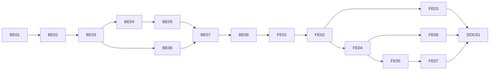

# F-13 Change Requests — Backend + Frontend Implementation Plan

This plan builds the authoring half of EP-13 (FR-55, FR-56, FR-60, FR-68, FR-108, FR-109): the rule that released data is changed only through a change request, now with a way through (US-053); creating, editing and deleting a request of one of six types on a working copy of the released data (MH-39, US-054); the origin and basis document number (US-055); scanned supporting documents (US-056); submitting with automatic routing to the coordinators, program directors and academic office that must approve it, and a preview of who that is (US-057); the conflict warning when another open request targets the same object (US-058); withdrawing (US-059); the organisational request of R2 and R4 that goes straight to the academic office (MH-40, US-060); the request list (MH-38) and the read-only detail page (MH-41).

It deliberately excludes every approval action — approve, return, reject, override, comments, the per-round history view, the "waiting for me" queue (MH-42) and notifications (F-14); final approval, applying a request to released data and creating the new version (MH-43, F-15); the grading-formula request type and the "CLO not assessed" submit block (F-12, after the MVP); importing a curriculum from Excel into a request's working copy (F-09, after the MVP); delegation (B6); and digital signatures (F13-05).

> **Companion documents**
> - Requirement: `docs/requirement/REQUIREMENTS.md` FR-55..FR-61, FR-68 (`:515-528`), FR-108, FR-109 (`:534-535`), BR-23, BR-27, BR-29, BR-30 (`:949`, `:958-961`), EC-21..EC-24, EC-27, EC-38 (`:1227-1249`)
> - Stories: `docs/planning/user-stories.md:657-747` (US-053..US-060); epic EP-13 (`docs/planning/epics.md:153`)
> - Design: `docs/design/data-dictionary.md:555-664` (§6 `ChangeRequest`, `ChangeItem`, `ApprovalStep`, `ApprovalLevelConfig`, `ChangeRequestDocument`); `docs/design/state-diagrams.md` (request status); `docs/design/screen-inventory.md:114-117` (MH-38..MH-41), `:205-208` (role grid)
> - Answers: `docs/planning/feature-questions.md:207-218` (§F-13: all A)
> - Builds on: F-01 (`AppException`, `COMMON_ERRORS`, `createTestApp`, `client.ts`), F-02 (`AccessContext`, `PERMISSIONS.CHANGE_REQUEST_*`, `ROLE_CODES`, `PERMISSION_TABLE`), F-03 (`SubjectGroup`, `SubjectGroupMember`, `activeMembershipWhere`), F-04 (`edit-path.ts`, `HOME_FACULTY_CODE`, `courseEditState`, paging), F-05 (`CourseRelation`, `lockRequisiteGraph`), F-06 (`ProgramVersion`, `ProgramsService.update`, `VersionContentCopier`, `activeDirectorWhere`), F-07 (`curriculum-access.ts`, `CourseUsageReader`), F-08 (`ConsistencyChecker`, `acceptMismatch`), F-10 (`Syllabus`, `syllabus-access.ts`, `FileStorageService`, attachment upload), F-11 (`outcome-access.ts`, `currentRevisionByCourse`, copier steps)
> - Tests: `docs/planning/test-plan.md:204-210` (KB-040..KB-046), `:325-333` (NT-B4-01..NT-B4-03, NT-B4-09)

**Status**: Not started

---

## 0. Plan at a glance

Everything below in one table. Read this; the rest is detail for whoever builds it.

| What | Why | How and where |
|---|---|---|
| **"Tạo đề xuất" opens a request form with the target already chosen** — on every screen that today shows the disabled button | US-053 AC1; FR-55; every earlier plan left the button disabled for F-13 | The shared tooltip becomes a link to MH-39 with `?type=&targetType=&targetId=`; one shared FE helper builds it (FE-07) |
| **A request edits a working copy, never the released data** — a Draft program version or a Draft syllabus revision tied to the request | US-054 AC2; F13-08 | `ProgramVersion.sourceRequestId`, `Syllabus.sourceRequestId`; the copy is made with the existing version copier and a new syllabus copier, then edited in the **existing** curriculum, outcome, program-info and syllabus screens (BE-01, BE-03, FE-05) |
| **The existing screens accept the request's creator on the copy, and only them** | US-054 AC6; BR-23 | One shared guard `assertEditPath` replaces `assertDirectEdit` in the four write guards of F-07, F-08, F-10, F-11; every call site is listed (BE-02) |
| **Course attributes, relations and organisational changes are typed in as items** — no copy to edit | US-053 AC4; US-060 | Item editor on the request: course fields and relation add / change / remove; member add / end, director assign / end (BE-04, FE-04, FE-06) |
| **Seven request types, six for data and one organisational; grading formula greyed out** | FR-56; F13-02, F13-03; F-12 is after the MVP | `ChangeRequestType` enum; R2 and R4 may create only `ORGANIZATION`; creating a data request needs edit permission on the target (BE-03) |
| **Origin "Trường" requires the basis document number; documents are scans in five types** | US-055, US-056; F13-05..F13-07 | CHECK constraint + DTO rule; `ChangeRequestDocument` stored with the F-10 file store; removable only before an approver has seen it (BE-01, BE-06, FE-04) |
| **Submitting computes the before/after items, checks the copy, routes the approvers and shows them first** | US-057; FR-57; EC-21..EC-24, EC-38 | Submit preview + submit; differs per workspace; level-1 rows per affected subject group, level-2 rows per affected program, level-3 one row; foreign courses go straight to level 3 (BE-05, BE-07, FE-04) |
| **Conflict warning, never a block; stale copy blocked at submit** | US-058; BR-30; EC-27 | Same-target open requests listed on the form and detail page; submit refuses a copy whose base has moved, with a "rebase" action (BE-03, BE-07) |
| **Withdraw while nobody has approved; delete only a never-submitted draft** | US-054 AC3–AC4; US-059; F13-04, F14-08 | Status rules in BE-07 and BE-03; skipped steps never count as approved |
| **List (MH-38) and read-only detail (MH-41)** | US-055 AC4; FR-58 (display half) | Visibility by scope; detail shows header, items before/after, documents, step progress per approver (BE-03, BE-05, FE-03, FE-07) |

**Key behaviours worth knowing**

| Behaviour | Why it is this way |
|---|---|
| The working copy is a real `ProgramVersion` / `Syllabus` row in status DRAFT, hidden from every list, matrix, usage count and "current version" read | Re-using the existing editors is the only way the six types get a full editor in one feature; every reader that must not see copies filters `sourceRequestId: null` (BE-02 table) |
| A request copy is excluded from the "one Draft per program / course" index | The program's own Draft (before first release) and several requests' copies can exist together; the copy is not a Draft of the program |
| Only the request's creator edits the copy, only while the request is DRAFT, and only if they still hold the edit permission on the target | US-054 AC6; the copy is the request's content — once submitted it is frozen until returned |
| Changes are stored as items at submit, and computed live while the request is a Draft | The stored items are what approvers saw (FR-67 history); the live diff spares a write on every edit |
| Submitting a request with zero changes is refused | A request must change something; `NO_CHANGES` |
| A program copy must pass the F-08 consistency check to be submitted | F-08's "submit and release block a framework with errors" constraint (`f-08-…` §8) |
| Every level's approvers are fixed at submit, all at once; each level needs **every** row at that level to approve | EC-22, EC-23 ("cần cả hai Điều phối", "cả ba Giám đốc"); fixing them up front lets the preview show exactly who and F-14 just walks the rows |
| A group with two active coordinators needs both | Literal EC-22 per person; §8 risk |
| The creator's own row is recorded as skipped with a reason, not removed | FR-61, BR-27, F14-07, F14-09 |
| A request about another faculty's course skips levels 1 and 2, recorded as "not applicable" | EC-24, KB-043 |
| An R1 creator needs another active R1 at level 3; if there is none, submit is refused with that message | F13-01 |
| Withdraw is refused once any non-skipped row in the current round has approved | FR-60, F14-08, US-059 AC3 |
| A withdrawn request keeps its copy, read-only, for the record; a deleted draft deletes its copy | US-059 AC4; US-054 AC3 |
| A document stays removable only until an approver could have seen it | US-056 AC3: removable while it was uploaded since the last submit and the request is a Draft |
| The conflict warning lists requests that are open (submitted at least once and not finished), plus the caller's own other drafts | US-058 AC1; another person's never-submitted draft is private to them |

**Not included**

| Excluded | Why |
|---|---|
| Approve, return, reject, override, comments, history per round, queue MH-42, notifications | F-14 (EP-14) |
| Final approval, decision number, effective semester, creating the released version, applying course / organisational items | F-15 (EP-15) and F-14 (organisational apply at level 3) |
| Grading-formula requests (`GRADING_FORMULA`) | F-12 is after the MVP; the enum value exists, the form shows it disabled |
| "CLO not assessed" block at submit (US-057 AC5, KB-044) | Needs F-12's assessment–CLO mapping |
| Importing Excel into a request's program copy | F-09 is after the MVP; F-09's import guard keeps refusing request copies |
| Attachments of the syllabus on a request copy | A copy shares nothing that is file-backed; attachments of a published syllabus are F-15's question |
| Delegation of approval | B6 (`ApprovalDelegation`, deferred) |
| Digital signature | F13-05: scans only |
| Audit log row for request actions | F01-07: no audit log in this release; `ApprovalStep` is the record |

---

## 1. Scope

| In scope | Why |
|---|---|
| `ChangeRequest`, `ChangeItem`, `ApprovalLevelConfig`, `ApprovalStep`, `ChangeRequestDocument`; request columns on `ProgramVersion`, `Syllabus` | DD §6; F13-08 |
| Request-Draft guard and its migration across F-07, F-08, F-10, F-11 | US-053, US-054 AC6 |
| Request CRUD, request code, conflict list, working copies, rebase | US-054, US-055, US-058 |
| Authored items: course attributes and relations, organisational changes | US-053 AC4, US-060 |
| Before/after differs for program copies and syllabus copies | FR-58 (computed here, displayed here and in F-14) |
| Documents | US-056 |
| Submit preview, submit, routing, withdraw | US-057, US-059 |
| List MH-38, form MH-39, organisational form MH-40, detail skeleton MH-41 | screen inventory |
| "Tạo đề xuất" buttons become links | US-053 AC1 |

| Out of scope | Deferred until |
|---|---|
| Approval actions, comments, queue, notifications, R1 override | F-14 |
| Final approval, release, apply | F-15 |
| `GRADING_FORMULA` editing, CLO-assessment block | F-12 (after MVP) |
| Delegation | B6 |
| Backlog filter on MH-38 ("tồn đọng") | F-14 (needs the waiting days of the queue) |

| AC | Covered by |
|---|---|
| US-053 AC1 — edit on released program opens the request form with the target chosen | FE-07 (`requestFormLink`), FE-04 (prefill) |
| US-053 AC2 — direct write on a published syllabus refused, even for R1 | F-04 `assertDirectEdit` (unchanged rule), BE-02 (`assertEditPath` keeps it for non-copies), BE-08 test |
| US-053 AC3 — program never released stays directly editable | BE-02 (no request → `assertDirectEdit` as before), BE-03 (`TARGET_NOT_RELEASED`) |
| US-053 AC4 — course in a released version: credits or relations via request | BE-04 (`COURSE_RELATION` items), FE-04 |
| US-054 AC1 — six types, saved as Draft with its own code | BE-01 (enum, sequence), BE-03, FE-04 (`GRADING_FORMULA` disabled) |
| US-054 AC2 — edits on a copy, live data unchanged | BE-01 (`sourceRequestId`), BE-03 (copy), BE-02 (read filters), BE-08 test |
| US-054 AC3 — never-submitted draft deleted by creator | BE-03 (`remove`), FE-07 |
| US-054 AC4 — returned draft cannot be deleted | BE-03 (`submissionRound > 0` → `REQUEST_NOT_DELETABLE`) |
| US-054 AC5 — R5 creating for another group's course refused | BE-03 (`assertCanCreate` → `OUT_OF_SCOPE`) |
| US-054 AC6 — editing another person's request refused | BE-02 (`NOT_CREATOR` on the copy), BE-03/BE-04/BE-06 (`assertCreatorDraft`) |
| US-055 AC1–AC2 — basis number required for "Trường" only | BE-01 (CHECK), BE-03 (DTO `@ValidateIf`), FE-04 (`dependencies` rule) |
| US-055 AC3 — UNIVERSITY origin by R3 still goes through three levels | BE-07 (routing ignores origin), BE-08 test |
| US-055 AC4 — list filter by origin | BE-03 (`origin` filter), FE-03 |
| US-056 AC1 — upload with one of five types; list shows type, name, uploader, time | BE-06, FE-04, FE-07 |
| US-056 AC2 — approvers download each document | BE-06 (`download` for any viewer), FE-07 |
| US-056 AC3 — submitted documents not removable, new ones can be added | BE-06 (`seenInRound`), FE-07 |
| US-056 AC4 — no signing | Not built (F13-05) |
| US-057 AC1 — routed to the coordinator of the course's group, not the author's other group | BE-07 (`RoutingPlanner` uses `course.ownerGroupId`), BE-08 (KB-040) |
| US-057 AC2 — courses of two groups need both coordinators; progress per person | BE-07 (one row per coordinator), FE-07 (`StepProgress`), BE-08 (KB-041 first half) |
| US-057 AC3 — course in three programs needs three directors | BE-07 (level-2 rows per affected program), BE-08 (KB-042 routing half) |
| US-057 AC4 — another faculty's course goes straight to the academic office | BE-07 (`FOREIGN_COURSE` skip rows), BE-08 (KB-043) |
| US-057 AC5 — CLO not assessed blocks submit | Deferred to F-12 |
| US-057 AC6 — resubmit restarts at level 1, round + 1 | BE-07 (`submit` increments `submissionRound`, materialises all levels), BE-08 test (Return is simulated by setting status DRAFT until F-14) |
| US-057 AC7 — affected programs shown before confirming | BE-07 (`submitPreview`), FE-04 (`SubmitConfirmModal`) |
| US-058 AC1 — warning names code, creator, status; creation still allowed | BE-03 (`ConflictFinder`), FE-04, FE-07 |
| US-058 AC2 — stale request blocked at the final step | BE-07 (`StaleChecker`, used at submit here and by F-15 at final approval) |
| US-058 AC3 — different targets, no warning | BE-03 (same target FK only) |
| US-059 AC1 — withdraw before anyone approved | BE-07 (`withdraw`), FE-07 |
| US-059 AC2 — refused once someone approved, with reason | BE-07 (`WITHDRAW_NOT_ALLOWED`) |
| US-059 AC3 — skipped level 1 does not count | BE-07 (`isSkipped` rows ignored), BE-08 test |
| US-059 AC4 — withdrawn is read-only | BE-02 (`NOT_DRAFT`), BE-03 (`findOwnDraft`), FE-07 |
| US-060 AC1 — R4 adds a member to own group; straight to level 3 | BE-04 (`ORGANIZATION` items), BE-07 (organisational routing), FE-06 |
| US-060 AC2 — applied at once on approval | F-14 (apply at level 3) — §8 constraint |
| US-060 AC3 — R2 cannot pick the six data types | BE-03 (`CHANGE_REQUEST_CREATE` not held), FE-04 / FE-06 (type list by permission) |
| US-060 AC4 — R4 for another group refused | BE-04 (`assertCan(CHANGE_REQUEST_CREATE_ORGANIZATIONAL, groupTarget)` → `OUT_OF_SCOPE`) |

---

## 2. Contract verification

Every existing piece F-13 consumes is defined in an earlier plan (F-01..F-11 are unbuilt). Each row is re-read at build time (Rule 13) before the deliverable that uses it.

| Existing piece used | Defined at | Used by |
|---|---|---|
| `PERMISSIONS.CHANGE_REQUEST_VIEW` `'changeRequest.view'`, `CHANGE_REQUEST_CREATE` `'changeRequest.create'`, `CHANGE_REQUEST_CREATE_ORGANIZATIONAL` `'changeRequest.createOrganizational'`; cells: VIEW = R1 X, R2..R5 P; CREATE = R1, R3, R4, R5 X; CREATE_ORGANIZATIONAL = R2 P, R4 P | F-02 (`f-02-…:578-584`, `:1220-1226`) | BE-03, BE-04, FE-01 |
| `ROLE_CODES` (`R1`..`R6`), `SEED_ROLES` in `prisma/seed-data/roles.ts`, `Role.roleCode @unique`, `seedAccessControl(prisma)` | F-02 (`f-02-…:449`, `:1150-1160`, `:1252`) | BE-01 (level config seed) |
| `AccessContext.userId`, `has`, `modeFor` (DIRECT wins; null when not covered), `assertCan` (`OUT_OF_SCOPE` when held elsewhere, else `PERMISSION_DENIED`), `scopeFor` (`{ all: true }` or union of `ScopeIds`), `ScopeTarget { orgUnitIds?, subjectGroupIds?, programIds?, studentIds? }` | F-02 BE (`f-02-…:640-760`) | BE-02..BE-07 |
| `EDIT_PATH { DIRECT, VIA_REQUEST }`, `EditState { released, draftOpenToRequestHolders }`, `editPathFor`, `resolveEditPath`, `assertDirectEdit` (409 `COMMON_ERRORS.CHANGE_REQUEST_REQUIRED`) in `src/shared/authz/edit-path.ts` | F-04 BE-02 (`f-04-…:340-376`) | BE-02 |
| `HOME_FACULTY_CODE = 'KHOA_CNTT'` in `src/shared/org-units/home-faculty.ts`; "foreign" = owner faculty code ≠ home | F-04 (`f-04-…:432`, D9) | BE-07 |
| `PAGINATION`, `PageQueryDto`, `Page<T>`, `toSkipTake`, `toPage` in `src/shared/pagination/`; list via `$transaction([findMany, count])` | F-04 BE-02 | BE-03 |
| `Course { id, courseCode, courseName, englishName?, credits Decimal(5,2), courseType, status, ownerFacultyId, ownerGroupId? , updatedAt }`; `CreateCourseDto`, `UpdateCourseDto = PartialType(OmitType(CreateCourseDto, ['courseCode']))`; `trimString`, `emptyToNull`, `CREDITS_PATTERN` | F-04 BE-01, BE-03 (`f-04-…:277-300`, `:550-581`) | BE-04 |
| `courseTarget`, `courseEditState(usage, course)` (released = `inReleasedVersion`) | F-04, F-10 BE-02 | BE-03, BE-04 |
| `CourseRelation { id, sourceCourseId, targetCourseId, relationType, minScore Decimal(4,2)?, updatedAt }`, `@@unique([sourceCourseId, targetCourseId, relationType])`; `CreateCourseRelationDto`, `UpdateCourseRelationDto`, `GRADE_POINT_PATTERN`; `lockRequisiteGraph(tx)` | F-05 BE-01, BE-03 (`f-05-…:237-250`, `:464-485`, `:639`) | BE-04, BE-07 |
| `SubjectGroup { id, groupCode @unique, groupName, facultyId, status }`, `SubjectGroupMember { subjectGroupId, lecturerId, memberRole, validFrom, validTo?, revokedAt? }`, `activeMembershipWhere(today)` in `src/shared/...` (active row + group ACTIVE); `AddSubjectGroupMemberDto { lecturerId, memberRole, validFrom, validTo? }`, `EndSubjectGroupMemberDto { validTo }` | F-03 BE-01, BE-03 (`f-03-…:266-300`, `:433-445`, `:1066-1082`) | BE-04, BE-07 |
| `Program { id, programCode, facultyId, degreeLevel, status }`; `ProgramVersion { id, programId, versionNumber?, status, programName, majorCode, majorName, semesterCount, totalCredits, compulsoryCredits, electiveCredits }`; `ProgramVersion_one_draft` partial unique index | F-06 BE-01 (`f-06-…:243-312`) | BE-01 |
| `ProgramDirectorAssignment { programId, directorId, validFrom, validTo?, revokedAt? }`; `activeDirectorWhere(today)` in `src/shared/programs/active-director.ts`; `AssignDirectorDto { directorId, validFrom, validTo? }`, `EndDirectorDto { validTo }` | F-06 BE-01, BE-03 (`f-06-…:281-300`, `:145-178`, `:349-356`) | BE-04, BE-07 |
| `programTarget(program{id, facultyId})`, `programEditState(db, programId)`; `programInclude(today)` (versions by `createdAt desc`), `currentVersion(row)`; `ProgramsService.update(programId, dto, access)` (`assertDirectEdit` → find the Draft → `assertCreditsAddUp` → transaction); `versionData(fields)`; `VERSION_INFO_SELECT`; `clone` reads its source from `programInclude` | F-06 BE-02, BE-03 (`f-06-…:365-420`, `:715-760`, `:857-885`) | BE-02 |
| `VersionContentCopier.copy(tx, from, to)` (groups → items → requisites; F-11 adds PLOs → course–PLO → CLO–PLO) in `ProgramsSharedModule` | F-06 D7 (`f-06-…:386-400`), F-07 (`f-07-…:484-525`), F-11 (`f-11-…:496-502`) | BE-03 |
| `curriculum-access.ts`: `VERSION_ACCESS_SELECT`, `assertDraft`, `assertCurriculumWrite(prisma, access, version, target)`; callers listed in BE-02 | F-07 BE-03 (`f-07-…:727-751`) | BE-02 |
| `CourseUsageReader.inReleasedVersion`, `programsUsing` | F-07 BE-02 (`f-07-…:525-560`) | BE-02, BE-07 |
| `ConsistencyChecker.check(versionId, db)`, `assertPasses(versionId, db)` (throws `CONSISTENCY_FAILED` with details) in `src/shared/curriculum/consistency-checker.ts`; `acceptMismatch`, `canAccept` | F-08 BE-02, BE-04 (`f-08-…:542-625`, `:757-782`) | BE-02, BE-07 |
| `Syllabus { id, courseId, revisionNumber Int, status, courseDescription?, englishDescription?, objectives?, teachingMethods?, assessmentMethods?, references?, previousVersionId? @unique, publishedAt? }`, `WeeklyContent { weekLabel, sortOrder, content, teachingActivities? }`, `Syllabus_one_draft`; `SyllabusAttachment` | F-10 BE-01 (`f-10-…:268-335`) | BE-01, BE-03 |
| `syllabus-access.ts` `assertDraftWrite(prisma, access, row, permission?)`, `syllabusEditState`, `seesDrafts`; `forCourse` | F-10 BE-03, F-11 BE-02 (`f-10-…:683-720`, `:788-812`; `f-11-…:462`) | BE-02 |
| `FileStorageService.write / open / remove`, `FilesModule`, `sendFile`, `uploadedFileName`, `ATTACHMENT_TYPE_SPECS`, `detectAttachmentType`, `AttachmentFileType`, env `ATTACHMENT_MAX_MB`, `MulterModule.registerAsync` limits | F-10 BE-05 (`f-10-…:449-470`, `:1040-1124`) | BE-06 |
| `outcome-access.ts`: `assertOutcomeWrite`, `outcomeEditPath`; `currentRevisionByCourse` | F-11 BE-02, BE-04 (`f-11-…:470-490`, `:868-896`) | BE-02 |
| `getJson`, `sendJson`, `sendForm`, `downloadFile`, `errorMessage`, `applyFieldErrors`, `PageContainer`, `PageSpin`, `ApiErrorResult`, `RequirePermission`, `useCan`, `APP_MENU`, `ROUTES` | F-01 FE, F-02 FE-04 (`f-02-…:2318-2358`), F-09 FE-02 | FE-01..FE-07 |
| `CHANGE_REQUEST_PENDING_TOOLTIP` and the disabled "Tạo đề xuất" button: `CourseEditButton` (F-04 `:1384`), F-05 (`:1294`), `ProgramEditButton` (F-06 `:1194`), `CurriculumAddButton` (F-07 `:1759`), F-10, F-11 | F-04 FE (`f-04-…:1232`) and siblings | FE-07 |
| Routes `programDetail`, `programEdit` (F-06 `:1007`), `curriculum` (F-07 `:1572`), `syllabus`, `syllabusEdit` (F-10 `:1261`), `plos`, `coursePloMatrix`, `cloPloMatrix`, `itemCloPlo`, `outcomeCoverage` (F-11 `:1401`) | earlier FE plans | FE-05 |

### 2a. Endpoints

All under the global `/api` prefix, all requiring a session.

| Endpoint | Permission | Request | Response | Notes |
|---|---|---|---|---|
| `GET /change-requests` | `changeRequest.view` | `ChangeRequestQueryDto` | `ChangeRequestPageDto` | visibility filter (D9); R6 → 403 |
| `GET /change-requests/conflicts` | `changeRequest.view` | `?targetType&targetId` | `ConflictDto[]` | lets the form warn before the request exists |
| `GET /change-requests/user-options` | `changeRequest.createOrganizational` | `?q` | `UserOptionDto[]` | ACTIVE users, at most `USER_OPTIONS_MAX`; the member and director pickers of MH-40 (F-03's `GET /users` is R1-only) |
| `POST /change-requests` | `changeRequest.create` (data types) / `.createOrganizational` (`ORGANIZATION`) + edit permission on the target | `CreateChangeRequestDto` | 201 `ChangeRequestDetailDto` | creates the copy for workspace types; 409 `TARGET_NOT_RELEASED`; `conflicts` filled |
| `GET /change-requests/:id` | `changeRequest.view` + visible | — | `ChangeRequestDetailDto` | 404 `REQUEST_NOT_FOUND` outside visibility |
| `PATCH /change-requests/:id` | creator, DRAFT | `UpdateChangeRequestDto` | `ChangeRequestDetailDto` | header fields only |
| `DELETE /change-requests/:id` | creator, DRAFT, round 0 | — | 204 | deletes the copy and the documents; 409 `REQUEST_NOT_DELETABLE` |
| `POST /change-requests/:id/rebase` | creator, DRAFT, workspace type | — | `ChangeRequestDetailDto` | re-copies from the newest base; edits on the copy are discarded |
| `PUT /change-requests/:id/items` | creator, DRAFT, authored type | `ReplaceAuthoredItemsDto` | `ChangeRequestDetailDto` | `COURSE_RELATION` and `ORGANIZATION` only; 409 `ITEMS_NOT_AUTHORED` otherwise |
| `GET /change-requests/:id/diff` | visible | — | `ChangeDiffDto` | live for a DRAFT workspace request, stored items otherwise |
| `GET /change-requests/:id/submit-preview` | creator | — | `SubmitPreviewDto` | read-only dry run of submit |
| `POST /change-requests/:id/submit` | creator, DRAFT | — | `ChangeRequestDetailDto` | 409 `NO_CHANGES`, `STALE_BASE`, `CONSISTENCY_FAILED`, `NO_OTHER_ACADEMIC_OFFICE`, `REQUEST_NOT_DRAFT` |
| `POST /change-requests/:id/withdraw` | creator | — | `ChangeRequestDetailDto` | 409 `WITHDRAW_NOT_ALLOWED` |
| `POST /change-requests/:id/documents` | creator, DRAFT or PENDING_* | multipart `file` + `documentType` | 201 `ChangeRequestDocumentDto` | 400 `ATTACHMENT_FILE_REQUIRED`, `ATTACHMENT_TYPE_NOT_ALLOWED`; 409 `DOCUMENTS_LIMIT` |
| `GET /change-request-documents/:documentId/file` | visible | — | file stream | `Content-Disposition` via `sendFile` |
| `DELETE /change-request-documents/:documentId` | creator, DRAFT, `seenInRound` null | — | 204 | 409 `DOCUMENT_LOCKED` |
| `GET /program-versions/:versionId/info` (programs feature, new) | `program.view` | — | `VersionInfoEditDto` | used by the program-info form on a request copy |
| `PATCH /program-versions/:versionId/info` (programs feature, new) | `program.editInfo` | `UpdateVersionInfoDto` | `VersionInfoEditDto` | the only route that writes a copy's version fields |
| `GET /courses/:courseId/syllabus` (F-10, extended) | `syllabus.view` | `?requestId` | `CourseSyllabusDto` | with `requestId`: the request copy as `draft`, `published` unchanged |

### 2b. DTOs

**`RequestRefDto`** (used on copy-carrying DTOs of other features): `id: string`, `requestCode: string`, `status: ChangeRequestStatus`. Modeled as `RequestDraftBanner`.

`ChangeRequestStatus` wire values (BE-01): `'DRAFT' | 'PENDING_COORDINATOR' | 'PENDING_DIRECTOR' | 'PENDING_ACADEMIC_OFFICE' | 'APPROVED' | 'EFFECTIVE' | 'REJECTED' | 'WITHDRAWN'`. `ChangeRequestType`: `'GRADING_FORMULA' | 'OUTCOME' | 'SYLLABUS_CONTENT' | 'CURRICULUM' | 'COURSE_RELATION' | 'PROGRAM_INFO' | 'ORGANIZATION'`. `ChangeTargetType`: `'COURSE' | 'PROGRAM' | 'SUBJECT_GROUP'`. `RequestOrigin`: `'UNIVERSITY' | 'FACULTY'`. `ApprovalAction`: `'PENDING' | 'APPROVE' | 'RETURN' | 'REJECT'`. `ChangeDocumentType`: `'SUBMISSION' | 'MINUTES' | 'COUNCIL_MINUTES' | 'REVIEW_MINUTES' | 'OFFICIAL_LETTER'`.

**`ChangeRequestSummaryDto`** (list row)

| Field | Wire type | Nullable | Source | Modeled as | Note |
|---|---|---|---|---|---|
| `id` | `string` | no | BE-01 | key, link | |
| `requestCode` | `string` | no | BE-01 | "Mã" | `DX-2026-0001` |
| `requestType` | `ChangeRequestType` | no | BE-01 | "Loại" | label from `REQUEST_TYPE_LABELS` |
| `target` | `RequestTargetDto` | no | BE-03 | "Đối tượng" | `{ targetType, id, code, name }` |
| `title` | `string` | no | BE-01 | "Tiêu đề" | |
| `status` | `ChangeRequestStatus` | no | BE-01 | status tag | |
| `origin` | `RequestOrigin` | no | BE-01 | "Nguồn" | |
| `submissionRound` | `number` | no | BE-01 | "Lần gửi" | 0 = never submitted |
| `createdBy` | `UserRefDto` | no | BE-03 | "Người tạo" | `{ id, fullName }` (F-02) |
| `createdAt` | `string` (ISO) | no | BE-01 | sort | |
| `updatedAt` | `string` (ISO) | no | BE-01 | "Cập nhật" | |

**`ChangeRequestPageDto`**: `items: ChangeRequestSummaryDto[]`, `total`, `page`, `pageSize` (F-04 `CoursePageDto` shape).

**`ChangeRequestDetailDto`**

| Field | Wire type | Nullable | Source | Modeled as | Note |
|---|---|---|---|---|---|
| …all of `ChangeRequestSummaryDto` | | | | header | |
| `reason` | `string` | no | BE-01 | "Lý do" | |
| `basisDocumentNumber` | `string` | **yes** | BE-01 | "Số văn bản căn cứ" | required when `origin = UNIVERSITY` |
| `workspace` | `RequestWorkspaceDto` | **yes** | BE-03 | "Soạn thay đổi" links | null for authored types |
| `authoredItems` | `AuthoredItemDto[]` | no | BE-04 | item editor rows | empty for workspace types |
| `documents` | `ChangeRequestDocumentDto[]` | no | BE-06 | documents table | newest first |
| `steps` | `ApprovalStepDto[]` | no | BE-07 | `StepProgress` | current round only; empty before the first submit |
| `conflicts` | `ConflictDto[]` | no | BE-03 | warning `Alert` | |
| `permissions` | `RequestActionsDto` | no | BE-03 | buttons | `{ canEdit, canDelete, canSubmit, canWithdraw, canUpload }` — computed for the caller |

**`RequestWorkspaceDto`**: `kind: 'PROGRAM_VERSION' | 'SYLLABUS'`, `copyId: string` (version id or syllabus id), `programId: string | null`, `courseId: string | null`, `baseLabel: string` (e.g. `"Phiên bản 2.1"`, `"Đề cương bản 3"`), `isStale: boolean` (`StaleChecker`, BE-07). Modeled as the "Soạn thay đổi" card: links per type (FE-05).

**`AuthoredItemDto`**: `id`, `entityType: 'COURSE_FIELD' | 'COURSE_RELATION' | 'ORG_MEMBERSHIP' | 'ORG_DIRECTOR'`, `itemKey: string`, `label: string` (Vietnamese, built by BE-04), `oldValue: unknown | null`, `newValue: unknown | null`. Modeled as rows of `AuthoredItemsTable`.

**`ChangeRequestDocumentDto`**

| Field | Wire type | Nullable | Source | Modeled as | Note |
|---|---|---|---|---|---|
| `id` | `string` | no | BE-01 | key | |
| `documentType` | `ChangeDocumentType` | no | BE-01 | "Loại hồ sơ" | `DOCUMENT_TYPE_LABELS` |
| `fileName` | `string` | no | BE-06 | link text | original name, sanitised |
| `fileType` | `AttachmentFileType` | no | F-10 | icon | |
| `sizeBytes` | `number` | no | BE-06 | size | |
| `uploadedBy` | `UserRefDto` | no | BE-06 | "Người tải" | |
| `createdAt` | `string` (ISO) | no | BE-01 | "Thời điểm" | |
| `seenInRound` | `number` | **yes** | BE-06 | "Đã gửi kèm lần N" | null = not yet seen by an approver |
| `canRemove` | `boolean` | no | BE-06 | delete button | creator ∧ DRAFT ∧ `seenInRound` null |

**`ApprovalStepDto`**

| Field | Wire type | Nullable | Source | Modeled as | Note |
|---|---|---|---|---|---|
| `id` | `string` | no | BE-01 | key | |
| `approvalLevel` | `1 \| 2 \| 3` | no | BE-01 | column of `StepProgress` | |
| `levelName` | `string` | no | `ApprovalLevelConfig` | column title | |
| `approver` | `UserRefDto` | **yes** | BE-07 | person | null at level 3 ("Phòng Đào tạo") and on "no approver" skips |
| `forSubjectGroup` | `{ id, groupCode, groupName }` | **yes** | BE-07 | "Nhóm" | level 1 |
| `forProgram` | `{ id, programCode }` | **yes** | BE-07 | "Chương trình" | level 2 |
| `action` | `ApprovalAction` | no | BE-01 | tag | |
| `isSkipped` | `boolean` | no | BE-01 | "Bỏ qua" tag | |
| `skipReason` | `string` | **yes** | BE-07 | tooltip | `SKIP_REASONS` text |
| `remark` | `string` | **yes** | F-14 | — | written by F-14; shown when present |
| `recordedAt` | `string` (ISO) | **yes** | F-14 / BE-07 | time | set on skip rows at submit |

**`ConflictDto`**: `id`, `requestCode`, `title`, `status: ChangeRequestStatus`, `createdBy: UserRefDto`. Modeled as the `ConflictAlert` list (US-058 AC1: code, creator, status).

**`ChangeDiffDto`**

| Field | Wire type | Nullable | Source | Modeled as | Note |
|---|---|---|---|---|---|
| `live` | `boolean` | no | BE-05 | "Bản xem trước" note | true while DRAFT |
| `sections` | `DiffSectionDto[]` | no | BE-05 | `DiffView` tabs | one per `entityType` present, in `DIFF_SECTION_ORDER` |

**`DiffSectionDto`**: `entityType: string`, `title: string`, `rows: DiffRowDto[]`. **`DiffRowDto`**: `itemKey: string`, `label: string`, `change: 'ADDED' | 'REMOVED' | 'CHANGED'`, `fields: { name: string; label: string; before: string | null; after: string | null }[]` (values pre-formatted for display by BE-05; `WEEKLY_CONTENTS` and long text sections carry the whole text in `before`/`after`).

**`SubmitPreviewDto`**

| Field | Wire type | Nullable | Source | Modeled as | Note |
|---|---|---|---|---|---|
| `itemCount` | `number` | no | BE-05 | "N thay đổi" | |
| `affectedPrograms` | `{ id, programCode, programName }[]` | no | BE-07 | list in the confirm (US-057 AC7) | |
| `levels` | `PreviewLevelDto[]` | no | BE-07 | three rows | `{ approvalLevel, levelName, approvers: { name: string; scope: string \| null; skipReason: string \| null }[] }` |
| `blockingIssues` | `{ code: string; message: string }[]` | no | BE-07 | red list; submit disabled | `NO_CHANGES`, `STALE_BASE`, `CONSISTENCY_FAILED` (one per error), `NO_OTHER_ACADEMIC_OFFICE` |

**`VersionInfoEditDto`** (programs feature): `VERSION_INFO_SELECT` fields (`id, versionNumber, status, programName, majorCode, majorName, semesterCount, totalCredits, compulsoryCredits, electiveCredits, updatedAt`, decimals as strings) + `program: { id, programCode, degreeLevel }` + `sourceRequest: RequestRefDto | null` + `canEdit: boolean`.

Other features' DTOs gain one field each: `CurriculumVersionDto`, `OutcomeVersionDto`, `SyllabusDto` gain `sourceRequest: RequestRefDto | null`; `SyllabusDto.revisionNumber` becomes `number | null` (null on a request copy).

**Request DTOs**

| DTO | Fields |
|---|---|
| `ChangeRequestQueryDto` | `PageQueryDto` + `status?` (`ChangeRequestStatus`), `requestType?`, `origin?`, `createdById?`, `mine?: boolean` (`@Transform` from `'true'`) |
| `CreateChangeRequestDto` | `requestType` (`@IsIn(CREATABLE_TYPES)` — `GRADING_FORMULA` refused), `targetType`, `targetId` (string), `title` (trim, 1..`TITLE_MAX`), `reason` (trim, 1..`REASON_MAX`), `origin`, `basisDocumentNumber?` (`@ValidateIf(origin === UNIVERSITY)` `@IsNotEmpty`, ≤ `BASIS_NUMBER_MAX`; blank → null) |
| `UpdateChangeRequestDto` | `PartialType(PickType(CreateChangeRequestDto, ['title', 'reason', 'origin', 'basisDocumentNumber']))`; the service re-checks the origin rule on the merged row |
| `ReplaceAuthoredItemsDto` | `items: AuthoredItemInputDto[]`, ≤ `AUTHORED_ITEMS_MAX`; each a flat object discriminated by `operation`, one class per operation (BE-04) |
| `UploadChangeRequestDocumentDto` | `documentType` (`@IsEnum(ChangeDocumentType)`) + multipart `file` |
| `UpdateVersionInfoDto` (programs) | `PickType(UpdateProgramDto, version fields)` — the F-06 version fields without `degreeLevel` |

### 2c. Mismatch log

| Deliverable | What the earlier doc said | What this plan does | Found at |
|---|---|---|---|
| BE-01 | DD `ApprovalStep.approver → User` required | `approverId` nullable: level 3 is "any R1 other than the creator" (F13-01), and a "no coordinator" skip row has nobody | `data-dictionary.md` §6 `ApprovalStep`; F13-01 |
| BE-01 | DD `ApprovalStep` has no group or program column | ⊕ `forSubjectGroupId`, `forProgramId`, so EC-22 / EC-23 progress can name whose approval a row stands for | EC-22 "hiển thị tiến độ phê duyệt theo từng người" |
| BE-01 | DD `ChangeRequest.targetCode` only | ⊕ `courseId`, `programId`, `subjectGroupId` (exactly one set, CHECK) beside `targetCode`; conflict and visibility join on the key | `data-dictionary.md` §6; codes can be renamed, ids cannot |
| BE-01 | DD `ChangeItem` has `entityType`, `recordId`, `oldValue`, `newValue`, `baseVersion` | ⊕ `itemKey` (natural key: course code, PLO code, field name) and `sortOrder`; the diff matches on natural keys because the copy has new row ids | F13-08; BE-05 |
| BE-01 | DD `ChangeRequestDocument.recordedAt` | `createdAt` like every other table, plus `sizeBytes`, `fileType`, `seenInRound` | F-10 `SyllabusAttachment` (`f-10-…:304-317`); US-056 AC3 |
| BE-01 | DD `ChangeRequest` ⊕ `decisionNumber?`, `signedDate?`, `effectiveSemester?` | Not added here; F-15 adds them with `Semester` | F-15 owns MH-43 |
| BE-01 | DD `ApprovalStep.delegation` | Not added (B6) | `deferred-scope.md` |
| BE-01 | F-10: `Syllabus.revisionNumber Int`, `@@unique([courseId, revisionNumber])` | `revisionNumber Int?`, null on a request copy (CHECK: null only with `sourceRequestId`); F-15 numbers the copy when it publishes | `f-10-…:268-290` |
| BE-02 | F-07/F-10/F-11: "F-13 opens the released path" | Opened by a request copy, not by relaxing `assertDirectEdit`; the released program's own data still answers `CHANGE_REQUEST_REQUIRED` | `f-07-…` §8, `f-10-…` §8, `f-11-…` §8 constraints |
| BE-03 | DD: ORGANIZATION requests change "thành viên nhóm, Điều phối hoặc phân công Giám đốc CTĐT" | Four operations: add member (any role), end membership, assign director, end director — the F-03 and F-06 write shapes | US-060; `f-03-…:1066-1082`, `f-06-…:178` |
| BE-04 | FR-56 "sửa quan hệ học phần" | `COURSE_RELATION` also carries course attribute changes (credits, name, type, owner group); there is no "course info" type and US-053 AC4 sends credits through a request | US-053 AC4; FR-56 |
| BE-07 | US-057 AC5 / KB-044 block on unassessed CLO | Not checked (F-12 after MVP); NT-B4-02's grading-formula walk becomes a syllabus-content walk | `test-plan.md:206`, `:326`; DOC-01 |
| BE-03 | F-10 §8: the request copy copies attachment rows and sets `previousVersionId` | Attachments are not copied and a copy refuses uploads (`REQUEST_COPY_NO_ATTACHMENTS`); the copy points at its base through `baseRevisionId`, and `previousVersionId` stays F-15's to set when it publishes | `f-10-…:1890`; US-077 is F-15's |
| BE-04 | F-03 D14: `UserSelect` searches `GET /users`, "allowed for R1, who is the only writer" | R2 and R4 now pick members and directors too; `GET /change-requests/user-options` serves them, and `UserSelect` gains a `searchPath` prop | `f-03-…:236` |
| — | MH-38 "R1 có thêm bộ lọc tồn đọng" | Left to F-14 with the queue's waiting days | `screen-inventory.md:114` |

---

## 3. Decisions

| # | Decision | Why | Rejected alternative |
|---|---|---|---|
| D1 | A workspace request owns a **working copy** — a `ProgramVersion` or `Syllabus` row in status DRAFT with `sourceRequestId` set — edited through the existing screens | F13-08. Each type already has a full editor with validation; a second editor per type would double F-06..F-11's UI and drift from their rules | Items edited as JSON in a generic form (no validation reuse); a per-field patch log replayed at apply (every rule re-implemented on JSON) |
| D2 | The copy's permission check is "creator ∧ request DRAFT ∧ still holds the edit permission on the target", in one shared `assertEditPath` | US-054 AC6; a lecturer removed from the group mid-draft must lose the copy too. One function so the four feature guards cannot drift | A separate guard per feature; checking only the creator |
| D3 | Type → workspace: `CURRICULUM`, `PROGRAM_INFO`, `OUTCOME` on a program → program copy; `SYLLABUS_CONTENT`, `OUTCOME` on a course → syllabus copy; `COURSE_RELATION`, `ORGANIZATION` → authored items | The type is the label and the permission check; the copy carries whatever the creator changed. A curriculum request that also edits a PLO is still one request — F-15 numbers by what the items contain | One copy per type with the other screens read-only — splits one real change into several requests |
| D4 | Items are generated at submit and stored; while DRAFT the diff is computed live | Stored items are what approvers saw and survive later edits of the base; live diff avoids a write per edit | Writing items on every copy edit (every feature write path would need a hook) |
| D5 | Differs match rows by natural key (course code, group code, PLO code, CLO code, field name) | The copy has new row ids; codes are unique within a version / revision and are what a reader recognises | Matching by `recordId` — copies break it |
| D6 | All approval rows of all three levels are created at submit; the status points at the lowest level with a PENDING row | The preview shows the exact same rows; F-14 only walks them; resubmit makes a fresh set with round + 1 (BR-29) | Creating level N+1 rows when level N completes — the preview could disagree with what happens |
| D7 | Every row at a level must approve | EC-22, EC-23 are per person ("cần cả hai Điều phối", "cả ba Giám đốc") | One approval per group or per program — §8 risk lists the alternative |
| D8 | `ApprovalStep.approverId` is null at level 3: any active R1 other than the creator acts | F13-01; Phòng Đào tạo is an office, not a person | One row per R1 — every R1 would have to approve |
| D9 | Visibility: unscoped `changeRequest.view` sees all; otherwise creator ∨ has a step ∨ target inside the caller's scope; a never-submitted draft is visible only to its creator | MH-38 "đề xuất của tôi và các đề xuất trong phạm vi của mình"; a draft is private work | Showing drafts to scope holders |
| D10 | Conflict = same target key, other request, status open (DRAFT with round > 0, PENDING_*, APPROVED) or the caller's own other drafts | BR-30; another person's private draft must not leak through the warning | Including every draft — leaks titles of private drafts |
| D11 | Stale = the base moved: program copy's base version is no longer the newest non-Draft version; syllabus copy's base is no longer the published revision; an authored course item's `oldValue` differs from now | EC-27 optimistic lock; US-058 AC2. One `StaleChecker` in `src/shared/change-requests/` used at submit here and at final approval by F-15 | Version counters on every table |
| D12 | Rebase re-copies from the newest base and discards the copy's edits, after a confirm | Merging edits onto a new base is a three-way merge per table; US-058 AC2 says "phải soạn lại trên bản mới" | Automatic merge |
| D13 | Request code `DX-<year>-<NNNN>` from one PostgreSQL sequence, never reset | Unique and gap-tolerant under concurrency; the year is the creation year for reading only | `MAX + 1` per year (race), a counter table (lock) |
| D14 | Shared code in `src/shared/change-requests/`: `request-draft.ts` (guard), `StaleChecker`, snapshot readers and differs | F-07/F-08/F-10/F-11 need the guard; F-14 shows diffs; F-15 needs the stale check and snapshots. Features do not import each other | Inside the feature — F-15 would have to import it |
| D15 | `PROGRAM_INFO` copies cannot change `degreeLevel` | It lives on `Program`, not on the version; a version-scoped request cannot carry it | Adding `degreeLevel` to the version — schema change for a field that never changes in practice |
| D16 | `ORGANIZATION` requests skip levels 1 and 2 by routing, not by skip rows | US-060 AC1 "không qua cấp 1 và cấp 2"; they never had those levels, so no "skipped" history is written | Writing skip rows — reads as if someone was bypassed |
| D17 | `GRADING_FORMULA` is in the enum but refused by `CREATABLE_TYPES` | F-12 is after the MVP; the value keeps the DD's type list and the form shows it disabled with "Chưa hỗ trợ" | Leaving the value out — a migration later for an enum add |
| D18 | A request copy is readable by id by anyone who may read its target (curriculum, outcome, syllabus screens); the "private draft" rule of D9 applies to the request list, detail and conflict list only | The copy's id is reached only through the request; adding a privacy check to every reader of F-07..F-11 multiplies the call sites for a draft whose content the same people will review once submitted | A visibility check in every reader — §8 risk keeps it as the fallback if a reviewer objects |

---

## 5. Deliverables

Backend paths are under `source/backend/`, frontend paths under `source/frontend/`.

### BE-01 — Prisma schema: requests, items, steps, level config, documents; copy columns

What/Why: DD §6; F13-08 (working copy); BR-29 (round); D6, D8, D13.

**Files**

| Action | Path |
|---|---|
| MODIFY | `prisma/schema.prisma` |
| NEW | `prisma/migrations/<timestamp>_change_requests/migration.sql` (generated, then edited for the CHECKs, the sequence and the two indexes) |
| NEW | `prisma/seed-data/approval-levels.ts` |
| MODIFY | `prisma/seed.ts` |

**Shape**

```prisma
enum ChangeRequestType {
  GRADING_FORMULA
  OUTCOME
  SYLLABUS_CONTENT
  CURRICULUM
  COURSE_RELATION
  PROGRAM_INFO
  ORGANIZATION
}

enum ChangeTargetType {
  COURSE
  PROGRAM
  SUBJECT_GROUP
}

enum ChangeRequestStatus {
  DRAFT
  PENDING_COORDINATOR
  PENDING_DIRECTOR
  PENDING_ACADEMIC_OFFICE
  APPROVED
  EFFECTIVE
  REJECTED
  WITHDRAWN
}

enum RequestOrigin {
  UNIVERSITY
  FACULTY
}

enum ApprovalAction {
  PENDING
  APPROVE
  RETURN
  REJECT
}

enum ChangeDocumentType {
  SUBMISSION
  MINUTES
  COUNCIL_MINUTES
  REVIEW_MINUTES
  OFFICIAL_LETTER
}

model ChangeRequest {
  id                  String                  @id @default(cuid(2))
  requestCode         String                  @unique
  requestType         ChangeRequestType
  targetType          ChangeTargetType
  targetCode          String
  courseId            String?
  course              Course?                 @relation(fields: [courseId], references: [id], onDelete: Restrict)
  programId           String?
  program             Program?                @relation(fields: [programId], references: [id], onDelete: Restrict)
  subjectGroupId      String?
  subjectGroup        SubjectGroup?           @relation(fields: [subjectGroupId], references: [id], onDelete: Restrict)
  createdById         String
  createdBy           User                    @relation("ChangeRequestCreator", fields: [createdById], references: [id], onDelete: Restrict)
  title               String
  reason              String
  status              ChangeRequestStatus     @default(DRAFT)
  origin              RequestOrigin
  basisDocumentNumber String?
  submissionRound     Int                     @default(0)
  items               ChangeItem[]
  steps               ApprovalStep[]
  documents           ChangeRequestDocument[]
  programCopy         ProgramVersion?         @relation("ProgramVersionRequestCopy")
  syllabusCopy        Syllabus?               @relation("SyllabusRequestCopy")
  createdAt           DateTime                @default(now())
  updatedAt           DateTime                @updatedAt

  @@index([status])
  @@index([createdById])
  @@index([courseId])
  @@index([programId])
  @@index([subjectGroupId])
}

model ChangeItem {
  id              String        @id @default(cuid(2))
  changeRequestId String
  changeRequest   ChangeRequest @relation(fields: [changeRequestId], references: [id], onDelete: Cascade)
  sortOrder       Int
  entityType      String
  itemKey         String
  label           String
  recordId        String?
  oldValue        Json?
  newValue        Json?
  baseVersion     String?

  @@unique([changeRequestId, entityType, itemKey])
  @@index([changeRequestId, sortOrder])
}

model ApprovalLevelConfig {
  id            String   @id @default(cuid(2))
  approvalLevel Int      @unique
  levelName     String
  roleId        String
  role          Role     @relation(fields: [roleId], references: [id], onDelete: Restrict)
  createdAt     DateTime @default(now())
  updatedAt     DateTime @updatedAt
}

model ApprovalStep {
  id                String         @id @default(cuid(2))
  changeRequestId   String
  changeRequest     ChangeRequest  @relation(fields: [changeRequestId], references: [id], onDelete: Cascade)
  submissionRound   Int
  approvalLevel     Int
  approverId        String?
  approver          User?          @relation("ApprovalStepApprover", fields: [approverId], references: [id], onDelete: Restrict)
  forSubjectGroupId String?
  forSubjectGroup   SubjectGroup?  @relation(fields: [forSubjectGroupId], references: [id], onDelete: Restrict)
  forProgramId      String?
  forProgram        Program?       @relation(fields: [forProgramId], references: [id], onDelete: Restrict)
  action            ApprovalAction @default(PENDING)
  remark            String?
  recordedAt        DateTime?
  isSkipped         Boolean        @default(false)
  skipReason        String?
  performedById     String?
  performedBy       User?          @relation("ApprovalStepPerformer", fields: [performedById], references: [id], onDelete: Restrict)
  isOverride        Boolean        @default(false)
  createdAt         DateTime       @default(now())

  @@index([changeRequestId, submissionRound, approvalLevel])
  @@index([approverId, action])
}

model ChangeRequestDocument {
  id              String             @id @default(cuid(2))
  changeRequestId String
  changeRequest   ChangeRequest      @relation(fields: [changeRequestId], references: [id], onDelete: Restrict)
  documentType    ChangeDocumentType
  fileName        String
  fileType        AttachmentFileType
  filePath        String             @unique
  sizeBytes       Int
  uploadedById    String
  uploadedBy      User               @relation("ChangeRequestDocumentUploader", fields: [uploadedById], references: [id], onDelete: Restrict)
  seenInRound     Int?
  createdAt       DateTime           @default(now())

  @@index([changeRequestId, createdAt])
}
```

Added to existing models:

```prisma
model ProgramVersion {
  // …F-06..F-11 columns unchanged…
  sourceRequestId String?         @unique
  sourceRequest   ChangeRequest?  @relation("ProgramVersionRequestCopy", fields: [sourceRequestId], references: [id], onDelete: Restrict)
  baseVersionId   String?
  baseVersion     ProgramVersion? @relation("ProgramVersionBase", fields: [baseVersionId], references: [id], onDelete: Restrict)
  requestCopies   ProgramVersion[] @relation("ProgramVersionBase")
}

model Syllabus {
  // …F-10, F-11 columns unchanged, except:
  revisionNumber  Int?
  sourceRequestId String?        @unique
  sourceRequest   ChangeRequest? @relation("SyllabusRequestCopy", fields: [sourceRequestId], references: [id], onDelete: Restrict)
  baseRevisionId  String?
  baseRevision    Syllabus?      @relation("SyllabusBase", fields: [baseRevisionId], references: [id], onDelete: Restrict)
  requestCopies   Syllabus[]     @relation("SyllabusBase")
}
```

Back-relations: `Course.changeRequests`, `Program.changeRequests`, `Program.approvalSteps`, `SubjectGroup.changeRequests`, `SubjectGroup.approvalSteps`, `Role.approvalLevels`, and on `User` the four named relations (`ChangeRequestCreator`, `ApprovalStepApprover`, `ApprovalStepPerformer`, `ChangeRequestDocumentUploader`).

Appended to the generated migration:

```sql
CREATE SEQUENCE "change_request_code_seq";

ALTER TABLE "ChangeRequest"
  ADD CONSTRAINT "ChangeRequest_target_key" CHECK (
    ("targetType" = 'COURSE'        AND "courseId" IS NOT NULL AND "programId" IS NULL AND "subjectGroupId" IS NULL) OR
    ("targetType" = 'PROGRAM'       AND "programId" IS NOT NULL AND "courseId" IS NULL AND "subjectGroupId" IS NULL) OR
    ("targetType" = 'SUBJECT_GROUP' AND "subjectGroupId" IS NOT NULL AND "courseId" IS NULL AND "programId" IS NULL)
  ),
  ADD CONSTRAINT "ChangeRequest_basis_required" CHECK ("origin" <> 'UNIVERSITY' OR "basisDocumentNumber" IS NOT NULL),
  ADD CONSTRAINT "ChangeRequest_round_nonneg" CHECK ("submissionRound" >= 0);

ALTER TABLE "ApprovalStep"
  ADD CONSTRAINT "ApprovalStep_level_range" CHECK ("approvalLevel" BETWEEN 1 AND 3),
  ADD CONSTRAINT "ApprovalStep_skip_reason" CHECK (NOT "isSkipped" OR "skipReason" IS NOT NULL);

ALTER TABLE "Syllabus"
  ADD CONSTRAINT "Syllabus_number_unless_copy" CHECK ("revisionNumber" IS NOT NULL OR "sourceRequestId" IS NOT NULL);

DROP INDEX "ProgramVersion_one_draft";
CREATE UNIQUE INDEX "ProgramVersion_one_draft" ON "ProgramVersion" ("programId") WHERE "status" = 'DRAFT' AND "sourceRequestId" IS NULL;

DROP INDEX "Syllabus_one_draft";
CREATE UNIQUE INDEX "Syllabus_one_draft" ON "Syllabus" ("courseId") WHERE "status" = 'DRAFT' AND "sourceRequestId" IS NULL;
```

```ts
// prisma/seed-data/approval-levels.ts
import { ROLE_CODES } from '../../src/shared/authz/role-codes.js';

export const SEED_APPROVAL_LEVELS = [
  { approvalLevel: 1, levelName: 'Điều phối nhóm chuyên môn', roleCode: ROLE_CODES.SUBJECT_GROUP_COORDINATOR },
  { approvalLevel: 2, levelName: 'Giám đốc CTĐT', roleCode: ROLE_CODES.PROGRAM_DIRECTOR },
  { approvalLevel: 3, levelName: 'Phòng Đào tạo', roleCode: ROLE_CODES.ACADEMIC_OFFICE },
] as const;
```

```ts
// prisma/seed.ts — after seedAccessControl(prisma)
for (const level of SEED_APPROVAL_LEVELS) {
  const role = await prisma.role.findUniqueOrThrow({ where: { roleCode: level.roleCode } });
  await prisma.approvalLevelConfig.upsert({
    where: { approvalLevel: level.approvalLevel },
    create: { approvalLevel: level.approvalLevel, levelName: level.levelName, roleId: role.id },
    update: { levelName: level.levelName, roleId: role.id },
  });
}
```

Commands, in `source/backend` with Docker running: `pnpm exec prisma migrate dev --create-only --name change_requests`, edit the SQL, `pnpm exec prisma migrate dev`, `pnpm exec prisma generate`, `pnpm exec prisma db seed`.

**Rationale**: Table shapes follow DD §6 with the §2c deviations. The CHECK-plus-partial-index style mirrors F-06's `ProgramVersion_one_draft` (`f-06-…:312`) and F-11's `CoursePLOMapping` CHECK. The document table mirrors F-10's `SyllabusAttachment` (`f-10-…:304`). The seed mirrors F-02's `seedAccessControl` upsert-by-natural-key.

**Gotchas**
- Rule 13: re-read `ROLE_CODES` key names at build (`f-02-…:449`); the seed above assumes `ACADEMIC_OFFICE`, `PROGRAM_DIRECTOR`, `SUBJECT_GROUP_COORDINATOR` keys for R1, R3, R4. Use whatever F-02 named them, never the string `'R1'`.
- Prisma does not model partial indexes: after `DROP INDEX` / `CREATE UNIQUE INDEX`, `prisma migrate dev` must show no drift. F-06 and F-10 already live with this; keep their names.
- `ChangeRequestDocument` is `Restrict`, not `Cascade`: deleting a request must delete the files too, so the service removes rows and files explicitly (BE-03). A cascade would leave orphan files with no row pointing at them.
- `ProgramVersion.sourceRequest` and `Syllabus.sourceRequest` are `Restrict`: the copy is deleted before the request (BE-03 `remove`).
- `revisionNumber` turning nullable makes every F-10/F-11 reader of it `number | null` at compile time. The type checker lists them; each is a non-copy read (copies are filtered, BE-02) and takes a `!` only where the row is provably not a copy — prefer narrowing by `sourceRequestId === null`.
- `ChangeItem.@@unique([changeRequestId, entityType, itemKey])` is what lets the differ and the authored-item editor replace items without duplicates.

**Verify**: migration applies on an empty database and on one seeded with F-01..F-11 data; `prisma migrate dev` reports no drift; `psql` `\d "ChangeRequest"` lists both CHECKs; inserting `origin = 'UNIVERSITY'` with a null basis number fails; seed is idempotent (run twice). `pnpm exec tsc --noEmit -p tsconfig.json`.

**Depends on**: —

---

### BE-02 — Request-Draft guard, its call sites, read filters, version-info routes

What/Why: US-053, US-054 AC2, AC6; D1, D2, D15, D18. The copy is edited through the existing screens; their write guards learn one more path and their reads stop seeing copies.

**Files**

| Action | Path |
|---|---|
| NEW | `src/shared/change-requests/request-draft.ts` |
| NEW | `src/shared/change-requests/request-draft.spec.ts` |
| NEW | `src/shared/change-requests/change-request.errors.ts` |
| MODIFY | `src/features/curriculum/curriculum-access.ts` |
| MODIFY | `src/features/curriculum/*.service.ts` (read DTOs only — `sourceRequest`, `canEdit`) |
| MODIFY | `src/features/outcomes/outcome-access.ts` |
| MODIFY | `src/features/syllabi/syllabus-access.ts` |
| MODIFY | `src/features/syllabi/syllabi.service.ts` (`forCourse`, history list) |
| MODIFY | `src/features/syllabi/syllabus-attachments.service.ts` |
| MODIFY | `src/features/consistency/consistency.service.ts` |
| MODIFY | `src/shared/curriculum/consistency-checker.ts` (select) |
| MODIFY | `src/shared/syllabi/current-revision.ts` |
| MODIFY | `src/shared/courses/course-usage.reader.ts` |
| MODIFY | `src/features/programs/programs.service.ts` |
| MODIFY | `src/features/programs/program-include.ts` (or wherever `programInclude` lives — Rule 13) |
| NEW | `src/features/programs/program-version-info.service.ts` |
| NEW | `src/features/programs/program-version-info.controller.ts` |
| NEW | `src/features/programs/version-info.dto.ts` |
| MODIFY | `src/features/programs/programs.module.ts` |

**Shape**

```ts
// src/shared/change-requests/request-draft.ts
import { ChangeRequestStatus } from '../../generated/prisma/client.js';
import type { AccessContext } from '../authz/access-context.js';
import { assertDirectEdit, type EditState } from '../authz/edit-path.js';
import type { PermissionCode } from '../authz/permissions.js';
import type { ScopeTarget } from '../authz/scope-target.js';
import { AppException } from '../exception/app.exception.js';
import { COMMON_ERRORS } from '../exception/common.errors.js';
import { REQUEST_DRAFT_ERRORS } from './change-request.errors.js';

export const REQUEST_DRAFT_SELECT = {
  sourceRequest: { select: { id: true, requestCode: true, status: true, createdById: true } },
} as const;

export interface RequestDraftRef { id: string; requestCode: string; status: ChangeRequestStatus; createdById: string }

// The only door into a request's working copy; released data itself still answers CHANGE_REQUEST_REQUIRED.
export async function assertEditPath(
  access: AccessContext, code: PermissionCode, target: ScopeTarget,
  request: RequestDraftRef | null, state: () => Promise<EditState>,
): Promise<void> {
  if (!request) return assertDirectEdit(access, code, target, await state());
  if (access.modeFor(code, target) === null) throw new AppException(COMMON_ERRORS.PERMISSION_DENIED);
  if (request.createdById !== access.userId) throw new AppException(REQUEST_DRAFT_ERRORS.NOT_CREATOR);
  if (request.status !== ChangeRequestStatus.DRAFT) throw new AppException(REQUEST_DRAFT_ERRORS.NOT_DRAFT);
}

export function canEditCopy(access: AccessContext, code: PermissionCode, target: ScopeTarget, request: RequestDraftRef): boolean {
  return request.createdById === access.userId
    && request.status === ChangeRequestStatus.DRAFT
    && access.modeFor(code, target) !== null;
}

export function toRequestRef(request: RequestDraftRef | null) {
  return request && { id: request.id, requestCode: request.requestCode, status: request.status };
}
```

```ts
// src/shared/change-requests/change-request.errors.ts
export const REQUEST_DRAFT_ERRORS = {
  NOT_CREATOR: { status: HttpStatus.FORBIDDEN, code: 'REQUEST_NOT_CREATOR', message: 'Chỉ người tạo đề xuất được sửa bản nháp của đề xuất.' },
  NOT_DRAFT: { status: HttpStatus.CONFLICT, code: 'REQUEST_NOT_DRAFT', message: 'Đề xuất không còn ở trạng thái Nháp; không sửa được bản nháp của nó.' },
  COPY_HAS_NO_ATTACHMENTS: { status: HttpStatus.CONFLICT, code: 'REQUEST_COPY_NO_ATTACHMENTS', message: 'Bản nháp của đề xuất không nhận tệp đính kèm; hãy đính kèm hồ sơ vào chính đề xuất.' },
  COPY_DELETED_WITH_REQUEST: { status: HttpStatus.CONFLICT, code: 'REQUEST_COPY_DELETED_WITH_REQUEST', message: 'Bản nháp của đề xuất chỉ bị xóa cùng đề xuất.' },
} as const satisfies Record<string, ErrorDefinition>;
```

Guard changes, shown for the curriculum guard; the others follow the same two-line pattern:

```ts
// src/features/curriculum/curriculum-access.ts — after
export const VERSION_ACCESS_SELECT = {
  id: true, status: true, semesterCount: true, programId: true,
  program: { select: { id: true, facultyId: true } },
  ...REQUEST_DRAFT_SELECT,
} as const satisfies Prisma.ProgramVersionSelect;

export async function assertCurriculumWrite(
  prisma: PrismaService | Prisma.TransactionClient, access: AccessContext, version: VersionAccessRow, target: ScopeTarget,
): Promise<void> {
  assertDraft(version);
  await assertEditPath(access, PERMISSIONS.CURRICULUM_EDIT, target, version.sourceRequest, () => programEditState(prisma, version.programId));
}
```

```ts
// src/features/outcomes/outcome-access.ts — after
export async function assertOutcomeWrite(
  prisma: PrismaService | Prisma.TransactionClient, access: AccessContext, version: OutcomeVersionRow, permission: PermissionCode, target: ScopeTarget,
): Promise<void> {
  if (version.status !== ProgramVersionStatus.DRAFT) throw new AppException(OUTCOME_ERRORS.VERSION_NOT_EDITABLE);
  await assertEditPath(access, permission, target, version.sourceRequest, () => programEditState(prisma, version.programId));
}

export function outcomeEditPath(access: AccessContext, version: OutcomeVersionRow, permission: PermissionCode, target: ScopeTarget, state: EditState) {
  if (version.sourceRequest) {
    return { editPath: EDIT_PATH.DIRECT, canEdit: version.status === ProgramVersionStatus.DRAFT && canEditCopy(access, permission, target, version.sourceRequest) };
  }
  const editPath = editPathFor(access, permission, target, state);
  return { editPath, canEdit: version.status === ProgramVersionStatus.DRAFT && editPath === EDIT_PATH.DIRECT };
}
```

```ts
// src/features/syllabi/syllabus-access.ts — after
export async function assertDraftWrite(
  prisma: PrismaService, access: AccessContext, row: SyllabusAccessRow | null, permission: PermissionCode = PERMISSIONS.SYLLABUS_EDIT,
): Promise<SyllabusAccessRow> {
  assertRevisionVisible(row, access);
  await assertEditPath(access, permission, courseTarget(row.course), row.sourceRequest, () => syllabusEditState(prisma, row.course));
  if (row.status !== SyllabusStatus.DRAFT) throw new AppException(SYLLABUS_ERRORS.SYLLABUS_NOT_DRAFT);
  if (row.course.status === CourseStatus.CANCELLED) throw new AppException(SYLLABUS_ERRORS.COURSE_CANCELLED);
  return row;
}
```

**Call sites — the deliverable** (Rule 13, "replacing a shared function"). `assertDirectEdit` is not replaced everywhere; every caller is listed with its outcome.

| Caller | Cite | Outcome |
|---|---|---|
| `assertCurriculumWrite` (definition) | `f-07-…:746` | migrated (above); `VERSION_ACCESS_SELECT` gains `REQUEST_DRAFT_SELECT` |
| curriculum items `create` / `update` / `remove` / `reorder` | `f-07-…:889`, `:915`, `:934`, `:941` | unchanged — they call `assertCurriculumWrite` |
| curriculum requisites `replace` | `f-07-…:1148` | unchanged — calls `assertCurriculumWrite` |
| elective groups `create` / `update` / `remove` / `assign` | `f-07-…:1326`, `:1337`, `:1351`, `:1358` | unchanged — calls `assertCurriculumWrite` |
| curriculum read `editPath` / `canEdit` | `f-07-…:862` | migrated: with `sourceRequest`, `canEdit = canEditCopy(...)`, `editPath = DIRECT`; DTO gains `sourceRequest` |
| `assertOutcomeWrite` (definition) | `f-11-…:881` | migrated (above) |
| PLO `create` / `update` / `remove`, course–PLO `set`, CLO–PLO `set`, matrix bulk | `f-11-…:944`, `:963`, `:967`, `:971`, `:1093`, `:1106` | unchanged — they call `assertOutcomeWrite` |
| `outcomeEditPath` | `f-11-…:895` | migrated (above); outcome DTOs gain `sourceRequest` |
| CLO writes (through `assertDraftWrite(…, PERMISSIONS.CLO_EDIT)`) | `f-11-…:1207` | unchanged — calls `assertDraftWrite` |
| `assertDraftWrite` (definition) | `f-10-…:713`; F-11 signature `f-11-…:462` | migrated (above); `SYLLABUS_ACCESS_SELECT` gains `REQUEST_DRAFT_SELECT` |
| syllabus `update`, weekly `replace`, `remove` draft, `submit`-like writes | `f-10-…:830`, `:922`, `:936`, `:943` | unchanged — they call `assertDraftWrite`; `remove` additionally refuses a copy with `COPY_DELETED_WITH_REQUEST` (Gotchas) |
| attachment `upload` / `remove` | `f-10-…:1064`, `:1104` | migrated: after `assertDraftWrite`, `if (row.sourceRequest) throw REQUEST_DRAFT_ERRORS.COPY_HAS_NO_ATTACHMENTS` |
| `forCourse` | `f-10-…:788-812` | migrated: base query adds `sourceRequestId: null`; with `?requestId=` the copy of that request is returned as `draft`, `canEdit` from `canEditCopy` |
| syllabus history list (`HISTORICAL` + published) | F-10 BE-03 | migrated: `sourceRequestId: null` |
| `currentRevisionByCourse` | `f-11-…:470-490` | migrated: `sourceRequestId: null` |
| `CourseUsageReader.programsUsing` | `f-07-…:546` | migrated: `version: { …, sourceRequestId: null }` |
| `CourseUsageReader.inReleasedVersion` | `f-07-…:537` | left: copies are DRAFT and already excluded by `status: { not: DRAFT }` |
| `programEditState` | `f-06-…:375` | left: same reason |
| `programInclude(today).versions` | F-06 BE-02 | migrated: `where: { sourceRequestId: null }` — program list, detail, `currentVersion`, and `clone`'s source lookup never see a copy |
| `ProgramsService.update` | `f-06-…:715` | migrated: finds the Draft among `programInclude` versions (already copy-free); the field write moves to `ProgramVersionInfoService.write` |
| `ProgramsService.clone` with `sourceVersionId` | `f-06-…:857` | left: the source list comes from `programInclude`, so a copy id is "not found"; a spec case pins it |
| `ConsistencyService.acceptMismatch` | `f-08-…:757` | migrated: with `version.sourceRequest`, `await assertEditPath(access, PROGRAM_EDIT_INFO, target, version.sourceRequest, …)` replaces the `assertCan`; otherwise unchanged |
| `canAccept` | `f-08-…:782` | migrated: with `sourceRequest`, `canEditCopy(...)` |
| `ConsistencyChecker` version select | `f-08-…:597` | migrated: adds `REQUEST_DRAFT_SELECT` |
| F-04 course `update`, `setStatus` | `f-04-…:701`, `:726`, `:733` | left: courses have no copy; changes go through `COURSE_RELATION` items (BE-04) |
| F-05 relation writes | `f-05-…:543`, `:619` | left: same |
| F-09 `assertCurriculumImport` | `f-09-…` | left: refuses any version with `sourceRequestId` (F-09 is after the MVP; §8 constraint) |

```ts
// src/features/programs/program-version-info.service.ts
@Injectable()
export class ProgramVersionInfoService {
  constructor(private readonly prisma: PrismaService) {}

  async read(versionId: string, access: AccessContext): Promise<VersionInfoEditDto> {
    const row = await this.findOrThrow(versionId);
    access.assertCan(PERMISSIONS.PROGRAM_VIEW, programTarget(row.program));
    return toVersionInfoEditDto(row, await this.canEdit(row, access));
  }

  async update(versionId: string, dto: UpdateVersionInfoDto, access: AccessContext): Promise<VersionInfoEditDto> {
    const row = await this.findOrThrow(versionId);
    if (row.status !== ProgramVersionStatus.DRAFT) throw new AppException(PROGRAM_ERRORS.VERSION_NOT_EDITABLE);
    await assertEditPath(access, PERMISSIONS.PROGRAM_EDIT_INFO, programTarget(row.program), row.sourceRequest,
      () => programEditState(this.prisma, row.programId));
    await this.write(this.prisma, row, dto);
    return toVersionInfoEditDto(await this.findOrThrow(versionId), true);
  }

  // Shared with ProgramsService.update so both paths check credits the same way.
  async write(db: PrismaService | Prisma.TransactionClient, current: VersionCredits & { id: string }, fields: UpdateVersionInfoDto): Promise<void> {
    assertCreditsAddUp({
      totalCredits: fields.totalCredits ?? current.totalCredits.toString(),
      compulsoryCredits: fields.compulsoryCredits ?? current.compulsoryCredits.toString(),
      electiveCredits: fields.electiveCredits ?? current.electiveCredits.toString(),
    });
    await db.programVersion.updateMany({ where: { id: current.id, status: ProgramVersionStatus.DRAFT }, data: versionData(fields) });
  }

  private async canEdit(row: VersionInfoRow, access: AccessContext): Promise<boolean> {
    if (row.status !== ProgramVersionStatus.DRAFT) return false;
    const target = programTarget(row.program);
    if (row.sourceRequest) return canEditCopy(access, PERMISSIONS.PROGRAM_EDIT_INFO, target, row.sourceRequest);
    return editPathFor(access, PERMISSIONS.PROGRAM_EDIT_INFO, target, await programEditState(this.prisma, row.programId)) === EDIT_PATH.DIRECT;
  }

  private async findOrThrow(versionId: string): Promise<VersionInfoRow> {
    const row = await this.prisma.programVersion.findUnique({ where: { id: versionId }, select: VERSION_INFO_ROW_SELECT });
    if (!row) throw new AppException(PROGRAM_ERRORS.VERSION_NOT_FOUND);
    return row;
  }
}
```

```ts
// src/features/programs/program-version-info.controller.ts
@ApiTags('programs')
@Controller('program-versions/:versionId/info')
export class ProgramVersionInfoController {
  constructor(private readonly service: ProgramVersionInfoService) {}

  @Get()
  @RequirePermission(PERMISSIONS.PROGRAM_VIEW)
  @ApiOkResponse({ type: VersionInfoEditDto })
  read(@Param('versionId') versionId: string, @CurrentAccess() access: AccessContext): Promise<VersionInfoEditDto> {
    return this.service.read(versionId, access);
  }

  @Patch()
  @RequirePermission(PERMISSIONS.PROGRAM_EDIT_INFO)
  @ApiOkResponse({ type: VersionInfoEditDto })
  update(@Param('versionId') versionId: string, @Body() dto: UpdateVersionInfoDto, @CurrentAccess() access: AccessContext): Promise<VersionInfoEditDto> {
    return this.service.update(versionId, dto, access);
  }
}
```

`version-info.dto.ts`: `UpdateVersionInfoDto = PickType(UpdateProgramDto, ['programName', 'majorCode', 'majorName', 'semesterCount', 'totalCredits', 'compulsoryCredits', 'electiveCredits'])` — the `versionData` fields; `VersionInfoEditDto` per §2b; `VERSION_INFO_ROW_SELECT = { ...VERSION_INFO_SELECT, programId: true, program: { select: { id: true, facultyId: true, programCode: true, degreeLevel: true } }, ...REQUEST_DRAFT_SELECT }`. `ProgramsService.update` keeps its `degreeLevel` write and calls `versionInfo.write(tx, draft, versionFields)` inside its existing transaction (converted to the interactive form).

**Rationale**: One guard in `src/shared/` because four features need it and features do not import each other (D14). The lazy `state` thunk keeps a copy write from querying the program's release state it does not need. The version-info service mirrors F-08's `program-versions/:versionId` controller layout (`f-08-…` BE-04). The call-site table mirrors F-11's migration table for `itemTarget` (`f-11-…:455-462`).

**Gotchas**
- Rule 13: `programInclude` and `SYLLABUS_ACCESS_SELECT` names and files are re-read at build; the plan names their F-06 / F-10 homes but not their final file.
- Deleting a syllabus copy through the F-10 "delete draft" route must be refused, or the request would point at nothing. In `remove`, after `assertDraftWrite`, add `if (row.sourceRequest) throw new AppException(REQUEST_DRAFT_ERRORS.COPY_DELETED_WITH_REQUEST)`.
- `ProgramsService.update` must not start writing copies: its Draft lookup is over the copy-free `programInclude` list, so a released program still answers `CHANGE_REQUEST_REQUIRED` there. The copy's info form uses the new route only.
- The `updateMany` in `write` is conditional on DRAFT so a submit racing an edit loses cleanly (count 0 is ignored on purpose: the next read shows the frozen state).
- `assertEditPath` checks permission before creator, so a creator who lost the edit permission gets `PERMISSION_DENIED`, and a colleague with the permission gets `REQUEST_NOT_CREATOR` — the message that explains what happened.

**Verify**: `request-draft.spec.ts` — no request → `assertDirectEdit` called with the awaited state; copy + creator + DRAFT + permission → passes; other user → `REQUEST_NOT_CREATOR`; creator without permission → `PERMISSION_DENIED`; status `PENDING_COORDINATOR` → `REQUEST_NOT_DRAFT`; state thunk never called for a copy. Existing F-07 / F-10 / F-11 / F-08 specs still pass with `sourceRequest: null` added to their fixtures. `pnpm exec tsc --noEmit -p tsconfig.json`.

**Depends on**: BE-01

---

### BE-03 — `change-requests` feature: CRUD, code, visibility, conflicts, working copies, rebase

What/Why: US-054, US-055, US-058; MH-38, MH-39; D1, D3, D9, D10, D12, D13, D17.

**Files**

| Action | Path |
|---|---|
| NEW | `src/shared/change-requests/request-kinds.ts` |
| NEW | `src/shared/change-requests/approval.constants.ts` |
| NEW | `src/shared/change-requests/released-base.ts` |
| NEW | `src/shared/syllabi/syllabus-sections.ts` |
| NEW | `src/shared/syllabi/syllabus-revision.copier.ts` |
| NEW | `src/shared/syllabi/syllabus-revision.copier.spec.ts` |
| NEW | `src/features/change-requests/change-requests.module.ts` |
| NEW | `src/features/change-requests/change-requests.controller.ts` |
| NEW | `src/features/change-requests/change-requests.service.ts` |
| NEW | `src/features/change-requests/change-requests.service.spec.ts` |
| NEW | `src/features/change-requests/change-request-detail.reader.ts` |
| NEW | `src/features/change-requests/request-target.resolver.ts` |
| NEW | `src/features/change-requests/request-visibility.ts` |
| NEW | `src/features/change-requests/conflict-finder.ts` |
| NEW | `src/features/change-requests/working-copy.service.ts` |
| NEW | `src/features/change-requests/working-copy.service.spec.ts` |
| NEW | `src/features/change-requests/change-request.dto.ts` |
| NEW | `src/features/change-requests/change-request.mapper.ts` |
| NEW | `src/features/change-requests/change-request.constants.ts` |
| NEW | `src/features/change-requests/change-request-feature.errors.ts` |
| MODIFY | `src/app.module.ts` |

**Shape**

```ts
// src/shared/change-requests/request-kinds.ts
export const WORKSPACE_KIND = { PROGRAM_VERSION: 'PROGRAM_VERSION', SYLLABUS: 'SYLLABUS' } as const;
export type WorkspaceKind = (typeof WORKSPACE_KIND)[keyof typeof WORKSPACE_KIND];

export const TYPE_TARGETS: Record<ChangeRequestType, readonly ChangeTargetType[]> = {
  GRADING_FORMULA: [ChangeTargetType.COURSE],
  OUTCOME: [ChangeTargetType.COURSE, ChangeTargetType.PROGRAM],
  SYLLABUS_CONTENT: [ChangeTargetType.COURSE],
  CURRICULUM: [ChangeTargetType.PROGRAM],
  COURSE_RELATION: [ChangeTargetType.COURSE],
  PROGRAM_INFO: [ChangeTargetType.PROGRAM],
  ORGANIZATION: [ChangeTargetType.SUBJECT_GROUP, ChangeTargetType.PROGRAM],
};

export function workspaceKindFor(type: ChangeRequestType, targetType: ChangeTargetType): WorkspaceKind | null {
  if (type === ChangeRequestType.CURRICULUM || type === ChangeRequestType.PROGRAM_INFO) return WORKSPACE_KIND.PROGRAM_VERSION;
  if (type === ChangeRequestType.SYLLABUS_CONTENT) return WORKSPACE_KIND.SYLLABUS;
  if (type === ChangeRequestType.OUTCOME) {
    return targetType === ChangeTargetType.PROGRAM ? WORKSPACE_KIND.PROGRAM_VERSION : WORKSPACE_KIND.SYLLABUS;
  }
  return null;
}

// Creating a data request needs the right to edit what it changes, through either path.
export function editPermissionsFor(type: ChangeRequestType, targetType: ChangeTargetType): readonly PermissionCode[] {
  switch (type) {
    case ChangeRequestType.SYLLABUS_CONTENT: return [PERMISSIONS.SYLLABUS_EDIT];
    case ChangeRequestType.OUTCOME: return [targetType === ChangeTargetType.PROGRAM ? PERMISSIONS.PLO_EDIT : PERMISSIONS.CLO_EDIT];
    case ChangeRequestType.CURRICULUM: return [PERMISSIONS.CURRICULUM_EDIT];
    case ChangeRequestType.PROGRAM_INFO: return [PERMISSIONS.PROGRAM_EDIT_INFO];
    case ChangeRequestType.COURSE_RELATION: return [PERMISSIONS.COURSE_EDIT, PERMISSIONS.COURSE_RELATION_EDIT];
    case ChangeRequestType.ORGANIZATION: return [PERMISSIONS.CHANGE_REQUEST_CREATE_ORGANIZATIONAL];
    case ChangeRequestType.GRADING_FORMULA: return [];
  }
}

export const OPEN_REQUEST_STATUSES = [
  ChangeRequestStatus.PENDING_COORDINATOR, ChangeRequestStatus.PENDING_DIRECTOR,
  ChangeRequestStatus.PENDING_ACADEMIC_OFFICE, ChangeRequestStatus.APPROVED,
] as const;
```

```ts
// src/shared/change-requests/approval.constants.ts
export const APPROVAL_LEVEL = { COORDINATOR: 1, DIRECTOR: 2, ACADEMIC_OFFICE: 3 } as const;
export type ApprovalLevel = (typeof APPROVAL_LEVEL)[keyof typeof APPROVAL_LEVEL];

export const PENDING_STATUS_BY_LEVEL: Record<ApprovalLevel, ChangeRequestStatus> = {
  1: ChangeRequestStatus.PENDING_COORDINATOR,
  2: ChangeRequestStatus.PENDING_DIRECTOR,
  3: ChangeRequestStatus.PENDING_ACADEMIC_OFFICE,
};

export const SKIP_REASONS = {
  CREATOR: 'Người duyệt là người tạo đề xuất',
  NO_GROUP: 'Học phần chưa thuộc nhóm chuyên môn nào',
  NO_COORDINATOR: 'Nhóm chuyên môn chưa có Điều phối',
  NO_COURSE: 'Đề xuất không thay đổi học phần nào',
  FOREIGN_COURSE: 'Không áp dụng — học phần của khoa khác',
  NO_PROGRAM: 'Học phần chưa thuộc chương trình đào tạo nào',
  NO_DIRECTOR: 'Chương trình chưa có Giám đốc CTĐT',
} as const;
```

```ts
// src/features/change-requests/change-request.constants.ts
export const CHANGE_REQUEST_LIMITS = {
  TITLE_MAX: 200,
  REASON_MAX: 4000,
  BASIS_NUMBER_MAX: 100,
  AUTHORED_ITEMS_MAX: 100,
  DOCUMENTS_MAX: 20,
  USER_OPTIONS_MAX: 20,
} as const;

export const REQUEST_CODE = { PREFIX: 'DX', DIGITS: 4 } as const;

export const CREATABLE_TYPES = Object.values(ChangeRequestType).filter((type) => type !== ChangeRequestType.GRADING_FORMULA);
```

```ts
// src/features/change-requests/change-request-feature.errors.ts
export const CHANGE_REQUEST_ERRORS = {
  REQUEST_NOT_FOUND: { status: HttpStatus.NOT_FOUND, code: 'REQUEST_NOT_FOUND', message: 'Không tìm thấy đề xuất.' },
  TARGET_NOT_FOUND: { status: HttpStatus.NOT_FOUND, code: 'TARGET_NOT_FOUND', message: 'Không tìm thấy đối tượng của đề xuất.' },
  TYPE_TARGET_MISMATCH: { status: HttpStatus.BAD_REQUEST, code: 'TYPE_TARGET_MISMATCH', message: 'Loại đề xuất này không áp dụng cho đối tượng đã chọn.' },
  TARGET_NOT_RELEASED: { status: HttpStatus.CONFLICT, code: 'TARGET_NOT_RELEASED', message: 'Đối tượng chưa ban hành; hãy sửa trực tiếp, không cần đề xuất.' },
  REQUEST_NOT_DELETABLE: { status: HttpStatus.CONFLICT, code: 'REQUEST_NOT_DELETABLE', message: 'Chỉ xóa được đề xuất Nháp chưa gửi lần nào; đề xuất đã gửi chỉ có thể rút.' },
  NOT_WORKSPACE_TYPE: { status: HttpStatus.CONFLICT, code: 'NOT_WORKSPACE_TYPE', message: 'Loại đề xuất này không có bản nháp để làm lại.' },
  BASIS_REQUIRED: { status: HttpStatus.BAD_REQUEST, code: 'BASIS_REQUIRED', message: 'Đề xuất theo yêu cầu của Trường phải có số văn bản căn cứ.' },
} as const satisfies Record<string, ErrorDefinition>;
```

`REQUEST_NOT_CREATOR` and `REQUEST_NOT_DRAFT` come from `REQUEST_DRAFT_ERRORS` (BE-02) so the copy and the request answer alike.

```ts
// src/features/change-requests/request-target.resolver.ts
export interface ResolvedTarget {
  targetType: ChangeTargetType;
  id: string;
  code: string;
  name: string;
  scope: ScopeTarget;
  course: { id: string; ownerGroupId: string | null; ownerFacultyCode: string } | null;
  program: { id: string; facultyId: string } | null;
  group: { id: string; facultyId: string } | null;
}

@Injectable()
export class RequestTargetResolver {
  constructor(private readonly prisma: PrismaService) {}

  async resolve(db: PrismaService | Prisma.TransactionClient, targetType: ChangeTargetType, id: string): Promise<ResolvedTarget> {
    switch (targetType) {
      case ChangeTargetType.COURSE: {
        const course = await db.course.findUnique({
          where: { id }, select: { id: true, courseCode: true, courseName: true, ownerGroupId: true, ownerFacultyId: true, ownerFaculty: { select: { unitCode: true } } },
        });
        if (!course) throw new AppException(CHANGE_REQUEST_ERRORS.TARGET_NOT_FOUND);
        return {
          targetType, id, code: course.courseCode, name: course.courseName, scope: courseTarget(course),
          course: { id, ownerGroupId: course.ownerGroupId, ownerFacultyCode: course.ownerFaculty.unitCode }, program: null, group: null,
        };
      }
      case ChangeTargetType.PROGRAM: {
        const program = await db.program.findUnique({
          where: { id },
          select: { id: true, programCode: true, facultyId: true, versions: { where: { sourceRequestId: null }, orderBy: { createdAt: 'desc' }, take: 1, select: { programName: true } } },
        });
        if (!program) throw new AppException(CHANGE_REQUEST_ERRORS.TARGET_NOT_FOUND);
        return {
          targetType, id, code: program.programCode, name: program.versions[0]?.programName ?? program.programCode,
          scope: programTarget(program), course: null, program: { id, facultyId: program.facultyId }, group: null,
        };
      }
      case ChangeTargetType.SUBJECT_GROUP: {
        const group = await db.subjectGroup.findUnique({ where: { id }, select: { id: true, groupCode: true, groupName: true, facultyId: true } });
        if (!group) throw new AppException(CHANGE_REQUEST_ERRORS.TARGET_NOT_FOUND);
        return {
          targetType, id, code: group.groupCode, name: group.groupName,
          scope: { subjectGroupIds: [id], orgUnitIds: [group.facultyId] }, course: null, program: null, group: { id, facultyId: group.facultyId },
        };
      }
    }
  }
}

export function targetKey(target: Pick<ResolvedTarget, 'targetType' | 'id'>) {
  return {
    courseId: target.targetType === ChangeTargetType.COURSE ? target.id : null,
    programId: target.targetType === ChangeTargetType.PROGRAM ? target.id : null,
    subjectGroupId: target.targetType === ChangeTargetType.SUBJECT_GROUP ? target.id : null,
  };
}
```

```ts
// src/features/change-requests/request-visibility.ts
// D9: unscoped viewers see every submitted request; everyone sees their own; a never-submitted draft is private.
export function visibleWhere(access: AccessContext): Prisma.ChangeRequestWhereInput {
  const mine: Prisma.ChangeRequestWhereInput = { createdById: access.userId };
  const scope = access.scopeFor(PERMISSIONS.CHANGE_REQUEST_VIEW);
  if (scope.all) return { OR: [mine, { submissionRound: { gt: 0 } }] };
  const { orgUnitIds = [], subjectGroupIds = [], programIds = [] } = scope;
  return {
    OR: [
      mine,
      {
        submissionRound: { gt: 0 },
        OR: [
          { steps: { some: { approverId: access.userId } } },
          { course: { OR: [{ ownerGroupId: { in: subjectGroupIds } }, { ownerFacultyId: { in: orgUnitIds } }] } },
          { program: { OR: [{ id: { in: programIds } }, { facultyId: { in: orgUnitIds } }] } },
          { subjectGroup: { OR: [{ id: { in: subjectGroupIds } }, { facultyId: { in: orgUnitIds } }] } },
        ],
      },
    ],
  };
}
```

```ts
// src/features/change-requests/conflict-finder.ts
@Injectable()
export class ConflictFinder {
  constructor(private readonly prisma: PrismaService) {}

  // BR-30 warns, never blocks; another person's unsubmitted draft stays private (D10).
  async find(key: ReturnType<typeof targetKey>, access: AccessContext, excludeId?: string): Promise<ConflictDto[]> {
    const rows = await this.prisma.changeRequest.findMany({
      where: {
        ...pickTargetKey(key),
        ...(excludeId && { id: { not: excludeId } }),
        OR: [
          { status: { in: [...OPEN_REQUEST_STATUSES] } },
          { status: ChangeRequestStatus.DRAFT, submissionRound: { gt: 0 } },
          { status: ChangeRequestStatus.DRAFT, createdById: access.userId },
        ],
      },
      select: { id: true, requestCode: true, title: true, status: true, createdBy: { select: { id: true, fullName: true } } },
      orderBy: { createdAt: 'asc' },
    });
    return rows.map(toConflictDto);
  }
}
```

`pickTargetKey` drops the two null keys so the `where` matches on the one set column.

```ts
// src/shared/syllabi/syllabus-sections.ts
export const SYLLABUS_SECTION_FIELDS = [
  'courseDescription', 'englishDescription', 'objectives', 'teachingMethods', 'assessmentMethods', 'references',
] as const;
export type SyllabusSectionField = (typeof SYLLABUS_SECTION_FIELDS)[number];
```

```ts
// src/shared/syllabi/syllabus-revision.copier.ts
// Copies a revision's text, weeks, CLOs and week–CLO links into a request copy. Attachments stay with their revision.
export async function copySyllabusRevision(
  tx: Prisma.TransactionClient, fromId: string, copy: { sourceRequestId: string },
): Promise<string> {
  const from = await tx.syllabus.findUniqueOrThrow({
    where: { id: fromId },
    include: { weeklyContents: { include: { cloLinks: true }, orderBy: { sortOrder: 'asc' } }, clos: { orderBy: { sortOrder: 'asc' } } },
  });
  const sections = Object.fromEntries(SYLLABUS_SECTION_FIELDS.map((field) => [field, from[field]]));
  const created = await tx.syllabus.create({
    data: { courseId: from.courseId, status: SyllabusStatus.DRAFT, revisionNumber: null, ...sections, sourceRequestId: copy.sourceRequestId, baseRevisionId: from.id },
    select: { id: true },
  });
  const clos = await tx.cLO.createManyAndReturn({
    data: from.clos.map(({ cloCode, description, englishDescription, cognitiveLevel, sortOrder }) =>
      ({ syllabusId: created.id, cloCode, description, englishDescription, cognitiveLevel, sortOrder })),
    select: { id: true, cloCode: true },
  });
  const cloIdByCode = new Map(clos.map((clo) => [clo.cloCode, clo.id]));
  const codeByOldCloId = new Map(from.clos.map((clo) => [clo.id, clo.cloCode]));
  for (const week of from.weeklyContents) {
    const { id } = await tx.weeklyContent.create({
      data: { syllabusId: created.id, weekLabel: week.weekLabel, sortOrder: week.sortOrder, content: week.content, teachingActivities: week.teachingActivities },
      select: { id: true },
    });
    const links = week.cloLinks.map((link) => ({ weeklyContentId: id, cloId: cloIdByCode.get(codeByOldCloId.get(link.cloId)!)! }));
    if (links.length) await tx.weeklyContentCLO.createMany({ data: links });
  }
  return created.id;
}
```

```ts
// src/features/change-requests/working-copy.service.ts
@Injectable()
export class WorkingCopyService {
  constructor(private readonly versionCopier: VersionContentCopier) {}

  async create(tx: Prisma.TransactionClient, request: CopyOwner): Promise<void> {
    const kind = workspaceKindFor(request.requestType, request.targetType);
    if (kind === WORKSPACE_KIND.PROGRAM_VERSION) return this.copyProgramVersion(tx, request.id, request.programId!);
    if (kind === WORKSPACE_KIND.SYLLABUS) return this.copySyllabus(tx, request.id, request.courseId!);
  }

  // Cascades take the copy's rows; a syllabus copy never has attachments (BE-02).
  async discard(tx: Prisma.TransactionClient, requestId: string): Promise<void> {
    await tx.programVersion.deleteMany({ where: { sourceRequestId: requestId } });
    await tx.syllabus.deleteMany({ where: { sourceRequestId: requestId } });
  }

  async rebase(tx: Prisma.TransactionClient, request: CopyOwner): Promise<void> {
    await this.discard(tx, request.id);
    await this.create(tx, request);
  }

  private async copyProgramVersion(tx: Prisma.TransactionClient, requestId: string, programId: string): Promise<void> {
    const base = await newestReleasedVersion(tx, programId);
    if (!base) throw new AppException(CHANGE_REQUEST_ERRORS.TARGET_NOT_RELEASED);
    const copy = await tx.programVersion.create({
      data: { programId, status: ProgramVersionStatus.DRAFT, ...pick(base, VERSION_COPY_FIELDS), sourceRequestId: requestId, baseVersionId: base.id },
      select: { id: true },
    });
    await this.versionCopier.copy(tx, base.id, copy.id);
  }

  private async copySyllabus(tx: Prisma.TransactionClient, requestId: string, courseId: string): Promise<void> {
    const base = await tx.syllabus.findFirst({ where: { courseId, status: SyllabusStatus.PUBLISHED }, select: { id: true } });
    if (!base) throw new AppException(CHANGE_REQUEST_ERRORS.TARGET_NOT_RELEASED);
    await copySyllabusRevision(tx, base.id, { sourceRequestId: requestId });
  }
}

// What the copy starts from; versionNumber stays null until F-15 numbers the release.
const VERSION_COPY_FIELDS = [
  'programName', 'majorCode', 'majorName', 'semesterCount', 'totalCredits', 'compulsoryCredits', 'electiveCredits',
  'creditMismatchReason', 'creditMismatchCompulsoryGap', 'creditMismatchElectiveGap', 'creditMismatchAcceptedById', 'creditMismatchAcceptedAt',
] as const satisfies readonly (keyof ProgramVersion)[];
```

```ts
// src/shared/change-requests/released-base.ts
// The newest version that left Draft — Pending counts: a request builds on what will be in force.
export function newestReleasedVersion(db: PrismaService | Prisma.TransactionClient, programId: string) {
  return db.programVersion.findFirst({
    where: { programId, sourceRequestId: null, status: { not: ProgramVersionStatus.DRAFT } },
    orderBy: { createdAt: 'desc' },
  });
}
```

`released-base.ts` is shared because `StaleChecker` (BE-07) and F-15 ask the same question.

```ts
// src/features/change-requests/change-requests.service.ts
@Injectable()
export class ChangeRequestsService {
  private readonly logger = new Logger(ChangeRequestsService.name);

  constructor(
    private readonly prisma: PrismaService,
    private readonly targets: RequestTargetResolver,
    private readonly copies: WorkingCopyService,
    private readonly conflicts: ConflictFinder,
    private readonly files: FileStorageService,
    private readonly details: ChangeRequestDetailReader,
  ) {}

  async list(query: ChangeRequestQueryDto, access: AccessContext): Promise<ChangeRequestPageDto> {
    const where: Prisma.ChangeRequestWhereInput = {
      AND: [
        visibleWhere(access),
        {
          ...(query.status && { status: query.status }),
          ...(query.requestType && { requestType: query.requestType }),
          ...(query.origin && { origin: query.origin }),
          ...(query.createdById && { createdById: query.createdById }),
          ...(query.mine && { createdById: access.userId }),
        },
      ],
    };
    const [rows, total] = await this.prisma.$transaction([
      this.prisma.changeRequest.findMany({ where, select: REQUEST_SUMMARY_SELECT, orderBy: { updatedAt: 'desc' }, ...toSkipTake(query) }),
      this.prisma.changeRequest.count({ where }),
    ]);
    return toPage(rows.map(toSummaryDto), total, query);
  }

  async create(dto: CreateChangeRequestDto, access: AccessContext): Promise<ChangeRequestDetailDto> {
    if (!TYPE_TARGETS[dto.requestType].includes(dto.targetType)) throw new AppException(CHANGE_REQUEST_ERRORS.TYPE_TARGET_MISMATCH);
    const target = await this.targets.resolve(this.prisma, dto.targetType, dto.targetId);
    assertCanCreate(access, dto.requestType, target);
    const id = await this.prisma.$transaction(async (tx) => {
      const request = await tx.changeRequest.create({
        data: {
          requestCode: await nextRequestCode(tx),
          requestType: dto.requestType, targetType: dto.targetType, targetCode: target.code, ...targetKey(target),
          createdById: access.userId, title: dto.title, reason: dto.reason, origin: dto.origin,
          basisDocumentNumber: dto.basisDocumentNumber ?? null,
        },
      });
      await this.copies.create(tx, request);
      return request.id;
    });
    this.logger.log(`Change request ${id} (${dto.requestType}) created by ${access.userId}`);
    return this.details.read(id, access);
  }

  async update(id: string, dto: UpdateChangeRequestDto, access: AccessContext): Promise<ChangeRequestDetailDto> {
    const row = await this.findOwnDraft(id, access);
    const origin = dto.origin ?? row.origin;
    const basis = dto.basisDocumentNumber !== undefined ? dto.basisDocumentNumber : row.basisDocumentNumber;
    if (origin === RequestOrigin.UNIVERSITY && !basis) throw new AppException(CHANGE_REQUEST_ERRORS.BASIS_REQUIRED);
    const { count } = await this.prisma.changeRequest.updateMany({
      where: { id, status: ChangeRequestStatus.DRAFT },
      data: { title: dto.title, reason: dto.reason, origin, basisDocumentNumber: basis },
    });
    if (count === 0) throw new AppException(REQUEST_DRAFT_ERRORS.NOT_DRAFT);
    return this.details.read(id, access);
  }

  async remove(id: string, access: AccessContext): Promise<void> {
    const row = await this.findOwnDraft(id, access);
    if (row.submissionRound > 0) throw new AppException(CHANGE_REQUEST_ERRORS.REQUEST_NOT_DELETABLE);
    const paths = await this.prisma.$transaction(async (tx) => {
      const { count } = await tx.changeRequest.updateMany({ where: { id, status: ChangeRequestStatus.DRAFT, submissionRound: 0 }, data: {} });
      if (count === 0) throw new AppException(CHANGE_REQUEST_ERRORS.REQUEST_NOT_DELETABLE);
      await this.copies.discard(tx, id);
      const documents = await tx.changeRequestDocument.findMany({ where: { changeRequestId: id }, select: { filePath: true } });
      await tx.changeRequestDocument.deleteMany({ where: { changeRequestId: id } });
      await tx.changeRequest.delete({ where: { id } });
      return documents.map((document) => document.filePath);
    });
    await Promise.all(paths.map((path) => this.files.remove(path)));
    this.logger.log(`Change request ${id} deleted by ${access.userId}`);
  }

  async rebase(id: string, access: AccessContext): Promise<ChangeRequestDetailDto> {
    const row = await this.findOwnDraft(id, access);
    if (!workspaceKindFor(row.requestType, row.targetType)) throw new AppException(CHANGE_REQUEST_ERRORS.NOT_WORKSPACE_TYPE);
    await this.prisma.$transaction((tx) => this.copies.rebase(tx, row));
    this.logger.log(`Change request ${id} rebased by ${access.userId}`);
    return this.details.read(id, access);
  }

  async conflictsFor(targetType: ChangeTargetType, targetId: string, access: AccessContext): Promise<ConflictDto[]> {
    const target = await this.targets.resolve(this.prisma, targetType, targetId);
    return this.conflicts.find(targetKey(target), access);
  }

  // Every write by the creator on the request itself starts here.
  async findOwnDraft(id: string, access: AccessContext): Promise<OwnDraftRow> {
    const row = await this.prisma.changeRequest.findFirst({ where: { id, ...visibleWhere(access) }, select: OWN_DRAFT_SELECT });
    if (!row) throw new AppException(CHANGE_REQUEST_ERRORS.REQUEST_NOT_FOUND);
    if (row.createdById !== access.userId) throw new AppException(REQUEST_DRAFT_ERRORS.NOT_CREATOR);
    if (row.status !== ChangeRequestStatus.DRAFT) throw new AppException(REQUEST_DRAFT_ERRORS.NOT_DRAFT);
    return row;
  }
}

function assertCanCreate(access: AccessContext, type: ChangeRequestType, target: ResolvedTarget): void {
  if (type === ChangeRequestType.ORGANIZATION) {
    access.assertCan(PERMISSIONS.CHANGE_REQUEST_CREATE_ORGANIZATIONAL, target.scope);
    return;
  }
  access.assertCan(PERMISSIONS.CHANGE_REQUEST_CREATE, {});
  const codes = editPermissionsFor(type, target.targetType);
  if (!codes.some((code) => access.modeFor(code, target.scope) !== null)) access.assertCan(codes[0], target.scope);
}

async function nextRequestCode(tx: Prisma.TransactionClient): Promise<string> {
  const [{ value }] = await tx.$queryRaw<{ value: bigint }[]>`SELECT nextval('change_request_code_seq') AS value`;
  return `${REQUEST_CODE.PREFIX}-${new Date().getFullYear()}-${String(value).padStart(REQUEST_CODE.DIGITS, '0')}`;
}
```

`ChangeRequestDetailReader` (`change-request-detail.reader.ts`) loads one request with `visibleWhere`, its documents, current-round steps, authored items, the copy (`programCopy` / `syllabusCopy` with base label), conflicts and the caller's `RequestActionsDto`; 404 `REQUEST_NOT_FOUND` when not visible. It is split from the service to keep both under the ~250-line guideline (nestjs-rules §2).

```ts
// src/features/change-requests/change-requests.controller.ts
@ApiTags('change-requests')
@Controller('change-requests')
@RequirePermission(PERMISSIONS.CHANGE_REQUEST_VIEW)
export class ChangeRequestsController {
  constructor(private readonly service: ChangeRequestsService, private readonly details: ChangeRequestDetailReader) {}

  @Get()
  @ApiOkResponse({ type: ChangeRequestPageDto })
  list(@Query() query: ChangeRequestQueryDto, @CurrentAccess() access: AccessContext) { return this.service.list(query, access); }

  @Get('conflicts')
  @ApiOkResponse({ type: [ConflictDto] })
  conflicts(@Query() query: ConflictQueryDto, @CurrentAccess() access: AccessContext) {
    return this.service.conflictsFor(query.targetType, query.targetId, access);
  }

  @Post()
  @ApiCreatedResponse({ type: ChangeRequestDetailDto })
  create(@Body() dto: CreateChangeRequestDto, @CurrentAccess() access: AccessContext) { return this.service.create(dto, access); }

  @Get(':id')
  @ApiOkResponse({ type: ChangeRequestDetailDto })
  read(@Param('id') id: string, @CurrentAccess() access: AccessContext) { return this.details.read(id, access); }

  @Patch(':id')
  @ApiOkResponse({ type: ChangeRequestDetailDto })
  update(@Param('id') id: string, @Body() dto: UpdateChangeRequestDto, @CurrentAccess() access: AccessContext) { return this.service.update(id, dto, access); }

  @Delete(':id')
  @HttpCode(HttpStatus.NO_CONTENT)
  remove(@Param('id') id: string, @CurrentAccess() access: AccessContext) { return this.service.remove(id, access); }

  @Post(':id/rebase')
  @HttpCode(HttpStatus.OK)
  @ApiOkResponse({ type: ChangeRequestDetailDto })
  rebase(@Param('id') id: string, @CurrentAccess() access: AccessContext) { return this.service.rebase(id, access); }
}
```

BE-04..BE-07 add their routes to this controller (items, diff, submit-preview, submit, withdraw, documents) and a second `ChangeRequestDocumentsController` for `change-request-documents/:documentId`.

`change-requests.module.ts`: `imports: [ProgramsSharedModule, CurriculumSharedModule, CoursesSharedModule, FilesModule, MulterModule.registerAsync(…)]` (the F-10 limits factory), `controllers`, `providers` for every service, resolver, finder and reader of BE-03..BE-07. `app.module.ts` imports `ChangeRequestsModule`.

**Rationale**: The service shape mirrors F-06's `ProgramsService` (`findOrThrow` + conditional `updateMany` + `toDetail`), the list mirrors F-04's paged course list. The resolver mirrors F-04's `courseTarget` / F-06's `programTarget` helpers, gathered so every request entry point resolves a target the same way. The sequence mirrors PostgreSQL practice for human-readable codes (D13).

**Gotchas**
- `access.assertCan(CHANGE_REQUEST_CREATE, {})` with an empty target: the CREATE cell is `X` (unscoped) for R1, R3, R4, R5, so `{}` is enough; the scoped check is on the edit permission. Rule 13: re-read `assertCan`'s handling of `{}` (`f-02-…:700-720`).
- `assertCanCreate` reports through `assertCan(codes[0], …)` so the caller gets `OUT_OF_SCOPE` when they hold the edit permission elsewhere (US-054 AC5) and `PERMISSION_DENIED` when they hold none.
- R2 holds `CHANGE_REQUEST_VIEW` but not `CHANGE_REQUEST_CREATE`: picking a data type answers `PERMISSION_DENIED` (US-060 AC3).
- `nextRequestCode` runs inside the transaction; if the transaction rolls back, the number is lost. Gaps are allowed (D13).
- `remove` uses an empty `updateMany` as a guard read inside the transaction so a submit racing the delete is caught; a plain `findFirst` would not lock anything either, but the conditional update fails on a changed row without a second round trip.
- `createManyAndReturn` is supported on PostgreSQL in Prisma 7; Rule 13: re-read the generated client's method name for model `CLO` (`tx.cLO`) at build.
- Files are removed after the transaction commits, never inside it: a rollback after a file removal would leave rows pointing at nothing (F-10's attachment removal does the same, `f-10-…:1104`).
- `findOwnDraft` filters by `visibleWhere` first, so another user's private draft answers 404, not 403.

**Verify**: `change-requests.service.spec.ts` (mocked Prisma): create refuses `GRADING_FORMULA` at the DTO (`CREATABLE_TYPES`); type/target mismatch → `TYPE_TARGET_MISMATCH`; R5 on another group's course → `OUT_OF_SCOPE`; R2 with `CURRICULUM` → `PERMISSION_DENIED`; `UNIVERSITY` without basis → 400 (DTO) and `BASIS_REQUIRED` (update merge); delete with round 1 → `REQUEST_NOT_DELETABLE`; delete removes copy, document rows, then files after commit; rebase on `COURSE_RELATION` → `NOT_WORKSPACE_TYPE`. `working-copy.service.spec.ts`: program with only a Draft → `TARGET_NOT_RELEASED`; base = newest non-Draft non-copy; copier called with base and copy ids. `syllabus-revision.copier.spec.ts`: CLO codes and week–CLO links re-pointed to the copy's ids; attachments not copied; `revisionNumber` null. `pnpm exec tsc --noEmit -p tsconfig.json`.

**Depends on**: BE-01, BE-02

---

### BE-04 — Authored items: course attributes and relations, organisational changes

What/Why: US-053 AC4, US-060 AC1, AC4; D3, D16. Types with no copy store their items directly while DRAFT.

**Files**

| Action | Path |
|---|---|
| NEW | `src/features/change-requests/authored-items.service.ts` |
| NEW | `src/features/change-requests/authored-items.service.spec.ts` |
| NEW | `src/features/change-requests/authored-item.dto.ts` |
| NEW | `src/shared/change-requests/authored-item.types.ts` |
| MODIFY | `src/features/change-requests/change-requests.controller.ts` |

**Shape**

```ts
// src/shared/change-requests/authored-item.types.ts
export const AUTHORED_ENTITY = {
  COURSE_FIELD: 'COURSE_FIELD',
  COURSE_RELATION: 'COURSE_RELATION',
  ORG_MEMBERSHIP: 'ORG_MEMBERSHIP',
  ORG_DIRECTOR: 'ORG_DIRECTOR',
} as const;

export const AUTHORED_OPERATION = {
  SET_COURSE_FIELD: 'SET_COURSE_FIELD',
  ADD_RELATION: 'ADD_RELATION',
  UPDATE_RELATION: 'UPDATE_RELATION',
  REMOVE_RELATION: 'REMOVE_RELATION',
  ADD_MEMBER: 'ADD_MEMBER',
  END_MEMBERSHIP: 'END_MEMBERSHIP',
  ASSIGN_DIRECTOR: 'ASSIGN_DIRECTOR',
  END_DIRECTOR: 'END_DIRECTOR',
} as const;
export type AuthoredOperation = (typeof AUTHORED_OPERATION)[keyof typeof AUTHORED_OPERATION];

// Stored in ChangeItem.newValue; F-14 / F-15 apply it with the owning feature's rules.
export type AuthoredPayload =
  | { operation: 'SET_COURSE_FIELD'; field: CourseRequestField; value: string | null }
  | { operation: 'ADD_RELATION'; sourceCourseId: string; targetCourseId: string; relationType: CourseRelationType; minScore: string | null }
  | { operation: 'UPDATE_RELATION'; relationId: string; minScore: string | null }
  | { operation: 'REMOVE_RELATION'; relationId: string }
  | { operation: 'ADD_MEMBER'; lecturerId: string; memberRole: SubjectGroupMemberRole; validFrom: string; validTo: string | null }
  | { operation: 'END_MEMBERSHIP'; memberRowId: string; validTo: string }
  | { operation: 'ASSIGN_DIRECTOR'; directorId: string; validFrom: string; validTo: string | null }
  | { operation: 'END_DIRECTOR'; assignmentId: string; validTo: string };

export const COURSE_REQUEST_FIELDS = ['courseName', 'englishName', 'credits', 'courseType', 'ownerGroupId'] as const;
export type CourseRequestField = (typeof COURSE_REQUEST_FIELDS)[number];

export const OPERATIONS_BY_TYPE: Partial<Record<ChangeRequestType, readonly AuthoredOperation[]>> = {
  COURSE_RELATION: ['SET_COURSE_FIELD', 'ADD_RELATION', 'UPDATE_RELATION', 'REMOVE_RELATION'],
  ORGANIZATION: ['ADD_MEMBER', 'END_MEMBERSHIP', 'ASSIGN_DIRECTOR', 'END_DIRECTOR'],
};
```

```ts
// src/features/change-requests/authored-item.dto.ts — one class per operation, picked by the discriminator
abstract class AuthoredItemInputBase { @IsIn(Object.values(AUTHORED_OPERATION)) operation!: AuthoredOperation }

export class SetCourseFieldInput extends AuthoredItemInputBase {
  @IsIn(COURSE_REQUEST_FIELDS) field!: CourseRequestField;
  @IsOptional() @IsString() @Transform(emptyToNull) value!: string | null;
}
export class AddRelationInput extends AuthoredItemInputBase {
  @IsString() sourceCourseId!: string;
  @IsString() targetCourseId!: string;
  @IsEnum(CourseRelationType) relationType!: CourseRelationType;
  @IsOptional() @Matches(GRADE_POINT_PATTERN) minScore!: string | null;
}
export class UpdateRelationInput extends AuthoredItemInputBase {
  @IsString() relationId!: string;
  @IsOptional() @Matches(GRADE_POINT_PATTERN) minScore!: string | null;
}
export class RemoveRelationInput extends AuthoredItemInputBase { @IsString() relationId!: string }
export class AddMemberInput extends AuthoredItemInputBase {
  @IsString() lecturerId!: string;
  @IsEnum(SubjectGroupMemberRole) memberRole!: SubjectGroupMemberRole;
  @IsISO8601({ strict: true }) validFrom!: string;
  @IsOptional() @IsISO8601({ strict: true }) validTo!: string | null;
}
export class EndMembershipInput extends AuthoredItemInputBase {
  @IsString() memberRowId!: string;
  @IsISO8601({ strict: true }) validTo!: string;
}
export class AssignDirectorInput extends AuthoredItemInputBase {
  @IsString() directorId!: string;
  @IsISO8601({ strict: true }) validFrom!: string;
  @IsOptional() @IsISO8601({ strict: true }) validTo!: string | null;
}
export class EndDirectorInput extends AuthoredItemInputBase {
  @IsString() assignmentId!: string;
  @IsISO8601({ strict: true }) validTo!: string;
}

export class ReplaceAuthoredItemsDto {
  @IsArray() @ArrayMaxSize(CHANGE_REQUEST_LIMITS.AUTHORED_ITEMS_MAX) @ValidateNested({ each: true })
  @Type(() => AuthoredItemInputBase, {
    keepDiscriminatorProperty: true,
    discriminator: {
      property: 'operation',
      subTypes: [
        { value: SetCourseFieldInput, name: AUTHORED_OPERATION.SET_COURSE_FIELD },
        { value: AddRelationInput, name: AUTHORED_OPERATION.ADD_RELATION },
        { value: UpdateRelationInput, name: AUTHORED_OPERATION.UPDATE_RELATION },
        { value: RemoveRelationInput, name: AUTHORED_OPERATION.REMOVE_RELATION },
        { value: AddMemberInput, name: AUTHORED_OPERATION.ADD_MEMBER },
        { value: EndMembershipInput, name: AUTHORED_OPERATION.END_MEMBERSHIP },
        { value: AssignDirectorInput, name: AUTHORED_OPERATION.ASSIGN_DIRECTOR },
        { value: EndDirectorInput, name: AUTHORED_OPERATION.END_DIRECTOR },
      ],
    },
  })
  items!: AuthoredItemInput[];
}
```

```ts
// src/features/change-requests/authored-items.service.ts
@Injectable()
export class AuthoredItemsService {
  constructor(private readonly prisma: PrismaService, private readonly requests: ChangeRequestsService, private readonly details: ChangeRequestDetailReader) {}

  async replace(id: string, dto: ReplaceAuthoredItemsDto, access: AccessContext): Promise<ChangeRequestDetailDto> {
    const request = await this.requests.findOwnDraft(id, access);
    const allowed = OPERATIONS_BY_TYPE[request.requestType];
    if (!allowed) throw new AppException(AUTHORED_ITEM_ERRORS.ITEMS_NOT_AUTHORED);
    const drafts: ChangeItemDraft[] = [];
    for (const [index, input] of dto.items.entries()) {
      if (!allowed.includes(input.operation)) throw new AppException(AUTHORED_ITEM_ERRORS.OPERATION_NOT_FOR_TYPE, { index });
      drafts.push({ ...(await this.describe(request, input, access, index)), sortOrder: index });
    }
    assertUniqueKeys(drafts);
    await this.prisma.$transaction(async (tx) => {
      const { count } = await tx.changeRequest.updateMany({ where: { id, status: ChangeRequestStatus.DRAFT }, data: { updatedAt: new Date() } });
      if (count === 0) throw new AppException(REQUEST_DRAFT_ERRORS.NOT_DRAFT);
      await tx.changeItem.deleteMany({ where: { changeRequestId: id } });
      await tx.changeItem.createMany({ data: drafts.map((draft) => ({ ...draft, changeRequestId: id })) });
    });
    return this.details.read(id, access);
  }

  // Resolves the referenced rows once, so the label and the "before" value are what the creator saw.
  private async describe(request: OwnDraftRow, input: AuthoredItemInput, access: AccessContext, index: number): Promise<Omit<ChangeItemDraft, 'sortOrder'>> {
    switch (input.operation) {
      case 'SET_COURSE_FIELD': return this.courseField(request.courseId!, input, index);
      case 'ADD_RELATION':
      case 'UPDATE_RELATION':
      case 'REMOVE_RELATION': return this.relation(request.courseId!, input, index);
      case 'ADD_MEMBER':
      case 'END_MEMBERSHIP': return this.membership(request, input, access, index);
      case 'ASSIGN_DIRECTOR':
      case 'END_DIRECTOR': return this.director(request, input, access, index);
    }
  }
  // courseField / relation / membership / director: see the table below
}
```

| Operation | Precondition (else 400 with `details.index`) | `entityType` / `itemKey` | `label` | `oldValue` | `newValue` |
|---|---|---|---|---|---|
| `SET_COURSE_FIELD` | value differs from the course's current value; `credits` matches `CREDITS_PATTERN`; `courseType` is a `CourseType`; `ownerGroupId` is an active group of the course's faculty | `COURSE_FIELD` / field name | `"Số tín chỉ"` etc. from `COURSE_FIELD_LABELS` | `{ value: current }` | payload |
| `ADD_RELATION` | the request's course is source or target; both courses exist; no relation with the same three keys | `COURSE_RELATION` / `"<source code>|<target code>|<type>"` | `"IT3011 → IT3020 (Tiên quyết)"` | `null` | payload |
| `UPDATE_RELATION` | relation exists and touches the request's course | same key, from the row | same | `{ minScore }` now | payload |
| `REMOVE_RELATION` | same | same | same | `{ minScore }` now | payload (`newValue` keeps the operation; "removed" is read from the operation, not from a null) |
| `ADD_MEMBER` | target is `SUBJECT_GROUP`; lecturer exists and is ACTIVE; `validTo` ≥ `validFrom` | `ORG_MEMBERSHIP` / `"ADD|<lecturerId>|<role>|<validFrom>"` | `"Thêm Nguyễn Văn A — Điều phối, từ 01/11/2026"` | `null` | payload |
| `END_MEMBERSHIP` | row belongs to the target group, not revoked | `ORG_MEMBERSHIP` / `"END|<memberRowId>"` | `"Kết thúc Nguyễn Văn A — Thành viên, đến …"` | `{ validTo: current }` | payload |
| `ASSIGN_DIRECTOR` | target is `PROGRAM`; user exists and is ACTIVE | `ORG_DIRECTOR` / `"ASSIGN|<directorId>|<validFrom>"` | `"Phân công … làm Giám đốc CTĐT, từ …"` | `null` | payload |
| `END_DIRECTOR` | assignment belongs to the target program, not revoked | `ORG_DIRECTOR` / `"END|<assignmentId>"` | `"Kết thúc phân công …"` | `{ validTo: current }` | payload |

```ts
// errors, in authored-items.service.ts's sibling file change-request-feature.errors.ts
export const AUTHORED_ITEM_ERRORS = {
  ITEMS_NOT_AUTHORED: { status: HttpStatus.CONFLICT, code: 'ITEMS_NOT_AUTHORED', message: 'Loại đề xuất này soạn thay đổi trên bản nháp, không nhập từng mục.' },
  OPERATION_NOT_FOR_TYPE: { status: HttpStatus.BAD_REQUEST, code: 'OPERATION_NOT_FOR_TYPE', message: 'Thay đổi này không thuộc loại đề xuất đã chọn.' },
  OPERATION_TARGET_MISMATCH: { status: HttpStatus.BAD_REQUEST, code: 'OPERATION_TARGET_MISMATCH', message: 'Thay đổi này không áp dụng cho đối tượng của đề xuất.' },
  ITEM_REFERENCE_NOT_FOUND: { status: HttpStatus.BAD_REQUEST, code: 'ITEM_REFERENCE_NOT_FOUND', message: 'Không tìm thấy bản ghi mà thay đổi nhắc tới.' },
  ITEM_UNCHANGED: { status: HttpStatus.BAD_REQUEST, code: 'ITEM_UNCHANGED', message: 'Giá trị mới trùng giá trị hiện tại.' },
  ITEM_DUPLICATE: { status: HttpStatus.BAD_REQUEST, code: 'ITEM_DUPLICATE', message: 'Hai thay đổi trùng nhau trong cùng đề xuất.' },
} as const satisfies Record<string, ErrorDefinition>;
```

Controller additions: `@Put(':id/items') replaceItems(...)` → `AuthoredItemsService.replace`; and the picker source for MH-40, declared **before** `@Get(':id')` so the literal path wins:

```ts
@Get('user-options')
@RequirePermission(PERMISSIONS.CHANGE_REQUEST_CREATE_ORGANIZATIONAL)
@ApiOkResponse({ type: [UserOptionDto] })
userOptions(@Query() query: UserOptionQueryDto): Promise<UserOptionDto[]> {
  return this.authoredItems.userOptions(query.q);
}
```

```ts
// AuthoredItemsService — R2 and R4 cannot call GET /users, which is R1-only.
userOptions(q: string | undefined): Promise<UserOptionDto[]> {
  const term = q?.trim();
  return this.prisma.user.findMany({
    where: {
      status: UserStatus.ACTIVE,
      ...(term && { OR: [{ userCode: { contains: term, mode: 'insensitive' } }, { fullName: { contains: term, mode: 'insensitive' } }, { username: { contains: term, mode: 'insensitive' } }] }),
    },
    select: { id: true, userCode: true, fullName: true },
    orderBy: { userCode: 'asc' },
    take: CHANGE_REQUEST_LIMITS.USER_OPTIONS_MAX,
  });
}
```

`UserOptionDto { id, userCode, fullName }` and `UserOptionQueryDto { q?: string (≤ 100) }` in `authored-item.dto.ts`; `USER_OPTIONS_MAX: 20` joins `CHANGE_REQUEST_LIMITS`.

**Rationale**: The operation shapes mirror the F-03 member DTOs (`f-03-…:1066-1082`), F-06 director DTOs (`f-06-…:178`), F-05 relation DTOs (`f-05-…:464-485`) and F-04's `UpdateCourseDto` fields, so F-14 / F-15 can hand the payload to the owning feature's writer unchanged. The discriminator mirrors class-transformer's documented `subTypes` pattern; no earlier plan uses it — this is its first use.

**Gotchas**
- Only light checks run here (existence, ownership by the target, unchanged value). The owning feature's full rules — F-03 `COORDINATOR_NOT_MEMBER` and overlap, F-05 cycle detection, F-04 credit consistency — run when F-14 / F-15 apply the item. A request can therefore be approved and still fail at apply; §8 records the constraint on F-14 and F-15.
- `ownerGroupId` changes move a course to another group's scope: the request's own routing uses the **current** owner group (BE-07), so the old group's coordinator approves the move.
- `REMOVE_RELATION` keeps a non-null `newValue` because the item must carry the relation id for the apply; the differ in BE-05 reads `operation` to show "Xóa".
- Dates are ISO days compared as strings only after `parsePeriod` (F-03 `validity.ts`); never `new Date(string)` in a comparison — time zones shift the day.
- `assertCan(CHANGE_REQUEST_CREATE_ORGANIZATIONAL, target.scope)` already ran at create; an R4 whose coordinator period ended mid-draft keeps their draft but `replace` re-checks it: `membership` / `director` call `access.assertCan(...)` on the target first (US-060 AC4 stays true over time).

**Verify**: `authored-items.service.spec.ts`: `CURRICULUM` request → `ITEMS_NOT_AUTHORED`; `ADD_MEMBER` on a `COURSE_RELATION` request → `OPERATION_NOT_FOR_TYPE`; `SET_COURSE_FIELD credits` equal to current → `ITEM_UNCHANGED`; relation not touching the course → `OPERATION_TARGET_MISMATCH`; `END_MEMBERSHIP` of another group's row → `OPERATION_TARGET_MISMATCH`; two identical `ADD_RELATION` → `ITEM_DUPLICATE`; replace deletes then inserts in one transaction; submitted request → `REQUEST_NOT_DRAFT`. `pnpm exec tsc --noEmit -p tsconfig.json`.

**Depends on**: BE-03

---

### BE-05 — Shared snapshots and differ; the request diff

What/Why: FR-58 (computed here, shown here and in F-14); D4, D5, D14.

**Files**

| Action | Path |
|---|---|
| NEW | `src/shared/change-requests/diff/snapshot-entry.ts` |
| NEW | `src/shared/change-requests/diff/program-snapshot.reader.ts` |
| NEW | `src/shared/change-requests/diff/syllabus-snapshot.reader.ts` |
| NEW | `src/shared/change-requests/diff/snapshot-differ.ts` |
| NEW | `src/shared/change-requests/diff/snapshot-differ.spec.ts` |
| NEW | `src/shared/change-requests/diff/diff-presenter.ts` |
| NEW | `src/shared/change-requests/diff/diff-labels.ts` |
| NEW | `src/shared/change-requests/diff/change-diff.dto.ts` |
| NEW | `src/features/change-requests/request-items.service.ts` |
| MODIFY | `src/features/change-requests/change-requests.controller.ts` |

**Shape**

```ts
// src/shared/change-requests/diff/snapshot-entry.ts
export type DiffScalar = string | null;

export interface SnapshotEntry {
  entityType: string;
  itemKey: string;
  label: string;
  recordId: string | null;
  value: Record<string, DiffScalar>;
}

export interface ChangeItemDraft {
  sortOrder: number;
  entityType: string;
  itemKey: string;
  label: string;
  recordId: string | null;
  oldValue: Record<string, DiffScalar> | AuthoredPayload | null;
  newValue: Record<string, DiffScalar> | AuthoredPayload | null;
  baseVersion: string | null;
}

export const SNAPSHOT_ENTITY = {
  VERSION_INFO: 'VERSION_INFO',
  ELECTIVE_GROUP: 'ELECTIVE_GROUP',
  CURRICULUM_ITEM: 'CURRICULUM_ITEM',
  CURRICULUM_REQUISITE: 'CURRICULUM_REQUISITE',
  PLO: 'PLO',
  COURSE_PLO: 'COURSE_PLO',
  CLO_PLO: 'CLO_PLO',
  SYLLABUS_FIELD: 'SYLLABUS_FIELD',
  WEEKLY_CONTENTS: 'WEEKLY_CONTENTS',
  CLO: 'CLO',
} as const;
```

```ts
// src/shared/change-requests/diff/program-snapshot.reader.ts
// Everything a program copy can change, keyed by what a reader recognises — never by row id (D5).
export async function readProgramSnapshot(db: PrismaService | Prisma.TransactionClient, versionId: string): Promise<SnapshotEntry[]> {
  const version = await db.programVersion.findUniqueOrThrow({
    where: { id: versionId },
    include: {
      electiveGroups: true,
      curriculumItems: {
        include: {
          course: { select: { courseCode: true, courseName: true } },
          electiveGroup: { select: { groupCode: true } },
          requisites: { include: { sourceCourse: { select: { courseCode: true } } } },
          ploMappings: { include: { plo: { select: { ploCode: true } }, cloLinks: { include: { clo: { select: { cloCode: true } } } } } },
        },
      },
      plos: true,
    },
  });
  return [
    ...VERSION_INFO_FIELDS.map((field) => entry(SNAPSHOT_ENTITY.VERSION_INFO, field, VERSION_INFO_LABELS[field], version.id, { value: scalar(version[field]) })),
    ...version.electiveGroups.map((group) => entry(SNAPSHOT_ENTITY.ELECTIVE_GROUP, group.groupCode, `${group.groupCode} ${group.groupName}`, group.id,
      { groupName: group.groupName, minCredits: scalar(group.minCredits), minCourses: scalar(group.minCourses) })),
    ...version.curriculumItems.flatMap((item) => itemEntries(item)),
    ...version.plos.map((plo) => entry(SNAPSHOT_ENTITY.PLO, plo.ploCode, plo.ploCode, plo.id,
      { description: plo.description, englishDescription: plo.englishDescription, competencyGroup: plo.competencyGroup, sortOrder: scalar(plo.sortOrder) })),
  ];
}

const VERSION_INFO_FIELDS = ['programName', 'majorCode', 'majorName', 'semesterCount', 'totalCredits', 'compulsoryCredits', 'electiveCredits', 'creditMismatchReason'] as const;
```

`itemEntries(item)` yields one `CURRICULUM_ITEM` entry keyed by course code (`plannedSemester`, `sortOrder`, `blockSymbol`, `isElective`, `electiveGroup` code, `htDa`, `tqDa`, `minStudiedScore`, `minTransferScore`, `note`), one `CURRICULUM_REQUISITE` per requisite keyed `"<course>|<source>|<type>"` (`minScore`), one `COURSE_PLO` per mapping keyed `"<course>|<plo>"` (`weight`), and one `CLO_PLO` per link keyed `"<course>|<clo>|<plo>"` (`linked: 'true'`). `scalar` turns `Decimal`, `number`, `boolean` and `Date` into strings with `toWireDecimal` for decimals, so `"3.00"` and `"3"` never differ.

```ts
// src/shared/change-requests/diff/syllabus-snapshot.reader.ts
export async function readSyllabusSnapshot(db: PrismaService | Prisma.TransactionClient, syllabusId: string): Promise<SnapshotEntry[]> {
  const row = await db.syllabus.findUniqueOrThrow({
    where: { id: syllabusId },
    include: {
      weeklyContents: { orderBy: { sortOrder: 'asc' }, include: { cloLinks: { include: { clo: { select: { cloCode: true } } } } } },
      clos: { orderBy: { sortOrder: 'asc' } },
    },
  });
  return [
    ...SYLLABUS_SECTION_FIELDS.map((field) => entry(SNAPSHOT_ENTITY.SYLLABUS_FIELD, field, SYLLABUS_SECTION_LABELS[field], row.id, { text: row[field] })),
    // Weeks are one item: reordering or retitling weeks has no stable key per row.
    entry(SNAPSHOT_ENTITY.WEEKLY_CONTENTS, 'weeks', 'Nội dung theo tuần', row.id, { text: formatWeeks(row.weeklyContents) }),
    ...row.clos.map((clo) => entry(SNAPSHOT_ENTITY.CLO, clo.cloCode, clo.cloCode, clo.id,
      { description: clo.description, englishDescription: clo.englishDescription, cognitiveLevel: clo.cognitiveLevel, sortOrder: scalar(clo.sortOrder) })),
  ];
}
```

```ts
// src/shared/change-requests/diff/snapshot-differ.ts
export function diffSnapshots(before: readonly SnapshotEntry[], after: readonly SnapshotEntry[], baseVersion: string): ChangeItemDraft[] {
  const key = (entry: SnapshotEntry) => `${entry.entityType}\u0000${entry.itemKey}`;
  const old = new Map(before.map((entry) => [key(entry), entry]));
  const now = new Map(after.map((entry) => [key(entry), entry]));
  const drafts: Omit<ChangeItemDraft, 'sortOrder'>[] = [];
  for (const [k, entry] of now) {
    const prior = old.get(k);
    if (!prior) drafts.push(toDraft(entry, null, entry.value, baseVersion));
    else if (!sameValue(prior.value, entry.value)) drafts.push(toDraft(entry, prior.value, entry.value, baseVersion));
  }
  for (const [k, prior] of old) {
    if (!now.has(k)) drafts.push(toDraft(prior, prior.value, null, baseVersion));
  }
  return sortDrafts(drafts).map((draft, sortOrder) => ({ ...draft, sortOrder }));
}
```

`sortDrafts` orders by `DIFF_SECTION_ORDER` (the `SNAPSHOT_ENTITY` order above, then the four authored entities) and by `itemKey` with `localeCompare(…, 'vi')`. `recordId` of a removed or changed entry is the **base** row id (the copy's id would be meaningless once the copy is gone); of an added one, null. `baseVersion` is the base version / revision id.

```ts
// src/shared/change-requests/diff/diff-presenter.ts
export function toDiffSections(items: readonly StoredItemLike[]): DiffSectionDto[] {
  const groups = Map.groupBy(items, (item) => item.entityType);
  return DIFF_SECTION_ORDER.filter((type) => groups.has(type)).map((type) => ({
    entityType: type,
    title: DIFF_SECTION_TITLES[type],
    rows: groups.get(type)!.map(toDiffRow),
  }));
}
```

`toDiffRow` sets `change` to `ADDED` / `REMOVED` / `CHANGED` from the null-ness of `oldValue` / `newValue`, except for authored items where the operation decides (`ADD_*`, `ASSIGN_*` → ADDED; `REMOVE_*`, `END_*` → REMOVED; others → CHANGED). `fields` lists only the keys whose before and after differ, labelled from `DIFF_FIELD_LABELS`; an added or removed row lists every non-null key.

```ts
// src/features/change-requests/request-items.service.ts
@Injectable()
export class RequestItemsService {
  constructor(private readonly prisma: PrismaService) {}

  // Workspace drafts are diffed live (D4); everything else reads the stored items.
  async current(db: PrismaService | Prisma.TransactionClient, request: ItemSource): Promise<{ live: boolean; items: ChangeItemDraft[] }> {
    const kind = workspaceKindFor(request.requestType, request.targetType);
    if (request.status !== ChangeRequestStatus.DRAFT || !kind) {
      return { live: false, items: await db.changeItem.findMany({ where: { changeRequestId: request.id }, orderBy: { sortOrder: 'asc' } }) as ChangeItemDraft[] };
    }
    return { live: true, items: await this.liveItems(db, request, kind) };
  }

  async liveItems(db: PrismaService | Prisma.TransactionClient, request: ItemSource, kind: WorkspaceKind): Promise<ChangeItemDraft[]> {
    if (kind === WORKSPACE_KIND.PROGRAM_VERSION) {
      const copy = await db.programVersion.findUniqueOrThrow({ where: { sourceRequestId: request.id }, select: { id: true, baseVersionId: true } });
      return diffSnapshots(await readProgramSnapshot(db, copy.baseVersionId!), await readProgramSnapshot(db, copy.id), copy.baseVersionId!);
    }
    const copy = await db.syllabus.findUniqueOrThrow({ where: { sourceRequestId: request.id }, select: { id: true, baseRevisionId: true } });
    return diffSnapshots(await readSyllabusSnapshot(db, copy.baseRevisionId!), await readSyllabusSnapshot(db, copy.id), copy.baseRevisionId!);
  }

  async diff(id: string, access: AccessContext): Promise<ChangeDiffDto> {
    const request = await findVisibleRequest(this.prisma, id, access);
    const { live, items } = await this.current(this.prisma, request);
    return { live, sections: toDiffSections(items) };
  }
}
```

Controller addition: `@Get(':id/diff')` → `RequestItemsService.diff`.

**Rationale**: One differ over flat entries instead of one per table: every table reduces to "natural key → field map", and F-14 (display) and F-15 (apply by entity) consume the same entries. The readers mirror the F-07 / F-11 copier steps table by table (`f-07-…:484-520`, `f-11-…:496-530`) — what the copier copies is exactly what the differ must compare. `findVisibleRequest` is the detail reader's lookup, exported from `change-request-detail.reader.ts`.

**Gotchas**
- The diff compares the copy with its **base**, not with the newest release: after someone else's change lands, the diff still shows only this request's edits; staleness is reported separately (BE-07).
- A `CLO_PLO` link exists in the program copy, but its CLO belongs to the course's published syllabus: if a syllabus request renames a CLO code, the program copy's link keys change too only after F-15 re-points them. Program diffs never see syllabus edits.
- `Map.groupBy` needs Node 21+; the project is on Node 22 (CLAUDE.md). Rule 13: confirm `lib` in `tsconfig.json` includes `ES2024` — if not, use a local reduce.
- `readProgramSnapshot` on a large program reads every item with its mappings; keep it to one query with `include` as above, never a query per item.
- Text sections compare whole strings; whitespace-only edits count as changes. That is intended: approvers see what was saved.

**Verify**: `snapshot-differ.spec.ts`: identical snapshots → `[]`; course added / removed / semester changed → one `CURRICULUM_ITEM` each with the right null side; decimal `3.00` vs `3` → no item; requisite added → keyed `"IT3020|IT3011|PREREQUISITE"`; PLO description changed → `CHANGED` with only `description` in the presenter's `fields`; removed entry carries the base `recordId`; order follows `DIFF_SECTION_ORDER`. `pnpm exec tsc --noEmit -p tsconfig.json`.

**Depends on**: BE-03, BE-04 (authored entity labels)

---

### BE-06 — Documents

What/Why: US-056; FR-109; F13-05..F13-07.

**Files**

| Action | Path |
|---|---|
| NEW | `src/features/change-requests/change-request-documents.service.ts` |
| NEW | `src/features/change-requests/change-request-documents.service.spec.ts` |
| NEW | `src/features/change-requests/change-request-documents.controller.ts` |
| NEW | `src/features/change-requests/change-request-document.dto.ts` |
| MODIFY | `src/features/change-requests/change-requests.controller.ts` |

**Shape**

```ts
// src/features/change-requests/change-request-documents.service.ts
@Injectable()
export class ChangeRequestDocumentsService {
  private readonly logger = new Logger(ChangeRequestDocumentsService.name);

  constructor(private readonly prisma: PrismaService, private readonly files: FileStorageService) {}

  async upload(requestId: string, dto: UploadChangeRequestDocumentDto, file: Express.Multer.File | undefined, access: AccessContext): Promise<ChangeRequestDocumentDto> {
    if (!file) throw new AppException(FILE_ERRORS.ATTACHMENT_FILE_REQUIRED);
    const request = await findVisibleRequest(this.prisma, requestId, access);
    if (request.createdById !== access.userId) throw new AppException(REQUEST_DRAFT_ERRORS.NOT_CREATOR);
    if (!UPLOAD_STATUSES.includes(request.status)) throw new AppException(DOCUMENT_ERRORS.REQUEST_CLOSED);
    const fileType = detectAttachmentType(file);
    const count = await this.prisma.changeRequestDocument.count({ where: { changeRequestId: requestId } });
    if (count >= CHANGE_REQUEST_LIMITS.DOCUMENTS_MAX) throw new AppException(DOCUMENT_ERRORS.DOCUMENTS_LIMIT);
    const filePath = `${DOCUMENT_DIR}/${requestId}/${randomUUID()}${ATTACHMENT_TYPE_SPECS[fileType].extension}`;
    await this.files.write(filePath, file.buffer);
    try {
      const row = await this.prisma.changeRequestDocument.create({
        data: {
          changeRequestId: requestId, documentType: dto.documentType, fileName: uploadedFileName(file), fileType, filePath,
          sizeBytes: file.size, uploadedById: access.userId,
          // Uploaded while pending: approvers of this round already see it.
          seenInRound: request.status === ChangeRequestStatus.DRAFT ? null : request.submissionRound,
        },
        include: { uploadedBy: { select: { id: true, fullName: true } } },
      });
      this.logger.log(`Document ${row.id} added to change request ${requestId} by ${access.userId}`);
      return toDocumentDto(row, access, request);
    } catch (error) {
      await this.files.remove(filePath);
      throw error;
    }
  }

  async download(documentId: string, access: AccessContext): Promise<{ stream: Readable; fileName: string; fileType: AttachmentFileType }> {
    const row = await this.prisma.changeRequestDocument.findUnique({ where: { id: documentId }, select: { changeRequestId: true, filePath: true, fileName: true, fileType: true } });
    if (!row) throw new AppException(DOCUMENT_ERRORS.DOCUMENT_NOT_FOUND);
    await findVisibleRequest(this.prisma, row.changeRequestId, access);
    return { stream: await this.files.open(row.filePath), fileName: row.fileName, fileType: row.fileType };
  }

  async remove(documentId: string, access: AccessContext): Promise<void> {
    const row = await this.prisma.changeRequestDocument.findUnique({ where: { id: documentId }, select: { id: true, changeRequestId: true, filePath: true } });
    if (!row) throw new AppException(DOCUMENT_ERRORS.DOCUMENT_NOT_FOUND);
    const request = await findVisibleRequest(this.prisma, row.changeRequestId, access);
    if (request.createdById !== access.userId) throw new AppException(REQUEST_DRAFT_ERRORS.NOT_CREATOR);
    const { count } = await this.prisma.changeRequestDocument.deleteMany({
      where: { id: documentId, seenInRound: null, changeRequest: { status: ChangeRequestStatus.DRAFT } },
    });
    if (count === 0) throw new AppException(DOCUMENT_ERRORS.DOCUMENT_LOCKED);
    await this.files.remove(row.filePath);
    this.logger.log(`Document ${documentId} removed from change request ${row.changeRequestId} by ${access.userId}`);
  }
}

const DOCUMENT_DIR = 'change-requests';
const UPLOAD_STATUSES: readonly ChangeRequestStatus[] = [
  ChangeRequestStatus.DRAFT, ChangeRequestStatus.PENDING_COORDINATOR, ChangeRequestStatus.PENDING_DIRECTOR, ChangeRequestStatus.PENDING_ACADEMIC_OFFICE,
];
```

```ts
export const DOCUMENT_ERRORS = {
  DOCUMENT_NOT_FOUND: { status: HttpStatus.NOT_FOUND, code: 'DOCUMENT_NOT_FOUND', message: 'Không tìm thấy hồ sơ.' },
  DOCUMENT_LOCKED: { status: HttpStatus.CONFLICT, code: 'DOCUMENT_LOCKED', message: 'Hồ sơ đã gửi kèm đề xuất cho người duyệt; không xóa được, chỉ thêm hồ sơ mới.' },
  DOCUMENTS_LIMIT: { status: HttpStatus.CONFLICT, code: 'DOCUMENTS_LIMIT', message: 'Đề xuất đã đủ số hồ sơ tối đa.' },
  REQUEST_CLOSED: { status: HttpStatus.CONFLICT, code: 'REQUEST_CLOSED', message: 'Đề xuất đã kết thúc; không thêm hồ sơ được.' },
} as const satisfies Record<string, ErrorDefinition>;
```

Controllers: `@Post(':id/documents')` on `ChangeRequestsController` with `@UseInterceptors(FileInterceptor('file'))`, `@ApiConsumes('multipart/form-data')`; `ChangeRequestDocumentsController` (`@Controller('change-request-documents')`, class-level `@RequirePermission(CHANGE_REQUEST_VIEW)`) with `@Get(':documentId/file')` → `sendFile(res, …)` and `@Delete(':documentId')` 204.

**Rationale**: Mirrors F-10's `SyllabusAttachmentsService` line for line (`f-10-…:1040-1124`): same storage service, same type detection, same write-then-row-then-remove-on-failure order, same `sendFile`. Only the lock rule differs.

**Gotchas**
- The lock is the conditional `deleteMany` (`seenInRound: null` and request DRAFT): a submit that sets `seenInRound` between the read and the delete wins, and the user gets `DOCUMENT_LOCKED`.
- `seenInRound` for a document uploaded while DRAFT is filled by submit (BE-07); a returned Draft (round ≥ 1) keeps earlier documents locked and new ones removable until the next submit — exactly US-056 AC3.
- `FILE_ERRORS` is F-10's (`ATTACHMENT_FILE_REQUIRED`, `ATTACHMENT_TYPE_NOT_ALLOWED`, `ATTACHMENT_TOO_LARGE` via Multer limits); Rule 13: re-read its home in `src/shared/files/` at build.
- Never pass `file.originalname` to the path; `uploadedFileName` sanitises the display name only.

**Verify**: `change-request-documents.service.spec.ts`: no file → `ATTACHMENT_FILE_REQUIRED`; non-creator → `REQUEST_NOT_CREATOR`; WITHDRAWN → `REQUEST_CLOSED`; 21st → `DOCUMENTS_LIMIT`; DB create fails → `files.remove` called; upload while PENDING sets `seenInRound` = round; remove with `seenInRound` 1 → `DOCUMENT_LOCKED`; remove deletes the file after the row. `pnpm exec tsc --noEmit -p tsconfig.json`.

**Depends on**: BE-03

---

### BE-07 — Submit preview, submit, routing, stale check, withdraw

What/Why: US-057, US-058 AC2, US-059; FR-57, FR-60, FR-61; EC-21..EC-24, EC-27, EC-38; BR-27, BR-29; D6, D7, D8, D11, D16.

**Files**

| Action | Path |
|---|---|
| NEW | `src/shared/change-requests/stale-checker.ts` |
| NEW | `src/shared/change-requests/stale-checker.spec.ts` |
| NEW | `src/shared/change-requests/change-requests-shared.module.ts` |
| NEW | `src/features/change-requests/routing-planner.ts` |
| NEW | `src/features/change-requests/routing-planner.spec.ts` |
| NEW | `src/features/change-requests/submission.service.ts` |
| NEW | `src/features/change-requests/submission.service.spec.ts` |
| NEW | `src/features/change-requests/submit-preview.dto.ts` |
| MODIFY | `src/features/change-requests/change-requests.controller.ts` |

**Shape**

```ts
// src/shared/change-requests/stale-checker.ts
// EC-27: a request is stale when what it was written against is no longer what is in force.
@Injectable()
export class StaleChecker {
  async isStale(db: PrismaService | Prisma.TransactionClient, request: StaleSubject): Promise<boolean> {
    const kind = workspaceKindFor(request.requestType, request.targetType);
    if (kind === WORKSPACE_KIND.PROGRAM_VERSION) {
      const copy = await db.programVersion.findUniqueOrThrow({ where: { sourceRequestId: request.id }, select: { baseVersionId: true } });
      const newest = await newestReleasedVersion(db, request.programId!);
      return newest?.id !== copy.baseVersionId;
    }
    if (kind === WORKSPACE_KIND.SYLLABUS) {
      const copy = await db.syllabus.findUniqueOrThrow({ where: { sourceRequestId: request.id }, select: { baseRevisionId: true } });
      const published = await db.syllabus.findFirst({ where: { courseId: request.courseId!, status: SyllabusStatus.PUBLISHED }, select: { id: true } });
      return published?.id !== copy.baseRevisionId;
    }
    const items = await db.changeItem.findMany({ where: { changeRequestId: request.id } });
    for (const item of items) if (!(await this.authoredStillMatches(db, item))) return true;
    return false;
  }

  // COURSE_FIELD: current field = oldValue.value; relation update/remove: row exists with oldValue.minScore;
  // relation add: no row with the three keys; END_*: row not revoked with oldValue.validTo; ADD_MEMBER / ASSIGN_DIRECTOR: never stale.
  private async authoredStillMatches(db: PrismaService | Prisma.TransactionClient, item: ChangeItem): Promise<boolean> { /* per the comment */ }
}
```

`StaleChecker` is provided by a new `ChangeRequestsSharedModule` (`src/shared/change-requests/change-requests-shared.module.ts`, exports `StaleChecker`) so F-15 can inject it.

```ts
// src/features/change-requests/routing-planner.ts
export interface PlannedStep {
  approvalLevel: ApprovalLevel;
  approverId: string | null;
  forSubjectGroupId: string | null;
  forProgramId: string | null;
  isSkipped: boolean;
  skipReason: string | null;
}

export interface RoutingPlan { steps: PlannedStep[]; affectedPrograms: { id: string; programCode: string; programName: string }[] }

@Injectable()
export class RoutingPlanner {
  async plan(db: PrismaService | Prisma.TransactionClient, request: RoutingSubject, items: readonly ChangeItemDraft[], today: Date): Promise<RoutingPlan> {
    const academicOffice = await this.academicOfficeStep(db, request.createdById, today);
    if (request.requestType === ChangeRequestType.ORGANIZATION) return { steps: [academicOffice], affectedPrograms: [] };

    if (request.course && request.course.ownerFacultyCode !== HOME_FACULTY_CODE) {
      return {
        steps: [skip(APPROVAL_LEVEL.COORDINATOR, SKIP_REASONS.FOREIGN_COURSE), skip(APPROVAL_LEVEL.DIRECTOR, SKIP_REASONS.FOREIGN_COURSE), academicOffice],
        affectedPrograms: [],
      };
    }
    const courses = await this.affectedHomeCourses(db, request, items);
    const programs = request.programId ? await this.programById(db, request.programId) : await this.programsUsing(db, request.courseId!);
    const steps = [
      ...(await this.coordinatorSteps(db, courses, today)),
      ...(await this.directorSteps(db, programs, request.course !== null, today)),
      academicOffice,
    ].map((step) => (step.approverId === request.createdById ? { ...step, isSkipped: true, skipReason: SKIP_REASONS.CREATOR } : step));
    return { steps, affectedPrograms: programs };
  }
  // helpers below
}
```

Rules the helpers implement:

| Helper | Rule | Source |
|---|---|---|
| `affectedHomeCourses` | Course target → that course. Program copy → the distinct course codes in `CURRICULUM_ITEM`, `CURRICULUM_REQUISITE`, `COURSE_PLO`, `CLO_PLO` items, resolved to courses; foreign courses dropped (they have no coordinator here) | FR-57; EC-24 |
| `coordinatorSteps` | Group the courses by `ownerGroupId`. Each group: one row per active coordinator (`memberRole: COORDINATOR`, `activeMembershipWhere(today)`) with `forSubjectGroupId`; none → one skipped row `NO_COORDINATOR`. Courses with no group → one skipped row `NO_GROUP`. No course at all → one skipped row `NO_COURSE` | EC-21, EC-22; US-057 AC1–AC2 |
| `programsUsing` | Programs with an `ACTIVE` or `PENDING` version (not a copy) containing the course, program `ACTIVE`; ordered by program code | US-057 AC3, AC7; EC-23 |
| `directorSteps` | Each program: one row per active director (`activeDirectorWhere(today)`) with `forProgramId`; none → skipped row `NO_DIRECTOR`. Course target with no program → skipped row `NO_PROGRAM` | EC-23 |
| `academicOfficeStep` | One row, `approverId` null. If the creator holds an active R1 assignment and no **other** active user does → `SUBMISSION_ERRORS.NO_OTHER_ACADEMIC_OFFICE` | F13-01; D8 |
| creator skip | A row whose approver is the creator → skipped, `CREATOR` | FR-61, BR-27 |
| `skip(level, reason)` | `{ approverId: null, isSkipped: true, skipReason: reason, … }` | KB-043 |

Active R1 holders: `RoleAssignment` with `role.roleCode = ROLE_CODES.ACADEMIC_OFFICE`, `revokedAt: null`, `coversDay(today)`, `user.status = ACTIVE` (F-02 `RoleAssignment`, `f-02-…:491`).

```ts
// src/features/change-requests/submission.service.ts
@Injectable()
export class SubmissionService {
  private readonly logger = new Logger(SubmissionService.name);

  constructor(
    private readonly prisma: PrismaService,
    private readonly requests: ChangeRequestsService,
    private readonly items: RequestItemsService,
    private readonly stale: StaleChecker,
    private readonly checker: ConsistencyChecker,
    private readonly routing: RoutingPlanner,
    private readonly details: ChangeRequestDetailReader,
  ) {}

  async preview(id: string, access: AccessContext): Promise<SubmitPreviewDto> {
    const request = await this.requests.findOwnDraft(id, access);
    const issues: BlockingIssueDto[] = [];
    const { items } = await this.items.current(this.prisma, request);
    if (items.length === 0) issues.push(issue(SUBMISSION_ERRORS.NO_CHANGES));
    if (await this.stale.isStale(this.prisma, request)) issues.push(issue(SUBMISSION_ERRORS.STALE_BASE));
    const copyId = await programCopyId(this.prisma, request);
    if (copyId) issues.push(...(await this.checker.check(copyId)).errors.map(toConsistencyIssue));
    let plan: RoutingPlan = { steps: [], affectedPrograms: [] };
    try {
      plan = await this.routing.plan(this.prisma, await routingSubject(this.prisma, request), items, todayDate());
    } catch (error) {
      if (!(error instanceof AppException)) throw error;
      issues.push(issueFrom(error));
    }
    return toSubmitPreviewDto(items.length, plan, await this.levelNames(), issues);
  }

  async submit(id: string, access: AccessContext): Promise<ChangeRequestDetailDto> {
    const request = await this.requests.findOwnDraft(id, access);
    await this.prisma.$transaction(async (tx) => {
      const round = request.submissionRound + 1;
      const { count } = await tx.changeRequest.updateMany({
        where: { id, status: ChangeRequestStatus.DRAFT, submissionRound: request.submissionRound },
        data: { submissionRound: round },
      });
      if (count === 0) throw new AppException(REQUEST_DRAFT_ERRORS.NOT_DRAFT);
      const copyId = await programCopyId(tx, request);
      if (copyId) {
        await lockRequisiteGraph(tx);
        await this.checker.assertPasses(copyId, tx);
      }
      if (await this.stale.isStale(tx, request)) throw new AppException(SUBMISSION_ERRORS.STALE_BASE);
      const { live, items } = await this.items.current(tx, request);
      if (items.length === 0) throw new AppException(SUBMISSION_ERRORS.NO_CHANGES);
      if (live) {
        await tx.changeItem.deleteMany({ where: { changeRequestId: id } });
        await tx.changeItem.createMany({ data: items.map((item) => ({ ...item, changeRequestId: id })) });
      }
      await tx.changeRequestDocument.updateMany({ where: { changeRequestId: id, seenInRound: null }, data: { seenInRound: round } });
      const plan = await this.routing.plan(tx, await routingSubject(tx, request), items, todayDate());
      const now = new Date();
      await tx.approvalStep.createMany({
        data: plan.steps.map((step) => ({
          ...step, changeRequestId: id, submissionRound: round,
          // Skipped rows are settled at submit; only PENDING rows wait for someone (US-059 AC3 reads isSkipped).
          action: step.isSkipped ? ApprovalAction.APPROVE : ApprovalAction.PENDING,
          recordedAt: step.isSkipped ? now : null,
        })),
      });
      await tx.changeRequest.update({ where: { id }, data: { status: firstPendingStatus(plan.steps) } });
    });
    this.logger.log(`Change request ${id} submitted (round ${request.submissionRound + 1}) by ${access.userId}`);
    return this.details.read(id, access);
  }

  async withdraw(id: string, access: AccessContext): Promise<ChangeRequestDetailDto> {
    const request = await findVisibleRequest(this.prisma, id, access);
    if (request.createdById !== access.userId) throw new AppException(REQUEST_DRAFT_ERRORS.NOT_CREATOR);
    const withdrawable = PENDING_STATUSES.includes(request.status) || (request.status === ChangeRequestStatus.DRAFT && request.submissionRound > 0);
    if (!withdrawable) throw new AppException(SUBMISSION_ERRORS.WITHDRAW_NOT_ALLOWED);
    const { count } = await this.prisma.changeRequest.updateMany({
      where: {
        id, status: request.status, submissionRound: request.submissionRound,
        steps: { none: { submissionRound: request.submissionRound, action: ApprovalAction.APPROVE, isSkipped: false } },
      },
      data: { status: ChangeRequestStatus.WITHDRAWN },
    });
    if (count === 0) throw new AppException(SUBMISSION_ERRORS.WITHDRAW_NOT_ALLOWED);
    this.logger.log(`Change request ${id} withdrawn by ${access.userId}`);
    return this.details.read(id, access);
  }
}

function firstPendingStatus(steps: readonly PlannedStep[]): ChangeRequestStatus {
  const level = Math.min(...steps.filter((step) => !step.isSkipped).map((step) => step.approvalLevel)) as ApprovalLevel;
  return PENDING_STATUS_BY_LEVEL[level];
}
```

```ts
export const SUBMISSION_ERRORS = {
  NO_CHANGES: { status: HttpStatus.CONFLICT, code: 'NO_CHANGES', message: 'Đề xuất chưa có thay đổi nào so với bản đang áp dụng.' },
  STALE_BASE: { status: HttpStatus.CONFLICT, code: 'STALE_BASE', message: 'Dữ liệu gốc đã thay đổi sau khi đề xuất được soạn; hãy làm lại bản nháp trên dữ liệu mới.' },
  NO_OTHER_ACADEMIC_OFFICE: { status: HttpStatus.CONFLICT, code: 'NO_OTHER_ACADEMIC_OFFICE', message: 'Không có cán bộ Phòng Đào tạo nào khác để phê duyệt đề xuất do bạn tạo.' },
  WITHDRAW_NOT_ALLOWED: { status: HttpStatus.CONFLICT, code: 'WITHDRAW_NOT_ALLOWED', message: 'Không rút được: đã có người phê duyệt đề xuất ở lần gửi này, hoặc đề xuất đã kết thúc.' },
} as const satisfies Record<string, ErrorDefinition>;
```

Controller additions: `@Get(':id/submit-preview')`, `@Post(':id/submit')` (200), `@Post(':id/withdraw')` (200).

**Rationale**: The transaction order mirrors F-08's submit constraint ("`lockRequisiteGraph(tx)` then `assertPasses(versionId, tx)`", `f-08-…` §8) and F-07's conditional-`updateMany` claim. The planner is a pure function of the database and the items so the preview and the submit cannot disagree (D6). The planner's active-row filters reuse F-03 and F-06's shared helpers, whose comments already name "level-1 / level-2 approver lookups" as their purpose (`f-03-…:428`, `f-06-…:347`).

**Gotchas**
- The round is claimed first so two submits cannot both pass; everything after runs under that claim, and any throw rolls the claim back.
- `firstPendingStatus` always finds level 3 — its row is never skipped (the creator is never its approver, the row has none). If every level-1 and level-2 row is skipped, the request starts at `PENDING_ACADEMIC_OFFICE`.
- A Return in F-14 sets the request to DRAFT with the round unchanged; resubmitting increments it and creates a full new set of rows (US-057 AC6). Older rounds' rows stay for the history.
- Withdraw leaves PENDING rows untouched: F-14's queue filters by request status, so they leave every queue at once (US-059 AC1).
- Skipped rows are `APPROVE` + `isSkipped`; every count of approvals (withdraw here, completion in F-14) filters `isSkipped: false`.
- The preview swallows only `AppException`s; anything else is a bug and propagates.
- A course-target `OUTCOME` or `SYLLABUS_CONTENT` request needs the director of **every** program using the course (EC-23); a program-target request needs only that program's director.

**Verify**: `routing-planner.spec.ts` (mocked Prisma): KB-040 — course of group A, author also member of B → one level-1 row for A's coordinator; KB-041 — two groups → two rows; a group with two coordinators → two rows; KB-042 — course in three programs → three level-2 rows; KB-043 — foreign course → two skipped rows "Không áp dụng" and level 3; R3 creator on own program → their level-2 row skipped `CREATOR`; R1 creator alone → `NO_OTHER_ACADEMIC_OFFICE`; `ORGANIZATION` → level 3 only. `submission.service.spec.ts`: zero items → `NO_CHANGES`; stale → `STALE_BASE`; consistency error → `CONSISTENCY_FAILED`; success writes items, sets `seenInRound`, creates rows with round 1 and status `PENDING_COORDINATOR`; all level-1/2 skipped → `PENDING_ACADEMIC_OFFICE`; withdraw with one non-skipped APPROVE → `WITHDRAW_NOT_ALLOWED`; with only skipped APPROVEs → WITHDRAWN. `stale-checker.spec.ts`: base equals newest → fresh; newer PENDING version → stale; course field changed since → stale. `pnpm exec tsc --noEmit -p tsconfig.json`.

**Depends on**: BE-03, BE-04, BE-05, BE-06

---

### BE-08 — End-to-end tests

What/Why: KB-040..KB-043, KB-045, KB-046, NT-B4-01, NT-B4-03, NT-B4-09; the whole authoring path against a real database.

**Files**

| Action | Path |
|---|---|
| NEW | `test/change-requests.e2e-spec.ts` |
| NEW | `test/helpers/change-request-fixtures.ts` |

**Shape**

```ts
// test/helpers/change-request-fixtures.ts
// Builds a released program with one course per group, two coordinators in group B and directors on three programs.
export async function seedRoutingFixture(prisma: PrismaClient): Promise<RoutingFixture> { /* uses releaseVersionForTest, publishSyllabusForTest */ }

export async function returnForTest(prisma: PrismaClient, requestId: string): Promise<void> {
  // Stands in for F-14's Return until it exists; F-14 replaces every call with the real route.
  await prisma.changeRequest.update({ where: { id: requestId }, data: { status: ChangeRequestStatus.DRAFT } });
}
```

| Scenario | Expect |
|---|---|
| R5 opens a `SYLLABUS_CONTENT` request on own group's course with a published syllabus | 201, code `DX-<year>-0001`, `workspace.kind = SYLLABUS`; `GET /courses/:id/syllabus` still shows the published text; `?requestId=` shows the copy |
| Same R5 edits the copy through `PATCH /syllabi/:copyId` | 200; the published revision is unchanged (US-054 AC2) |
| Another R5 of the same group edits that copy | 403 `REQUEST_NOT_CREATOR` (US-054 AC6) |
| R1 writes the published syllabus directly | 409 `CHANGE_REQUEST_REQUIRED` (US-053 AC2) |
| R5 creates a request for another group's course | 403 `OUT_OF_SCOPE` (US-054 AC5) |
| R3 opens `CURRICULUM` on a never-released program | 409 `TARGET_NOT_RELEASED` (US-053 AC3) |
| R3 opens `CURRICULUM` on a released program, moves a course of group A and one of group B, submits | rows: A's coordinator, both B coordinators, R3's own level-2 row skipped `CREATOR`, level 3; status `PENDING_COORDINATOR` (KB-041) |
| Submit with no edits | 409 `NO_CHANGES` |
| Submit after another release of the program | 409 `STALE_BASE`; `POST /rebase` → 200 and the copy's base is the new version (US-058 AC2) |
| Foreign course `COURSE_RELATION` request with one `SET_COURSE_FIELD credits` | levels 1, 2 skipped "Không áp dụng — học phần của khoa khác"; status `PENDING_ACADEMIC_OFFICE` (KB-043, US-057 AC4) |
| Course used by three programs, `SYLLABUS_CONTENT` submit | three level-2 rows (KB-042, US-057 AC3); submit preview lists the three programs (US-057 AC7) |
| R3 `UNIVERSITY` origin without basis number | 400; with it → submitted through all three levels (US-055 AC1, AC3) |
| Second request on the same target | `conflicts` names the first's code, creator, status; creation succeeds (US-058 AC1); a request on another course shows none (AC3) |
| Withdraw while all rows PENDING | WITHDRAWN; the copy refuses writes with `REQUEST_NOT_DRAFT` (US-059 AC1, AC4) |
| Withdraw when level 1 is only a skipped `CREATOR` row | allowed (US-059 AC3) |
| Delete a never-submitted draft | 204; copy and documents gone; files gone from storage (US-054 AC3) |
| Delete after `returnForTest` | 409 `REQUEST_NOT_DELETABLE`; resubmit → round 2, new rows at level 1 (US-054 AC4, US-057 AC6) |
| Upload a PDF, submit, remove it | 409 `DOCUMENT_LOCKED`; a new upload is accepted (US-056 AC3) |
| R4 `ORGANIZATION` `ADD_MEMBER` on own group | submitted straight to `PENDING_ACADEMIC_OFFICE`, no level-1/2 rows (US-060 AC1) |
| R4 `ORGANIZATION` on another group | 403 `OUT_OF_SCOPE` (US-060 AC4) |
| R2 `CURRICULUM` | 403 `PERMISSION_DENIED` (US-060 AC3) |
| R6 `GET /change-requests` | 403 |
| R5 lists requests | sees own drafts and submitted requests of their group; not another group's |
| R1 alone, creates and submits | 409 `NO_OTHER_ACADEMIC_OFFICE` |

**Rationale**: Mirrors F-11's e2e layout (`test/outcomes.e2e-spec.ts`) with `createTestApp` and per-role login helpers from F-02. `releaseVersionForTest` and `publishSyllabusForTest` are the stand-ins F-07 and F-10 left for F-15.

**Gotchas**
- The request code sequence is not reset between tests; assert the pattern `^DX-\d{4}-\d{4}$`, not a number, except in a fresh container.
- `returnForTest` exists only until F-14; F-14's plan lists its calls for replacement.
- Testcontainers runs the real migration, so the partial indexes and CHECKs are under test here and nowhere else.

**Verify**: `pnpm test:e2e -- change-requests`.

**Depends on**: BE-01..BE-07

---

### FE-01 — Types, permissions, routes, menu, labels

What/Why: The generated types, five routes, the "Đề xuất thay đổi" menu entry, and every Vietnamese label the request screens share.

**Files**

| Action | Path |
|---|---|
| MODIFY | `src/shared/api/schema.d.ts` (generated, `pnpm api:types`) |
| MODIFY | `src/shared/auth/permissions.ts` |
| MODIFY | `src/routes.ts` |
| MODIFY | `src/router.tsx` |
| MODIFY | `src/shared/layout/menuItems.tsx` |
| NEW | `src/features/change-requests/constants/changeRequestLabels.ts` |
| NEW | `src/shared/change-requests/requestStatus.ts` |
| NEW | `src/shared/change-requests/RequestStatusTag.tsx` |

**Shape**

```ts
// src/routes.ts — additions
changeRequests: '/change-requests',
changeRequestNew: '/change-requests/new',
changeRequestOrganizationalNew: '/change-requests/new-organizational',
changeRequestDetail: '/change-requests/:requestId',
changeRequestEdit: '/change-requests/:requestId/edit',
programVersionInfo: '/programs/:programId/versions/:versionId/info',

// src/shared/auth/permissions.ts — additions (values from the backend PERMISSIONS)
changeRequestView: 'changeRequest.view',
changeRequestCreate: 'changeRequest.create',
changeRequestCreateOrganizational: 'changeRequest.createOrganizational',
```

```tsx
// src/router.tsx — additions, lazy like every feature page
{ path: ROUTES.changeRequests, element: <RequirePermission code={PERMISSIONS.changeRequestView}><ChangeRequestListPage /></RequirePermission> },
{ path: ROUTES.changeRequestNew, element: <RequirePermission code={PERMISSIONS.changeRequestCreate}><ChangeRequestFormPage /></RequirePermission> },
{ path: ROUTES.changeRequestOrganizationalNew, element: <RequirePermission code={PERMISSIONS.changeRequestCreateOrganizational}><OrganizationalRequestPage /></RequirePermission> },
{ path: ROUTES.changeRequestDetail, element: <RequirePermission code={PERMISSIONS.changeRequestView}><ChangeRequestDetailPage /></RequirePermission> },
{ path: ROUTES.changeRequestEdit, element: <RequirePermission code={PERMISSIONS.changeRequestView}><ChangeRequestEditPage /></RequirePermission> },
{ path: ROUTES.programVersionInfo, element: <RequirePermission code={PERMISSIONS.programView}><VersionInfoEditPage /></RequirePermission> },
```

```tsx
// src/shared/layout/menuItems.tsx — APP_MENU addition, after the syllabus entries
{ path: ROUTES.changeRequests, label: 'Đề xuất thay đổi', permission: PERMISSIONS.changeRequestView },
```

```ts
// src/shared/change-requests/requestStatus.ts — shared because the copy banner on four features shows the status
export const REQUEST_STATUS_LABELS: Record<ChangeRequestStatus, string> = {
  DRAFT: 'Nháp',
  PENDING_COORDINATOR: 'Chờ Điều phối duyệt',
  PENDING_DIRECTOR: 'Chờ Giám đốc CTĐT duyệt',
  PENDING_ACADEMIC_OFFICE: 'Chờ Phòng Đào tạo duyệt',
  APPROVED: 'Đã phê duyệt',
  EFFECTIVE: 'Đã có hiệu lực',
  REJECTED: 'Bị từ chối',
  WITHDRAWN: 'Đã rút',
};

export const REQUEST_STATUS_COLORS: Record<ChangeRequestStatus, string> = {
  DRAFT: 'default',
  PENDING_COORDINATOR: 'processing',
  PENDING_DIRECTOR: 'processing',
  PENDING_ACADEMIC_OFFICE: 'processing',
  APPROVED: 'success',
  EFFECTIVE: 'success',
  REJECTED: 'error',
  WITHDRAWN: 'warning',
};
```

```tsx
// src/shared/change-requests/RequestStatusTag.tsx
interface RequestStatusTagProps { status: ChangeRequestStatus }

export function RequestStatusTag({ status }: RequestStatusTagProps) {
  return <Tag color={REQUEST_STATUS_COLORS[status]}>{REQUEST_STATUS_LABELS[status]}</Tag>;
}
```

```ts
// src/features/change-requests/constants/changeRequestLabels.ts
export const REQUEST_TYPE_LABELS: Record<ChangeRequestType, string> = {
  GRADING_FORMULA: 'Công thức tính điểm',
  OUTCOME: 'Chuẩn đầu ra (PLO/CLO)',
  SYLLABUS_CONTENT: 'Nội dung đề cương',
  CURRICULUM: 'Khung chương trình',
  COURSE_RELATION: 'Thông tin và quan hệ học phần',
  PROGRAM_INFO: 'Thông tin chương trình',
  ORGANIZATION: 'Tổ chức (thành viên nhóm, Giám đốc CTĐT)',
};
export const UNSUPPORTED_TYPE_HINT = 'Chưa hỗ trợ';
export const ORIGIN_LABELS: Record<RequestOrigin, string> = { UNIVERSITY: 'Theo yêu cầu của Trường', FACULTY: 'Khoa đề xuất' };
export const DOCUMENT_TYPE_LABELS: Record<ChangeDocumentType, string> = {
  SUBMISSION: 'Tờ trình',
  MINUTES: 'Biên bản họp',
  COUNCIL_MINUTES: 'Biên bản Hội đồng',
  REVIEW_MINUTES: 'Biên bản thẩm định',
  OFFICIAL_LETTER: 'Công văn',
};
export const TARGET_TYPE_LABELS: Record<ChangeTargetType, string> = { COURSE: 'Học phần', PROGRAM: 'Chương trình đào tạo', SUBJECT_GROUP: 'Nhóm chuyên môn' };
export const DIFF_CHANGE_LABELS = { ADDED: 'Thêm', REMOVED: 'Xóa', CHANGED: 'Sửa' } as const;
export const DELETE_REQUEST_CONFIRM = 'Xóa đề xuất Nháp này? Bản nháp dữ liệu và hồ sơ đính kèm cũng bị xóa.';
export const WITHDRAW_CONFIRM = 'Rút đề xuất? Đề xuất sẽ rời khỏi hàng chờ của mọi người duyệt và không gửi lại được.';
export const REBASE_CONFIRM = 'Làm lại bản nháp trên dữ liệu mới nhất? Mọi thay đổi đã soạn trên bản nháp hiện tại sẽ mất.';
export const STALE_WORKSPACE = 'Dữ liệu gốc đã thay đổi sau khi bản nháp được tạo. Cần làm lại bản nháp trước khi gửi.';
export const LIVE_DIFF_NOTE = 'Bản xem trước — tính lại từ bản nháp mỗi lần mở.';
export const NO_CHANGES_YET = 'Chưa có thay đổi nào so với bản đang áp dụng.';
```

**Rationale**: As F-11 FE-01 (`f-11-…:1401`): routes in `src/routes.ts`, lazy pages in `router.tsx`, permission strings mirrored from the backend, the menu entry carries its permission (F-02 `APP_MENU`, `f-02-…:2345`). `ChangeRequestEditPage` is guarded by `changeRequestView` only, because the organisational creator (R2) does not hold `changeRequestCreate`; the page itself redirects when `permissions.canEdit` is false.

**Gotchas**
- Rule 13: confirm the permission code strings against F-02's `PERMISSIONS` file and the icon import against the menu file's existing imports.
- `programVersionInfo` lives in the programs feature (FE-05), but the route constant joins the others here so FE-05 and FE-07 can link to it.
- `REQUEST_STATUS_LABELS` must cover all eight wire values: `Record<ChangeRequestStatus, …>` makes a missing one a type error after `pnpm api:types`.

**Verify**: `pnpm api:types`; `pnpm exec tsc -b`; R6 has no "Đề xuất thay đổi" in the menu.

**Depends on**: BE-03..BE-07 (spec generated)

---

### FE-02 — API, hooks

**Files**

| Action | Path |
|---|---|
| NEW | `src/features/change-requests/api/changeRequests.ts` |
| NEW | `src/features/change-requests/hooks/useChangeRequests.ts` |
| NEW | `src/features/change-requests/types.ts` |
| NEW | `src/shared/change-requests/changeRequestQueryRoot.ts` |
| MODIFY | `src/shared/users/UserSelect.tsx` (`searchPath` prop) |

**Shape**

```ts
// src/features/change-requests/api/changeRequests.ts
const REQUESTS = '/change-requests';
const requestPath = (id: string) => `${REQUESTS}/${encodeURIComponent(id)}`;

export const listChangeRequests = (query: ChangeRequestQuery) => getJson<ChangeRequestPage>(`${REQUESTS}?${toSearch(query)}`);
export const getChangeRequest = (id: string) => getJson<ChangeRequestDetail>(requestPath(id));
export const getConflicts = (targetType: ChangeTargetType, targetId: string) =>
  getJson<Conflict[]>(`${REQUESTS}/conflicts?${toSearch({ targetType, targetId })}`);
export const createChangeRequest = (body: CreateChangeRequestBody) => sendJson<ChangeRequestDetail>('POST', REQUESTS, body);
export const updateChangeRequest = (id: string, body: UpdateChangeRequestBody) => sendJson<ChangeRequestDetail>('PATCH', requestPath(id), body);
export const deleteChangeRequest = (id: string) => sendJson<void>('DELETE', requestPath(id));
export const rebaseChangeRequest = (id: string) => sendJson<ChangeRequestDetail>('POST', `${requestPath(id)}/rebase`);
export const replaceAuthoredItems = (id: string, items: AuthoredItemInput[]) => sendJson<ChangeRequestDetail>('PUT', `${requestPath(id)}/items`, { items });
export const getDiff = (id: string) => getJson<ChangeDiff>(`${requestPath(id)}/diff`);
export const getSubmitPreview = (id: string) => getJson<SubmitPreview>(`${requestPath(id)}/submit-preview`);
export const submitChangeRequest = (id: string) => sendJson<ChangeRequestDetail>('POST', `${requestPath(id)}/submit`);
export const withdrawChangeRequest = (id: string) => sendJson<ChangeRequestDetail>('POST', `${requestPath(id)}/withdraw`);

export function uploadDocument(id: string, documentType: ChangeDocumentType, file: File) {
  const form = new FormData();
  form.append('documentType', documentType);
  form.append('file', file);
  return sendForm<ChangeRequestDocument>(`${requestPath(id)}/documents`, form);
}
export const removeDocument = (documentId: string) => sendJson<void>('DELETE', `/change-request-documents/${encodeURIComponent(documentId)}`);
export const downloadDocument = (document: ChangeRequestDocument) =>
  downloadFile(`/change-request-documents/${encodeURIComponent(document.id)}/file`, document.fileName);

// Target pickers read other features' list endpoints directly; the feature never imports their code.
export const searchCourses = (q: string) => getJson<TargetOptionPage>(`/courses?${toSearch({ q, pageSize: TARGET_OPTIONS_PAGE_SIZE })}`);
export const searchPrograms = (q: string) => getJson<TargetOptionPage>(`/programs?${toSearch({ q, pageSize: TARGET_OPTIONS_PAGE_SIZE })}`);
export const searchSubjectGroups = (q: string) => getJson<TargetOptionPage>(`/subject-groups?${toSearch({ q, pageSize: TARGET_OPTIONS_PAGE_SIZE })}`);
export const USER_OPTIONS_PATH = `${REQUESTS}/user-options`;
```

```ts
// src/shared/change-requests/changeRequestQueryRoot.ts
// Writes on a request copy in the curriculum, outcome, program and syllabus features invalidate this root, so the request's diff refetches.
export const CHANGE_REQUEST_QUERY_ROOT = ['change-requests'] as const;
```

```ts
// src/features/change-requests/hooks/useChangeRequests.ts
export const CHANGE_REQUEST_QUERY_KEYS = {
  all: CHANGE_REQUEST_QUERY_ROOT,
  list: (query: ChangeRequestQuery) => [...CHANGE_REQUEST_QUERY_ROOT, 'list', query] as const,
  detail: (id: string) => [...CHANGE_REQUEST_QUERY_ROOT, 'detail', id] as const,
  diff: (id: string) => [...CHANGE_REQUEST_QUERY_ROOT, 'diff', id] as const,
  preview: (id: string) => [...CHANGE_REQUEST_QUERY_ROOT, 'preview', id] as const,
  conflicts: (targetType: ChangeTargetType, targetId: string) => [...CHANGE_REQUEST_QUERY_ROOT, 'conflicts', targetType, targetId] as const,
};

export function useChangeRequests(query: ChangeRequestQuery) {
  return useQuery({ queryKey: CHANGE_REQUEST_QUERY_KEYS.list(query), queryFn: () => listChangeRequests(query), placeholderData: keepPreviousData });
}

export function useChangeRequest(id: string) {
  return useQuery({ queryKey: CHANGE_REQUEST_QUERY_KEYS.detail(id), queryFn: () => getChangeRequest(id) });
}

export function useConflicts(targetType: ChangeTargetType | undefined, targetId: string | undefined) {
  return useQuery({
    queryKey: CHANGE_REQUEST_QUERY_KEYS.conflicts(targetType!, targetId!),
    queryFn: () => getConflicts(targetType!, targetId!),
    enabled: Boolean(targetType && targetId),
  });
}

// Every request mutation returns the detail; it replaces the cached detail and invalidates the rest of the root.
function useRequestMutation<TVariables>(mutationFn: (variables: TVariables) => Promise<ChangeRequestDetail>) {
  const queryClient = useQueryClient();
  return useMutation({
    mutationFn,
    onSuccess: (detail) => {
      queryClient.setQueryData(CHANGE_REQUEST_QUERY_KEYS.detail(detail.id), detail);
      return queryClient.invalidateQueries({ queryKey: CHANGE_REQUEST_QUERY_ROOT, predicate: (query) => query.queryKey[2] !== detail.id || query.queryKey[1] !== 'detail' });
    },
  });
}

export const useCreateChangeRequest = () => useRequestMutation(createChangeRequest);
export const useUpdateChangeRequest = (id: string) => useRequestMutation((body: UpdateChangeRequestBody) => updateChangeRequest(id, body));
export const useRebaseChangeRequest = (id: string) => useRequestMutation(() => rebaseChangeRequest(id));
export const useReplaceAuthoredItems = (id: string) => useRequestMutation((items: AuthoredItemInput[]) => replaceAuthoredItems(id, items));
export const useSubmitChangeRequest = (id: string) => useRequestMutation(() => submitChangeRequest(id));
export const useWithdrawChangeRequest = (id: string) => useRequestMutation(() => withdrawChangeRequest(id));
// useDiff, useSubmitPreview (enabled only while the confirm modal is open), useDeleteChangeRequest,
// useUploadDocument, useRemoveDocument: plain useQuery / useMutation invalidating CHANGE_REQUEST_QUERY_ROOT.
```

```tsx
// src/shared/users/UserSelect.tsx — after: one optional prop, default unchanged
interface UserSelectProps {
  value?: string;
  onChange?: (value: string) => void;
  placeholder?: string;
  searchPath?: string;
}
// queryFn: getJson(`${searchPath}?${toSearch({ q, status: 'ACTIVE' })}`); searchPath defaults to '/users'
```

`types.ts` re-exports the generated component types under short names (`ChangeRequestDetail = components['schemas']['ChangeRequestDetailDto']`, …) and declares `AuthoredItemInput` as the union of the eight operation shapes — the generated type of a discriminated `ValidateNested` array is too loose to build from.

**Rationale**: As F-11 FE-02 (`src/features/outcomes/api/outcomes.ts`, `useOutcomes.ts`) and F-10's attachment calls (`f-10-…:1355-1358`) for the multipart and download pair. The shared query root mirrors F-11's `OUTCOME_QUERY_ROOT` (`src/shared/outcomes/outcomeQueryRoot.ts`) for the same reason: features invalidate each other without importing each other.

**Gotchas**
- Rule 13: re-read the `q` parameter name of `GET /courses`, `/programs`, `/subject-groups` (F-04, F-06, F-03 list DTOs) before wiring the pickers.
- `TARGET_OPTIONS_PAGE_SIZE = 20`, `TITLE_MAX`, `REASON_MAX`, `BASIS_NUMBER_MAX` live in `constants/changeRequestLimits.ts` (FE-04 creates it; FE-02 imports the page size), the last three mirrored from the backend `CHANGE_REQUEST_LIMITS`.
- The `UserSelect` query key must include `searchPath` (`['users', 'options', searchPath, q]`), or R1's `/users` results and R4's `user-options` results share a cache entry.
- `UserSelect` callers in F-03 and F-06 pass nothing and keep `/users`; record both as "left" in the FE-02 implement report row.
- The user-options endpoint returns `UserOptionDto[]`, not a page; `UserSelect` must accept both — map `Array.isArray(data) ? data : data.items`.

**Verify**: `UserSelect.test.tsx` gains one case: `searchPath="/change-requests/user-options"` requests that path. `pnpm exec tsc -b`.

**Depends on**: FE-01

---

### FE-03 — Request list (MH-38)

**Files**

| Action | Path |
|---|---|
| NEW | `src/features/change-requests/pages/ChangeRequestListPage.tsx` |
| NEW | `src/features/change-requests/pages/ChangeRequestListPage.test.tsx` |
| NEW | `src/features/change-requests/components/ChangeRequestFilters.tsx` |
| NEW | `src/features/change-requests/components/TargetCell.tsx` |

**Shape**

```tsx
// src/features/change-requests/pages/ChangeRequestListPage.tsx
export function ChangeRequestListPage() {
  const [query, setQuery] = useListQuery<ChangeRequestQuery>(REQUEST_LIST_DEFAULTS);
  const { data, isLoading, error } = useChangeRequests(query);
  const canCreate = useCan(PERMISSIONS.changeRequestCreate);
  const canCreateOrganizational = useCan(PERMISSIONS.changeRequestCreateOrganizational);

  if (error) return <ApiErrorResult error={error} />;
  return (
    <PageContainer
      title="Đề xuất thay đổi"
      extra={
        <Space>
          {canCreateOrganizational && <Link to={ROUTES.changeRequestOrganizationalNew}><Button>Đề xuất tổ chức</Button></Link>}
          {canCreate && <Link to={ROUTES.changeRequestNew}><Button type="primary">Tạo đề xuất</Button></Link>}
        </Space>
      }
    >
      <ChangeRequestFilters value={query} onChange={setQuery} />
      <Table<ChangeRequestSummary>
        rowKey="id"
        loading={isLoading}
        dataSource={data?.items}
        columns={REQUEST_COLUMNS}
        pagination={toPagination(data, query, setQuery)}
      />
    </PageContainer>
  );
}
```

Columns: Mã (link to `ROUTES.changeRequestDetail`), Loại (`REQUEST_TYPE_LABELS`), Đối tượng (`TargetCell`: code + name, the target type as a small grey prefix), Tiêu đề, Nguồn (`ORIGIN_LABELS`), Người tạo, Trạng thái (`RequestStatusTag`; "lần N" suffix when `submissionRound > 1`), Cập nhật (`formatDateTime`). Filters: Trạng thái, Loại, Nguồn (US-055 AC4), "Chỉ đề xuất của tôi" switch (`mine`). Filters live in the URL through the shared `useListQuery`, as the F-04 course list does.

**Rationale**: Mirrors F-04's `CourseListPage` (paged `Table`, filters in the URL) and F-06's `ProgramListPage` (`f-06-…:1119`).

**Gotchas**
- R2 holds `changeRequestCreateOrganizational` only: the page shows "Đề xuất tổ chức" and no "Tạo đề xuất" (US-060 AC3).
- `GRADING_FORMULA` stays in the type filter: F-12 requests will exist later, and an empty filter option costs nothing.
- Rule 13: `useListQuery` is the name F-04 FE gave its URL-state helper; re-read it.

**Verify**: page test — R5 sees "Tạo đề xuất" only; R2 sees "Đề xuất tổ chức" only; choosing origin "Theo yêu cầu của Trường" requests `origin=UNIVERSITY`; a round-2 row shows "lần 2". `pnpm exec tsc -b`.

**Depends on**: FE-02

---

### FE-04 — Request form (MH-39): header, conflicts, course items, documents, submit

**Files**

| Action | Path |
|---|---|
| NEW | `src/features/change-requests/pages/ChangeRequestFormPage.tsx` |
| NEW | `src/features/change-requests/pages/ChangeRequestFormPage.test.tsx` |
| NEW | `src/features/change-requests/pages/ChangeRequestEditPage.tsx` |
| NEW | `src/features/change-requests/pages/ChangeRequestEditPage.test.tsx` |
| NEW | `src/features/change-requests/components/RequestHeaderForm.tsx` |
| NEW | `src/features/change-requests/components/RequestHeaderCard.tsx` |
| NEW | `src/features/change-requests/components/RequestDraftActions.tsx` |
| NEW | `src/features/change-requests/components/RequestDiff.tsx` |
| NEW | `src/features/change-requests/components/SubmitPreviewBody.tsx` |
| NEW | `src/features/change-requests/constants/changeRequestLimits.ts` |
| NEW | `src/features/change-requests/components/TargetSelect.tsx` |
| NEW | `src/features/change-requests/components/ConflictAlert.tsx` |
| NEW | `src/features/change-requests/components/CourseItemsEditor.tsx` |
| NEW | `src/features/change-requests/components/CourseItemsEditor.test.tsx` |
| NEW | `src/features/change-requests/components/DocumentsCard.tsx` |
| NEW | `src/features/change-requests/components/UploadDocumentModal.tsx` |
| NEW | `src/features/change-requests/components/DiffView.tsx` |
| NEW | `src/features/change-requests/components/SubmitConfirmModal.tsx` |
| NEW | `src/features/change-requests/components/SubmitConfirmModal.test.tsx` |
| NEW | `src/features/change-requests/schema/requestRules.ts` |
| NEW | `src/features/change-requests/requestTypes.ts` |

**Shape**

```ts
// src/features/change-requests/requestTypes.ts — mirrors the backend TYPE_TARGETS and editPermissionsFor
export const TYPE_TARGETS: Record<ChangeRequestType, readonly ChangeTargetType[]> = {
  GRADING_FORMULA: ['COURSE'],
  OUTCOME: ['COURSE', 'PROGRAM'],
  SYLLABUS_CONTENT: ['COURSE'],
  CURRICULUM: ['PROGRAM'],
  COURSE_RELATION: ['COURSE'],
  PROGRAM_INFO: ['PROGRAM'],
  ORGANIZATION: ['SUBJECT_GROUP', 'PROGRAM'],
};
export const DATA_TYPES = ['SYLLABUS_CONTENT', 'OUTCOME', 'CURRICULUM', 'COURSE_RELATION', 'PROGRAM_INFO', 'GRADING_FORMULA'] as const satisfies readonly ChangeRequestType[];
export const UNSUPPORTED_TYPES: readonly ChangeRequestType[] = ['GRADING_FORMULA'];
```

```tsx
// src/features/change-requests/pages/ChangeRequestFormPage.tsx — create only; reads the prefill from the link
export function ChangeRequestFormPage() {
  const [params] = useSearchParams();
  const navigate = useNavigate();
  const create = useCreateChangeRequest();
  const [form] = Form.useForm<RequestHeaderValues>();
  const prefill = readPrefill(params);
  const targetType = Form.useWatch('targetType', form) ?? prefill.targetType;
  const targetId = Form.useWatch('targetId', form) ?? prefill.targetId;
  const conflicts = useConflicts(targetType, targetId);

  async function onFinish(values: RequestHeaderValues) {
    try {
      const detail = await create.mutateAsync(toCreateBody(values));
      navigate(generatePath(ROUTES.changeRequestEdit, { requestId: detail.id }));
    } catch (error) {
      applyFieldErrors(form, error);
    }
  }

  return (
    <PageContainer title="Tạo đề xuất thay đổi">
      <ConflictAlert conflicts={conflicts.data ?? []} />
      <RequestHeaderForm form={form} mode="create" types={DATA_TYPES} initialValues={prefill} onFinish={onFinish} submitting={create.isPending} />
    </PageContainer>
  );
}
```

```tsx
// src/features/change-requests/pages/ChangeRequestEditPage.tsx — the creator's workbench for one DRAFT request
export function ChangeRequestEditPage() {
  const { requestId = '' } = useParams();
  const { data: request, isLoading, error } = useChangeRequest(requestId);
  const [confirming, setConfirming] = useState(false);

  if (isLoading) return <PageSpin />;
  if (error) return <ApiErrorResult error={error} />;
  if (!request!.permissions.canEdit) return <Navigate to={generatePath(ROUTES.changeRequestDetail, { requestId })} replace />;
  return (
    <PageContainer
      title={`${request!.requestCode} — ${request!.title}`}
      tags={<RequestStatusTag status={request!.status} />}
      extra={<RequestDraftActions request={request!} onSubmit={() => setConfirming(true)} />}
    >
      <ConflictAlert conflicts={request!.conflicts} />
      <RequestHeaderCard request={request!} />
      {request!.workspace && <WorkspaceCard request={request!} />}
      {request!.requestType === 'COURSE_RELATION' && <CourseItemsEditor request={request!} />}
      {request!.requestType === 'ORGANIZATION' && <OrganizationalItemsEditor request={request!} />}
      <DocumentsCard request={request!} />
      <Card title="Thay đổi so với bản đang áp dụng"><RequestDiff requestId={requestId} /></Card>
      {confirming && <SubmitConfirmModal requestId={requestId} onClose={() => setConfirming(false)} />}
    </PageContainer>
  );
}
```

`RequestDraftActions`: "Gửi duyệt" (`canSubmit`), "Xóa" (`canDelete`, `Popconfirm` `DELETE_REQUEST_CONFIRM`, then navigate to the list), "Rút" (`canWithdraw`, a returned Draft). `RequestHeaderCard` shows the header read-only with an "Sửa" toggle that swaps in `RequestHeaderForm mode="edit"` (type and target disabled). `WorkspaceCard` is FE-05; `OrganizationalItemsEditor` is FE-06.

`RequestHeaderForm` fields: Loại (`Select`; options from `types`, `UNSUPPORTED_TYPES` disabled with `UNSUPPORTED_TYPE_HINT`); Đối tượng (`TargetSelect`, its kind from `TYPE_TARGETS[type]` — a `Segmented` when two kinds are allowed); Tiêu đề; Lý do (`TextArea`); Nguồn (`Radio.Group`, `ORIGIN_LABELS`); Số văn bản căn cứ, `rules` from `requestRules.ts`:

```ts
// src/features/change-requests/schema/requestRules.ts
export const basisNumberRules = (form: FormInstance<RequestHeaderValues>): Rule[] => [
  { required: form.getFieldValue('origin') === 'UNIVERSITY', whitespace: true, message: 'Nhập số văn bản căn cứ của Trường.' },
  { max: BASIS_NUMBER_MAX, message: `Tối đa ${BASIS_NUMBER_MAX} ký tự.` },
];
// Form.Item dependencies={['origin']} so changing the origin re-validates the field (US-055 AC1–AC2).
```

```tsx
// src/features/change-requests/components/ConflictAlert.tsx
interface ConflictAlertProps { conflicts: readonly Conflict[] }

// BR-30 warns; it never blocks creation or submission.
export function ConflictAlert({ conflicts }: ConflictAlertProps) {
  if (conflicts.length === 0) return null;
  return (
    <Alert
      type="warning"
      showIcon
      message="Đối tượng này đang có đề xuất khác chưa kết thúc"
      description={
        <ul>
          {conflicts.map((conflict) => (
            <li key={conflict.id}>
              <Link to={generatePath(ROUTES.changeRequestDetail, { requestId: conflict.id })}>{conflict.requestCode}</Link>
              {' — '}{conflict.title} · {conflict.createdBy.fullName} · <RequestStatusTag status={conflict.status} />
            </li>
          ))}
        </ul>
      }
    />
  );
}
```

`CourseItemsEditor` (`COURSE_RELATION`): two tables edited locally, saved together with "Lưu thay đổi" → `useReplaceAuthoredItems` (the whole list, as the backend replaces it).
- "Thông tin học phần": one row per `COURSE_REQUEST_FIELDS` entry — current value, new value input (credits through the F-04 `CREDITS_PATTERN` mirror, course type `Select`, owner group `Select` of the faculty's active groups), blank new value = no item.
- "Quan hệ học phần": the course's current relations (from `GET /courses/:courseId/relations`, Rule 13 on the F-05 path) each with "Sửa ngưỡng" / "Xóa" toggles; "Thêm quan hệ" opens a small modal (other course via the course `TargetSelect`, direction, relation type, minimum score).
- Rows rebuild from `request.authoredItems` on load, so a reload shows what was saved; a `400` with `details.index` highlights that row.

`DocumentsCard`: table (Loại, Tệp → `downloadDocument`, Người tải, Thời điểm, "Đã gửi kèm lần N" when `seenInRound`), "Tải lên" (`canUpload`) opens `UploadDocumentModal` (document type `Select` + AntD `Upload` with `beforeUpload` returning `false`, accept list from the F-10 attachment rules), "Xóa" only when `canRemove`.

`DiffView` renders `ChangeDiffDto`: one `Collapse` panel per section (`title` + row count), each row a `Descriptions`-like block — tag `DIFF_CHANGE_LABELS[row.change]`, `label`, and a two-column before/after table of `fields`; long text (`WEEKLY_CONTENTS`, syllabus sections) in a scrollable `<pre>` pair. `live` → `Typography.Text type="secondary"` `LIVE_DIFF_NOTE`; no sections → `Empty` `NO_CHANGES_YET`. `RequestDiff` is the hook wrapper (`useDiff`).

```tsx
// src/features/change-requests/components/SubmitConfirmModal.tsx
interface SubmitConfirmModalProps { requestId: string; onClose: () => void }

export function SubmitConfirmModal({ requestId, onClose }: SubmitConfirmModalProps) {
  const preview = useSubmitPreview(requestId);
  const submit = useSubmitChangeRequest(requestId);
  const navigate = useNavigate();
  const blocked = (preview.data?.blockingIssues.length ?? 0) > 0;

  async function onOk() {
    try {
      await submit.mutateAsync();
      navigate(generatePath(ROUTES.changeRequestDetail, { requestId }));
    } catch (error) {
      void message.error(errorMessage(error));
      void preview.refetch();
    }
  }

  return (
    <Modal open title="Gửi đề xuất đi duyệt" okText="Gửi" onOk={onOk} onCancel={onClose}
      okButtonProps={{ disabled: preview.isLoading || blocked, loading: submit.isPending }}>
      {preview.isLoading ? <PageSpin /> : <SubmitPreviewBody preview={preview.data!} />}
    </Modal>
  );
}
```

`SubmitPreviewBody`: blocking issues first (red `Alert` list, each `message`); then "N thay đổi"; "Chương trình bị ảnh hưởng" list (US-057 AC7); then three rows, one per level — level name, approvers as `name (scope)`, a skipped approver struck through with `skipReason` beside it.

**Rationale**: The create page mirrors F-06's `ProgramFormPage` (`f-06-…:1217`): AntD `Form`, `applyFieldErrors`, navigate on success. The edit page is a composer of cards like F-06's `ProgramOverviewPage` (`f-06-…:1169`). The documents card mirrors F-10's attachments tab (`f-10-…` FE-05) and uses the same `sendForm` / `downloadFile`.

**Gotchas**
- A type that needs a copy fails creation with `TARGET_NOT_RELEASED` when the target was never released; the form shows the server message on the "Đối tượng" field through `applyFieldErrors`, mapped by a `FIELD_BY_CODE = { TARGET_NOT_RELEASED: 'targetId', TYPE_TARGET_MISMATCH: 'targetId', BASIS_REQUIRED: 'basisDocumentNumber' }` table in `requestRules.ts`.
- `useSubmitPreview` runs only while the modal is open, and `staleTime: 0`: the preview must be computed now, not from a cache taken before the last edit.
- A submit that fails after a passing preview (someone released the program meanwhile) shows the error and refetches the preview, so the blocking issue appears in the same modal.
- The type list for creation is filtered: a type shows only if the user holds one of its edit permissions somewhere (`useCan` on the FE mirror of `editPermissionsFor`); the server still decides on the actual target.
- `Upload` must not auto-post: `beforeUpload` returns `false` and the modal posts on OK, so the document type travels with the file.

**Verify**: `ChangeRequestFormPage.test.tsx` — prefill from `?type=CURRICULUM&targetType=PROGRAM&targetId=p1` fills both fields; "Theo yêu cầu của Trường" without basis shows the message and posts nothing; "Công thức tính điểm" option is disabled; a conflict response shows code, creator and status, and the save button stays enabled. `ChangeRequestEditPage.test.tsx` — `canEdit: false` redirects to the detail; `COURSE_RELATION` shows the items editor, `CURRICULUM` shows the workspace card. `CourseItemsEditor.test.tsx` — credits 3 → 4 sends one `SET_COURSE_FIELD`; removing a relation sends `REMOVE_RELATION` with its id; a `400` with `details.index: 1` marks the second row. `SubmitConfirmModal.test.tsx` — blocking `STALE_BASE` disables "Gửi"; three affected programs are listed; a skipped approver shows the reason. `pnpm exec tsc -b`.

**Depends on**: FE-02

---

### FE-05 — Working copies in the existing screens

What/Why: US-054 AC2; D1, D18. The copy is edited where the released data is shown; a banner says which request it belongs to and links back.

**Files**

| Action | Path |
|---|---|
| NEW | `src/shared/change-requests/RequestDraftBanner.tsx` |
| NEW | `src/shared/change-requests/RequestDraftBanner.test.tsx` |
| NEW | `src/features/change-requests/components/WorkspaceCard.tsx` |
| NEW | `src/features/change-requests/components/WorkspaceCard.test.tsx` |
| NEW | `src/features/change-requests/workspaceLinks.ts` |
| NEW | `src/features/programs/pages/VersionInfoEditPage.tsx` |
| NEW | `src/features/programs/pages/VersionInfoEditPage.test.tsx` |
| MODIFY | `src/features/programs/api/programs.ts`, `hooks/usePrograms.ts` (version info read/write) |
| MODIFY | `src/features/curriculum/pages/CurriculumPage.tsx`, `pages/ElectiveGroupsPage.tsx` (banner) |
| MODIFY | `src/features/outcomes/pages/PloListPage.tsx`, `CoursePloMatrixPage.tsx`, `ProgramCloPloPage.tsx`, `ItemCloPloPage.tsx` (banner) |
| MODIFY | `src/features/syllabi/pages/SyllabusPage.tsx`, `pages/SyllabusEditorPage.tsx` (`?requestId`, banner, no attachments tab on a copy) |
| MODIFY | `src/features/syllabi/api/syllabi.ts`, `hooks/useSyllabus.ts` (`requestId` in the query key) |
| MODIFY | every curriculum, outcome, program-info and syllabus mutation hook (invalidate `CHANGE_REQUEST_QUERY_ROOT` too) |

**Shape**

```tsx
// src/shared/change-requests/RequestDraftBanner.tsx
interface RequestDraftBannerProps { request: RequestRef | null }

export function RequestDraftBanner({ request }: RequestDraftBannerProps) {
  if (!request) return null;
  return (
    <Alert
      type="info"
      showIcon
      message={<>Bạn đang xem bản nháp của đề xuất <Link to={generatePath(ROUTES.changeRequestEdit, { requestId: request.id })}>{request.requestCode}</Link> <RequestStatusTag status={request.status} /></>}
      description="Thay đổi ở đây chỉ nằm trong đề xuất; dữ liệu đang áp dụng giữ nguyên cho đến khi đề xuất được phê duyệt và ban hành."
      style={{ marginBottom: 16 }}
    />
  );
}
```

```ts
// src/features/change-requests/workspaceLinks.ts
export interface WorkspaceLink { label: string; to: string }

export function workspaceLinks(type: ChangeRequestType, workspace: RequestWorkspace, requestId: string): WorkspaceLink[] {
  if (workspace.kind === 'SYLLABUS') {
    const to = `${generatePath(ROUTES.syllabusEdit, { courseId: workspace.courseId! })}?requestId=${encodeURIComponent(requestId)}`;
    return type === 'OUTCOME' ? [{ label: 'Sửa CLO của đề cương', to: `${to}&tab=${SYLLABUS_CLO_TAB}` }] : [{ label: 'Sửa nội dung đề cương', to }];
  }
  const params = { programId: workspace.programId!, versionId: workspace.copyId };
  switch (type) {
    case 'CURRICULUM':
      return [
        { label: 'Sửa khung chương trình', to: generatePath(ROUTES.curriculum, params) },
        { label: 'Sửa nhóm tự chọn', to: generatePath(ROUTES.electiveGroups, params) },
      ];
    case 'PROGRAM_INFO':
      return [{ label: 'Sửa thông tin chương trình', to: generatePath(ROUTES.programVersionInfo, params) }];
    default:
      return [
        { label: 'Sửa PLO', to: generatePath(ROUTES.plos, params) },
        { label: 'Sửa ma trận học phần–PLO', to: generatePath(ROUTES.coursePloMatrix, params) },
        { label: 'Sửa ma trận CLO–PLO', to: generatePath(ROUTES.cloPloMatrix, params) },
      ];
  }
}
```

`WorkspaceCard`: title "Soạn thay đổi", line "Dựa trên {baseLabel}", the links as buttons; `isStale` → warning `Alert` `STALE_WORKSPACE` with "Làm lại trên bản mới" (`Popconfirm` `REBASE_CONFIRM` → `useRebaseChangeRequest`).

`VersionInfoEditPage` (programs feature): loads `GET /program-versions/:versionId/info`; `canEdit` false → read-only `Descriptions`; otherwise the F-06 version fields (`programRules.ts`, `CreditsGapHint`) without code, faculty and degree level; save → `PATCH`, `applyFieldErrors`. `RequestDraftBanner` on top when `sourceRequest`.

Existing pages: each renders `<RequestDraftBanner request={data.sourceRequest} />` above its content; nothing else changes, because the read DTOs already return `canEdit` for the copy (BE-02). The syllabus pages read `requestId` from the search params, pass it to `GET /courses/:courseId/syllabus?requestId=`, keep it on every internal link (view ↔ editor), and hide the attachments tab when `draft.sourceRequest` is set.

**Rationale**: The banner is shared because four features show it and features do not import each other (react-vite §4); it mirrors the shared `ProgramSectionLinks` (`f-07-…:2004`). `VersionInfoEditPage` mirrors F-06's `ProgramFormPage` edit mode (`f-06-…:1217-1245`) with the program-level fields removed (D15).

**Gotchas**
- `CurriculumPage` and the outcome pages already take `versionId` from the path, so a copy needs no new route; Rule 13: confirm each page loads by `versionId` and does not resolve "the working version" of the program itself — a page that does would show the program's own Draft instead of the copy.
- `SyllabusEditorPage` redirects when `editPath !== 'DIRECT'` (`f-10-…:1647`); with `requestId`, BE-02 returns `DIRECT` for the creator, so the redirect still guards everyone else.
- Mutation hooks of the four features add `queryClient.invalidateQueries({ queryKey: CHANGE_REQUEST_QUERY_ROOT })` — list each hook in the FE-05 implement report row (Rule 13 call sites).
- The syllabus query key gains `requestId` (`['syllabi', courseId, requestId ?? null]`), or the copy and the published view overwrite each other in the cache.
- Rule 13: `SYLLABUS_CLO_TAB` is the CLO tab key F-11 FE-07 added to `EDITOR_TABS`; re-read it, and make the editor honour `?tab=`.

**Verify**: `RequestDraftBanner.test.tsx` — null renders nothing; a ref renders the code as a link to the edit page. `WorkspaceCard.test.tsx` — `CURRICULUM` shows two links with the copy's `versionId`; `SYLLABUS_CONTENT` link carries `?requestId=`; `isStale` shows the rebase button. `VersionInfoEditPage.test.tsx` — `canEdit` false shows no inputs; 150/120/25 shows the gap hint. `pnpm exec tsc -b`.

**Depends on**: FE-04

---

### FE-06 — Organisational request (MH-40)

**Files**

| Action | Path |
|---|---|
| NEW | `src/features/change-requests/pages/OrganizationalRequestPage.tsx` |
| NEW | `src/features/change-requests/pages/OrganizationalRequestPage.test.tsx` |
| NEW | `src/features/change-requests/components/OrganizationalItemsEditor.tsx` |
| NEW | `src/features/change-requests/components/OrganizationalItemsEditor.test.tsx` |

**Shape**: `OrganizationalRequestPage` is `ChangeRequestFormPage` with `types={['ORGANIZATION']}` fixed and the target kind chosen by a `Segmented` "Nhóm chuyên môn" / "Chương trình đào tạo" (`TYPE_TARGETS.ORGANIZATION`); on success it navigates to `ROUTES.changeRequestEdit` like the data form. `OrganizationalItemsEditor` on the edit page:
- Subject-group target: current members (from `GET /subject-groups/:id/members`, Rule 13 on the F-03 path) with "Kết thúc" (date picker → `END_MEMBERSHIP`); "Thêm thành viên" modal — `UserSelect searchPath={USER_OPTIONS_PATH}`, role (`Thành viên` / `Điều phối`), from / to dates → `ADD_MEMBER`.
- Program target: current directors with "Kết thúc" → `END_DIRECTOR`; "Phân công Giám đốc CTĐT" → `ASSIGN_DIRECTOR`.
- Saved as a whole list through `useReplaceAuthoredItems`; rows rebuilt from `authoredItems` on load.

**Rationale**: Mirrors F-03's member modal (`f-03-…:1970`) and F-06's director section (`ProgramDirectorsSection`, `f-06-…:1160`) field for field, so the payload matches the F-03 / F-06 write DTOs F-15 will apply.

**Gotchas**
- The submit preview for `ORGANIZATION` shows only the "Phòng Đào tạo" level (D16); `SubmitPreviewBody` must not render empty level-1/level-2 rows as "skipped".
- Dates go over the wire as `YYYY-MM-DD` (`dayjs().format(DATE_WIRE_FORMAT)`), never ISO timestamps — the backend compares days.
- R4 sees only their own groups in the target picker because `GET /subject-groups` is scoped; a group outside it still answers `OUT_OF_SCOPE` on create (US-060 AC4).

**Verify**: page test — target kind toggle switches the picker; `OrganizationalItemsEditor.test.tsx` — adding a coordinator sends `ADD_MEMBER` with `memberRole: 'COORDINATOR'` and date strings; the user picker requests `/change-requests/user-options`. `pnpm exec tsc -b`.

**Depends on**: FE-04

---

### FE-07 — Detail (MH-41) and "Tạo đề xuất" on every screen

What/Why: The read-only page everyone with visibility opens (US-055 AC3, US-057 AC2, US-059), and the change that turns every disabled "Tạo đề xuất" left by F-04..F-11 into a link (US-053 AC1).

**Files**

| Action | Path |
|---|---|
| NEW | `src/features/change-requests/pages/ChangeRequestDetailPage.tsx` |
| NEW | `src/features/change-requests/pages/ChangeRequestDetailPage.test.tsx` |
| NEW | `src/features/change-requests/components/StepProgress.tsx` |
| NEW | `src/features/change-requests/components/StepProgress.test.tsx` |
| NEW | `src/shared/change-requests/requestFormLink.ts` |
| NEW | `src/shared/change-requests/requestFormLink.test.ts` |
| NEW | `src/shared/change-requests/CreateRequestButton.tsx` |
| MODIFY | `src/features/courses/components/CourseEditButton.tsx` |
| MODIFY | F-05 relations section (the component that renders the disabled button, `f-05-…:1294`) |
| MODIFY | `src/features/programs/components/ProgramEditButton.tsx` |
| MODIFY | `src/features/curriculum/components/CurriculumAddButton.tsx` |
| MODIFY | `src/features/curriculum/pages/ElectiveGroupsPage.tsx` |
| MODIFY | `src/features/syllabi/pages/SyllabusPage.tsx` |
| MODIFY | `src/features/outcomes/pages/PloListPage.tsx`, `CoursePloMatrixPage.tsx`, `ProgramCloPloPage.tsx` |
| DELETE | `CHANGE_REQUEST_PENDING_TOOLTIP` from wherever F-04 / F-06 left it (`src/shared/constants/editPath.ts` or the courses feature) |

**Shape**

```ts
// src/shared/change-requests/requestFormLink.ts
export interface RequestPrefill { type: ChangeRequestType; targetType: ChangeTargetType; targetId: string }

export function requestFormLink({ type, targetType, targetId }: RequestPrefill): string {
  return `${ROUTES.changeRequestNew}?${new URLSearchParams({ type, targetType, targetId })}`;
}
```

```tsx
// src/shared/change-requests/CreateRequestButton.tsx
interface CreateRequestButtonProps { prefill: RequestPrefill; label?: string }

// Shown where editPath is VIA_REQUEST; the request form decides what the user may actually create.
export function CreateRequestButton({ prefill, label = 'Tạo đề xuất' }: CreateRequestButtonProps) {
  const canCreate = useCan(PERMISSIONS.changeRequestCreate);
  if (!canCreate) return null;
  return <Link to={requestFormLink(prefill)}><Button icon={<FileSyncOutlined />}>{label}</Button></Link>;
}
```

**Call sites — the deliverable** (Rule 13): every disabled "Tạo đề xuất" and every use of `CHANGE_REQUEST_PENDING_TOOLTIP`.

| Caller | Cite | Prefill | Outcome |
|---|---|---|---|
| `CourseEditButton` | `f-04-…:1386` | `COURSE_RELATION`, `COURSE`, course id | migrated → `CreateRequestButton` |
| F-05 relations section | `f-05-…:1294` | `COURSE_RELATION`, `COURSE`, course id | migrated |
| `ProgramEditButton` | `f-06-…:1194` | `PROGRAM_INFO`, `PROGRAM`, program id | migrated |
| `CurriculumAddButton` | `f-07-…:1759` | `CURRICULUM`, `PROGRAM`, program id | migrated |
| `ElectiveGroupsPage` add button | `f-07-…:1907` | `CURRICULUM`, `PROGRAM`, program id | migrated (Rule 13: confirm it shows the tooltip) |
| `SyllabusPage` "Tạo đề xuất" | `f-10-…:162` (`editPath`) | `SYLLABUS_CONTENT`, `COURSE`, course id | migrated |
| `SyllabusEditorPage` `NOT_DIRECTLY_EDITABLE` result | `f-10-…:1647` | — | left: it is reached only by URL; the syllabus page now offers the button |
| `PloListPage` `NOT_DIRECTLY_EDITABLE` alert | `f-11-…:1482` | `OUTCOME`, `PROGRAM`, program id | migrated: the alert gains the button as `action` |
| `CoursePloMatrixPage`, `ProgramCloPloPage` | F-11 FE-04, FE-05 | `OUTCOME`, `PROGRAM`, program id | migrated, same as above |
| `CHANGE_REQUEST_PENDING_TOOLTIP` | `f-04-…:1232` | — | deleted once the rows above are migrated; `grep -r CHANGE_REQUEST_PENDING_TOOLTIP src` returns nothing |

```tsx
// src/features/change-requests/components/StepProgress.tsx
interface StepProgressProps { steps: readonly ApprovalStep[] }

// One column per level; one line per approver row, so two coordinators show two lines (EC-22).
export function StepProgress({ steps }: StepProgressProps) {
  const levels = groupByLevel(steps);
  return (
    <Row gutter={16}>
      {levels.map(({ approvalLevel, levelName, rows }) => (
        <Col key={approvalLevel} xs={24} md={8}>
          <Card size="small" title={`Cấp ${approvalLevel} — ${levelName}`}>
            {rows.map((row) => <StepLine key={row.id} step={row} />)}
          </Card>
        </Col>
      ))}
    </Row>
  );
}
```

`StepLine`: approver name (or "Phòng Đào tạo" / "—"), the group or program it stands for, then a tag — `isSkipped` → grey "Bỏ qua" with `skipReason` in a tooltip; else `ACTION_LABELS[action]` (`PENDING` "Chờ duyệt", `APPROVE` "Đã duyệt", `RETURN` "Trả lại", `REJECT` "Từ chối") with `recordedAt`; `remark` below when present.

`ChangeRequestDetailPage`: header `Descriptions` (mã, loại, đối tượng with a link to its screen, tiêu đề, lý do, nguồn, số văn bản căn cứ, người tạo, lần gửi, trạng thái); `ConflictAlert`; `StepProgress` (hidden before the first submit); `DiffView` through `RequestDiff`; `DocumentsCard` read-only except `canUpload` while pending (US-056 AC2–AC3); actions — "Tiếp tục soạn" (`canEdit`, link to the edit page), "Rút đề xuất" (`canWithdraw`, `Popconfirm` `WITHDRAW_CONFIRM`). F-14 adds the approve / return / reject panel to this page.

**Rationale**: `StepProgress` mirrors AntD's `Card` grid used by F-06's overview sections; the button helper mirrors F-07's shared `ProgramSectionLinks` (`f-07-…:2004`) — one shared builder so every screen links the same way. The call-site table mirrors F-11's migration table (`f-11-…:455-462`).

**Gotchas**
- `CreateRequestButton` is hidden for users without `changeRequestCreate` (R2 sees `VIA_REQUEST` on some screens but files only organisational requests).
- Authored items (`COURSE_RELATION`, `ORGANIZATION`) reach the detail through `DiffView`: BE-05's presenter turns them into diff sections, so the page has no separate items list.
- The detail page is the landing page after submit and withdraw; both mutations already put the new detail in the cache (FE-02), so it renders without a refetch flash.
- `generatePath` throws on a missing param; the target link builds from `target.targetType` and must handle `SUBJECT_GROUP` (F-03 group detail route) as well.

**Verify**: `requestFormLink.test.ts` — the three params are encoded. `StepProgress.test.tsx` — two coordinators of one group render two lines; a skipped row shows "Bỏ qua" and its reason; level 3 with no approver shows "Phòng Đào tạo". `ChangeRequestDetailPage.test.tsx` — R4 viewing another's pending request sees no actions; the creator of a pending request with a non-skipped `APPROVE` row sees no "Rút" (`canWithdraw` false); `canEdit` shows "Tiếp tục soạn". `grep -r CHANGE_REQUEST_PENDING_TOOLTIP src` is empty. `pnpm exec tsc -b`.

**Depends on**: FE-04, FE-05

---

### DOC-01 — Docs sync

| Action | Path | Change |
|---|---|---|
| MODIFY | `docs/architecture/database_and_models.md` | `ChangeRequest`, `ChangeItem`, `ApprovalLevelConfig`, `ApprovalStep`, `ChangeRequestDocument`; copy columns on `ProgramVersion` and `Syllabus`; the two partial indexes now exclude copies; `change_request_code_seq`; CHECKs |
| MODIFY | `docs/architecture/features_architecture.md` | change-requests feature (backend + frontend); program version info routes; `?requestId` on the syllabus read; working-copy model |
| MODIFY | `docs/architecture/general_architecture.md` | `src/shared/change-requests/` (guard, stale checker, diff), `released-base.ts`, `syllabus-revision.copier.ts`; FE `src/shared/change-requests/` (banner, button, query root); `UserSelect.searchPath` |
| MODIFY | `docs/design/data-dictionary.md` | §6 as built: the §2c deviations (nullable approver, `forSubjectGroupId`, `forProgramId`, target keys, `itemKey`, `sortOrder`, `seenInRound`, nullable `revisionNumber`) |
| MODIFY | `docs/planning/test-plan.md` | NT-B4-02 walks a syllabus-content request instead of a grading-formula one; KB-044 marked "sau MVP (F-12)" |
| MODIFY | `docs/progress/*` | per Rule 4 |

---

## 6. Sequencing



Build order: BE-01 → BE-02 → **pause P1** → BE-03 → BE-04 → BE-05 → BE-06 → BE-07 → BE-08 → **pause P2** → FE-01 → FE-02 → FE-03 → FE-04 → FE-05 → **pause P3** → FE-06 → FE-07 → DOC-01.

| Pause | Demoable | Check |
|---|---|---|
| P1 | Nothing new on screen; every F-07..F-11 path behaves as before | All earlier backend specs and e2e suites green with the guard swapped in and the read filters added — the riskiest change of the plan lands alone |
| P2 | The whole request API through Swagger | `test/change-requests.e2e-spec.ts` green; KB-040..KB-043 rows by hand in Swagger |
| P3 | Create a request, edit its copy in the curriculum and syllabus screens, see the diff, submit | NT-B4-01 by hand as R5 and R3; the released data unchanged after editing the copy |

---

## 7. Verification strategy

| Layer | What |
|---|---|
| Backend unit | `request-draft`, `syllabus-revision.copier`, `change-requests.service`, `working-copy.service`, `authored-items.service`, `snapshot-differ`, `change-request-documents.service`, `stale-checker`, `routing-planner`, `submission.service` specs; every F-07 / F-08 / F-10 / F-11 spec re-run with `sourceRequest: null` fixtures |
| Backend e2e | `test/change-requests.e2e-spec.ts`; the F-07, F-10, F-11 e2e suites re-run (guard swap) |
| Frontend unit | `requestFormLink.test.ts`, `UserSelect.test.tsx`, component and page tests of FE-03..FE-07 |
| Build gate | build-verifier agent on both projects |
| Manual walk | NT-B4-01, NT-B4-03, NT-B4-09; MH-38..MH-41 as R1, R2, R3, R4, R5 |
| Test cases | `docs/planning/test-plan.md` KB-040..KB-043, KB-045, KB-046 (KB-044 after the MVP) |

---

## 8. Risks and open items

| Risk | Impact | Mitigation |
|---|---|---|
| The guard swap touches every write path of F-07, F-08, F-10, F-11 | A missed call site either blocks copies or opens released data | BE-02 call-site table is the deliverable; pause P1 re-runs every earlier suite before anything else lands |
| A copy is readable by id to anyone who may read its target (D18) | A colleague who learns the id sees an unsubmitted draft | Ids are only reachable from the request; if review objects, add `assertCopyReadable` to the four readers |
| Any copy page is writable by its creator, whatever the request type | A `CURRICULUM` request could also change PLOs through a typed URL | The diff shows every change and approvers see it; tighten by passing the request type into `assertEditPath` if it is abused |
| Authored items are applied later by F-15 with the owning feature's full checks | An approved request can fail at apply (overlap, cycle, credit sum) | **Constraint for F-15:** apply each authored item through the owning feature's shared writer, report a failed item with its label, and keep the request `APPROVED` (not `EFFECTIVE`) until it applies |
| Prisma accessor `tx.cLO`, `createManyAndReturn` | Copier does not compile | Rule 13 at BE-03 against the generated client |
| `Map.groupBy` typing | Type error | Rule 13 on `tsconfig` lib; reduce fallback |
| Request code sequence never resets | Numbers keep growing across years | Accepted (D13); the year in the code is for reading |
| **Constraint for F-14:** approval actions | Steps exist with `PENDING`; nothing moves them | F-14 approves / returns / rejects per row of the current `submissionRound`; level complete = every non-skipped row `APPROVE`; next status from the next level with a `PENDING` row (`PENDING_STATUS_BY_LEVEL`); Return sets status `DRAFT` and leaves the round, so resubmit increments it; every approval count filters `isSkipped: false`; replace every `returnForTest` call; the approval panel goes on `ChangeRequestDetailPage` and the queue (MH-42) in the same frontend feature, reusing `DiffView` and `StepProgress`; level 3 has no `approverId` — any active R1 other than the creator acts on it |
| **Constraint for F-14:** visibility | Approvers of a returned Draft must still see it | `visibleWhere` already admits round ≥ 1 and step holders; F-14 keeps the approver condition on `steps.some.approverId` and adds "any R1" for level 3 |
| **Constraint for F-15:** release | The request copy is the next version / revision | F-15 promotes the copy: numbers it (`versionNumber`, `revisionNumber`), sets `previousVersionId`, clears `sourceRequestId` only if the two partial indexes and every copy filter stay correct — or keeps it and adds `status <> 'DRAFT'` to the filters; re-points CLO–PLO links of the program to the new syllabus CLO ids by `cloCode`; re-runs `StaleChecker` at release and refuses a stale request; adds `decisionNumber`, `signedDate`, `effectiveSemester` to `ChangeRequest` |
| **Constraint for F-15:** discarding copies | A rejected or withdrawn request keeps its copy | F-15 (or F-14 on reject) decides whether to delete the copy at `REJECTED` / `WITHDRAWN` through `WorkingCopyService.discard`; until then copies of closed requests stay, read-only through `REQUEST_NOT_DRAFT` |
| **Constraint for F-09:** Excel import | Import into a copy would bypass review | `assertCurriculumImport` keeps refusing any version with `sourceRequestId` |
| **Constraint for F-12:** grading formula | `GRADING_FORMULA` refused by `CREATABLE_TYPES` | F-12 adds the type, its workspace (the syllabus copy's assessments) and the "CLO not assessed" submit block (US-057 AC5) |
