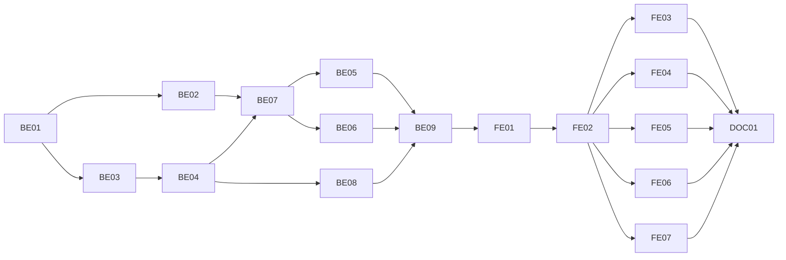

# F-14 Three-Level Approval and Notifications — Backend + Frontend Implementation Plan

This plan builds EP-14 (FR-57 decision half, FR-58 display, FR-59, FR-61 enforcement, FR-62, FR-63, FR-65, FR-67): the "waiting for me" queue of coordinators, program directors and the academic office (MH-42, US-061); the approval panel on the request detail page with Approve, Return and Reject at each of the three levels (US-062..US-065); refusing a decision on one's own request (US-066 AC5); comments that never block (US-067); in-app notifications with a 60-second poll that does not keep the session alive (US-068, MH-04); the approval history of every round (US-069); the academic office's override at levels 1 and 2 and the backlog filter of the request list (US-070); and applying an approved organisational request at once (US-060 AC2).

It deliberately excludes final approval of data requests — decision number, signed date, effective semester, creating the new version (MH-43, F-15); e-mail notifications (FR-64, B6 EP-25); reminders for overdue requests (FR-66, optional, B6); delegation of approval (B6, `ApprovalDelegation`); a configurable number of levels per request type (F14-03: every request goes through three levels); and the audit log (F01-07).

> **Companion documents**
> - Requirement: `docs/requirement/REQUIREMENTS.md` FR-57, FR-59, FR-61..FR-67 (`:517-527`), BR-27..BR-29, BR-31 (`:958-962`), EC-19..EC-29 (`:1225-1235`), NFR-08 (`:1027`)
> - Stories: `docs/planning/user-stories.md:750-842` (US-061..US-070), US-060 AC2 (`:740`); epic EP-14 (`docs/planning/epics.md:154`)
> - Design: `docs/design/data-dictionary.md:595` (`ApprovalStep`), `:627` (`Comment`), `:638` (`Notification`); `docs/design/state-diagrams.md:43-150` (DX-07..DX-14, BD-01..BD-05); `docs/design/screen-inventory.md:55` (MH-04), `:117-118` (MH-41, MH-42), `:260` (menu "Phê duyệt › Chờ tôi duyệt")
> - Answers: `docs/planning/feature-questions.md:220-232` (§F-14: F14-01 A, F14-10 A, the rest A by default)
> - Builds on: F-01 (`AuthenticatedGuard`, `session-lifecycle.ts`, `SessionData`, `SESSION_IDLE_MINUTES`, `AppLayout`), F-02 (`PERMISSIONS.CHANGE_REQUEST_OVERRIDE`, `CHANGE_REQUEST_COMMENT`, `AnyAuthenticated`, `AccessContext`, `ROLE_CODES`, `RoleAssignment`, `APP_MENU`), F-03 (`SubjectGroupMembersService`, `SUBJECT_GROUP_ERRORS`), F-06 (`ProgramDirectorsService`, `PROGRAM_ERRORS`), F-13 (`ApprovalStep`, `ChangeRequest`, `SubmissionService`, `ChangeRequestDetailReader`, `visibleWhere`, `StaleChecker`, `StepProgress`, `DiffView`, `ChangeRequestDetailPage`, `returnForTest`)
> - Tests: `docs/planning/test-plan.md:211-217` (KB-047..KB-053), `:328-332` (NT-B4-04, NT-B4-05 first half, NT-B4-07, NT-B4-08)

**Status**: Not started

---

## 0. Plan at a glance

Everything below in one table. Read this; the rest is detail for whoever builds it.

| What | Why | How and where |
|---|---|---|
| **"Chờ tôi duyệt": every approver sees exactly the requests waiting for them, with days waiting** | US-061; FR-65; MH-42 | `GET /approval-queue` reads the caller's PENDING rows of the current round at the request's current level, plus every level-3 request for the academic office; `ChangeRequest.levelEnteredAt` gives the days (BE-01, BE-08, FE-05) |
| **Approve, Return, Reject on the detail page, at each of the three levels** | US-062..US-065; FR-59; F14-01 | `ApprovalPanel` on MH-41 with a remark modal; `POST /change-requests/:id/approve|return|reject` (BE-04, FE-03) |
| **A level passes only when every approver of that level has approved; one Return sends the request back at once** | US-063 AC1–AC2, US-064 AC1–AC3; EC-22, EC-23 | Shared `ApprovalRecorder` claims the request, records the caller's rows, advances to the next level with a PENDING row (BE-04) |
| **Return and Reject need a reason of at least 20 characters; Return goes to Draft and the resubmit starts at level 1** | BR-28, BR-29; KB-047..KB-049 | DTO rule + status DRAFT with the round unchanged; F-13's submit already restarts at level 1 (BE-04) |
| **Nobody decides on their own request** | US-066 AC5; BR-27; KB-052 | `SELF_APPROVAL` refused before any row is read; the creator's own rows are already skipped by F-13's routing (BE-04) |
| **An approved organisational request changes the group or the director assignment at once** | US-060 AC2 | Level-3 approval applies its items through writers extracted from F-03 and F-06, in the same transaction; status EFFECTIVE (BE-03, BE-04) |
| **The academic office overrides a stuck level 1 or 2, with a reason, and the history says who should have acted** | US-070; BR-31; EC-25, EC-28; KB-053 | `POST /change-requests/:id/override`; rows marked `isOverride` with `performedById`; backlog filter "chờ quá N ngày" on the request list (BE-05, FE-03, FE-07) |
| **Comments by anyone who can see the request, never changing its status** | US-067; FR-62; F14-04 | `Comment` table, `GET|POST /change-requests/:id/comments` (BE-01, BE-06, FE-04) |
| **Full approval history, every round** | US-069; FR-67 | `GET /change-requests/:id/history` grouped by round, each row labelled normal / skipped / override (BE-06, FE-04) |
| **In-app notifications with a bell and a page; polling does not keep an idle session alive** | US-068; FR-63; F14-10; NFR-08 and F-01's constraint | `Notification` written in the same transaction as each event; bell polls every 60 s and on page change; `@PassiveRequest()` + `lastActivityAt` in the session (BE-02, BE-07, FE-06) |

**Key behaviours worth knowing**

| Behaviour | Why it is this way |
|---|---|
| Every decision first claims the request row with a conditional update on its id, status and round | Two coordinators approving at the same moment would each see the other's row still PENDING and both leave the request at level 1; the claim serialises them |
| An approver who stands for two groups (or two programs) decides both rows with one click | Routing creates one row per group / program (F-13 D7); asking the same person twice is noise |
| After a Return, the other approvers' PENDING rows of that round stay PENDING and are dead | S-4 "không còn hiệu lực"; every reader of PENDING rows matches the request's round **and** status, so they leave every queue at once |
| Level 3 has one row with no named approver; any active R1 who did not create the request acts on it | F-13 D8; F13-01 |
| At level 3 a data request can be returned or rejected here, but approving it is F-15's final-approval form | DX-10 needs decision number, signed date and effective semester (MH-43); this plan answers `FINAL_APPROVAL_REQUIRED` |
| An organisational request whose item no longer applies (member already ended, overlap) is refused as a whole and stays at level 3 | One transaction; the error names the item; R1 then returns or rejects it |
| Override decides **every** PENDING row of the current level and keeps `approverId` | US-070 AC1: the level counts as passed and the history names who should have approved |
| A notification is written in the same transaction as the event that causes it | A rolled-back approval never leaves a notification behind |
| The actor of an event is never notified of it | Their own click is not news |
| The unread-count poll is marked passive: it neither renews the idle timer nor counts as activity | F-01 §8 constraint; NFR-08 — a tab left open must still log out after 60 idle minutes |
| A session created before this deploy has no `lastActivityAt`; the guard treats it as active now | Avoids logging everyone out on deploy |
| Comments are allowed in every status, including closed requests | FR-62 "không làm đổi trạng thái ở bất kỳ trạng thái nào" |

**Not included**

| Excluded | Why |
|---|---|
| Final approval of data requests (MH-43), new version, effective semester | F-15 |
| E-mail notifications (FR-64) | SHOULD; B6 EP-25 |
| Reminders for overdue requests (FR-66) | Optional; B6. The backlog filter covers US-070 AC4 |
| Delegation of approval (EC-25 first half) | B6 `ApprovalDelegation` |
| Withdrawal notifying the pending approvers | No acceptance criterion asks for it; the request simply leaves their queue |
| Deleting old notifications | No retention rule in the requirements; volume is small (§8) |
| Real-time push (WebSocket / SSE) | F14-10 A: poll |
| Audit log rows for decisions | F01-07; `ApprovalStep` and the `Logger` are the record |

---

## 1. Scope

| In scope | Why |
|---|---|
| `Comment`, `Notification`; `ChangeRequest.levelEnteredAt` | DD §6; days waiting |
| Passive requests and the idle limit from `lastActivityAt` | F-01 §8 constraint; NFR-08 |
| Shared membership and director writers; F-03 and F-06 services delegate to them | US-060 AC2 apply with the owning feature's rules |
| Approve, Return, Reject; level advance; organisational apply at level 3 | US-062..US-065, US-060 AC2 |
| Override at levels 1–2; backlog filter on MH-38 | US-070 |
| Comments; history of every round | US-067, US-069 |
| Notifications: write, list, unread count, mark read | US-068; MH-04 |
| Queue MH-42 | US-061 |
| F-13's submit sets `levelEnteredAt` and notifies level-1 (or first pending) approvers | US-068 AC1; FR-63 |
| `returnForTest` replaced by the real Return | F-13 §8 constraint |

| Out of scope | Deferred until |
|---|---|
| Final approval and release of data requests | F-15 |
| E-mail, reminders | B6 |
| Delegation | B6 |
| Discarding the working copy of a rejected request | F-15 (§8 constraint) |

| AC | Covered by |
|---|---|
| US-061 AC1 — R4 sees level-1 requests of their group not yet handled | BE-08 (`ApprovalQueueReader`), FE-05 |
| US-061 AC2 — R3 sees level-2 requests of their programs | BE-08, FE-05 |
| US-061 AC3 — columns code, title, type, creator, submitted, days waiting; sort, filter by type | BE-08 (`ApprovalQueueItemDto`, `?requestType`), FE-05 |
| US-061 AC4 — handled request leaves the queue | BE-08 (PENDING rows of the current round only), BE-09 test |
| US-062 AC1–AC3 — detail with before/after, documents, progress | F-13 `DiffView`, `DocumentsCard`, `StepProgress`; FE-03 places the panel |
| US-062 AC4 — R5 who is not an approver sees no action buttons | BE-04 (`permissions.canApprove` etc.), FE-03 |
| US-063 AC1 — single coordinator approves → `PENDING_DIRECTOR` | BE-04 (`ApprovalRecorder.advance`), BE-09 |
| US-063 AC2 — two coordinators: stays at level 1, shows who approved | BE-04, F-13 `StepProgress`, BE-09 |
| US-063 AC3 — remark under 20 characters refused | BE-04 (`DecisionRemarkDto`), FE-03 (`RemarkModal` rule), BE-09 (KB-047) |
| US-063 AC4 — Return → DRAFT, creator notified with the reason | BE-04, BE-07, BE-09 (KB-048) |
| US-063 AC5 — Reject → REJECTED, cannot resubmit | BE-04; F-13 `findOwnDraft` (`REQUEST_NOT_DRAFT`) |
| US-063 AC6 — another group's request refused | BE-04 (`NOT_YOUR_STEP`), BE-09 |
| US-064 AC1 — one program → `PENDING_ACADEMIC_OFFICE` | BE-04, BE-09 |
| US-064 AC2 — three programs wait for all three directors | BE-04 (level complete only without PENDING rows), BE-09 (KB-042 approval half) |
| US-064 AC3 — one director returns → DRAFT at once | BE-04 (Return does not wait for the level), BE-09 |
| US-064 AC4 — not their program → refused | BE-04 (`NOT_YOUR_STEP`) |
| US-065 AC1 — level-3 Return → DRAFT, resubmit from level 1 | BE-04, F-13 submit, BE-09 (KB-049) |
| US-065 AC2 — level-3 Reject → REJECTED | BE-04 |
| US-065 AC3 — creator and lower-level approvers notified with the reason | BE-07 (`RequestNotifier.decided`), BE-09 |
| US-066 AC1–AC4 — skip of the creator's own row | F-13 BE-07 (routing); BE-09 re-checks KB-050, KB-051 end to end |
| US-066 AC5 — direct call on own request refused | BE-04 (`SELF_APPROVAL`), BE-05, BE-09 (KB-052) |
| US-067 AC1 — R2 comments, no action buttons | BE-06, BE-04 (`permissions`), FE-03, FE-04, BE-09 (NT-B4-07) |
| US-067 AC2 — author, time, chronological | BE-06 (`orderBy createdAt asc`), FE-04 |
| US-067 AC3 — no edit or delete | BE-06 (no routes), BE-01 (no `updatedAt`) |
| US-067 AC4 — comments never block | BE-06 (no status change, any status) |
| US-068 AC1 — arriving at a level notifies every approver of it, with a link | BE-07 (`RequestNotifier.arrived`), F-13 submit call site (BE-07), FE-06 |
| US-068 AC2 — returned / rejected / approved notifies the creator with result and reason | BE-07 |
| US-068 AC3 — new comment notifies creator and current approvers | BE-06 + BE-07 (`RequestNotifier.commented`) |
| US-068 AC4 — opening a notification marks it read; count drops | BE-07 (`POST /notifications/:id/read`), FE-06 |
| US-069 AC1 — level, actor, action, remark, time per step | BE-06 (`ApprovalHistoryDto`), FE-04 |
| US-069 AC2 — grouped by round, earlier rounds kept | BE-06, FE-04 |
| US-069 AC3 — distinct labels for skip / override | BE-06 (`kind`), FE-04 (delegation is B6) |
| US-069 AC4 — no edit or delete | No route; decided rows are never updated (BE-04 claims only PENDING rows) |
| US-070 AC1 — R1 overrides level 1 or 2; history names who should have approved | BE-05, FE-03, FE-04 |
| US-070 AC2 — reason required | BE-05 (`OverrideDecisionDto`), FE-03 |
| US-070 AC3 — refused on own request | BE-05 (`SELF_APPROVAL`) |
| US-070 AC4 — system-wide list filtered by days waiting | BE-08 (`minDaysWaiting` on `GET /change-requests`), FE-07 |
| US-060 AC2 — organisational change applied on approval | BE-03, BE-04 (`OrganizationalApplier`), BE-09 |

---

## 2. Contract verification

Every existing piece F-14 consumes is defined in an earlier plan (F-01..F-13 are unbuilt). Each row is re-read at build time (Rule 13) before the deliverable that uses it.

| Existing piece used | Defined at | Used by |
|---|---|---|
| `AuthenticatedGuard` (`IS_PUBLIC_KEY`, `session.userId`, `AUTHENTICATED_USER_SELECT`, `endSession` on an inactive user, `PASSWORD_CHANGE_REQUIRED`) in `src/shared/auth/authenticated.guard.ts` | F-01 BE (`f-01-…:1000-1051`) | BE-02 |
| `SessionData { userId }` in `src/shared/session/session-data.ts`; `startSession(request, userId)`, `endSession(session)` in `session-lifecycle.ts`; `rolling: true`, cookie `maxAge = SESSION_IDLE_MINUTES * MS_PER_MINUTE` | F-01 BE-05 (`f-01-…:684-692`, `:722-727`, `:751-775`) | BE-02 |
| F-01 constraint: polls must not count as activity; `lastActivityAt` updated only by non-poll requests | `f-01-…:2389` | BE-02 |
| `AppException(definition, details?)`, `ErrorDefinition`, `COMMON_ERRORS.SESSION_REQUIRED`, `PERMISSION_DENIED` | F-01 (`f-01-…:389-397`) | BE-02..BE-08 |
| `PERMISSIONS.CHANGE_REQUEST_VIEW`; `CHANGE_REQUEST_OVERRIDE` `'changeRequest.override'` (R1 X); `CHANGE_REQUEST_COMMENT` `'changeRequest.comment'` (R1..R5 X) | F-02 (`f-02-…:581-582`, `:1220-1224`) | BE-05, BE-06, FE-01 |
| `AnyAuthenticated()` (`ANY_AUTHENTICATED_KEY`); `PermissionGuard` refuses a route with neither marker | F-02 (`f-02-…:1014-1015`, `:1045-1070`) | BE-07 |
| `RoleAssignment { userId, roleId, revokedAt?, validFrom, validTo? }`, `ROLE_CODES.ACADEMIC_OFFICE`, `coversDay(today)` | F-02 (`f-02-…:491`); `src/shared/time/validity.ts` | BE-04 |
| `APP_MENU: AppMenuItem[] { path, label, permission? }`, `toMenuItems` in `src/shared/layout/menuItems.tsx`; `AppLayout` header with the user `Dropdown` | F-02 FE-04 (`f-02-…:2330-2358`), F-01 FE | FE-01, FE-06 |
| `SubjectGroupMembersService.add(groupId, dto, actorId)` / `end(groupId, memberId, dto, actorId)`; `SUBJECT_GROUP_ERRORS`, `MEMBER_SELECT`; `parsePeriod`, `overlapsPeriod`, `assertNoOverlap`, `assertCoveredByMembership`, `coordinatorRowsInside` | F-03 BE-03 (`f-03-…:745`, `:845`, `:1089-1200`) | BE-03 |
| `ProgramDirectorsService.assign(programId, dto, actorId)` / `end(programId, assignmentId, dto, actorId)`; `PROGRAM_ERRORS`, `DIRECTOR_SELECT` | F-06 BE-03 (`f-06-…:436`, `:468-525`, `:567`) | BE-03 |
| `ChangeRequest { id, requestCode, requestType, targetType, courseId?, programId?, subjectGroupId?, createdById, title, status, submissionRound }`; `ChangeItem { entityType, itemKey, label, newValue Json? }`; `ApprovalStep` (all columns incl. `performedById`, `isOverride`, `remark`, `recordedAt`) | F-13 BE-01 (`f-13-…:420-500`) | BE-01, BE-04..BE-08 |
| `APPROVAL_LEVEL`, `ApprovalLevel`, `PENDING_STATUS_BY_LEVEL`, `SKIP_REASONS` in `src/shared/change-requests/approval.constants.ts`; `PENDING_STATUSES`, `OPEN_REQUEST_STATUSES` | F-13 BE-01, BE-07 | BE-04, BE-08 |
| `AuthoredPayload` (`ADD_MEMBER`, `END_MEMBERSHIP`, `ASSIGN_DIRECTOR`, `END_DIRECTOR`); `ORGANIZATION` targets `SUBJECT_GROUP` or `PROGRAM` | F-13 BE-04 (`f-13-…:1427-1445`, `:902`) | BE-04 |
| `visibleWhere(access)` in `src/features/change-requests/request-visibility.ts`; `CHANGE_REQUEST_ERRORS.REQUEST_NOT_FOUND`; `REQUEST_DRAFT_ERRORS` | F-13 BE-03 (`f-13-…:973-985`, `:1050-1069`), BE-02 (`:683`) | BE-04..BE-06, BE-08 |
| `ChangeRequestDetailReader.read(id, access)` → `ChangeRequestDetailDto` with `steps` (current round) and `permissions: RequestActionsDto` | F-13 BE-03 (`f-13-…:1325`) | BE-04 |
| `SubmissionService.submit` (claim → checks → items → routing → `approvalStep.createMany` → `firstPendingStatus`); `SUBMISSION_ERRORS.STALE_BASE`; `RoutingPlanner.academicOfficeStep` | F-13 BE-07 (`f-13-…:1980-2122`) | BE-04, BE-07 |
| `StaleChecker.isStale(db, request)` in `ChangeRequestsSharedModule` | F-13 BE-07 (`f-13-…:1938-1965`) | BE-04 |
| `ChangeRequestQueryDto`, `ChangeRequestSummaryDto`, `GET /change-requests` | F-13 BE-03 (`f-13-…:197-213`, `:291`) | BE-08 |
| `returnForTest` and its call in `test/change-requests.e2e-spec.ts` ("Delete after `returnForTest`") | F-13 BE-08 (`f-13-…:2161-2164`, `:2185`) | BE-09 |
| FE: `CHANGE_REQUEST_QUERY_ROOT`, `CHANGE_REQUEST_QUERY_KEYS`, `useRequestMutation`, `useChangeRequest`, `useChangeRequests`; `StepProgress`, `ACTION_LABELS`; `ChangeRequestDetailPage`; `RequestStatusTag`; `REQUEST_TYPE_LABELS`; routes `changeRequests`, `changeRequestDetail` | F-13 FE-01, FE-02, FE-07 (`f-13-…:2207-2466`, `:2907-2930`) | FE-02..FE-07 |
| `getJson`, `sendJson`, `errorMessage`, `PageContainer`, `PageSpin`, `ApiErrorResult`, `RequirePermission`, `useCan`, `useMe` | F-01 FE, F-02 FE | FE-01..FE-07 |

### 2a. Endpoints

All under the global `/api` prefix, all requiring a session.

| Endpoint | Permission | Request | Response | Notes |
|---|---|---|---|---|
| `POST /change-requests/:id/approve` | `changeRequest.view` + actor rule (BE-04) | `ApproveDecisionDto` | `ChangeRequestDetailDto` | 403 `SELF_APPROVAL`, `NOT_YOUR_STEP`; 409 `REQUEST_STATE_CHANGED`, `FINAL_APPROVAL_REQUIRED` (data request at level 3), `ORGANIZATION_APPLY_FAILED`, `STALE_BASE` |
| `POST /change-requests/:id/return` | as approve | `DecisionRemarkDto` | `ChangeRequestDetailDto` | status DRAFT, round unchanged; 400 on a short remark |
| `POST /change-requests/:id/reject` | as approve | `DecisionRemarkDto` | `ChangeRequestDetailDto` | status REJECTED |
| `POST /change-requests/:id/override` | `changeRequest.override` | `OverrideDecisionDto` | `ChangeRequestDetailDto` | levels 1–2 only (409 `OVERRIDE_LEVEL`); 403 `SELF_APPROVAL` |
| `GET /change-requests/:id/history` | `changeRequest.view` + visible | — | `ApprovalHistoryDto` | every round, newest first |
| `GET /change-requests/:id/comments` | `changeRequest.view` + visible | — | `CommentDto[]` | oldest first |
| `POST /change-requests/:id/comments` | `changeRequest.comment` + visible | `CreateCommentDto` | 201 `CommentDto` | any status; notifies (BE-07) |
| `GET /change-requests` (F-13, extended) | `changeRequest.view` | `ChangeRequestQueryDto` + `minDaysWaiting?` | `ChangeRequestPageDto` | summary rows gain `levelEnteredAt`, `daysWaiting` |
| `GET /approval-queue` | `changeRequest.view` | `ApprovalQueueQueryDto` | `ApprovalQueueItemDto[]` | not paged; own path so it never meets `/change-requests/:id` |
| `GET /notifications` | any authenticated | `NotificationQueryDto` | `NotificationPageDto` | own rows only; newest first |
| `GET /notifications/unread-count` | any authenticated, **passive** | — | `UnreadCountDto` | does not renew the idle timer |
| `POST /notifications/:id/read` | any authenticated | — | `NotificationDto` | 404 `NOTIFICATION_NOT_FOUND` for another user's row; idempotent |
| `POST /notifications/read-all` | any authenticated | — | `UnreadCountDto` | returns `{ count: 0 }` |

### 2b. DTOs

`ApprovalAction` wire values (F-13 BE-01): `'PENDING' | 'APPROVE' | 'RETURN' | 'REJECT'`. `NotificationType` (BE-01): `'REQUEST_AWAITING_YOU' | 'REQUEST_RETURNED' | 'REQUEST_REJECTED' | 'REQUEST_APPROVED' | 'REQUEST_OVERRIDDEN' | 'REQUEST_COMMENTED'`. `NotificationReadStatus`: `'UNREAD' | 'READ'`. `ApprovalStepKind` (BE-06, derived): `'NORMAL' | 'SKIPPED' | 'OVERRIDE'`.

**`ApprovalStepDto`** (F-13, extended)

| Field | Wire type | Nullable | Source | Modeled as | Note |
|---|---|---|---|---|---|
| …all F-13 fields (`id`, `approvalLevel`, `levelName`, `approver`, `forSubjectGroup`, `forProgram`, `action`, `isSkipped`, `skipReason`, `remark`, `recordedAt`) | | | `f-13-…:247-261` | `StepLine` | unchanged |
| `performedBy` | `UserRefDto` | **yes** | BE-04 | "Người thực hiện" | set on every decided row; null on PENDING and skipped rows |
| `isOverride` | `boolean` | no | F-13 BE-01 | "Duyệt thay" tag | |
| `kind` | `ApprovalStepKind` | no | BE-06 | tag colour and label | `isSkipped` → SKIPPED, `isOverride` → OVERRIDE, else NORMAL |

**`RequestActionsDto`** (F-13, extended): F-13's `canEdit`, `canDelete`, `canSubmit`, `canWithdraw`, `canUpload` plus

| Field | Wire type | Nullable | Source | Modeled as | Note |
|---|---|---|---|---|---|
| `canApprove` | `boolean` | no | BE-04 | "Đồng ý" | caller has actionable rows; false for a data request at level 3 (F-15 adds `canFinalApprove`) |
| `canReturn` | `boolean` | no | BE-04 | "Trả lại" | caller has actionable rows |
| `canReject` | `boolean` | no | BE-04 | "Từ chối" | as `canReturn` |
| `canOverride` | `boolean` | no | BE-05 | "Duyệt thay" | holds `changeRequest.override`, request at level 1 or 2, caller not the creator |
| `canComment` | `boolean` | no | BE-06 | comment box | holds `changeRequest.comment` |

**`ApprovalHistoryDto`**: `rounds: ApprovalRoundDto[]`, newest first. **`ApprovalRoundDto`**: `submissionRound: number`, `submittedAt: string` (ISO, the round's earliest step `createdAt`), `steps: ApprovalStepDto[]` ordered by `approvalLevel`, then `recordedAt` (nulls last), then `createdAt`. Modeled as `ApprovalHistory` (FE-04).

**`CommentDto`**

| Field | Wire type | Nullable | Source | Modeled as | Note |
|---|---|---|---|---|---|
| `id` | `string` | no | BE-01 | key | |
| `author` | `UserRefDto` | no | BE-06 | name | `{ id, fullName }` |
| `content` | `string` | no | BE-01 | text | plain text, line breaks kept |
| `createdAt` | `string` (ISO) | no | BE-01 | time | |

**`ApprovalQueueItemDto`**

| Field | Wire type | Nullable | Source | Modeled as | Note |
|---|---|---|---|---|---|
| `requestId` | `string` | no | BE-08 | link | |
| `requestCode` | `string` | no | F-13 | "Mã" | |
| `title` | `string` | no | F-13 | "Tiêu đề" | |
| `requestType` | `ChangeRequestType` | no | F-13 | "Loại" | |
| `status` | `ChangeRequestStatus` | no | F-13 | status tag | always one of `PENDING_*` |
| `approvalLevel` | `1 \| 2 \| 3` | no | BE-08 | "Cấp" | |
| `standsFor` | `string` | **yes** | BE-08 | "Thay mặt" | group code(s) or program code(s) of the caller's rows, joined; null at level 3 |
| `createdBy` | `UserRefDto` | no | F-13 | "Người tạo" | |
| `submittedAt` | `string` (ISO) | no | BE-08 | "Ngày gửi" | the round's step `createdAt` |
| `daysWaiting` | `number` | no | BE-08 | "Số ngày chờ" | whole days since `levelEnteredAt` |

**`ChangeRequestSummaryDto`** (F-13, extended): ⊕ `levelEnteredAt: string | null` (ISO; null outside `PENDING_*`), ⊕ `daysWaiting: number | null`.

**`NotificationDto`**

| Field | Wire type | Nullable | Source | Modeled as | Note |
|---|---|---|---|---|---|
| `id` | `string` | no | BE-01 | key | |
| `notificationType` | `NotificationType` | no | BE-01 | icon | |
| `content` | `string` | no | BE-07 | text | Vietnamese, built when written |
| `changeRequestId` | `string` | **yes** | BE-01 | link target | FE builds `ROUTES.changeRequestDetail`; null only for future non-request types |
| `readStatus` | `NotificationReadStatus` | no | BE-01 | bold when UNREAD | |
| `createdAt` | `string` (ISO) | no | BE-01 | relative time | |
| `readAt` | `string` (ISO) | **yes** | BE-01 | — | **not modeled** in the UI |

**`NotificationPageDto`**: `items: NotificationDto[]`, `total`, `page`, `pageSize` (F-04 page shape). **`UnreadCountDto`**: `count: number`.

**Request DTOs**

| DTO | Fields |
|---|---|
| `ApproveDecisionDto` | `remark?` (trim, ≤ `REMARK_MAX`; blank → null) |
| `DecisionRemarkDto` | `remark` (trim, `MinLength(REMARK_MIN)`, ≤ `REMARK_MAX`) |
| `OverrideDecisionDto` | `action` (`@IsIn([APPROVE, RETURN, REJECT])`), `reason` (trim, `MinLength(REMARK_MIN)`, ≤ `REMARK_MAX`) |
| `CreateCommentDto` | `content` (trim, 1..`COMMENT_MAX`) |
| `ApprovalQueueQueryDto` | `requestType?` (`@IsEnum(ChangeRequestType)`) |
| `ChangeRequestQueryDto` (F-13, extended) | ⊕ `minDaysWaiting?` (`@Type(() => Number) @IsInt() @Min(1)`) |
| `NotificationQueryDto` | `PageQueryDto` + `unread?: boolean` (`@Transform` from `'true'`) |

### 2c. Mismatch log

| Deliverable | What the earlier doc said | What this plan does | Found at |
|---|---|---|---|
| BE-01 | DD `Comment.recordedAt` | `createdAt` like every other table | `data-dictionary.md:627`; F-13 did the same for documents |
| BE-01 | DD `Notification.link` (string, optional), `recordedAt`, `emailSent` | No `link`: the FE builds the link from `changeRequestId`, so a route rename never leaves dead links in old rows. `createdAt` + `readAt` instead of `recordedAt`. `emailSent` not added (FR-64 is B6) | `data-dictionary.md:638-649` |
| BE-01 | DD `Notification.notificationType` is a free string | Enum `NotificationType` with six values | every type is produced by this plan; an enum keeps the FE icon map total |
| BE-01 | DD `ChangeRequest` has no time-at-level column | ⊕ `levelEnteredAt DateTime?` | US-061 AC3, US-070 AC4 need days waiting; deriving it from step rows needs the previous level's last decision per request |
| BE-04 | State diagram: `APPROVED → EFFECTIVE` only "tới đầu học kỳ hiệu lực" (DX-11) | An `ORGANIZATION` request goes `PENDING_ACADEMIC_OFFICE → EFFECTIVE` directly on level-3 approval | US-060 AC2 "áp dụng ngay"; it has no version and no semester |
| BE-04 | US-060 AC2 "có dòng nhật ký" | No audit log (F01-07); the `ApprovalStep` row, the applied rows' `assignedById`, and a `Logger` line are the record | `feature-questions.md` F01-07 |
| BE-04 | State diagram BD-03: the actor may be the approver, a delegate "hoặc R1" on any row | Approve / Return / Reject act only on the caller's own rows (level 3: any R1); R1 acting on someone else's row goes through the explicit override (BE-05) | BR-31, US-070: override must carry a reason and be labelled; a plain click by R1 would be neither |
| BE-07 | F-13 `SubmissionService.submit` writes no notification and no `levelEnteredAt` | F-14 modifies `submit` to set `levelEnteredAt` and notify the first pending level | US-068 AC1 |
| BE-09 | F-13 BE-08 `returnForTest` sets status DRAFT directly | Deleted; its one call uses `POST /change-requests/:id/return` | `f-13-…:2161`, `:2185` |
| FE-01 | Screen inventory: menu "Phê duyệt › Chờ tôi duyệt" (nested), shown to R1, R3, R4 only | A flat entry "Chờ tôi duyệt" gated by `changeRequestView`: F-02's `AppMenuItem` has no children, and no permission marks "is an approver" (approval is decided per row) — R2 and R5 see an empty queue | `screen-inventory.md:260`; `f-02-…:2330-2343` |
| FE-01 | F-13 FE-01 adds its menu entry as `{ key, label, icon, permission }` | F-02's `AppMenuItem` is `{ path, label, permission? }`; F-14 uses that shape and F-13's line is corrected to it in the same change | `f-13-…:2253`; `f-02-…:2330-2335` |
| FE-06 | MH-04 lists notifications; the bell is not in the screen inventory | Bell with unread badge in the `AppLayout` header plus MH-04 | US-068 AC4 "số thông báo chưa đọc giảm một" needs a visible count |

---

## 3. Decisions

| # | Decision | Why | Rejected alternative |
|---|---|---|---|
| D1 | Approve / Return / Reject / override live in the change-requests feature (`ApprovalService`); claiming the request, recording rows and advancing the level live in a shared `ApprovalRecorder` (`src/shared/change-requests/`) | F-15's final approval records the level-3 row and moves the status under the same rules; features do not import each other | All in the feature — F-15 would duplicate the level rules |
| D2 | Every decision starts with a conditional `updateMany` on the request (`id`, `status`, `submissionRound`) | Serialises decisions on one request: the second approver's transaction waits on the row lock and then reads the first's committed row, so "last approver of the level" is always seen | `SERIALIZABLE` isolation with retries — more code for the same effect |
| D3 | A decision covers every PENDING row of the caller at the current level and round | A coordinator of two affected groups has two rows (F-13 D7); one click decides both | One row per click — the same person approves twice |
| D4 | Level complete = no PENDING row at that level in the round; the next status is the lowest higher level with a PENDING row; none → complete | Skipped rows are APPROVE at submit (F14-09); the rows already say which levels remain (F-13 D6) | Counting approvals against an expected number — the rows already are the expectation |
| D5 | Level 3 here: Return and Reject for every type; Approve only for `ORGANIZATION`. A data request answers `FINAL_APPROVAL_REQUIRED` and waits for F-15's MH-43 | DX-10 requires decision number, signed date, effective semester and creates versions | A plain level-3 Approve that leaves the request APPROVED without a decision — DX-10's conditions would be skipped |
| D6 | `ORGANIZATION` level-3 approval applies the items in item order, in the decision's transaction, through shared writers; any failure refuses the whole approval with the item label; success → EFFECTIVE | US-060 AC2 "áp dụng ngay"; the writers carry F-03 / F-06's overlap and coverage rules | Applying later in a job — "ngay" and a failure nobody sees |
| D7 | Return → DRAFT with the round unchanged; Reject → REJECTED. The other PENDING rows of that round are left as they are | BR-29 (F-13 submit increments the round); S-4: they are dead because every reader matches round **and** status | Marking them RETURN — would claim people decided who did not |
| D8 | Remark: required ≥ `REMARK_MIN` = 20 characters after trimming for Return, Reject and override; optional for Approve; ≤ `REMARK_MAX` = 2000 | BR-28; US-070 AC2 | Counting untrimmed — 20 spaces would pass |
| D9 | `performedById` is set on every decided row to whoever acted; `isOverride` marks R1 acting on someone else's row; `approverId` never changes | History needs "ai làm thay ai" (US-069 AC3) and level-3 rows have no `approverId` | Setting `performedById` only on overrides — level 3 would have no actor |
| D10 | Override is a separate route, R1 only (`changeRequest.override`), levels 1–2 only, decides every PENDING row of the level with one action and one reason | US-070 AC1–AC3; at level 3 R1 is the approver already | Letting R1 click Approve on any row — no reason, no label |
| D11 | Level-3 actor = holder of an active R1 role assignment (`academicOfficeHoldersWhere`), the same query F-13's routing uses, extracted to `src/shared/change-requests/academic-office.ts` | The routing decided "another R1 exists" with this query; the decision must agree with it | Using `access.has(CHANGE_REQUEST_OVERRIDE)` — a permission, not the office |
| D12 | `ChangeRequest.levelEnteredAt` set on submit and on every level change; cleared when the request leaves `PENDING_*` | Days waiting in the queue and the backlog filter become one column read | Deriving from step rows per request at read time |
| D13 | Queue at `GET /approval-queue`, not paged; candidate rows by SQL, round / level match in code | A queue holds tens of rows; Prisma cannot compare a step's round with its request's round in one `where` | `GET /change-requests/queue` — collides with F-13's `:id` route by registration order |
| D14 | Notifications are rows written in the event's transaction by a shared `NotificationService`; recipients deduplicated and the actor removed; content built in Vietnamese when written | A rolled-back event leaves nothing; the text is what the reader saw at the time | Writing after commit — a crash between the two loses the notification |
| D15 | The bell polls `GET /notifications/unread-count` every `NOTIFICATION_POLL_MS` = 60 000 and on every route change; the route is `@PassiveRequest()` | F14-10 A; F-01 §8 | WebSocket / SSE (F14-10 B) |
| D16 | The guard enforces the idle limit from `session.lastActivityAt`; non-passive requests update it; a missing value counts as now | The cookie's rolling `maxAge` is renewed by every response including polls, so it can no longer be the idle clock | Turning `rolling` off — every active user would be logged out 60 minutes after login |
| D17 | Comments: no update or delete route, any status, author needs `changeRequest.comment` and must see the request | US-067 AC3–AC4; FR-62 | Allowing edits within a grace period — not asked for |
| D18 | Writers for membership and director assignments move to `src/shared/subject-groups/membership.writer.ts` and `src/shared/programs/director.writer.ts`, taking a transaction client; F-03 and F-06 services delegate | The change-requests feature cannot import F-03 / F-06; one implementation keeps the overlap and coverage rules in one place | Re-implementing the rules in the applier — two copies drift |
| D19 | Recipient rules live in a shared `RequestNotifier` (`src/shared/change-requests/request-notifier.ts`) on top of a generic `NotificationService` (`src/shared/notifications/`) | F-13's submit (feature), F-14's decisions and F-15's final approval and activation all notify; one place answers "who hears about this" | Each caller computing its own recipients |

---

## 5. Deliverables

Backend paths are under `source/backend/`, frontend paths under `source/frontend/`.

### BE-01 — Schema: comments, notifications, time at level

What/Why: US-061 AC3, US-067, US-068, US-070 AC4; DD §6 `Comment`, `Notification`; D12, D14.

**Files**

| Action | Path |
|---|---|
| MODIFY | `prisma/schema.prisma` |
| NEW | `prisma/migrations/<timestamp>_approval_comments_notifications/migration.sql` (generated) |
| MODIFY | `src/shared/change-requests/approval.constants.ts` |
| NEW | `src/shared/notifications/notification.constants.ts` |

**Shape**

```prisma
enum NotificationType {
  REQUEST_AWAITING_YOU
  REQUEST_RETURNED
  REQUEST_REJECTED
  REQUEST_APPROVED
  REQUEST_OVERRIDDEN
  REQUEST_COMMENTED
}

enum NotificationReadStatus {
  UNREAD
  READ
}

model ChangeRequest {
  // …F-13 columns unchanged
  levelEnteredAt DateTime?
  comments       Comment[]
  notifications  Notification[]
}

model Comment {
  id              String        @id @default(cuid(2))
  changeRequestId String
  changeRequest   ChangeRequest @relation(fields: [changeRequestId], references: [id], onDelete: Cascade)
  authorId        String
  author          User          @relation("CommentAuthor", fields: [authorId], references: [id], onDelete: Restrict)
  content         String
  createdAt       DateTime      @default(now())

  @@index([changeRequestId, createdAt])
}

model Notification {
  id               String                 @id @default(cuid(2))
  recipientId      String
  recipient        User                   @relation("NotificationRecipient", fields: [recipientId], references: [id], onDelete: Cascade)
  notificationType NotificationType
  content          String
  changeRequestId  String?
  changeRequest    ChangeRequest?         @relation(fields: [changeRequestId], references: [id], onDelete: Cascade)
  readStatus       NotificationReadStatus @default(UNREAD)
  readAt           DateTime?
  createdAt        DateTime               @default(now())

  @@index([recipientId, readStatus, createdAt])
}

model User {
  // …
  comments      Comment[]      @relation("CommentAuthor")
  notifications Notification[] @relation("NotificationRecipient")
}
```

```ts
// src/shared/change-requests/approval.constants.ts — additions
export const REMARK_MIN = 20;
export const REMARK_MAX = 2000;
export const COMMENT_MAX = 2000;

// src/shared/notifications/notification.constants.ts
export const NOTIFICATION_PAGE_SIZE_MAX = 50;
```

**Rationale**: Table layout mirrors F-13's `ChangeRequestDocument` (`f-13-…:499`): cascade from the request, `createdAt` instead of the data dictionary's `recordedAt`. The index on `Notification` serves the unread count (`recipientId, readStatus`) and the newest-first page (`createdAt`) with one index.

**Gotchas**
- `Comment` has no `updatedAt` on purpose: nothing updates it (US-067 AC3).
- `Notification.changeRequest` cascades: F-13 can delete a never-submitted draft, and a draft that was never submitted has produced no notifications anyway; the cascade keeps the FK honest.
- `levelEnteredAt` stays null for every existing row; F-13 is unbuilt, so there is no data to backfill. If F-13 ships to a shared database before F-14, the migration sets `levelEnteredAt = updatedAt` for rows in `PENDING_*` (one `UPDATE` in the same migration).
- `content` holds the rendered sentence; a request renamed later does not rewrite old notifications.

**Verify**: `pnpm exec prisma migrate dev --name approval_comments_notifications`; `pnpm exec prisma generate`; the migration SQL creates two enums, two tables, one column and three indexes and nothing else. `pnpm exec tsc --noEmit -p tsconfig.json`.

**Depends on**: —

---

### BE-02 — Passive requests and the idle limit

What/Why: F14-10 A; NFR-08; F-01 §8 constraint (`f-01-…:2389`); D15, D16.

**Files**

| Action | Path |
|---|---|
| MODIFY | `src/shared/session/session-data.ts` |
| MODIFY | `src/shared/session/session-lifecycle.ts` |
| NEW | `src/shared/session/passive-request.decorator.ts` |
| MODIFY | `src/shared/auth/authenticated.guard.ts` |
| MODIFY | `src/shared/auth/authenticated.guard.spec.ts` |

**Shape**

```ts
// src/shared/session/session-data.ts
declare module 'express-session' {
  interface SessionData {
    userId: string;
    lastActivityAt: number;
  }
}
```

```ts
// src/shared/session/session-lifecycle.ts — startSession sets the clock with the user id
request.session.userId = userId;
request.session.lastActivityAt = Date.now();
```

```ts
// src/shared/session/passive-request.decorator.ts
import { SetMetadata } from '@nestjs/common';

export const IS_PASSIVE_REQUEST_KEY = 'isPassiveRequest';

// Background polls: authenticated, but neither renew nor count as user activity for the idle limit.
export const PassiveRequest = () => SetMetadata(IS_PASSIVE_REQUEST_KEY, true);
```

```ts
// src/shared/auth/authenticated.guard.ts
@Injectable()
export class AuthenticatedGuard implements CanActivate {
  private readonly idleMs: number;

  constructor(
    private readonly reflector: Reflector,
    private readonly prisma: PrismaService,
    config: ConfigService<EnvConfig, true>,
  ) {
    this.idleMs = config.get('SESSION_IDLE_MINUTES', { infer: true }) * MS_PER_MINUTE;
  }

  async canActivate(context: ExecutionContext): Promise<boolean> {
    if (this.isMarked(context, IS_PUBLIC_KEY)) return true;
    const request = context.switchToHttp().getRequest<Request>();
    const session = request.session;
    if (!session?.userId) throw new AppException(COMMON_ERRORS.SESSION_REQUIRED);

    // The cookie is rolling, so every response — polls included — renews it; this clock is the idle limit.
    const now = Date.now();
    if (now - (session.lastActivityAt ?? now) > this.idleMs) {
      await endSession(session);
      throw new AppException(COMMON_ERRORS.SESSION_REQUIRED);
    }

    // …F-01's user re-read, inactive → endSession, mustChangePassword check, request.user — unchanged

    if (!this.isMarked(context, IS_PASSIVE_REQUEST_KEY)) session.lastActivityAt = now;
    return true;
  }
}
```

**Rationale**: Keeps F-01's guard as the one place that decides "is this session alive" (`f-01-…:1000-1051`); the decorator mirrors F-01's `@Public()` (`IS_PUBLIC_KEY`) and F-02's `@AnyAuthenticated()`. The constant `MS_PER_MINUTE` and the env key are F-01's (`f-01-…:680`, `:727`).

**Gotchas**
- `?? now` treats a session written before this deploy as active now; it gains a clock on its next non-passive request.
- Setting `lastActivityAt` marks the session modified, so the store writes it; passive requests do not modify it. With `rolling: true` the store's expiry is still touched by every response, which is why the clock lives in the session and not in the store TTL.
- The check runs before the user re-read so an idle session costs no query.
- Logout and login are `@Public()`; neither passes through this check.
- A guard spec that builds the guard by hand needs the new `ConfigService` argument.

**Verify**: `authenticated.guard.spec.ts` — session with `lastActivityAt` 61 minutes ago → `SESSION_REQUIRED` and `endSession` called; 59 minutes ago → allowed and `lastActivityAt` set to now; a passive route 59 minutes ago → allowed and `lastActivityAt` unchanged; a passive route 61 minutes ago → `SESSION_REQUIRED`; no `lastActivityAt` → allowed. `pnpm exec tsc --noEmit -p tsconfig.json`.

**Depends on**: —

---

### BE-03 — Shared membership and director writers

What/Why: US-060 AC2 applies organisational items from the change-requests feature, which may not import F-03 or F-06 (nestjs-rules §1); D18. Replacing two shared service methods' bodies makes their call sites a deliverable (Rule 13).

**Files**

| Action | Path |
|---|---|
| NEW | `src/shared/subject-groups/membership.writer.ts` |
| NEW | `src/shared/subject-groups/membership.writer.spec.ts` |
| NEW | `src/shared/subject-groups/membership.errors.ts` |
| NEW | `src/shared/programs/director.writer.ts` |
| NEW | `src/shared/programs/director.writer.spec.ts` |
| NEW | `src/shared/programs/director.errors.ts` |
| MODIFY | `src/features/subject-groups/subject-groups.errors.ts` |
| MODIFY | `src/features/subject-groups/subject-group-members.service.ts` |
| MODIFY | `src/features/programs/programs.errors.ts` |
| MODIFY | `src/features/programs/program-directors.service.ts` |

**Shape**

```ts
// src/shared/subject-groups/membership.errors.ts — moved from SUBJECT_GROUP_ERRORS, codes unchanged
export const MEMBERSHIP_ERRORS = {
  SUBJECT_GROUP_NOT_FOUND: { /* as F-03 */ },
  SUBJECT_GROUP_INACTIVE: { /* as F-03 */ },
  LECTURER_INVALID: { /* as F-03 */ },
  MEMBERSHIP_OVERLAP: { /* as F-03 */ },
  COORDINATOR_NOT_MEMBER: { /* as F-03 */ },
  MEMBER_NOT_FOUND: { /* as F-03 */ },
  MEMBER_ALREADY_REVOKED: { /* as F-03 */ },
  END_DATE_NOT_EARLIER: { /* as F-03 */ },
} as const satisfies Record<string, ErrorDefinition>;

// src/features/subject-groups/subject-groups.errors.ts
export const SUBJECT_GROUP_ERRORS = {
  ...MEMBERSHIP_ERRORS,
  GROUP_CODE_TAKEN: { /* unchanged */ },
  FACULTY_INVALID: { /* unchanged */ },
  MEMBER_HAS_COORDINATOR: { /* unchanged */ },
} as const satisfies Record<string, ErrorDefinition>;
```

```ts
// src/shared/subject-groups/membership.writer.ts
type Db = PrismaService | Prisma.TransactionClient;

export interface MembershipInput {
  lecturerId: string;
  memberRole: SubjectGroupMemberRole;
  validFrom: string;
  validTo: string | null;
}

export const MEMBER_SELECT = { /* moved from F-03 subject-group-members.service.ts */ } satisfies Prisma.SubjectGroupMemberSelect;
export type MemberRow = Prisma.SubjectGroupMemberGetPayload<{ select: typeof MEMBER_SELECT }>;

export async function addMembership(db: Db, groupId: string, input: MembershipInput, actorId: string): Promise<MemberRow> {
  // F-03's add body, with this.prisma → db and the overlap / coverage checks as module functions taking db
}

// Returns the ended row first, then the coordinator rows it trimmed or revoked.
export async function endMembership(db: Db, groupId: string, memberId: string, validTo: string, actorId: string): Promise<MemberRow[]> {
  // F-03's end body; the $transaction([...]) array becomes sequential awaits on db
}
```

```ts
// src/shared/programs/director.writer.ts — same pattern
export interface DirectorInput { directorId: string; validFrom: string; validTo: string | null }
export const DIRECTOR_SELECT = { /* moved from F-06 */ } satisfies Prisma.ProgramDirectorAssignmentSelect;
export type DirectorRow = Prisma.ProgramDirectorAssignmentGetPayload<{ select: typeof DIRECTOR_SELECT }>;

export async function assignDirector(db: Db, programId: string, input: DirectorInput, actorId: string): Promise<DirectorRow> { /* F-06 assign body */ }
export async function endDirector(db: Db, programId: string, assignmentId: string, validTo: string, actorId: string): Promise<DirectorRow> { /* F-06 end body */ }
```

`DIRECTOR_ERRORS` (`src/shared/programs/director.errors.ts`) takes `PROGRAM_NOT_FOUND`, `PROGRAM_INACTIVE`, `DIRECTOR_INVALID`, `DIRECTOR_PERIOD_OVERLAP`, `DIRECTOR_ASSIGNMENT_NOT_FOUND`, `END_DATE_NOT_EARLIER`; `PROGRAM_ERRORS` spreads it.

```ts
// src/features/subject-groups/subject-group-members.service.ts — after
async add(groupId: string, dto: AddSubjectGroupMemberDto, actorId: string): Promise<SubjectGroupMemberDto> {
  const row = await addMembership(this.prisma, groupId, dto, actorId);
  this.logger.log(`${dto.memberRole} ${dto.lecturerId} in group ${groupId} (${dto.validFrom}..${dto.validTo ?? '∞'}) by ${actorId}`);
  return toSubjectGroupMemberDto(row, todayDate());
}

async end(groupId: string, memberId: string, dto: EndSubjectGroupMemberDto, actorId: string): Promise<SubjectGroupMemberDto[]> {
  const changed = await this.prisma.$transaction((tx) => endMembership(tx, groupId, memberId, dto.validTo, actorId));
  this.logger.log(`Member row ${memberId} ended ${dto.validTo} by ${actorId}; ${changed.length - 1} coordinator row(s) adjusted`);
  const today = todayDate();
  return changed.map((member) => toSubjectGroupMemberDto(member, today));
}
```

**Call sites of the moved logic**

| Call site | After this deliverable |
|---|---|
| `SubjectGroupMembersService.add` (F-03) | migrated — delegates to `addMembership(this.prisma, …)` |
| `SubjectGroupMembersService.end` (F-03) | migrated — delegates to `endMembership(tx, …)` in an interactive transaction |
| `SubjectGroupMembersService.revoke` (F-03) | left — revoking is not an organisational request operation; it keeps its private `findLiveOrThrow` and `coordinatorRowsInside`, which now call the writer module's exported `findLiveMember` and `coordinatorRowsInside` |
| `ProgramDirectorsService.assign` (F-06) | migrated — delegates to `assignDirector` |
| `ProgramDirectorsService.end` (F-06) | migrated — delegates to `endDirector` |
| `ProgramDirectorsService.revoke` (F-06) | left — not a request operation; uses the writer module's exported `findLiveAssignment` |
| `OrganizationalApplier` (BE-04) | new caller |

**Rationale**: Plain functions over a `Db` handle, like F-08's `lockRequisiteGraph(tx)` and F-13's `newestReleasedVersion(db, …)`: no module wiring, and the caller owns the transaction. The bodies are F-03 BE-03 (`f-03-…:1089-1200`) and F-06 BE-03 (`f-06-…:468-525`) moved, not rewritten.

**Gotchas**
- Error codes must not change: the FE maps them and F-03 / F-06 e2e tests assert them. Spreading the shared constants into the feature constants keeps `SUBJECT_GROUP_ERRORS.MEMBERSHIP_OVERLAP` valid at every existing call site.
- F-03's `end` used the array form of `$transaction`; the interactive form is required now because the writer reads before it writes. Behaviour is the same.
- Logging stays in the feature services: the writer does not know whether it runs for an admin screen or a request.
- `assertCoveredByMembership` for an `ADD_MEMBER` coordinator row inside a request must see a `MEMBER` row added earlier **in the same request**; it does, because the applier runs both on the same `tx` in item order.

**Verify**: `membership.writer.spec.ts` and `director.writer.spec.ts` carry F-03 / F-06's existing service cases moved over (overlap, coverage, end-not-earlier, inactive group, disabled user). The F-03 and F-06 service specs shrink to delegation + DTO mapping. `grep -rn "subjectGroupMember.create\|programDirectorAssignment.create" src/features` is empty. `pnpm test -- subject-group program-director membership director` passes. `pnpm exec tsc --noEmit -p tsconfig.json`.

**Depends on**: —

---

### BE-04 — Approve, Return, Reject and the level advance

What/Why: US-062 AC4, US-063, US-064, US-065, US-066 AC5, US-060 AC2; FR-59, FR-61; BR-27..BR-29; EC-22, EC-23; D1..D9, D11.

**Files**

| Action | Path |
|---|---|
| NEW | `src/shared/change-requests/approval.errors.ts` |
| NEW | `src/shared/change-requests/approval-rules.ts` |
| NEW | `src/shared/change-requests/approval-rules.spec.ts` |
| NEW | `src/shared/change-requests/academic-office.ts` |
| NEW | `src/shared/change-requests/approval-recorder.ts` |
| NEW | `src/shared/change-requests/approval-recorder.spec.ts` |
| MODIFY | `src/shared/change-requests/change-requests-shared.module.ts` |
| NEW | `src/features/change-requests/approval-feature.errors.ts` |
| NEW | `src/features/change-requests/decision.dto.ts` |
| NEW | `src/features/change-requests/organizational-applier.ts` |
| NEW | `src/features/change-requests/organizational-applier.spec.ts` |
| NEW | `src/features/change-requests/approval.service.ts` |
| NEW | `src/features/change-requests/approval.service.spec.ts` |
| NEW | `src/features/change-requests/approval.controller.ts` |
| MODIFY | `src/features/change-requests/routing-planner.ts` |
| MODIFY | `src/features/change-requests/change-request-detail.reader.ts` |
| MODIFY | `src/features/change-requests/change-request.dto.ts` |
| MODIFY | `src/features/change-requests/change-requests.module.ts` |

**Shape**

```ts
// src/shared/change-requests/approval.errors.ts
export const APPROVAL_ERRORS = {
  SELF_APPROVAL: { status: HttpStatus.FORBIDDEN, code: 'SELF_APPROVAL', message: 'Bạn không thể phê duyệt đề xuất do chính mình tạo.' },
  NOT_YOUR_STEP: { status: HttpStatus.FORBIDDEN, code: 'NOT_YOUR_STEP', message: 'Đề xuất không chờ bạn duyệt ở cấp hiện tại.' },
  REQUEST_STATE_CHANGED: { status: HttpStatus.CONFLICT, code: 'REQUEST_STATE_CHANGED', message: 'Đề xuất vừa được người khác xử lý; hãy tải lại trang.' },
  STEP_ALREADY_DECIDED: { status: HttpStatus.CONFLICT, code: 'STEP_ALREADY_DECIDED', message: 'Bước duyệt này đã có quyết định.' },
} as const satisfies Record<string, ErrorDefinition>;
```

```ts
// src/features/change-requests/approval-feature.errors.ts
export const APPROVAL_FEATURE_ERRORS = {
  FINAL_APPROVAL_REQUIRED: { status: HttpStatus.CONFLICT, code: 'FINAL_APPROVAL_REQUIRED', message: 'Phê duyệt cuối cấp Phòng Đào tạo cần số quyết định và học kỳ hiệu lực; dùng màn hình ban hành.' },
  ORGANIZATION_APPLY_FAILED: { status: HttpStatus.CONFLICT, code: 'ORGANIZATION_APPLY_FAILED', message: 'Không áp dụng được thay đổi tổ chức; đề xuất vẫn chờ duyệt.' },
  OVERRIDE_LEVEL: { status: HttpStatus.CONFLICT, code: 'OVERRIDE_LEVEL', message: 'Chỉ duyệt thay được khi đề xuất đang chờ cấp Điều phối hoặc Giám đốc CTĐT.' },
} as const satisfies Record<string, ErrorDefinition>;
```

```ts
// src/shared/change-requests/approval-rules.ts
export function levelOfStatus(status: ChangeRequestStatus): ApprovalLevel | null {
  const entry = Object.entries(PENDING_STATUS_BY_LEVEL).find(([, pending]) => pending === status);
  return entry ? (Number(entry[0]) as ApprovalLevel) : null;
}

// A row is live only in the request's current round and at the request's current level (S-4: a Return leaves the others dead).
export function isActionable(
  step: Pick<ApprovalStep, 'action' | 'submissionRound' | 'approvalLevel'>,
  request: Pick<ChangeRequest, 'status' | 'submissionRound'>,
): boolean {
  return step.action === ApprovalAction.PENDING
    && step.submissionRound === request.submissionRound
    && levelOfStatus(request.status) === step.approvalLevel;
}

export function stepKind(step: Pick<ApprovalStep, 'isSkipped' | 'isOverride'>): ApprovalStepKind {
  if (step.isSkipped) return APPROVAL_STEP_KIND.SKIPPED;
  return step.isOverride ? APPROVAL_STEP_KIND.OVERRIDE : APPROVAL_STEP_KIND.NORMAL;
}
```

```ts
// src/shared/change-requests/academic-office.ts
// Who may act at level 3 — the same rule F-13's routing used to decide that someone other than the creator exists.
export function academicOfficeHoldersWhere(today: Date) {
  return {
    status: UserStatus.ACTIVE,
    roleAssignments: { some: { revokedAt: null, ...coversDay(today), role: { roleCode: ROLE_CODES.ACADEMIC_OFFICE } } },
  } satisfies Prisma.UserWhereInput;
}

export async function isAcademicOfficeHolder(db: Db, userId: string, today: Date): Promise<boolean> {
  return (await db.user.count({ where: { id: userId, ...academicOfficeHoldersWhere(today) } })) > 0;
}
```

```ts
// src/shared/change-requests/approval-recorder.ts
export type DecisionSubject = Pick<ChangeRequest, 'id' | 'status' | 'submissionRound' | 'createdById' | 'requestType'>;

export interface Decision {
  action: typeof ApprovalAction.APPROVE | typeof ApprovalAction.RETURN | typeof ApprovalAction.REJECT;
  remark: string | null;
  performedById: string;
  isOverride: boolean;
}

export type AdvanceResult =
  | { kind: 'WAITING' }
  | { kind: 'NEXT_LEVEL'; level: ApprovalLevel }
  | { kind: 'COMPLETE' };

@Injectable()
export class ApprovalRecorder {
  // Serialises decisions on one request: a second decider waits on this row and then sees the first one's rows.
  async claim(tx: Prisma.TransactionClient, request: DecisionSubject): Promise<void> {
    const { count } = await tx.changeRequest.updateMany({
      where: { id: request.id, status: request.status, submissionRound: request.submissionRound },
      data: { updatedAt: new Date() },
    });
    if (count === 0) throw new AppException(APPROVAL_ERRORS.REQUEST_STATE_CHANGED);
  }

  async actionableRows(db: Db, request: DecisionSubject, userId: string, today: Date): Promise<ApprovalStep[]> {
    const level = levelOfStatus(request.status);
    if (level === null || userId === request.createdById) return [];
    if (level === APPROVAL_LEVEL.ACADEMIC_OFFICE && !(await isAcademicOfficeHolder(db, userId, today))) return [];
    return db.approvalStep.findMany({
      where: {
        changeRequestId: request.id, submissionRound: request.submissionRound, approvalLevel: level,
        action: ApprovalAction.PENDING,
        ...(level !== APPROVAL_LEVEL.ACADEMIC_OFFICE && { approverId: userId }),
      },
    });
  }

  async record(tx: Prisma.TransactionClient, rowIds: readonly string[], decision: Decision): Promise<void> {
    const { count } = await tx.approvalStep.updateMany({
      where: { id: { in: [...rowIds] }, action: ApprovalAction.PENDING },
      data: { ...decision, recordedAt: new Date() },
    });
    if (count !== rowIds.length) throw new AppException(APPROVAL_ERRORS.STEP_ALREADY_DECIDED);
  }

  // After an APPROVE: stay while the level still has PENDING rows, else move to the lowest higher level that has one.
  async advance(tx: Prisma.TransactionClient, request: DecisionSubject): Promise<AdvanceResult> {
    const level = levelOfStatus(request.status)!;
    const pending = await tx.approvalStep.findMany({
      where: { changeRequestId: request.id, submissionRound: request.submissionRound, action: ApprovalAction.PENDING, approvalLevel: { gte: level } },
      select: { approvalLevel: true },
      orderBy: { approvalLevel: 'asc' },
    });
    if (pending.some((row) => row.approvalLevel === level)) return { kind: 'WAITING' };
    if (pending.length === 0) return { kind: 'COMPLETE' };
    const next = pending[0].approvalLevel as ApprovalLevel;
    await tx.changeRequest.update({ where: { id: request.id }, data: { status: PENDING_STATUS_BY_LEVEL[next], levelEnteredAt: new Date() } });
    return { kind: 'NEXT_LEVEL', level: next };
  }

  async close(tx: Prisma.TransactionClient, requestId: string, status: ChangeRequestStatus): Promise<void> {
    await tx.changeRequest.update({ where: { id: requestId }, data: { status, levelEnteredAt: null } });
  }
}
```

`ChangeRequestsSharedModule` provides and exports `ApprovalRecorder` beside `StaleChecker`.

```ts
// src/features/change-requests/decision.dto.ts
const trim = ({ value }: TransformFnParams) => (typeof value === 'string' ? value.trim() : value);

export class ApproveDecisionDto {
  @ApiPropertyOptional({ maxLength: REMARK_MAX }) @IsOptional() @Transform(trim) @IsString() @MaxLength(REMARK_MAX) remark?: string;
}

export class DecisionRemarkDto {
  @ApiProperty({ minLength: REMARK_MIN, maxLength: REMARK_MAX })
  @Transform(trim) @IsString() @MinLength(REMARK_MIN) @MaxLength(REMARK_MAX) remark: string;
}
```

```ts
// src/features/change-requests/organizational-applier.ts
@Injectable()
export class OrganizationalApplier {
  // Items run in authored order on one transaction, so a member added by item 1 covers a coordinator row in item 2.
  async apply(tx: Prisma.TransactionClient, request: Pick<ChangeRequest, 'id' | 'subjectGroupId' | 'programId'>, actorId: string): Promise<void> {
    const items = await tx.changeItem.findMany({ where: { changeRequestId: request.id }, orderBy: { sortOrder: 'asc' } });
    for (const item of items) {
      try {
        await this.applyOne(tx, request, item.newValue as AuthoredPayload, actorId);
      } catch (error) {
        if (!(error instanceof AppException)) throw error;
        throw new AppException(APPROVAL_FEATURE_ERRORS.ORGANIZATION_APPLY_FAILED, [{ field: item.label, constraints: [error.code] }]);
      }
    }
  }

  private applyOne(tx: Prisma.TransactionClient, request: Pick<ChangeRequest, 'subjectGroupId' | 'programId'>, payload: AuthoredPayload, actorId: string) {
    switch (payload.operation) {
      case AUTHORED_OPERATION.ADD_MEMBER:
        return addMembership(tx, request.subjectGroupId!, payload, actorId);
      case AUTHORED_OPERATION.END_MEMBERSHIP:
        return endMembership(tx, request.subjectGroupId!, payload.memberRowId, payload.validTo, actorId);
      case AUTHORED_OPERATION.ASSIGN_DIRECTOR:
        return assignDirector(tx, request.programId!, payload, actorId);
      case AUTHORED_OPERATION.END_DIRECTOR:
        return endDirector(tx, request.programId!, payload.assignmentId, payload.validTo, actorId);
      default:
        throw new Error(`Operation ${payload.operation} is not organisational`);
    }
  }
}
```

```ts
// src/features/change-requests/approval.service.ts
@Injectable()
export class ApprovalService {
  private readonly logger = new Logger(ApprovalService.name);

  constructor(
    private readonly prisma: PrismaService,
    private readonly recorder: ApprovalRecorder,
    private readonly stale: StaleChecker,
    private readonly applier: OrganizationalApplier,
    private readonly notifier: RequestNotifier,
    private readonly details: ChangeRequestDetailReader,
  ) {}

  async approve(id: string, dto: ApproveDecisionDto, access: AccessContext): Promise<ChangeRequestDetailDto> {
    const request = await this.decidable(id, access);
    const finalLevel = levelOfStatus(request.status) === APPROVAL_LEVEL.ACADEMIC_OFFICE;
    if (finalLevel && request.requestType !== ChangeRequestType.ORGANIZATION) {
      throw new AppException(APPROVAL_FEATURE_ERRORS.FINAL_APPROVAL_REQUIRED);
    }
    await this.prisma.$transaction(async (tx) => {
      const rows = await this.ownRows(tx, request, access);
      if (finalLevel) {
        if (await this.stale.isStale(tx, request)) throw new AppException(SUBMISSION_ERRORS.STALE_BASE);
        await this.applier.apply(tx, request, access.userId);
      }
      await this.recorder.record(tx, rows.map((row) => row.id), decision(ApprovalAction.APPROVE, dto.remark ?? null, access));
      const result = await this.recorder.advance(tx, request);
      if (result.kind === 'NEXT_LEVEL') await this.notifier.arrived(tx, request, result.level, access.userId);
      if (result.kind === 'COMPLETE') {
        await this.recorder.close(tx, request.id, ChangeRequestStatus.EFFECTIVE);
        await this.notifier.approved(tx, request, access.userId);
      }
    });
    this.logger.log(`Change request ${id} approved at ${request.status} by ${access.userId}`);
    return this.details.read(id, access);
  }

  async returnToDraft(id: string, dto: DecisionRemarkDto, access: AccessContext): Promise<ChangeRequestDetailDto> {
    return this.close(id, dto.remark, ApprovalAction.RETURN, ChangeRequestStatus.DRAFT, access);
  }

  async reject(id: string, dto: DecisionRemarkDto, access: AccessContext): Promise<ChangeRequestDetailDto> {
    return this.close(id, dto.remark, ApprovalAction.REJECT, ChangeRequestStatus.REJECTED, access);
  }

  // Return and Reject end the round at once, whoever else at the level has not decided yet (US-064 AC3).
  private async close(id: string, remark: string, action: ClosingAction, status: ChangeRequestStatus, access: AccessContext) {
    const request = await this.decidable(id, access);
    await this.prisma.$transaction(async (tx) => {
      const rows = await this.ownRows(tx, request, access);
      await this.recorder.record(tx, rows.map((row) => row.id), decision(action, remark, access));
      await this.recorder.close(tx, request.id, status);
      await this.notifier.decided(tx, request, action, remark, access.userId);
    });
    this.logger.log(`Change request ${id} ${action} at ${request.status} by ${access.userId}`);
    return this.details.read(id, access);
  }

  private async decidable(id: string, access: AccessContext): Promise<DecisionRequest> {
    const request = await findVisibleRequest(this.prisma, id, access);
    if (request.createdById === access.userId) throw new AppException(APPROVAL_ERRORS.SELF_APPROVAL);
    return request;
  }

  private async ownRows(tx: Prisma.TransactionClient, request: DecisionRequest, access: AccessContext): Promise<ApprovalStep[]> {
    await this.recorder.claim(tx, request);
    const rows = await this.recorder.actionableRows(tx, request, access.userId, todayDate());
    if (rows.length === 0) throw new AppException(APPROVAL_ERRORS.NOT_YOUR_STEP);
    return rows;
  }
}

function decision(action: Decision['action'], remark: string | null, access: AccessContext): Decision {
  return { action, remark, performedById: access.userId, isOverride: false };
}
```

```ts
// src/features/change-requests/approval.controller.ts
@ApiTags('change-requests')
@Controller('change-requests')
@RequirePermission(PERMISSIONS.CHANGE_REQUEST_VIEW)
export class ApprovalController {
  constructor(private readonly approvals: ApprovalService) {}

  @Post(':id/approve') @HttpCode(HttpStatus.OK)
  approve(@Param('id') id: string, @Body() dto: ApproveDecisionDto, @CurrentAccess() access: AccessContext) {
    return this.approvals.approve(id, dto, access);
  }

  @Post(':id/return') @HttpCode(HttpStatus.OK)
  returnToDraft(@Param('id') id: string, @Body() dto: DecisionRemarkDto, @CurrentAccess() access: AccessContext) {
    return this.approvals.returnToDraft(id, dto, access);
  }

  @Post(':id/reject') @HttpCode(HttpStatus.OK)
  reject(@Param('id') id: string, @Body() dto: DecisionRemarkDto, @CurrentAccess() access: AccessContext) {
    return this.approvals.reject(id, dto, access);
  }
}
```

`routing-planner.ts`: `academicOfficeStep` replaces its inline `RoleAssignment` query with `db.user.findMany({ where: academicOfficeHoldersWhere(today), select: { id: true } })`.

| Call site of the inline active-R1 query | After this deliverable |
|---|---|
| `RoutingPlanner.academicOfficeStep` (F-13 BE-07) | migrated to `academicOfficeHoldersWhere` |
| `ApprovalRecorder.actionableRows` (this deliverable) | new caller via `isAcademicOfficeHolder` |
| `RequestNotifier.arrived` / `commented` at level 3 (BE-07) | new caller |

`ChangeRequestDetailReader`: `RequestActionsDto` gains `canApprove`, `canReturn`, `canReject` (computed with `recorder.actionableRows(prisma, request, access.userId, today)`; `canApprove` also false for a data request at level 3), `canOverride` (BE-05) and `canComment` (BE-06). `ApprovalStepDto` gains `performedBy`, `isOverride`, `kind` (select `performedBy: { select: { id, fullName } }`).

**Rationale**: The transaction shape mirrors F-13's `SubmissionService.submit` (`f-13-…:2053-2089`): conditional `updateMany` claim first, every check under it, a throw rolls everything back. The recorder is shared for the same reason `StaleChecker` is (`f-13-…:1965`): F-15's final approval records the level-3 row with it. The controller is a second class on the same `change-requests` path, like F-13's `ChangeRequestDocumentsController`; its routes all have a `:id/` prefix plus a literal, so registration order against F-13's `:id` does not matter.

**Gotchas**
- `actionableRows` is read **after** the claim. Read before it, the second of two concurrent coordinators would still see the first one's row PENDING and never advance.
- Under PostgreSQL READ COMMITTED, the blocked `updateMany` re-checks its `where` against the committed row: if the first decision moved the status, the second gets `REQUEST_STATE_CHANGED`; if it did not (level still waiting), the second proceeds and sees the first's row decided.
- `SELF_APPROVAL` comes before `NOT_YOUR_STEP`: a creator calling the route gets the specific refusal (KB-052) even though their own rows were skipped and so are not actionable.
- `FINAL_APPROVAL_REQUIRED` is checked before the transaction; Return and Reject at level 3 work for every type.
- The applier throws inside the transaction; the claim, the rows and any item applied before the failing one roll back together.
- `StaleChecker` for an `ORGANIZATION` request compares each `END_*` item's `oldValue.validTo` with the live row (F-13 BE-07); a row ended by an admin since submit is stale and refused with `STALE_BASE`.
- Level 1/2 approval never returns `COMPLETE`: the level-3 row is never skipped (F-13 BE-07 gotcha).
- `findVisibleRequest` is F-13's helper (404 when not visible); an R5 of another group gets 404, not 403.
- `ClosingAction` = `RETURN | REJECT`; keep it a type alias in `approval.service.ts`.

**Verify**: `approval-rules.spec.ts` — `isActionable` false for an older round, for a level below the status, for a decided row. `approval-recorder.spec.ts` (mocked Prisma) — claim count 0 → `REQUEST_STATE_CHANGED`; record count mismatch → `STEP_ALREADY_DECIDED`; advance with a PENDING row left at level 1 → WAITING; none at 1, one at 3 → NEXT_LEVEL 3 and status `PENDING_ACADEMIC_OFFICE`; none left → COMPLETE; level-3 actionable rows for a non-R1 → empty; creator → empty. `approval.service.spec.ts` — creator → `SELF_APPROVAL`; R5 not an approver → `NOT_YOUR_STEP`; remark passed through; data request at level 3 approve → `FINAL_APPROVAL_REQUIRED`; Return writes RETURN on the caller's rows and status DRAFT with `submissionRound` unchanged; Reject → REJECTED; organisational approve calls the applier before record and closes EFFECTIVE. `organizational-applier.spec.ts` — overlap error from the writer becomes `ORGANIZATION_APPLY_FAILED` with the item label; a non-organisational payload throws. `pnpm exec tsc --noEmit -p tsconfig.json`.

**Depends on**: BE-01, BE-03, BE-07 (`RequestNotifier`)

---

### BE-05 — Academic-office override

What/Why: US-070 AC1–AC3; BR-31; EC-25, EC-28; KB-053; D9, D10.

**Files**

| Action | Path |
|---|---|
| MODIFY | `src/features/change-requests/decision.dto.ts` |
| MODIFY | `src/features/change-requests/approval.service.ts` |
| MODIFY | `src/features/change-requests/approval.service.spec.ts` |
| MODIFY | `src/features/change-requests/approval.controller.ts` |
| MODIFY | `src/features/change-requests/change-request-detail.reader.ts` |

**Shape**

```ts
// src/features/change-requests/decision.dto.ts
export const OVERRIDE_ACTIONS = [ApprovalAction.APPROVE, ApprovalAction.RETURN, ApprovalAction.REJECT] as const;

export class OverrideDecisionDto {
  @ApiProperty({ enum: OVERRIDE_ACTIONS }) @IsIn(OVERRIDE_ACTIONS) action: (typeof OVERRIDE_ACTIONS)[number];
  @ApiProperty({ minLength: REMARK_MIN, maxLength: REMARK_MAX })
  @Transform(trim) @IsString() @MinLength(REMARK_MIN) @MaxLength(REMARK_MAX) reason: string;
}
```

```ts
// src/features/change-requests/approval.service.ts
async override(id: string, dto: OverrideDecisionDto, access: AccessContext): Promise<ChangeRequestDetailDto> {
  const request = await this.decidable(id, access);
  const level = levelOfStatus(request.status);
  if (level !== APPROVAL_LEVEL.COORDINATOR && level !== APPROVAL_LEVEL.DIRECTOR) throw new AppException(APPROVAL_FEATURE_ERRORS.OVERRIDE_LEVEL);
  await this.prisma.$transaction(async (tx) => {
    await this.recorder.claim(tx, request);
    const bypassed = await tx.approvalStep.findMany({
      where: { changeRequestId: id, submissionRound: request.submissionRound, approvalLevel: level, action: ApprovalAction.PENDING },
    });
    await this.recorder.record(tx, bypassed.map((row) => row.id), { action: dto.action, remark: dto.reason, performedById: access.userId, isOverride: true });
    const bypassedIds = bypassed.flatMap((row) => (row.approverId ? [row.approverId] : []));
    await this.notifier.overridden(tx, request, bypassedIds, dto.action, dto.reason, access.userId);
    if (dto.action === ApprovalAction.APPROVE) {
      const result = await this.recorder.advance(tx, request);
      if (result.kind === 'NEXT_LEVEL') await this.notifier.arrived(tx, request, result.level, access.userId);
    } else {
      await this.recorder.close(tx, id, dto.action === ApprovalAction.RETURN ? ChangeRequestStatus.DRAFT : ChangeRequestStatus.REJECTED);
      await this.notifier.decided(tx, request, dto.action, dto.reason, access.userId, bypassedIds);
    }
  });
  this.logger.log(`Change request ${id} overridden (${dto.action}) at level ${level} by ${access.userId}`);
  return this.details.read(id, access);
}
```

Controller: `@Post(':id/override') @HttpCode(HttpStatus.OK) @RequirePermission(PERMISSIONS.CHANGE_REQUEST_OVERRIDE)`; the method-level decorator replaces the class-level `CHANGE_REQUEST_VIEW` for this route (F-02 `PermissionGuard` reads `getAllAndOverride`). Detail reader: `canOverride = access.has(CHANGE_REQUEST_OVERRIDE) && level ∈ {1, 2} && request.createdById !== access.userId`.

**Rationale**: Same claim → record → advance path as BE-04 so override and normal decisions cannot disagree about when a level completes. `approverId` is never touched (D9): the history shows "should have been X, done by Y" from the same row.

**Gotchas**
- Override at level 1 decides **every** PENDING row of level 1, not one row (US-070 AC1 "cấp đó được tính là đã qua").
- The bypassed approvers get `REQUEST_OVERRIDDEN`; `decided` takes them as `except` so they are not also sent `REQUEST_RETURNED` for the same click.
- R1 who is also the level-1 coordinator of the group and not the creator can use either route; the plain Approve records `isOverride: false` because it was their own row.
- Override at level 3 is refused (`OVERRIDE_LEVEL`): there R1 is the approver and uses BE-04.
- R1's own request → `SELF_APPROVAL` via `decidable` (US-070 AC3).

**Verify**: `approval.service.spec.ts` — override at `PENDING_COORDINATOR` with two PENDING rows → both `isOverride: true`, `performedById` = R1, `approverId` unchanged, status `PENDING_DIRECTOR`, `levelEnteredAt` reset; override RETURN → DRAFT; at `PENDING_ACADEMIC_OFFICE` → `OVERRIDE_LEVEL`; on own request → `SELF_APPROVAL`; reason of 19 characters rejected by the DTO (class-validator `validate`). `pnpm exec tsc --noEmit -p tsconfig.json`.

**Depends on**: BE-04, BE-07

---

### BE-06 — Comments and approval history

What/Why: US-067, US-069; FR-62, FR-67; D17.

**Files**

| Action | Path |
|---|---|
| NEW | `src/features/change-requests/comments.service.ts` |
| NEW | `src/features/change-requests/comments.service.spec.ts` |
| NEW | `src/features/change-requests/comment.dto.ts` |
| NEW | `src/features/change-requests/approval-history.reader.ts` |
| NEW | `src/features/change-requests/approval-history.reader.spec.ts` |
| NEW | `src/features/change-requests/approval-history.dto.ts` |
| MODIFY | `src/features/change-requests/approval.controller.ts` |
| MODIFY | `src/features/change-requests/change-request.dto.ts` |

**Shape**

```ts
// src/features/change-requests/comment.dto.ts
export class CreateCommentDto {
  @ApiProperty({ maxLength: COMMENT_MAX }) @Transform(trim) @IsString() @IsNotEmpty() @MaxLength(COMMENT_MAX) content: string;
}

export class CommentDto {
  @ApiProperty() id: string;
  @ApiProperty({ type: UserRefDto }) author: UserRefDto;
  @ApiProperty() content: string;
  @ApiProperty() createdAt: string;
}
```

```ts
// src/features/change-requests/comments.service.ts
@Injectable()
export class CommentsService {
  constructor(private readonly prisma: PrismaService, private readonly notifier: RequestNotifier) {}

  async list(id: string, access: AccessContext): Promise<CommentDto[]> {
    await findVisibleRequest(this.prisma, id, access);
    const rows = await this.prisma.comment.findMany({
      where: { changeRequestId: id }, select: COMMENT_SELECT, orderBy: [{ createdAt: 'asc' }, { id: 'asc' }],
    });
    return rows.map(toCommentDto);
  }

  // Any status: a comment never moves the request (FR-62).
  async create(id: string, dto: CreateCommentDto, access: AccessContext): Promise<CommentDto> {
    const request = await findVisibleRequest(this.prisma, id, access);
    const row = await this.prisma.$transaction(async (tx) => {
      const created = await tx.comment.create({ data: { changeRequestId: id, authorId: access.userId, content: dto.content }, select: COMMENT_SELECT });
      await this.notifier.commented(tx, request, access.userId);
      return created;
    });
    return toCommentDto(row);
  }
}
```

```ts
// src/features/change-requests/approval-history.dto.ts
export class ApprovalRoundDto {
  @ApiProperty() submissionRound: number;
  @ApiProperty() submittedAt: string;
  @ApiProperty({ type: [ApprovalStepDto] }) steps: ApprovalStepDto[];
}

export class ApprovalHistoryDto {
  @ApiProperty({ type: [ApprovalRoundDto] }) rounds: ApprovalRoundDto[];
}
```

```ts
// src/features/change-requests/approval-history.reader.ts
@Injectable()
export class ApprovalHistoryReader {
  constructor(private readonly prisma: PrismaService) {}

  async read(id: string, access: AccessContext): Promise<ApprovalHistoryDto> {
    await findVisibleRequest(this.prisma, id, access);
    const steps = await this.prisma.approvalStep.findMany({
      where: { changeRequestId: id },
      select: STEP_SELECT,
      orderBy: [{ submissionRound: 'desc' }, { approvalLevel: 'asc' }, { recordedAt: { sort: 'asc', nulls: 'last' } }, { createdAt: 'asc' }],
    });
    const levelNames = await levelNameMap(this.prisma);
    return { rounds: groupByRound(steps).map((round) => toRoundDto(round, levelNames)) };
  }
}
```

The step select and step mapper inside F-13's detail reader move to `src/features/change-requests/approval-step.mapper.ts` as `STEP_SELECT` and `toApprovalStepDto`, so the detail reader and the history reader share them; the mapper adds `performedBy`, `isOverride`, `kind: stepKind(step)`. Controller additions: `@Get(':id/history')`, `@Get(':id/comments')`, `@Post(':id/comments') @RequirePermission(PERMISSIONS.CHANGE_REQUEST_COMMENT)` (201). Detail reader: `canComment = access.has(CHANGE_REQUEST_COMMENT)`.

**Rationale**: Reads mirror F-13's detail reader (`f-13-…:1325`): visibility through `findVisibleRequest`, then a plain select. History is its own route because the detail page shows only the current round and older rounds are opened on demand.

**Gotchas**
- A comment by the creator notifies the current approvers; a comment by an approver notifies the creator and the other current approvers; never the author (D14).
- No `PATCH` / `DELETE` route exists; do not add one "for admins" (US-067 AC3).
- `submittedAt` of a round = the earliest `createdAt` of its steps; every step of a round is created in one `createMany`, so they share it.
- Prisma's `nulls: 'last'` ordering needs the `{ sort, nulls }` object form; the shorthand string does not accept it.
- `R6` has no `CHANGE_REQUEST_VIEW`; the class-level permission refuses before visibility is checked.

**Verify**: `comments.service.spec.ts` — not visible → `REQUEST_NOT_FOUND`; a REJECTED request accepts a comment and its status is untouched; whitespace-only content rejected by the DTO; notifier called with the author as actor. `approval-history.reader.spec.ts` — two rounds come back newest first; a skipped row has `kind: SKIPPED`; an override row has `kind: OVERRIDE` with `approver` and `performedBy` different. `pnpm exec tsc --noEmit -p tsconfig.json`.

**Depends on**: BE-01, BE-04, BE-07

---

### BE-07 — Notifications: writing, reading, and the submit call site

What/Why: US-068; FR-63; F14-10; D14, D15, D19.

**Files**

| Action | Path |
|---|---|
| NEW | `src/shared/notifications/notification.service.ts` |
| NEW | `src/shared/notifications/notification.service.spec.ts` |
| NEW | `src/shared/notifications/notifications-shared.module.ts` |
| NEW | `src/shared/change-requests/notification-content.ts` |
| NEW | `src/shared/change-requests/request-notifier.ts` |
| NEW | `src/shared/change-requests/request-notifier.spec.ts` |
| MODIFY | `src/shared/change-requests/change-requests-shared.module.ts` |
| NEW | `src/features/notifications/notifications.module.ts` |
| NEW | `src/features/notifications/notifications.controller.ts` |
| NEW | `src/features/notifications/notifications.service.ts` |
| NEW | `src/features/notifications/notifications.service.spec.ts` |
| NEW | `src/features/notifications/notification.dto.ts` |
| NEW | `src/features/notifications/notifications.errors.ts` |
| MODIFY | `src/features/change-requests/submission.service.ts` |
| MODIFY | `src/features/change-requests/submission.service.spec.ts` |
| MODIFY | `src/app.module.ts` |

**Shape**

```ts
// src/shared/notifications/notification.service.ts
export interface NotifyInput {
  recipientIds: readonly string[];
  type: NotificationType;
  content: string;
  changeRequestId: string | null;
  actorId: string;
}

@Injectable()
export class NotificationService {
  // Written on the caller's transaction: an event that rolls back leaves no notification behind.
  async notify(tx: Prisma.TransactionClient, input: NotifyInput): Promise<number> {
    const recipients = [...new Set(input.recipientIds)].filter((id) => id !== input.actorId);
    if (recipients.length === 0) return 0;
    const { count } = await tx.notification.createMany({
      data: recipients.map((recipientId) => ({
        recipientId, notificationType: input.type, content: input.content, changeRequestId: input.changeRequestId,
      })),
    });
    return count;
  }
}
```

```ts
// src/shared/change-requests/notification-content.ts
export interface RequestHeadline { requestCode: string; title: string }

const ACTION_VERBS: Record<Decision['action'], string> = { APPROVE: 'đồng ý', RETURN: 'trả lại', REJECT: 'từ chối' };

export const NOTIFICATION_CONTENT = {
  awaiting: (request: RequestHeadline, levelName: string) => `Đề xuất ${request.requestCode} "${request.title}" đang chờ bạn duyệt (${levelName}).`,
  returned: (request: RequestHeadline, actor: string, remark: string) => `${actor} đã trả lại đề xuất ${request.requestCode}: ${remark}`,
  rejected: (request: RequestHeadline, actor: string, remark: string) => `${actor} đã từ chối đề xuất ${request.requestCode}: ${remark}`,
  applied: (request: RequestHeadline) => `Đề xuất ${request.requestCode} "${request.title}" đã được phê duyệt và áp dụng.`,
  overridden: (request: RequestHeadline, actor: string, action: Decision['action'], reason: string) =>
    `Phòng Đào tạo (${actor}) đã ${ACTION_VERBS[action]} thay bạn đề xuất ${request.requestCode}: ${reason}`,
  commented: (request: RequestHeadline, actor: string) => `${actor} đã bình luận về đề xuất ${request.requestCode}.`,
} as const;
```

```ts
// src/shared/change-requests/request-notifier.ts
type NotifySubject = Pick<ChangeRequest, 'id' | 'requestCode' | 'title' | 'createdById' | 'submissionRound' | 'requestType'>;

@Injectable()
export class RequestNotifier {
  constructor(private readonly notifications: NotificationService) {}

  // The approvers who now have to act: the level's PENDING rows, or every academic-office holder but the creator at level 3.
  async arrived(tx: Prisma.TransactionClient, request: NotifySubject, level: ApprovalLevel, actorId: string): Promise<void> {
    const recipientIds = level === APPROVAL_LEVEL.ACADEMIC_OFFICE
      ? (await tx.user.findMany({ where: { ...academicOfficeHoldersWhere(todayDate()), id: { not: request.createdById } }, select: { id: true } })).map((user) => user.id)
      : await this.pendingApproverIds(tx, request, level);
    const levelName = (await tx.approvalLevelConfig.findUniqueOrThrow({ where: { approvalLevel: level } })).levelName;
    await this.send(tx, request, recipientIds, NotificationType.REQUEST_AWAITING_YOU, NOTIFICATION_CONTENT.awaiting(request, levelName), actorId);
  }

  // Creator plus every named approver of the round who was not skipped (US-065 AC3).
  async decided(tx: Prisma.TransactionClient, request: NotifySubject, action: ClosingAction, remark: string, actorId: string, except: readonly string[] = []): Promise<void> {
    const actor = await actorName(tx, actorId);
    const approverIds = await this.roundApproverIds(tx, request);
    const recipientIds = [request.createdById, ...approverIds].filter((id) => !except.includes(id));
    const [type, content] = action === ApprovalAction.RETURN
      ? [NotificationType.REQUEST_RETURNED, NOTIFICATION_CONTENT.returned(request, actor, remark)]
      : [NotificationType.REQUEST_REJECTED, NOTIFICATION_CONTENT.rejected(request, actor, remark)];
    await this.send(tx, request, recipientIds, type, content, actorId);
  }

  async approved(tx: Prisma.TransactionClient, request: NotifySubject, actorId: string): Promise<void> {
    await this.send(tx, request, [request.createdById], NotificationType.REQUEST_APPROVED, NOTIFICATION_CONTENT.applied(request), actorId);
  }

  async overridden(tx: Prisma.TransactionClient, request: NotifySubject, bypassedIds: readonly string[], action: Decision['action'], reason: string, actorId: string): Promise<void> {
    const actor = await actorName(tx, actorId);
    await this.send(tx, request, bypassedIds, NotificationType.REQUEST_OVERRIDDEN, NOTIFICATION_CONTENT.overridden(request, actor, action, reason), actorId);
  }

  // Creator plus whoever must act now; a closed request has no current approvers.
  async commented(tx: Prisma.TransactionClient, request: NotifySubject & Pick<ChangeRequest, 'status'>, actorId: string): Promise<void> {
    const level = levelOfStatus(request.status);
    const current = level === null ? [] : level === APPROVAL_LEVEL.ACADEMIC_OFFICE
      ? (await tx.user.findMany({ where: { ...academicOfficeHoldersWhere(todayDate()), id: { not: request.createdById } }, select: { id: true } })).map((user) => user.id)
      : await this.pendingApproverIds(tx, request, level);
    const actor = await actorName(tx, actorId);
    await this.send(tx, request, [request.createdById, ...current], NotificationType.REQUEST_COMMENTED, NOTIFICATION_CONTENT.commented(request, actor), actorId);
  }

  // pendingApproverIds: approverId of PENDING rows at the level in the request's round
  // roundApproverIds: approverId of non-skipped rows of the round with an approverId
  // send: notifications.notify(tx, { recipientIds, type, content, changeRequestId: request.id, actorId })
}
```

`ChangeRequestsSharedModule` imports `NotificationsSharedModule` and provides and exports `RequestNotifier`. `NotificationsSharedModule` provides and exports `NotificationService`.

```ts
// src/features/change-requests/submission.service.ts — submit, after the createMany
const status = firstPendingStatus(plan.steps);
await tx.changeRequest.update({ where: { id }, data: { status, levelEnteredAt: now } });
await this.notifier.arrived(tx, { ...request, submissionRound: round }, levelOfStatus(status)!, access.userId);
```

| Call site that moves a request into a level | Sets `levelEnteredAt` and notifies arrival |
|---|---|
| `SubmissionService.submit` (F-13 BE-07) | migrated in this deliverable |
| `ApprovalService.approve` → `advance` NEXT_LEVEL (BE-04) | yes |
| `ApprovalService.override` → `advance` NEXT_LEVEL (BE-05) | yes |
| `SubmissionService.withdraw` (F-13) | leaves `PENDING_*`: sets `levelEnteredAt: null` in its `updateMany` data; no notification (§0 Not included) |

```ts
// src/features/notifications/notifications.controller.ts
@ApiTags('notifications')
@Controller('notifications')
@AnyAuthenticated()
export class NotificationsController {
  constructor(private readonly notifications: NotificationsService) {}

  @Get()
  list(@Query() query: NotificationQueryDto, @CurrentUser() user: AuthenticatedUser): Promise<NotificationPageDto> {
    return this.notifications.list(user.id, query);
  }

  @Get('unread-count')
  @PassiveRequest()
  unreadCount(@CurrentUser() user: AuthenticatedUser): Promise<UnreadCountDto> {
    return this.notifications.unreadCount(user.id);
  }

  @Post('read-all') @HttpCode(HttpStatus.OK)
  markAllRead(@CurrentUser() user: AuthenticatedUser): Promise<UnreadCountDto> {
    return this.notifications.markAllRead(user.id);
  }

  @Post(':id/read') @HttpCode(HttpStatus.OK)
  markRead(@Param('id') id: string, @CurrentUser() user: AuthenticatedUser): Promise<NotificationDto> {
    return this.notifications.markRead(user.id, id);
  }
}
```

```ts
// src/features/notifications/notifications.service.ts
@Injectable()
export class NotificationsService {
  constructor(private readonly prisma: PrismaService) {}

  async list(userId: string, query: NotificationQueryDto): Promise<NotificationPageDto> {
    const where: Prisma.NotificationWhereInput = { recipientId: userId, ...(query.unread && { readStatus: NotificationReadStatus.UNREAD }) };
    const [rows, total] = await this.prisma.$transaction([
      this.prisma.notification.findMany({ where, orderBy: [{ createdAt: 'desc' }, { id: 'desc' }], ...toSkipTake(query) }),
      this.prisma.notification.count({ where }),
    ]);
    return toPage(rows.map(toNotificationDto), total, query);
  }

  async unreadCount(userId: string): Promise<UnreadCountDto> {
    return { count: await this.prisma.notification.count({ where: { recipientId: userId, readStatus: NotificationReadStatus.UNREAD } }) };
  }

  // Idempotent: reading a read notification returns it unchanged.
  async markRead(userId: string, id: string): Promise<NotificationDto> {
    const row = await this.prisma.notification.findFirst({ where: { id, recipientId: userId } });
    if (!row) throw new AppException(NOTIFICATION_ERRORS.NOTIFICATION_NOT_FOUND);
    if (row.readStatus === NotificationReadStatus.READ) return toNotificationDto(row);
    return toNotificationDto(await this.prisma.notification.update({ where: { id }, data: { readStatus: NotificationReadStatus.READ, readAt: new Date() } }));
  }

  async markAllRead(userId: string): Promise<UnreadCountDto> {
    await this.prisma.notification.updateMany({
      where: { recipientId: userId, readStatus: NotificationReadStatus.UNREAD },
      data: { readStatus: NotificationReadStatus.READ, readAt: new Date() },
    });
    return { count: 0 };
  }
}
```

```ts
// src/features/notifications/notifications.errors.ts
export const NOTIFICATION_ERRORS = {
  NOTIFICATION_NOT_FOUND: { status: HttpStatus.NOT_FOUND, code: 'NOTIFICATION_NOT_FOUND', message: 'Không tìm thấy thông báo.' },
} as const satisfies Record<string, ErrorDefinition>;
```

`NotificationQueryDto extends PageQueryDto` with `unread?: boolean` (`@Transform(({ value }) => value === 'true')`, `@IsOptional() @IsBoolean()`) and `pageSize` capped at `NOTIFICATION_PAGE_SIZE_MAX`. `app.module.ts` imports `NotificationsModule`.

**Rationale**: The paged list mirrors F-13's `ChangeRequestsService.list` (`f-13-…:1217-1235`: `$transaction([findMany, count])`, `toSkipTake`, `toPage`). `@AnyAuthenticated()` is F-02's marker for routes every signed-in user may use (`f-02-…:1014`). The writer is shared and generic; the change-request recipient rules sit beside the other shared change-request rules (D19).

**Gotchas**
- `@CurrentUser()` / `AuthenticatedUser` are F-01's; this feature never reads `AccessContext` because it checks no permission.
- Another user's notification id → 404, not 403: existence is not revealed.
- Recipients are computed **after** the rows are recorded: `arrived` for level 2 must see level-2 PENDING rows, which exist since submit.
- `roundApproverIds` includes approvers who already approved at a lower level (US-065 AC3 "người duyệt các cấp trước") and excludes skipped rows, whose `approverId` is the creator or null.
- A pre-existing notification for a request stays readable after the request is withdrawn or rejected; the detail link still resolves for whoever can see the request.
- `ApprovalLevelConfig.levelName` is the configured display name (F-13 BE-01); reading it per notification is one indexed lookup.
- `withdraw`'s `updateMany` gains `levelEnteredAt: null` in `data`; nothing else in it changes.

**Verify**: `notification.service.spec.ts` — duplicate recipients written once; the actor is removed; empty list writes nothing. `request-notifier.spec.ts` (mocked Prisma) — `arrived` at level 3 targets R1 holders minus the creator; `decided` targets the creator and non-skipped approvers minus `except`; `commented` on a REJECTED request targets only the creator. `notifications.service.spec.ts` — another user's id → `NOTIFICATION_NOT_FOUND`; markRead twice → one update; unread filter applied. `submission.service.spec.ts` — submit sets `levelEnteredAt` and calls `arrived` with level 1, or level 3 when levels 1 and 2 are all skipped; withdraw clears `levelEnteredAt`. `pnpm exec tsc --noEmit -p tsconfig.json`.

**Depends on**: BE-01, BE-02, BE-04 (`academic-office.ts`, `approval-rules.ts` — build those two files first)

---

### BE-08 — "Chờ tôi duyệt" queue and the backlog filter

What/Why: US-061, US-070 AC4; FR-65; D12, D13.

**Files**

| Action | Path |
|---|---|
| NEW | `src/features/change-requests/approval-queue.reader.ts` |
| NEW | `src/features/change-requests/approval-queue.reader.spec.ts` |
| NEW | `src/features/change-requests/approval-queue.dto.ts` |
| NEW | `src/features/change-requests/approval-queue.controller.ts` |
| NEW | `src/shared/time/days-since.ts` |
| NEW | `src/shared/time/days-since.spec.ts` |
| MODIFY | `src/features/change-requests/change-request-query.dto.ts` |
| MODIFY | `src/features/change-requests/change-requests.service.ts` |
| MODIFY | `src/features/change-requests/change-request.dto.ts` |
| MODIFY | `src/features/change-requests/change-requests.module.ts` |

**Shape**

```ts
// src/shared/time/days-since.ts
// Whole calendar days in the school's time zone, so a request entered at 23:50 shows one day the next morning.
export function daysSince(from: Date, today: Date = todayDate()): number {
  return Math.max(0, Math.round((today.getTime() - startOfDay(from).getTime()) / MS_PER_DAY));
}
```

```ts
// src/features/change-requests/approval-queue.reader.ts
@Injectable()
export class ApprovalQueueReader {
  constructor(private readonly prisma: PrismaService) {}

  async read(query: ApprovalQueueQueryDto, access: AccessContext): Promise<ApprovalQueueItemDto[]> {
    const today = todayDate();
    const typeFilter = query.requestType ? { requestType: query.requestType } : {};
    // Candidates by SQL; "same round, request at this row's level" needs the request's columns, so it is checked in code.
    const named = await this.prisma.approvalStep.findMany({
      where: {
        approverId: access.userId, action: ApprovalAction.PENDING,
        changeRequest: { status: { in: [ChangeRequestStatus.PENDING_COORDINATOR, ChangeRequestStatus.PENDING_DIRECTOR] }, createdById: { not: access.userId }, ...typeFilter },
      },
      select: QUEUE_STEP_SELECT,
    });
    const rows = named.filter((step) => isActionable(step, step.changeRequest));
    const finals = (await isAcademicOfficeHolder(this.prisma, access.userId, today))
      ? await this.prisma.changeRequest.findMany({
        where: { status: ChangeRequestStatus.PENDING_ACADEMIC_OFFICE, createdById: { not: access.userId }, ...typeFilter },
        select: QUEUE_REQUEST_SELECT,
      })
      : [];
    return [...groupByRequest(rows).map((group) => toQueueItem(group, today)), ...finals.map((request) => toFinalQueueItem(request, today))]
      .sort((a, b) => b.daysWaiting - a.daysWaiting || a.requestCode.localeCompare(b.requestCode));
  }
}
```

`groupByRequest` folds a caller's two rows for one request (two groups) into one item whose `standsFor` joins the group or program codes. `toFinalQueueItem` takes `submittedAt` from the request's level-3 step `createdAt` (selected in `QUEUE_REQUEST_SELECT`).

```ts
// src/features/change-requests/approval-queue.controller.ts
@ApiTags('change-requests')
@Controller('approval-queue')
@RequirePermission(PERMISSIONS.CHANGE_REQUEST_VIEW)
export class ApprovalQueueController {
  constructor(private readonly queue: ApprovalQueueReader) {}

  @Get()
  read(@Query() query: ApprovalQueueQueryDto, @CurrentAccess() access: AccessContext): Promise<ApprovalQueueItemDto[]> {
    return this.queue.read(query, access);
  }
}
```

```ts
// src/features/change-requests/change-requests.service.ts — list, inside the AND
...(query.minDaysWaiting && { levelEnteredAt: { lte: subtractDays(todayDate(), query.minDaysWaiting) } }),
```

`ChangeRequestSummaryDto` gains `levelEnteredAt` and `daysWaiting` (`levelEnteredAt ? daysSince(levelEnteredAt) : null`); `REQUEST_SUMMARY_SELECT` gains `levelEnteredAt`. `minDaysWaiting` implies a `PENDING_*` status because only those rows have `levelEnteredAt`.

**Rationale**: A reader class like F-13's `ChangeRequestDetailReader` (`f-13-…:1325`) keeps the service under the size guideline. Default sort is "longest waiting first" (MH-42 "sắp xếp theo số ngày chờ"); the FE table can re-sort client-side because the list is not paged. `daysSince` sits in `src/shared/time/` beside F-03's `todayDate` and `coversDay`.

**Gotchas**
- The queue's `createdById: { not: access.userId }` is belt and braces: the creator's own rows were skipped at submit, so they are not PENDING anyway.
- After a Return, the other approvers' PENDING rows still match the SQL filter only if the request is back in a `PENDING_*` status in a **new** round; `isActionable` drops them on the round check.
- `MS_PER_DAY` and `startOfDay` live with `todayDate` in `src/shared/time/today.ts`; if F-03 did not export `startOfDay`, add it there rather than here.
- `subtractDays(today, n)`: a request entered exactly `n` days ago is included (`lte`), matching "chờ quá N ngày" read as "N ngày trở lên".
- The R1 branch lists every level-3 request in the system, including from other faculties' courses (R1 scope is all, F-02).

**Verify**: `approval-queue.reader.spec.ts` (mocked Prisma) — a PENDING row of round 1 when the request is in round 2 → dropped; a level-2 row while the request is at level 1 → dropped; two rows of one request → one item with both group codes; R1 gets level-3 items not created by them; `requestType` filter passed into both queries; ordering by `daysWaiting` desc. `days-since.spec.ts` — 23:50 yesterday → 1; now → 0. `pnpm exec tsc --noEmit -p tsconfig.json`.

**Depends on**: BE-01, BE-04

---

### BE-09 — End-to-end tests

What/Why: KB-047..KB-053, NT-B4-04, NT-B4-05 (approval half), NT-B4-07, NT-B4-08; US-068 notifications and the idle limit against a real database and session store.

**Files**

| Action | Path |
|---|---|
| NEW | `test/approvals.e2e-spec.ts` |
| NEW | `test/notifications.e2e-spec.ts` |
| MODIFY | `test/helpers/change-request-fixtures.ts` |
| MODIFY | `test/change-requests.e2e-spec.ts` |

**Shape**

```ts
// test/helpers/change-request-fixtures.ts — returnForTest deleted; its one caller now uses the route
export async function returnAs(agent: TestAgent, requestId: string, remark = VALID_REMARK): Promise<void> {
  await agent.post(`/api/change-requests/${requestId}/return`).send({ remark }).expect(HttpStatus.OK);
}

export const VALID_REMARK = 'Cần bổ sung minh chứng cho thay đổi này.';
```

| Call site of `returnForTest` | After this deliverable |
|---|---|
| `test/change-requests.e2e-spec.ts` — "Delete after `returnForTest`" | migrated to `returnAs(coordinatorAgent, id)`; the scenario is renamed "Delete after Return" |
| `test/helpers/change-request-fixtures.ts` — the definition | deleted |

| Scenario | Expect |
|---|---|
| R5 submits a `SYLLABUS_CONTENT` request; group has one coordinator | coordinator's `GET /approval-queue` lists it with `daysWaiting` 0; R3 of a using program does not see it yet (US-061 AC1) |
| Coordinator approves | status `PENDING_DIRECTOR`; the item leaves the coordinator's queue and appears in the director's (US-063 AC1, US-061 AC4) |
| Group with two coordinators: first approves | still `PENDING_COORDINATOR`; detail steps show one APPROVE and one PENDING (US-063 AC2) |
| Two coordinators approve at the same time (`Promise.all`) | both 200 or one 409 `REQUEST_STATE_CHANGED`; final status `PENDING_DIRECTOR`, never stuck at level 1 |
| Return with a 10-character remark | 400 (KB-047) |
| Return with a valid remark | DRAFT, `submissionRound` 1; creator has an unread `REQUEST_RETURNED` with the remark (KB-048, US-063 AC4) |
| Creator resubmits | round 2, new level-1 rows; history shows two rounds (US-069 AC2) |
| Course in three programs: two directors approve | still `PENDING_DIRECTOR` (US-064 AC2) |
| Third director returns | DRAFT at once (US-064 AC3) |
| R4 of another group calls approve | 404 (not visible) or 403 `NOT_YOUR_STEP` when visible through a program (US-063 AC6) |
| R1 returns at level 3 | DRAFT; creator and level-1/2 approvers notified (KB-049, US-065 AC1, AC3) |
| R1 approves a `SYLLABUS_CONTENT` request at level 3 | 409 `FINAL_APPROVAL_REQUIRED` |
| R1 rejects at level 3 | REJECTED; `POST /submit` → 409 `REQUEST_NOT_DRAFT` (US-065 AC2, US-063 AC5) |
| R5 who is also coordinator submits | level-1 row skipped "Người tạo"; starts at `PENDING_DIRECTOR` (KB-050) |
| R3 submits a curriculum change on own program | level-2 row skipped (KB-051) |
| Creator calls `POST /approve` on own request | 403 `SELF_APPROVAL` (KB-052) |
| R1 overrides level 1 after the coordinator is absent | rows `isOverride`, `performedBy` R1, `approver` the coordinator; status `PENDING_DIRECTOR`; coordinator has `REQUEST_OVERRIDDEN` (KB-053, US-070 AC1) |
| Override with a 5-character reason | 400 (US-070 AC2) |
| R1 overrides own request | 403 `SELF_APPROVAL` (US-070 AC3) |
| `GET /change-requests?minDaysWaiting=3` after moving `levelEnteredAt` back 4 days | lists the request; `minDaysWaiting=5` does not (US-070 AC4) |
| R4 `ORGANIZATION` `ADD_MEMBER`, R1 approves | EFFECTIVE; `GET /subject-groups/:id/members` shows the new row (US-060 AC2) |
| `ORGANIZATION` `ADD_MEMBER` whose period now overlaps a row added by an admin after submit | 409 `ORGANIZATION_APPLY_FAILED` with the item label; status still `PENDING_ACADEMIC_OFFICE` |
| R2 comments on a pending request | 201; status unchanged; creator has `REQUEST_COMMENTED`; R2's detail has no approve buttons (NT-B4-07, US-067 AC1) |
| Comment on a REJECTED request | 201 (US-067 AC4) |
| `PATCH` or `DELETE` on a comment | 404 route (US-067 AC3) |
| Request with a course in two groups → coordinators of both approve → three directors → R1 rejects | full path; history labels every row (NT-B4-04, NT-B4-05 approval half, NT-B4-08) |

`test/notifications.e2e-spec.ts`

| Scenario | Expect |
|---|---|
| Submit | each level-1 approver gets one `REQUEST_AWAITING_YOU` with `changeRequestId`; the creator gets none (US-068 AC1) |
| `GET /notifications/unread-count` | count 1; `POST /notifications/:id/read` → count 0 (US-068 AC4) |
| Read another user's notification | 404 `NOTIFICATION_NOT_FOUND` |
| App built with `SESSION_IDLE_MINUTES=1`: poll `unread-count` every 20 s for 70 s, no other request | the 70-second poll → 401 `SESSION_REQUIRED` |
| Same, but `GET /auth/me` at 40 s | the 70-second poll → 200 |

**Rationale**: Layout mirrors F-13 BE-08 (`test/change-requests.e2e-spec.ts`) with `seedRoutingFixture` and F-02's per-role login helpers. The idle test uses a one-minute limit like F-01's manual walk (`f-01-…:2375`) and Vitest fake timers are **not** used: the session store compares real times, so the test sleeps (`vi.useRealTimers`, `await delay(...)`) and is tagged slow.

**Gotchas**
- Moving `levelEnteredAt` back for the backlog test is a direct Prisma update in the test — the only place a test writes a request column directly now that `returnForTest` is gone.
- The concurrency scenario can legitimately return 409 for one call; assert the final state, not both status codes.
- The idle test takes over a minute; keep it in its own `describe` with a raised timeout so the rest of the file stays fast.

**Verify**: `pnpm test:e2e -- approvals notifications change-requests`. `grep -rn returnForTest test src` is empty.

**Depends on**: BE-01..BE-08

---

### FE-01 — Types, permissions, routes, menu, labels

What/Why: Generated types for every BE-04..BE-08 DTO, two routes, the "Chờ tôi duyệt" and "Thông báo" menu entries (`screen-inventory.md:244`, `:260`), the labels the approval components share; F-13's menu line corrected to F-02's shape (§2c).

**Files**

| Action | Path |
|---|---|
| MODIFY | `src/shared/api/schema.d.ts` (generated, `pnpm api:types`) |
| MODIFY | `src/shared/auth/permissions.ts` |
| MODIFY | `src/routes.ts` |
| MODIFY | `src/router.tsx` |
| MODIFY | `src/shared/layout/menuItems.tsx` |
| NEW | `src/features/change-requests/constants/approvalLabels.ts` |
| NEW | `src/features/change-requests/constants/approvalLimits.ts` |

**Shape**

```ts
// src/routes.ts — additions
approvalQueue: '/approval-queue',
notifications: '/notifications',

// src/shared/auth/permissions.ts — additions (values from the backend PERMISSIONS)
changeRequestOverride: 'changeRequest.override',
changeRequestComment: 'changeRequest.comment',
```

```tsx
// src/router.tsx — additions, lazy like every feature page
{ path: ROUTES.approvalQueue, element: <RequirePermission code={PERMISSIONS.changeRequestView}><ApprovalQueuePage /></RequirePermission> },
{ path: ROUTES.notifications, element: <NotificationsPage /> },
```

```tsx
// src/shared/layout/menuItems.tsx — APP_MENU; the first line replaces F-13's { key, label, icon, permission } entry
{ path: ROUTES.changeRequests, label: 'Đề xuất thay đổi', permission: PERMISSIONS.changeRequestView },
{ path: ROUTES.approvalQueue, label: 'Chờ tôi duyệt', permission: PERMISSIONS.changeRequestView },
{ path: ROUTES.notifications, label: 'Thông báo' },
```

```ts
// src/features/change-requests/constants/approvalLabels.ts
export const STEP_KIND_LABELS: Record<ApprovalStepKind, string> = {
  NORMAL: '',
  SKIPPED: 'Bỏ qua',
  OVERRIDE: 'Phòng Đào tạo duyệt thay',
};

export const OVERRIDE_ACTION_LABELS: Record<OverrideAction, string> = {
  APPROVE: 'Đồng ý thay',
  RETURN: 'Trả lại thay',
  REJECT: 'Từ chối thay',
};

export const DECISION_TITLES = {
  RETURN: 'Trả lại đề xuất',
  REJECT: 'Từ chối đề xuất',
} as const;

// src/features/change-requests/constants/approvalLimits.ts — mirrored from the backend approval.constants.ts
export const REMARK_MIN = 20;
export const REMARK_MAX = 2000;
export const COMMENT_MAX = 2000;
```

**Rationale**: Same files and order as F-13 FE-01 (`f-13-…:2207-2330`). The menu shape is F-02's `AppMenuItem` (`f-02-…:2330-2343`); `toMenuItems` filters by permission, so "Thông báo" with no permission shows for everyone.

**Gotchas**
- `pnpm api:types` needs the backend running with BE-01..BE-08 in; regenerate before anything in FE-02 compiles.
- F-13's `{ key, label, icon, permission }` line does not type-check against `AppMenuItem`; fixing it here is part of this deliverable, and the F-13 plan is corrected in the same change (DOC-01).
- `ApprovalStepKind` and `OverrideAction` come from the generated schema; do not redeclare the unions.
- `NotificationsPage` has no `RequirePermission`: every signed-in user has notifications, and `RequireAuth` already wraps the layout.

**Verify**: `menuItems.test.tsx` (F-02) gains: a user without `changeRequest.view` sees "Thông báo" and not "Chờ tôi duyệt". `pnpm exec tsc -b`.

**Depends on**: BE-01..BE-08

---

### FE-02 — API and hooks

What/Why: Typed calls and TanStack Query hooks for decisions, history, comments, queue (feature) and notifications (shared, because the layout's bell uses them).

**Files**

| Action | Path |
|---|---|
| MODIFY | `src/features/change-requests/api/changeRequests.ts` |
| MODIFY | `src/features/change-requests/hooks/useChangeRequests.ts` |
| NEW | `src/features/change-requests/hooks/useApprovals.ts` |
| MODIFY | `src/features/change-requests/types.ts` |
| NEW | `src/shared/notifications/notificationsApi.ts` |
| NEW | `src/shared/notifications/useNotifications.ts` |
| NEW | `src/shared/notifications/notificationConstants.ts` |

**Shape**

```ts
// src/features/change-requests/api/changeRequests.ts — additions
export const approveChangeRequest = (id: string, remark?: string) => sendJson<ChangeRequestDetail>('POST', `${requestPath(id)}/approve`, { remark });
export const returnChangeRequest = (id: string, remark: string) => sendJson<ChangeRequestDetail>('POST', `${requestPath(id)}/return`, { remark });
export const rejectChangeRequest = (id: string, remark: string) => sendJson<ChangeRequestDetail>('POST', `${requestPath(id)}/reject`, { remark });
export const overrideChangeRequest = (id: string, body: OverrideDecisionBody) => sendJson<ChangeRequestDetail>('POST', `${requestPath(id)}/override`, body);
export const getApprovalHistory = (id: string) => getJson<ApprovalHistory>(`${requestPath(id)}/history`);
export const listComments = (id: string) => getJson<Comment[]>(`${requestPath(id)}/comments`);
export const createComment = (id: string, content: string) => sendJson<Comment>('POST', `${requestPath(id)}/comments`, { content });
export const getApprovalQueue = (query: ApprovalQueueQuery) => getJson<ApprovalQueueItem[]>(`/approval-queue?${toSearch(query)}`);
```

```ts
// src/features/change-requests/hooks/useChangeRequests.ts — export the mutation helper and add the keys
export const CHANGE_REQUEST_QUERY_KEYS = {
  // …F-13 keys
  history: (id: string) => [...CHANGE_REQUEST_QUERY_ROOT, 'history', id] as const,
  comments: (id: string) => [...CHANGE_REQUEST_QUERY_ROOT, 'comments', id] as const,
  queue: (query: ApprovalQueueQuery) => [...CHANGE_REQUEST_QUERY_ROOT, 'queue', query] as const,
};

export function useRequestMutation<TVariables>(/* unchanged */) { /* … */ }
```

```ts
// src/features/change-requests/hooks/useApprovals.ts
export const useApproveChangeRequest = (id: string) => useDecisionMutation((remark?: string) => approveChangeRequest(id, remark));
export const useReturnChangeRequest = (id: string) => useDecisionMutation((remark: string) => returnChangeRequest(id, remark));
export const useRejectChangeRequest = (id: string) => useDecisionMutation((remark: string) => rejectChangeRequest(id, remark));
export const useOverrideChangeRequest = (id: string) => useDecisionMutation((body: OverrideDecisionBody) => overrideChangeRequest(id, body));

// A decision writes notifications for the caller's colleagues, never for the caller, so the bell needs no refresh here.
function useDecisionMutation<TVariables>(mutationFn: (variables: TVariables) => Promise<ChangeRequestDetail>) {
  return useRequestMutation(mutationFn);
}

export function useApprovalHistory(id: string, enabled: boolean) {
  return useQuery({ queryKey: CHANGE_REQUEST_QUERY_KEYS.history(id), queryFn: () => getApprovalHistory(id), enabled });
}

export function useComments(id: string) {
  return useQuery({ queryKey: CHANGE_REQUEST_QUERY_KEYS.comments(id), queryFn: () => listComments(id) });
}

export function useCreateComment(id: string) {
  const queryClient = useQueryClient();
  return useMutation({
    mutationFn: (content: string) => createComment(id, content),
    onSuccess: () => queryClient.invalidateQueries({ queryKey: CHANGE_REQUEST_QUERY_KEYS.comments(id) }),
  });
}

export function useApprovalQueue(query: ApprovalQueueQuery) {
  return useQuery({ queryKey: CHANGE_REQUEST_QUERY_KEYS.queue(query), queryFn: () => getApprovalQueue(query) });
}
```

```ts
// src/shared/notifications/notificationConstants.ts
export const NOTIFICATION_POLL_MS = 60_000;
export const BELL_PREVIEW_SIZE = 5;
export const NOTIFICATION_QUERY_ROOT = ['notifications'] as const;
```

```ts
// src/shared/notifications/useNotifications.ts
export const NOTIFICATION_QUERY_KEYS = {
  all: NOTIFICATION_QUERY_ROOT,
  unreadCount: [...NOTIFICATION_QUERY_ROOT, 'unread-count'] as const,
  list: (query: NotificationQuery) => [...NOTIFICATION_QUERY_ROOT, 'list', query] as const,
};

export function useUnreadCount() {
  return useQuery({ queryKey: NOTIFICATION_QUERY_KEYS.unreadCount, queryFn: getUnreadCount, refetchInterval: NOTIFICATION_POLL_MS });
}

export function useNotifications(query: NotificationQuery, enabled = true) {
  return useQuery({ queryKey: NOTIFICATION_QUERY_KEYS.list(query), queryFn: () => listNotifications(query), enabled, placeholderData: keepPreviousData });
}

export function useMarkNotificationRead() {
  const queryClient = useQueryClient();
  return useMutation({ mutationFn: markNotificationRead, onSuccess: () => queryClient.invalidateQueries({ queryKey: NOTIFICATION_QUERY_ROOT }) });
}

export function useMarkAllNotificationsRead() {
  const queryClient = useQueryClient();
  return useMutation({ mutationFn: markAllNotificationsRead, onSuccess: () => queryClient.invalidateQueries({ queryKey: NOTIFICATION_QUERY_ROOT }) });
}
```

`notificationsApi.ts`: `getUnreadCount`, `listNotifications(query)`, `markNotificationRead(id)`, `markAllNotificationsRead()` over `getJson` / `sendJson`, paths `/notifications`, `/notifications/unread-count`, `/notifications/:id/read`, `/notifications/read-all`. Types are aliased from the generated schema in the same file's sibling `src/shared/notifications/types.ts`.

**Rationale**: Feature calls extend F-13 FE-02 (`f-13-…:2333-2466`). Notifications live in `src/shared/` like F-13's `changeRequestQueryRoot.ts`: `AppLayout` is shared code and may not import a feature (F00-02).

**Gotchas**
- `useRequestMutation` was module-private in F-13; exporting it is the only change to its body's file besides the keys.
- `refetchInterval` keeps polling while the tab is hidden only if `refetchIntervalInBackground` is set; leave it unset, so a hidden tab stops polling and a 60-minute idle tab logs out on its next focus refetch.
- A poll answered 401 `SESSION_REQUIRED` goes through F-01's cache-level `handleSessionError` (F-01 D13), which clears `me` and redirects to login; nothing extra here.
- `approve` sends `{ remark: undefined }` → `{}` on the wire; the DTO accepts it.

**Verify**: `useNotifications.test.tsx` — `useUnreadCount` refetches after `NOTIFICATION_POLL_MS` with fake timers; mark-read invalidates the count. `pnpm exec tsc -b`.

**Depends on**: FE-01

---

### FE-03 — Approval panel, remark modal, override

What/Why: MH-41 actions for the current approver and for R1 (US-062 AC4, US-063..US-065, US-070 AC1–AC2); the F-13 detail page placeholder "F-14 adds the approve / return / reject panel" (`f-13-…:2930`).

**Files**

| Action | Path |
|---|---|
| NEW | `src/features/change-requests/components/ApprovalPanel.tsx` |
| NEW | `src/features/change-requests/components/ApprovalPanel.test.tsx` |
| NEW | `src/features/change-requests/components/RemarkModal.tsx` |
| NEW | `src/features/change-requests/components/OverrideModal.tsx` |
| MODIFY | `src/features/change-requests/pages/ChangeRequestDetailPage.tsx` |
| MODIFY | `src/features/change-requests/pages/ChangeRequestDetailPage.test.tsx` |

**Shape**

```tsx
// src/features/change-requests/components/ApprovalPanel.tsx
interface ApprovalPanelProps { request: ChangeRequestDetail }

export function ApprovalPanel({ request }: ApprovalPanelProps) {
  const { canApprove, canReturn, canReject, canOverride } = request.permissions;
  const [modal, setModal] = useState<'RETURN' | 'REJECT' | 'OVERRIDE' | null>(null);
  const approve = useApproveChangeRequest(request.id);
  const returnRequest = useReturnChangeRequest(request.id);
  const reject = useRejectChangeRequest(request.id);
  const { message } = App.useApp();

  if (!canApprove && !canReturn && !canReject && !canOverride) return null;
  return (
    <Card size="small" title="Xử lý đề xuất">
      <Space wrap>
        {canApprove && (
          <Popconfirm title="Đồng ý đề xuất này?" onConfirm={() => approve.mutateAsync(undefined).then(() => message.success('Đã đồng ý.'))}>
            <Button type="primary" loading={approve.isPending}>Đồng ý</Button>
          </Popconfirm>
        )}
        {canReturn && <Button onClick={() => setModal('RETURN')}>Trả lại</Button>}
        {canReject && <Button danger onClick={() => setModal('REJECT')}>Từ chối</Button>}
        {canOverride && <Button onClick={() => setModal('OVERRIDE')}>Duyệt thay</Button>}
      </Space>
      <RemarkModal
        open={modal === 'RETURN' || modal === 'REJECT'}
        title={modal === 'REJECT' ? DECISION_TITLES.REJECT : DECISION_TITLES.RETURN}
        pending={returnRequest.isPending || reject.isPending}
        onCancel={() => setModal(null)}
        onSubmit={(remark) => (modal === 'REJECT' ? reject : returnRequest).mutateAsync(remark).then(() => setModal(null))}
      />
      <OverrideModal open={modal === 'OVERRIDE'} requestId={request.id} onClose={() => setModal(null)} />
    </Card>
  );
}
```

```tsx
// src/features/change-requests/components/RemarkModal.tsx
interface RemarkModalProps {
  open: boolean;
  title: string;
  pending: boolean;
  onCancel: () => void;
  onSubmit: (remark: string) => Promise<unknown>;
}

export function RemarkModal({ open, title, pending, onCancel, onSubmit }: RemarkModalProps) {
  const [form] = Form.useForm<{ remark: string }>();
  return (
    <Modal open={open} title={title} okText="Xác nhận" confirmLoading={pending} onCancel={onCancel} onOk={() => form.submit()} destroyOnHidden>
      <Form form={form} layout="vertical" onFinish={({ remark }) => onSubmit(remark.trim())}>
        <Form.Item
          name="remark"
          label="Lý do"
          rules={[
            { required: true, whitespace: true, message: 'Nhập lý do.' },
            { validator: (_, value: string = '') => (value.trim().length >= REMARK_MIN ? Promise.resolve() : Promise.reject(new Error(`Lý do cần ít nhất ${REMARK_MIN} ký tự.`))) },
          ]}
        >
          <Input.TextArea rows={4} maxLength={REMARK_MAX} showCount />
        </Form.Item>
      </Form>
    </Modal>
  );
}
```

`OverrideModal`: `Form` with `action` (`Radio.Group` over `OVERRIDE_ACTION_LABELS`) and `reason` (same rules as `RemarkModal`), an `Alert` "Phòng Đào tạo quyết định thay cho người duyệt của cấp hiện tại; lịch sử ghi rõ người được thay.", submit through `useOverrideChangeRequest`.

`ChangeRequestDetailPage`: `<ApprovalPanel request={data} />` between `StepProgress` and `DiffView`.

**Rationale**: AntD `Form` with `rules` (F00-04), the modal-form pattern of F-03's `EndMembershipModal` and F-06's director end modal. Buttons come only from `permissions`, the same rule F-13's "Tiếp tục soạn" / "Rút đề xuất" follow: the server decides, the page shows.

**Gotchas**
- `canApprove` is false for a data request at level 3 while `canReturn` / `canReject` are true; F-15 adds the "Chấp thuận cuối" button beside them.
- A 409 `REQUEST_STATE_CHANGED` shows `errorMessage(error)` and refetches the detail (`queryClient.invalidateQueries`), so the buttons that no longer apply disappear.
- A 409 `ORGANIZATION_APPLY_FAILED` lists each `details[].field` (the item label) under the message.
- The validator trims, so 25 spaces do not pass a 20-character minimum.
- The approver's `Popconfirm` has no optional remark field: US-063 asks for none, and the DTO stays ready if one is wanted.

**Verify**: `ApprovalPanel.test.tsx` — all flags false → renders nothing (US-062 AC4, US-067 AC1); a 19-character remark shows the error and sends nothing (KB-047); a 20-character remark posts to `/return`; override form posts `{ action: 'APPROVE', reason }`. `ChangeRequestDetailPage.test.tsx` gains: R1 on a level-1 request sees "Duyệt thay". `pnpm exec tsc -b`.

**Depends on**: FE-02

---

### FE-04 — Approval history and comments

What/Why: US-069 (every round, labelled), US-067 (comments) on MH-41.

**Files**

| Action | Path |
|---|---|
| NEW | `src/features/change-requests/components/ApprovalHistory.tsx` |
| NEW | `src/features/change-requests/components/ApprovalHistory.test.tsx` |
| NEW | `src/features/change-requests/components/CommentsCard.tsx` |
| NEW | `src/features/change-requests/components/CommentsCard.test.tsx` |
| MODIFY | `src/features/change-requests/components/StepProgress.tsx` |
| MODIFY | `src/features/change-requests/pages/ChangeRequestDetailPage.tsx` |

**Shape**

```tsx
// src/features/change-requests/components/ApprovalHistory.tsx
interface ApprovalHistoryProps { requestId: string; submissionRound: number }

// Loaded only when opened: the current round is already on the page in StepProgress.
export function ApprovalHistory({ requestId, submissionRound }: ApprovalHistoryProps) {
  const [open, setOpen] = useState(false);
  const { data, isLoading, error } = useApprovalHistory(requestId, open);
  if (submissionRound === 0) return null;
  return (
    <Collapse
      onChange={(keys) => setOpen(keys.length > 0)}
      items={[{
        key: 'history',
        label: 'Lịch sử phê duyệt',
        children: error ? <ApiErrorResult error={error} /> : isLoading ? <PageSpin /> : (
          <Timeline
            items={data!.rounds.flatMap((round) => [
              { color: 'gray', children: <Typography.Text strong>Lần gửi {round.submissionRound} — {formatDateTime(round.submittedAt)}</Typography.Text> },
              ...round.steps.map((step) => ({ color: STEP_COLORS[step.action], children: <StepLine step={step} /> })),
            ])}
          />
        ),
      }]}
    />
  );
}
```

`StepProgress.tsx`: `StepLine` is exported and gains the override line — when `step.kind === 'OVERRIDE'`, a tag `STEP_KIND_LABELS.OVERRIDE` and "Người duyệt: {approver.fullName} · Thực hiện: {performedBy.fullName}"; `SKIPPED` keeps F-13's grey "Bỏ qua" tag, now read from `STEP_KIND_LABELS`.

```tsx
// src/features/change-requests/components/CommentsCard.tsx
interface CommentsCardProps { requestId: string; canComment: boolean }

export function CommentsCard({ requestId, canComment }: CommentsCardProps) {
  const { data, isLoading } = useComments(requestId);
  const create = useCreateComment(requestId);
  const [form] = Form.useForm<{ content: string }>();
  return (
    <Card size="small" title="Bình luận">
      <List
        loading={isLoading}
        dataSource={data}
        locale={{ emptyText: 'Chưa có bình luận.' }}
        renderItem={(comment) => (
          <List.Item>
            <List.Item.Meta title={`${comment.author.fullName} · ${formatDateTime(comment.createdAt)}`} description={<Typography.Paragraph style={{ whiteSpace: 'pre-wrap', marginBottom: 0 }}>{comment.content}</Typography.Paragraph>} />
          </List.Item>
        )}
      />
      {canComment && (
        <Form form={form} onFinish={({ content }) => create.mutateAsync(content.trim()).then(() => form.resetFields())}>
          <Form.Item name="content" rules={[{ required: true, whitespace: true, message: 'Nhập nội dung bình luận.' }]}>
            <Input.TextArea rows={3} maxLength={COMMENT_MAX} showCount />
          </Form.Item>
          <Button htmlType="submit" loading={create.isPending}>Gửi bình luận</Button>
        </Form>
      )}
    </Card>
  );
}
```

`ChangeRequestDetailPage`: `ApprovalHistory` below `StepProgress`; `CommentsCard` at the bottom with `canComment={data.permissions.canComment}`.

**Rationale**: `Timeline` grouped by round is MH-41's "lịch sử phê duyệt theo từng lần gửi"; reusing `StepLine` keeps one rendering of a step for the current round and every earlier one. The card + list + form mirrors F-13's `DocumentsCard`.

**Gotchas**
- `STEP_COLORS: Record<ApprovalAction, string>` (`PENDING` gray, `APPROVE` green, `RETURN` orange, `REJECT` red) lives in `approvalLabels.ts`.
- A dead PENDING row of an earlier round (after a Return) shows "Chờ duyệt" in grey with no time; the label "không còn hiệu lực" is added when `round.submissionRound < submissionRound` and `step.action === 'PENDING'`.
- Comments render as plain text (`pre-wrap`), never as HTML.
- No edit or delete control (US-067 AC3).

**Verify**: `ApprovalHistory.test.tsx` — two rounds render newest first with both headers; an override step shows both names; an old-round PENDING row shows "không còn hiệu lực". `CommentsCard.test.tsx` — `canComment` false hides the form; submit posts trimmed content and clears the box. `pnpm exec tsc -b`.

**Depends on**: FE-02

---

### FE-05 — "Chờ tôi duyệt" (MH-42)

What/Why: US-061; MH-42 "sắp theo số ngày đã chờ; lọc theo loại; mở chi tiết".

**Files**

| Action | Path |
|---|---|
| NEW | `src/features/change-requests/pages/ApprovalQueuePage.tsx` |
| NEW | `src/features/change-requests/pages/ApprovalQueuePage.test.tsx` |

**Shape**

```tsx
// src/features/change-requests/pages/ApprovalQueuePage.tsx
export function ApprovalQueuePage() {
  const [query, setQuery] = useListQuery<ApprovalQueueQuery>(APPROVAL_QUEUE_DEFAULTS);
  const { data, isLoading, error } = useApprovalQueue(query);

  if (error) return <ApiErrorResult error={error} />;
  return (
    <PageContainer title="Chờ tôi duyệt">
      <Select
        allowClear
        placeholder="Loại đề xuất"
        style={{ width: 280, marginBottom: 16 }}
        value={query.requestType}
        options={Object.entries(REQUEST_TYPE_LABELS).map(([value, label]) => ({ value, label }))}
        onChange={(requestType) => setQuery({ ...query, requestType })}
      />
      <Table<ApprovalQueueItem>
        rowKey="requestId"
        loading={isLoading}
        dataSource={data}
        columns={QUEUE_COLUMNS}
        pagination={false}
        locale={{ emptyText: 'Không có đề xuất nào chờ bạn duyệt.' }}
      />
    </PageContainer>
  );
}
```

Columns: Mã (link to `generatePath(ROUTES.changeRequestDetail, { requestId })`), Tiêu đề, Loại (`REQUEST_TYPE_LABELS`), Cấp (`RequestStatusTag`), Thay mặt (`standsFor ?? '—'`), Người tạo, Ngày gửi (`formatDateTime`), Số ngày chờ (`sorter: (a, b) => a.daysWaiting - b.daysWaiting`, `defaultSortOrder: 'descend'`).

**Rationale**: Mirrors F-13's `ChangeRequestListPage` (`f-13-…:2466-2524`) without paging: the server returns the whole queue already sorted (BE-08).

**Gotchas**
- `useListQuery` keeps the type filter in the URL, so a link "Chờ tôi duyệt?requestType=…" from a later dashboard works.
- After a decision on the detail page, F-13's `useRequestMutation` invalidates the whole `CHANGE_REQUEST_QUERY_ROOT`, which includes the queue key: going back shows the queue without the decided request (US-061 AC4).

**Verify**: `ApprovalQueuePage.test.tsx` — rows render with days waiting; choosing a type requests `?requestType=…`; empty list shows the empty text. `pnpm exec tsc -b`.

**Depends on**: FE-02

---

### FE-06 — Notification bell and MH-04

What/Why: US-068; MH-04; F14-10 A (poll); D15.

**Files**

| Action | Path |
|---|---|
| NEW | `src/shared/notifications/NotificationBell.tsx` |
| NEW | `src/shared/notifications/NotificationBell.test.tsx` |
| NEW | `src/shared/notifications/NotificationItem.tsx` |
| MODIFY | `src/shared/layout/AppLayout.tsx` |
| NEW | `src/features/notifications/pages/NotificationsPage.tsx` |
| NEW | `src/features/notifications/pages/NotificationsPage.test.tsx` |

**Shape**

```tsx
// src/shared/notifications/NotificationBell.tsx
export function NotificationBell() {
  const { pathname } = useLocation();
  const { data, refetch } = useUnreadCount();
  const [open, setOpen] = useState(false);
  const preview = useNotifications({ page: 1, pageSize: BELL_PREVIEW_SIZE }, open);

  // A page change is the moment a user looks up; the interval only covers a page left open.
  useEffect(() => { void refetch(); }, [pathname, refetch]);

  return (
    <Popover
      open={open}
      onOpenChange={setOpen}
      trigger="click"
      placement="bottomRight"
      content={
        <List
          style={{ width: 360 }}
          loading={preview.isLoading}
          dataSource={preview.data?.items}
          locale={{ emptyText: 'Không có thông báo.' }}
          renderItem={(notification) => <NotificationItem notification={notification} onOpen={() => setOpen(false)} />}
          footer={<Link to={ROUTES.notifications} onClick={() => setOpen(false)}>Xem tất cả</Link>}
        />
      }
    >
      <Badge count={data?.count ?? 0} size="small">
        <Button type="text" icon={<BellOutlined />} style={{ color: '#fff' }} aria-label="Thông báo" />
      </Badge>
    </Popover>
  );
}
```

```tsx
// src/shared/notifications/NotificationItem.tsx
interface NotificationItemProps { notification: Notification; onOpen?: () => void }

export function NotificationItem({ notification, onOpen }: NotificationItemProps) {
  const navigate = useNavigate();
  const markRead = useMarkNotificationRead();
  const unread = notification.readStatus === 'UNREAD';

  async function open() {
    if (unread) await markRead.mutateAsync(notification.id);
    onOpen?.();
    if (notification.changeRequestId) navigate(generatePath(ROUTES.changeRequestDetail, { requestId: notification.changeRequestId }));
  }

  return (
    <List.Item onClick={open} style={{ cursor: 'pointer' }}>
      <List.Item.Meta
        title={<Typography.Text strong={unread}>{notification.content}</Typography.Text>}
        description={formatDateTime(notification.createdAt)}
      />
    </List.Item>
  );
}
```

`AppLayout.tsx`: the header's right side becomes `<Space><NotificationBell /><Dropdown …user menu… /></Space>`.

```tsx
// src/features/notifications/pages/NotificationsPage.tsx
export function NotificationsPage() {
  const [query, setQuery] = useListQuery<NotificationQuery>(NOTIFICATION_LIST_DEFAULTS);
  const { data, isLoading, error } = useNotifications(query);
  const markAll = useMarkAllNotificationsRead();

  if (error) return <ApiErrorResult error={error} />;
  return (
    <PageContainer
      title="Thông báo"
      extra={<Button onClick={() => markAll.mutate()} loading={markAll.isPending}>Đánh dấu tất cả đã đọc</Button>}
    >
      <Segmented
        options={[{ label: 'Tất cả', value: 'all' }, { label: 'Chưa đọc', value: 'unread' }]}
        value={query.unread ? 'unread' : 'all'}
        onChange={(value) => setQuery({ ...query, page: 1, unread: value === 'unread' || undefined })}
      />
      <List
        loading={isLoading}
        dataSource={data?.items}
        renderItem={(notification) => <NotificationItem notification={notification} />}
        pagination={toPagination(data, query, setQuery)}
      />
    </PageContainer>
  );
}
```

**Rationale**: The bell sits in `src/shared/` because `AppLayout` is shared (F00-02); the page is a feature that imports shared code, never the reverse. Header placement extends F-01's `AppLayout` header (`f-01-…:2247-2280`). The page mirrors F-13's list page (`useListQuery`, `toPagination`).

**Gotchas**
- Opening a notification marks it read **before** navigating, so the badge has dropped by the time the detail renders (US-068 AC4).
- `navigate` to a request the user can no longer see lands on F-13's 404 result; the notification stays read.
- The preview query is `enabled` only while the popover is open; only the count polls.
- The `#fff` icon colour matches F-01's header button; if F-01 moved it to a theme token, use the token.
- `Segmented` writes `unread: undefined` for "Tất cả" so the URL carries no `unread=false`.

**Verify**: `NotificationBell.test.tsx` — count 3 shows a badge of 3; a route change triggers a second `unread-count` request; clicking an unread item posts `/notifications/:id/read` and navigates to the detail path. `NotificationsPage.test.tsx` — "Chưa đọc" requests `?unread=true`; "Đánh dấu tất cả đã đọc" posts `read-all`. `pnpm exec tsc -b`.

**Depends on**: FE-01, FE-02

---

### FE-07 — Backlog filter on MH-38

What/Why: US-070 AC4 — R1 lists requests waiting more than N days at their current level.

**Files**

| Action | Path |
|---|---|
| MODIFY | `src/features/change-requests/components/ChangeRequestFilters.tsx` |
| MODIFY | `src/features/change-requests/pages/ChangeRequestListPage.tsx` |
| MODIFY | `src/features/change-requests/pages/ChangeRequestListPage.test.tsx` |

**Shape**

```tsx
// src/features/change-requests/components/ChangeRequestFilters.tsx — addition
<InputNumber
  min={1}
  precision={0}
  addonBefore="Chờ từ"
  addonAfter="ngày"
  value={value.minDaysWaiting}
  onChange={(minDaysWaiting) => onChange({ ...value, page: 1, minDaysWaiting: minDaysWaiting ?? undefined })}
/>
```

`ChangeRequestListPage`: a column "Số ngày chờ" (`daysWaiting ?? '—'`) after Trạng thái.

**Rationale**: The filter joins F-13's existing filter bar (`f-13-…:2511`); the list endpoint already carries the filter (BE-08).

**Gotchas**
- Available to everyone who sees the list, not only R1: it filters only what the caller may already see, and approvers use it too.
- `addonBefore` / `addonAfter` on `InputNumber` are deprecated in AntD 6 in favour of `Space.Compact`; Rule 13 — check the installed AntD 6 API and use `Space.Compact` with plain text if the props are gone.

**Verify**: `ChangeRequestListPage.test.tsx` gains: entering 3 requests `minDaysWaiting=3`; a pending row shows its days. `pnpm exec tsc -b`.

**Depends on**: FE-02

---

### DOC-01 — Docs sync

| Action | Path | Change |
|---|---|---|
| MODIFY | `docs/architecture/database_and_models.md` | `Comment`, `Notification`, `NotificationType`, `NotificationReadStatus`, `ChangeRequest.levelEnteredAt` |
| MODIFY | `docs/architecture/features_architecture.md` | approvals in the change-requests feature (decisions, override, comments, history, queue); notifications feature; FE bell, MH-04, MH-42, the MH-41 panel |
| MODIFY | `docs/architecture/general_architecture.md` | `@PassiveRequest()` and `lastActivityAt` in the guard; `src/shared/change-requests/` gains `ApprovalRecorder`, `RequestNotifier`, `academic-office.ts`, `approval-rules.ts`; `src/shared/notifications/` (BE and FE); `src/shared/subject-groups/membership.writer.ts`, `src/shared/programs/director.writer.ts` |
| MODIFY | `docs/design/data-dictionary.md` | §6 `Comment`, `Notification` as built (§2c rows) |
| MODIFY | `docs/design/screen-inventory.md` | MH-42 menu entry flat and shown to every holder of `changeRequest.view`; the bell in the header |
| MODIFY | `docs/design/state-diagrams.md` | `ORGANIZATION`: `PENDING_ACADEMIC_OFFICE → EFFECTIVE`; BD-03 actor: R1 acts on another's row only through override |
| MODIFY | `docs/implementation/f-13-change-requests-implementation-plan.md` | §5 FE-01 menu line in F-02's `AppMenuItem` shape |
| MODIFY | `docs/progress/*` | per Rule 4 |

---

## 6. Sequencing



Build order: BE-01 → BE-02 → BE-03 → **pause P1** → BE-04 (shared `academic-office.ts`, `approval-rules.ts` first) → BE-07 → BE-04 (rest) → BE-05 → BE-06 → BE-08 → BE-09 → **pause P2** → FE-01 → FE-02 → FE-03 → FE-04 → **pause P3** → FE-05 → FE-06 → FE-07 → DOC-01.

| Pause | Demoable | Check |
|---|---|---|
| P1 | Nothing new on screen; F-03 member and F-06 director screens behave as before; a session idle past the limit is refused | F-01, F-03, F-06 specs and e2e suites green after the writer move and the guard change — both touch code every later feature relies on |
| P2 | The whole approval API and notifications through Swagger | `test/approvals.e2e-spec.ts`, `test/notifications.e2e-spec.ts`, `test/change-requests.e2e-spec.ts` green; KB-047..KB-053 by hand in Swagger |
| P3 | Approve, return, reject, override from the detail page; history and comments | NT-B4-04 by hand as R5 → R4 → R3 → R1 (return at level 3), resubmit, round 2 in the history |

---

## 7. Verification strategy

| Layer | What |
|---|---|
| Backend unit | `authenticated.guard`, `membership.writer`, `director.writer`, `approval-rules`, `approval-recorder`, `organizational-applier`, `approval.service`, `comments.service`, `approval-history.reader`, `notification.service`, `request-notifier`, `notifications.service`, `approval-queue.reader`, `days-since`, `submission.service` specs; F-03 and F-06 service specs re-run |
| Backend e2e | `test/approvals.e2e-spec.ts`, `test/notifications.e2e-spec.ts`, `test/change-requests.e2e-spec.ts`; F-03, F-06 e2e suites re-run (writer move) and F-01's (guard change) |
| Frontend unit | `menuItems.test.tsx`, `useNotifications.test.tsx`, component and page tests of FE-03..FE-07 |
| Build gate | build-verifier agent on both projects |
| Manual walk | NT-B4-04, NT-B4-05 (approval half), NT-B4-07, NT-B4-08; MH-41, MH-42, MH-04 and the bell as R1..R5; a tab left open 61 minutes with the bell polling ends on the login page |
| Test cases | `docs/planning/test-plan.md` KB-047..KB-053 |

---

## 8. Risks and open items

| Risk | Impact | Mitigation |
|---|---|---|
| The writer move touches F-03 and F-06's write paths | A changed error code or a lost check breaks the admin screens | Codes kept by spreading the shared constants; pause P1 re-runs both features' suites before any approval code lands |
| The guard change touches every authenticated request | A wrong idle comparison logs everyone out, or never | Unit cases at 59 / 61 minutes and the missing-value case; the e2e idle test at a one-minute limit |
| Concurrent decisions on one request | A level stuck with every row approved | The claim serialises deciders; the e2e concurrency scenario asserts the final status |
| `levelEnteredAt` and the status drift apart if a later write path moves the status without the recorder | Wrong days waiting, a request missing from the backlog filter | Every status move into or out of `PENDING_*` goes through `ApprovalRecorder` or F-13's submit / withdraw (BE-07 call-site table); a new path must use the recorder |
| Notification volume | One row per recipient per event; a busy year is tens of thousands of rows | Index `(recipientId, readStatus, createdAt)`; retention is a later decision, nothing deletes rows today |
| The bell polls every minute per open tab | Load grows with open tabs | One indexed `count`; a hidden tab stops polling (FE-02) |
| AntD 6 `InputNumber` addons | Deprecated props | Rule 13 at FE-07 |
| **Constraint for F-15:** final approval | Data requests at level 3 answer `FINAL_APPROVAL_REQUIRED` | F-15's final-approval route records the level-3 row through `ApprovalRecorder` (`claim`, `actionableRows`, `record`), re-checks `StaleChecker`, moves the request to `APPROVED` with `close`, notifies with `RequestNotifier.approved`, and sets `canFinalApprove` in `RequestActionsDto`; `FINAL_APPROVAL_REQUIRED` stays as the answer of the plain approve route |
| **Constraint for F-15:** activation | `APPROVED → EFFECTIVE` must notify like every other transition | The activation job calls `ApprovalRecorder.close(…, EFFECTIVE)` (clears `levelEnteredAt`) and `RequestNotifier.approved` on the same transaction as the release, so a re-run job finds nothing to do and sends nothing twice |
| **Constraint for F-15:** discarding copies | A request closed by Reject (here) keeps its working copy | F-15 decides whether `REJECTED` / `WITHDRAWN` copies are deleted (F-13 `WorkingCopyService.discard`); until then they stay, read-only through `REQUEST_NOT_DRAFT` |
| **Constraint for F-15:** recipients | F-15 may be tempted to compute its own recipients | Use `RequestNotifier`; add a method there for any new event (D19) |
