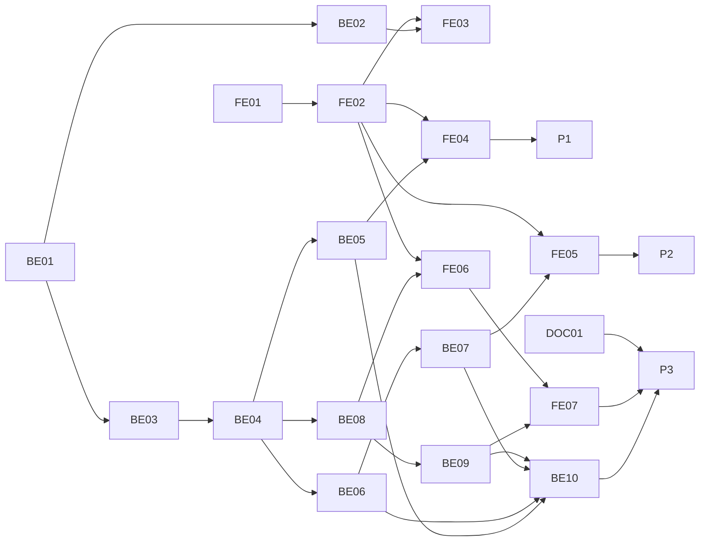

# F-15 Release, Versioning and Snapshots — Backend + Frontend Implementation Plan

This plan builds EP-15 (US-071..US-077; CV-177..CV-193 except CV-187): semesters and cohorts (MH-10), initial release (MH-45), final academic-office approval and snapshot production (MH-43), scheduled activation, immutable version history (MH-46/47), corrections (MH-49), and revision-specific signed attachments. It supplies the read-only version view needed by US-079 AC1–AC3 without implementing F-16's version comparison or cohort reassignment.

It deliberately excludes MH-48 comparison and MH-50 reassignment (F-16), backup/restore (F-26, CV-187), grading formulas and the CLO-coverage block (F-12), audit log (F01-07: none), and Excel import (F-09, after MVP).

> **Companion documents**
> - Stories: `docs/planning/user-stories.md:866-970` (US-071..US-079); tasks `docs/planning/task-breakdown.md:353-369`.
> - Decisions: `docs/planning/feature-questions.md:240-247` (F15-01..08; blank answer = A); F16-01 in the following section.
> - Design: `docs/design/state-diagrams.md:170-177` (PB-01..09), `:212-214` (DC-03..05), DX-10/11; `docs/design/data-dictionary.md:270-325`, `:360-397`, `:466-486`, `:558-579`.
> - Screens: `docs/design/screen-inventory.md:66`, `:119`, `:126-130`, `:249`, `:292-299` (MH-10/43/45/46/47/49; G-6).
> - Builds on: F-02 permissions; F-04/05 course writers; F-06/07 version copier and curriculum; F-08 checker; F-10/11 syllabi and outcomes; F-13 copies and stale check; F-14 recorder and notifier.
> - Tests: `docs/planning/test-plan.md` KB-037..039, KB-045, KB-055..058, NT-B4-01/05/06/10/12 (`:325-336`).

**Status**: Code complete 2026-10-19 (browser walkthrough owed) — see `docs/implement-report/f-15-release-version-snapshots-implement-report.md`

---

## 0. Plan at a glance

Everything below in one table. Read this; the rest is detail for whoever builds it.

| What | Why | How and where |
|---|---|---|
| **Manage semesters and cohorts before releasing anything** | US-071; MH-10 | Semester, Cohort, CohortVersion schema, R1 CRUD and selector (BE-01/02, FE-01..03) |
| **Release the one plain Draft initially** | US-071; PB-03/04 | Consistency, syllabus completeness, atomic publish/snapshot/pin; editable default `1.0`; semester and cohorts (BE-04/05, FE-04) |
| **Promote approved request copies, not live catalog rows** | US-072/074; F15-01 | Claim and stale check; immutable snapshot; decision and provenance; one transaction (BE-04/06, FE-05) |
| **Fan out a syllabus change to every affected program** | US-075; CV-188 | Publish one syllabus revision, copy newest ACTIVE/PENDING version per program, re-point CLO ids, promote all or none (BE-04/06) |
| **Activate in semester order, without duplicate notifications** | US-073; PB-06/07 | Once at boot and daily BullMQ reconciliation; per-version idempotent transaction; distinct effective event (BE-04/07) |
| **Preserve version-specific content and provenance** | US-074; US-079 AC3 | Frozen course name/credits, pinned syllabus, history/detail and request history link (BE-04/08, FE-06) |
| **Correct without deleting published history** | US-076; PB-08/09 | R1 correction Draft, issue as new minor number, optional cohort move, old row Historical (BE-09, FE-07) |
| **Keep signed attachments on their own revision** | US-077 | Published upload additions permitted; non-Draft deletion prohibited; new request copy starts empty (BE-09, FE-07) |

| In scope | Basis |
|---|---|
| Semester/Cohort CRUD, original release, academic-office final approval | US-071/072; MH-10/43/45 |
| Numbering, request promotion, course snapshots and syllabus pins | BR-23/24; US-072/074 |
| Activation, history/detail, correction, attachments | US-073/076/077; US-079 AC1–AC3 |
| E2E migration to real release and non-Draft write refusals | CV-183/185/186/190; F-07 test-helper constraint |

| Not included | Deferred until |
|---|---|
| MH-48 version compare, MH-50 cohort reassignment (including arbitrary historical moves) | F-16 |
| Backup/restore and upgrade retention, CV-187 | F-26 |
| Grading formula and CLO coverage blocking | F-12 |
| Audit log (F01-07: none); Excel import | No audit log; F-09 after MVP |

| AC / task | Covered by |
|---|---|
| US-071 AC1–AC5; CV-177..180 | BE-01/02/04/05/10; FE-01..04 |
| US-072 AC1–AC5; CV-181..183 | BE-03/04/06/10; FE-05 |
| US-073; CV-184/185 | BE-04/07/10; FE-06 |
| US-074; CV-186 | BE-01/04/08/10; FE-06; every non-Draft writer checked |
| US-075; CV-188..190 | BE-04/06/10; FE-05 preview |
| US-076; CV-191/192 | BE-01/09/10; FE-07 |
| US-077; CV-193 | BE-09/10; FE-07 attachment affordances |
| US-079 AC1–AC3 (read-only dependency) | BE-08, FE-06; comparison is F-16 |

---

## 1. Scope

F-06..F-14 are plans, not code yet. Treat their declared signatures, routes, models, and test helpers as contracts, and re-read their actual implementation at each build gate. F-15 creates non-Draft versions once at final approval, not at activation (F15-01). A released row never takes catalog edits by reference; its curriculum row keeps a name, credits, syllabus revision, requisite rows and matrix rows. The only allowed amendment to a published syllabus is an additional signed attachment; it does not rewrite its substantive content.

First-release eligibility is a plain program Draft only, and only when the program has never released. Later requests use a request-specific Draft copy or authored relation items. A correction uses its own distinguishable Draft; nobody edits a published version in place. A version may be PENDING even while another version remains ACTIVE. A syllabus can be PUBLISHED before its version is ACTIVE, so version pinning, never syllabus status alone, determines what a viewer sees (state-diagrams S-9, `:460`).

The permission for final approval is the actual level-3 actionable row and self-approval rule, not a broad R1 UI check. Initial release, corrections and semester management require R1 school-wide direct cells; version history is scoped like `program.view`. No F-15 endpoint allows writes on an already released version. Migrations are additive: existing released versions, if any, need an explicit data check before enforcing publication completeness.

---

## 2. Contract verification

All “existing” files below are specified by earlier plans rather than by a working `source/` implementation. Recheck these signatures when executing; references name the plan and exact grepped line. No feature source is inspected here.

| Existing piece used | Defined at | Used by |
|---|---|---|
| `VersionContentCopier.copy(tx, from, to)` and four-state `ProgramVersion` | `f-06-programs-directors-implementation-plan.md:203`, `:390`; `f-07-curriculum-elective-groups-implementation-plan.md:484-520` | BE-04/05/06/09 |
| `ProgramVersion_one_draft` (copy-aware) and `ProgramVersion_one_active`; `sourceRequestId @unique` | `f-06-programs-directors-implementation-plan.md:205`; `f-13-change-requests-implementation-plan.md:3010` | BE-01/04/06 |
| F-07 curriculum read `course` live, credit totals live, released course usage | `f-07-curriculum-elective-groups-implementation-plan.md:51`, `:197`, `:263`, `:537`, `:1498` | BE-04/08/10 |
| F-09 `releasedCourseIds` uses non-Draft membership | `f-09-excel-import-export-implementation-plan.md:1949` | BE-10 regression; after MVP |
| `lockRequisiteGraph(tx)` and `ConsistencyChecker.assertPasses(versionId, db)` | `f-05-course-relations-equivalence-implementation-plan.md:546`; `f-08-consistency-check-implementation-plan.md:594-661` | BE-04..06/09 |
| `Syllabus` revisions, published-time CHECK, attachments, storage | `f-10-syllabus-implementation-plan.md:268-346`, `:147-149`, `:449-493` | BE-01/04/08/09 |
| `currentRevisionByCourse` and matrix callers | `f-11-plo-clo-matrices-implementation-plan.md:474-490`, `:588`, `:1183`, `:1209`, `:1233` | BE-04/08 |
| `WorkingCopyService`, `copySyllabusRevision`, `newestReleasedVersion`, request Draft guard | `f-13-change-requests-implementation-plan.md:1112-1200`, `:650-724` | BE-06/09 |
| `StaleChecker`, authored operations, shared module | `f-13-change-requests-implementation-plan.md:1405-1450`, `:1965`; constraint `:3004` | BE-03/06 |
| `ApprovalRecorder` and `RequestNotifier` (five existing events) | `f-14-three-level-approval-notifications-implementation-plan.md:700-765`, `:1205-1256` | BE-06/07 |
| `RequestActionsDto.canApprove`, data plain-route block | `f-14-three-level-approval-notifications-implementation-plan.md:198`, `:657`, `:839` | BE-06/FE-05 |
| Queue module and worker precedent | `f-09-excel-import-export-implementation-plan.md:121`, `:1188`, `:1274`; `docs/technical/technical_reference.md:82-85` | BE-07 |

### 2a. Endpoints

All endpoints are under `/api`; controller paths below omit `/api`. Scope in the service follows the F-02 `AccessContext` pattern; reject mismatched program/version/course pairs with 404.

| Endpoint | Permission (guard) | Request | Response | Notes |
|---|---|---|---|---|
| `GET /semesters`, `GET /cohorts` | authenticated | list query | `SemesterDto[]`, `CohortDto[]` | selectors for users who can release; no writes |
| `POST /semesters`, `PATCH /semesters/:id` | `semester.manage` | `Create/UpdateSemesterDto` | `SemesterDto` | R1; referenced start date immutable |
| `POST /cohorts`, `PATCH /cohorts/:id` | `semester.manage` | `Create/UpdateCohortDto` | `CohortDto` | R1; referenced rows cannot be deleted |
| `GET /programs/:programId/versions/:versionId/release-check` | `version.publish` | — | `ReleaseCheckDto` | reports consistency and syllabus details; preflight is advisory |
| `POST /programs/:programId/versions/:versionId/release` | `version.publish` | `ReleaseVersionDto` | `VersionDetailDto` | only plain first Draft; `ALREADY_RELEASED`; repeat refuses |
| `GET /change-requests/:id/final-approval` | `changeRequest.view` | — | `FinalApprovalPreviewDto` | authorized level-3 caller; next number per affected program |
| `POST /change-requests/:id/final-approve` | `changeRequest.view` plus actionable rows | `FinalApproveDto` | `ChangeRequestDetailDto` | atomic claim, validate, apply, record, close; plain approve remains blocked |
| `GET /programs/:programId/versions` | `version.viewHistory` or scoped `program.view` | — | `VersionListDto` | extends F-06 detail's `versions` contract |
| `GET /programs/:programId/versions/:versionId` | scoped `program.view` | — | `VersionDetailDto` | version-specific snapshot and provenance; no write actions |
| `GET /courses/:courseId/syllabus?versionId=` | `syllabus.view` | optional `versionId` | `CourseSyllabusDto` | extends F-10's GET route; pin for matching row |
| `POST /programs/:programId/versions/:versionId/corrections` | `version.correct` | — | correction Draft detail | R1, ACTIVE/PENDING only |
| `POST /programs/:programId/versions/:versionId/corrections/:correctionId/issue` | `version.correct` | `IssueCorrectionDto` | `VersionDetailDto` | mandatory reason, `moveCohorts` default true |
| `DELETE /programs/:programId/versions/:versionId/corrections/:correctionId` | `version.correct` | — | 204 | only unissued correction Draft |
| Existing `POST /syllabi/:id/attachments` and `DELETE /syllabus-attachments/:id` | `syllabus.edit` | existing file / — | existing DTO / 204 | published upload additions; non-Draft delete locked |

### 2b. DTOs

| Field | Type | Required | Source / display |
|---|---|---|---|
| `ReleaseVersionDto.versionNumber` | `string`, `^\d{1,3}\.\d{1,3}$` | no; default `1.0` | FE editable “Số phiên bản” |
| `ReleaseVersionDto.decisionNumber`, `signedDate`, `effectiveSemesterId` | string, ISO date, UUID | yes | “Số quyết định”, “Ngày ký”, “Học kỳ hiệu lực” |
| `ReleaseVersionDto.cohortIds` | UUID[] unique | yes, empty accepted | “Khóa áp dụng” |
| `FinalApproveDto.decisionNumber`, `signedDate`, `effectiveSemesterId` | string, ISO date, UUID | yes | persisted on request and all versions |
| `FinalApproveDto.remark`, `allowPastSemester`, `cohortIds` | string?, boolean?, UUID[]? | no | past semester only for academic-office-created request; cohort IDs only single-program |
| `FinalApprovalPreviewDto` | affected program IDs/codes, next numbers, stale flag, consistency, missing syllabi, dropped links | — | MH-43 read-only preview; final POST recomputes |
| `ReleaseCheckDto` | consistency result, missing/incomplete syllabi | — | MH-45 block details, never a write lock |
| `IssueCorrectionDto.reason`, `moveCohorts` | nonempty string, boolean default true | reason yes | “Lý do đính chính”, “Chuyển khóa đang áp dụng” |
| `VersionDetailDto` | id, number, status, decision, dates, semester, publisher, cohorts, origin request, previous/correction, content | — | MH-47 read-only; no raw Prisma model |
| `RequestActionsDto.canFinalApprove` | boolean | yes | level 3, actionable and data request only |
| `CurriculumItemDto.course` | course code, frozen name/credits if present | — | Draft uses live; released uses snapshot |

### 2c. Mismatch log

| Deliverable | What the earlier doc said | What this plan does | Found at |
|---|---|---|---|
| BE-01 | DD `sourceRequest` is the published version's request | Clears `sourceRequestId` on promotion; uses non-unique `originRequestId`, preserving copy-only filters | `data-dictionary.md:294`, `:483`; `f-13-change-requests-implementation-plan.md:3010` |
| BE-01 | DD `CurriculumItem.syllabus` and F-07 `syllabusVersionId` | Uses `syllabusId` FK to the exact revision | `data-dictionary.md:323`; `f-07-curriculum-elective-groups-implementation-plan.md:243` |
| BE-04 | F-11 selects the latest Published-else-Draft syllabus per course | `revisionForItems` selects pinned ID first; Draft fallback unchanged | `f-11-plo-clo-matrices-implementation-plan.md:478-490`, `:588` |
| BE-06 | F-13 would keep an approved authored request `APPROVED` until later apply | Apply all items before recording approval in the same transaction; failed apply rolls back to pending | `f-13-change-requests-implementation-plan.md:3004`; US-075 all-or-nothing; F-14 `OrganizationalApplier` precedent |
| BE-07 | F-14 activation suggests `RequestNotifier.approved` again | Add `REQUEST_EFFECTIVE` and call `RequestNotifier.effective` exactly once; approval keeps `approved` | `f-14-three-level-approval-notifications-implementation-plan.md:2240-2242` |
| BE-05 | PB-03 initial release requires a future start date | PB-04 allows an initial release of a historical semester; ACTIVE immediately | `docs/design/state-diagrams.md:172-173`; F15-03 `feature-questions.md:242` |
| BE-09 | F-13 no-request guard delegates to `programEditState`, which treats a released program as request-only | Existing Draft guards branch on `correctionOfId` first, assert R1 correction permission, then reuse the normal Draft writer; leave shared F-13 `assertEditPath` intact | `f-13-change-requests-implementation-plan.md:659-723`; `f-06-programs-directors-implementation-plan.md:376` |
| BE-09 | F-10 attachments upload only to Draft | Also allow PUBLISHED additions (not replacements/deletes) under scoped permission | `f-10-syllabus-implementation-plan.md:147-149`, `:1057-1104` |
| BE-09 | PB-08 describes correction as PENDING even when its predecessor is ACTIVE | Issue with predecessor status ACTIVE/PENDING; corrected original always becomes HISTORICAL | `docs/design/state-diagrams.md:177-178`; US-076 AC5 |
| BE-10 | F-07 helper sets ACTIVE and `1.0` directly; F-10 helper publishes directly | Delete both helpers and use the real release API in tests | `f-07-curriculum-elective-groups-implementation-plan.md:1498`; `f-10-syllabus-implementation-plan.md:1182-1214` |
| BE-04 | DC-03 says Draft first pin publishes; F-10 partial index permits only one published syllabus | Move the previous PUBLISHED revision to HISTORICAL first in the same transaction | `docs/design/state-diagrams.md:212-214`; `f-10-syllabus-implementation-plan.md:1891` |

---

## 3. Decisions

| # | Decision | Why | Rejected alternative |
|---|---|---|---|
| D1 | Shared release core in `src/shared/releases/`; semesters and releases each have their own feature. Final approval remains in `change-requests`; shared course and relation writers live under `src/shared/courses/`. | Feature modules never import one another; both regular services and final approval need identical writers. | Make `releases` import feature-internal approval, course, or curriculum services. |
| D2 | Promoting a request copy moves `sourceRequestId` to non-unique `originRequestId`; relations named `ProgramVersionOrigin` and `SyllabusOrigin`. | A syllabus request makes several versions, and `sourceRequestId: null` continues to mean “not a working copy.” | Keep `sourceRequestId` and change every copy-only filter. |
| D3 | Validate `major.minor` with `VERSION_NUMBER_PATTERN`; start `1.0`; major for CURRICULUM and program OUTCOME, minor for PROGRAM_INFO, SYLLABUS_CONTENT and course OUTCOME; correction = highest minor in same major + 1; collision → `VERSION_NUMBER_TAKEN`. | BR-24 and the unique program/number constraint give deterministic numbering. | Timestamp labels or silent auto-retry to another number. |
| D4 | Semester code and academic-year/term unique; cohort code unique; assignments unique per cohort/version. Final approval requires known future start except academic-office-created past-allowed request; initial release may use past; referenced dates immutable. | BR-25, historical import F15-03, and stable published effective dates. | Infer a semester start or retroactively change an existing version's start. |
| D5 | Release ACTIVE if start ≤ today, otherwise PENDING; a boot + daily BullMQ reconciliation activates PENDING rows in created order in per-version transactions. Close request EFFECTIVE once no associated PENDING versions remain; notify with new effective event. | PB-06, at-most-one ACTIVE, idempotent retries and no duplicated approved notice. | Re-send the approved event or use Redis as source of truth. |
| D6 | At every promotion snapshot live course name/credits and pin a PUBLISHED syllabus on each item; Draft falls back to live via `rowCourse`/`rowCredits`. | Released catalog reads must remain invariant after later edits. | Copy JSON blobs or keep reading `Course` live. |
| D7 | Add `MISSING_SYLLABUS` Error to F-08, and return one `SYLLABUS_INCOMPLETE` detail per failing course for DC-03. | Preview, submit and publish all reject the same incomplete input. | Add the check only to release POST. |
| D8 | Replace `currentRevisionByCourse` with `revisionForItems(db, items)`; prefer pinned revision, else Published-else-Draft; extend existing GET syllabus. | Row-specific matrix and syllabus reads must agree with published history. | Add separate history-only syllabus route. |
| D9 | Re-point fan-out CLO–PLO links by `cloCode`; drop and count links whose code is absent in the new revision. | CLO IDs belong to a revision, not a course; initial Draft publication retains IDs. | Keep stale CLO IDs or guess by description. |
| D10 | Final approve atomically claims, checks actionable level-3 rows and stale base, validates semester, locks graph, promotes or applies, records decisions, closes, and notifies. ORGANIZATION keeps F-14 plain approve. | US-075 all-or-nothing; no approved-but-unapplied request. | Defer authored-item writes after approval. |
| D11 | Initial release of a plain Draft is R1-only, checks once in its transaction and refuses second release; publish Draft syllabi, snapshot/pin, set decision and assignments. | US-071 AC5 and PB-03/04. | Treat a request copy as an initial version. |
| D12 | R1-only correction creates an editable Draft with `correctionOfId`; issue with mandatory reason, minor number and same semester/status, move chosen cohorts; delete unissued Draft only. | PB-08/09 preserve both old and corrected history. | Update or delete the mistaken version in place. |
| D13 | Extend F-06 history and add MH-47 read-only page with pinned curriculum/syllabus, decision and origin request link to approval history. | US-079 AC1–AC3; G-6 navigation. | Separate reimplementation of MH-22/25/31/32 displays. |
| D14 | Keep REJECTED/WITHDRAWN working copies read-only. | The copy records precisely what was refused. | Invoke `WorkingCopyService.discard` at close. |
| D15 | Permit signed file additions to a PUBLISHED syllabus but never delete from non-Draft; request copies start with no attachments. | US-077 preserves signed revision identity. | Copy predecessor files to the new revision. |
| D16 | Delete test-only `releaseVersionForTest` / `publishSyllabusForTest`; provide `releaseViaApi`. | E2E should exercise checks, locks, snapshots and state transitions. | Set ACTIVE/PUBLISHED directly in fixtures. |
| D17 | Assert every existing non-Draft writer rejects PENDING, ACTIVE and HISTORICAL; correction exception applies only to its separate Draft. | BR-23, US-074 AC1. | Hide edit buttons while leaving writable API routes. |

---

## 5. Deliverables

Backend paths are under `source/backend/`, frontend paths under `source/frontend/`.

### BE-01 — Schema and additive migration

What/Why: Store release provenance, a stable effective semester, frozen curriculum facts and a separate correction Draft without invalidating existing copy filters (D2, D4, D6, D12).

**Files**

| Action | Path |
|---|---|
| MODIFY | `prisma/schema.prisma` |
| NEW | `prisma/migrations/<timestamp>_release_versions/migration.sql` |
| MODIFY | `src/shared/authz/permission-codes.ts` |
| MODIFY | `prisma/seed.ts` |
| MODIFY | `test/permission-table.e2e-spec.ts` |
| MODIFY | `src/features/change-requests/change-requests.service.ts` |

**Shape**

```prisma
// prisma/schema.prisma
model Semester {
  id String @id @default(uuid())
  semesterCode String @unique
  academicYear String
  termInYear Int
  startDate DateTime? @db.Date
  effectiveVersions ProgramVersion[] @relation("EffectiveSemester")
  effectiveRequests ChangeRequest[] @relation("RequestEffectiveSemester")
  startingCohortVersions CohortVersion[] @relation("CohortStartSemester")
  @@unique([academicYear, termInYear])
}

model Cohort {
  id String @id @default(uuid())
  cohortCode String @unique
  intakeYear Int
  versions CohortVersion[]
}

model CohortVersion {
  id String @id @default(uuid())
  cohortId String
  programVersionId String
  fromSemesterId String
  cohort Cohort @relation(fields: [cohortId], references: [id], onDelete: Restrict)
  programVersion ProgramVersion @relation(fields: [programVersionId], references: [id], onDelete: Restrict)
  fromSemester Semester @relation("CohortStartSemester", fields: [fromSemesterId], references: [id], onDelete: Restrict)
  @@unique([cohortId, programVersionId])
  @@index([programVersionId])
}

model ProgramVersion {
  decisionNumber String?
  signedDate DateTime? @db.Date
  effectiveSemesterId String?
  effectiveSemester Semester? @relation("EffectiveSemester", fields: [effectiveSemesterId], references: [id], onDelete: Restrict)
  publishedById String?
  publishedBy User? @relation("VersionPublisher", fields: [publishedById], references: [id], onDelete: Restrict)
  publishedAt DateTime?
  previousVersionId String?
  previousVersion ProgramVersion? @relation("PreviousProgramVersion", fields: [previousVersionId], references: [id], onDelete: Restrict)
  nextVersions ProgramVersion[] @relation("PreviousProgramVersion")
  originRequestId String?
  originRequest ChangeRequest? @relation("ProgramVersionOrigin", fields: [originRequestId], references: [id], onDelete: Restrict)
  correctionOfId String? @unique
  correctionOf ProgramVersion? @relation("ProgramVersionCorrection", fields: [correctionOfId], references: [id], onDelete: Restrict)
  correctedBy ProgramVersion? @relation("ProgramVersionCorrection")
  correctionReason String?
  cohortVersions CohortVersion[]
}

model CurriculumItem {
  courseNameSnapshot String?
  creditsSnapshot Decimal? @db.Decimal(5, 2)
  syllabusId String?
  syllabus Syllabus? @relation("CurriculumItemSyllabus", fields: [syllabusId], references: [id], onDelete: Restrict)
}

model Syllabus {
  originRequestId String?
  originRequest ChangeRequest? @relation("SyllabusOrigin", fields: [originRequestId], references: [id], onDelete: Restrict)
  pinnedItems CurriculumItem[] @relation("CurriculumItemSyllabus")
}

model ChangeRequest {
  decisionNumber String?
  signedDate DateTime? @db.Date
  effectiveSemesterId String?
  effectiveSemester Semester? @relation("RequestEffectiveSemester", fields: [effectiveSemesterId], references: [id], onDelete: Restrict)
  pastSemesterAllowed Boolean @default(false)
  createdByAcademicOffice Boolean @default(false)
  originatedVersions ProgramVersion[] @relation("ProgramVersionOrigin")
  originatedSyllabi Syllabus[] @relation("SyllabusOrigin")
}
```

Existing fields (IDs, `status`, `sourceRequestId`, `versionNumber`, `revisionNumber`, `baseVersionId`, `baseRevisionId`, F-08 mismatch columns, `Course` references and relation names) remain unchanged. Extend the existing models rather than redeclaring their other fields. `ProgramVersion_one_draft` continues `status = 'DRAFT' AND sourceRequestId IS NULL` after F-13; `ProgramVersion_one_active` continues `status = 'ACTIVE'`; `Syllabus_one_published` stays unchanged. Draft correction's `correctionOfId` does not weaken the single plain-Draft index; explicitly exclude correction Drafts from `ProgramVersion_one_draft` using `AND correctionOfId IS NULL`. This is a migration index replacement, not a second plain Draft per program.

```sql
// prisma/migrations/<timestamp>_release_versions/migration.sql
ALTER TABLE "ProgramVersion" ADD CONSTRAINT "ProgramVersion_published_has_time"
  CHECK (("status" = 'DRAFT') = ("publishedAt" IS NULL));
DROP INDEX IF EXISTS "ProgramVersion_one_draft";
CREATE UNIQUE INDEX "ProgramVersion_one_draft" ON "ProgramVersion" ("programId")
  WHERE "status" = 'DRAFT' AND "sourceRequestId" IS NULL AND "correctionOfId" IS NULL;
CREATE INDEX "ProgramVersion_origin_idx" ON "ProgramVersion" ("originRequestId", "status");
CREATE INDEX "ProgramVersion_due_idx" ON "ProgramVersion" ("status", "effectiveSemesterId", "createdAt");
ALTER TYPE "NotificationType" ADD VALUE 'REQUEST_EFFECTIVE';
```

Migration order: add nullable columns and tables, create FKs/uniques, replace the partial Draft index, then add CHECK. Backfill `publishedAt` for any actual preexisting non-Draft row before installing the CHECK; inspect the database at build time rather than inventing timestamps. Prisma's `@@unique([programId, versionNumber])` stays; null permits several working/correction Drafts while the partial index guards plain Drafts. On F-13 request create persist `createdByAcademicOffice = await isAcademicOfficeHolder(tx, access.userId, todayDate())` (`f-13-change-requests-implementation-plan.md:1237-1249`), never derive past eligibility from current roles.

Extend the existing Prisma `NotificationType` enum with `REQUEST_EFFECTIVE` in BE-01; the matching SQL above is part of that same migration. No second enum is introduced.

```ts
// src/shared/authz/permission-codes.ts
export const PERMISSIONS = {
  VERSION_PUBLISH: 'version.publish',
  VERSION_CORRECT: 'version.correct',
  SEMESTER_MANAGE: 'semester.manage',
} as const;

export const RELEASE_PERMISSION_CELLS = {
  [PERMISSIONS.VERSION_PUBLISH]: { R1: 'X' },
  [PERMISSIONS.VERSION_CORRECT]: { R1: 'X' },
  [PERMISSIONS.SEMESTER_MANAGE]: { R1: 'X' },
} as const;
```

`VERSION_PUBLISH` already exists: extend its table row rather than duplicate the constant; follow F-02's actual seeded `PERMISSION_TABLE` fields and include new endpoints in `permission-table.e2e-spec.ts`.

**Rationale**: F-06 leaves release columns to F-15 (`f-06-programs-directors-implementation-plan.md:186`) and starts the unique indexes (`:205`); F-13's copy filters expect `sourceRequestId: null` for published data (`f-13-change-requests-implementation-plan.md:756-762`, `:3010`); F-10's CHECK pattern is at `f-10-syllabus-implementation-plan.md:335-346`.

**Gotchas**
- Never drop `ProgramVersion_one_active`; status ordering is necessary even in a single transaction.
- Restrict FKs protect old snapshots, request provenance, signed syllabi and cohort links from deletion.
- `publishedAt` remains non-null for HISTORICAL, including corrected versions.
- Do not make name/credits/pin columns non-null on Drafts or migration would break unsubmitted work.
- Index predicate update is essential: a correction Draft must coexist with a plain Draft or another correction Draft, but only one unissued correction is allowed per corrected version by `@unique`.

**Verify**: `pnpm exec prisma migrate dev --name release_versions`; `pnpm exec prisma generate`; schema and migration tests for Draft/copy/correction concurrency, ACTIVE uniqueness, on-delete restriction, published-time CHECK and optional Draft pins; `pnpm exec tsc --noEmit -p tsconfig.json`.

**Depends on**: F-06..F-14 schema and F-02 seed

---

### BE-02 — Semesters and cohorts (MH-10)

What/Why: R1 can define academic terms, dates and intakes used by release decisions without changing effective dates already consumed by published versions.

**Files**

| Action | Path |
|---|---|
| NEW | `src/features/semesters/semesters.module.ts` |
| NEW | `src/features/semesters/semesters.controller.ts` |
| NEW | `src/features/semesters/semesters.service.ts` |
| NEW | `src/features/semesters/dto/semester.dto.ts` |
| NEW | `src/features/semesters/dto/cohort.dto.ts` |
| NEW | `src/features/semesters/semesters.errors.ts` |
| NEW | `src/features/semesters/semesters.service.spec.ts` |
| MODIFY | `src/app.module.ts` |

**Shape**

```ts
// src/features/semesters/dto/semester.dto.ts
export class CreateSemesterDto {
  @IsString() @IsNotEmpty() semesterCode!: string;
  @IsString() @IsNotEmpty() academicYear!: string;
  @IsInt() @Min(1) termInYear!: number;
  @IsOptional() @IsDateString() startDate?: string;
}

export class UpdateSemesterDto extends PartialType(CreateSemesterDto) {}

export interface SemesterDto {
  id: string;
  semesterCode: string;
  academicYear: string;
  termInYear: number;
  startDate: string | null;
}
```

```ts
// src/features/semesters/dto/cohort.dto.ts
export class CreateCohortDto {
  @IsString() @IsNotEmpty() cohortCode!: string;
  @IsInt() @Min(1900) intakeYear!: number;
}

export class UpdateCohortDto extends PartialType(CreateCohortDto) {}

export interface CohortDto { id: string; cohortCode: string; intakeYear: number }
```

```ts
// src/features/semesters/semesters.errors.ts
export const SEMESTER_ERRORS = {
  START_UNKNOWN: { status: 409, code: 'SEMESTER_START_UNKNOWN', message: 'Học kỳ chưa có ngày bắt đầu.' },
  ALREADY_STARTED: { status: 409, code: 'SEMESTER_ALREADY_STARTED', message: 'Học kỳ đã bắt đầu.' },
  IN_USE: { status: 409, code: 'SEMESTER_IN_USE', message: 'Không thể đổi ngày bắt đầu của học kỳ đã có phiên bản ban hành.' },
  COHORT_IN_USE: { status: 409, code: 'COHORT_IN_USE', message: 'Khóa tuyển sinh đã gắn với phiên bản.' },
  DUPLICATE: { status: 409, code: 'SEMESTER_OR_COHORT_EXISTS', message: 'Mã hoặc học kỳ đã tồn tại.' },
} as const;
```

```ts
// src/features/semesters/semesters.controller.ts
@Controller()
export class SemestersController {
  constructor(private readonly semesters: SemestersService) {}

  @Get('semesters')
  listSemesters() { return this.semesters.listSemesters(); }

  @Post('semesters')
  @RequirePermission(PERMISSIONS.SEMESTER_MANAGE)
  createSemester(@Body() dto: CreateSemesterDto, @CurrentAccess() access: AccessContext) {
    return this.semesters.createSemester(dto, access);
  }

  @Patch('semesters/:id')
  @RequirePermission(PERMISSIONS.SEMESTER_MANAGE)
  updateSemester(@Param('id') id: string, @Body() dto: UpdateSemesterDto, @CurrentAccess() access: AccessContext) {
    return this.semesters.updateSemester(id, dto, access);
  }

  @Get('cohorts')
  listCohorts() { return this.semesters.listCohorts(); }

  @Post('cohorts')
  @RequirePermission(PERMISSIONS.SEMESTER_MANAGE)
  createCohort(@Body() dto: CreateCohortDto, @CurrentAccess() access: AccessContext) {
    return this.semesters.createCohort(dto, access);
  }

  @Patch('cohorts/:id')
  @RequirePermission(PERMISSIONS.SEMESTER_MANAGE)
  updateCohort(@Param('id') id: string, @Body() dto: UpdateCohortDto, @CurrentAccess() access: AccessContext) {
    return this.semesters.updateCohort(id, dto, access);
  }
}
```

```ts
// src/features/semesters/semesters.service.ts
@Injectable()
export class SemestersService {
  constructor(private readonly prisma: PrismaService) {}

  async listSemesters(): Promise<SemesterDto[]> {
    const rows = await this.prisma.semester.findMany({ orderBy: [{ academicYear: 'desc' }, { termInYear: 'asc' }] });
    return rows.map(toSemesterDto);
  }

  async updateSemester(id: string, dto: UpdateSemesterDto, access: AccessContext): Promise<SemesterDto> {
    assertSchoolWideDirect(access, PERMISSIONS.SEMESTER_MANAGE);
    return this.prisma.$transaction(async (tx) => {
      const current = await tx.semester.findUniqueOrThrow({ where: { id } });
      if (dto.startDate !== undefined && dateOnly(dto.startDate) !== dateOnly(current.startDate)) {
        const used = await tx.programVersion.count({ where: { effectiveSemesterId: id, status: { in: ['ACTIVE', 'HISTORICAL'] } } });
        if (used) throw new AppException(SEMESTER_ERRORS.IN_USE);
      }
      return toSemesterDto(await tx.semester.update({ where: { id }, data: validatedSemesterFields(dto) }));
    });
  }

  async createSemester(dto: CreateSemesterDto, access: AccessContext): Promise<SemesterDto> {
    assertSchoolWideDirect(access, PERMISSIONS.SEMESTER_MANAGE);
    return toSemesterDto(await this.prisma.semester.create({ data: validatedSemesterFields(dto) }));
  }

  async listCohorts(): Promise<CohortDto[]> {
    return (await this.prisma.cohort.findMany({ orderBy: { intakeYear: 'desc' } })).map(toCohortDto);
  }

  async createCohort(dto: CreateCohortDto, access: AccessContext): Promise<CohortDto> {
    assertSchoolWideDirect(access, PERMISSIONS.SEMESTER_MANAGE);
    return toCohortDto(await this.prisma.cohort.create({ data: dto }));
  }

  async updateCohort(id: string, dto: UpdateCohortDto, access: AccessContext): Promise<CohortDto> {
    assertSchoolWideDirect(access, PERMISSIONS.SEMESTER_MANAGE);
    return toCohortDto(await this.prisma.cohort.update({ where: { id }, data: dto }));
  }
}
```

Add no DELETE routes for referenced semesters/cohorts; if delete is added for unreferenced rows, check FK references first and map P2003 to the explicit IN_USE errors. Format `startDate` as a calendar date (`YYYY-MM-DD`) without local-time round trips.

**Rationale**: The R1 route guard and explicit school-wide check mirror F-06's program creation and director assignment (`f-06-programs-directors-implementation-plan.md:138-143`, `:205`); MH-10's fields and menu are defined by `screen-inventory.md:66`, `:249`.

**Gotchas**
- Unique `(academicYear, termInYear)` is independent of `semesterCode`; translate both unique violations.
- Before ACTIVE/HISTORICAL a PENDING version may have its semester start corrected; a concurrent activation must serialize with the date update (lock semester row in both paths).
- No automatic cohort reassignment from a term change; that is F-16.

**Verify**: `semesters.service.spec.ts` tests duplicates, blank start date, immutable published date, PENDING edit and both FK restrictions; `test/semesters.e2e-spec.ts` checks R1 vs R3; `pnpm exec tsc --noEmit -p tsconfig.json`.

**Depends on**: BE-01

---

### BE-03 — Shared course and relation writers

What/Why: Move F-04 update and F-05 create/update/remove write bodies into transaction-aware shared writers so final approval applies authored items through exactly the owning feature's checks, without importing feature services (D1).

**Files**

| Action | Path |
|---|---|
| NEW | `src/shared/courses/course.writer.ts` |
| NEW | `src/shared/courses/course-relation.writer.ts` |
| NEW | `src/shared/courses/course.writer.spec.ts` |
| NEW | `src/shared/courses/course-relation.writer.spec.ts` |
| MODIFY | `src/features/courses/courses.service.ts` |
| MODIFY | `src/features/course-relations/course-relations.service.ts` |
| MODIFY | `src/shared/courses/courses-shared.module.ts` |

**Shape**

```ts
// src/shared/courses/course.writer.ts
export type CoursePatch = Pick<UpdateCourseDto,
  'courseName' | 'englishName' | 'credits' | 'courseType' | 'ownerFacultyId' | 'ownerGroupId'>;

export async function writeCourse(
  db: Prisma.TransactionClient | PrismaService,
  usage: CourseUsageReader,
  access: AccessContext,
  courseId: string,
  patch: CoursePatch,
): Promise<CourseWithInclude> {
  const current = await db.course.findUniqueOrThrow({ where: { id: courseId }, include: COURSE_INCLUDE });
  if (current.status === CourseStatus.CANCELLED) throw new AppException(COURSE_ERRORS.COURSE_CANCELLED);
  assertDirectEdit(access, PERMISSIONS.COURSE_EDIT, courseTarget(current), await courseEditState(usage, current));
  const ownersChange = patch.ownerFacultyId !== undefined || patch.ownerGroupId !== undefined;
  const owners = ownersChange
    ? await assertCourseOwners(db, patch.ownerFacultyId ?? current.ownerFacultyId,
        patch.ownerGroupId === undefined ? current.ownerGroupId : patch.ownerGroupId)
    : null;
  if (owners) assertDirectEdit(access, PERMISSIONS.COURSE_EDIT, courseTarget(owners), {
    released: false, draftOpenToRequestHolders: !owners.isForeign,
  });
  return db.course.update({
    where: { id: courseId },
    data: {
      courseName: patch.courseName, englishName: patch.englishName,
      credits: patch.credits === undefined ? undefined : new Prisma.Decimal(patch.credits),
      courseType: patch.courseType, ownerFacultyId: owners?.ownerFacultyId,
      ownerGroupId: owners ? owners.ownerGroupId : undefined,
    },
    include: COURSE_INCLUDE,
  });
}
```

For final approval only, `applyApprovedCourseField` accepts the already-authorized request actor and its validated authored payload, bypassing `assertDirectEdit` while keeping identical field validation, ownership and status rules; never bypass destination scope or data checks. Its signature explicitly requires the request ID and claim (not a caller-controlled boolean). Keep `writeCourse` as the direct-edit entry point.

```ts
// src/shared/courses/course.writer.ts
export async function applyApprovedCourseField(
  db: Prisma.TransactionClient, context: ApprovedWriteContext,
  courseId: string, field: CourseRequestField, value: string | null,
): Promise<void> {
  if (!COURSE_REQUEST_FIELDS.includes(field)) throw new AppException(RELEASE_ERRORS.ITEM_APPLY_FAILED);
  const request = await db.changeRequest.findUniqueOrThrow({ where: { id: context.requestId } });
  if (request.status !== context.claimedStatus || request.requestType !== 'COURSE_RELATION') {
    throw new AppException(RELEASE_ERRORS.ITEM_APPLY_FAILED);
  }
  const current = await db.course.findUniqueOrThrow({ where: { id: courseId } });
  if (current.status === CourseStatus.CANCELLED) throw new AppException(COURSE_ERRORS.COURSE_CANCELLED);
  if (field === 'ownerGroupId') await assertCourseOwners(db, current.ownerFacultyId, value);
  await db.course.update({ where: { id: courseId }, data: validatedCourseField(field, value) });
}
```

`validatedCourseField` reuses F-04 DTO field rules and Decimal conversion. The final-approval service constructs `ApprovedWriteContext` only after `ApprovalRecorder.claim` and actionable-row check; F-13 does not expose it on any direct course endpoint. Relation writers apply identical claimed-context verification before bypassing direct-edit state, while still checking scope, cancellation, cycles and replacement availability.

```ts
// src/shared/courses/course-relation.writer.ts
export interface ApprovedWriteContext {
  requestId: string;
  claimedStatus: ChangeRequestStatus.PENDING_ACADEMIC_OFFICE;
  actor: AccessContext;
}

export async function createRelation(
  db: Prisma.TransactionClient | PrismaService, dto: CreateCourseRelationDto,
  access: AccessContext | ApprovedWriteContext,
): Promise<CourseRelationRow> {
  if (dto.sourceCourseId === dto.targetCourseId) throw new AppException(COURSE_RELATION_ERRORS.RELATION_SELF);
  assertMinScoreAllowed(dto.relationType, dto.minScore);
  const [source, target] = await Promise.all([
    findRelationCourse(db, dto.sourceCourseId), findRelationCourse(db, dto.targetCourseId),
  ]);
  if ([source, target].some((course) => course.status === CourseStatus.CANCELLED)) {
    throw new AppException(COURSE_RELATION_ERRORS.RELATION_COURSE_CANCELLED);
  }
  await assertRelationScopeAndEdit(db, access, owningCourse({ relationType: dto.relationType, sourceCourse: source, targetCourse: target }));
  await lockRequisiteGraph(db);
  if (CYCLE_CHECKED_TYPES.includes(dto.relationType)) await assertNoRelationCycle(db, dto);
  return db.courseRelation.create({ data: relationCreateData(dto), include: RELATION_INCLUDE });
}

export async function updateRelationMinScore(
  db: Prisma.TransactionClient | PrismaService, relationId: string,
  dto: UpdateCourseRelationDto, access: AccessContext | ApprovedWriteContext,
): Promise<CourseRelationRow> {
  const row = await findRelationOrThrow(db, relationId);
  await assertRelationChangeAllowed(db, row, access);
  assertMinScoreAllowed(row.relationType, dto.minScore);
  return db.courseRelation.update({ where: { id: relationId }, data: { minScore: decimalOrNull(dto.minScore) }, include: RELATION_INCLUDE });
}

export async function removeRelation(
  db: Prisma.TransactionClient | PrismaService, relationId: string,
  access: AccessContext | ApprovedWriteContext,
): Promise<void> {
  const row = await findRelationOrThrow(db, relationId);
  await assertRelationChangeAllowed(db, row, access);
  await assertReplacementStillAvailable(db, row);
  await db.courseRelation.delete({ where: { id: relationId } });
}
```

Direct service calls retain their original transaction boundaries: `create` wraps `createRelation(tx, …)` in `$transaction`; `updateMinScore` and `remove` call the shared writer with `this.prisma`. Final approval uses its existing transaction. `lockRequisiteGraph` is the SAME advisory lock as the F-05 writer and F-08 checker; do not invent a second graph lock. Map unique violations to original `RELATION_EXISTS`; leave logging and DTO mapping in the feature service.

**Call sites — moved body and disposition**

| Caller | Earlier plan | Outcome |
|---|---|---|
| `CoursesService.update` | `f-04-course-catalog-implementation-plan.md:721-752` | F-04 update body moved; `this.prisma` → `db`; existing method calls `writeCourse` and maps DTO/logs |
| `CoursesService.transition` | `f-04-course-catalog-implementation-plan.md:754-772` | unchanged; status workflow is not an authored field |
| `CourseRelationsService.create` | `f-05-course-relations-equivalence-implementation-plan.md:531-566` | body moved; `this.prisma` → `db`; retain transaction and log |
| `CourseRelationsService.updateMinScore` | `f-05-course-relations-equivalence-implementation-plan.md:568-580` | body moved; `this.prisma` → `db`; DTO in feature |
| `CourseRelationsService.remove` | `f-05-course-relations-equivalence-implementation-plan.md:582-600` | body moved; `this.prisma` → `db`; replacement protection retained |
| Final-approval authored items | `f-13-change-requests-implementation-plan.md:1408-1444` | new caller: each sorted item dispatches to shared writer with claimed request context |

**Rationale**: Mirror F-14 BE-03's shared membership/director writer pattern (`f-14-three-level-approval-notifications-implementation-plan.md:494-613`), retaining F-04's exact ownership checks (`f-04-course-catalog-implementation-plan.md:721-752`) and F-05's cycle and replacement guards (`f-05-course-relations-equivalence-implementation-plan.md:531-600`).

**Gotchas**
- Approved application is not a public direct-edit endpoint; validate request ownership and data fields against `OPERATIONS_BY_TYPE` before dispatch.
- A new relation may be used by a published curriculum: catalog relation writes never mutate per-version requisite rows.
- No recursion through F-04/F-05 feature services from final approval.
- A concurrent course catalog write can race with snapshot; serialize promotion using the same transaction and row locks around live course selects.

**Verify**: `course.writer.spec.ts`, `course-relation.writer.spec.ts`, F-04/F-05 service/e2e regressions and relation cycle/replacement cases; grep feature services for direct course/relation writes that should delegate; `pnpm exec tsc --noEmit -p tsconfig.json`.

**Depends on**: BE-01, F-04/05

---

### BE-04 — Shared release core, pinned readers and consistency

What/Why: Give initial release, final approval, correction and scheduled activation one source of truth for version numbers, publication, frozen rows, syllabus pinning and read fallback (D3, D5..D9).

**Files**

| Action | Path |
|---|---|
| NEW | `src/shared/releases/version-number.ts` |
| NEW | `src/shared/releases/version-number.spec.ts` |
| NEW | `src/shared/releases/release.errors.ts` |
| NEW | `src/shared/releases/syllabus.publisher.ts` |
| NEW | `src/shared/releases/version.publisher.ts` |
| NEW | `src/shared/releases/version.activator.ts` |
| NEW | `src/shared/releases/releases-shared.module.ts` |
| NEW | `src/shared/syllabi/revision-for-items.ts` |
| NEW | `src/shared/curriculum/row-course.ts` |
| MODIFY | `src/shared/programs/version-content.copier.ts` |
| MODIFY | `src/shared/consistency/consistency-checker.ts` |
| MODIFY | `src/features/curriculum/curriculum.service.ts` |
| MODIFY | `src/features/outcomes/outcomes.service.ts` |
| MODIFY | `src/features/programs/programs.service.ts` |
| MODIFY | `src/features/syllabi/syllabi.service.ts` |
| DELETE | `src/shared/syllabi/current-revision.ts` |
| NEW | `src/shared/releases/version.publisher.spec.ts` |

**Shape**

```ts
// src/shared/releases/version-number.ts
export const VERSION_NUMBER_PATTERN = /^\d{1,3}\.\d{1,3}$/;
export type VersionBump = 'MAJOR' | 'MINOR';

export function parseVersionNumber(value: string): { major: number; minor: number } {
  if (!VERSION_NUMBER_PATTERN.test(value)) throw new AppException(RELEASE_ERRORS.VERSION_NUMBER_INVALID);
  const [major, minor] = value.split('.').map(Number);
  return { major, minor };
}

export function nextVersionNumber(base: string, bump: VersionBump): string {
  const { major, minor } = parseVersionNumber(base);
  const next = bump === 'MAJOR' ? `${major + 1}.0` : `${major}.${minor + 1}`;
  if (!VERSION_NUMBER_PATTERN.test(next)) throw new AppException(RELEASE_ERRORS.VERSION_NUMBER_INVALID);
  return next;
}

export function bumpForRequest(request: Pick<ChangeRequest, 'requestType' | 'targetType'>): VersionBump {
  return request.requestType === 'CURRICULUM'
    || (request.requestType === 'OUTCOME' && request.targetType === 'PROGRAM') ? 'MAJOR' : 'MINOR';
}
```

```ts
// src/shared/releases/release.errors.ts
export const RELEASE_ERRORS = {
  VERSION_NUMBER_INVALID: { status: 400, code: 'VERSION_NUMBER_INVALID', message: 'Số phiên bản phải có dạng Chính.Phụ.' },
  VERSION_NUMBER_TAKEN: { status: 409, code: 'VERSION_NUMBER_TAKEN', message: 'Số phiên bản đã tồn tại.' },
  ALREADY_RELEASED: { status: 409, code: 'ALREADY_RELEASED', message: 'Chương trình đã có phiên bản ban hành.' },
  VERSION_NOT_CORRECTABLE: { status: 409, code: 'VERSION_NOT_CORRECTABLE', message: 'Không thể đính chính phiên bản Lịch sử hoặc Nháp.' },
  MISSING_SYLLABUS: { status: 409, code: 'MISSING_SYLLABUS', message: 'Học phần trong khung chưa có đề cương.' },
  SYLLABUS_INCOMPLETE: { status: 409, code: 'SYLLABUS_INCOMPLETE', message: 'Đề cương chưa đủ điều kiện ban hành.' },
  ITEM_APPLY_FAILED: { status: 409, code: 'ITEM_APPLY_FAILED', message: 'Không áp dụng được nội dung đề xuất.' },
} as const;
```

**DC-03 publish conditions, verbatim** (`docs/design/state-diagrams.md:212`): “`courseDescription`, `objectives` có nội dung; tổng trọng số 100% (BR-12); mọi CLO có thành phần đánh giá (BR-14); thành phần điều kiện có ngưỡng (BR-15). Ghi `publishedAt`”. For F-12 formula rules, the checker owns the complete calculation once that feature is built; F-15 does not invent formulas. Reject a missing revision as `MISSING_SYLLABUS`; reject any present but incomplete revision with per-course `SYLLABUS_INCOMPLETE` details.

```ts
// src/shared/releases/syllabus.publisher.ts
@Injectable()
export class SyllabusPublisher {
  async publishDraftForFirstPin(tx: Prisma.TransactionClient, courseId: string, now: Date): Promise<string> {
    const published = await tx.syllabus.findFirst({ where: { courseId, status: 'PUBLISHED', sourceRequestId: null } });
    if (published) return published.id;
    const draft = await tx.syllabus.findFirst({ where: { courseId, status: 'DRAFT', sourceRequestId: null } });
    if (!draft) throw new AppException(RELEASE_ERRORS.MISSING_SYLLABUS, [{ field: courseId, constraints: ['MISSING_SYLLABUS'] }]);
    await this.assertPublishable(tx, draft.id, courseId);
    await tx.syllabus.updateMany({ where: { courseId, status: 'PUBLISHED' }, data: { status: 'HISTORICAL' } });
    await tx.syllabus.update({ where: { id: draft.id }, data: { status: 'PUBLISHED', publishedAt: now } });
    return draft.id;
  }

  async publishFromRequest(tx: Prisma.TransactionClient, copyId: string, requestId: string, now: Date): Promise<PublishedRevision> {
    const copy = await tx.syllabus.findUniqueOrThrow({ where: { id: copyId } });
    if (copy.sourceRequestId !== requestId || !copy.baseRevisionId) throw new AppException(RELEASE_ERRORS.ITEM_APPLY_FAILED);
    await this.assertPublishable(tx, copy.id, copy.courseId);
    const previous = await tx.syllabus.findUniqueOrThrow({ where: { id: copy.baseRevisionId } });
    const number = await nextRevisionNumber(tx, copy.courseId);
    await tx.syllabus.updateMany({ where: { courseId: copy.courseId, status: 'PUBLISHED' }, data: { status: 'HISTORICAL' } });
    const revision = await tx.syllabus.update({ where: { id: copy.id }, data: {
      sourceRequestId: null, originRequestId: requestId, baseRevisionId: null,
      revisionNumber: number, previousVersionId: previous.id, status: 'PUBLISHED', publishedAt: now,
    } });
    return { revision, previous };
  }

  async assertPublishable(tx: Prisma.TransactionClient, syllabusId: string, courseId: string): Promise<void> {
    const failures = await syllabusPublishIssues(tx, syllabusId);
    if (failures.length) throw new AppException(RELEASE_ERRORS.SYLLABUS_INCOMPLETE,
      failures.map((issue) => ({ field: courseId, constraints: [issue] })));
  }
}
```

`nextRevisionNumber` reads max released number for the course (not max nullable copy); under the course lock, add one. The CHECK on a request Draft's null revision remains true until the same update sets both `revisionNumber` and PUBLISHED + `publishedAt`. Published-to-Historical happens before Draft-to-Published. Assessment/CLO checks delegate to F-12's existing shared validator when available, without implementing grading formula storage here.

```ts
// src/shared/releases/version.publisher.ts
export interface PromoteVersionInput {
  versionId: string;
  programId: string;
  versionNumber: string;
  decisionNumber: string;
  signedDate: Date;
  effectiveSemesterId: string;
  effectiveStart: Date;
  publisherId: string;
  now: Date;
  previousVersionId?: string;
  originRequestId?: string;
  correctionOfId?: string;
  correctionReason?: string;
  cohortIds: string[];
  statusOverride?: 'ACTIVE' | 'PENDING';
}

@Injectable()
export class VersionPublisher {
  constructor(private readonly syllabi: SyllabusPublisher) {}

  async promote(tx: Prisma.TransactionClient, input: PromoteVersionInput): Promise<ProgramVersion> {
    const source = await tx.programVersion.findUniqueOrThrow({ where: { id: input.versionId } });
    if (source.status !== 'DRAFT' || source.programId !== input.programId) throw new AppException(RELEASE_ERRORS.ALREADY_RELEASED);
    const items = await tx.curriculumItem.findMany({ where: { versionId: source.id }, include: { course: true } });
    const frozenAt = new Map<string, string>();
    for (const item of items) {
      const syllabusId = item.syllabusId ?? frozenAt.get(item.courseId)
        ?? await this.syllabi.publishDraftForFirstPin(tx, item.courseId, input.now);
      frozenAt.set(item.courseId, syllabusId);
      await tx.curriculumItem.update({ where: { id: item.id }, data: {
        courseNameSnapshot: item.course.courseName,
        creditsSnapshot: item.course.credits,
        syllabusId,
      } });
    }
    const status = input.statusOverride ?? (dateOnly(input.effectiveStart) <= dateOnly(input.now) ? 'ACTIVE' : 'PENDING');
    if (status === 'ACTIVE') await tx.programVersion.updateMany({
      where: { programId: source.programId, status: 'ACTIVE' }, data: { status: 'HISTORICAL' },
    });
    const released = await tx.programVersion.update({ where: { id: source.id }, data: {
      sourceRequestId: null, originRequestId: input.originRequestId ?? null,
      baseVersionId: null, previousVersionId: input.previousVersionId ?? null,
      correctionOfId: input.correctionOfId, correctionReason: input.correctionReason,
      versionNumber: input.versionNumber, decisionNumber: input.decisionNumber,
      signedDate: input.signedDate, effectiveSemesterId: input.effectiveSemesterId,
      publishedById: input.publisherId, publishedAt: input.now, status,
    } });
    await tx.cohortVersion.createMany({ data: input.cohortIds.map((cohortId) => ({
      cohortId, programVersionId: released.id, fromSemesterId: input.effectiveSemesterId,
    })) });
    return released;
  }
}
```

If the row is the syllabus changed by this transaction, override its existing pin with the new revision before `promote`; the publisher's pin selection must take this override instead of retaining the copied old pin. For an unchanged row copied from an old released version, retain its pinned revision, never substitute today's PUBLISHED revision. On first release there is no old pin; publish or find current published. Acquire locks on program and course IDs in stable order to serialize competing releases and catalog writes; map the program/number unique failure to `VERSION_NUMBER_TAKEN`.

```ts
// src/shared/syllabi/revision-for-items.ts
export interface RevisionItem { id: string; courseId: string; syllabusId: string | null }

export async function revisionForItems(
  db: Prisma.TransactionClient | PrismaService, items: readonly RevisionItem[],
): Promise<Map<string, SyllabusRevisionRef | null>> {
  const pinnedIds = [...new Set(items.map((item) => item.syllabusId).filter(isNonNull))];
  const pins = await db.syllabus.findMany({ where: { id: { in: pinnedIds } }, include: REVISION_INCLUDE });
  const pinById = new Map(pins.map((revision) => [revision.id, revision]));
  const unpinnedCourseIds = [...new Set(items.filter((item) => !item.syllabusId).map((item) => item.courseId))];
  const fallback = await publishedElseDraftByCourse(db, unpinnedCourseIds, { sourceRequestId: null });
  return new Map(items.map((item) => [item.id,
    item.syllabusId ? pinById.get(item.syllabusId) ?? null : fallback.get(item.courseId) ?? null]));
}
```

```ts
// src/shared/curriculum/row-course.ts
export function rowCredits(item: { creditsSnapshot: Prisma.Decimal | null; course: { credits: Prisma.Decimal } }): Prisma.Decimal {
  return item.creditsSnapshot ?? item.course.credits;
}

export function rowCourse<T extends { courseName: string; credits: Prisma.Decimal }>(
  item: { courseNameSnapshot: string | null; creditsSnapshot: Prisma.Decimal | null; course: T },
): T {
  return { ...item.course, courseName: item.courseNameSnapshot ?? item.course.courseName, credits: rowCredits(item) };
}
```

```ts
// src/shared/programs/version-content.copier.ts
const copiedItemFields = (item: CurriculumItem) => ({
  courseId: item.courseId,
  courseNameSnapshot: item.courseNameSnapshot,
  creditsSnapshot: item.creditsSnapshot,
  syllabusId: item.syllabusId,
});
```

Extend F-07 `copyCurriculumItems` field selection with these three columns (preserve its existing semester, group, ordering and requisite data). F-13 request copies, fan-out shells and correction Drafts then retain old pins unless an explicitly changed syllabus replaces that row. Drafts created from unreleased content have null snapshots and continue to read live catalog values.

```ts
// src/shared/releases/version.activator.ts
async function lockRequestForActivation(tx: Prisma.TransactionClient, requestId: string): Promise<void> {
  await tx.changeRequest.updateMany({
    where: { id: requestId, status: 'APPROVED' }, data: { updatedAt: new Date() },
  });
}

@Injectable()
export class VersionActivator {
  constructor(private readonly recorder: ApprovalRecorder, private readonly notifier: RequestNotifier) {}

  async activate(tx: Prisma.TransactionClient, versionId: string): Promise<boolean> {
    const version = await tx.programVersion.findUniqueOrThrow({ where: { id: versionId }, include: { effectiveSemester: true } });
    if (version.status !== 'PENDING') return false;
    if (!version.effectiveSemester?.startDate || dateOnly(version.effectiveSemester.startDate) > dateOnly(new Date())) return false;
    if (version.originRequestId) await lockRequestForActivation(tx, version.originRequestId);
    await lockProgramForRelease(tx, version.programId);
    const fresh = await tx.programVersion.findUniqueOrThrow({ where: { id: versionId }, select: { status: true } });
    if (fresh.status !== 'PENDING') return false;
    await tx.programVersion.updateMany({ where: { programId: version.programId, status: 'ACTIVE' }, data: { status: 'HISTORICAL' } });
    const claim = await tx.programVersion.updateMany({ where: { id: versionId, status: 'PENDING' }, data: { status: 'ACTIVE' } });
    if (claim.count === 0) throw new AppException(APPROVAL_ERRORS.REQUEST_STATE_CHANGED);
    if (version.originRequestId) {
      const remaining = await tx.programVersion.count({ where: { originRequestId: version.originRequestId, status: 'PENDING' } });
      if (!remaining) {
        await this.recorder.close(tx, version.originRequestId, ChangeRequestStatus.EFFECTIVE);
        const request = await tx.changeRequest.findUniqueOrThrow({ where: { id: version.originRequestId } });
        await this.notifier.effective(tx, request, version.effectiveSemesterId!, version.publishedById!);
      }
    }
    return true;
  }
}
```

`lockRequestForActivation` conditionally touches the APPROVED request row before locking its program. This serializes activations for two programs from the same request so the last one observes the other as ACTIVE. The conditional PENDING→ACTIVE update happens after old-ACTIVE→HISTORICAL under the program lock. A losing conditional write throws and rolls back the demotion; an already-activated row returns before any write. A final-approval transaction whose all versions start ACTIVE closes EFFECTIVE directly and emits the effective event only once after `approved`.

```ts
// src/shared/consistency/consistency-checker.ts
async function syllabusIssues(db: Db, items: readonly CurriculumItem[]): Promise<ConsistencyIssue[]> {
  const revisions = await revisionForItems(db, items);
  return items.filter((item) => !revisions.get(item.id)).map((item) => ({
    code: 'MISSING_SYLLABUS', severity: 'ERROR',
    message: `Học phần ${item.courseId} chưa có đề cương.`,
    semester: item.plannedSemester, itemId: item.id, groupId: item.electiveGroupId,
  }));
}
```

```ts
// src/shared/releases/version.publisher.ts
export async function repointCourseLinks(tx: Prisma.TransactionClient,
  versionId: string, courseId: string, newRevisionId: string): Promise<number> {
  const items = await tx.curriculumItem.findMany({ where: { versionId, courseId }, select: { id: true } });
  const links = await tx.cLOPLOMapping.findMany({
    where: { curriculumItemId: { in: items.map((item) => item.id) } },
    include: { clo: { select: { cloCode: true } } },
  });
  const clos = await tx.cLO.findMany({ where: { syllabusId: newRevisionId }, select: { id: true, cloCode: true } });
  const idByCode = new Map(clos.map((clo) => [clo.cloCode, clo.id]));
  let dropped = 0;
  for (const link of links) {
    const newId = idByCode.get(link.clo.cloCode);
    if (!newId) { await tx.cLOPLOMapping.delete({ where: { id: link.id } }); dropped++; }
    else await tx.cLOPLOMapping.update({ where: { id: link.id }, data: { cloId: newId } });
  }
  return dropped;
}
```

The checker runs on every Draft target: no revision is an Error on MH-27, submit and release; an incomplete *existing* Draft additionally fails DC-03 at publication. `repointCourseLinks` is called after copying each fan-out version and before promotion; preview estimates the same dropped count from CLO codes without writing.

**Reader and writer call sites — mandatory migration**

| Caller | Earlier plan | Outcome |
|---|---|---|
| F-07 curriculum item read (`course` in DTO) | `f-07-curriculum-elective-groups-implementation-plan.md:197` | use `rowCourse(item)` for frozen name/credits |
| F-07 semester/block/listed credit totals | `f-07-curriculum-elective-groups-implementation-plan.md:263` | use `rowCredits(item)` before Decimal aggregation |
| F-08 consistency credit and elective-group totals | `f-08-consistency-check-implementation-plan.md:594-661` | include snapshots and use `rowCredits` on every row; missing revision adds Error |
| F-11 outcome item DTO and matrix row labels | `f-11-plo-clo-matrices-implementation-plan.md:1081`, `:1233` | use `rowCourse`; make revision lookup item-scoped |
| F-11 matrix read | `f-11-plo-clo-matrices-implementation-plan.md:588` | `currentRevisionByCourse` → `revisionForItems(db, items)` indexed by item ID |
| F-11 course matrix/detail read | `f-11-plo-clo-matrices-implementation-plan.md:1183` | `revisionForItems(db, [item]).get(item.id)` |
| F-11 CLO link write/read | `f-11-plo-clo-matrices-implementation-plan.md:1209` | `revisionForItems(db, [item])`, still refuse non-Draft write |
| F-11 bulk matrix reference | `f-11-plo-clo-matrices-implementation-plan.md:1233` | one batched `revisionForItems(db, items)` |
| F-13 copy-only syllabus list | `f-13-change-requests-implementation-plan.md:758` | fallback still excludes `sourceRequestId != null` |
| F-07 inReleasedVersion, F-09 releasedCourseIds | `f-07-curriculum-elective-groups-implementation-plan.md:537`; `f-09-excel-import-export-implementation-plan.md:1949` | unchanged: status != DRAFT; E2E proves it |

**Rationale**: F-06's copier (`f-06-programs-directors-implementation-plan.md:390`) already copies the version shell; F-07 supplies groups/items/requisites (`f-07-curriculum-elective-groups-implementation-plan.md:484-503`), F-11 supplies PLO/cells/CLO links (`f-11-plo-clo-matrices-implementation-plan.md:505-530`). F-08 explicitly requires the graph lock before `assertPasses` (`f-08-consistency-check-implementation-plan.md:1188`). The row-revision replacement is the F-11 constraint (`f-11-plo-clo-matrices-implementation-plan.md:1600`); Syllabus's published-first ordering comes from F-10 (`f-10-syllabus-implementation-plan.md:1891`).

**Gotchas**
- Do not retain a copied row's old pinned revision for a newly published syllabus on that same course.
- An old historical version's syllabus can be HISTORICAL; pins remain valid and never fall back to today's Published.
- Link re-point is a fan-out step: load the old CLO `cloCode`, new CLO IDs by code, update surviving links, delete unmatched links and report deleted count.
- `versionNumber` collision is not a stale-base retry: return 409 and rerun preview deliberately.
- For a failed DC-03 include course code and each failed condition; keep failed release Draft and no partially published syllabi.
- Dates compare the semester's stored `@db.Date` against `todayDate()` from `src/shared/time/today.ts` (F-02, `APP_TIME_ZONE`), not arbitrary UTC hours.

**Verify**: `version-number.spec.ts`, `version.publisher.spec.ts`, syllabus publisher, activator and `revision-for-items` specs; F-07/F-08/F-11 regression tests after call-site migration; `pnpm exec tsc --noEmit -p tsconfig.json`.

**Depends on**: BE-01, BE-03, F-08, F-10..F-13

---

### BE-05 — Initial release (MH-45)

What/Why: R1 previews blocking issues and promotes the first plain Draft atomically, creating the immutable first snapshot and optional cohort assignments (D11).

**Files**

| Action | Path |
|---|---|
| NEW | `src/features/releases/releases.module.ts` |
| NEW | `src/features/releases/releases.controller.ts` |
| NEW | `src/features/releases/releases.service.ts` |
| NEW | `src/features/releases/dto/release-version.dto.ts` |
| NEW | `src/features/releases/dto/release-check.dto.ts` |
| NEW | `src/features/releases/releases.service.spec.ts` |
| MODIFY | `src/app.module.ts` |

**Shape**

```ts
// src/features/releases/dto/release-version.dto.ts
export class ReleaseVersionDto {
  @IsOptional() @Matches(VERSION_NUMBER_PATTERN) versionNumber = '1.0';
  @IsString() @IsNotEmpty() decisionNumber!: string;
  @IsDateString() signedDate!: string;
  @IsUUID() effectiveSemesterId!: string;
  @IsArray() @ArrayUnique() @IsUUID('all', { each: true }) cohortIds!: string[];
}
```

```ts
// src/features/releases/dto/release-check.dto.ts
export interface SyllabusReleaseIssue {
  courseId: string;
  courseCode: string;
  code: 'MISSING_SYLLABUS' | 'SYLLABUS_INCOMPLETE';
  details: string[];
}

export interface ReleaseCheckDto {
  versionId: string;
  canRelease: boolean;
  consistency: ConsistencyResultDto;
  syllabusIssues: SyllabusReleaseIssue[];
}
```

```ts
// src/features/releases/releases.controller.ts
@Controller('programs/:programId/versions/:versionId')
export class ReleasesController {
  constructor(private readonly releases: ReleasesService) {}

  @Get('release-check')
  @RequirePermission(PERMISSIONS.VERSION_PUBLISH)
  check(@Param('programId') programId: string, @Param('versionId') versionId: string,
    @CurrentAccess() access: AccessContext) {
    return this.releases.check(programId, versionId, access);
  }

  @Post('release')
  @RequirePermission(PERMISSIONS.VERSION_PUBLISH)
  release(@Param('programId') programId: string, @Param('versionId') versionId: string,
    @Body() dto: ReleaseVersionDto, @CurrentAccess() access: AccessContext) {
    return this.releases.release(programId, versionId, dto, access);
  }
}
```

```ts
// src/features/releases/releases.service.ts
@Injectable()
export class ReleasesService {
  constructor(
    private readonly prisma: PrismaService,
    private readonly consistency: ConsistencyChecker,
    private readonly publisher: VersionPublisher,
    private readonly syllabi: SyllabusPublisher,
  ) {}

  async check(programId: string, versionId: string, access: AccessContext): Promise<ReleaseCheckDto> {
    assertSchoolWideDirect(access, PERMISSIONS.VERSION_PUBLISH);
    const version = await plainFirstDraft(this.prisma, programId, versionId);
    const consistency = await this.consistency.check(version.id, this.prisma);
    const syllabusIssues = await collectSyllabusIssues(this.prisma, version.id, this.syllabi);
    return { versionId, canRelease: !consistency.errors.length && !syllabusIssues.length, consistency, syllabusIssues };
  }

  async release(programId: string, versionId: string, dto: ReleaseVersionDto, access: AccessContext): Promise<VersionDetailDto> {
    assertSchoolWideDirect(access, PERMISSIONS.VERSION_PUBLISH);
    return this.prisma.$transaction(async (tx) => {
      await lockProgramForRelease(tx, programId);
      await plainFirstDraft(tx, programId, versionId);
      const semester = await requireSemesterStart(tx, dto.effectiveSemesterId);
      await assertCohortIdsExist(tx, dto.cohortIds);
      await lockRequisiteGraph(tx);
      await this.consistency.assertPasses(versionId, tx);
      await assertNoSyllabusIssues(tx, versionId, this.syllabi);
      const released = await this.publisher.promote(tx, {
        versionId, programId, versionNumber: dto.versionNumber, decisionNumber: dto.decisionNumber,
        signedDate: parseDateOnly(dto.signedDate), effectiveSemesterId: semester.id,
        effectiveStart: semester.startDate!, publisherId: access.userId,
        now: new Date(), cohortIds: dto.cohortIds,
      });
      return readVersionDetail(tx, programId, released.id, access);
    });
  }
}
```

`plainFirstDraft` checks `status: DRAFT`, `sourceRequestId: null`, `correctionOfId: null`, and zero non-Draft versions, including HISTORICAL. Map already released to `ALREADY_RELEASED` even if another plain Draft exists. `assertNoSyllabusIssues` may publish inside `publisher.promote` only; preview runs the same pure completeness rules, not publication writes. Confirm irreversible release (decision, version, semester, cohorts) in UI.

**Rationale**: F-08's `assertPasses(versionId, tx)` follows `lockRequisiteGraph(tx)` (`f-08-consistency-check-implementation-plan.md:1188`); F-07's test-only helper deliberately bypasses the real transition (`f-07-curriculum-elective-groups-implementation-plan.md:1498`). MH-45 specifies both preflight and confirmation (`screen-inventory.md:126`).

**Gotchas**
- Preview is not an authorization token; repeat every check under the POST transaction.
- A missing semester start is never silently replaced with signed date; initial release can use a past date.
- An empty `cohortIds` list is allowed and creates zero assignments; no implicit reassignment.
- Concurrent releases for one program serialize and the loser receives `ALREADY_RELEASED` or `VERSION_NUMBER_TAKEN`.

**Verify**: `releases.service.spec.ts` includes past/future dates, invalid number, duplicate release, incomplete syllabus, checker Error, zero cohorts and rollback after publication; `test/releases.e2e-spec.ts` runs KB-037..039; `pnpm exec tsc --noEmit -p tsconfig.json`.

**Depends on**: BE-01/02/04

---

### BE-06 — Final approval and fan-out (MH-43)

What/Why: Complete level-3 data requests atomically, with one version per affected program, immutable syllabus changes, numbers and approval history (D2/03/09/10).

**Files**

| Action | Path |
|---|---|
| NEW | `src/features/change-requests/final-approval.service.ts` |
| NEW | `src/features/change-requests/dto/final-approve.dto.ts` |
| NEW | `src/features/change-requests/dto/final-approval-preview.dto.ts` |
| NEW | `src/features/change-requests/final-approval.service.spec.ts` |
| MODIFY | `src/features/change-requests/change-requests.controller.ts` |
| MODIFY | `src/features/change-requests/change-requests.module.ts` |
| MODIFY | `src/features/change-requests/change-request-detail.reader.ts` |
| MODIFY | `src/shared/change-requests/request-notifier.ts` |

**Shape**

```ts
// src/features/change-requests/dto/final-approve.dto.ts
export class FinalApproveDto {
  @IsString() @IsNotEmpty() decisionNumber!: string;
  @IsDateString() signedDate!: string;
  @IsUUID() effectiveSemesterId!: string;
  @IsOptional() @IsString() remark?: string;
  @IsOptional() @IsBoolean() allowPastSemester?: boolean;
  @IsOptional() @IsArray() @ArrayUnique() @IsUUID('all', { each: true }) cohortIds?: string[];
}
```

```ts
// src/features/change-requests/dto/final-approval-preview.dto.ts
export interface AffectedProgramPreview {
  programId: string;
  programCode: string;
  baseVersionId: string;
  nextVersionNumber: string;
  consistency: ConsistencyResultDto;
  missingSyllabi: SyllabusReleaseIssue[];
  droppedCloLinks: number;
}

export interface FinalApprovalPreviewDto {
  requestId: string;
  stale: boolean;
  affectedPrograms: AffectedProgramPreview[];
  hasAuthoredItemsOnly: boolean;
}
```

```ts
// src/features/change-requests/change-requests.controller.ts
@Get(':id/final-approval')
@RequirePermission(PERMISSIONS.CHANGE_REQUEST_VIEW)
finalApproval(@Param('id') id: string, @CurrentAccess() access: AccessContext) {
  return this.finalApprovals.preview(id, access);
}

@Post(':id/final-approve')
@RequirePermission(PERMISSIONS.CHANGE_REQUEST_VIEW)
finalApprove(@Param('id') id: string, @Body() dto: FinalApproveDto, @CurrentAccess() access: AccessContext) {
  return this.finalApprovals.approve(id, dto, access);
}
```

```ts
// src/features/change-requests/final-approval.service.ts
@Injectable()
export class FinalApprovalService {
  private readonly logger = new Logger(FinalApprovalService.name);

  constructor(
    private readonly prisma: PrismaService,
    private readonly recorder: ApprovalRecorder,
    private readonly stale: StaleChecker,
    private readonly consistency: ConsistencyChecker,
    private readonly publisher: VersionPublisher,
    private readonly syllabi: SyllabusPublisher,
    private readonly copier: VersionContentCopier,
    private readonly notifier: RequestNotifier,
    private readonly usage: CourseUsageReader,
  ) {}

  async preview(id: string, access: AccessContext): Promise<FinalApprovalPreviewDto> {
    const request = await visibleLevelThreeRequest(this.prisma, id, access);
    await requireActionableRows(this.recorder, this.prisma, request, access.userId, new Date());
    const stale = await this.stale.isStale(this.prisma, request);
    return buildFinalPreview(this.prisma, request, stale, this.consistency);
  }

  async approve(id: string, dto: FinalApproveDto, access: AccessContext): Promise<ChangeRequestDetailDto> {
    return this.prisma.$transaction(async (tx) => {
      const request = await tx.changeRequest.findUniqueOrThrow({ where: { id } });
      if (request.status !== ChangeRequestStatus.PENDING_ACADEMIC_OFFICE) throw new AppException(APPROVAL_ERRORS.NOT_YOUR_STEP);
      await this.recorder.claim(tx, request);
      const rows = await this.recorder.actionableRows(tx, request, access.userId, new Date());
      if (!rows.length) throw new AppException(APPROVAL_ERRORS.NOT_YOUR_STEP);
      if (await this.stale.isStale(tx, request)) throw new AppException(SUBMISSION_ERRORS.STALE_BASE);
      const semester = await requireSemesterStart(tx, dto.effectiveSemesterId);
      await validateEffectiveDate(tx, request.createdByAcademicOffice, semester, dto.allowPastSemester ?? false);
      await lockRequisiteGraph(tx);
      const now = new Date();
      const releases = await this.applyRequest(tx, request, dto, semester, access, now);
      await this.recorder.record(tx, rows.map((row) => row.id), {
        action: ApprovalAction.APPROVE, remark: dto.remark ?? null, performedById: access.userId, isOverride: false,
      });
      await tx.changeRequest.update({ where: { id }, data: {
        decisionNumber: dto.decisionNumber, signedDate: parseDateOnly(dto.signedDate),
        effectiveSemesterId: semester.id, pastSemesterAllowed: !!dto.allowPastSemester,
      } });
      const immediatelyEffective = !releases.some((version) => version.status === 'PENDING');
      await this.recorder.close(tx, id, immediatelyEffective ? ChangeRequestStatus.EFFECTIVE : ChangeRequestStatus.APPROVED);
      await this.notifier.approved(tx, request, access.userId);
      if (immediatelyEffective) await this.notifier.effective(tx, request, semester.id, access.userId);
      return readChangeRequestDetail(tx, id, access);
    });
  }

  private async applyRequest(
    tx: Prisma.TransactionClient, request: ChangeRequest, dto: FinalApproveDto,
    semester: Semester, access: AccessContext, now: Date,
  ): Promise<ProgramVersion[]> {
    if (request.requestType === 'COURSE_RELATION') {
      if (dto.cohortIds?.length) throw new AppException(RELEASE_ERRORS.ITEM_APPLY_FAILED);
      await this.applyAuthoredItems(tx, request, access);
      return [];
    }
    if (request.requestType === 'SYLLABUS_CONTENT'
      || (request.requestType === 'OUTCOME' && request.targetType === 'COURSE')) {
      const copy = await tx.syllabus.findUniqueOrThrow({ where: { sourceRequestId: request.id } });
      const published = await this.syllabi.publishFromRequest(tx, copy.id, request.id, now);
      const targets = await newestReleasedVersionsContainingCourse(tx, copy.courseId);
      if (targets.length !== 1 && dto.cohortIds?.length) throw new AppException(RELEASE_ERRORS.ITEM_APPLY_FAILED);
      return this.fanOutVersions(tx, targets, published, request, dto, semester, access, now);
    }
    const copy = await tx.programVersion.findUniqueOrThrow({ where: { sourceRequestId: request.id } });
    const base = await newestReleasedVersion(tx, copy.programId);
    await this.consistency.assertPasses(copy.id, tx);
    return [await this.publisher.promote(tx, makePromotion(copy, base, request, dto, semester, access, now))];
  }
}
```

`fanOutVersions`: select each distinct program whose newest non-Draft ACTIVE **or PENDING** version contains that course; sort by program id; for each create a new Draft shell with program's newest version as base, copy all content via `VersionContentCopier.copy`, replace that course's row pin with new syllabus ID, re-point CLO links by `cloCode` (count deleted links), run consistency on the newly constructed Draft, calculate minor+1 from this program's newest released version, promote. Include every version in the same transaction and emit exactly one approval notification. A syllabus request can fan out to zero current programs: publish the syllabus and close EFFECTIVE without a version; reject cohort IDs in that case. For a program copy preserve its edited content, not recopy its base over it. For course relation authored items, process sorted `ChangeItem` operations using `COURSE_REQUEST_FIELDS`/`OPERATIONS_BY_TYPE`, map any writer failure to `ITEM_APPLY_FAILED` with the item's label.

`makePromotion` uses `nextVersionNumber(base.versionNumber!, bumpForRequest(request))`; a syllabus fan-out always uses MINOR. Promote with `originRequestId = request.id`, `previousVersionId = base.id`, actor ID and decision from the final form. Map the program/number unique violation to `VERSION_NUMBER_TAKEN`; never silently bump again.

`validateEffectiveDate`: unknown start → `SEMESTER_START_UNKNOWN`; start ≤ today → `SEMESTER_ALREADY_STARTED` unless `allowPastSemester: true` **and** `request.createdByAcademicOffice` is true; on exception persist `pastSemesterAllowed = true` and `Logger.warn` including request ID and semester code. For future semesters `allowPastSemester` must not set that flag. A single-program request may pass cohortIds, validated against existing cohorts; fan-out with multiple programs cannot, because which program receives each cohort is undefined.

`RequestActionsDto.canFinalApprove = dataType && level === 3 && actionableRows.length > 0 && !self`; preserve `canApprove = false` and `FINAL_APPROVAL_REQUIRED` from the plain approve route. `ORGANIZATION` continues its F-14 method. The preview is nonauthoritative; the POST recomputes base, fan-out and every check.

**Rationale**: F-13 has the request copy and newest released base (`f-13-change-requests-implementation-plan.md:1143-1200`), authored operation whitelist (`:1405-1444`) and stale check (`:1965`). F-14 `ApprovalRecorder` and notifier already perform level-3 transactions (`f-14-three-level-approval-notifications-implementation-plan.md:700-765`, `:1205-1256`); F-14's `FINAL_APPROVAL_REQUIRED` and DTO placeholder are at `:657`, `:198`.

**Gotchas**
- Lock all affected program IDs in stable order, then courses and graph; a concurrent approved request must not base itself on the same superseded version.
- Do not call `ApprovalRecorder.close` before item application; any exception keeps rows pending.
- The creator restriction also applies when R1 is its own approver; no self-approval shortcut.
- Status EFFECTIVE with no version is correct for authored relation requests; no fake version shell.
- Approval sends `approved`; when all created versions are immediately ACTIVE, effective transition can be recorded immediately but MUST NOT duplicate `approved`; send `effective` only on actual effective transition.

**Verify**: `final-approval.service.spec.ts`: claim loser, self, empty row, stale base, missing/start/past semesters, authored item rollback with label, zero/one/three-program fan-out, mixed ACTIVE/PENDING and missing CLO; `test/final-approval.e2e-spec.ts` covers KB-045/055; `pnpm exec tsc --noEmit -p tsconfig.json`.

**Depends on**: BE-01..04, BE-05 (first-release fixture), F-13/14

---

### BE-07 — Scheduled activation and effective notification

What/Why: Reconcile due versions at boot and daily, retiring each prior ACTIVE first, with per-version retry safety and a distinct request-effective notification (D5).

**Files**

| Action | Path |
|---|---|
| NEW | `src/features/releases/release-activation.processor.ts` |
| NEW | `src/features/releases/release-activation.scheduler.ts` |
| NEW | `src/features/releases/release-activation.processor.spec.ts` |
| MODIFY | `src/features/releases/releases.module.ts` |
| MODIFY | `src/shared/change-requests/request-notifier.ts` |
| MODIFY | `prisma/schema.prisma` (`NotificationType.REQUEST_EFFECTIVE`, added in BE-01 migration) |

**Shape**

```ts
// src/features/releases/release-activation.scheduler.ts
export const RELEASE_ACTIVATION_QUEUE = 'release-activation';
export const RELEASE_ACTIVATION_JOB = 'reconcile-due-versions';
export const RELEASE_ACTIVATION_CRON = '5 0 * * *';
// Time zone and today come from src/shared/time/today.ts (APP_TIME_ZONE, todayDate).

@Injectable()
export class ReleaseActivationScheduler implements OnApplicationBootstrap {
  constructor(@InjectQueue(RELEASE_ACTIVATION_QUEUE) private readonly queue: Queue) {}

  async onApplicationBootstrap(): Promise<void> {
    await this.queue.upsertJobScheduler(RELEASE_ACTIVATION_JOB, {
      pattern: RELEASE_ACTIVATION_CRON, tz: APP_TIME_ZONE,
    }, { name: RELEASE_ACTIVATION_JOB, data: {} satisfies ActivationJobPayload });
    await this.queue.add(RELEASE_ACTIVATION_JOB, {}, {
      jobId: `activation-on-boot-${process.pid}-${Date.now()}`, removeOnComplete: true,
    });
  }
}

export interface ActivationJobPayload {}
```

```ts
// src/features/releases/release-activation.processor.ts
@Processor(RELEASE_ACTIVATION_QUEUE)
export class ReleaseActivationProcessor extends WorkerHost {
  private readonly logger = new Logger(ReleaseActivationProcessor.name);

  constructor(private readonly prisma: PrismaService, private readonly activator: VersionActivator) { super(); }

  async process(job: Job<ActivationJobPayload>): Promise<void> {
    if (job.name !== RELEASE_ACTIVATION_JOB) return;
    const today = todayDate();
    const due = await this.prisma.programVersion.findMany({
      where: { status: 'PENDING', effectiveSemester: { startDate: { lte: today } } },
      orderBy: [{ createdAt: 'asc' }, { id: 'asc' }], select: { id: true },
    });
    for (const version of due) {
      await this.prisma.$transaction((tx) => this.activator.activate(tx, version.id));
      this.logger.log(`Activation checked ${version.id}`);
    }
  }
}
```

```ts
// src/features/releases/releases.module.ts
@Module({
  imports: [ReleasesSharedModule, ChangeRequestsSharedModule, BullModule.registerQueue({ name: RELEASE_ACTIVATION_QUEUE })],
  controllers: [ReleasesController],
  providers: [ReleasesService, ReleaseActivationScheduler, ReleaseActivationProcessor],
})
export class ReleasesModule {}
```

```ts
// src/shared/change-requests/request-notifier.ts
export const EFFECTIVE_NOTIFICATION = {
  type: NotificationType.REQUEST_EFFECTIVE,
  content: (requestCode: string, semesterCode: string) =>
    `Đề xuất ${requestCode} đã có hiệu lực từ học kỳ ${semesterCode}.`,
};

export class RequestNotifier {
  async effective(tx: Prisma.TransactionClient, request: NotifySubject, semesterId: string, actorId: string): Promise<void> {
    const semester = await tx.semester.findUniqueOrThrow({ where: { id: semesterId } });
    await this.send(tx, request, [request.createdById], NotificationType.REQUEST_EFFECTIVE,
      EFFECTIVE_NOTIFICATION.content(request.requestCode, semester.semesterCode), actorId);
  }
}
```

Extend F-14's `NotificationType` enum and its `NOTIFICATION_CONTENT` map (not a parallel notifier). Run the boot reconciliation even if the repeatable scheduler already exists; use a fresh per-boot job ID or remove stale completed boot jobs so every process startup actually reconciles. Job failure may retry; individual activated versions must not trigger another notification or demote an ACTIVE version on replay.

**Rationale**: F-09 defines the queue (`f-09-excel-import-export-implementation-plan.md:121`) and first `WorkerHost`/`@Processor` pattern (`:1188`, `:1274`); F-14 requires recorder and notifier reuse at activation (`f-14-three-level-approval-notifications-implementation-plan.md:2240-2242`).

**Gotchas**
- Unique ACTIVE index forces the old ACTIVE transition before the conditional PENDING→ACTIVE write in one transaction.
- Future PENDING versions stay pinned and readable, while their cohorts do not silently transfer.
- For one request with three versions, the first two activations do not close or notify; the last closes exactly once.
- Release processes may restart concurrently; row/program locks and conditional status transition are mandatory.

**Verify**: `release-activation.processor.spec.ts` boot catch-up, same job twice, reverse created order prevention, three-program request, timezone midnight; `test/activation.e2e-spec.ts` covers KB-038/057; `pnpm exec tsc --noEmit -p tsconfig.json`.

**Depends on**: BE-01/04/06

---

### BE-08 — Version history, read-only detail and pinned syllabus (MH-46/47)

What/Why: Published versions expose historical metadata and their actual frozen curriculum and syllabus revision, with origin request navigation to approval history (D6/08/13).

**Files**

| Action | Path |
|---|---|
| NEW | `src/features/releases/version-history.controller.ts` |
| NEW | `src/features/releases/version-history.reader.ts` |
| NEW | `src/features/releases/dto/version-detail.dto.ts` |
| MODIFY | `src/features/releases/releases.module.ts` |
| MODIFY | `src/features/programs/programs.service.ts` |
| MODIFY | `src/features/programs/dto/program-detail.dto.ts` |
| MODIFY | `src/features/syllabi/syllabi.service.ts` |
| MODIFY | `src/features/syllabi/syllabi.controller.ts` |
| NEW | `src/features/releases/version-history.reader.spec.ts` |

**Shape**

```ts
// src/features/releases/dto/version-detail.dto.ts
export interface VersionRefDto {
  id: string;
  versionNumber: string | null;
  status: 'DRAFT' | 'PENDING' | 'ACTIVE' | 'HISTORICAL';
  decisionNumber: string | null;
  signedDate: string | null;
  effectiveSemester: SemesterDto | null;
  cohorts: CohortDto[];
  originRequest: { id: string; requestCode: string } | null;
  correctedBy: { id: string; versionNumber: string | null } | null;
}

export interface VersionDetailDto extends VersionRefDto {
  programId: string;
  publishedAt: string | null;
  publishedBy: UserRefDto | null;
  previousVersion: { id: string; versionNumber: string | null } | null;
  correctionOf: { id: string; versionNumber: string | null } | null;
  correctionReason: string | null;
  programInfo: ProgramVersionInfoDto;
  curriculum: CurriculumReadDto;
  outcomes: OutcomeReadDto;
  syllabusPins: { curriculumItemId: string; syllabusId: string | null }[];
}

export interface VersionListDto { versions: VersionRefDto[] }
```

```ts
// src/features/releases/version-history.controller.ts
@Controller('programs/:programId/versions')
export class VersionHistoryController {
  constructor(private readonly history: VersionHistoryReader) {}

  @Get()
  @RequirePermission(PERMISSIONS.VERSION_VIEW_HISTORY)
  list(@Param('programId') programId: string, @CurrentAccess() access: AccessContext) {
    return this.history.list(programId, access);
  }

  @Get(':versionId')
  @RequirePermission(PERMISSIONS.PROGRAM_VIEW)
  detail(@Param('programId') programId: string, @Param('versionId') versionId: string,
    @CurrentAccess() access: AccessContext) {
    return this.history.detail(programId, versionId, access);
  }
}
```

```ts
// src/features/releases/version-history.reader.ts
@Injectable()
export class VersionHistoryReader {
  constructor(private readonly prisma: PrismaService) {}

  async list(programId: string, access: AccessContext): Promise<VersionListDto> {
    const program = await scopedProgram(this.prisma, programId, access);
    const rows = await this.prisma.programVersion.findMany({
      where: { programId: program.id, sourceRequestId: null,
        OR: [{ status: { not: 'DRAFT' } }, { correctionOfId: null }] },
      orderBy: [{ createdAt: 'desc' }, { id: 'desc' }], include: VERSION_HISTORY_INCLUDE,
    });
    return { versions: rows.map(toVersionRef) };
  }

  async detail(programId: string, versionId: string, access: AccessContext): Promise<VersionDetailDto> {
    await scopedProgram(this.prisma, programId, access);
    const row = await this.prisma.programVersion.findFirstOrThrow({
      where: { id: versionId, programId, sourceRequestId: null }, include: VERSION_DETAIL_INCLUDE,
    });
    if (row.status === 'DRAFT' && row.correctionOfId) assertSchoolWideDirect(access, PERMISSIONS.VERSION_CORRECT);
    return toVersionDetail(row, {
      curriculum: await readCurriculumForVersion(this.prisma, row.id, access),
      outcomes: await readOutcomesForVersion(this.prisma, row.id, access),
    });
  }
}
```

`readCurriculumForVersion` and `readOutcomesForVersion` are shared reader functions extracted from F-07/F-11, not imports from their feature modules; use `rowCourse`/`rowCredits` and `revisionForItems`. `ProgramDetailDto.versions` extends F-06's `ProgramVersionRefDto` with decision, semester, cohorts, origin and correction fields; its existing field names and current-version selection do not change. Add an origin link to `/change-requests/:id` and reuse the F-14 approval-history section.

```ts
// src/features/syllabi/syllabi.service.ts
async forCourse(courseId: string, access: AccessContext, versionId?: string): Promise<CourseSyllabusDto> {
  const course = await this.visibleCourse(courseId, access);
  if (!versionId) return this.readCurrentSyllabus(course, access);
  const version = await this.prisma.programVersion.findFirstOrThrow({
    where: { id: versionId, sourceRequestId: null, items: { some: { courseId } } },
    select: { program: { select: { id: true, facultyId: true } }, items: { where: { courseId }, select: { id: true, courseId: true, syllabusId: true } } },
  });
  access.assertCan(PERMISSIONS.PROGRAM_VIEW, programTarget(version.program));
  const revision = (await revisionForItems(this.prisma, version.items)).get(version.items[0].id) ?? null;
  return { course: toCourseRef(course), published: revision ? toSyllabusDto(revision, access) : null, draft: null };
}
```

Controller adds `@Query('versionId') versionId?: string` to the already existing F-10 GET route. For a released version whose pin is null, return the missing condition rather than silently showing a newer syllabus; fallback is only for Draft versions. Attachments use that exact revision's ID, including when its status is HISTORICAL.

**Rationale**: F-06's `ProgramDetailDto.versions` is newest-first (`f-06-programs-directors-implementation-plan.md:164-168`); F-07 builds version URLs with `generatePath(ROUTES.curriculum, { programId, versionId })` (`f-07-curriculum-elective-groups-implementation-plan.md:1586`); F-10's syllabus GET already exists (`f-10-syllabus-implementation-plan.md:140`), so it is extended, not duplicated.

**Gotchas**
- Do not include request copies (`sourceRequestId != null`) in the public history list.
- A historical syllabus is valid when pinned; do not query only `status: PUBLISHED`.
- One shared course in two versions can pin different revisions; item ID, not course ID, is the map key.
- Published detail shows no edit endpoints or edit affordances, even for R1.

**Verify**: `version-history.reader.spec.ts` verifies prior catalog edits do not affect old names/credits, historical attachment lists, approval-history link and scope; F-10 syllabus GET e2e with two version IDs; `pnpm exec tsc --noEmit -p tsconfig.json`.

**Depends on**: BE-01/04/05

---

### BE-09 — Correction Drafts and signed attachments (MH-49)

What/Why: R1 fixes a mistaken released version by issuing a distinct successor, without weakening Draft ownership checks or changing a published syllabus's content (D12/15/17).

**Files**

| Action | Path |
|---|---|
| NEW | `src/features/releases/corrections.controller.ts` |
| NEW | `src/features/releases/corrections.service.ts` |
| NEW | `src/features/releases/dto/issue-correction.dto.ts` |
| NEW | `src/features/releases/corrections.service.spec.ts` |
| MODIFY | `src/features/releases/releases.module.ts` |
| MODIFY | `src/features/programs/program-version-info.service.ts` |
| MODIFY | `src/features/programs/programs.service.ts` |
| MODIFY | `src/features/curriculum/curriculum-access.ts` |
| MODIFY | `src/features/outcomes/outcome-access.ts` |
| MODIFY | `src/features/consistency/consistency.service.ts` |
| MODIFY | `src/features/syllabi/syllabus-attachments.service.ts` |
| MODIFY | `src/features/syllabi/syllabi.errors.ts` |

**Shape**

```ts
// src/features/releases/dto/issue-correction.dto.ts
export class IssueCorrectionDto {
  @IsString() @IsNotEmpty() reason!: string;
  @IsOptional() @IsBoolean() moveCohorts = true;
}
```

```ts
// src/features/releases/corrections.controller.ts
@Controller('programs/:programId/versions/:versionId/corrections')
@RequirePermission(PERMISSIONS.VERSION_CORRECT)
export class CorrectionsController {
  constructor(private readonly corrections: CorrectionsService) {}

  @Post()
  create(@Param('programId') programId: string, @Param('versionId') versionId: string,
    @CurrentAccess() access: AccessContext) {
    return this.corrections.create(programId, versionId, access);
  }

  @Post(':correctionId/issue')
  issue(@Param('programId') programId: string, @Param('versionId') versionId: string,
    @Param('correctionId') correctionId: string, @Body() dto: IssueCorrectionDto,
    @CurrentAccess() access: AccessContext) {
    return this.corrections.issue(programId, versionId, correctionId, dto, access);
  }

  @Delete(':correctionId')
  @HttpCode(HttpStatus.NO_CONTENT)
  discard(@Param('programId') programId: string, @Param('versionId') versionId: string,
    @Param('correctionId') correctionId: string, @CurrentAccess() access: AccessContext) {
    return this.corrections.discard(programId, versionId, correctionId, access);
  }
}
```

```ts
// src/features/releases/corrections.service.ts
@Injectable()
export class CorrectionsService {
  constructor(private readonly prisma: PrismaService,
    private readonly copier: VersionContentCopier,
    private readonly publisher: VersionPublisher,
    private readonly consistency: ConsistencyChecker) {}

  async create(programId: string, versionId: string, access: AccessContext): Promise<VersionDetailDto> {
    assertSchoolWideDirect(access, PERMISSIONS.VERSION_CORRECT);
    return this.prisma.$transaction(async (tx) => {
      await lockProgramForRelease(tx, programId);
      const base = await correctableVersion(tx, programId, versionId);
      const draft = await tx.programVersion.create({ data: {
        programId, status: 'DRAFT', correctionOfId: base.id, baseVersionId: base.id,
        ...pickVersionCopyFields(base),
      } });
      await this.copier.copy(tx, base.id, draft.id);
      return readVersionDetail(tx, programId, draft.id, access);
    });
  }

  async issue(programId: string, versionId: string, correctionId: string,
    dto: IssueCorrectionDto, access: AccessContext): Promise<VersionDetailDto> {
    assertSchoolWideDirect(access, PERMISSIONS.VERSION_CORRECT);
    return this.prisma.$transaction(async (tx) => {
      await lockProgramForRelease(tx, programId);
      const original = await correctableVersion(tx, programId, versionId);
      const draft = await correctionDraft(tx, correctionId, original.id);
      await lockRequisiteGraph(tx);
      await this.consistency.assertPasses(draft.id, tx);
      await assertNoSyllabusIssues(tx, draft.id);
      const number = await nextCorrectionNumber(tx, programId, original.versionNumber!);
      const cohorts = dto.moveCohorts ? await tx.cohortVersion.findMany({ where: { programVersionId: original.id } }) : [];
      await tx.programVersion.update({ where: { id: original.id }, data: { status: 'HISTORICAL' } });
      const released = await this.publisher.promote(tx, {
        versionId: draft.id, programId, versionNumber: number,
        decisionNumber: original.decisionNumber!, signedDate: original.signedDate!,
        effectiveSemesterId: original.effectiveSemesterId!,
        effectiveStart: (await requireSemesterStart(tx, original.effectiveSemesterId!)).startDate!,
        statusOverride: original.status,
        publisherId: access.userId, now: new Date(), previousVersionId: original.id,
        correctionOfId: original.id, correctionReason: dto.reason,
        cohortIds: [],
      });
      if (dto.moveCohorts) for (const row of cohorts) await tx.cohortVersion.update({
        where: { id: row.id }, data: { programVersionId: released.id },
      });
      return readVersionDetail(tx, programId, released.id, access);
    });
  }

  async discard(programId: string, versionId: string, correctionId: string, access: AccessContext): Promise<void> {
    assertSchoolWideDirect(access, PERMISSIONS.VERSION_CORRECT);
    await this.prisma.$transaction(async (tx) => {
      await correctionDraft(tx, correctionId, versionId, programId);
      await tx.programVersion.delete({ where: { id: correctionId } });
    });
  }
}
```

`nextCorrectionNumber` parses the original's major, finds the numerically greatest minor for that major among non-Draft rows, and adds one; do not sort strings lexically. `correctableVersion` accepts ACTIVE or PENDING only, rejects HISTORICAL/DRAFT and any already corrected target. Status after issue equals the corrected version's original status; if it was ACTIVE, the publisher's ACTIVE transition can proceed after the old version is HISTORICAL. If PENDING, the correction stays PENDING even if its semester start has just passed; enqueue reconciliation immediately. The publisher's normal date-derived status must therefore accept an explicit correction status override. This is a planned API parameter on `PromoteVersionInput`, not a later ad hoc update.

```ts
// src/features/curriculum/curriculum-access.ts
export async function assertCurriculumWrite(db: Db, access: AccessContext,
  version: VersionAccessRow, target: ScopeTarget): Promise<void> {
  assertDraft(version);
  if (version.correctionOfId) {
    assertSchoolWideDirect(access, PERMISSIONS.VERSION_CORRECT);
    return;
  }
  await assertEditPath(access, PERMISSIONS.CURRICULUM_EDIT, target,
    version.sourceRequest, () => programEditState(db, version.programId));
}
```

Apply the same early correction Draft branch to `assertOutcomeWrite` (PLO/matrices) and `ConsistencyService.acceptMismatch`, and to `ProgramVersionInfoService.write` / `ProgramsService.update` before their `programEditState` direct-edit call. Do not change F-13's shared `assertEditPath`, its request-copy creator rule, or `programEditState`. For F-06's program-level PATCH, accept optional `correctionId` query selecting the correct Draft explicitly (otherwise a plain Draft could be selected); all version-scoped curriculum/outcome Draft routes already carry `versionId`. Never apply the correction branch on a non-Draft version; `assertDraft` remains first.

F-06 `programInclude`, `draftVersion`, `currentVersion` and clone's implicit source exclude `correctionOfId != null` Drafts; the explicit BE-08 detail is R1-only for such a Draft. Preserve published correction versions in normal history. Query selection for an edit to program info is explicit; no ambiguous latest-created Draft fallback.

```ts
// src/features/syllabi/syllabus-attachments.service.ts
async upload(syllabusId: string, file: Express.Multer.File | undefined, access: AccessContext): Promise<SyllabusAttachmentDto> {
  const row = await visibleSyllabusForAttachment(this.prisma, syllabusId, access);
  if (row.status !== 'PUBLISHED') await assertDraftWrite(this.prisma, access, row);
  else access.assertCan(PERMISSIONS.SYLLABUS_EDIT, courseTarget(row.course));
  return this.uploadValidatedFileAndCreateRow(row, file, access);
}

async remove(attachmentId: string, access: AccessContext): Promise<void> {
  const row = await this.findAttachment(attachmentId);
  if (row.syllabus.status !== 'DRAFT') throw new AppException(SYLLABUS_ERRORS.ATTACHMENT_LOCKED);
  await assertDraftWrite(this.prisma, access, row.syllabus);
  await this.removeOwnedDraftAttachment(row, access);
}
```

Keep F-10's content signature, max size/count, random filename, file-first/row-second compensation, same-scoped visibility and uploader-only Draft deletion. A new request revision's attachments remain empty: F-13 `copySyllabusRevision` copies content, not attachment rows. Do not change `PATCH /syllabi/:id` or weekly content guards: PUBLISHED body stays immutable.

**Rationale**: F-13 `assertEditPath` with no request delegates to `programEditState` (`f-13-change-requests-implementation-plan.md:659-673`), while the F-07/F-11 guards already call it after status checks (`:694-724`). F-10 attachment guards are at `f-10-syllabus-implementation-plan.md:1063-1107`; its file writes and compensation remain the same. F-06's program PATCH selects a Draft (`f-06-programs-directors-implementation-plan.md:140`; `f-13-change-requests-implementation-plan.md:763-788`).

**Gotchas**
- Do not edit a PENDING/ACTIVE/HISTORICAL row by bypassing only a frontend check; the branch is Draft-only.
- Do not orphan previous cohort history when moving rows; same rows move only when R1 opts in, and old version still exists.
- If corrected version is PENDING, moving to HISTORICAL must not accidentally demote a different ACTIVE version.
- `@unique(correctionOfId)` prevents multiple corrections for one original, including abandoned Drafts; discard explicitly frees it.
- Published signed attachments are additive even when version pins the now-HISTORICAL revision; deletions always conflict.

**Verify**: `corrections.service.spec.ts` Draft edit with R1 and denial with R3, wrong ID, mandatory reason, PENDING vs ACTIVE, numbered minor over 9, move cohort true/false, no published DELETE; attachments tests add published and lock deletion; `pnpm exec tsc --noEmit -p tsconfig.json`.

**Depends on**: BE-01/04/08

---

### BE-10 — End-to-end release and immutability coverage

What/Why: Remove shortcut fixtures, then exercise real release, final approval, activation, historical reads, corrections and released-course usage (D16/17).

**Files**

| Action | Path |
|---|---|
| NEW | `test/helpers/release-via-api.ts` |
| NEW | `test/releases.e2e-spec.ts` |
| NEW | `test/final-approval.e2e-spec.ts` |
| NEW | `test/activation.e2e-spec.ts` |
| NEW | `test/corrections.e2e-spec.ts` |
| MODIFY | `test/helpers/program-fixtures.ts` (actual helper location from F-07) |
| MODIFY | `test/helpers/syllabus-fixtures.ts` (actual helper location from F-10) |
| MODIFY | `test/curriculum.e2e-spec.ts` |
| MODIFY | `test/consistency.e2e-spec.ts` |
| MODIFY | `test/syllabi.e2e-spec.ts` |
| MODIFY | `test/outcomes.e2e-spec.ts` |
| MODIFY | `test/change-requests.e2e-spec.ts` |

**Shape**

```ts
// test/helpers/release-via-api.ts
export interface ReleaseViaApiInput {
  app: INestApplication;
  r1Cookie: string;
  programId: string;
  versionId: string;
  effectiveSemesterId: string;
  cohortIds?: string[];
  number?: string;
  signedDate: string;
}

export async function releaseViaApi(input: ReleaseViaApiInput): Promise<VersionDetailDto> {
  const response = await request(input.app.getHttpServer())
    .post(`/api/programs/${input.programId}/versions/${input.versionId}/release`)
    .set('Cookie', input.r1Cookie)
    .send({ versionNumber: input.number ?? '1.0', decisionNumber: 'QD-TEST',
      signedDate: input.signedDate, effectiveSemesterId: input.effectiveSemesterId,
      cohortIds: input.cohortIds ?? [] })
    .expect(201);
  return response.body.data;
}
```

Use fixtures to create a fully publishable syllabus and a semester BEFORE calling this helper; test-time dates must be relative to a frozen test clock. The helper is HTTP-only and never updates Prisma status.

**Shortcut removal — every planned call site**

| Earlier plan | Call or definition | Disposition |
|---|---|---|
| `f-07-curriculum-elective-groups-implementation-plan.md:1498`, `:1520`, `:1548` | `releaseVersionForTest` definition/curriculum e2e | delete helper; call `releaseViaApi` |
| `f-08-consistency-check-implementation-plan.md:849` | acceptance e2e | call `releaseViaApi` |
| `f-09-excel-import-export-implementation-plan.md:138` | later import test dependency | replace when F-09 is built after MVP; no F-09 source now |
| `f-10-syllabus-implementation-plan.md:1182-1214` | `publishSyllabusForTest` definition/calls | delete helper; release an owning program through API |
| `f-11-plo-clo-matrices-implementation-plan.md:1369` | both helpers in matrix e2e | use release API and pinned revision |
| `f-13-change-requests-implementation-plan.md:2159`, `:2194` | released-base fixtures | real release API, then submit request |

**Immutability matrix**

| Writer | PENDING | ACTIVE | HISTORICAL | Existing guard |
|---|---|---|---|---|
| Program info (F-06/F-13) | refuse | refuse | refuse | `programEditState`/Draft selection; explicitly assert target status |
| Curriculum rows/groups/requisites (F-07) | refuse | refuse | refuse | `assertCurriculumWrite` calls `assertDraft` first (`f-13-change-requests-implementation-plan.md:701-706`) |
| Credit mismatch acceptance (F-08) | refuse | refuse | refuse | Draft status guard before `assertEditPath` (`f-13-change-requests-implementation-plan.md:765-766`) |
| Syllabus body/weekly/CLO (F-10/F-11) | refuse | refuse | refuse | `assertDraftWrite`/CLO Draft check (`f-13-change-requests-implementation-plan.md:729-735`, `:752-754`) |
| PLO/cells/CLO links (F-11) | refuse | refuse | refuse | `assertOutcomeWrite` status guard (`f-13-change-requests-implementation-plan.md:710-715`) |
| Published attachment delete | refuse | refuse | refuse | BE-09 `ATTACHMENT_LOCKED`; upload exception is additive only |

**Rationale**: F-07's direct ACTIVE test helper is declared at `f-07-curriculum-elective-groups-implementation-plan.md:1498`; F-10's test helper and calls are `f-10-syllabus-implementation-plan.md:1182-1214`. F-04 requires an e2e showing released course PATCH `CHANGE_REQUEST_REQUIRED` and cancel `COURSE_IN_USE` (`f-04-course-catalog-implementation-plan.md:1640`).

**Gotchas**
- Schema-only snapshot assertions are insufficient: mutate Course afterward and re-read the old program and syllabus.
- Test a PENDING version before activation and again after, plus repeated processor invocation.
- Count no duplicate approval/effective notification on retries and no partial fan-out on the third program's failure.
- Reject and withdraw leave copy readable but not editable; no `WorkingCopyService.discard` call.

**Verify**: run `pnpm test:e2e -- releases final-approval activation corrections curriculum consistency syllabi outcomes change-requests`; cover KB-037/038/039, KB-045, KB-055/056/057/058, NT-B4-01/05/06/10/12; `pnpm exec tsc --noEmit -p tsconfig.json`.

**Depends on**: BE-01..09

---

### FE-01 — Types, permissions, routes, menu and labels

What/Why: Expose generated release contracts and R1 management while keeping history scoped (D13).

**Files**

| Action | Path |
|---|---|
| MODIFY | `src/shared/auth/permissions.ts` |
| MODIFY | `src/routes.ts` |
| MODIFY | `src/router.tsx` |
| MODIFY | `src/shared/api/schema.d.ts` (generated) |
| MODIFY | `src/shared/layout/menuItems.tsx` |
| NEW | `src/features/releases/types/release.types.ts` |
| NEW | `src/features/releases/constants/release-labels.ts` |
| MODIFY | `src/features/change-requests/types/change-request.types.ts` |
| MODIFY | `src/features/programs/types/program.types.ts` |

**Shape**

```ts
// src/routes.ts
export const RELEASE_ROUTES = {
  semesters: '/semesters',
  release: '/programs/:programId/versions/:versionId/release',
  versionHistory: '/programs/:programId/versions',
  versionDetail: '/programs/:programId/versions/:versionId',
  correction: '/programs/:programId/versions/:versionId/corrections/:correctionId',
  finalApproval: '/change-requests/:id/final-approval',
} as const;
```

```ts
// src/features/releases/constants/release-labels.ts
export const VERSION_STATUS_LABELS = {
  DRAFT: 'Nháp', PENDING: 'Chờ hiệu lực', ACTIVE: 'Đang hiệu lực', HISTORICAL: 'Lịch sử',
} as const;
```

Add `versionCorrect`, `semesterManage` to F-02 FE `PERMISSIONS`, reuse existing `versionPublish`. `APP_MENU` shape remains `{ path, label, permission? }`; add “Quản trị › Học kỳ và khóa tuyển sinh” for MH-10, gated by semester manage. Lazy routes use `RequirePermission`; every service also checks scope. Regenerate generated API types using `pnpm api:types`, then alias generated wire fields rather than redefining them.

**Rationale**: F-02 seeds `VERSION_PUBLISH` and `VERSION_VIEW_HISTORY` (`f-02-accounts-roles-permissions-implementation-plan.md:584-585`); F-14's FE-01 uses the existing menu shape (`f-14-three-level-approval-notifications-implementation-plan.md:1545-1624`).

**Gotchas**
- No compare or cohort-reassignment links before F-16.
- R2–R5 can see scoped history but never release or correct.

**Verify**: `menuItems.test.tsx` and route smoke tests for R1/R3; `pnpm api:types`; `pnpm exec tsc -b`.

**Depends on**: BE-01/05/08/09

---

### FE-02 — API, hooks and shared semester selector

What/Why: Typed API calls and one date-aware term selector serve both release forms and invalidate affected cached views.

**Files**

| Action | Path |
|---|---|
| NEW | `src/features/releases/api/releases.api.ts` |
| NEW | `src/features/releases/hooks/useReleases.ts` |
| NEW | `src/features/releases/components/SemesterSelect.tsx` |
| NEW | `src/features/releases/components/SemesterSelect.test.tsx` |
| MODIFY | `src/features/change-requests/api/change-requests.api.ts` |
| MODIFY | `src/features/change-requests/hooks/useApprovals.ts` |

**Shape**

```ts
// src/features/releases/api/releases.api.ts
export const releasesApi = {
  semesters: () => getJson<SemesterDto[]>('/semesters'),
  cohorts: () => getJson<CohortDto[]>('/cohorts'),
  check: (programId: string, versionId: string) =>
    getJson<ReleaseCheckDto>(`/programs/${programId}/versions/${versionId}/release-check`),
  release: (programId: string, versionId: string, body: ReleaseVersionInput) =>
    sendJson<VersionDetailDto>('POST', `/programs/${programId}/versions/${versionId}/release`, body),
  history: (programId: string) => getJson<VersionListDto>(`/programs/${programId}/versions`),
  detail: (programId: string, versionId: string) =>
    getJson<VersionDetailDto>(`/programs/${programId}/versions/${versionId}`),
};
```

```tsx
// src/features/releases/components/SemesterSelect.tsx
interface SemesterSelectProps { value?: string; onChange?: (id: string) => void; disabled?: boolean }
export function SemesterSelect({ value, onChange, disabled }: SemesterSelectProps) {
  const semesters = useSemesters();
  return <Select value={value} onChange={onChange} loading={semesters.isLoading} disabled={disabled}
    options={semesters.data?.map((term) => ({ value: term.id,
      label: `${term.semesterCode} · ${term.startDate ?? 'Chưa có ngày bắt đầu'}` }))} />;
}
```

Hooks: `useSemesters`, `useCohorts`, `useReleaseCheck`, `useReleaseVersion`, `useVersionHistory`, `useVersionDetail`, `useCreateCorrection`, `useIssueCorrection`, `useFinalApprovalPreview`, `useFinalApprove`. Keys include IDs; mutation success invalidates program, version, pinned syllabus, request detail/history and approval queue. TanStack Query only, no local server-state mirror.

**Rationale**: F-14's typed `getJson`/`sendJson` and approval hooks (`f-14-three-level-approval-notifications-implementation-plan.md:1625-1750`) are the nearest API pattern.

**Gotchas**
- Display missing term start; final approval refuses selecting it.
- API/activation status is authoritative; no optimistic ACTIVE.

**Verify**: `SemesterSelect.test.tsx` missing date and loading; hook invalidation tests; `pnpm exec tsc -b`.

**Depends on**: FE-01, BE-02/05/06/08/09

---

### FE-03 — Semester and cohort management (MH-10)

What/Why: R1 configures term dates and intake cohorts before issuing a version.

**Files**

| Action | Path |
|---|---|
| NEW | `src/features/releases/pages/SemestersPage.tsx` |
| NEW | `src/features/releases/components/SemesterForm.tsx` |
| NEW | `src/features/releases/components/CohortForm.tsx` |
| NEW | `src/features/releases/pages/SemestersPage.test.tsx` |

**Shape**

```tsx
// src/features/releases/pages/SemestersPage.tsx
export function SemestersPage() {
  const semesters = useSemesters();
  const cohorts = useCohorts();
  return <PageContainer title={'Học kỳ và khóa tuyển sinh'}>
    <SemesterForm />
    <Table rowKey={'id'} dataSource={semesters.data} loading={semesters.isLoading} columns={semesterColumns} />
    <CohortForm />
    <Table rowKey={'id'} dataSource={cohorts.data} loading={cohorts.isLoading} columns={cohortColumns} />
  </PageContainer>;
}
```

`SemesterForm`: code, academic year, integer term and optional start date; `CohortForm`: code and intake year. AntD Form `rules` validate required fields; map unique conflicts from API. Disable editing the date on referenced ACTIVE/HISTORICAL versions and report `SEMESTER_IN_USE` if a concurrent release wins. No delete or reassignment UI.

**Rationale**: MH-10 fields and menu are `screen-inventory.md:66`, `:249`; F-14 FE pages use `PageContainer`, hooks and AntD forms (`f-14-three-level-approval-notifications-implementation-plan.md:1750-1855`).

**Gotchas**
- Send date-only `YYYY-MM-DD`, not browser local timestamps.
- MH-50 assignment belongs to F-16.

**Verify**: `SemestersPage.test.tsx` R1 submission, referenced date lock, R3 read-only; `pnpm exec tsc -b`.

**Depends on**: FE-01/02, BE-02

---

### FE-04 — Initial release (MH-45)

What/Why: Preflight Errors and irreversible confirmation appear on the program's first Draft.

**Files**

| Action | Path |
|---|---|
| NEW | `src/features/releases/pages/InitialReleasePage.tsx` |
| NEW | `src/features/releases/components/ReleaseCheckPanel.tsx` |
| NEW | `src/features/releases/pages/InitialReleasePage.test.tsx` |
| MODIFY | `src/features/programs/pages/ProgramDetailPage.tsx` |

**Shape**

```tsx
// src/features/releases/pages/InitialReleasePage.tsx
export function InitialReleasePage() {
  const { programId, versionId } = useParams();
  const check = useReleaseCheck(programId!, versionId!);
  const release = useReleaseVersion(programId!, versionId!);
  return <PageContainer title={'Ban hành phiên bản đầu tiên'}>
    <ReleaseCheckPanel value={check.data} loading={check.isLoading} />
    <Form initialValues={{ versionNumber: '1.0', cohortIds: [] }}
      onFinish={(value: ReleaseVersionInput) => confirmIrreversible('Ban hành phiên bản này?', () => release.mutate(value))}>
      <Form.Item name={'versionNumber'} label={'Số phiên bản'} rules={[{ required: true }, { pattern: VERSION_NUMBER_PATTERN }]}><Input /></Form.Item>
      <Form.Item name={'decisionNumber'} label={'Số quyết định'} rules={[{ required: true }]}><Input /></Form.Item>
      <Form.Item name={'signedDate'} label={'Ngày ký'} rules={[{ required: true }]}><DatePicker /></Form.Item>
      <Form.Item name={'effectiveSemesterId'} label={'Học kỳ hiệu lực'} rules={[{ required: true }]}><SemesterSelect /></Form.Item>
      <Form.Item name={'cohortIds'} label={'Khóa áp dụng'}><CohortMultiSelect /></Form.Item>
      <Button htmlType={'submit'} disabled={!check.data?.canRelease} loading={release.isPending}>Ban hành</Button>
    </Form>
  </PageContainer>;
}
```

MH-22 offers action only to R1 on the first plain Draft. `ReleaseCheckPanel` groups consistency Errors and per-course missing/incomplete syllabi; Warnings do not block. Success navigates to MH-47. Conflict re-fetches preflight; DatePicker submits `YYYY-MM-DD`.

**Rationale**: MH-45 originates on MH-22 (`screen-inventory.md:126`, `:294`); F-07 program-version links include both IDs (`f-07-curriculum-elective-groups-implementation-plan.md:1586`, `:2006`).

**Gotchas**
- `canRelease` is advisory; POST repeats every check.
- Past start is allowed initially, missing start is not.

**Verify**: `InitialReleasePage.test.tsx` Error disabled, Warning enabled, confirmation canceled, conflict, success; `pnpm exec tsc -b`.

**Depends on**: BE-05, FE-01/02/03

---

### FE-05 — Final approval (MH-43)

What/Why: The academic office previews affected programs and completes the actual final-approval route (D10).

**Files**

| Action | Path |
|---|---|
| NEW | `src/features/change-requests/pages/FinalApprovalPage.tsx` |
| NEW | `src/features/change-requests/components/FinalApprovalPreview.tsx` |
| MODIFY | `src/features/change-requests/components/ApprovalPanel.tsx` |
| MODIFY | `src/features/change-requests/pages/ChangeRequestDetailPage.tsx` |
| NEW | `src/features/change-requests/pages/FinalApprovalPage.test.tsx` |

**Shape**

```tsx
// src/features/change-requests/pages/FinalApprovalPage.tsx
export function FinalApprovalPage() {
  const { id } = useParams();
  const preview = useFinalApprovalPreview(id!);
  const approve = useFinalApprove(id!);
  return <PageContainer title={'Phê duyệt cuối'}>
    <FinalApprovalPreview value={preview.data} loading={preview.isLoading} />
    <Form onFinish={(value: FinalApproveInput) => confirmIrreversible('Chấp thuận và ban hành?', () => approve.mutate(value))}>
      <Form.Item name={'decisionNumber'} label={'Số quyết định'} rules={[{ required: true }]}><Input /></Form.Item>
      <Form.Item name={'signedDate'} label={'Ngày ký'} rules={[{ required: true }]}><DatePicker /></Form.Item>
      <Form.Item name={'effectiveSemesterId'} label={'Học kỳ hiệu lực'} rules={[{ required: true }]}><SemesterSelect /></Form.Item>
      <Form.Item name={'cohortIds'} label={'Khóa áp dụng'}><CohortMultiSelect /></Form.Item>
      <Form.Item name={'remark'} label={'Ghi chú'}><Input.TextArea /></Form.Item>
      <Form.Item name={'allowPastSemester'} valuePropName={'checked'}><Checkbox>Cho phép nạp học kỳ đã qua</Checkbox></Form.Item>
      <Button htmlType={'submit'} disabled={preview.data?.stale} loading={approve.isPending}>Phê duyệt cuối</Button>
    </Form>
  </PageContainer>;
}
```

`ApprovalPanel` shows “Phê duyệt cuối” linking to MH-43 when `canFinalApprove`, never plain “Đồng ý”. Cohort selector only for single-program preview; past override only if backend says creator qualified. Preview lists affected programs, next number, stale result, consistency Errors, missing syllabi and dropped CLO links. On 409 refresh the preview.

**Rationale**: F-14 reserves final approval in `canApprove` (`f-14-three-level-approval-notifications-implementation-plan.md:198`); F-14 `ApprovalPanel` (`:1758-1838`) is extended in place.

**Gotchas**
- Preview is nonauthoritative; never optimistically mark approved.
- Authored-only relation request has no cohorts/version number.

**Verify**: `FinalApprovalPage.test.tsx` no-action user, stale, one/three programs, past flag eligibility, 409; `ApprovalPanel.test.tsx` final button; `pnpm exec tsc -b`.

**Depends on**: BE-06/07, FE-01/02

---

### FE-06 — Version history and read-only detail (MH-46/47)

What/Why: Staff navigate issued versions, their frozen curriculum, pinned syllabus and decision provenance (D13).

**Files**

| Action | Path |
|---|---|
| NEW | `src/features/releases/pages/VersionHistoryPage.tsx` |
| NEW | `src/features/releases/pages/VersionDetailPage.tsx` |
| NEW | `src/features/releases/components/VersionHeader.tsx` |
| NEW | `src/features/releases/pages/VersionDetailPage.test.tsx` |
| MODIFY | `src/features/programs/pages/ProgramDetailPage.tsx` |

**Shape**

```tsx
// src/features/releases/pages/VersionDetailPage.tsx
export function VersionDetailPage() {
  const { programId, versionId } = useParams();
  const version = useVersionDetail(programId!, versionId!);
  if (!version.data) return <PageSpin />;
  return <PageContainer title={`Phiên bản ${version.data.versionNumber ?? 'Nháp'}`}>
    <VersionHeader version={version.data} />
    <ProgramInfoCard data={version.data.programInfo} readOnly />
    <CurriculumTable data={version.data.curriculum} readOnly versionId={versionId!} />
    <OutcomeMatrix data={version.data.outcomes} readOnly versionId={versionId!} />
    <PinnedSyllabusLinks items={version.data.syllabusPins} versionId={versionId!} />
  </PageContainer>;
}
```

MH-46 table: version number, decision, semester, status, cohorts, origin request and “đã được đính chính bởi”. MH-47 header: signed/published dates, publisher, previous version, correction reason, origin request link to MH-41 approval history. Reuse MH-22/25/31/32 display components with explicit versionId and no edit actions; pinned syllabus links pass `?versionId=`. Correction action is only for R1 on ACTIVE/PENDING versions not already corrected.

**Rationale**: F-06 already has newest-first version refs (`f-06-programs-directors-implementation-plan.md:164-168`); history/detail/G-6 (`screen-inventory.md:127-128`, `:295-296`) and F-11 matrix reads (`f-11-plo-clo-matrices-implementation-plan.md:478-490`) are reused.

**Gotchas**
- Old names/credits and signed files come from that version, not the latest catalog.
- Server guards still refuse writes even if a link is crafted by hand.

**Verify**: `VersionDetailPage.test.tsx` frozen row, pinned historical revision, R3 no edits, approval history link, correction label; `pnpm exec tsc -b`.

**Depends on**: BE-08, FE-01/02

---

### FE-07 — Corrections and revision attachments (MH-49)

What/Why: R1 edits only a correction Draft, enters a mandatory reason, chooses cohort movement and adds signed files to a published revision (D12/15).

**Files**

| Action | Path |
|---|---|
| NEW | `src/features/releases/pages/CorrectionPage.tsx` |
| NEW | `src/features/releases/components/CorrectionIssueForm.tsx` |
| NEW | `src/features/releases/pages/CorrectionPage.test.tsx` |
| MODIFY | `src/features/syllabi/components/AttachmentsCard.tsx` |
| MODIFY | `src/features/syllabi/pages/SyllabusPage.tsx` |

**Shape**

```tsx
// src/features/releases/pages/CorrectionPage.tsx
export function CorrectionPage() {
  const { programId, versionId, correctionId } = useParams();
  const draft = useVersionDetail(programId!, correctionId!);
  const issue = useIssueCorrection(programId!, versionId!, correctionId!);
  return <PageContainer title={'Ban hành đính chính'}>
    <CorrectionDraftLinks versionId={correctionId!} programId={programId!} />
    <Form initialValues={{ moveCohorts: true }}
      onFinish={(value: IssueCorrectionInput) => confirmIrreversible('Ban hành đính chính?', () => issue.mutate(value))}>
      <Form.Item name={'reason'} label={'Lý do đính chính'} rules={[{ required: true, whitespace: true }]}><Input.TextArea /></Form.Item>
      <Form.Item name={'moveCohorts'} valuePropName={'checked'}><Checkbox>Chuyển các khóa đang áp dụng</Checkbox></Form.Item>
      <Button htmlType={'submit'} loading={issue.isPending} disabled={!draft.data}>Ban hành đính chính</Button>
    </Form>
  </PageContainer>;
}
```

On first navigation create a correction Draft; on refresh load its existing ID, never POST twice. Existing editors receive correction versionId (program info PATCH uses `correctionId` query). Provide unissued Draft discard but never non-Draft delete. `AttachmentsCard` shows upload for scoped Published/Draft; delete is shown only to owner on Draft, never on Published/Historical.

**Rationale**: Direct R1 correction and mandatory reason (`feature-questions.md:245`); F-10 attachment guard (`f-10-syllabus-implementation-plan.md:147-149`); F-13 request Draft guard remains unchanged (`f-13-change-requests-implementation-plan.md:659-673`).

**Gotchas**
- A correction Draft must not be mistaken for the program's original plain Draft.
- Cohort choice defaults to true and is never a hidden change.

**Verify**: `CorrectionPage.test.tsx` reason, default checkbox, refresh without duplicate Draft, issued read-only, published add but no delete; `pnpm exec tsc -b`.

**Depends on**: BE-09, FE-01/02/06

---

### DOC-01 — Docs sync

| Action | Path | Change |
|---|---|---|
| MODIFY | `docs/architecture/database_and_models.md` | Semester, Cohort, CohortVersion; immutable snapshots, pins, origin/correction columns, CHECK/partial indexes |
| MODIFY | `docs/architecture/features_architecture.md` | Releases core and feature, MH-10/43/45/46/47/49, approval/activation boundaries |
| MODIFY | `docs/architecture/general_architecture.md` | Shared release/courses writers, BullMQ boot/daily reconciliation and transaction contract |
| MODIFY | `docs/design/data-dictionary.md` | Distinguish copy source and non-unique origin, correction Draft, frozen course values, syllabus pins and past-semester flag |
| MODIFY | `docs/design/state-diagrams.md` | PB-04 past initial release, PB-08/09 correction status, DX-10 atomic application and new effective event |
| MODIFY | `docs/design/screen-inventory.md` | MH-10 menu path and G-6 pinned version detail navigation |
| MODIFY | `docs/progress/*` | Record shipped scope and remaining F-16/F-26 dependencies after implementation |

---

## 6. Sequencing



Build order: BE-01 → BE-02 → BE-03 → BE-04 → BE-05 → FE-01 → FE-02 → FE-03 → FE-04 → **pause P1** → BE-06 → BE-07 → FE-05 → **pause P2** → BE-08 → BE-09 → BE-10 → FE-06 → FE-07 → DOC-01 → **pause P3**.

| Pause | Demoable | Check |
|---|---|---|
| P1 | R1 defines a term/cohort, sees release Errors and issues 1.0; future term PENDING or past term ACTIVE | KB-037..039, NT-B4-01; live Course edit cannot change released snapshot |
| P2 | Request approval produces all versions, then boot/daily activation changes PENDING to ACTIVE | KB-045/055/057, NT-B4-05/06; re-run same job produces no duplicate notification |
| P3 | Historical detail, correction Draft/issue, revision-scoped signed attachments | KB-056/058, NT-B4-10/12; guards refuse all published writes |

---

## 7. Verification strategy

| Layer | What |
|---|---|
| Backend unit | Numbering, published completeness, snapshot/pin readers, approved writers, stale/fan-out/rollback, term rules, correction and activator concurrency |
| Backend e2e | `test/releases.e2e-spec.ts`, `test/final-approval.e2e-spec.ts`, `test/activation.e2e-spec.ts`, `test/corrections.e2e-spec.ts`; F-04/05/07/08/10/11/13/14 regressions |
| Frontend unit | Release/check form, semester/cohort forms, final approval preview, historical viewer, correction and attachment affordances |
| Build gate | Backend `pnpm exec tsc --noEmit -p tsconfig.json`; frontend `pnpm api:types` then `pnpm exec tsc -b` |
| Manual walk | NT-B4-01/05/06/10/12 with one past, one future and three shared-syllabus programs; R1/R3 permission contrast |
| Test cases | `docs/planning/test-plan.md` KB-037..039, KB-045, KB-055..058, US-079 AC1–AC3 and F-04 released usage |

---

## 8. Risks and open items

| Risk | Impact | Mitigation |
|---|---|---|
| Program/semester/request locks and ACTIVE partial index race | Parallel activations can leave APPROVED forever or demote wrong version | Request lock before program lock, stable order, old ACTIVE→HISTORICAL before conditional activation; parallel e2e |
| F-12 validator not present until its planned build | DC-03 weights/CLO coverage could be silently skipped | Integrate F-12 shared validator at build gate; until then `SYLLABUS_INCOMPLETE` must fail closed for missing assessment facts |
| Correction Draft is excluded by an index but not every ordinary Draft selector | Program PATCH might edit the wrong Draft | Explicit correctionId for F-06 info PATCH; plain Draft filters add `correctionOfId: null`; guard remains Draft-first |
| Current F-13 submitted request lacks persisted creation-time academic-office credential | Later role changes could illegitimately allow past semester | BE-01 adds `createdByAcademicOffice` at request creation; final approval checks the stored boolean, not current roles |
| Version suffix overflow or two requests choose same next number | Ambiguous ordering / unique violation | Pure range validation, program locks and `VERSION_NUMBER_TAKEN` 409 |
| Disk write succeeds but attachment DB insert fails | Orphaned signed file | Keep F-10 file-first compensation and unchanged download visibility |
| **Constraint for F-16:** cohort reassignment and version comparison | An implicit move or history query would predetermine F-16 policy | F-15 writes only explicit selected cohorts and exposes stable version IDs/pins; no MH-48/MH-50 UI |
| **Constraint for F-16:** revision-aware historic reads | Comparing old/new data could accidentally use latest catalog | Consume `rowCourse`, `rowCredits` and `revisionForItems` for every compared row |
| **Constraint for F-26:** backup of version history and signed files | A DB-only backup would lose revision attachments | Document storage root and FK graph for F-26; backup not implemented here |
