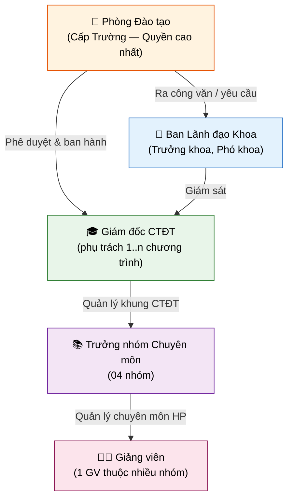
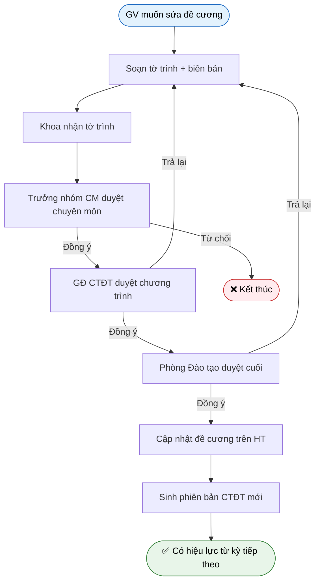
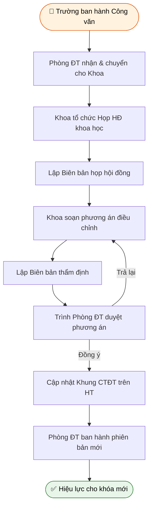
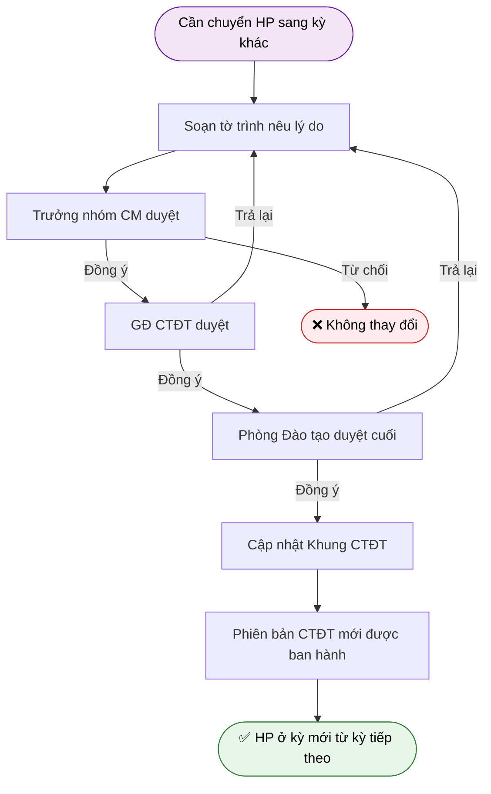
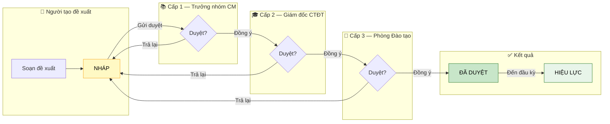

# 🔄 Minh Hoạ Quy Trình Nghiệp Vụ
## Workflows rút ra từ buổi khảo sát lần 2

> **Mục đích:** Trình giảng viên xem, xác nhận các quy trình này có đúng với thực tế không
> **Ngày lập:** 03/09/2026

---

## 📌 Bức tranh tổng quan — Ai quản lý cái gì?

**Phạm vi quản lý theo tầng:**

| Tầng | Vai trò | Quản lý |
|---|---|---|
| Cấp Trường | Phòng Đào tạo | Toàn bộ khung CTĐT của tất cả khoa |
| Cấp Khoa | Ban LĐ Khoa + Giám đốc CTĐT | Khung CTĐT của Khoa CNTT |
| Cấp Giảng viên | Giảng viên | Học phần do mình soạn đề cương |

---

## 🔄 WORKFLOW 1 — Điều chỉnh Đề cương Học phần (Thường niên)

> Khoa có quyền cập nhật đề cương sau mỗi năm học, không cần chờ rà soát 5 năm

**❓ Điểm cần xác nhận về Workflow 1:**
- [ ] Giảng viên có phải làm **tờ trình vật lý (giấy)** không, hay hệ thống số hoá hoàn toàn bước này?
- [ ] Bước "Trưởng nhóm CM duyệt" có bắt buộc không, hay thay đổi nhỏ được bỏ qua bước đó?
- [ ] Phiên bản mới sinh ngay khi **Phòng ĐT duyệt**, hay phải chờ đến **đầu kỳ học mới**?

---

## 🔄 WORKFLOW 2 — Rà soát & Điều chỉnh CTĐT 5 năm (Theo yêu cầu Trường)

> Trường ra công văn/quyết định, Khoa phải thực hiện điều chỉnh toàn bộ CTĐT

**❓ Điểm cần xác nhận về Workflow 2:**
- [ ] Hội đồng khoa học và hội đồng thẩm định gồm những **thành phần cụ thể** nào?
- [ ] Biên bản họp hội đồng và biên bản thẩm định có cần **đính kèm vào hệ thống** không?
- [ ] Có cần **số hoá bước họp hội đồng** trong hệ thống, hay chỉ lưu kết quả cuối?
- [ ] Ai trong hệ thống sẽ đóng vai trò **tạo đề xuất thay đổi** khi có công văn Trường?

---

## 🔄 WORKFLOW 3 — Chuyển Học phần sang kỳ khác

> Ví dụ: Chuyển "Mạng máy tính" từ kỳ 5 → kỳ 6

**❓ Điểm cần xác nhận về Workflow 3:**
- [ ] Chuyển kỳ có **ảnh hưởng đến sinh viên đang học** phiên bản cũ không?
- [ ] Phải chờ đến **đầu khóa mới** hay áp dụng ngay từ kỳ học kế tiếp?
- [ ] Việc chuyển kỳ có cần **kiểm tra lại ràng buộc tiên quyết** với các HP khác không?

---

## 📊 Luồng Phê duyệt chung cho MỌI loại thay đổi — Swimlane

> Đây là luồng **dùng chung** cho tất cả đề xuất: sửa đề cương, sửa khung CTĐT, sửa công thức điểm, sửa PLO/CLO...
> Rút ra từ REQUIREMENTS.md — nhờ giảng viên xác nhận có đúng không

> **Quy tắc đặc biệt:**
> - Cấp 1 **tự động bỏ qua** nếu người tạo = Trưởng nhóm CM
> - Cấp 2 **tự động bỏ qua** nếu người tạo = Giám đốc CTĐT
> - **Từ chối** ở bất kỳ cấp nào → đề xuất bị đóng, không thực thi
> - **Thu hồi** — người tạo tự rút lại khi chưa có cấp nào duyệt

**❓ Câu hỏi tổng hợp về luồng phê duyệt:**
- [ ] Luồng 3 cấp này có **đúng với thực tế** của Trường/Khoa không?
- [ ] Có trường hợp **bỏ qua cấp** (thay đổi nhỏ chỉ cần 2 cấp) không?
- [ ] Khi bị Trả lại từ bất kỳ cấp nào, có phải đi lại **từ cấp 1** không, hay gửi lại cấp vừa trả?

---

## 🏗️ Tổng hợp — So sánh các loại thay đổi

| Loại thay đổi | Tần suất | Hồ sơ cần có | Cấp duyệt | Trạng thái |
|---|---|---|---|---|
| Sửa đề cương HP | Hàng năm | Tờ trình + biên bản (?) | CM → GĐ CTĐT → Phòng ĐT | ❓ Cần xác nhận |
| Chuyển HP sang kỳ khác | Khi cần | Tờ trình + biên bản (?) | CM → GĐ CTĐT → Phòng ĐT | ❓ Cần xác nhận |
| Sửa công thức điểm | Khi cần | Tờ trình (?) | CM → GĐ CTĐT → Phòng ĐT | ❓ Chưa đề cập |
| Sửa PLO / CLO | Khi cần | Tờ trình (?) | CM → GĐ CTĐT → Phòng ĐT | ❓ Chưa đề cập |
| Rà soát toàn bộ CTĐT | 5 năm/lần | BB họp HĐ + BB thẩm định + CV Trường | Phòng ĐT (cuối) | ❓ Cần xác nhận thêm |

---

## 🎯 Tóm tắt — Những điểm cần confirm gấp

| Mức ưu tiên | Vấn đề | Lý do quan trọng |
|---|---|---|
| 🔴 Cao | Tờ trình/biên bản: giấy tờ hay số hoá trong hệ thống? | Quyết định phạm vi thiết kế luồng phê duyệt |
| 🔴 Cao | Luồng từ Trường xuống — ai tạo đề xuất trong hệ thống? | Ảnh hưởng đến phân quyền tạo CR |
| 🔴 Cao | Biên bản họp HĐ có cần lưu vào hệ thống không? | Ảnh hưởng đến dữ liệu đính kèm CR |
| 🟡 Trung bình | CLO có khác nhau giữa các CTĐT không? | Ảnh hưởng đến mô hình dữ liệu |
| 🟡 Trung bình | Đề xuất bị trả lại có đi lại từ cấp 1 không? | Ảnh hưởng đến logic chuyển trạng thái |
| 🟢 Thấp | Ý nghĩa chính xác của HT ĐA và TQ ĐA | Ảnh hưởng đến bộ quy tắc |
| 🟢 Thấp | Chu kỳ 5 năm được quy định ở đâu? | Tham khảo thiết kế, không chặn tiến độ |
